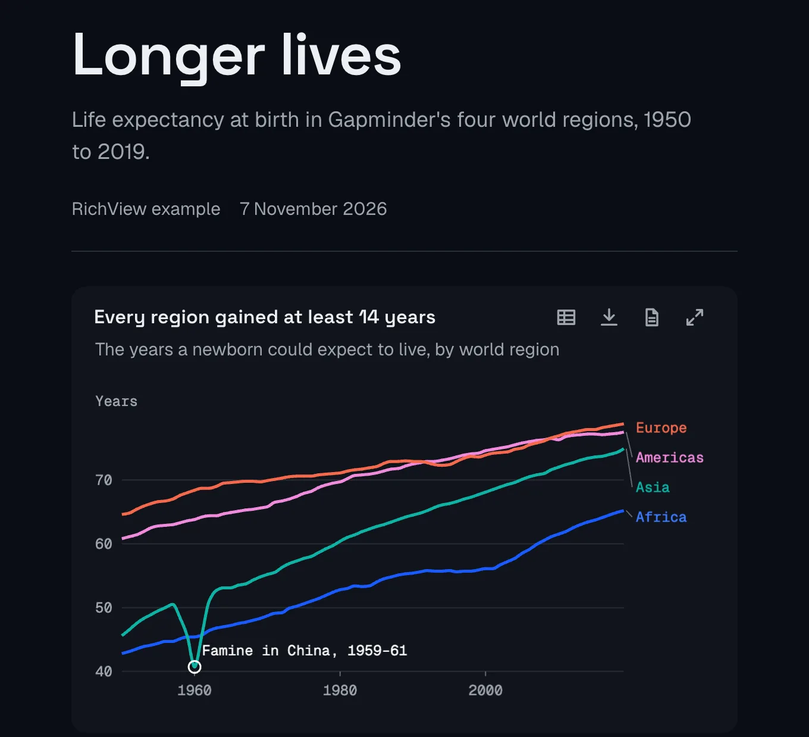
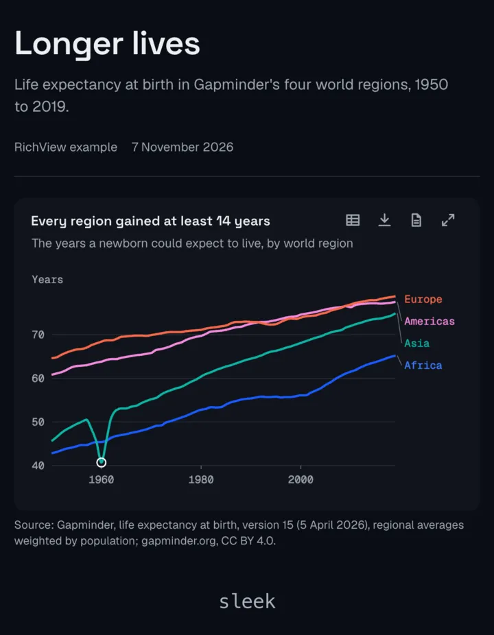
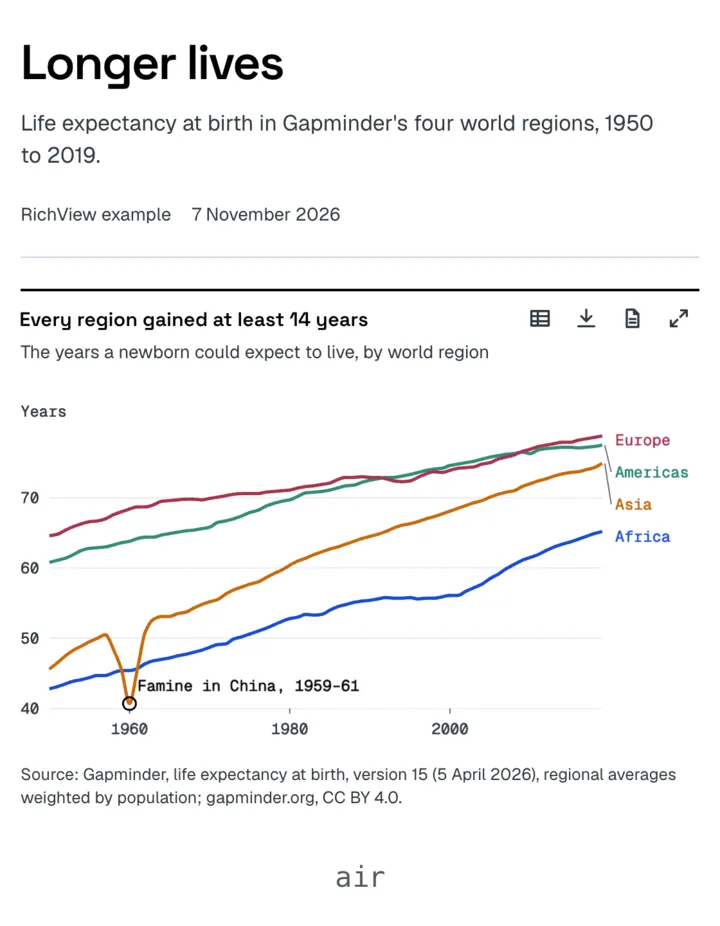
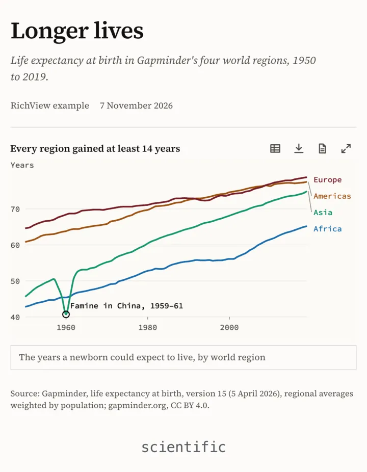
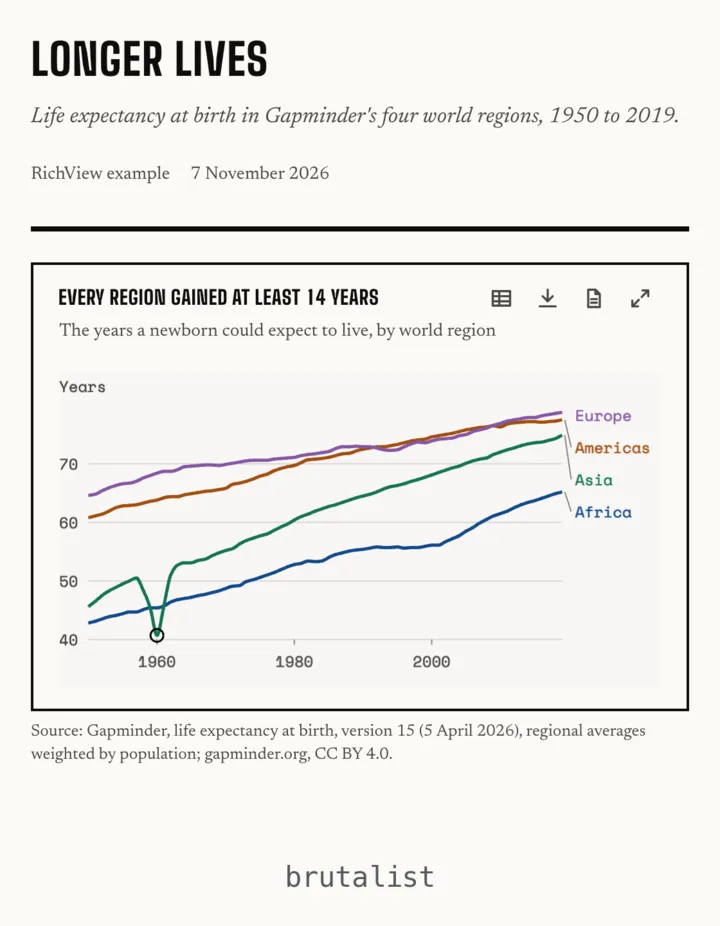
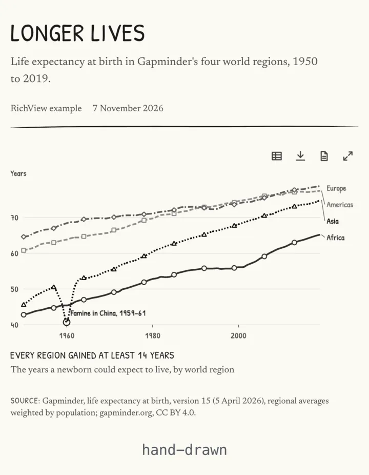

<h1 align="center">Let your agent present.</h1>

<p align="center">
  <strong>RichView is a presentation layer for your agent.</strong><br>
  Your coding agent writes Rich Markdown. RichView renders it into a designed, self-contained report.
</p>

<p align="center">
  
</p>

<p align="center"><sub>The top of a real report, rendered by <code>richview generate</code> from the <a href="#what-your-agent-writes">text below</a>.</sub></p>

## Try it

**Ask your agent.** Paste this into Claude Code, Codex, Cursor or another coding agent that can run commands:

```text
Install RichView from https://github.com/1vecera/richview/releases/latest and
run richview learn. Then make me a beautiful report from my data, or from the
starter example if I have none. Check it, fix anything it flags, and show me
the result. Keep everything on my machine.
```

**Or install it yourself.** One line, from the latest [GitHub release](https://github.com/1vecera/richview/releases/latest):

```sh
curl -fsSL https://github.com/1vecera/richview/releases/latest/download/install.sh | sh
export PATH="$HOME/.richview/bin:$PATH"
richview --help
```

The installer verifies the archive checksum and creates `~/.richview`. It doesn't change your shell configuration or start a service, so add the `PATH` line to your shell profile to keep it. The [install guide](https://richview.ai/docs/install) covers removal and building from source.

**Or install nothing.** Write and render a report in your browser in the [playground](https://richview.ai/playground).

### Platforms

| Platform | Status |
| --- | --- |
| macOS on Apple Silicon | Supported |
| Linux x64, glibc 2.35 or newer | Supported. Reports with SQL data sources also need kernel 6.2 or newer with Landlock ABI 3. |
| Windows x64 | Supported, with the same features. Tested on Windows Server 2025; Windows 10 and 11 should behave the same but are untested. The programs are not signed yet. |
| Intel Mac | Not yet. Use the playground. |

## What your agent writes

Rich Markdown (`.rmd`) is plain Markdown with blocks such as `chart`, `table`, `metric` and `callout`. This is the source of what the picture above shows. The whole report, [`assets/landing/anchor/report.rmd`](assets/landing/anchor/report.rmd), adds a title photo, a source note, two paragraphs and a table:

````text
---
title: Longer lives
description: Life expectancy at birth in Gapminder's four world regions, 1950 to 2019.
version: 1.0.0
author: RichView example
date: 2026-11-07
styles: [sleek, report.rstyle.yaml]
---

```chart
type: line
title: Every region gained at least 14 years
subtitle: The years a newborn could expect to live, by world region
data:
  csv: data/life-expectancy-by-region.csv
encoding: { x: year, y: life, color: region }
axes:
  x: { format: year }
  y: { label: Years, min: 40 }
style: { ratio: "2:1" }
annotations:
  - { kind: point, at: { x: 1960, y: 40.7 }, text: "Famine in China, 1959–61" }
```
````

The agent writes the story and the data. RichView owns the typography, the charts and the layout.

- **Editable.** The source is words, chart definitions and data in plain text. Change a sentence, a title or a value, then render again.
- **Versionable.** The report's source, style file and CSV come to about 7 KB. They diff and review like code. The rendered file is one HTML page of about 1.6 MB, because it carries its runtime and fonts.
- **Checked.** `richview check` validates the source and inspects each rendered chart, so the agent can fix what is broken or unreadable before you see it.
- **Consistent.** Every report comes from a designed style, and the same source renders the same way every time.

## Your first report

```sh
richview init first-report                      # a starter report folder
richview check first-report/report.rmd          # diagnostics and per-chart checks
richview generate first-report/report.rmd       # writes first-report/Rendered/report.html
richview serve first-report/report.rmd          # live preview at http://127.0.0.1:4711/
```

Open `first-report/Rendered/report.html` in a browser: hover the chart, open its table, download its data. Edit `report.rmd` and generate again, or keep `serve` running and the preview reloads on every save.

For your agent, `richview learn` prints the authoring guide, `richview mcp` serves the same tools over MCP, and `--format json` on `init`, `validate`, `check` and `generate` prints one object with `ok`, `status` and `diagnostics`. Everything runs on your machine. [Your first report](https://richview.ai/docs/first-report) walks through it step by step.

## Styles

Five styles ship with RichView. Choose one in the frontmatter (`styles: [scientific]`) or with `richview generate --style scientific`. The same report in each:

<p align="center">
  
  
  
  
  
</p>

A small `report.rstyle.yaml` beside the report adjusts colours, type and chart treatment on top of a style. See the [styles guide](https://richview.ai/docs/styles).

## Publish

A file is often enough. The generated HTML is self-contained, and `richview generate first-report/report.rmd --to pdf` prints a PDF with a local Chromium, Chrome or Edge.

For a link, publish to RichView Cowork, the report server: RichView hosts it at [app.richview.ai](https://app.richview.ai), or you run your own with `richview server`. Each published version keeps a permanent address, and the server stores the source with the result.

```sh
richview publish first-report/report.rmd --slug first-report --new
```

With no server chosen, the command asks where to publish:

- **Hosted by RichView.** Create an account with your email at [app.richview.ai](https://app.richview.ai) and create an author token on that page. Set `RICHVIEW_SERVER=https://app.richview.ai` and `RICHVIEW_TOKEN` to the token, then publish. Publishing uploads the report's source and linked files, and new reports are private to you until you share them. Each publish request is limited to 32 MiB, including the encoded source and files; an organization can store up to 50 MiB in total.
- **Your own server.** `richview server` runs the same Cowork server on your infrastructure.

The [publishing walkthrough](https://richview.ai/docs/publishing) tries the whole path on your own machine first, and [publishing and access](https://richview.ai/docs/access) covers permissions, pinning and deletion.

## Documentation

- [Install](https://richview.ai/docs/install) and [your first report](https://richview.ai/docs/first-report)
- [Authoring guide](https://richview.ai/docs/authoring), [styles](https://richview.ai/docs/styles) and the [chart gallery](https://richview.ai/docs/charts), with live examples and copyable source for every chart type
- [CLI](https://richview.ai/docs/cli), [MCP](https://richview.ai/docs/mcp) and [VS Code](https://richview.ai/docs/vscode)
- [Publishing](https://richview.ai/docs/publishing), [access](https://richview.ai/docs/access) and [HTML and PDF export](https://richview.ai/docs/export)
- [The `.rmd` format specification](docs/RMD-SPEC.md)
- [Examples](examples/) in this repository: [`first-report`](examples/first-report/report.rmd) is a small starter with a CSV, [`every-block`](examples/every-block/report.rmd) uses every block and chart type, and [`openai-vs-anthropic`](examples/openai-vs-anthropic/README.md) is a larger sourced research report.

The sources of the documentation pages are in [`docs/public/`](docs/public/).

## Contributing and problems

Found a bug, or a report that renders badly? [Open an issue](https://github.com/1vecera/richview/issues) with the smallest `.rmd` that shows it, your RichView version and your platform.

To change RichView itself, read [CONTRIBUTING.md](CONTRIBUTING.md) for the source build, the checks and the rules the code keeps. Pull requests go to `main`. [AGENTS.md](AGENTS.md) holds the same rules for coding agents.

## Licence

MIT, everywhere: every crate, the VS Code extension, the documentation, the examples and the tooling. See [LICENSE](LICENSE) and [LICENSING.md](LICENSING.md). Bundled fonts keep their own licences and notices, which are packaged with each build, and third-party example data keeps its own licence, recorded beside the data.
