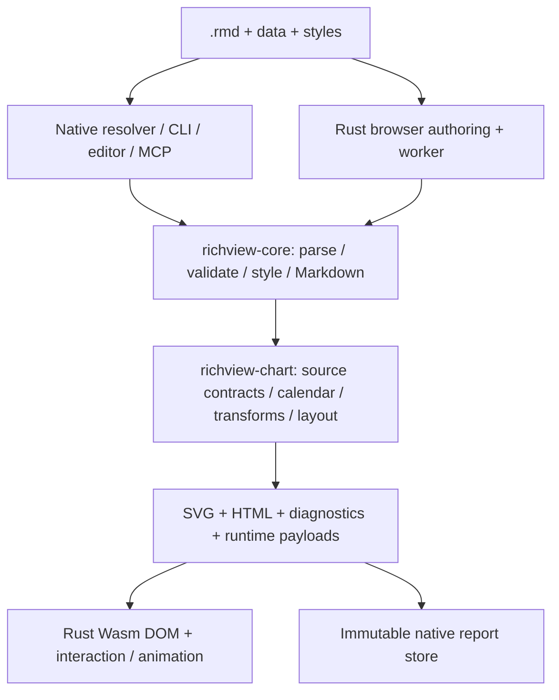

# Rust architecture and extension guidance

The pure report core accepts source and caller-resolved resources. Native and browser hosts own I/O and platform APIs; both call the same chart/render implementation. Source parsing, numerical transforms and interaction state are never delegated to a JavaScript renderer.

`richview-core::parse` produces an owned `Document` with original block source and one-based source lines. `render_document`/`check_document` consume that validated AST after native resource resolution, avoiding a second parse. Source-line accounting and rich-block insertion scan forward once; literal source comments cannot duplicate generated blocks or recursively insert a chart into a callout. An optional `block_placeholder_prefix` accompanies the AST only when a reserved marker occurs in source. The native report result omits the bulky AST; the JavaScript package interface includes it in its declared result shape.

`RenderOptions.data` carries CSV/JSON bytes and safe media data URIs. The core never reads files or fetches URLs. `MAX_REPORT_BYTES` bounds accumulated rich-block and final HTML at 64 MiB, including media, fonts and runtime; repeated media is checked before copying payloads and budget failures return `render.output-limit` with source provenance. The native resolver additionally caps aggregate retained style/data/media resources at 64 MiB (`MAX_RESOLVED_RESOURCE_BYTES`), including reference keys and media base64 expansion, alongside individual source/file limits. Repeated data/media references reuse one resolved value; each retained style entry counts toward the budget. Native references stay within the source directory, including symlink resolution; separately supplied style paths are explicit caller authority. Remote native loading is opt-in, bounded, credential-free public HTTPS with DNS pinning and no proxy/redirect. HTTP render/publication accepts resolved bytes, not arbitrary paths or runtime code. Report frontmatter cannot select JavaScript/WebAssembly initializer code.

Native generated reports embed cached gzip-compressed WebAssembly and generated bindings. Browser downloads resolve the embedded runtime on explicit export, preferring the built gzip artifact and falling back to raw Wasm when gzip is unavailable. Live browser previews use cached external runtime resources in an opaque-origin `allow-scripts` iframe; only the exact root runtime routes receive public CORS. Large source parsing/reference discovery/rendering runs in a Rust worker with a single in-flight request and the latest pending generation. Rust owns that scheduling; the emitted worker JavaScript only loads bindings and transports messages.

Font catalogs are compiled into native builds only. The WebAssembly runtime that every interactive report embeds leaves them out: a report already carries the faces it uses as embedded `@font-face` rules, so its runtime never needs a catalog. Hosts that render reports with the WebAssembly core load `richview-fonts.css`, which `richview-build` stages beside each runtime, and pass it to the core once with `provide_font_catalog`, as they pass resolved data: the Node package facade reads it when it is imported, the browser runtime initializer and the playground worker fetch it, and the browser authoring controller awaits it before its first render. A render without it falls back to system fonts and reports `style.fonts-unavailable`. The native CLI, server, editor and the prerendered showcase are unchanged.

Browser source and chart-CSV editors retain complete UTF-8 text in the Rust `SourceBuffer`. Sources over 128 KiB or 512 source lines use navigable windows bounded to 64 KiB and 512 newline breaks, including byte windows for long single lines. Rendering, worker requests, whole-source copy/cut/paste and downloads use complete text; editing a window preserves hidden bytes and untouched original newline bytes. Native textarea undo is local to the current window and resets on navigation, repagination and complete-source replacement; this is not a full-document undo history. VS Code continues to own its ordinary editor history. [Source buffer](../crates/richview-site/src/source_buffer.rs), [Rust DOM controller](../crates/richview-site/src/browser/authoring.rs), [browser contracts](../scripts/verify-browser.mjs).

The temporal engine stores exact observations separately from display geometry. Its calendar arithmetic, transformations, aggregation and M4 decimation are shared across targets. Browser interaction uses Rust state and retained SVG nodes. Dense path reduction never replaces exact hover/table values. Glyph measurement has two explicit tiers: native layout estimates and browser-rendered rectangles after fonts resolve.

Source-chart ratios provide nominal height; wrapped headings, subtitles and axes can increase the SVG viewport when needed to retain a readable plot. Explicit engine height overrides remain caller choices. Canonical and showcase grids use shrinkable tracks/children; wide direct Markdown tables scroll locally. Mobile contracts verify viewport containment and retained cells for those canonical and showcase cases. Standalone SVG downloads preserve the current geometry and styles but reference font families/fallback stacks rather than embedding font files; installed fonts affect their typography. Use complete HTML export when portable embedded-font fidelity is required.

The server publishes immutable slug/version bundles retaining source, style/data resources, metadata and generated HTML. Native publication preflight validates source/schema/resources and uses `create_publish_request` for slug selection; the selected server renders the submitted source once. Authentication gates writes. Duplicate publication preserves the original artifact and latest pointer. Regeneration uses retained resources and never changes the immutable stored version. Partial-read routes avoid loading embedded report runtimes when listing metadata or retrieving raw source.

The showcase's Rust controller owns report treatment selection, comparison panes, source citations, presentation links, chart expansion. Its paired panes retain the same report source and data. The reel applies deterministic scene geometry to the flagship's committed monthly CSV; native frame output and browser playback call the same `Reel::frame` operation. The native audio generator mixes the scene cue list on the same 120 BPM clock. `scripts/record-reel.py` captures an isolated headless browser and invokes the native soundtrack exporter and ffmpeg for local video files. These capture tools are separate from the Rust product engines.

## Add a chart type

Extend the source contract validation in `crates/richview-core/src/parser.rs`, then add the rendering branch in `richview-chart/src/rmd_render.rs`. Keep scales, values, label decisions and geometry findings in that crate. Return the shared runtime payload when the chart needs interaction; use `crates/richview-runtime` for DOM bindings while keeping numerical and interaction policy in Rust. Add a meaningful source-to-SVG contract and an exact-value/browser interaction case. Register its authoring snippet in the Rust editor catalog.

## Add a rich block

Register the fence/schema in the core parser and its HTML dispatch in `blocks.rs`. Use the shared Markdown renderer, escaping and URL policy; retain the original source and diagnostics when invalid. If it needs browser interaction, delegate the DOM event to the same core operation, as table sorting does. Add an end-to-end source example and update `richview learn`.

## Add a style

Add declarative `.rstyle.yaml`, register the builtin, and extend the showcase manifest if it is a showcase style. Canonical font faces are generated: add a family's faces to [the font build](../scripts/fonts/README.md), which rebuilds the core `fonts-*.css` catalogs and `font-manifest.json` from pinned upstream releases, list a new catalog in `BUNDLED_FONT_CATALOGS` and its notice in `bundled_font_notices`, and [the font contracts](../crates/richview-core/tests/fonts.rs) check the catalogs against the manifest. Drawn marks (pencil rules, the callout bracket, the stat underline) are component variants: `components_css` renders seeded strokes from `richview_chart::pencil` as CSS images, so a style selects them without new CSS. Use semantic tokens and existing chart treatment fields; avoid injecting arbitrary CSS. Validate the actual source/font combination and mobile layout. The complete showcase faces retain the original assets; licenses are under `assets/showcase/fonts/licenses/`. Core keeps exact canonical notices under its assets and emits them as inert, script-safe JSON in every report; the cached notice block counts toward the HTML budget and travels with self-contained offline exports.

## Host interfaces

No npm package ships: the Wasm browser API stays internal to the runtimes (ARC-36). Native Rust APIs and the JSON CLI/HTTP/MCP vocabulary are the primary interfaces. The approximately 8 KiB VS Code activation module handles host APIs, IPC, credentials and bounded request transport. Explicit Publish prompts for a masked token and stores it per server in SecretStorage. The plaintext `richview.apiToken` setting is not read. Test scripts use Node/Playwright to verify these boundaries.
