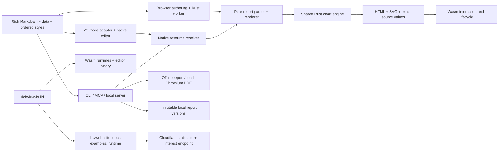

# Current system and evidence boundaries

Snapshot: 18 October 2026, `origin/main` at `b4db233`. Use [CLAUDE.md](../CLAUDE.md), the [source contract](RMD-SPEC.md), and the [Rust extension guide](RUST-ARCHITECTURE.md) for implementation. This map connects the hosts, retained data, build outputs, and verification boundaries. A historical design or an open PR does not change the current contract.

The static website and the native report server are separate hosts. Visiting `richview.ai` does not create a report store. A documentation gallery, a gallery rendered as a report, and the flagship report also have different reader journeys; one passing route test cannot certify all three.

## Source to reader

| Boundary | Implementation and invariant | Useful evidence |
| --- | --- | --- |
| Authoring | [parser](../crates/richview-core/src/parser.rs), [spec](RMD-SPEC.md). CommonMark, YAML frontmatter and typed rich fences; unknown metadata/fences and recoverable invalid blocks remain visible. Drafts may omit publication metadata; publication requires title/version. | Core contracts, `richview validate`, source lines in diagnostics. |
| Data and resources | [resolver](../crates/richview-app/src/resolver.rs). Native hosts resolve local CSV/JSON/style/media with report-root/symlink boundaries and explicit network policy; core has no filesystem/network/process I/O. Source/resource limits are enforced before rendering. | Native verifier, retained exported source/CSV, explicit rejected-path tests. |
| Report and style | [render](../crates/richview-core/src/render.rs), [styles](../crates/richview-core/src/style.rs). Ordered declarative styles supply semantic tokens, fonts and component treatment. Preserve source attribution and licensed font declarations. | Core contracts, compatibility and package type checks, browser glyph/containment evidence. |
| Charts | [chart crate](../richview-chart/src/lib.rs), [RMD bridge](../richview-chart/src/rmd_render.rs). Nine source-level types: line, bar, scatter, area, pie, heatmap, histogram, boxplot, interval. Exact observations remain distinct from reduced display geometry and binary64 coordinates. | Chart Rust tests; browser keyboard readouts, export/table checks, actual glyph rectangles. Native font estimates alone do not establish browser readability. |
| Browser | [browser host](../crates/richview-site/src/browser.rs), [source buffer](../crates/richview-site/src/source_buffer.rs). Rust owns DOM behavior, worker scheduling, source editing and lifecycle. Large source windows retain hidden bytes. A worker has one in-flight job and the latest pending edit. | `verify-browser.mjs`, `verify-browser-api.mjs`, `verify-motion-runtime.mjs`; `window.__richview.settled()` plus pending/error checks. |
| CLI / MCP | [CLI](../crates/richview-app/src/cli.rs), [MCP](../crates/richview-app/src/mcp.rs). Native commands share the resolver/render contracts. JSON receipts expose errors and output identity. Generated interactive HTML embeds the runtime; PDF uses a local Chromium-family browser. | `verify-native.mjs`; tutorial source → validate → generate → offline keyboard journey. |
| Packages | [build generator](../crates/richview-build/src/main.rs) stages the Wasm runtimes and the VS Code payload. No npm package ships; the browser API stays internal to the runtimes (ARC-36). | The VS Code extension check. |
| Editor | [native editor](../crates/richview-editor/src/lib.rs), [VS Code package](../packages/vscode/package.json). Native authoring/preview logic plus a small VS Code activation/IPC/SecretStorage adapter. | `verify-editor.cjs`; a packaged VSIX or marketplace listing is a separate release claim. |
| Report server / storage | [server](../crates/richview-app/src/server.rs), [storage](../crates/richview-app/src/storage.rs). Local preview/API and immutable report versions retain source/resources. Publication uses a lock and atomic rename; an existing version is not silently overwritten. | Native verifier with an isolated temporary store; generated/exported content checks. No production publishing is needed to test this path. |
| Site / docs / flagship | [landing](../assets/landing/), [docs](../assets/docs/), [flagship](../examples/openai-vs-anthropic/), [reel](../crates/richview-site/src/reel.rs). Build staging combines source-authored reports, static shells and the Rust runtime. | Landing, docs, showcase, reel and scoped visual checks. Assert content, interaction, motion preference and widths independently. |
| Public deployment | [Worker](../cloudflare/interest-worker.mjs), [Wrangler](../wrangler.toml). Static assets come from `dist/web`; the interest endpoint has D1/rate-limit bindings. It is not the native immutable-report API. | Local Worker tests plus the deployment owner's version ID, rollback target and live read-only checks. Never submit real signup data as a generic smoke test. |

## Build and verification

The pinned toolchain builds native executables and `wasm32-unknown-unknown`, then matching `wasm-bindgen` produces bindings. `richview-build` stages `dist/web`, the core/charts package distributions and VS Code's native binary. Node/Playwright are development tools. [CI](../.github/workflows/ci.yml) is a manual-only advisory workflow that prepares the pinned tools and calls `rv-gate pre-pr`. It has no automatic triggers or deployment job; local release receipts provide the delivery evidence.

The [12 October prerelease](https://github.com/richview-universe/richview-v3/releases/tag/chart-refinements-2026-10-12) reports six assets at `5d47fbd8`: a chart-story ZIP, two npm tarballs from the since-deleted core and charts packages, a Linux CLI bundle, a VSIX and checksums. This audit indexed their names, sizes and reported digests; it did not execute those payloads. Public npm lookups for `@richview/core` and `@richview/charts` returned E404 on 18 October (not found or inaccessible). Local package/extension manifests therefore establish build contracts, not current registry/Marketplace availability.

Use the [development harness](development-harness.md) to keep the build and its consumers inside one existing shared build slot. Record the source content digest, Cargo manifest/executable paths, pre-execution dep-info ownership, builder output directory, tool versions, artifact hashes and named checks. The source digest includes uncommitted source; a commit name alone cannot identify a worktree build. Hashes detect changed bytes but cannot prove correctness or eliminate every compiler-cache defect. Retain actual behavior evidence as well.

| Path | Audit assessment |
| --- | --- |
| Public landing, docs, chart-gallery and flagship route delivery | Working HTTP delivery at both inspected widths; this does not certify every interaction or motion sequence. |
| Live chart gallery at 390 px | Observed report-frame/footer overlap despite no document overflow; repair and deployed acceptance belong to the website track. |
| Shared native build selection | Naive `cargo run` reproduced a foreign worktree builder; the harness adds pre-execution ownership gates and workspace-only invalidation. Each run still needs a passing receipt. |
| Current native/Wasm/report/editor contracts | Explicit integration targets in the runbook; use the retained receipt for the exact tested head, named gates and failures. Old PR totals are not current acceptance. |
| Published binary/VSIX payloads and registry installs | Metadata inventoried; payload execution and Marketplace installation remain unverified here. |
| Legacy service, v2 and July TypeScript build instructions | Obsolete for current development. Their old deployment health is unverified, not inferred from accessible source. |

## What history changes about today's work

| Period / source | Architectural consequence today |
| --- | --- |
| Original service generation, preserved in the `mvp`, `mlservice`, `RichViewPublicRestAPI`, `RichViewSDK` and `user_management` repositories | Next.js/EditorJS/Highcharts plus Python services and remote storage are historical. Their credentials, customer data and deployment settings are not inputs to this Rust build. |
| v2, through May 2026 | Nine TypeScript packages, separate web/server deployments and JSON reports. Commit `a9e9b61` fixed a stale frontend/proxy build; a healthy backend endpoint did not prove the browser route worked. This motivates checking the real reader path, not reviving v2. |
| v3 scaffold `3c808bd`, chart extraction `4cab1f5`, pure SVG change `722c6c3`, July integration `5ceb7d4` | Rich Markdown, pure rendering and retained source survived later migrations. TypeScript package paths, D3/ECharts, pnpm build instructions and the old hosting topology are obsolete for current development. The separate public `richview-charts` repository still describes an ECharts package; it is not this checkout's Rust implementation. |
| Rust integration [PR #10](https://github.com/richview-universe/richview-v3/pull/10), merged 4 October | Native and browser hosts now share Rust behavior. Keep host I/O at the boundary and keep generated JS thin. |
| Quality sprint [PR #60](https://github.com/richview-universe/richview-v3/pull/60), merged 16 October | Broader exact-value, source, layout and interaction checks; histogram/boxplot/interval support. Its reported performance and Linux GUI limitations remain limitations, not blanket green evidence. |
| Current base [PR #61](https://github.com/richview-universe/richview-v3/pull/61) | This task's source baseline. An old primary checkout can be months behind the remote even when its directory name is correct. |

## Integration state, 18 October

| Track / head at audit | State and boundary |
| --- | --- |
| Galleries [PR #65](https://github.com/richview-universe/richview-v3/pull/65), `850032b` | Published site evidence exists; source remains an unmerged draft. The report-based chart gallery's acceptance does not establish a documentation catalog. |
| Playback/selectors [PR #62](https://github.com/richview-universe/richview-v3/pull/62), `a703897` | Draft implements playback/filter/metric/variant controls and dropdown synchronization. Consume the actual head and its tests; the feature is not automatically in `main`. |
| Tabs [PR #63](https://github.com/richview-universe/richview-v3/pull/63), `f1cb254` | Draft retains panels and uses `rv:panel-shown` / `rv:panel-hidden` on `.rv-chart`. Integration with playback needs both contracts exercised. |
| Connectors [PR #66](https://github.com/richview-universe/richview-v3/pull/66), `4ecef05` | Draft adds SQL/cache/MetricFlow resolution. Its handoff reports eight of nine browser/native verifiers passing and a failing broad browser gate. To Review does not establish that the remaining gate passed. |
| Voice dashboard [PR #64](https://github.com/richview-universe/richview-v3/pull/64), `81110e0` | Separate sibling app using the chart engine. Offline capture, local semantic queries and remote OAuth have different evidence and limits. It is not the default report/server path. |
| Current website/chart batch | Website owner owns landing/docs/gallery staging and publication; chart owner owns chart/report polish. Harness changes are tooling/docs. Agree exact shared files before integration and rerun affected checks on the combined source. |

Private sessions, transcripts and audit extracts are intentionally outside this repository. The private audit manifest distinguishes indexed files, skimmed extracts and original turns/artifacts reviewed deeply; selected Lenovo excerpts are partial, and unavailable original ranges remain explicit gaps. Repository history above is architectural context, not renewed feature or publication authority.
