# RichView rewrite: state at the pause, 28 October 2026

RichView is a presentation layer for coding agents: an agent writes Rich Markdown (`.rmd`) and RichView renders it into a designed, self-contained report. Daniel paused all agent work on 28 October 2026 at about 14:00 CET so the work account stays free for the week. This page is the handover: what exists, what a release could contain today, a visual walkthrough, the state of every stream, and how to resume.

**In one paragraph.** The Rust rewrite is on `dev`: 609 commits since the evening of 27 October, built and run end to end. The CLI initialises, checks and renders reports to HTML and PDF in five styles. A report server, MCP tools, a VS Code extension, the site and the Publish port exist too. Nothing has reached `pre-prod` or `prod`. `pre-prod` still sits at 532dae70 from 27 October, 611 commits behind `dev`, because no release run has been green. The final release run on the paused head passes 33 of 41 steps, and the failures are summarised below. What stands between `dev` and a release: precision bugs in charts after a filter, playback or zoom (TYP-36, review 1l); chart craft, where 0 of 42 chart types yet withstand the side-by-side comparison Daniel set as the bar (INT-12); and evidence, where 315 of 622 lockdown items have a gate check (51 %).

## A minimal release now

**The final release run** (receipt `release-20261028T125509Z-45916d320c`, `dev` at 45916d32, the paused head): 33 of 41 steps pass, 7 fail, and 1 stays unrun by design, because the captures need a first `pre-prod` baseline. Passing steps include:

- Rust tests and Clippy, native and Wasm;
- the hostile corpus, no-JS, a11y and the site;
- Chromium and the other engines, contract, exports with vector PDF charts, motion and journeys;
- packaging and Publish's tests.

| Failing step | What fails | Owner |
| --- | --- | --- |
| perf | Only PRF-05's regression margins against the 27 October baseline: runtime Wasm 736 to 893 KB, site Wasm 1,514 to 1,574 KB, report HTML about +210 KB each, CLI instructions +7 %, footprint +11 %. Every absolute budget passes: site payload 1,933,555 B of 1,966,080; report runtime 904,278 B of the new 2 MiB; CLI p95 18–54 ms of 150–400; WebKit frame p95 8 ms of 8. | Daniel: accept today's sizes as the first PRF-05 baseline (PRF-08) |
| label-truth | The playback chart's size key reads "56.5 million" where the data says 56 or 57 million, and "718 million" against 700 million under the Asia filter. | Renderer, chart engine |
| cross-style | Data labels differ between 390 and 1440 px on six charts (labels dropped at 390 without being recorded). Embedded chart data keeps 6–7 digits where the author's precision allows 4 (TYP-36). | Chart engine, core |
| geometry | Hand-drawn draws no ink for labels on filled marks. | Chart engine |
| golden | The typography fixture's "Scientific" and "Brutalist" labels collide, in every style. | Chart engine |
| visual-matrix | The chart-review "after" phase fails; at 1zk it was the flagship's line-end names at 320 px. | Chart engine |
| coverage | Five items named by today's commits have no check yet: FEA-SF-56, INT-45, DEL-81, PRF-31, PRF-32. Bookkeeping, not product. | Release agent |

So the release is blocked by one decision of Daniel's (the PRF-05 baseline) and by five product failures, all in chart labels and precision.

**What can ship today without anyone working.** The local preview package on the build host holds:

- the `richview` CLI and the `richview-editor` language server, built from `dev` at the paused head;
- the site build (`dist/web`);
- the starter report rendered in all five styles, as HTML and PDF;
- `TRY.md` with the commands.

It runs on this Mac; nothing in it is published. It is what the agents built, with the failures listed above.

**Three ways forward, from cheapest:**

- **Keep it private.** Use the preview package to judge the product yourself. Cost: nothing.
- **A public preview with the failures waived.** This merges `dev` into `pre-prod`, cuts a candidate and promotes it. It needs your go to waive each failing release step by name, and a go for the candidate, the deploy and any publication (DEL-04, DEL-71). Not recommended: the label-truth and cross-style failures show readers numbers that differ from the author's data or precision (FEA-CH-37), the product's core promise.
- **Close the blockers first, then release a first wave.** This is the recommended route.
  - Daniel accepts today's sizes as the PRF-05 baseline.
  - The agents fix the five label and precision failures above. The chart engine's unmerged branch beeee0d3 already holds part of it.
  - Then the ARC-64 fixes for ten first-wave chart types: bar, line, area, scatter, histogram, pie, box plot, heatmap, waterfall and combo.
  - Then a green release run, a candidate and Daniel's go. The gallery would show the first wave only, under FEA-CH-75.

  Estimate: one to two days of the eight agents. For scale, the agents took the work account from 26 % to 35 % of its weekly limit between 11:35 and 14:00 today.

## Walkthrough

### Authoring and the CLI

An agent, or a person, writes plain Markdown with tagged blocks for numbers. This is the starter that `richview init` creates:

````markdown
---
title: Direct visits lead our traffic
description: A first report of one metric, one chart and one callout, ready to edit.
version: 0.0.1
slug: hello-world
styles: [sleek]
---

# Direct visits lead our traffic

This is Rich Markdown: plain Markdown for the story, and tagged blocks for the numbers.

```metric
value: 910
label: Visits this week
delta: 0.12
trend: up
```

```chart
type: bar
title: Direct visits lead, search follows
data: { csv: data/visits.csv }
encoding: { x: source, y: visits }
axes:
  y: { label: Visits }
```
````

```text
$ richview init demo
Created demo/report.rmd
$ richview check demo/report.rmd
Checked 1 charts: clean
$ richview generate demo/report.rmd
Generated demo/Rendered/report.html (3 rich blocks)
$ richview generate demo/report.rmd -o report.pdf
Generated demo/Rendered/report.pdf (2 A4 pages, 24287 bytes, printed by Chrome/156.0.8078.49)
```

The other commands are `validate`, `learn` (the authoring guide), `mcp` (the same tools for an agent over stdio), `serve` (a live preview), `publish` and `report` (a RichView server), `server` (RichView Cowork, the self-hosted server), `asset` and `image` (Unsplash photos with credits).

### One source, five styles

The same file in Sleek (the default, dark), Air, Scientific, Brutalist and Hand-drawn. A style is chosen once; the author never writes CSS (INT-28).


On a phone (390 px, Sleek), and the PDF export, where charts stay vector:

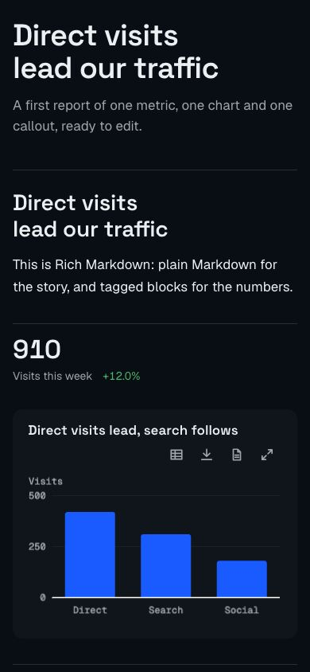 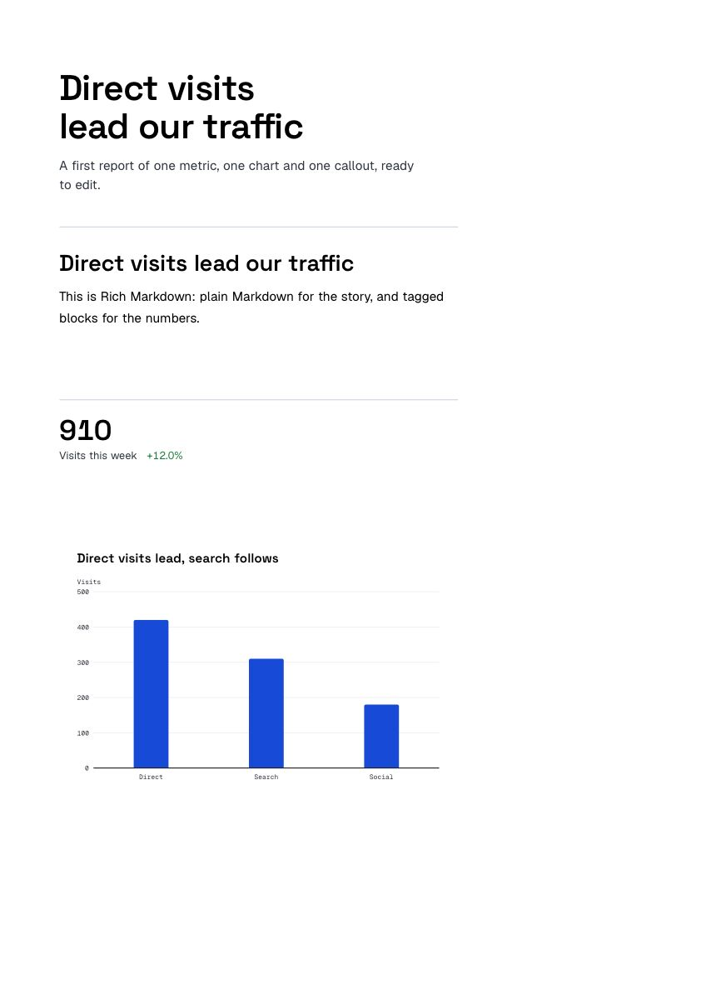

### A full report

`examples/every-block` holds every block the format has. Release captures in Sleek at 1440 px (top of the page) and at 390 px:

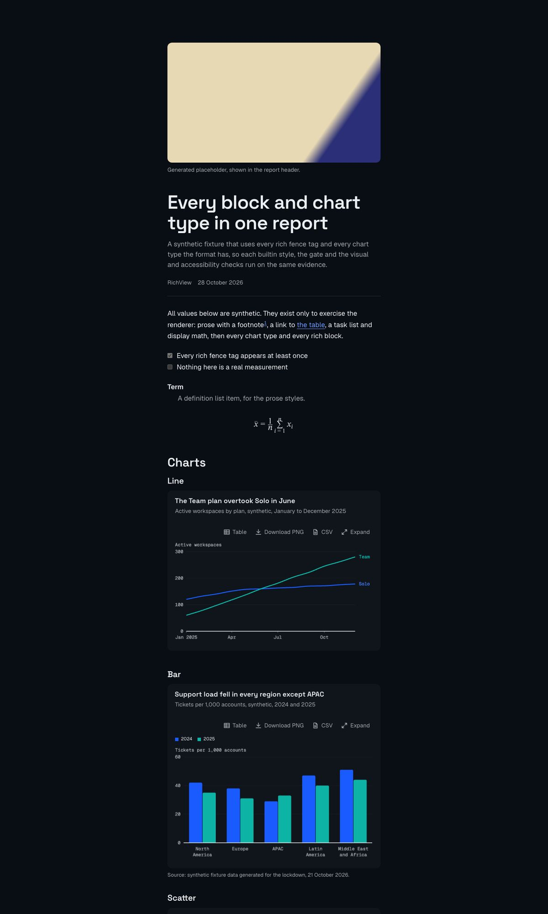

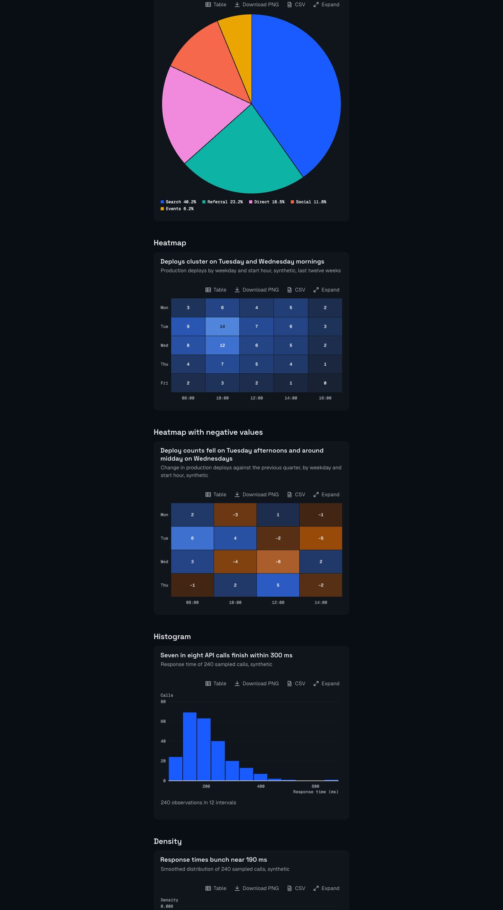

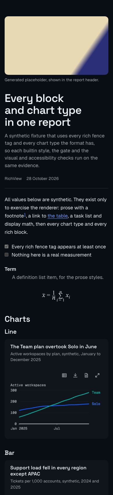 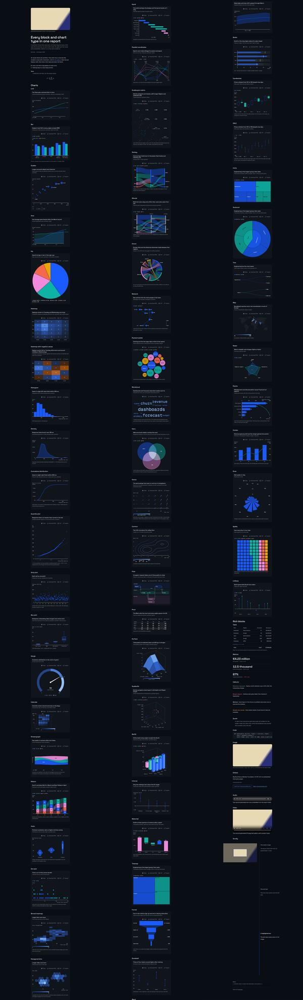

The right-hand image is the whole page shrunk, cut into three columns. It is 42,699 px tall at 1440 px.

### Charts against Highcharts and ECharts

The ARC-64 lab draws the same data, title and size in RichView, Highcharts and ECharts, and an Opus reviewer judges each type. Bar is one of the 22 types that come close: the reviewer asked for a clearer second series and finer ticks.

Calendar is one of the 20 that fall short: the colour domain is padded, cells don't use the width, and weekdays are unlabelled.

The reference renders are not redistributed here. Every finding is in the rewrite's review notes (`reviews/arc64-8008603c43-fixes.md`, outside the repository), grouped by owner: chart engine 66, styles 33, renderer 20.

### The site

The landing page with a live demo, the docs (one page per chart type), the gallery and the playground, from the release captures:

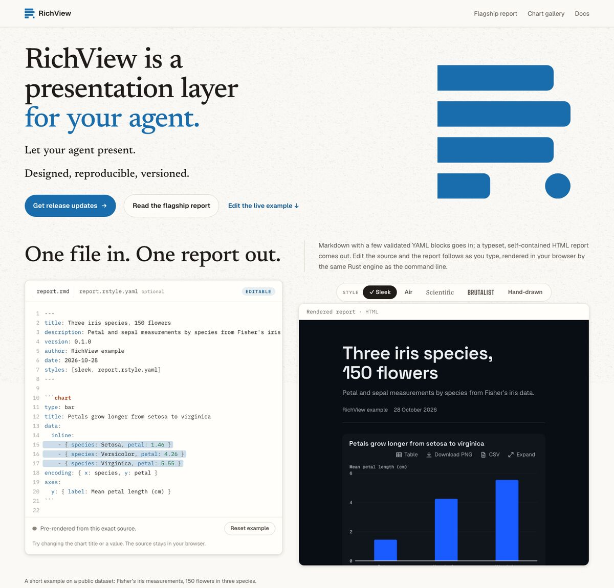

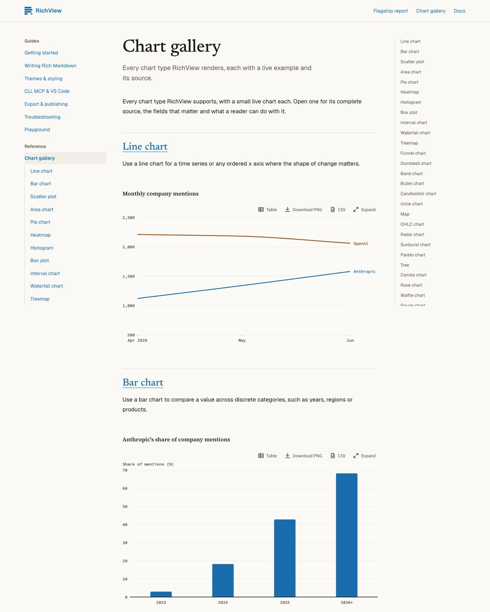

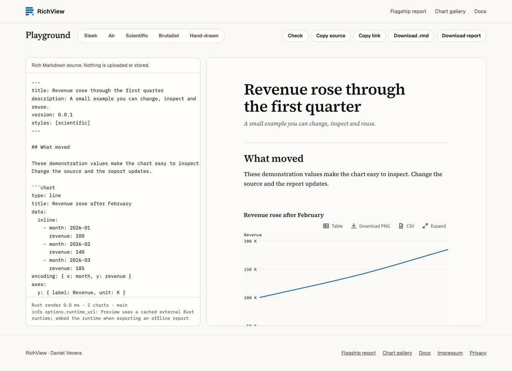

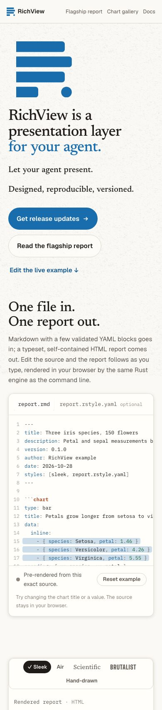 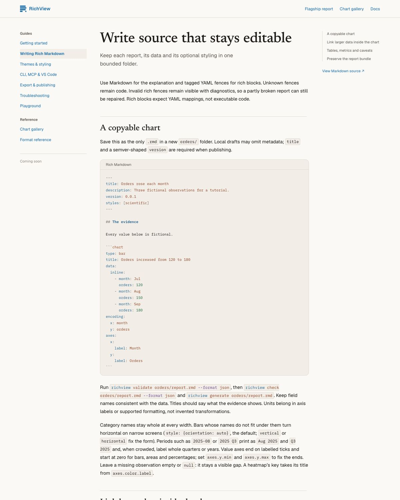

The landing is static by default (STY-44) until Daniel accepts the scroll story. At 1440 px there is a large empty band below the demo, which the next site round should check.

### Not captured here

The VS Code extension (language client, diagnostics, preview, Insert Block, Publish), the MCP tools, RichView Cowork (sign-in, roles, report store) and the Publish desk have tests, but no screenshots in this handover. Nothing is deployed: the Publish Worker, R2, D1, Access and DNS changes all wait for Daniel's go. The 15-second reel is in `assets/reel/` (FEA-SF-45) and is not served.

## Where each part stands

Every stream wrote a handover file in the rewrite's working folder (`streams/`, outside the repository) with its first line `State: PAUSED`. Nothing runs. Work that has not reached `dev` is pushed to origin as a task branch.

| Stream | On `dev` | Not on `dev` (origin branch) | Open, first |
| --- | --- | --- | --- |
| Core format | Schema registry, frontmatter, diagnostics with fixes, TYP-36 payload and grids, `payload.derived` per state, idna pin | none | Integer rule in `Quant::on_grid`; derived records at author precision with the chart engine |
| Renderer | Per-state derivation from shown rows, mark-id readouts, code-block regions, print boxes | none | Adopt core's per-state records; zoom floor; rect.obs after a legend toggle |
| Chart engine | Derive interfaces, mark ids, per-scale grids, mark-keyed texts, FEA-CH-75 limits for 16 types, bit-exact trig | `feat/s27-chart-types` beeee0d3: box plot summaries and bin edges at author precision (review 1l blocker 2), tests pass, no fast record | Land beeee0d3; golden typography label collision; 320 px line ends; ARC-64 first wave |
| Styles | Five builtins, part 06 coverage (48 cards), style rule tests | `feat/builtins` 995ad45f: Sleek series 2 to amber and visible gridlines (ARC-64), palettes test fails | Fix the palette distinctness; ARC-64 Sleek fixes |
| App surfaces | CLI, resolver, report server with access control, MCP, VS Code adapter, `learn`, snippets | `feat/operation-layer` 062ed5a9: an FEA-SF-27 test, no fast record | Audit list from FEA-SF-26 on |
| Site | Static landing with the neutral iris demo, docs, gallery, playground | `feat/site-landing` c138589c: playground `?style=`, docs fence depth, landing surfaces, no fast record | Fast and push c138589c; FEA-SF-41/43/44/46 |
| Publish port | Publish in Rust, perf step, link-preview thumbnails, export pagination, removals, coverage for 04d/07/03 | `feat/coverage` b2dafdae: FEA-BR-23/49 tests, two fail on fixtures | Fix the two fixtures; ARC-01 and ARC-50 tests |
| Release agent | Gate: one fast run per stack, type evidence, label-truth by mark, geometry per style and width, interaction, motion, perf per type, ARC-64 lab | `fix/lab-air` cb68e28a: Air captures and fixed references in the lab | Its STATUS.md lists each failure with its owner |

`origin/wip-limits` is an obsolete copy of the limits work (the chart engine's word). `feat/s27-publish-og` is already on `dev` in other commits. Both can be deleted.

## Lockdown and evidence

- **Answers.** Daniel answered 78 of 772 cards, 70 of the 134 key ones. Today's answers were INT-07 (link previews) and PRF-31 (report runtime up to 2 MiB gzip). Unanswered cards are built as their proposal; the maintainers' record of assumptions lists the 249 places that rely on one, and the lead's rulings are under "Lockdown lead, rulings".
- **Gate coverage** (items with a check, product parts):

  | Part | Checked |
  | --- | --- |
  | 02 delivery | 48 / 81 |
  | 03 architecture | 59 / 69 |
  | 04a chart features | 46 / 77 |
  | 04b report features | 7 / 62 |
  | 04c surfaces | 11 / 65 |
  | 04d branches and Publish | 33 / 50 |
  | 05 types | 51 / 99 |
  | 06 styles | 48 / 70 |
  | 07 performance | 12 / 49 |

  Part 04b (report features) and 04c (surfaces) are the largest gaps.
- **Reviews.**
  - Review 1l (Opus, 965e7308..69f45e65) found 4 blockers:
    - histograms binned twice outside the initial state, fixed on `dev` by 0b2623d7, with the second half open;
    - derived statistics at six digits, on beeee0d3;
    - a zoomable x axis at ten digits, removed by core;
    - graph caps.
  - Styles round 6 asks for fixes in all five styles, mostly in the chart engine's labels and legends.
  - ARC-64: 0 withstand, 22 close, 20 fall short, and 15 types have no reference.
- **Decisions waiting for Daniel:** `WAITING.md` in the rewrite's working folder, 13 items. The ones that change the build:
  - the report origin (ARC-15);
  - the precision reading (TYP-36);
  - print faces (STY-21);
  - PDF floats (FEA-RP-43);
  - whether a chart type may go public before its ARC-64 comparison (FEA-CH-75).

## How to resume

The agents resumed on 29 October under DEL-81's model rule as amended that day. The resume details (agent sessions, host jobs and their paths on the build host) are kept outside the repository, in the rewrite's working folder.

- **Order on resume:**
  - the chart engine lands beeee0d3 with `rv-gate fast --dependent-tests`;
  - the renderer adopts core's per-state records;
  - the site and app surfaces push their branches after a fast run;
  - styles fixes its palette;
  - then a release run, review 1m, and the ARC-64 first wave.
- **Build host.**
  - Every stream shares one Cargo target through `env.sh` and its shim.
  - Free disk sat at 38–45 GiB all day against the 40 GiB floor. The rest of the disk is swap (12.8 of 14.3 GB), colima (5.5 GB) and the uv cache (7.5 GB); WAITING.md's disk item has the options.

## Known limits of this handover

- **Final run:** its receipt, `release-20261028T125509Z-45916d320c.json` in the gate's evidence store, is the evidence for the gate table. It ran with load 4.6–5.1, so its timings are indicative.
- **Hosted CI:** GitHub CI is billing-blocked; every check here ran locally on Claw Mini.
- **Screenshots:** they come from the gate's own captures and from the kept build, not from a reviewer's pass. Visual quality is the review agent's judgement (INT-67, DEL-68), and round 6 still says "fix".
- **Not exercised this session:** the VS Code extension in a real editor, and Publish against live Cloudflare.
- **Private details:** session IDs, Herdr panes and host paths were moved out of this page on 29 October (review 1m note 3). INT-38's pre-public check still reviews it before the repository goes public.
