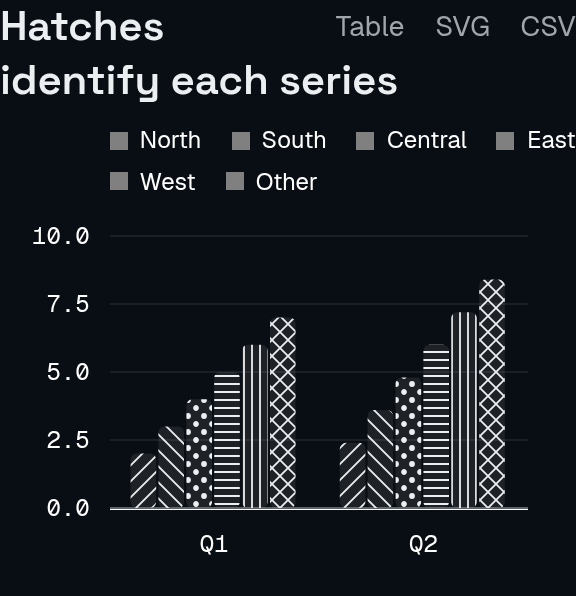
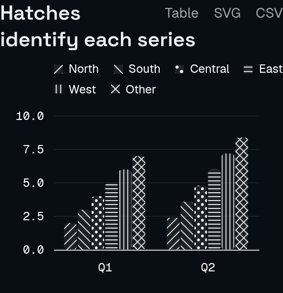
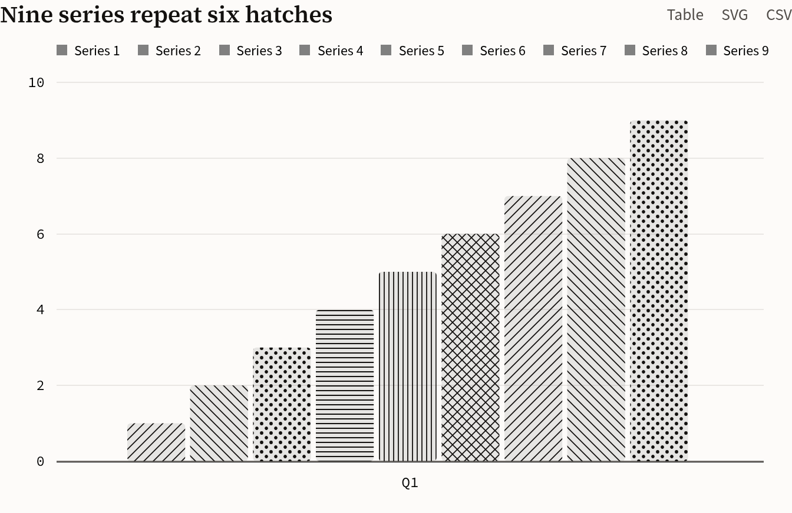

# Bar legend hatches

Explicit `chart.decals: true` bars already use six hatches, but their keys displayed identical flat swatches. The key now repeats each bar's existing tile inside the same clipped 9×9 box. It keeps the original category ordinal, including reserved unavailable categories and parent facet slots. Ordinary keys, plotted SVG, source rows, filtering and keyboard behavior remain unchanged. The public measurement helper selects the plot SVG before considering a fallback SVG.

This cut is stacked on the facet identity change, base `4fe6bec33b66642acb667fefa437577ac2f73634` (PR #49), with product source `07667f281cae7e0b0236ee6d01436f03548d6fe2`. [verification.json](verification.json) records the fresh native/Wasm artifacts, all 19 local checks, matched comparisons and independent review. Release build exited 0; its full log is `tmp/bar-legend/build.log` in the delivery worktree. Captures use Chromium 151.0.7922.173 at device scale 2, bundled fonts and settled output.

| Example | Before | After |
| --- | --- | --- |
| [Six series, Sleek, 320 px](six.rmd) |  |  |
| [Nine series, Scientific, 720 px](nine.rmd) |  |  |

Owner comparisons cover 240 configurations and 510 native/live panels across five themes and three widths. Plot SVG, diagnostics, key/button boxes and text are exact; 90 ordinary or key-free image controls are byte-identical. Paired lifecycle checks cover 78 states, 87 leaf panels and 24 Table/CSV/readout/export comparisons, including CSS-only ink changes, theme updates, source reordering, changed grouping field, facets, filtering, resizing and chart type changes. A separate 22-case check compares complete ordinary native results byte-for-byte. Independent review additionally verifies real mouse/touch events on path, rectangle and dot primitives and four JavaScript-disabled standalone SVG views.

Frozen PR #40 compatibility starts at `2c13ffb`, with accepted SVG resource ownership, pie-key inspection and facet identity changes composed before this cut. The matched pair is `3d690da0` → `c6a03222`; product Wasm is `7425139c40a6cdbca8eb38d4430fae293be3f4752972bc7c3d1ff34735c9d493`. It passes 24 configurations/56 panels, the same 78-state lifecycle comparison and 22 complete native controls. The sibling retains its direct-label export policy. Its original metadata test failed because line/area intentionally have no external legend; [the test-only reconciliation](pr40-test-reconciliation.patch), commit `3a8a956`, instead requires all three exact direct-label identities while preserving every bar/scatter assertion. The reconciled chart suite, formatting and Wasm Clippy pass; the unmodified sibling suite is not claimed to pass.

The six patterns repeat after six categories, and a 9 px swatch cannot represent every plotted hatch cycle. Long unbroken key names retain their pre-existing phone overflow exactly. New tiles have no fragment IDs or references; they remain identical in DOM, complete computed style, CTM and bounds while another mixed-theme view is hidden, destroyed, recreated, updated or resized. One Hand-drawn-first Chromium run changed 44 edge pixels (maximum channel delta 8/255) along an unchanged diagonal tile after a neighbouring view was hidden; strict screenshot equality for that lifecycle case is not claimed. The original failed oracle and complete paint-state comparison are retained in scratch. Existing duplicate plot-resource behavior on the isolated base is handled separately by PR #52 and is included in the frozen compatibility proof.

To reproduce the two images, build the chosen revision with `CARGO_BUILD_JOBS=3 npm run build`, install its locked Node dependencies, and run this package's helper against that built worktree. The selected source files, themes, viewport sizes, style tokens and all six source/image hashes are recorded in the adjacent verification file. The after images were reproduced byte-for-byte by this compact helper.

```sh
node docs/evidence/chart-refinements/bar-legend-decals/capture.mjs /absolute/built/worktree /absolute/output
```

Full matrices, first failed scratch oracles and review reports remain under `/home/vecera/tmp/richview-chart-refinement-20261011/bar-legend-craft-*` and `bar-legend-adversary-*`. No hosted CI, deployment or release is claimed by this evidence.
