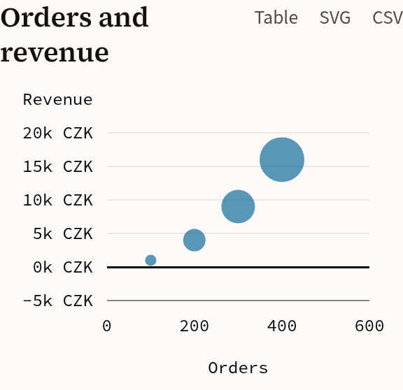
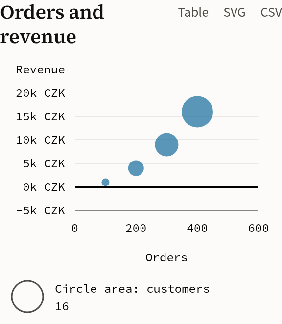
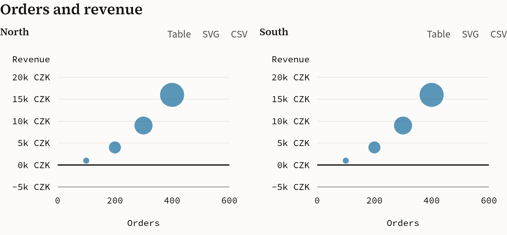
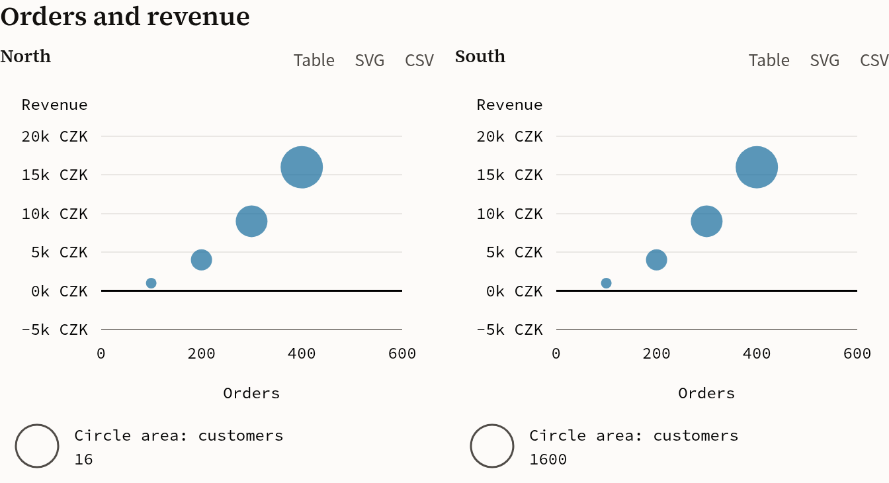

# Bubble area reference

Sized scatter plots now explain their third quantity with one outlined reference circle, the complete size-field name and the value represented by that circle. The existing largest-bubble radius is 16 px. Point sizes, positions, labels and targets stay unchanged; the guide appends below the completed axes.

The final [spacing correction](SPACING.md) uses 22-unit leading after Firefox exposed overlapping caption/value boxes in the original guide. Its separate Firefox pair, fresh checks and measured gaps are pinned to `7c97c1ea`. The four Chromium images below preserve the original introduction at `8c26556`; they are not pictures of the revised spacing. Both evidence sets retain their own complete sources, build hashes and reproduction helpers.

| Before | After |
| --- | --- |
|  |  |
|  |  |

The [phone source](phone.rmd) is Scientific at 320 px; the [facet source](facets.rmd) is Scientific at 720 px. Each actual before/after pair uses identical source, dimensions, fonts, reduced motion and DPR 2. The baseline is `480af942`, built from its identical tracked tree `dad1615`; the source change is `8c26556`. [verification.json](verification.json) records build and image hashes.

The guide reuses the panel’s existing positive size denominator, including filtering, zoom and local facet scales. Long field names wrap without losing characters. Its number round-trips to the finite denominator, with scientific notation for otherwise long values. Unsized charts and charts without a positive eligible size get no new guide. It creates no observation or inspection target, and appears in native and downloaded SVG. A requested fixed height may grow with an explicit diagnostic.

All 19 required local checks passed for the original introduction. Its matched captures cover 255 current-main reports and 200 reports composed with frozen PR #40, across five themes and 240/320/720 px. Every old quantitative SVG remains exact after excluding only the new guide and outer height; all 100 unaffected full SVG/PNG controls are exact. The sibling’s point names, annotations and dropped-label records remain unchanged. Sixty public-interface states on each side verify original source access, typed series filtering, zoom/reset, invalid-to-valid updates, facets, resizing and exports. Sixteen additional actual screen/print views preserve monochrome quantitative paint and contain the new guide without glyph findings. The spacing supplement records the final revision’s separate all-19-check and cross-browser review.

The original introduction’s independent review accepted its main and frozen sibling artifacts after 30 interaction states on each and 16 additional matched sibling reports. Its four curated PNGs reproduce exactly with the original helper.

The reference makes the existing local scale explicit; it does not make different facet scales comparable or supply graduated area estimates. Deliberately tiny requested heights retain earlier axis collisions and clipping. Expanding the viewport removes some old clipping findings without repairing that layout. The full evidence records these limits and retained failed setup/oracle checks.

To reproduce these four original images, build the recorded baseline and original `8c26556` candidate in separate worktrees, then run this directory’s unchanged [capture helper](capture.ts) with the selected worktree, output directory and `before` or `after`. Do not use the revised branch head as that helper’s candidate: it deliberately pins the original native-renderer Wasm, browser Wasm and PNG hashes. The recorded Chromium and fonts are required for identical pixels. Use the supplement’s separate helper for the final spacing pair.

```sh
node docs/evidence/chart-refinements/bubble-area-reference/capture.ts /path/to/baseline tmp/bubble-reference-before before
node docs/evidence/chart-refinements/bubble-area-reference/capture.ts /path/to/candidate tmp/bubble-reference-after after
```
