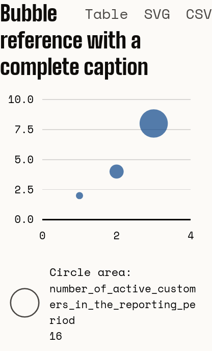
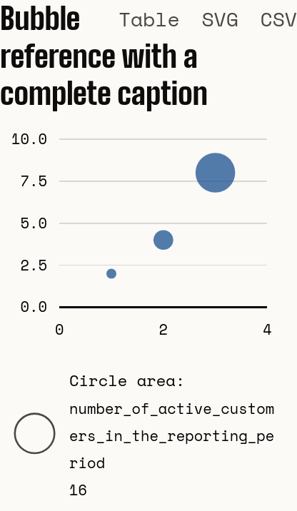

# Bubble reference spacing correction · 12 October 2026

Firefox 155 measured overlapping caption/value boxes in the original bubble reference. The 18-unit leading was shorter than the bundled fonts' client boxes. A fresh 20-unit trial still overlapped by 0.7001 px when the minimum 240-unit chart scaled to a 208 px content area. The final 22-unit leading leaves a measured gap in every checked case.

| Original 18-unit spacing | Revised 22-unit spacing |
| --- | --- |
|  |  |

This separate Firefox pair uses the [same complete source](spacing-wrapped.rmd), Brutalist theme, 240 px page width, reduced motion and DPR 2. The baseline is the original PR #46 delivery `6d7dcf41`; the corrected source is `7c97c1ea`. Both images are unmodified full figures. [spacing-verification.json](spacing-verification.json) pins their original bytes and both fresh native/browser builds. The original Chromium introduction pairs elsewhere in this directory remain pinned to `8c26556` and are not pictures of the revised spacing.

The change uses one line-leading value for text placement and reference height. A one-line caption gains 2 SVG units in total height, its value moves down 4 units and the reference circle center moves down 1 unit. Wrapped captions gain the corresponding space between every line. The original quantitative plot, complete text, value, source rows and inspection targets stay unchanged.

The fresh owner gate covers 80 matched Firefox reports at 240/320/390/720 px across five themes, including complete unbroken names, facets and unsized controls. All 100 quantitative SVG panels remain exact after excluding the guide and outer height; all 20 unaffected complete SVG/PNG controls remain exact. The smallest measured client gap improves from −2.4334 px to +1.0333 px. Twenty ordinary-motion cases settle to the same complete SVG and PNG as reduced motion. Sixty public-interface states preserve exact source values, Table/CSV, filtering, zoom/reset, resizing, invalid-to-valid updates, facet scales and SVG export. All 19 required local checks pass on the corrected source. Twenty additional JavaScript-disabled native screen/print comparisons preserve the visible quantitative SVG and full text, with a separate minimum client gap of 0.2833 px because the responsive native variant scales differently.

Independent review accepts the isolated correction and its fresh main and frozen PR40 compositions: 198 matched reports / 222 leaf panels across Chromium 151, Firefox 155 and Playwright WebKit 26.6, 42 exact guide-free PNGs and 72 combined plus 12 isolated public-interface states. The six original Firefox blockers are closed. All 19 required checks also pass on each combined revision.

The owner matrix retains 11 unrelated existing label-collision findings; it introduces none. This correction covers the recorded bundled fonts and engines, not arbitrary substituted fonts or every external SVG viewer. The rejected 20-unit artifact and its actual negative gap remain in the local review evidence. Eight independent short-height cases have specifically proved CSS auto-height rounding; reversible viewBox probes reproduce their old/new boxes exactly, preserving the inherited diagnostic identities. Failed scratch font-wait and hidden-native-variant oracles are also retained; they caused no product change.

To reproduce this additional pair, build `6d7dcf41` and `7c97c1ea` in separate worktrees. Use this supplement's helper from the current packet. It requires the recorded Firefox version and verifies both Wasm hashes, the full source and the exact resulting PNG; it also checks the actual client gap.

```sh
env -u DISPLAY -u WAYLAND_DISPLAY node docs/evidence/chart-refinements/bubble-area-reference/spacing-capture.mjs /path/to/original-46 tmp/bubble-spacing-before before
env -u DISPLAY -u WAYLAND_DISPLAY node docs/evidence/chart-refinements/bubble-area-reference/spacing-capture.mjs /path/to/revised-46 tmp/bubble-spacing-after after
```
