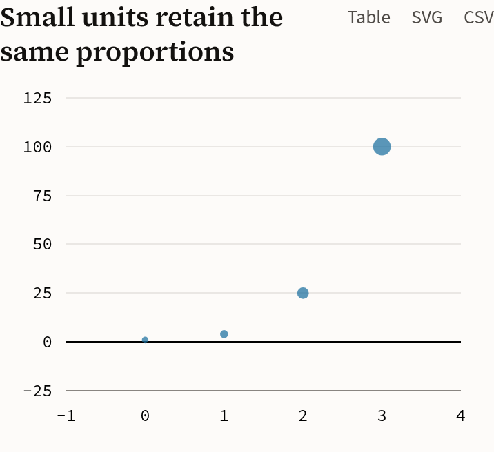
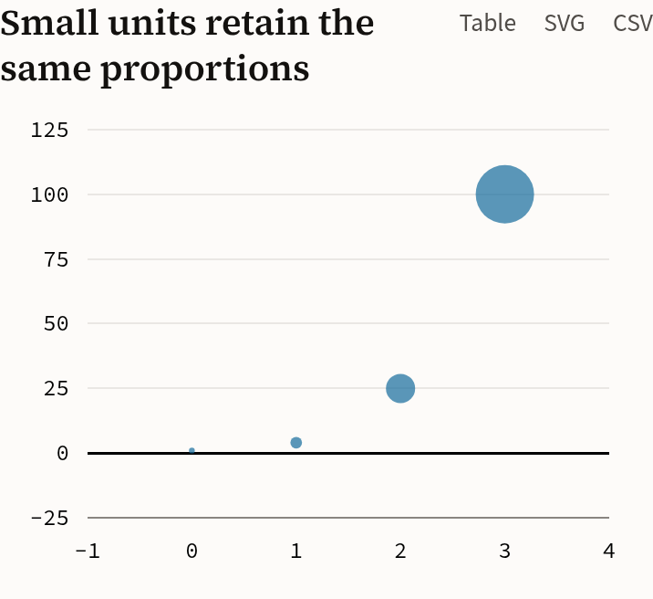
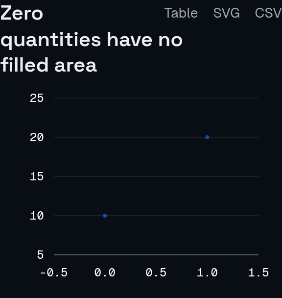
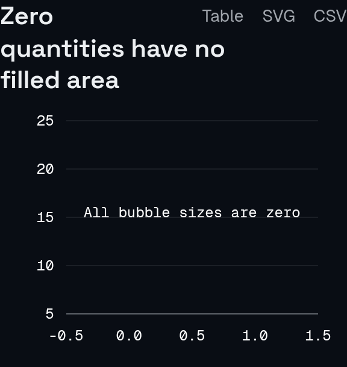
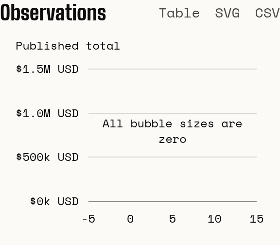
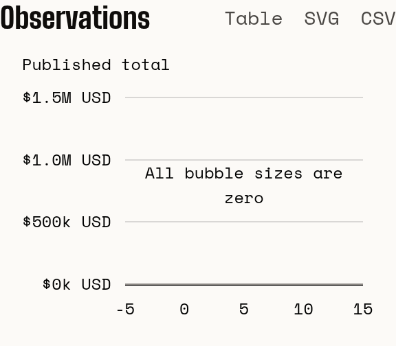

# Proportional bubble areas

Scatter charts with `encoding.size` now use area proportional to the source quantity. The largest drawable positive bubble remains 16 px in radius; changing quantity units no longer changes the picture. Zero has no filled area. Missing and invalid sizes omit marks, preserve source rows, and produce distinct diagnostics. Empty plots explain why no positive bubble is drawn.

These are actual report captures with loaded fonts and the Rust browser runtime, reduced motion and DPR 2. Matching pairs use identical source, theme and viewport. First two before views: `3c07128b7139687b754f6e1b5848c2a46c31cfe5`. Current product source: `e49646493c0d5e7d031f3f3486efcc9c8d9b24d2`.

| Before | After |
| --- | --- |
|  |  |
|  |  |
|  |  |

The first pair is [small-units.rmd](small-units.rmd), Scientific at a 390 px viewport. Its quantities `[.001,.004,.025,.1]` now produce radii `[1.6,3.2,8,16]`, matching equivalent larger-unit data. The second pair is [all-zero.rmd](all-zero.rmd), Sleek at 320 px. The exact figure dimensions, source/image hashes, artifact identity and validation summary are in [validation.json](validation.json).

The initial current-main implementation received independent acceptance after 20 normal-motion settled views of generic-title empty states, tiny values and excluded color groups. The full local evidence covers seven cases × three widths × five themes (105 matched views) and 24 native/browser/export interaction cases across reduced and normal motion. Valid-data coordinates and surviving mixed-data coordinates are unchanged; source rows, exact numeric strings, Table and CSV remain intact. All required repository checks pass, including the current motion lifecycle verifier. The first two after PNGs were reproduced byte-identically on the current production source. The complete matrix and logs are retained in the task workspace rather than checked into the repository.

The third pair is [wrapped-empty.rmd](wrapped-empty.rmd), Brutalist at 320 px. Its before source is the earlier proportional-area implementation `86541c1bcea366acc088096d66b054595afcccf5`. A combined-chart review exposed 17 px font boxes on 16 px baselines. Wrapped zero, mixed zero/missing and unavailable-size notes now use 18 px leading with the same visual center. The follow-up covers 135 actual views across all five themes, three widths and omitted/short/long titles, plus 12 reduced/ordinary-motion native/live/SVG checks. All 45 matched phone views retain identical quantitative SVG, axis labels and figure bounds; the Brutalist note boxes have a 1 px gap. The third after PNG also reproduces byte-identically. An independent reviewer accepted 45 additional ordinary-motion phone views across all three messages, three title variants and five themes. The complete required local suite was rerun successfully after this spacing change.

Zero retains the existing 4 px pointer tolerance and keyboard readout. Missing/invalid rows have no pointer target; keyboard navigation retains the existing fallback anchor. An absent size field stays absent in its exact-source readout. Negative/nonnumeric sizes now intentionally fail the chart check. Very small positive sizes can be visually tiny because there is no minimum quantitative disk. See the [size contract](../../../RMD-SPEC.md).

Source-size errors are reported by native rendering. The current browser diagnostics replace native findings with measured glyph checks, so their empty live check list does not imply valid source data. This change preserves that existing browser diagnostic behavior.

## Reproduce the after views

Build with `cargo run --release --locked -p richview-build` and install the pinned development dependencies with `npm ci --ignore-scripts`. Run this from the repository root; it writes only into a disposable local verification directory. To reproduce a before view, use its source commit from `validation.json` in a separate worktree, copy the fixtures into the same evidence path, build that worktree, and run the same snippet.

```sh
node --input-type=module <<'JS'
import { readFileSync } from 'node:fs';
import { harness, settled } from './scripts/browser-harness.mjs';
import rust from './packages/core/dist/index.js';
delete process.env.RICHVIEW_VERIFY_URL;
delete process.env.RICHVIEW_VERIFY_PUBLIC_DIR;
delete process.env.RICHVIEW_SERVER_BINARY;
const h = await harness('bubble-evidence');
const dir = 'docs/evidence/chart-refinements/bubble-area';
try {
  for (const [file, id, theme, width] of [
    ['small-units', 'bubble-small-units', 'scientific', 390],
    ['all-zero', 'bubble-all-zero', 'sleek', 320],
    ['wrapped-empty', 'note-zero-short', 'brutalist', 320],
  ]) {
    const context = await h.browser.newContext({
      viewport: { width, height: 900 }, deviceScaleFactor: 2, reducedMotion: 'reduce',
    });
    const page = await context.newPage();
    const source = readFileSync(`${dir}/${file}.rmd`, 'utf8');
    const rendered = JSON.parse(rust.render_source(source, JSON.stringify({
      width, styles: [theme], runtime_url: h.base + '/richview_web',
      report_folder: { root: id, source: 'report.rmd', files: ['report.rmd', 'reference.json'] },
    })));
    const url = `${h.base}/${id}`;
    await page.route(url, route => route.fulfill({ contentType: 'text/html', body: rendered.html }));
    await page.goto(url, { waitUntil: 'networkidle' });
    await page.evaluate(() => document.fonts.ready);
    await page.waitForFunction(() => document.querySelector('.rvc')?.hasAttribute('data-rvc-diagnostics'));
    await settled(page);
    await page.locator('figure.rv-chart').screenshot({ path: `${h.dir}/${file}.png` });
    await context.close();
  }
  console.log(h.dir);
} finally { await h.close(); }
JS
```
