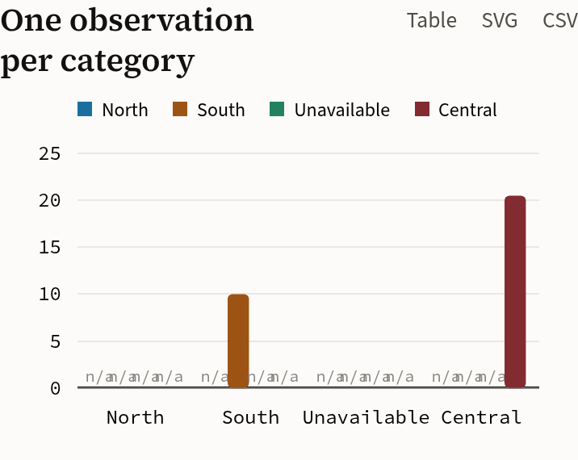
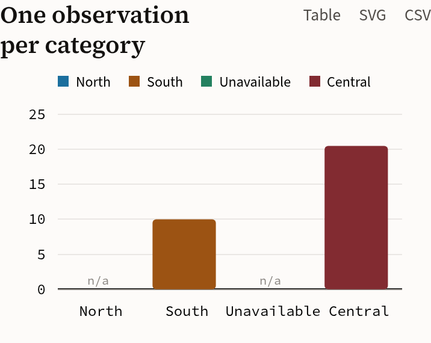
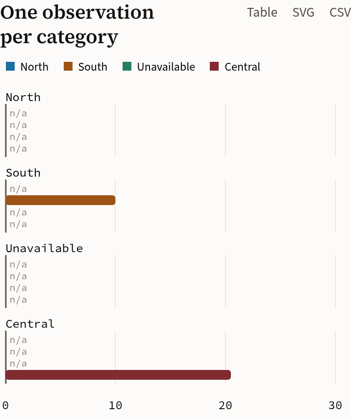
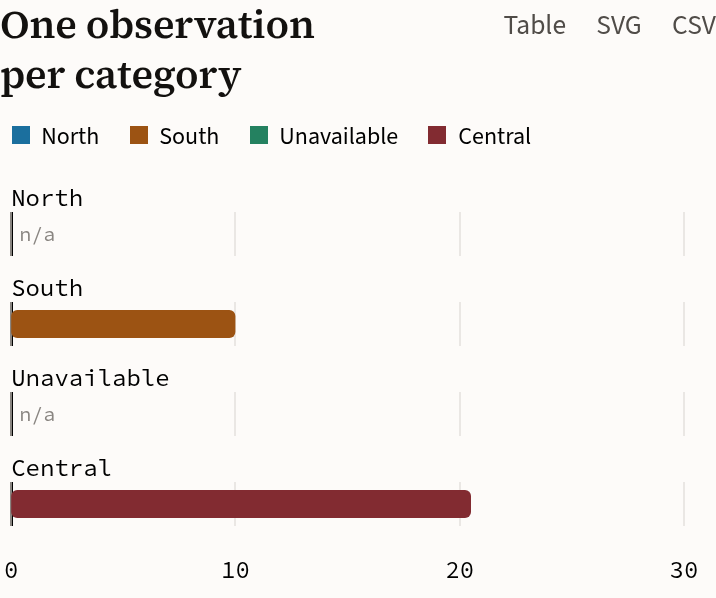

# One slot for a category colored by itself

When `encoding.x` and `encoding.color` name the same nonempty field, each category can only belong to itself. The renderer previously reserved a full group of slots and printed `n/a` for the impossible cross-category combinations. The alias now uses one slot per category while keeping its original color or pattern. Actual missing observations remain visible.

| Case | Before | After |
| --- | --- | --- |
| Vertical, Scientific at 390 px |  |  |
| Horizontal, Scientific at 390 px |  |  |

These are actual figures with identical sources, fonts and viewport settings, comparing main `bb8b112c121eae1ec70d810df1b5e6a2070c9c4e` with product head `c079c2cf917120aca1cb8700f8611f5069a719ed`. `verification.json` records the base commit, implementation, build and image hashes. After a fresh release build, run `node docs/evidence/chart-refinements/category-bars/capture.mjs` to reproduce the after images below `tmp/category-bars/reproduced`.

The refinement changes only slot count, slot position and the missing-mark guard in the two bar orientations. It preserves category order, source values, zero stubs, signed direction, palette ordinals, legends, duplicate-row policy and row identity. Hidden categories may compress visible indices, so missing marks are matched by category name rather than palette ordinal. Generated pattern IDs may change with the visible source; their ordinal and resolved pattern remain stable.

Validation covers 240 matched reports across all five themes at 320/390/720 px, including thirty actual facet panels and thirty monochrome reports. All 45 genuine-grouped, uncolored and distinct-field control SVGs remain byte-identical. No new glyph findings, horizontal overflow or browser errors occur. Fourteen native CLI pairs preserve source validity and the three native controls are byte-identical. Twenty-eight ordinary/reduced-motion interaction cases verify 116 exact keyboard rows, 56 pointer/touch checks, hiding/restoring colors, the last-visible-series guard, Table/CSV and current SVG geometry. Fresh independent review accepts 26 matched reports covering 28 actual charts and eight additional interface cases; exact currency and percentage readouts are preserved. The earlier review is retained separately. All required local checks pass.

Two distinct source fields remain independent even when their current values match. That deliberate stress control retains its existing overlapping `n/a` labels; this patch does not infer a dependency or alter grouped-bar policy. Duplicate rows keep their existing overlap and source readouts. Annotation placement, frames and label fitting are unchanged.
