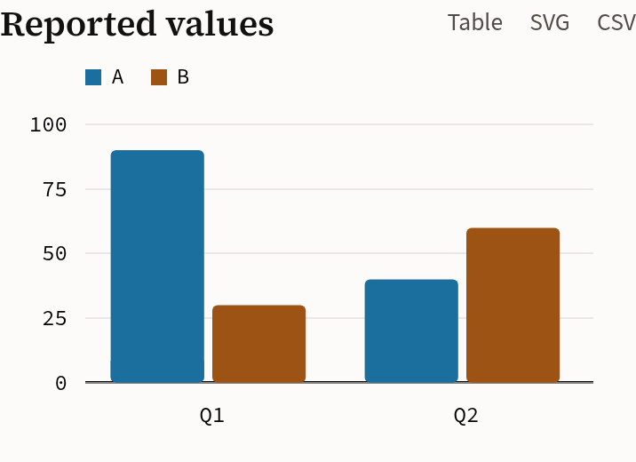
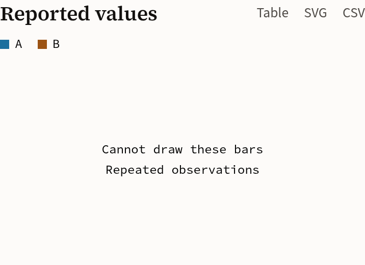
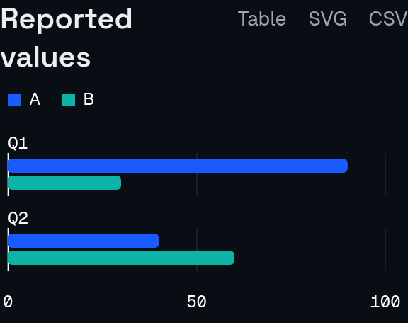
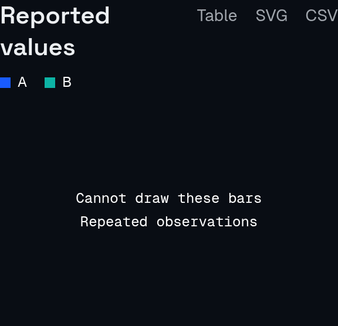

# Repeated bar observations

Two values in the same category and series previously painted over each other. For Q1/A = `10.000` and `90.000`, the silhouette looked like one value of 90 and both marks exposed the last row's label. The affected panel now shows a short reason and reports `chart.ambiguous-bar-slot`, including each repeated category, optional series and count. Authors must aggregate or resolve those observations explicitly.

This is an intentional validation change: equal values, repeated zero and opposite-sign pairs also reject the panel, even when both signs previously remained visible. Missing or nonnumeric values do not count as another finite value. Distinct series and facets remain independent. Pie aggregation and repeated line/area observations retain their existing rules.

Table, CSV and keyboard source inspection retain the observations. Hiding the conflicting series reveals the remaining valid bars with their original colors; restoring it restores the error. A valid source update clears the error. Rejected panels and SVG exports contain no quantitative marks, axes or annotations. Native nonnumeric warnings remain once; the browser retains source errors through its existing error interface.

| Matched capture | Before | After |
| --- | --- | --- |
| Scientific, 390 px viewport, reduced motion; [source](vertical.rmd) |  |  |
| Sleek, 320 px viewport, ordinary motion settled; [source](horizontal.rmd) |  |  |

These are actual report figures with the same source, viewport, theme, fonts and controls. Image pixels use device scale 2. The horizontal rejected panel uses the ordinary chart height rather than the row-driven height of horizontal bars.

Validation includes 520 full native render comparisons, 26 CLI source pairs, 85 matched browser reports across all five themes, eight facet leaves and 73 public-interface states. The 240 valid native results, 22 valid browser SVG/export/PNG controls and four valid facet neighbors are exact. Matched report Table/CSV and all 325 keyboard observations are unchanged. The five real theme fonts fit the reason in a 240 × 48 px rejected view. All 19 required local checks pass, including ordinary motion and the serialized local Cloudflare check. Independent review accepts the source, actual output and source interfaces. Identities and compact results are in [validation.json](validation.json).

A separate composition with frozen sibling `b19f92b` preserves its segmented bar baseline and zero marks: 560 native pairs, 32 matched reports, eight facet leaves and 79 public-interface states pass. The sibling deliberately permits hiding every series in a multi-series chart; the matched composition preserves that policy. The delivery branch retains current main's last-series protection and contains no browser changes.

To reproduce, build the repository, then generate either source with its named style and inspect the report at the stated viewport width:

```sh
cargo run --release --locked -p richview-build
mkdir -p tmp/repeated-bars-vertical tmp/repeated-bars-horizontal
cp docs/evidence/chart-refinements/duplicate-bars/vertical.rmd tmp/repeated-bars-vertical/report.rmd
cp docs/evidence/chart-refinements/duplicate-bars/horizontal.rmd tmp/repeated-bars-horizontal/report.rmd
target/release/richview generate tmp/repeated-bars-vertical/report.rmd --style scientific --format json
target/release/richview generate tmp/repeated-bars-horizontal/report.rmd --style sleek --format json
```

Both commands intentionally return exit 1 with the new source error and still write an inspectable report. Run the same source at baseline `b76885a66808956d7e7944b9923aacb445d72b66` for the before behavior. Readout formatting follows the existing policy; byte-for-byte preservation claims apply to Table/CSV, not every formatted readout. Verification used headless Chromium, not a physical touch device or a screen reader.

For exact PNG reproduction with the recorded Chromium and build, run `node docs/evidence/chart-refinements/duplicate-bars/capture.ts /path/to/baseline tmp/duplicate-bars/before before` and `node docs/evidence/chart-refinements/duplicate-bars/capture.ts . tmp/duplicate-bars/after after` from the candidate checkout. The helper verifies source, build and image hashes; all four stored images were reproduced exactly.
