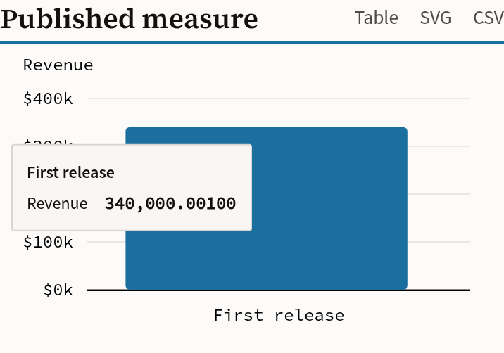
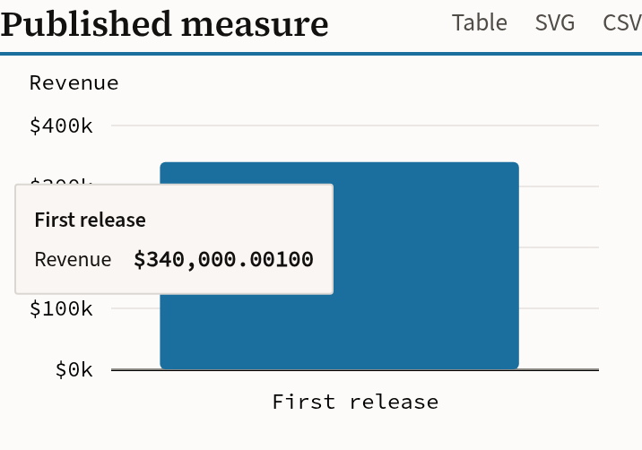
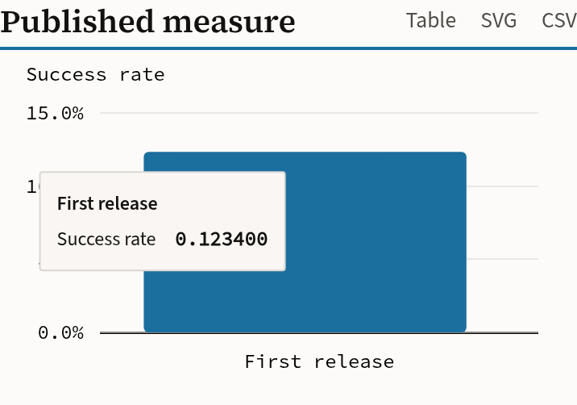
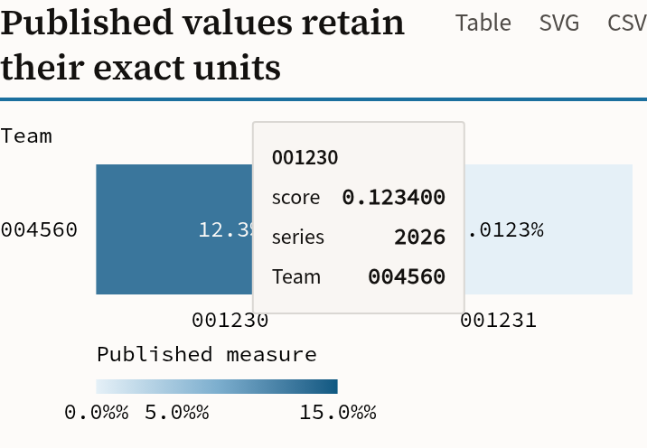
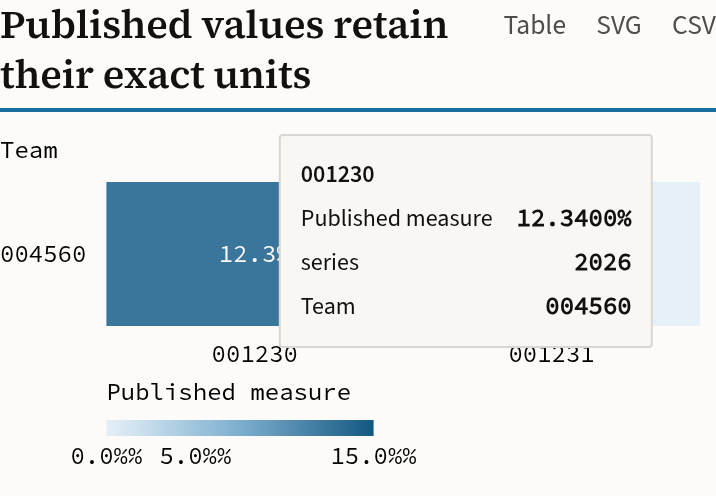

# Exact readouts with units

The axis could say dollars or percentages while the tooltip showed an unformatted source fraction. Generic chart readouts now honor the authored currency and percentage formats: `340000.00100` becomes `$340,000.00100`, and `0.123400` becomes `12.3400%`. Heatmap value readouts also use the existing `axes.color` label, format and suffix. The available source digits remain intact.

| Case | Before | After |
| --- | --- | --- |
| Currency, Scientific 390 px page |  |  |
| Percentage, Scientific 390 px page |  |  |
| Heatmap percentage, Scientific 390 px page |  |  |

These are actual keyboard readouts from the same fixture, theme and viewport. Captures use Chromium 151, device scale 2, reduced motion, and the Home key on a focused chart. Their live chart width is 358 px. `verification.json` records source/build hashes, exact readouts and figure dimensions against main `3c07128b7139687b754f6e1b5848c2a46c31cfe5`. All matched charts retain identical visible SVG geometry. Thirty bar SVGs change only their accessibility labels, which now carry the corrected units too; the other SVG strings are byte-identical. Heatmap cell geometry, ramp, key and in-cell formatting remain unchanged.

The original matrix covers five fixtures, all five builtin themes and 320/390/720 px viewports: 75 matched pairs. Its existing heatmap fixture now also applies authored color metadata; the other 60 readouts retain the first refinement's behavior. The heatmap extension adds 105 matched pairs across seven fixtures, with 105 byte-identical SVGs. Both matrices have no browser errors, actual glyph warnings or horizontal overflow. Generic interaction checks cover 21 chart/viewport combinations and 45 keyboard rows; heatmap checks add 42 cases and 186 keyboard rows with normal and reduced motion. Pointer/touch readouts, source Tables, downloaded CSVs and heatmap SVG geometry are checked. Null and invalid values retain their meaning; nominal codes and series names retain their identity. Tests also cover signed decimals, scientific notation, large exact decimal strings and an authored `%` suffix without duplication or accidental rescaling.

Independent source and visual reviews accepted the original formatter and the heatmap extension. The latter includes six additional matched views, eight native offline documents, 18 exact keyboard rows, shared-coordinate alias controls, and pointer, touch, Table/CSV and SVG checks.

Format checks, native and Wasm Clippy, workspace tests, release packaging, generated fixtures, strict TypeScript declarations, and all required native/editor/browser verification scripts, including motion lifecycle checks, pass locally. Verification used Rust 1.99.0 and Node 26.8.1; hosted CI uses Node 22.

The scope is generic x/y readouts for bar, scatter, pie and non-temporal line/area charts, plus a distinct heatmap color-value field. If a heatmap reuses an X or Y coordinate as its color field, the existing coordinate readout takes priority; it is neither duplicated nor reformatted as a separate value. Temporal Engine formatting and pie aggregation remain unchanged. Original lexical zeros of an unquoted JSON number are unavailable after parsing; authors can retain them with decimal strings. Missing keys remain absent, marker strings remain literal and source Table/CSV values retain no presentation units.

After the normal release build, reproduce the three current captures with `node docs/evidence/chart-refinements/exact-readouts/capture.ts`. Images are written under `tmp/exact-readouts/reproduced/`.
