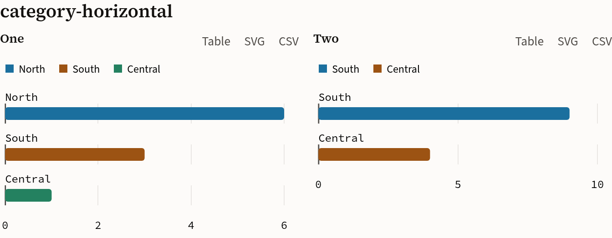
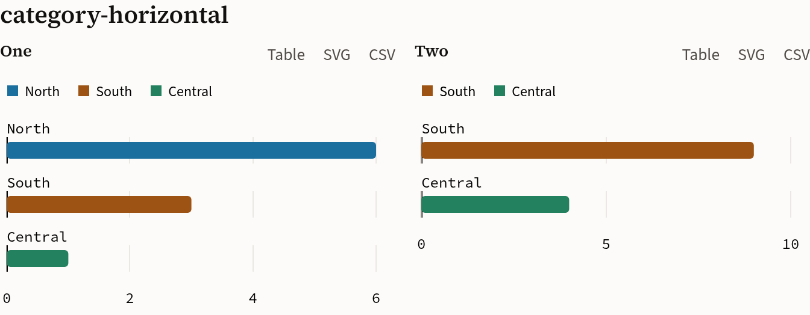
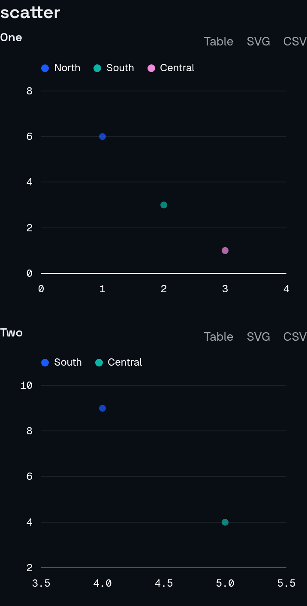
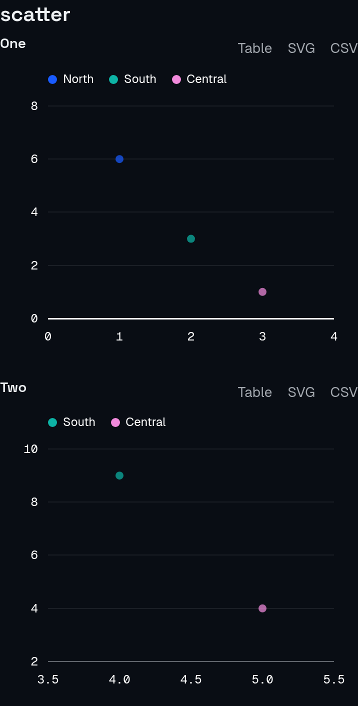

# Keep facet category colors consistent

South and Central kept their parent colors in native output, then changed to local palette slots when their facet became interactive. Bar and scatter facets now retain the original parent category colors in marks, keys and SVG downloads. Monochrome bars retain the corresponding hatch. Each child still owns only its own observations, group positions, Table and CSV.

| Source and view | Before | After |
| --- | --- | --- |
| [Category bars](bars.rmd), Scientific, 720 px page |  |  |
| [Scatter](scatter.rmd), Sleek, 390 px page |  |  |

The base is `480af942714c16ce4c1f959c7f046344d4f8c99d`; before captures use its identical tracked tree `dad1615876cf05dccd7241da269fbf69cbc1ec31`. Runtime is `ddf0dac411bde62bc30e2775a6a6e5023cb19653`. [Verification](verification.json) pins source/image hashes, native/Wasm builds and Chromium. All 19 required checks pass. The matched five-theme matrix checks 435 native child SVGs unchanged and 435 interactive children with the expected paint, unchanged quantitative geometry, text, source rows and diagnostics. Further checks cover hide/show, resize, numeric zoom, exact readouts, source reorder, unavailable reservations, aliases, custom palettes, hatch shapes, reused children, changed fields/types, standalone SVG and offline HTML.

A reused child can itself become a new facet parent. The first implementation retained stale scope during native rendering; the final version removes inherited metadata before each native child render and attaches the new parent inventory afterward. Its public renderer regression verifies the round trip. Original failure evidence is retained.

Independent review accepts both the current artifact and the frozen PR #40 composition at `91d4843` on `2badd277`. That composition passes a fresh build, four Rust checks, 50 matched reports and a separate interface review. Only specification context required reconciliation; sibling annotations, curves, direct labels and diagnostics remain intact. The real sibling tree was not edited.

This is limited to bar/scatter facets. Line/area and temporal identity remain unchanged: a mixed nominal/calendar line needs one coherent policy before its generic colors can change. Categories retain the existing normalization, eligibility and palette cycles. A changed parent source order intentionally regenerates category slots; no global registry or author setting is added. Existing narrow-container toolbar overlap and annotation findings are outside this change. The interface harness's overlapping 320 px host inside a 1000 px viewport is retained as a failed observation; the passing phone runs use matching viewport widths.

To reproduce the four images, build isolated baseline/current worktrees using [the pinned build instructions](../../../../CLAUDE.md), with npm dependencies and `/usr/bin/chromium` available. From this checkout run:

```sh
node docs/evidence/chart-refinements/facet-colors/capture.mjs /absolute/built/baseline tmp/facet-colors-before before
node docs/evidence/chart-refinements/facet-colors/capture.mjs /absolute/built/current tmp/facet-colors-after after
```

The helper uses bundled fonts and device scale 2, waits for ordinary motion to settle, and asserts exact image hashes. Full fixture matrices, interface runners and first failure logs remain in the campaign's local scratch record.
