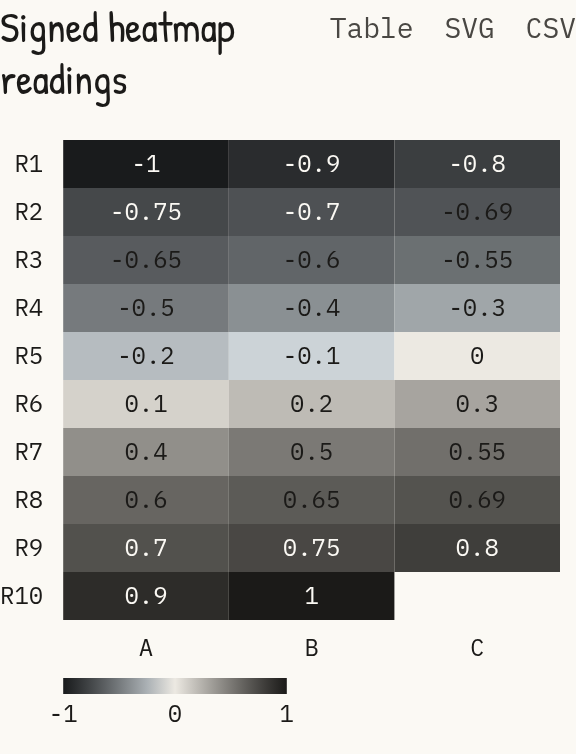
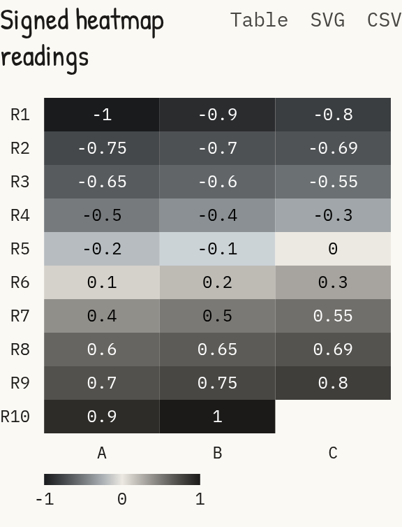
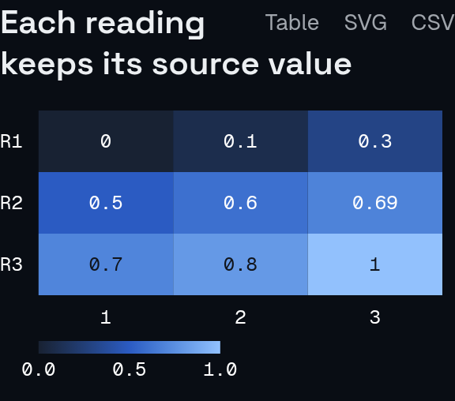
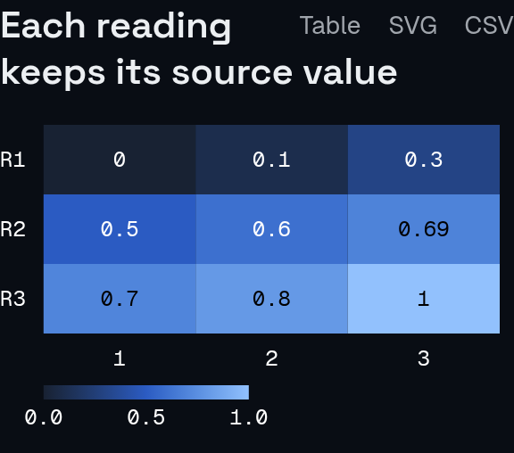

# Heatmap cell contrast

Numeric heatmap text now asks the browser to choose black or white from the cell’s existing color expression. This corrects midtone readings and follows CSS ramp changes without replacing cells. Geometry, values, label fit, missing-cell treatment and source interfaces stay unchanged.

| Actual Chromium 151 captures | Before | After |
| --- | --- | --- |
| Hand-drawn, signed values, 320 px viewport |  |  |
| Sleek, positive midtones, 320 px viewport |  |  |

The change equips fitted numeric text only. Its inline fill retains the prior theme-token fallback, and a literal `@supports (fill:contrast-color(red))` rule travels inside the SVG. Unsupported viewers retain that fallback. Explicit authored `!important` fills still win; ordinary author rules retain their existing precedence below the inline fill. Other chart text and older unmarked cell labels are unaffected.

Validation uses source `aae91e0` against `dad1615`, whose product matches main `480af942`. All 19 required local steps passed: four Rust checks, release, fixture generation and thirteen host checks. The 210 paired reports cover five themes and 240/320/720 px viewports: 225 leaf SVGs preserve every non-contrast element, source diagnostic and text bound; 55 control SVGs and PNGs are byte-identical. Another 215 direct native results preserve plot, hit targets, source rows and diagnostics. The 39 paired public-interface cases retain Table/CSV, 78 keyboard readouts, 36 pointer/touch inspections and 156 SVG states through resize/reset/export.

Twenty direct standalone SVG screen/print cases with page JavaScript disabled verify the embedded rule, dynamic ramp changes, unchanged node identity, author precedence, and an explicitly false feature gate. Independent review adds 135 native pairs, 58 public records, 10 standalone/cascade cases and 435 sampled cell/text pairs across five themes. Sample minimum contrast ratios rise to 4.665–4.851 using the existing color utility; this is evidence for these samples, not a universal threshold promise.

Only Chromium 151 was executed. The [CSS Color 5 specification](https://www.w3.org/TR/2026/WD-css-color-5-20260902/#contrast-color) leaves the contrast choice to the user agent. Other SVG viewers, arbitrary translucent overrides and downstream PDF conversion are not claimed verified. The foreground follows the emitted fill expression and its ramp variables; an independent override of a rectangle’s `fill` is outside that link. The existing negative-arm expression is preserved exactly. Tiny-value formatting and optional annotation omission belong to their separate package.

The corrected tiny-label composition (`7651ccb` → `f60f48c`) and frozen PR40/tiny composition (`b5f3a728` → `6b70675`) each pass 180 complete native pairs and 72 ordinary-motion reports, preserving all non-contrast SVG, annotation placement/omissions and diagnostics. Each keeps nine full SVG/PNG controls exact. Full chart tests, native/Wasm Clippy, release, browser/API and motion checks pass on both. Independent review adds 180 native pairs, 70 public records and eight standalone omission/fallback cases per composition. When every tiny label is omitted, the full SVG remains byte-identical and no contrast rule is emitted. PR40’s removed key stays absent. Integration preserves `scientific_labels` and its recorded output ranges; the style check runs only after annotation-driven removals. No sibling annotation, color-domain or key policy was copied into the isolated delivery.

The retained scratch history includes the superseded first stylesheet placement, an SVG-document full-page screenshot timeout, and two comparison-oracle corrections (unnamespaced live SVG styles and the expected added stylesheet node). None is hidden by an output tolerance. The final standalone screenshot uses a fixed viewport, while all geometric comparisons remain exact.

`verification.json` records built-artifact and fixture/image hashes. Run the byte-checking helper from this worktree with the preserved built baseline or candidate:

```sh
node docs/evidence/chart-refinements/heatmap-contrast/capture.mjs /path/to/baseline /tmp/contrast-before before
node docs/evidence/chart-refinements/heatmap-contrast/capture.mjs /path/to/candidate /tmp/contrast-after after
```

The release exit is the `build` record in `tmp/heatmap-contrast/final-checks.json`, with complete output in `final-build.log`. Rust and host inventories are in `tmp/heatmap-contrast/checks/{rust-checks,host-checks}.json`. Full local evidence remains under `/home/vecera/tmp/richview-chart-refinement-20261011/heatmap-contrast-owner-*` and the implementation worktree’s `tmp/heatmap-contrast/`. No remote publication or browser-support emulation is implied by the screenshots.
