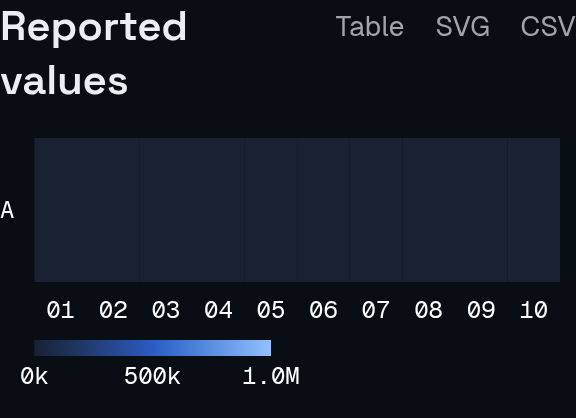
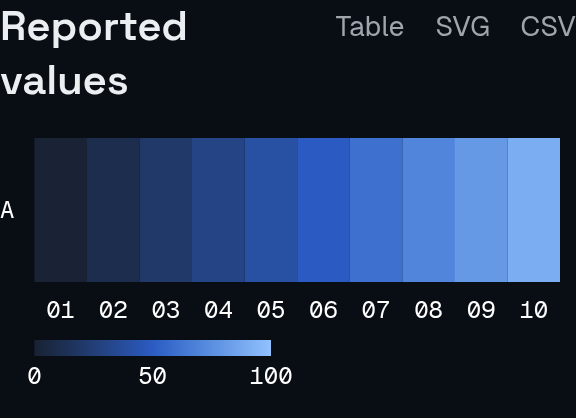
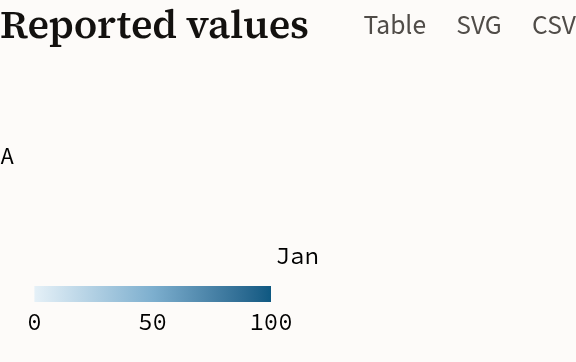
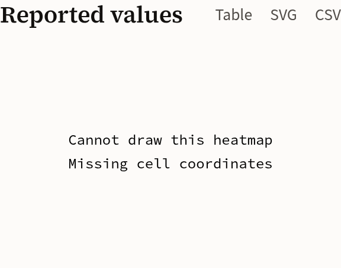

# Heatmap colors use observations that can be placed

A numeric row without an X or Y coordinate previously changed the color scale even though it could not draw a cell. An invisible value of one million made ten visible values from 1 to 100 look almost identical. Only finite values with both coordinates now enter the scale. Unplaceable numeric rows remain in source interfaces and report `chart.unlocated-color-values`, including the encoded fields and affected counts.

| Matched Scientific/Sleek phone figures, 320 px page | Before | After |
| --- | --- | --- |
| Visible color differences, Sleek; [source](visible-colors.rmd) |  |  |
| No placeable cells, Scientific; [source](missing-coordinates.rmd) |  |  |

The row/column inventory, cell geometry, source order and inspection identities stay unchanged. Null, absent and empty coordinates are unavailable; numeric zero, boolean false, significant whitespace and literal category names retain their existing meanings. Overlapping X/Y counts are explicit. Located missing cells retain their outlines without a numeric scale. Existing invalid-value and repeated-cell errors remain present, and valid neighboring facets still draw.

All 19 required local checks pass at source `e746b93` on baseline `b76885a`. The current 480-report comparison covers all five themes at 240/320/720 px: 195 complete SVG/PNG controls remain identical, and all 1,380 cell geometries and source names are preserved across 495 leaf charts. A second 480-report ordinary-motion run at the prior copy checkpoint matches the settled reduced-motion SVGs, pixels and diagnostics exactly; all 480 final-source reduced-motion outputs match that checkpoint too. Native CLI checks retain all original source errors across 32 cases. Independent review covers actual minimum-size text, source interfaces, error clearing, pointer/touch, exports and facet updates. The new empty state grows requests below 48 px to fit both lines; an independent ordinary-motion check measures all five fonts at 240 × 48 px and retains exact Table/CSV/readouts without inventing pointer or touch targets.

The frozen sibling composition at `b19f92b` includes its separate heatmap key policy. Its 128 ordinary-motion reports preserve 60 complete pixel/SVG controls, all 368 cell geometries and source names, and the same coordinate diagnostics. Its separate five-font short-height/source-interface check also passes on the final source. See [verification.json](verification.json) for artifact identities and the final independent compatibility verdict.

The broad current-main matrix retains ten existing authored-annotation collisions and one existing deliberately short missing-grid label clipping. They are neither hidden nor claimed fixed. An unlocated row may still contribute its other coordinate to the existing row/column inventory; the comparison preserves that inventory instead of deleting source rows. New coordinate errors intentionally make native validation fail until the source is corrected.

The sources and four images are unmodified artifacts. To reproduce their exact PNG hashes, use the recorded baseline/candidate builds, pinned dependencies and Chromium 151.0.7922.173, then run `node docs/evidence/chart-refinements/heatmap-coordinates/capture.ts /path/to/baseline tmp/heatmap-coordinates/before before` and `node docs/evidence/chart-refinements/heatmap-coordinates/capture.ts . tmp/heatmap-coordinates/after after` from the candidate checkout. The helper verifies source, build and image hashes. Full matrices and first failed setup attempts remain in local evidence; this folder keeps two reviewable examples.
