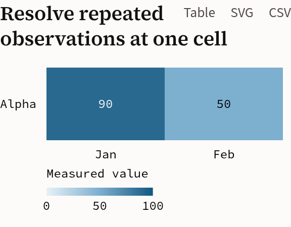
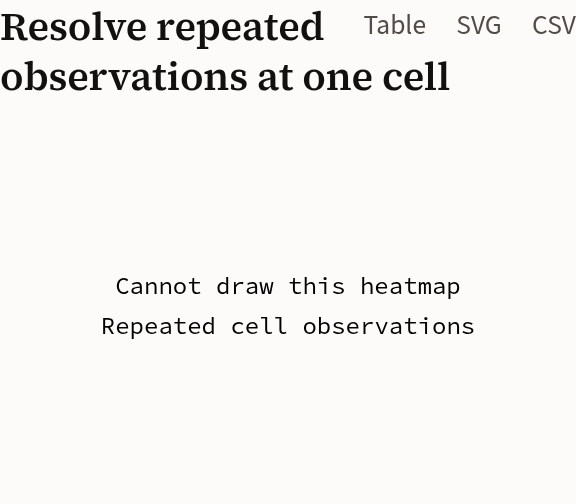
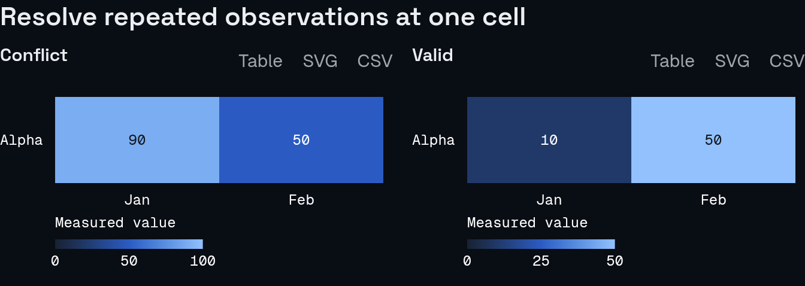
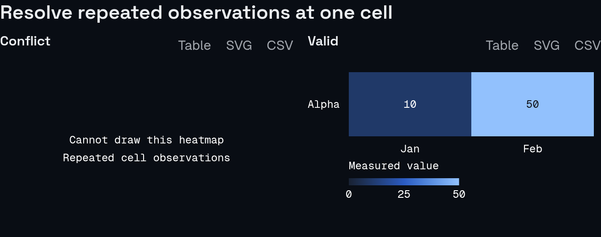

Two numeric observations at the same heatmap coordinate previously painted over each other: 10 followed by 90 showed 90, while reversing those source rows showed 10. The affected panel now explains the repeated observations and reports every conflicting coordinate with its original row positions. Table, CSV and keyboard inspection retain the full source. A valid neighboring facet keeps its original SVG.

| Actual figure | Before | After |
| --- | --- | --- |
| Scientific, 320 px |  |  |
| Sleek, 720 px; one valid neighboring facet |  |  |

The full figure PNGs are unmodified captures from the same sources, packaged fonts and viewports on main `159e3cbc` and source `1f5f2048`. The change applies to repeated finite numeric observations at representable coordinates, including equal values and existing numeric/string coordinate aliases. It adds no aggregation or cell-level conflict encoding. Existing missing/invalid-value diagnostics remain available. Diagnostic row numbers refer to the affected resolved chart data, including each facet’s own Table.

All 19 required local checks pass, and independent current review accepted the change. The matched gate covers 297 reports/312 panels across five themes and phone/desktop widths, plus actual 240 px and 60 px height stress views. It retains 120 exact control/neighbor SVGs and 105 complete PNGs. The 192 rejected panels have no cells, numeric key, annotations or spatial hit targets. Original source errors remain; measured collision/clipping findings fall from 235 to 0. Offline verification covers 96 reports with JavaScript on/off and both motion modes, complete source interfaces and downloaded SVG. Twenty independent update states verify error clearing and facet isolation. [Verification, build identities and retained first failures](verification.json) distinguish these current results from historical attempts and document an evidence-path collision resolved through fresh captures.

After building the base and candidate in separate worktrees, serve [source.rmd](source.rmd) with `target/release/richview serve docs/evidence/chart-refinements/heatmap-duplicates/source.rmd --style scientific --public-dir dist/web` and set the viewport to 320 px. Serve [facets.rmd](facets.rmd) with `--style sleek` at 720 px for the second pair. Existing zero/missing semantics and unrepresentable-coordinate handling are outside this refinement.
