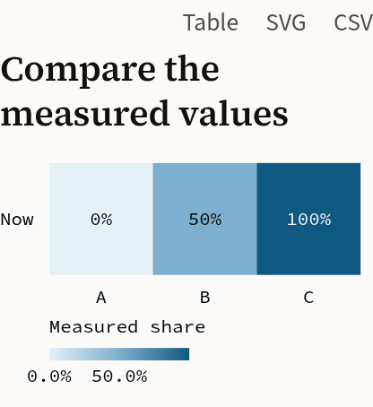
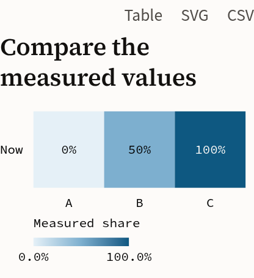
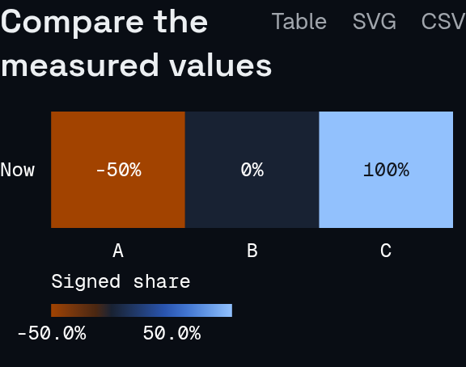
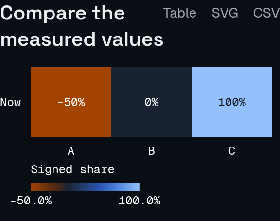

# Heatmap color-key endpoints

Narrow keys could label an interior value and omit the upper bound even when both endpoint labels fit. The renderer now reserves those existing endpoint positions before selecting interior labels. The color domain, gradient, cells, source data and interactions stay unchanged.

| Example | Before | After |
|---|---|---|
| Scientific, 240 px viewport |  |  |
| Sleek, 320 px viewport |  |  |

These are actual report captures with the original heading and controls, bundled fonts, Chromium 151.0.7922.173, device scale 2 and reduced motion. Viewport widths are not SVG or figure widths. The before build is main `480af942714c16ce4c1f959c7f046344d4f8c99d`, using the tree-identical frozen `dad1615876cf05dccd7241da269fbf69cbc1ec31` artifact. The source change is `71abfe4c2320740c7fb0486b511bc221524d37f2`; artifact hashes and results are in [validation.json](validation.json).

The five-theme matrix covers eight sources at 240, 320 and 720 px: 20 keys improve, while 100 entire SVGs and PNGs stay exact. All quantitative SVG remains exact. Another 30 ordinary-motion views match their reduced-motion SVGs and PNGs after settling. Native checks, exact source exports, pointer/touch/keyboard readouts, invalid-source recovery and the required suite are recorded in the validation summary.

When both endpoint strings cannot fit, the old collision-safe output is retained exactly; long units may still lose an endpoint. Zero has no special interior-label guarantee. Tiny cell formatting is a separate issue. The scientific formatter is reviewed in a separate local composition, and the frozen PR40 design removes this key entirely; this patch must not restore it there.

## Reproduce the images

Build the before and after worktrees using the repository's pinned toolchain and install development dependencies with `npm ci --ignore-scripts`. Run this helper from the after worktree for each built target; it reads the two checked-in `.rmd` sources and uses that target's own renderer, styles and fonts. It opens only a headless browser and a loopback server.

```sh
node docs/evidence/chart-refinements/heatmap-key-endpoints/capture.mjs --worktree /path/to/before-worktree --out tmp/heatmap-endpoints-before
node docs/evidence/chart-refinements/heatmap-key-endpoints/capture.mjs --worktree /path/to/after-worktree --out tmp/heatmap-endpoints-after
```

The output names are `positive-percent.png` and `signed-percent.png`. Their checked-in counterparts add `-before` or `-after`. Pixel equality depends on the recorded Chromium build; source, SVG and artifact hashes make the comparison explicit.
