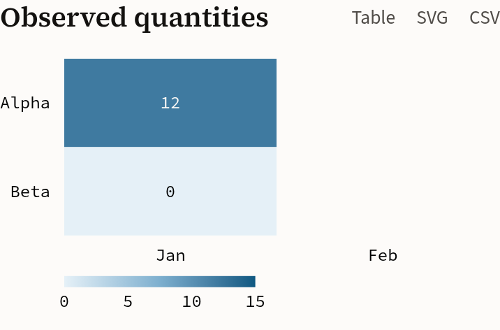
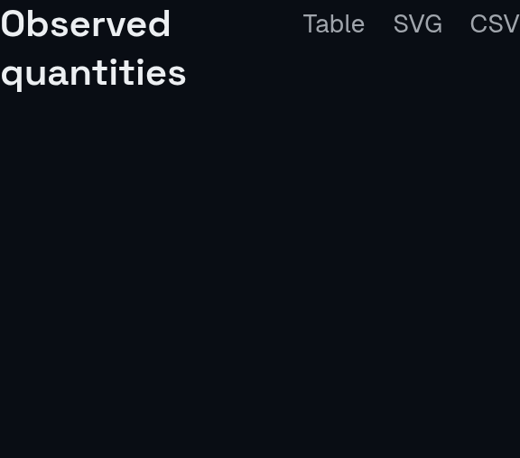
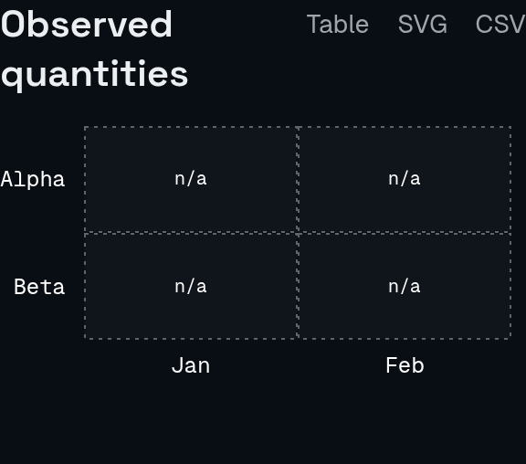

# Explicit missing heatmap observations

An authored missing observation now has a neutral outlined cell and `n/a`. A true zero keeps its numeric fill, and a Cartesian combination without a source row stays empty. Numeric values, colors, cell geometry and the key remain unchanged. Missing cells retain their original pointer and keyboard row identity; source Table and CSV output stay intact.

These actual report captures use loaded fonts, reduced motion and DPR 2. Each pair has identical source, theme and viewport. The baseline is `3c07128b7139687b754f6e1b5848c2a46c31cfe5`; [validation.json](validation.json) records the candidate identity and validation.

| Before | After |
| --- | --- |
|  |  |
|  |  |

The first pair is [sparse.rmd](sparse.rmd), Scientific at 390 px. It contains 12, null and 0, with one unprovided combination. The second is [all-missing.rmd](all-missing.rmd), Sleek at 320 px. The all-missing source error is retained; its previous blank plot becomes an explicit missing grid.

Recognized missing values follow the existing parser: null, an absent color key, blank text, `.`, `na`, `n/a`, `nan`, `null` and `none`, case-insensitively. Other nonnumeric values now report `invalid-color-values` and remain unpainted. A missing row at a repeated coordinate reports `ambiguous-missing-cell` and is not painted over another observation. This narrow guard preserves existing numeric marks in either source order; numeric-only duplicate behavior is unchanged. No aggregation or implicit winner is introduced.

The [dense fixture](dense.rmd) also includes an explicit missing cell, a true zero and an absent combination. The fixed 10 px `n/a` label is shown only in cells at least 24 × 20 px; smaller cells retain the outline and `No observation` mark title. Null readouts say `No observation`, recognized marker strings keep their exact source text, and an absent key remains absent from the readout. Native source checks and live glyph measurements are separate in this standalone change: current main’s live public diagnostics expose glyph checks only, so native errors above remain the authoritative source checks. Diagnostic propagation is handled separately.

Independent review accepted the implementation after fresh adversarial rendering and pointer, touch, keyboard and Table checks. The local matrix covers 210 matched views across five themes at 320/390/720 px, 14 actual native CLI before/after pairs and 168 interaction/export cases with normal and reduced motion. Numeric cells and keys remain unchanged; all missing labels fit their cells. All current repository checks pass, including the motion verifier. The two after PNGs reproduce byte-for-byte with the snippet below. Detailed matrices remain in the task workspace.

## Reproduce the after views

Build with `cargo run --release --locked -p richview-build` and install the pinned development dependencies with `npm ci --ignore-scripts`. Run this from the repository root. The output stays in a disposable local verification directory. For before views, use the baseline in a separate worktree, copy the two fixtures into the same evidence path, build and run this snippet.

```sh
node --input-type=module <<'JS'
import { readFileSync } from 'node:fs';
import { harness, settled } from './scripts/browser-harness.mjs';
import rust from './packages/core/dist/index.js';
delete process.env.RICHVIEW_VERIFY_URL;
delete process.env.RICHVIEW_VERIFY_PUBLIC_DIR;
delete process.env.RICHVIEW_SERVER_BINARY;
const h = await harness('heatmap-missing-evidence');
const dir = 'docs/evidence/chart-refinements/heatmap-missing';
try {
  for (const [file, id, theme, width] of [
    ['sparse', 'heatmap-missing-sparse', 'scientific', 390],
    ['all-missing', 'heatmap-all-missing', 'sleek', 320],
  ]) {
    const context = await h.browser.newContext({
      viewport: { width, height: 900 }, deviceScaleFactor: 2, reducedMotion: 'reduce',
    });
    const page = await context.newPage();
    const source = readFileSync(`${dir}/${file}.rmd`, 'utf8');
    const rendered = JSON.parse(rust.render_source(source, JSON.stringify({
      width, styles: [theme], runtime_url: h.base + '/richview_web',
      report_folder: { root: id, source: 'report.rmd', files: ['report.rmd', 'reference.json'] },
    })));
    const url = `${h.base}/${id}`;
    await page.route(url, route => route.fulfill({ contentType: 'text/html', body: rendered.html }));
    await page.goto(url, { waitUntil: 'networkidle' });
    await page.evaluate(() => document.fonts.ready);
    await page.waitForFunction(() => document.querySelector('.rvc')?.hasAttribute('data-rvc-diagnostics'));
    await page.evaluate(async () => { await window.__richview.settled(); });
    await settled(page);
    await page.locator('figure.rv-chart').screenshot({ path: `${h.dir}/${file}.png` });
    await context.close();
  }
  console.log(h.dir);
} finally { await h.close(); }
JS
```
