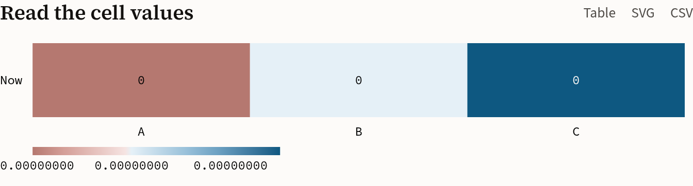
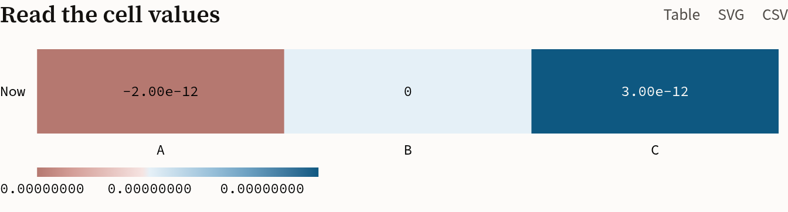
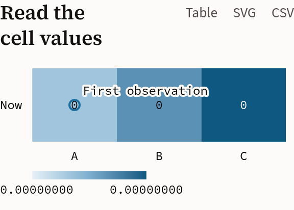

# Tiny heatmap values retain their sign and magnitude

Finite nonzero heatmap values that previously compacted to `0` now use three-significant-digit scientific text, such as `-2.00e-12`. Actual zero remains `0`. Percent scaling and literal suffixes retain their existing meaning. Exact source values remain available through keyboard and pointer readouts, Table and CSV.

[Signed values](signed.rmd), Scientific, 720px page:

| Before | After |
| --- | --- |
|  |  |

The existing cell-fit rule still applies. Longer fallback text is omitted when it cannot fit or would overlap existing annotation text, a point marker or a leader stroke. Annotation placement remains unchanged; ordinary labels and missing-value markers keep their prior behavior.

[Annotated cells](annotated.rmd), Scientific, 320px page:

| Before | After |
| --- | --- |
|  |  |

This patch changes cell text only. The color key still uses the existing axis formatter; [PR #51](https://github.com/richview-universe/richview-v3/pull/51) separately adds scientific axis notation. It does not repair general annotation layout or claim that every cell can show a value at every width.

Final source is `7651ccbefe6c8807e01d9ab086a950889fc40102`, based on main `480af942`. The recorded baseline `dad1615876cf05dccd7241da269fbf69cbc1ec31` has the same tracked tree as that main. All 19 required local checks pass on this branch, the frozen combined-refinement branch `fd3a7a1` and the PR40/scientific-label composition `b5f3a728`. [verification.json](verification.json) records full native/core/Web hashes, case and image hashes, checks and bounded results.

The main rendered comparison covers 315 reports across all five themes at 240/320/720px, including actual loaded fonts. All non-cell SVG and native diagnostics remain exact; 70 complete SVG/PNG controls are byte-identical. All 805 emitted cell glyph boxes fit inside their cells, and no new measured finding appears. Two compatibility matrices add 220 reports each, including fourteen adversarial annotation cases. Inherited annotation collisions and clipping remain explicit in their result counts; no new complete finding is allowed.

Each of the three branches also passes 315 native full-report pairs, 945 direct render pairs with automatic and real 72/120px height options, 21 native CLI report pairs and 60 complete source-interface comparisons. The latter preserve source/Table/CSV, keyboard and mouse/touch values, 180 initial/zoom/resize states and 60 SVG exports. The main offline gate adds 48 JavaScript-disabled/live screen/print pairs with no external requests. The old fixture named `fixed-short` contains an unused `style.height`; it is only an ordinary control, while actual short heights are tested through the public render option.

Independent review accepts all three fresh artifacts. It checks 225 native pairs and 106 public records per branch, actual transformed annotation and stroke bounds, plus eight full-report facet records/sixteen leaves per branch. A further sibling gate checks genuinely placed wrapped/rotated annotations and their leaders. The sibling renderer may already omit an optional annotation when placement has no room; this change preserves that decision.

For PR40 integration, start from the recorded scientific-label sibling `5485ab1a0fdf1b83951c4a2d1175959909e45452`, apply the notation-only commit `b9147c6`, then apply [pr40-annotation-clearance.patch](pr40-annotation-clearance.patch) instead of the main annotation correction. The tested intermediate is `ca4bf6d`, and the final is `b5f3a728`. The adaptation records bounds only after an existing smart label is actually emitted; it preserves PR40 placement, wrapping and leaders. It also adjusts the regression expectation where PR40 deliberately drops an optional annotation.

The initial notation-only build was held after broader owner captures exposed real new annotation collisions in fifteen views. The final correction removes only colliding new fallback labels. Original failed captures, the initial lint failure and corrected scratch oracles are retained in the local run evidence; none is counted as a passing gate.

To reproduce the four images, build the recorded baseline and candidate with pinned dependencies and Chromium 151.0.7922.173. From this checkout run `node docs/evidence/chart-refinements/heatmap-tiny-values/capture.ts /path/to/baseline tmp/heatmap-tiny-values/before before`, then `node docs/evidence/chart-refinements/heatmap-tiny-values/capture.ts . tmp/heatmap-tiny-values/after after`. The helper checks source, core/Web Wasm, browser and image hashes.
