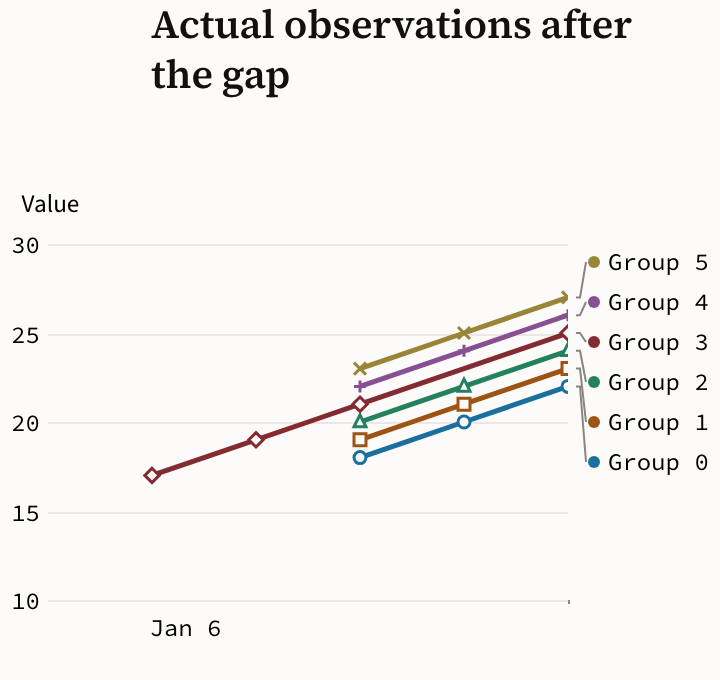
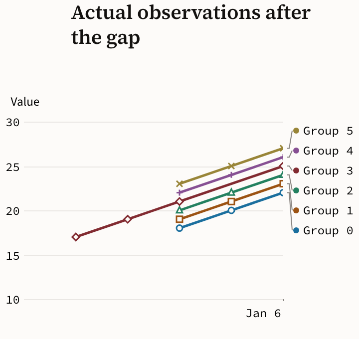

# Marker ink and scale-label alignment

This pair records the October 15 treatment. The October 16 caption refinement keeps titles at the caption's left edge independently of the first mark; marker geometry and first-label corrections shown here remain covered by the current regression checks.

The same synthetic calendar fixture at 360 CSS px in Chromium 153, rendered at 2× scale. All six series have a leading gap; the diamond series starts first. The source, mark paths, scale and theme remain the same.

| Before (`e9c6e7c`) | After (`a378c85`) |
| --- | --- |
|  |  |

The title's painted left column moves from 151 to 143, matching the marker at 143. The alignment includes polygon joins, butt caps and exact clipping boundaries. A scale label stays at its original position when optical alignment would detach it from its own coordinate or overlap the next label; categorical bar labels can align to the first band's edge. Native font estimates remain separate from browser glyph measurements.

[Capture metadata and image hashes](evidence.json) identify this pair. The [pixel regression](../../../../scripts/marker-ink.mjs) checks all six marker shapes on numeric and calendar axes at 720 and 360 CSS px, including standalone export and view disposal. The [native contract](../../../../richview-chart/tests/ink_alignment_contract.rs) additionally covers isolated observations and numeric clipping boundaries. Build the release and run `node scripts/verify-ink-alignment.mjs` to reproduce the full bar and marker checks.
