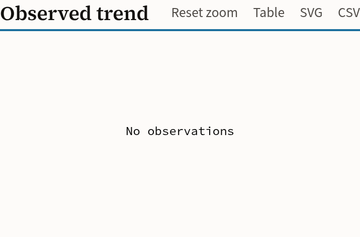
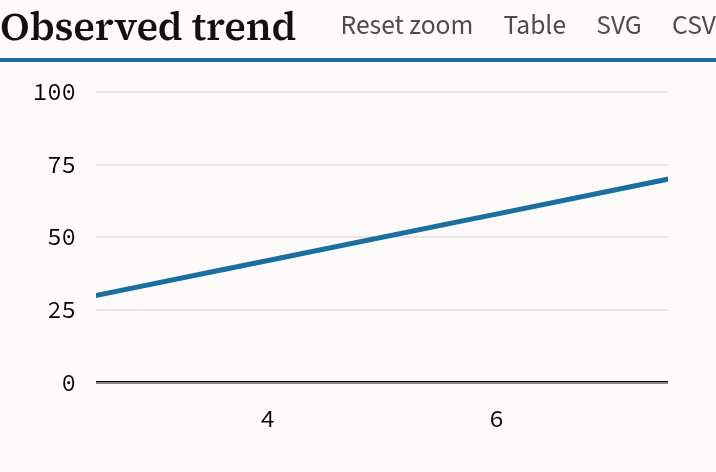
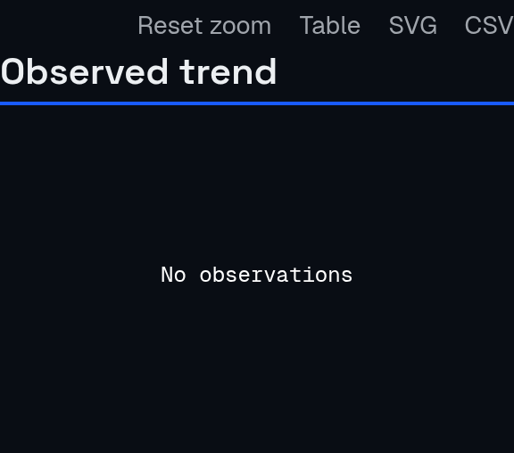
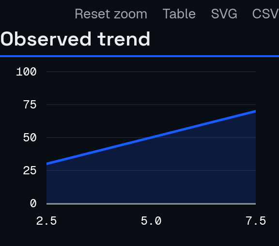

# Numeric line and area viewport continuity

Press `+` once on either source chart: the two original observations lie at X = 0 and 10, while the selected window is [2.5, 7.5]. Previously the chart said “No observations” and erased the segment crossing that window. The refinement keeps that segment and clips quantitative marks to the plot. Neither endpoint becomes a selectable observation inside the window.

| Source and viewport | Before | After |
| --- | --- | --- |
| [Line](line.rmd), Scientific, 390 px, ordinary motion settled |  |  |
| [Area](area.rmd), Sleek, 320 px, reduced motion |  |  |

This intentionally makes numeric line/area zoom an X-only viewport: automatic Y uses all currently visible source rows. Author Y bounds still apply, and hiding a series can change Y. True missing-value gaps remain gaps. Keyboard/readouts use only original rows inside the inclusive X window, including missing-Y rows; Table/CSV retain the complete original data. Scatter, nominal and calendar behavior remain unchanged.

The shared renderer keeps full-run M4 decisions, then emits only intersecting geometry. Areas retain oriented closures in one fill path. The 10,000-row one-unit reference window emits 36–41 line-path characters instead of 123,578–134,908; full source scans remain necessary. This is an emitted-size bound for ordinary monotone data, not a universal bound on genuinely repeated crossings or a performance benchmark.

Validation: all 19 required local checks passed; 1,560 unzoomed native results are exact; 116 matched report views cover five themes and 320/390/720 px, with exact initial PNG/SVG and reset SVG, plus source Table/CSV checks. Another 98 public interface states cover actual pointer/touch, stale outside pins, missing-row keyboard identity and clipped-Y targets. Two independent facets and 96 public dense zoom states include monochrome controls. Independent review accepted the main artifact.

The quantitative raster oracle has a disclosed Chromium edge-coverage difference on an outside-repeated linear run: identical retained coordinates and area winding, but 169/377 stroke edge pixels at 320/720 px differ, with maximum alpha delta 60/255 at the right clip edge. Changed pixel centers stay within 1.55 CSS px of the 2.5 px stroke center; opaque interiors are unchanged. The candidate matches an independent SVG line primitive exactly. The other 20 of 22 main quantitative rasters are exact. This is a specific reviewed rasterization difference, not a blanket screenshot tolerance. A deliberately short 96 px private-height control retains its pre-existing tick-collision warnings.

Separate frozen PR40 compatibility passed at `da0d11ba`: full sampled-run cubic controls, fallback classification and area winding remain intact. Its 122 final report views and 110 public interface states cover selected endpoint labels and legend recovery. During an active numeric window that composition uses the existing legend when a visible finite series has no selected endpoint, including a wholly offscreen series; hidden and wholly unavailable groups do not trigger it. The composition is preserved in its separate worktree and commit.

The before build is frozen `dad1615876cf05dccd7241da269fbf69cbc1ec31`, whose tracked tree equals the delivery base `480af942714c16ce4c1f959c7f046344d4f8c99d`. The after source is `aa0d199`. [validation.json](validation.json) records artifact hashes, checks, evidence identity and limitations. Full matrices and retained scratch-oracle failures remain in the campaign worktree’s `tmp/numeric-continuity/` and the historical audit path recorded there.

Build each checkout with `npm ci` and `CARGO_BUILD_JOBS=3 cargo run --release --locked -p richview-build`. Run this checkout’s helper against each built tree:

```sh
node docs/evidence/chart-refinements/numeric-continuity/reproduce.mjs BEFORE_WORKTREE before OUTPUT_DIRECTORY
node docs/evidence/chart-refinements/numeric-continuity/reproduce.mjs AFTER_WORKTREE after OUTPUT_DIRECTORY
```

The helper uses the actual report runtime, bundled fonts, headless Chromium and a 2× capture scale. `CHROMIUM` can select another executable; exact PNG hashes require the recorded browser build. It changes no chart styling.
