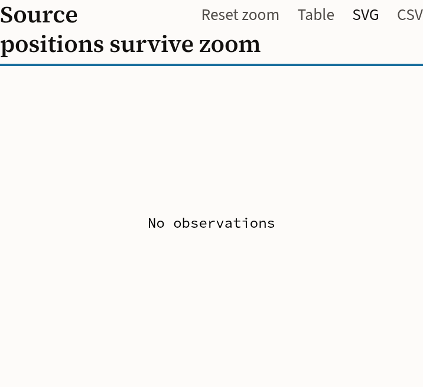
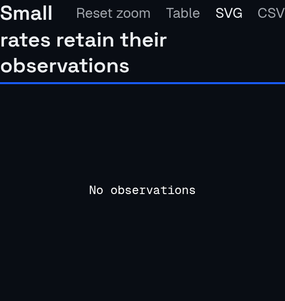
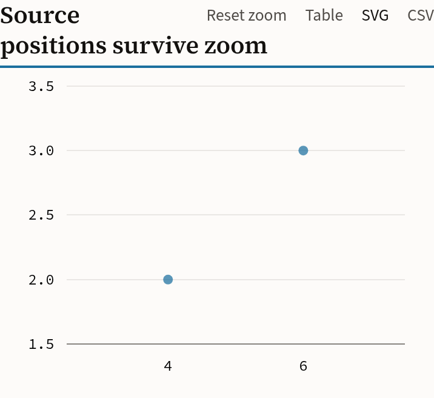
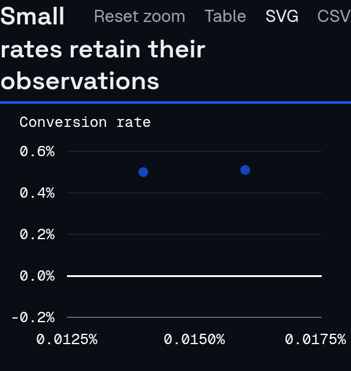

# Numeric strings survive numeric zoom

The source X values `[0, "4.000", "6.000", 10]` draw four observations. On main `bb8b112`, pressing `+` selects `[2.5, 7.5]` but removes both interior strings and reports “No observations.” The change retains those two observations in scatter, line and area views, using the renderer’s existing finite-number parser. All-string numeric sources gain the same zoom behavior.

| Scientific, 390 px viewport | Percentage data, Sleek, 320 px viewport |
| --- | --- |
| Before:  | Before:  |
| After:  | After:  |

These are actual settled Chromium figure captures at device scale 2, with unchanged report styling and source. The current-main pairs include the percentage-axis and source-readout refinements already on main. [validation.json](validation.json) records the build, source and image identities, checks and coverage. The [earlier reviewed package](history-3c07128/README.md) remains archived against its original base.

After the repository build, copy the [source fixture](source.rmd) into a dedicated report folder and serve it locally:

```sh
mkdir -p tmp/numeric-string-repro
cp docs/evidence/chart-refinements/numeric-string-zoom/source.rmd tmp/numeric-string-repro/report.rmd
target/release/richview serve tmp/numeric-string-repro/report.rmd --style scientific --port 0
```

Use a 390 px viewport, focus the chart stage and press `+`. The selected observations have X values `4.000` and `6.000`; Home and Right inspect those original rows. The downloaded SVG contains the selected marks. Table and CSV retain all four original rows, including the string literals. Escape restores the original chart. For the dark pair, replace `report.rmd` with [percent-source.rmd](percent-source.rmd), use `--style sleek` and a 320 px viewport, then press `+`. The selected X strings are `0.00014` and `0.00016`; the first point reads `0.014%` and `0.5000%` without changing those source strings.

Categorical line/area sources cannot enter numeric zoom. Hiding their nominal series may make the visible source numeric; restoring it resets numeric selection and reveals all categories. Calendar strings keep calendar behavior, while a numeric selection containing only year strings keeps its established numeric scale. Updating a chart cancels an obsolete numeric gesture. Readouts use the original source rows with their existing formatting.

Validation includes exact native SVG parity, matched live views across five themes and three widths, normal and reduced motion, source Table/CSV and SVG exports, inclusive boundaries, missing Y, calendar and category controls, facets, visibility changes, and real pointer drag/update transitions. Current-main composition checks also select zero, missing and invalid bubble sizes: notes and source errors follow the selected rows, and reset restores the original diagnostics. Failed calendar sources retain their explicit errors and stay excluded from numeric zoom. The required local Rust and host checks and independent adversarial review passed.

Crossing-only line/area windows and extreme-coordinate overflow remain separate existing limitations; no interpolation, clipping-neighbor policy or date coercion is added. Readouts retain their existing chart-specific formatting: generic line/area X headings keep source strings, while scatter applies the X format. Native missing-size warnings remain separate from the browser’s retained source errors and glyph checks.
