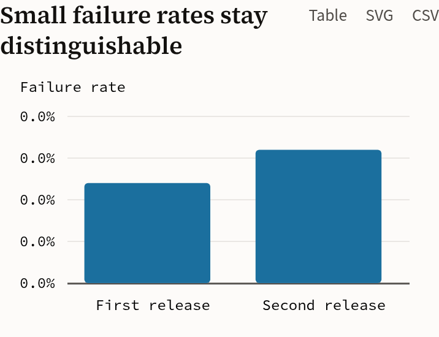
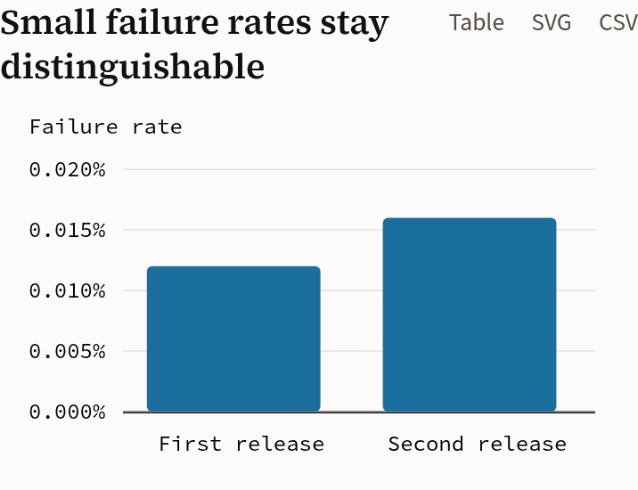
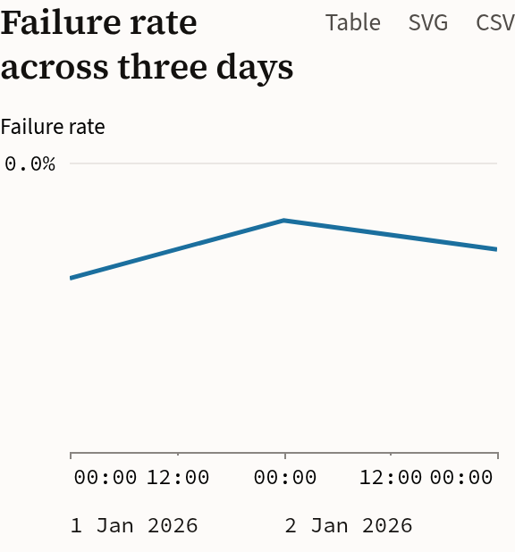
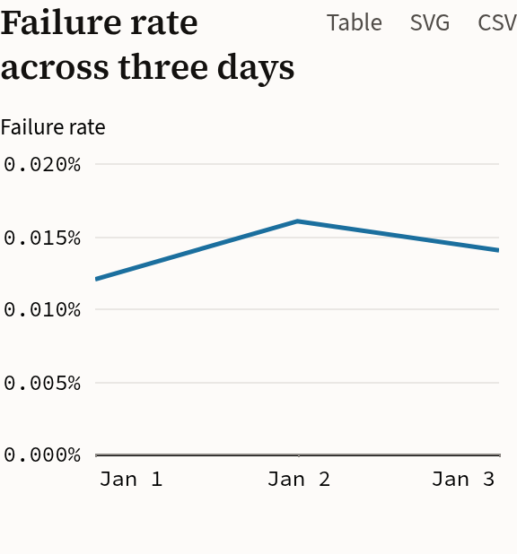

# Small percentage ticks

Values such as 0.00012 and 0.00016 previously produced several identical `0.0%` axis labels. Percentage ticks now use the tick step to retain enough decimal places, while ordinary percentages keep their established one-decimal presentation. Literal `%` suffixes still append a unit without scaling the source value.

Longer labels also need room. Numeric X labels remain inside the SVG with an edge inset. When their text would collide, the axis keeps both endpoint labels and omits only interior labels that lack room; dropped-label metadata records those omissions. Calendar axes choose an interval whose labels fit after edge alignment and the final Y-axis gutter. Source observations and value domains retain their existing calculations.

| Case | Before | After |
| --- | --- | --- |
| Small failure rates, 390 px Scientific page |  |  |
| Three days, 320 px Scientific page |  |  |

These are actual live chart captures with identical source, theme and viewport, using headless Chromium 151, device scale 2 and reduced motion. The chart widths differ from page widths because of report margins. `capture-evidence.json` records the base commit, source and build hashes, actual figure dimensions and live diagnostics. The comparison base is `3c07128b7139687b754f6e1b5848c2a46c31cfe5`.

The regression suite covers categorical and temporal Y axes, numeric X axes, signed values, fractional steps, literal suffixes, eight-decimal percentage labels, and actual phone chart widths with several font sizes. Visual inspection covered 120 matched cases across all five builtin themes at 320/390/720 px. An independent review reproduced and rejected initial numeric-edge clipping and phone date-label collisions, then accepted the fixes using fresh captures and unchanged ordinary/suffix controls. A later composition review found dense numeric labels overlapping on the sibling branch; a label-only spacing rule resolves that case without changing observation positions or numeric domains.

Local format checks, native and Wasm Clippy, workspace tests, release packaging, generated fixtures and strict TypeScript declarations pass. The native, editor, compatibility, browser, landing, local Cloudflare, showcase, flagship, reel, browser API, motion lifecycle and docs verifiers pass. Verification used Rust 1.99.0 and Node 26.8.1; hosted CI uses Node 22. No deployment was performed.

The existing eight-decimal formatting limit remains. Readouts and end labels have separate formatting policies. Native temporal diagnostics still estimate some X-label bounds at the tick position instead of the shifted label position; their pre-existing right-edge warning does not describe clipping in the inspected live output. This refinement does not claim to repair that diagnostic policy.

The branch is based on current main after design PR #22. It retains the merged numeric tick selection and text metrics, adding a 4 px edge inset and interior-label spacing. Independent reviews accepted main and reconciled-design captures with unchanged observation geometry. A separate unmerged curve/label branch also changes axis formatting and calendar presentation; later composition should keep one shared percentage formatter and one calendar fit planner, carrying these regression fixtures forward.
