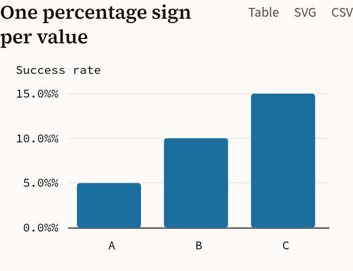
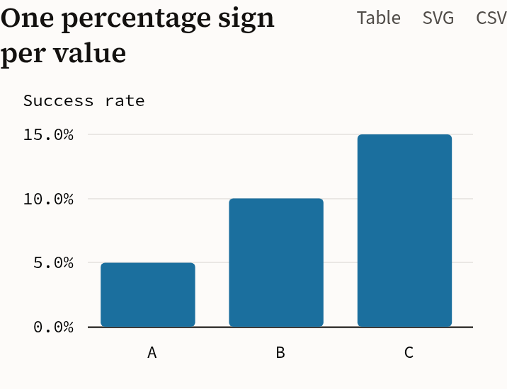
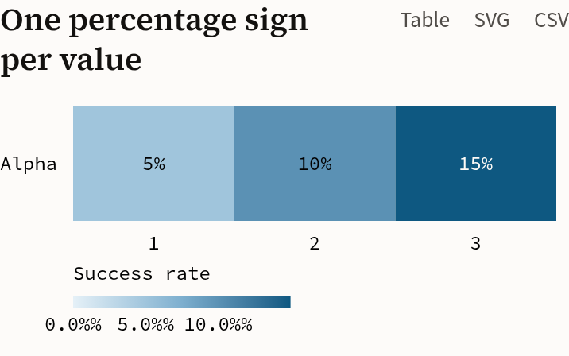
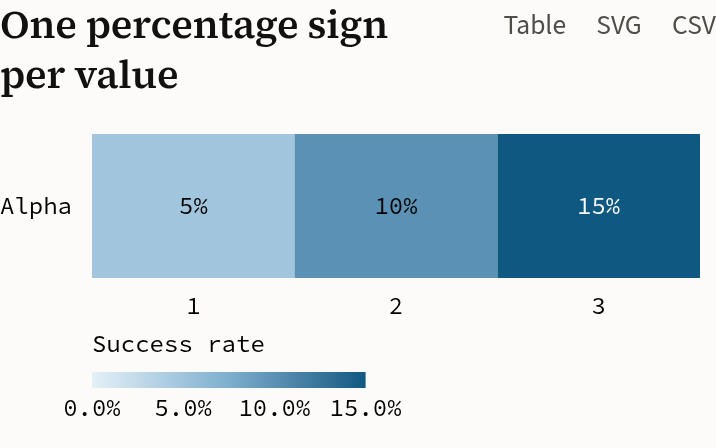

# One percentage sign per value

An axis or heatmap key using both `format: percent` and `suffix: "%"` previously printed labels such as `15.0%%`. The shared numeric label formatter now emits its percentage sign once when the suffix contains only that same sign, allowing surrounding whitespace. This is a two-line production refinement.

| Case | Before | After |
| --- | --- | --- |
| Percentage axis, Scientific at 390 px |  |  |
| Percentage heatmap key, Scientific at 390 px |  |  |

These are actual live figures from identical sources and viewports, with loaded fonts, Chromium 151.0.7922.173, device scale 2 and reduced motion. The base is `bb8b112c121eae1ec70d810df1b5e6a2070c9c4e`; the implementation is `abf21b9910f44b58815fca7ab433c0d798fba4f9`. `verification.json` records source, build and image hashes. After a fresh release build, run `node docs/evidence/chart-refinements/percent-unit/capture.mjs` to reproduce the two after images under `tmp/percent-unit/reproduced`.

The matched gate covered 165 views across all five builtin themes at 320/390/720 px. All 90 affected views use a single sign; all 75 control SVGs remain byte-identical. There were no browser errors, horizontal overflow or live glyph findings. Eleven native before/after pairs retain source validity, and five native controls are byte-identical. Fresh independent review accepted 13 additional matched phone views, including seven unchanged controls and unchanged exact readouts. Two further theme controls preserve distinct eight-decimal percentage endpoints. The historical 26-view review remains recorded separately. Shorter labels may change the existing gutter or allow more heatmap key ticks; source values and domains keep their existing calculations.

Formatting without a suffix, literal suffix-only units, currency, arbitrary text such as `share` or `% of total`, and temporal labels retain their existing behavior. This patch does not change readout formatting, cell labels, end labels or the separate percentage precision policy. The independent `% of total` stress control retains two pre-existing clipped labels at Scientific 320 px; it is not a new label-fit fix.

Local formatting, native and Wasm Clippy, workspace tests, release packaging, fixtures, strict TypeScript declarations and all thirteen host verifiers pass, including the original motion lifecycle check. One initial local Cloudflare process encountered a port collision while other worktrees ran the same check; the unchanged check passed in a serialized rerun, and both outcomes remain recorded. The earlier detached-node motion failure is retained with its historical baseline. No deployment was performed.
