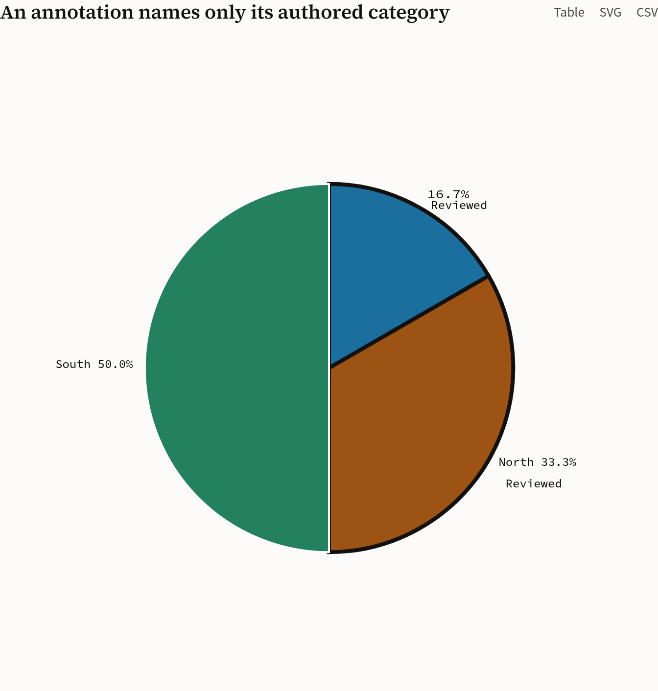
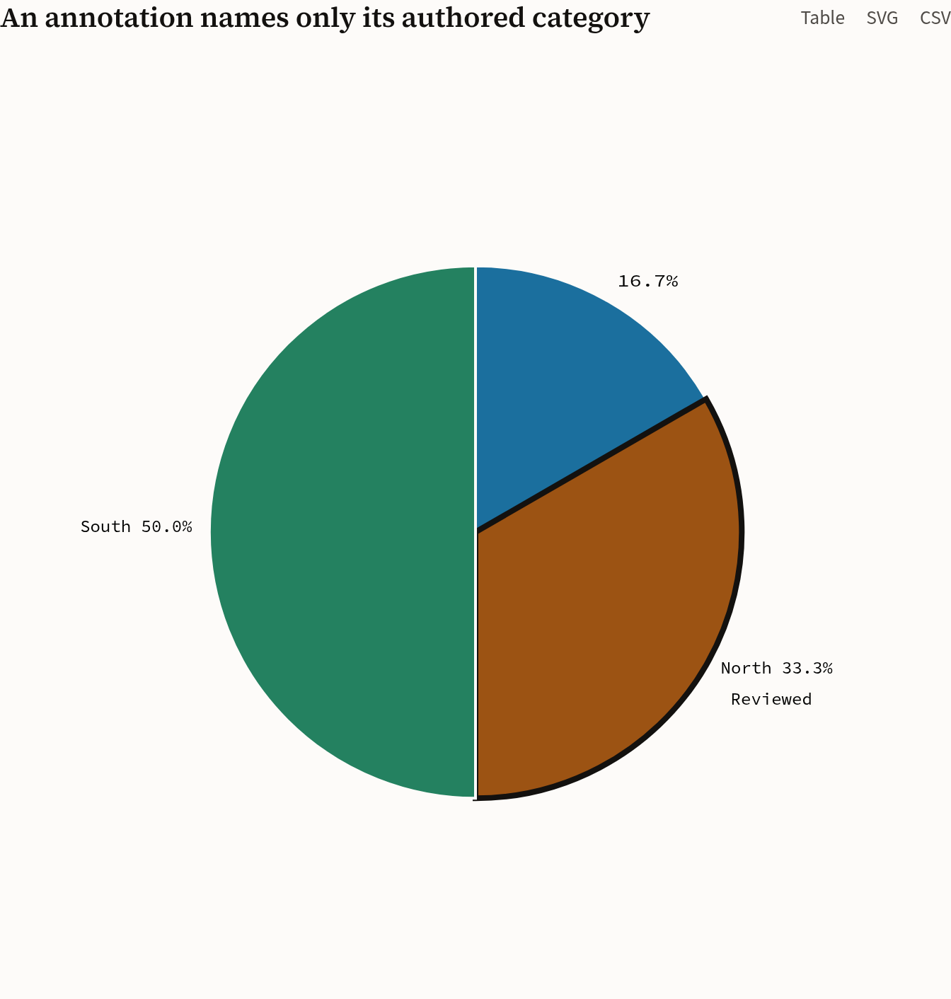

# Pie annotation target identity

A note authored for North previously also outlined an unnamed category and repeated its text there. Reading an absent category-field or `name` alias as null made it compare equal to the empty category name. The two existing alias comparisons now require the key to be present.

The fix preserves explicit empty-string targets, numeric/string normalization, category fields selected by `encoding.color`, and a field literally named `name`. Two explicit, conflicting aliases still select their union; equal aliases emit one annotation. Explicit null targets retain the low-level chart API's existing empty-name normalization. The report parser still rejects null coordinates. No slice order, color, layout, aggregation, selection or source value changes.

| Scientific, 720 px viewport | Before | After |
| --- | --- | --- |
| `at: {name: North}` with unnamed, North and South categories |  |  |

The pair is copied byte-for-byte from the complete figure captures, at device scale factor 2. The source is `pie-anchor-name` in [fixtures.json](fixtures.json). Font bounds and remaining annotation-placement warnings are retained, not concealed.

## Provenance

- Baseline: `bb8b112c121eae1ec70d810df1b5e6a2070c9c4e` (merged first refinement set).
- Product source: `9e414e175dce492a78584cb81a7d5a71c8b1b187` on `refine/chart-pie-anchor`; subsequent evidence-only commits do not change the build.
- Baseline browser Wasm: `1f278570318a19163969089bf4b8f1f694efe5b0f9b3ba04b2897912851458be`.
- Candidate browser Wasm: `32af0db212111a68dbf98d2fb5b18893000ccef4c0ce5f047095dbc441c25d2f`.
- Candidate native CLI: `efa4b6b592874df643737111715e0ee288988cee0ff144d869804f21e4974b29`.
- Rust 1.99.0, wasm-bindgen 0.2.129, Node 26.8.1, headless Chromium 151.0.7922.173. CI requests Node 22; the local result records the version actually used.

## Verification

The durable owner-level Rust test maps actual annotation outline paths to the expected existing sectors for both point and text notes. It covers missing/empty/unmatched aliases, explicit empty/null targets, conflicting/equal aliases, numeric category normalization, color grouping and literal `name`, while comparing all primary mark SVG, viewBox, hit points and hover rows with an unannotated chart.

The accompanying [verification.json](verification.json) records final matched rendering, native offline, source interaction and required local check results. Full raw captures and logs are retained at `/home/vecera/tmp/richview-chart-refinement-20261011/pie-anchor-*` and the branch's `tmp/pie-anchor/`.

Matched output covers 210 report configurations and 225 child charts across all five themes at 320, 390 and 720 px. Every surviving annotation and every non-annotation element is unchanged; 120 false outline/text pairs disappear. The 105 unaffected child SVGs and 90 unaffected complete-figure PNGs are byte-identical. Fifteen facet configurations were additionally captured with a corrected evidence helper that records each child SVG, closing the original helper's empty-outer-container gap.

Both motion modes pass on 60 matched native/static/live/export panels: 176 keyboard rows, 172 pointer hits, 172 touch hits and 60 Table/CSV pairs retain their source identity. A separate native CLI test passes 48 offline views covering 56 panels with JavaScript enabled and disabled. Measured warning instances in the broad matrix fall from 110 to 75; each remaining finding is unchanged from the baseline. Independent review accepted a separate 32-view matched matrix, explicit-null API controls and fresh interaction/export cases.

Formatting, native and Wasm Clippy, workspace tests, the release build and all 14 required host checks pass, including motion runtime. The local Cloudflare verifier ran under the campaign's shared lock to avoid concurrent Wrangler port contention. These are local results; no hosted CI result is claimed.

This is an identity correction. Existing annotation text clipping and collisions are a separate placement problem. The deferred pie-order proposal remains blocked by its demonstrated annotation collisions; this change does not claim to unblock it. Aggregated repeated categories retain their existing floating-point representation, while a single decimal-string value retains its source precision.

## Reproduce

Build this branch and a clean checkout of the baseline with `CARGO_BUILD_JOBS=3 cargo run --release --locked -p richview-build`, using the repository's npm dependencies. From this branch root, copy the evidence helpers to the expected scratch location:

```sh
mkdir -p tmp/pie-anchor
cp docs/evidence/chart-refinements/pie-anchor/*.ts docs/evidence/chart-refinements/pie-anchor/fixtures.json tmp/pie-anchor/
```

Run each source tree through [capture.ts](capture.ts), substituting its path and a separate output directory. The complete matrix uses all five themes and the three viewport widths:

```sh
node tmp/pie-anchor/capture.ts --worktree /path/to/source-tree --out /path/to/captures --sources tmp/pie-anchor/fixtures.json --themes sleek,scientific,brutalist,sleek-light,hand-drawn --widths 320,390,720
```

Run [verify-paths.ts](verify-paths.ts) and [verify-native-cli.ts](verify-native-cli.ts) for both builds with `--worktree`, `--out` and `--phase before` or `--phase after`. These check actual outlined sectors, native/static/live/export text, pointer/touch/keyboard identity, original Table/CSV rows, and ordinary/reduced motion. They use temporary local servers and separate headless browser contexts; native CLI reports embed their assets and are verified with network requests blocked.

Use [verify-matched.ts](verify-matched.ts) with `--before <baseline-captures> --after <candidate-captures> --baseline <baseline-tree> --out <result.json>` to compare the complete matrix and direct-API controls. Optional `--facet-before` and `--facet-after` point to the child-SVG supplements for the original campaign captures; the included capture helper records child SVGs in a fresh full run. Run [compare-interfaces.ts](compare-interfaces.ts) with `--before <baseline-interface-dir> --after <candidate-interface-dir> --native-before <baseline-native-dir> --native-after <candidate-native-dir> --out <result.json>` to compare source interaction and offline evidence.
