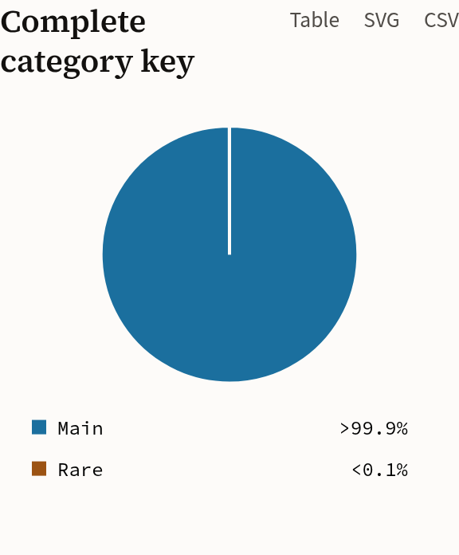
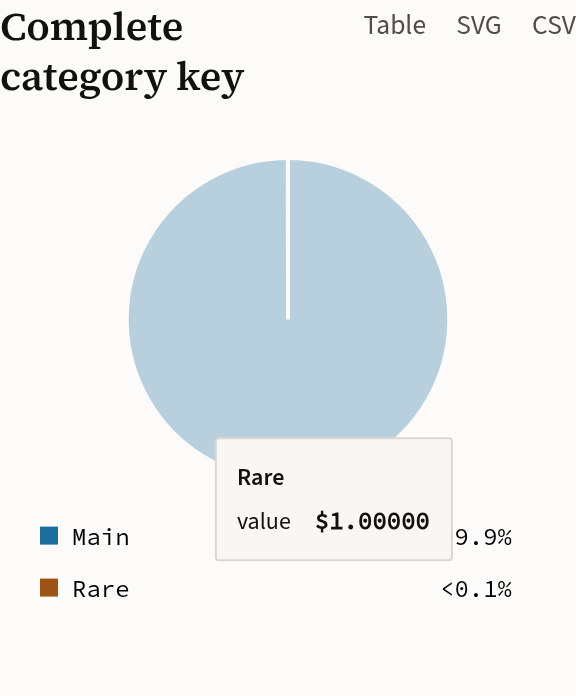
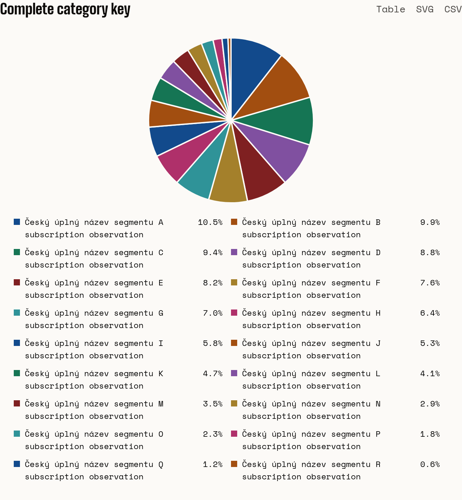
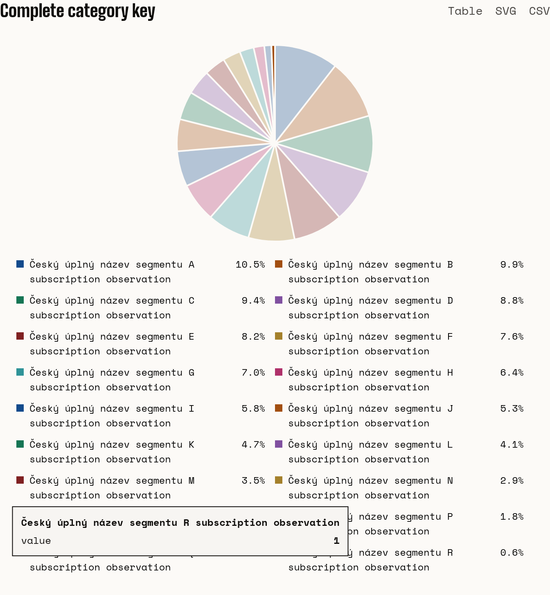

# Inspect pie values through the category key

A tiny sector can be smaller than a phone pointer target even though its complete category key is visible. Hovering or tapping that existing entry now reaches the same aggregated readout as the sector, including exact source strings and zero shares. The key's swatch, wrapped name and percentage all select the original aggregate index. No visible layout, order, color, annotation, sector geometry or source data changes.

The matched inspection states below use identical pointer coordinates. Before, the key produces no readout; after, Rare exposes `$1.00000`, and the final wrapped category exposes its complete name and value. Existing slice emphasis and tooltip behavior are reused. These interaction screenshots intentionally differ; a separate five-theme matrix proves all 320 resting figure PNGs byte-identical.

| Source and view | Before | After |
| --- | --- | --- |
| [Tiny share](tiny-source.rmd), Scientific, 320 px page |  |  |
| [Wrapped categories](wrapped-source.rmd), Brutalist, 720 px page |  |  |

The source baseline is `480af942714c16ce4c1f959c7f046344d4f8c99d`; captures use its identical tracked tree `dad1615876cf05dccd7241da269fbf69cbc1ec31`. Final runtime is `aa5e7bd90567e6fe75b3f65ffbd848509e155b61`. [Verification](verification.json) records source/image hashes, fresh native/Wasm hashes, Chromium version, the 19 required passing checks and matched render/interface coverage. Ordinary and reduced motion, true SVG widths 240–936 px, facets, gaps, both columns, annotations, resize/source updates, keyboard, original Table/CSV, SVG export and offline HTML were checked. Independent review accepts the final main and frozen PR #40 artifacts.

PR #40's frozen `2badd277` requires this [test reconciliation](pr40-test-reconciliation.patch): its pie annotation test must compare the complete Sector and Rect metadata. It retains every geometry assertion and adds nonvacuous counts. The first composition also exposed an omitted annotation; the final product collects key targets locally and publishes them only after annotation placement, so invisible inspection space is never treated as paint. The repaired composition preserves all annotation SVG and drop findings. The real sibling branch was not edited.

The change adds no focus stops, new tooltip policy or targets to radial/empty pies. A one-line key target is 22 px high with positive row/column gaps; this is not a 44 px touch-target claim. Static SVG remains unchanged. Existing annotation collisions or omissions remain unchanged.

To reproduce, build isolated baseline/current worktrees using [the pinned build instructions](../../../../CLAUDE.md), with npm dependencies and `/usr/bin/chromium` available. From the current checkout run:

```sh
node docs/evidence/chart-refinements/pie-key/capture.mjs /absolute/built/baseline tmp/pie-key-before
node docs/evidence/chart-refinements/pie-key/capture.mjs /absolute/built/current tmp/pie-key-after
```

The helper uses bundled fonts, device scale 2 and reduced motion, and writes both images plus pointer/readout/build provenance. Full matrices and first rejected source/harness logs remain in the campaign's local scratch record; they are not duplicated in this small evidence bundle.
