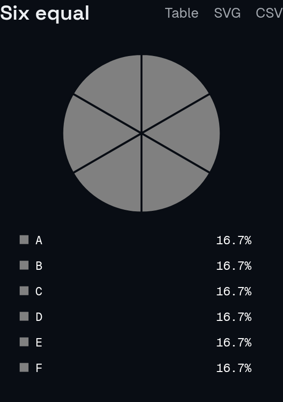
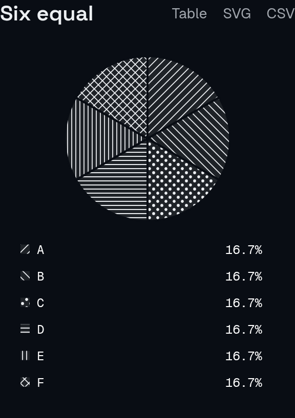
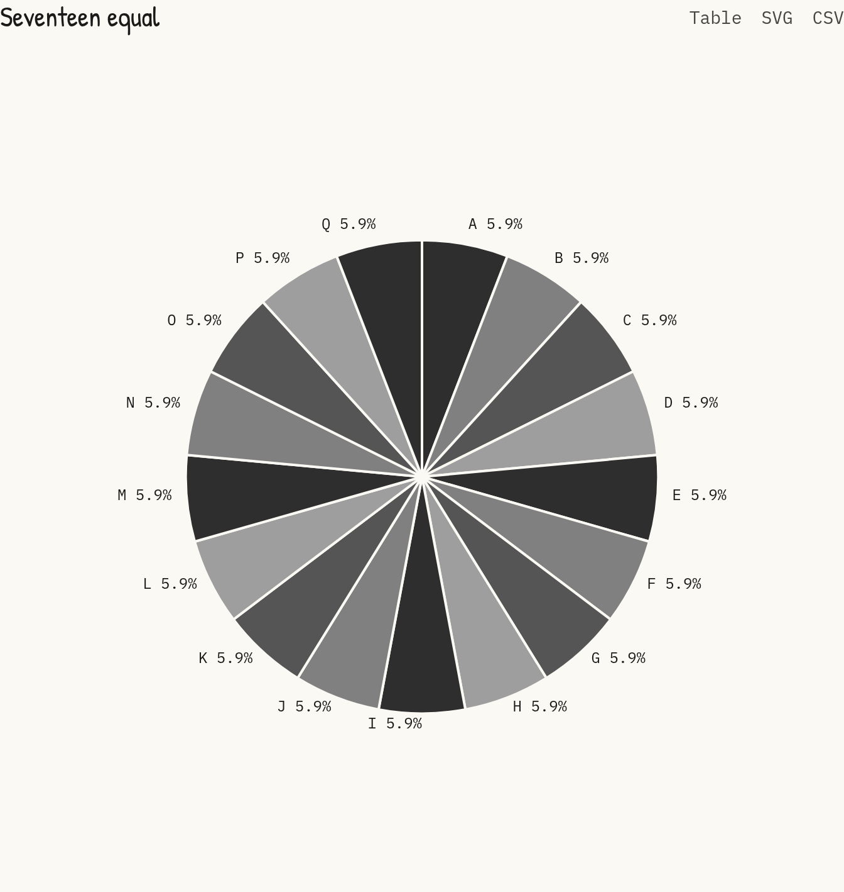
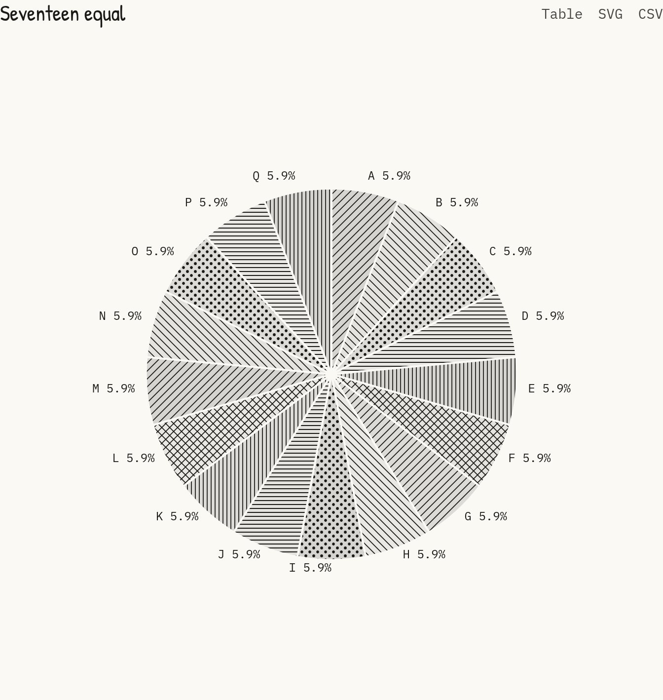

# Pie sectors and keys share explicit hatch patterns

With `chart.decals: true`, pie sectors and category-key swatches now use the same existing six hatch patterns as bars. This gives otherwise identical gray categories a second visual cue. Category order, palette slots, values, proportions, labels, annotations, source rows and interaction geometry stay unchanged. The flag is explicit; grayscale colors and the Hand-drawn theme alone do not enable it.

[Six-category source](six.rmd), Sleek, 320px page with the showcase monochrome palette:

| Before | After |
| --- | --- |
|  |  |

[Seventeen-category source](seventeen.rmd), Hand-drawn, 720px page with an explicit gray palette:

| Before | After |
| --- | --- |
|  |  |

The second pair shows the limit: six shapes repeat, and dense pies look busier. Patterns supplement the complete names and shares; they do not uniquely identify more than six categories. Tiny sectors and the existing 9px swatches may show only part of a tile. This change adds no palette, category-order or layout policy.

The pie source is `afe449a0a8ac7b7bc950ec7cfbdbfaa2cd31185a`, stacked on the independently reviewed [live SVG resource ownership change, PR #52](https://github.com/richview-universe/richview-v3/pull/52) at `54f722b856475cb6373034f7c9734f2cf353c2b5`; main was `480af942`. The prerequisite keeps resources local when identical charts share a document. Fresh isolated builds change Web Wasm from `7b59e786…` to `ac101c01…`. Full native/core/Web hashes, exact style tokens and source/image hashes are in [verification.json](verification.json).

All 19 required local checks pass. The matched matrix covers all five themes, 320/390/720px widths, ordinary/reduced motion, radial/wrapped keys, 6/9/17 categories, tiny/zero/blank/repeated/unavailable values, custom resolved palettes, facets and annotations. Its 410 native/core and live SVGs preserve everything except the intended definitions and fills; 100 empty or nondecal SVGs and PNGs remain byte-exact. Separate probes preserve 129 keyboard rows, 108 sector inspections, 27 Table/CSV panels and 27 downloaded SVGs. Eight duplicate-view lifecycle runs cover 80 states and 16 standalone exports. Sixty-four actual CLI-generated offline configurations cover JavaScript-disabled/live and screen/print output without external requests.

The frozen PR40 `2c13ffb` plus resource ownership and accepted pie-key composition compares `2b8c5a3` to `d14a212`. The only product delta is this pie change. Its fresh release, Rust checks and selected host checks pass; 36 matched configurations preserve native/live layout and annotation findings. A further 27 source panels preserve 129 keyboard rows, 348 key targets with mouse/touch, 108 sector inspections, 42 empty gaps and 27 downloads. That lab retains the previously accepted resource and pie-key test adaptations for PR40; this pie patch needs no new test reconciliation. Main key rows keep their existing interaction behavior.

Independent review accepts both fresh artifacts. Across its two matched gates, 96 direct native outputs and 64 live states preserve full geometry, diagnostics, source interfaces and resource ownership. It also checked exact key readouts in the composition and visually reviewed the clean six- and seventeen-category pairs above.

Original scratch failures remain recorded: a test compared the intentionally different decal flag, a palette array was placed in the source-only string field, an offline probe read before embedded runtime readiness, and a copied lifecycle probe incorrectly required a gradient in a pie. Corrected probes use resolved style tokens, explicit runtime readiness and the actual pattern contract. None required another product change.

To reproduce all four images, build the recorded baseline and candidate, install pinned npm dependencies and use Chromium 151.0.7922.173. From this checkout run `node docs/evidence/chart-refinements/pie-mono/capture.ts /path/to/baseline tmp/pie-mono/before before`, then `node docs/evidence/chart-refinements/pie-mono/capture.ts . tmp/pie-mono/after after`. The helper verifies source, core/Web Wasm, browser and PNG hashes. Full matrices and original logs remain in the local run evidence.
