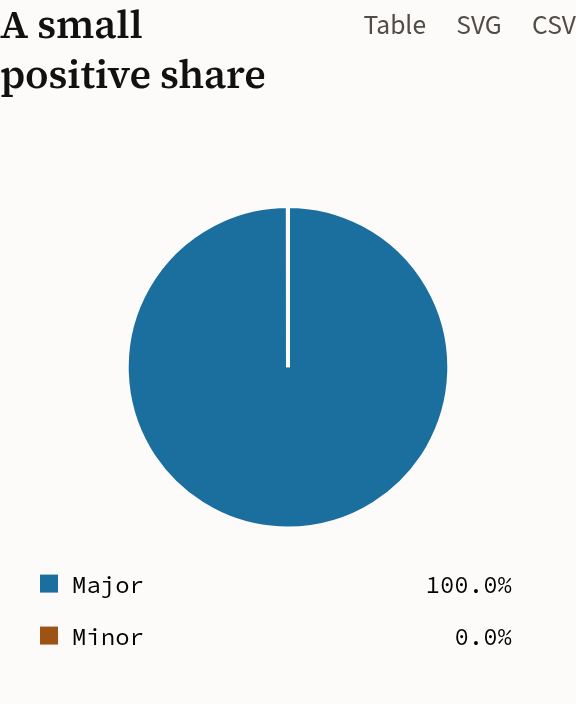
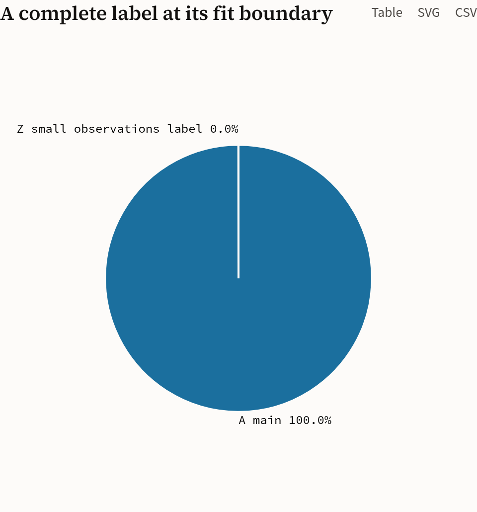
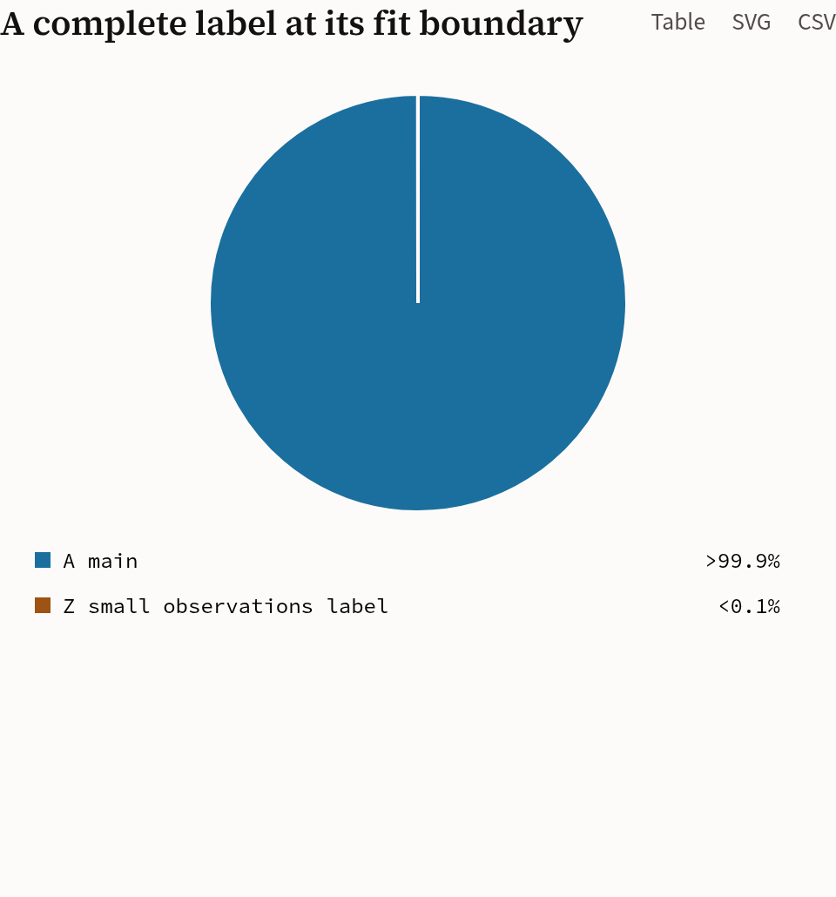

# Pie shares near zero and one hundred percent

A count of one beside 9,999 currently prints 0.0% and 100.0%, making a positive observation look absent and its complement look complete. This refinement uses `<0.1%` and `>99.9%` at those rounded endpoints. Genuine zero/full shares and ordinary one-decimal labels keep their existing text. The same escaped string appears in visible labels and SVG titles.

[Phone source](phone.rmd), Scientific, 320px page:

| Before | After |
| --- | --- |
|  |  |

[Fit-boundary source](fit-boundary.rmd), Scientific, 512px page with ordinary motion:

| Before | After |
| --- | --- |
|  |  |

The change preserves values, category order, angular proportions and colors. Existing layout can switch from radial labels to a key, or wrap a long key name onto another line; it does not abbreviate names or reduce text size. The second pair deliberately shows that fit boundary. A separate dense-name probe grows 252px through the existing wrapping policy.

The candidate source is `f87fd24604fa4dcfe8e25859ab7945a0dbfedd65` on current main `b76885a66808956d7e7944b9923aacb445d72b66`. Current matched captures cover 120 reports in all five themes plus 10 ordinary-motion fit-boundary views. Both sides reproduce their corresponding historical SVGs, PNGs and native diagnostics exactly in the 120 shared cases. The owner replay of 12 interface records is identical to the accepted independent probe, including raw source tables, CSV, keyboard and pointer/touch outcomes.

The original frozen source `a149032` on main `159e3cb` has 460 matched reports, 460 measured live child charts and 20 explicit static empty controls. Two hundred whole control PNGs and 220 control child SVGs remain byte-identical. Independent reviews additionally covered 54 craft views, 24 layout views and four interface panels. All 19 required local checks pass on the current source. Independent source, rendered-layout and interaction reviews accept the refinement; see [verification.json](verification.json) for recorded identities and limitations.

The frozen sibling composition at `b19f92b` also passes its bounded review: 125 of 130 matched chart outputs are exact to the corresponding standalone output, and 60 unchanged before/after reports retain identical SVGs and pixels within the sibling styling. Its existing annotation policy affects five deliberately crowded views: radial-to-key reflow leaves no collision-free position for an optional note, so the sibling omits that note and records the reason in `droppedLabels`. The source, angular proportions and non-annotation SVG content remain unchanged across branches. This optional-note tradeoff is separate from the current-main images above.

Existing annotation overlaps remain documented. Tiny sectors may still be smaller than pointer/touch resolution; keyboard and source interfaces retain their values. Overflowed totals are deliberately unchanged. Initial capture/oracle failures remain in local evidence and are not presented as successful runs.

To reproduce the four curated images, build the recorded baseline and candidate with the repository toolchain, install the pinned npm dependencies, and use Chromium 151.0.7922.173. From the candidate checkout, run `node docs/evidence/chart-refinements/pie-share-labels/capture.mjs /path/to/baseline tmp/pie-share-labels/before before` and then `node docs/evidence/chart-refinements/pie-share-labels/capture.mjs . tmp/pie-share-labels/after after`. The helper checks source, build and image hashes. Full matrices stay in local run evidence; this folder keeps two sources and four review images.
