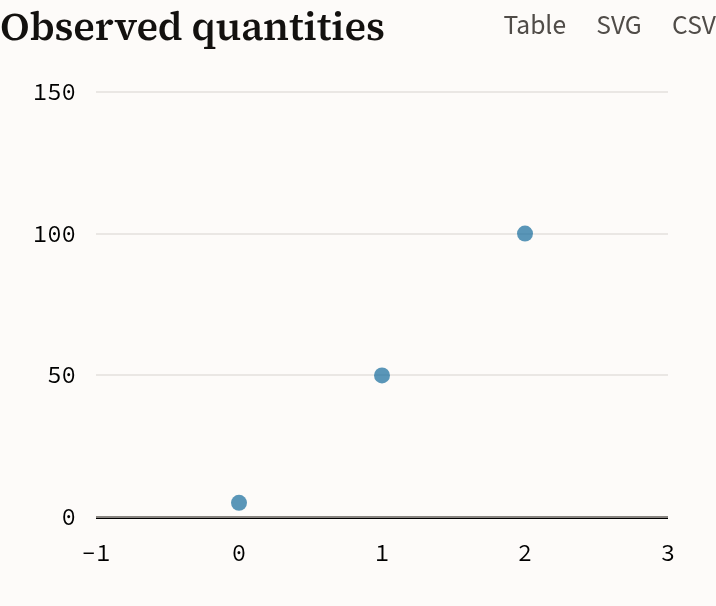
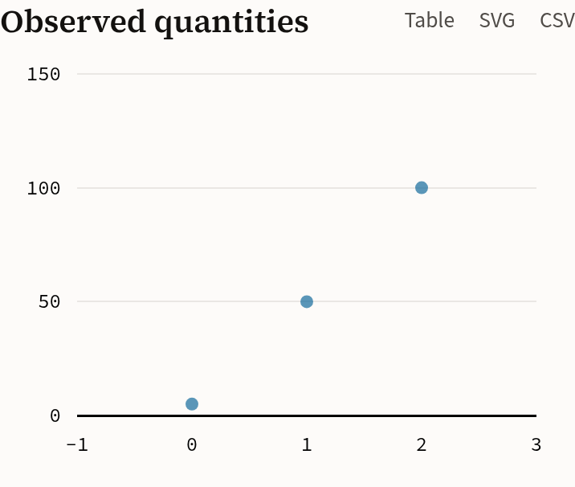
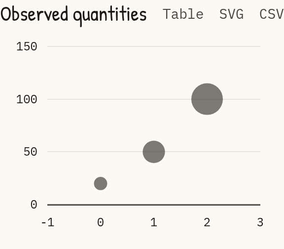
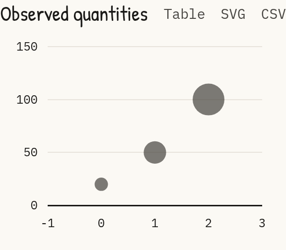

# A consistent lower zero reference for scatter

Scatter plots omit the overlaid bottom rule when their lowest visible Y tick is already zero. Removing the gray 1 px overpaint restores the existing ink zero reference. Signed plots with a mid-plot zero, views without a lower zero reference, and other chart types retain the frame. Data, domains, marks, axis labels and interaction stay unchanged.

These actual report captures use loaded fonts, reduced motion and DPR 2. Each pair has identical source, theme and viewport. The baseline is `3c07128b7139687b754f6e1b5848c2a46c31cfe5`; [validation.json](validation.json) records the candidate artifact identity and checks.

| Before | After |
| --- | --- |
|  |  |
|  |  |

The first pair is [points.rmd](points.rmd), Scientific at 390 px; the second is [bubbles.rmd](bubbles.rmd), Hand-drawn at 320 px. These automatic domains end at zero. An authored `axes.y.min: 0` can also qualify. A mathematically available or mid-plot zero is insufficient: the actual lowest emitted Y reference must be zero. Default scatter data containing zero can acquire a negative lowest tick from protective padding, so those views remain unchanged.

The independent reviewer accepted the current-main result after eight matched eligible and signed-control views. The benefit is a cleaner, consistent zero rule. The local matrix covers nine scatter fixtures at 320/390/720 across all five themes. All 135 actual SVG/glyph/figure comparisons and 42 native full HTML/metadata comparisons differ only by eligible rules. In 81 paired initial/zoom/reset states, geometry, keyboard readouts and downloaded SVG remain equal. The frame follows the actual lowest tick as zoom changes the domain. All required current repository checks pass, including the motion lifecycle verifier; the README reproduction matches the after PNGs byte-for-byte. Detailed matrices and logs remain in the task workspace.

The same 42 native, 135 live and 81 interaction comparisons pass when composed with the accepted proportional-bubble change on current main. Bubble areas, source readouts and zero-size explanations remain intact; only eligible lower rules differ.

## Reproduce the after views

Build with `cargo run --release --locked -p richview-build` and install the pinned development dependencies with `npm ci --ignore-scripts`. Run this from the repository root; output goes into a disposable local verification directory. For before views, use the baseline in a separate worktree, copy these two fixtures into the same evidence path, build, and run the same snippet.

```sh
node --input-type=module <<'JS'
import { readFileSync } from 'node:fs';
import { harness, settled } from './scripts/browser-harness.mjs';
import rust from './packages/core/dist/index.js';
delete process.env.RICHVIEW_VERIFY_URL;
delete process.env.RICHVIEW_VERIFY_PUBLIC_DIR;
delete process.env.RICHVIEW_SERVER_BINARY;
const h = await harness('scatter-frame-evidence');
const dir = 'docs/evidence/chart-refinements/scatter-frame';
try {
  for (const [file, id, theme, width] of [
    ['points', 'scatter-frame-auto-points', 'scientific', 390],
    ['bubbles', 'scatter-frame-auto-bubbles', 'hand-drawn', 320],
  ]) {
    const context = await h.browser.newContext({
      viewport: { width, height: 900 }, deviceScaleFactor: 2, reducedMotion: 'reduce',
    });
    const page = await context.newPage();
    const source = readFileSync(`${dir}/${file}.rmd`, 'utf8');
    const rendered = JSON.parse(rust.render_source(source, JSON.stringify({
      width, styles: [theme], runtime_url: h.base + '/richview_web',
      report_folder: { root: id, source: 'report.rmd', files: ['report.rmd', 'reference.json'] },
    })));
    const url = `${h.base}/${id}`;
    await page.route(url, route => route.fulfill({ contentType: 'text/html', body: rendered.html }));
    await page.goto(url, { waitUntil: 'networkidle' });
    await page.evaluate(() => document.fonts.ready);
    await page.waitForFunction(() => document.querySelector('.rvc')?.hasAttribute('data-rvc-diagnostics'));
    await settled(page);
    await page.locator('figure.rv-chart').screenshot({ path: `${h.dir}/${file}.png` });
    await context.close();
  }
  console.log(h.dir);
} finally { await h.close(); }
JS
```
