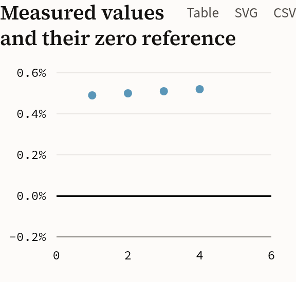
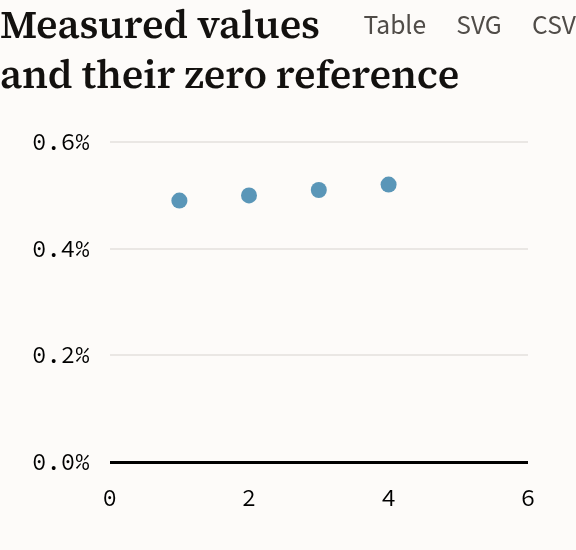
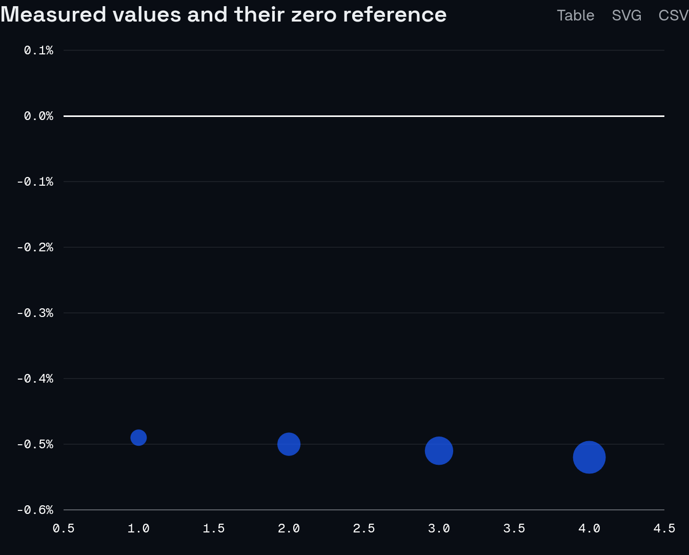
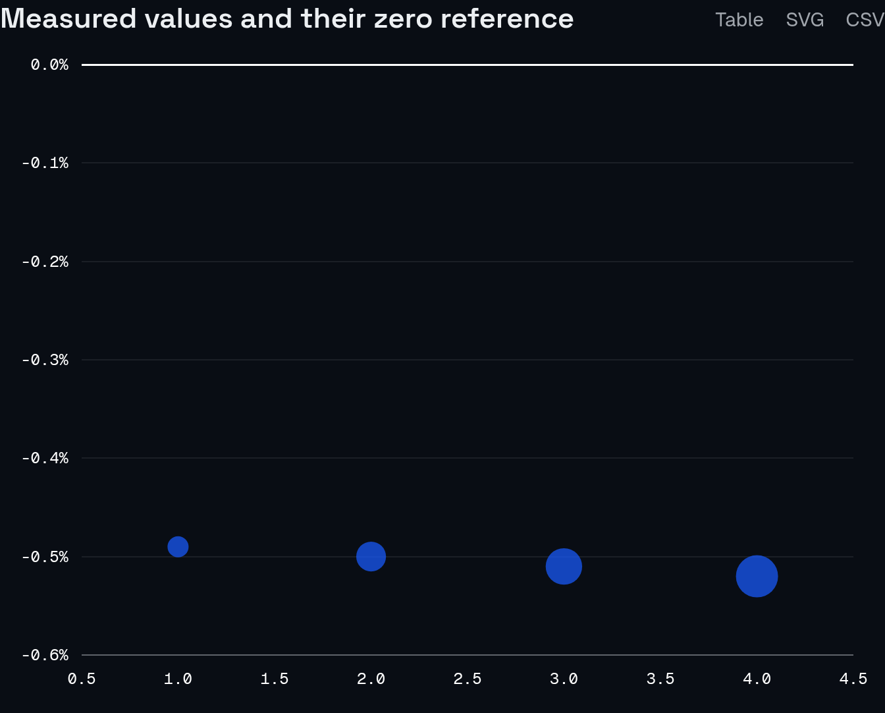

One-signed percentage scatters can reserve an opposite-sign band solely because their implicit zero endpoint receives circle padding. This change returns that space to the plot when every drawable circle still clears both Y edges by its radius plus 4 px. It preserves the far endpoint, surviving tick values and step, bubble areas, source rows and a linear scale. Real zero observations, insufficient clearance, any authored Y-bound key and nonempty annotation lists retain the existing domain.

| Actual figure | Before | After |
| --- | --- | --- |
| Scientific positive points, 320 px |  |  |
| Sleek negative bubbles, 720 px |  |  |

The positive phone plot recovers 40 of 160 plot pixels; the negative wide plot recovers 64 of 448. Circle sizes and X positions stay unchanged; Y positions follow the new affine scale. [positive.rmd](positive.rmd) and [negative.rmd](negative.rmd) are the exact sources. The four PNGs are unmodified complete figures with loaded fonts, Chromium 151.0.7922.173, device scale 2 and reduced motion.

The current base is `159e3cbc01773c59891c984d3a485d089ac6372d`; the tested source is `984f2233fe3065e152590d7f3c4515294b990c74` (runtime code `a2480c0`). [verification.json](verification.json) records builds, source/image hashes and results. Fresh formatting, native/Wasm Clippy, workspace tests, release packaging and all fourteen host/fixture checks pass, including motion and serialized Cloudflare verification. One initial Rust runner terminated before its workspace result; the preserved partial record and successful scoped rerun are identified in the proof.

The current matched gate covers 370 configurations across all five themes at 320/390/720 px, including ten intentionally rejected reversed-bound controls. Of 390 rendered child panels, 185 trim unused space and 205 keep byte-identical SVGs; 190 complete PNGs are identical. No new native/live findings occur. Sixty-four interface panels preserve 272 keyboard/source rows and 256 pointer and touch inspections each, exact Table/CSV and native/live/downloaded-SVG geometry. Twenty-four native reports produce 96 offline views, with JavaScript on and off. Percentage suffixes, exact decimal strings, zero-size targets, filtered rows, windows and facets are covered.

Independent current review passes 27 threshold/guard cases, fourteen live interaction states and twelve matched unit views. It checks hide/show, zoom, pan/reset, real zero targets and exact readouts. The identical rule was separately accepted before the frozen `c49fe55` sibling's final-label gutter at `749b063`, preserving all four point names in sixty owner and twelve independent ordinary-motion views. This does not claim compatibility with an unexamined newer sibling head.

The deliberately constrained 60 px chart retains inherited crowded axes as an exact control. Invalid values retain their diagnostics and source access; reversed bounds remain rejected. This does not change percentage recognition, units, annotation placement or interaction policy. Evidence is from Linux Chromium only, with local Node 26.8.1 rather than CI Node 22; no physical-device, hosted-CI or performance result is claimed. Full matrices, runners, first failures and raw outputs remain at the local paths in `verification.json`; historical proof is preserved at `db45d4b` on `archive/chart-scatter-padding-bb8b112`.

After building this source and the base in separate worktrees, run the helper from this worktree. Set `SCATTER_BASE_WT` to the built base; both commands use local headless browsers and private temporary report stores. They assert source and PNG hashes using the recorded browser/fonts/builds.

```sh
node docs/evidence/chart-refinements/scatter-padding/capture.ts . tmp/scatter-padding/reproduced-after after
node docs/evidence/chart-refinements/scatter-padding/capture.ts "$SCATTER_BASE_WT" tmp/scatter-padding/reproduced-before before
```
