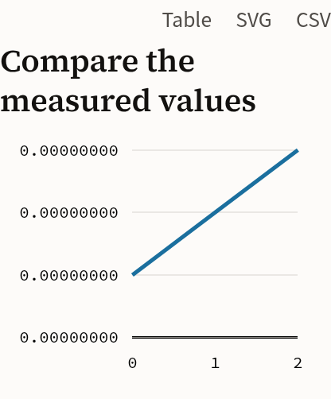
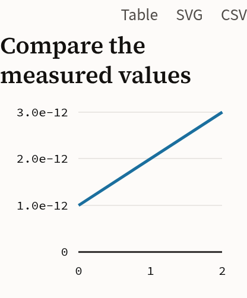
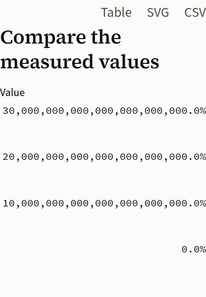
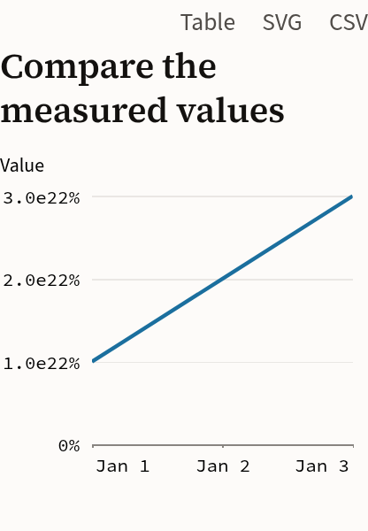

# Readable axes for tiny and very large values

A line from `1e-12` to `3e-12` previously printed every Y tick as `0.00000000`. Large percentage labels could consume the entire phone plot. Numeric axes and the existing heatmap key now use scientific notation when ordinary decimal labels are too long, round a nonzero scale to zero, or cannot express the tick step within eight decimal places. Ordinary formatting stays the same.

| Source, Scientific theme, 240 px viewport | Before | After |
| --- | --- | --- |
| [Tiny line](tiny-line.rmd) |  |  |
| [Large calendar percentages](large-percent-calendar.rmd) |  |  |

The coefficient keeps the precision required by the existing tick step, up to 17 significant digits. Percentage conversion and explicitly chosen display units apply once. Scientific labels omit automatic k/M/B suffixes. Source values, Table/CSV and readout formatting retain their existing policies. Compact cell and end-value labels are a separate policy and can still round tiny values to zero; this change does not imply support for every finite numerical range.

Main is based on `480af942`; the before tree `dad1615` is identical. Formatter source is `24fed09`, with final runtime `bd301ac`. The final commit also corrects calendar diagnostics to measure the displayed label position rather than its unshifted tick mark. All 176 independently compared native SVGs, domains, hit geometry and source fields stay exact across that diagnostic correction. [Verification](verification.json) pins complete hashes, the 19 passing local checks and matched image sources.

The initial formatter has 525 actual five-theme comparisons, including 90 ordinary SVG/PNG controls that are byte-identical, plus 750 unchanged catalog views. Final native rechecks cover all 1,275 records and add no finding; the calendar correction removes 75 false warnings from the focused matrix and 20 from the catalog. The focused matrix's remaining native clipping findings fall from 365 to 55; actual browser clipping findings fall from 416 to 95. Long precise labels can still need fit diagnostics. A further 100 matched reports cover horizontal bars and automatic layout feedback. The final main artifact also passes 36 independently captured views and 30 exact-width native calendar glyph checks.

Shorter labels can change plot gutters, tick density and rounded automatic domains. The independent 176-pair native audit records 126 changed plots, five changed rounded domains and 15 tick plans; original source extents remain contained and authored bounds remain intact. For example, a narrow horizontal bar's automatic range can tighten from 0–4 units to 0–3, while a numeric X range can round from 0–5 to 0–6. These are existing layout rules responding to the new label widths. Report viewport widths and actual chart viewBoxes are recorded separately.

The final public interface matrix retains all 105 source/Table/CSV outputs and 210 keyboard readouts. Pointer and touch readouts remain identical in 104 views; the remaining large-percentage phone chart gains an accessible point because its plot returns onscreen. All 105 exports contain their live axis labels. Five calendar resize cycles reorder identical SVG nodes; their node attributes, ancestry and actual PNGs remain exact.

## Frozen PR #40 compatibility

The sibling composition keeps its whole-axis magnitude, named-unit conversion, ordinary zero policy, direct labels and removed heatmap key. Its formatter initially preserves 90 ordinary complete SVG/PNG controls. Exact native font checks then caught a separate edge problem: the sibling rounds its temporal gutter with no outer inset, allowing label bounds to cross the SVG edge even when hydrated charts fit.

The required reconciliation is recorded in [sibling-label-gap.patch](sibling-label-gap.patch): move primary temporal value labels two pixels toward the plot, changing their gap from six to four pixels in native SVG, live SVG and diagnostics. Accepted composition `5485ab1` includes the correction and its failing-then-passing public renderer regression. All 182 independently compared Scene/model/runtime records remain exact, including larger-font date and aggregation boundaries. Fresh owner checks cover 105 calendar views with only 525 text X coordinates changed, 30 exact-width native views with no clipped label, and 105 public interface views with unchanged source and readouts.

Independent rendered review accepts 180 native pairs and 180 live/export pairs across all five themes, 240/720 px and 12/14/16 px fonts. Minimum horizontal clearance is 0.453125 px natively and 1.578125 px live/exported; the minimum label-to-plot gap is 3.205902 px. Twelve Brutalist 16 px cases retain an inherited title/top-tick bounding-box overlap; the finding identities stay the same, though some overlap widths change. Representative before/after ink remains legible. This is bounded font evidence, not a claim that every possible custom font or size is clear.

An earlier gutter-inset proposal was rejected because it could replace daily date labels with a single month label and change dense-series sampling. The final text-only correction restores the sibling's original gutter exactly. This patch reconciles the formatter with frozen PR #40; it does not change main's existing label gap. The later sibling head `2c13ffb` only imports the accepted pie-share label change relative to this frozen source; relevant formatter/calendar/browser files remain exact, without claiming a fresh build of that later head. Initial failing diagnostic, native glyph, boundary and harness checks remain in the campaign record.

## Reproduce the images

Build isolated baseline/current worktrees with [the pinned build instructions](../../../../CLAUDE.md), npm dependencies and `/usr/bin/chromium`. From this checkout run:

```sh
node docs/evidence/chart-refinements/scientific-axis/capture.mjs /absolute/built/baseline tmp/scientific-axis-before before
node docs/evidence/chart-refinements/scientific-axis/capture.mjs /absolute/built/current tmp/scientific-axis-after after
```

The helper uses bundled fonts, reduced motion and device scale 2, and asserts each image hash. Full matrices and retained failure logs stay in the campaign's local scratch record.
