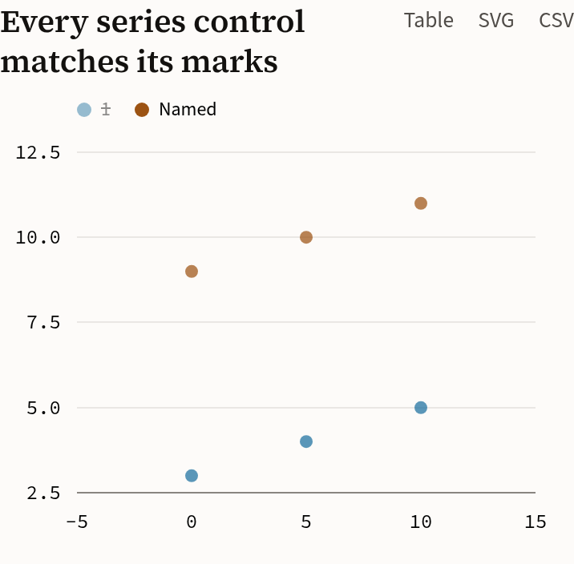
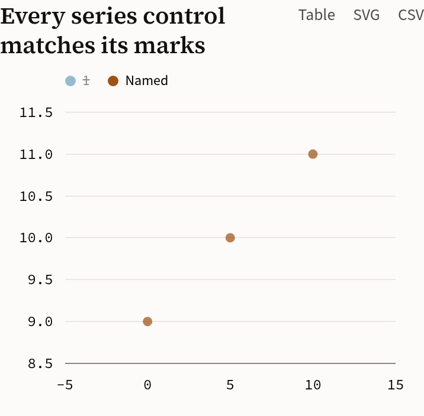
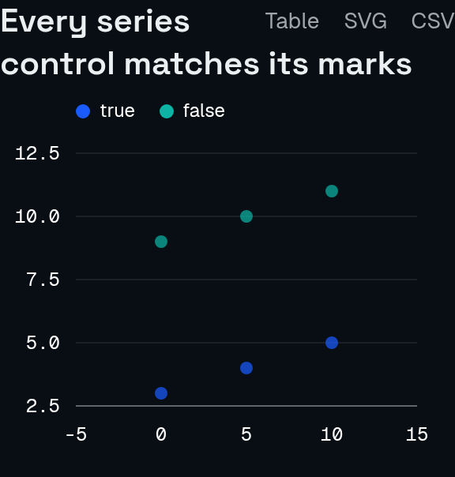
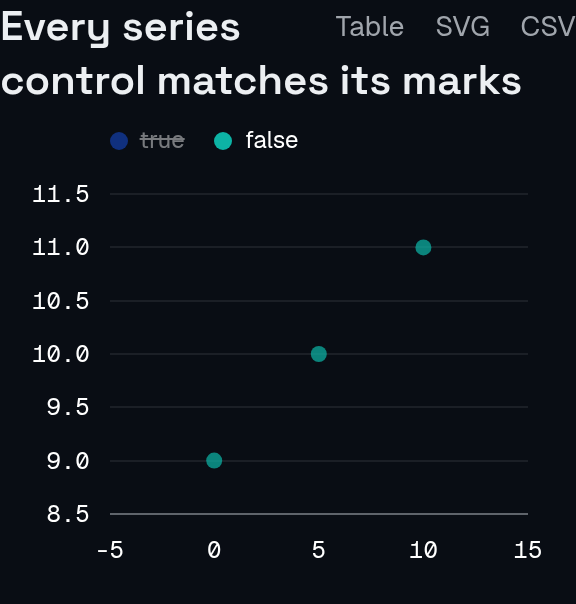

# Series controls follow category identity

Numeric and boolean series can be drawn correctly while their legend controls fail to hide them. In mixed numeric/string data, the numeric control can even be struck through while all its points remain. The controls now use the renderer's existing category identity, preserve original color/pattern slots, and keep the last visible group available. Numeric `1` and string `"1"` are one group; `"01"`, whitespace and the renderer's decimal distinctions remain unchanged.

Updating a generic chart retains matching hidden groups only while another current group remains visible. Removed keys, unknown toggle keys and stale generic hiding on pie/heatmap transitions no longer break current selection. Original generic Table/CSV rows remain intact.

| Same authored source and selected control | Before | After |
| --- | --- | --- |
| Scientific, 390px; hide numeric `1` beside `Named` |  |  |
| Sleek dark, 320px; hide boolean `true` |  |  |

The remaining observations use the existing automatic axis rescaling. The initial rendering is unchanged. These are actual report-figure captures with packaged fonts, settled motion and a device scale factor of 2, based on main `159e3cbc` and source `75e1b0c`.

After a release build, reproduce the first pair with `target/release/richview serve docs/evidence/chart-refinements/series-identity/mixed-scientific-390.rmd --style scientific --public-dir dist/web`. Set the browser viewport to 390px and click legend `1`. The second fixture uses `--style sleek` at 320px and legend `true`. Table and CSV retain both original groups.

[Validation and provenance](validation.json) record 26 unchanged native cases, 151 matched reduced-motion views and 60 ordinary-motion views across five themes. All 19 required local checks and the release build passed. The independent reviewer added 15 fresh current-main boundary states; the larger accepted composition review carries forward with identical production source and WebAssembly. This includes numeric-string zoom, calendar error clearing and compact category-colored bars already on main. [Earlier standalone evidence](https://github.com/richview-universe/richview-v3/blob/9185d31692308acd18c6e9cd23fc0bd6c5936b08/docs/evidence/chart-refinements/series-identity/README.md) remains preserved under its original base and build identity.
