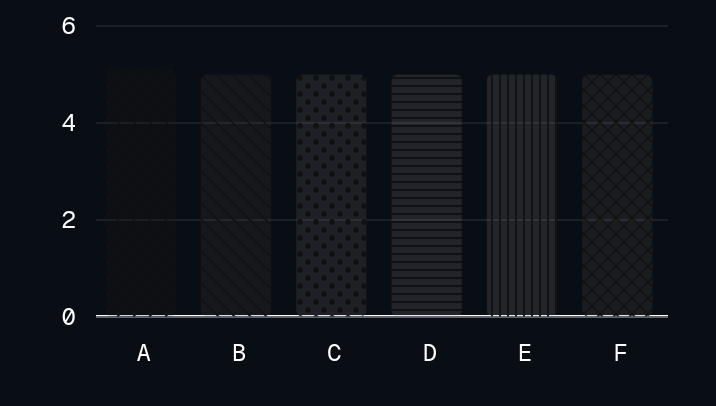
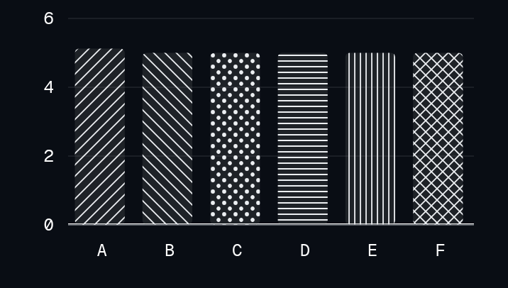
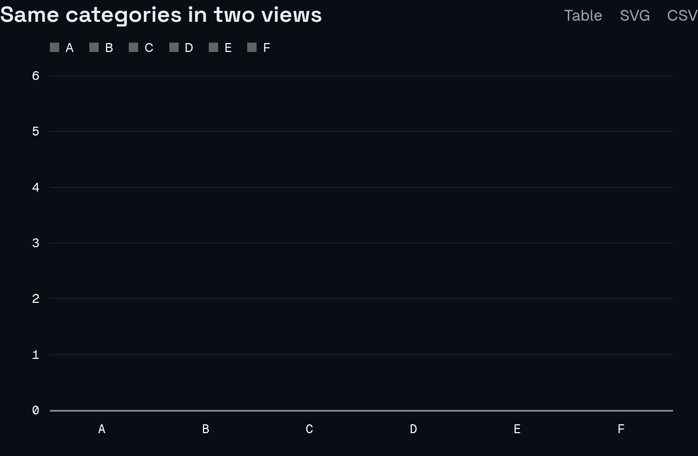
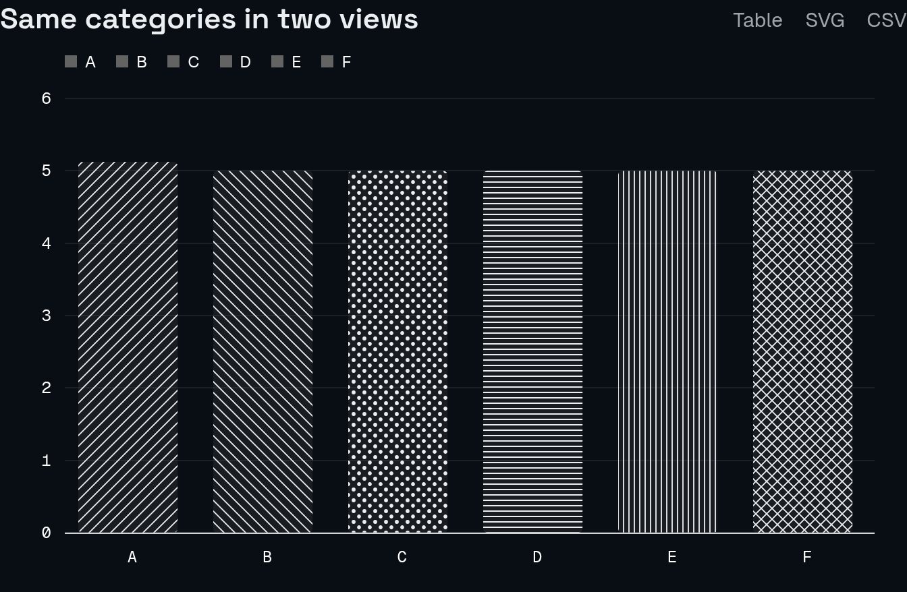

# Independent paint resources for live charts

Two live charts with identical data currently reuse SVG resource IDs. A later chart can borrow the earlier chart's hatch ink, and hiding the earlier chart can make the later bars disappear. This change scopes generated resources to the existing stable chart-view ID before motion, naming or measurement. Each view retains its own paint through hide/show, resize, updates, removal and recreation.

[Mixed-theme source](mixed-bars.rmd), 390px page, Scientific followed by Sleek with the existing mono-mode tokens:

| Before | After |
| --- | --- |
|  |  |

[Offline report source](identical-bars.rmd) and [explicit decal style](report.rstyle.yaml), Sleek, 720px page after hiding the earlier identical chart:

| Before | After |
| --- | --- |
|  |  |

Only declared resource IDs and their exact local references change. Data, geometry, labels, selection and source rows remain the same. The helper covers the generated pattern, gradient and clip reference forms; it is deliberately not a general SVG/CSS rewriter. Native/core rendering and standalone SVG export generation are unchanged. This package does not add pie hatches or change palettes.

The source is `879e1bed5bae745b1e66d2e825624e81a1650a99`, based on main `480af942714c16ce4c1f959c7f046344d4f8c99d`. The frozen before tree `dad1615` is byte-identical to that main tree. After isolated native/Wasm builds, the native CLI remains byte-identical; Web Wasm changes from `c415bc54…` to `7b59e786…`. Full hashes, file hashes and check results are in [verification.json](verification.json).

All 19 required local checks pass. The owner matrix compares 135 unchanged native outputs and 612 live SVGs across 324 lifecycle states, all five themes, 320/390/720px widths and ordinary/reduced motion. Every live SVG and diagnostic matches after normalizing only resource IDs/references; foreign resource lookups fall from 2,520 to zero. Seventy-two standalone SVGs are exact. Separate actual source/interface checks preserve 12 child Table/CSV panels, 24 keyboard readouts, 16 pointer/touch checks and 12 downloaded SVGs. Sixteen offline configurations cover JavaScript-disabled/live and screen/print output, without external requests.

Independent review accepts the source and both fresh artifacts. Its main probe compares 20 states and 64 complete SVGs, including prefix-overlapping pattern IDs, facets and no-resource controls. Keeping the inspected view at a fixed viewport position proves its pixels are identical before and after hiding an earlier duplicate. The frozen PR40 plus numeric-continuity composition adds 32 states and 100 SVG comparisons, including real line/area zoom clips, reset and selected source readouts. Owner composition checks also preserve 16 child source/download panels and four actual clipped windows.

That composition is separate from this main-based delivery. PR40 intentionally removes the heatmap color key, so the new main test's one-gradient expectation fails there. The accepted [test-only reconciliation](pr40-heatmap-test.patch), commit `82d4b9e`, asserts two real cells and no resource IDs/references while retaining every pattern and lifecycle assertion. The reconciled full browser verifier, native/Wasm lint, workspace tests, browser API and motion checks pass. Apply the supplied zero-context patch with `git apply --unidiff-zero` when composing that branch. No sibling production change is required.

Initial capture and test-oracle failures are retained in the local evidence: a rejected relative runtime URL, stale deferred diagnostics, existing heatmap text intercepting a locator hover, temporal table display formatting, an omitted authored style reference, a JavaScript-disabled animation wait, a moved screenshot target and the sibling's absent heatmap key. Their corrected checks preserve the original product contracts; none required another product change.

To reproduce the four images, build the recorded baseline and candidate with the repository toolchain, install the pinned npm dependencies and use Chromium 151.0.7922.173. From the candidate checkout, run `node docs/evidence/chart-refinements/svg-resources/capture.mjs /path/to/baseline tmp/svg-resources/before before`, then `node docs/evidence/chart-refinements/svg-resources/capture.mjs . tmp/svg-resources/after after`. The helper verifies source, Wasm, browser and PNG hashes. Full matrices and original logs stay in local run evidence; this folder keeps two source examples and four review images.
