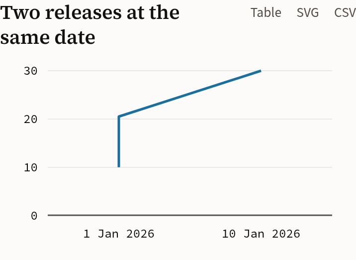
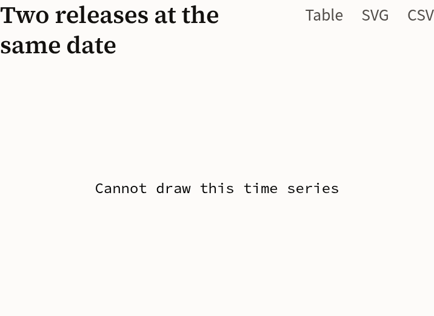
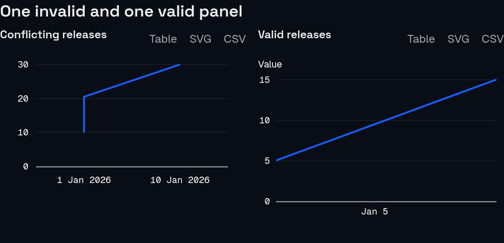
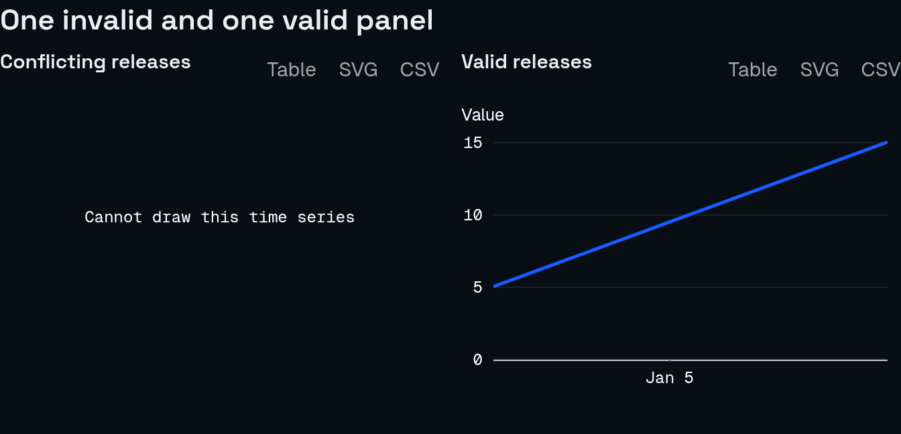
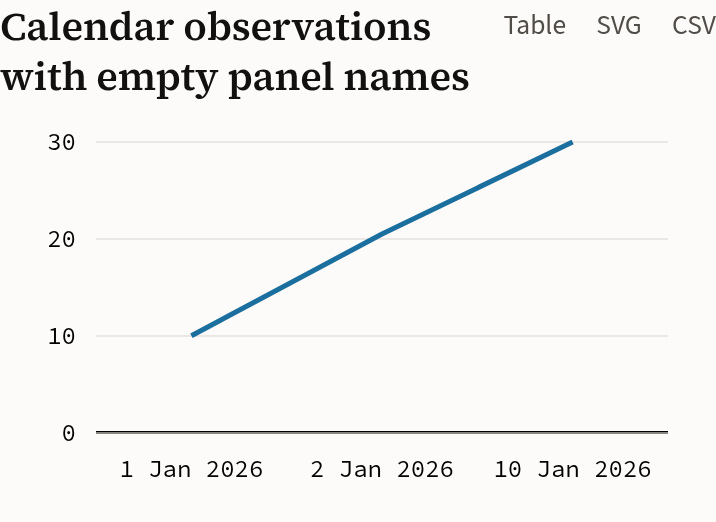
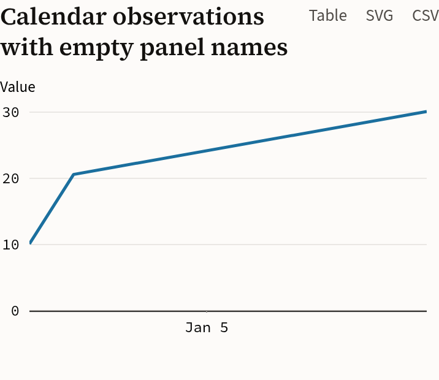

# Keep invalid time series visibly invalid

Repeated timestamps could fail calendar validation and then silently render as a categorical line or area chart. Calendar failures now show `Cannot draw this time series` and retain the original source diagnostics. A valid neighboring facet still draws. Source Table and CSV values stay available, and SVG export carries the same failure state.

| Case | Before | After |
| --- | --- | --- |
| Repeated date, Scientific 390 px |  |  |
| Invalid and valid panels, Sleek 720 px |  |  |
| Empty facet names, Scientific 390 px |  |  |

These are actual report figures from identical source, theme and viewport pairs against main `3c07128b7139687b754f6e1b5848c2a46c31cfe5`. Captures use Chromium 151, loaded fonts, DPR 2 and reduced motion. The three RMD fixtures and [verification.json](verification.json) record their source, build and image hashes.

When the authored facet field has no real groups, calendar handling still applies. Missing, null and empty names create no group; existing whitespace, marker text, zero and false group identities remain unchanged. Dates shared by different series stay valid. The existing rule selecting an all-ISO line or area chart is unchanged.

Live public measurements now retain generic chart source errors alongside actual browser glyph checks, including facet identity and available path/message/hint. Measuring a live SVG resolves its owning chart; measuring a facet parent collects its children once. Valid updates clear old errors. Native estimated-label warnings are not copied into browser measurements. Raw standalone SVG measurement remains glyph-only, and normal facet child measurement does not imply that the outer container is automatically measured.

All required local checks pass: format, native and Wasm Clippy, workspace tests, release packaging, generated fixtures, strict TypeScript declarations and all native/editor/browser scripts, including motion lifecycle. The matched matrix covers 135 views across nine fixtures, five themes and 320/390/720 px. Forty-five valid/control SVGs are byte-identical; 90 expected source errors remain visible in diagnostics. There are no browser errors, actual glyph warnings or horizontal overflows. Eighteen native CLI commands and 36 offline views verify both JavaScript and static fallback behavior. Invalid `check` and `generate` commands return exit 1; generation still writes the failure report for inspection.

Independent review accepted 40 matched views, 10 additional normal-motion phone views and nine successive public API states. It verified exact Table values, the failure SVG, canonical timestamp errors, valid neighboring facets, error clearing, direct-SVG diagnostic parity and a deliberate glyph collision that remains detectable beside the source error. The concise plot message does not explain the specific conflict; detailed repair information remains in author diagnostics.

After the normal release build, run `node docs/evidence/chart-refinements/temporal-validation/capture.mjs` from the repository root. It writes the three current after PNGs under `tmp/temporal-validation/reproduced/`. For before captures, build the baseline in a separate worktree and copy this evidence directory there before running the same command.
