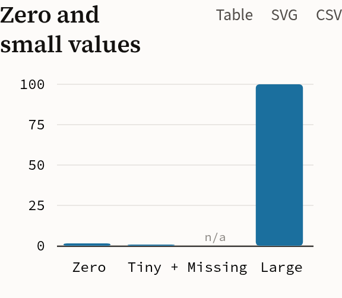
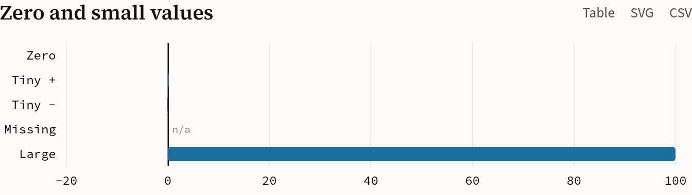

Exact zero previously painted a 2 px bar, while a tiny nonzero value could paint only 1 px. Parsed zero now has no filled length. Its category, palette slot, accessible name and existing source inspection target remain present; missing observations still show `n/a`, and every nonzero bar keeps its existing geometry.

| Actual figure | Before | After |
| --- | --- | --- |
| Vertical, Scientific, 320 px |  |  |
| Horizontal, Scientific, 720 px |  |  |

[vertical.rmd](vertical.rmd) and [horizontal.rmd](horizontal.rmd) are the exact sources. These are unmodified complete figures with loaded fonts, Chromium 151.0.7922.173, device scale 2 and reduced motion. The only pixel differences occupy the former zero stubs. [verification.json](verification.json) records source, build and image hashes.

The current base is `b76885a66808956d7e7944b9923aacb445d72b66`; tested source is `2221b07dc998e187e04cb1d79069dd5d148219ae`. Fresh release packaging, formatting, native/Wasm Clippy, workspace tests and all fourteen host/fixture checks pass, including motion and serialized Cloudflare verification. A first workspace doctest encountered a local Cargo dependency-cache mismatch; the log is retained alongside the successful scoped rerun after isolating the scratch probe cache.

The matched gate covers 390 configurations across all five themes at 320/390/720 px, including automatic orientation, grouped/category color, monochrome tokens, signed/string zeros, parsed-underflow boundaries, authored bounds excluding zero and neighboring populated facets. Across 420 panels, 610 zero marks lose their filled area, 830 nonzero marks remain exact and all 1,440 accessible names remain equal. Restoring only zero rectangle geometry makes every complete live SVG equal to the baseline. All native/live diagnostics are unchanged; inherited crowded `n/a` labels and clipping under deliberately excluding bounds remain outside this cut.

The direct renderer preserves every hit point, hit rectangle and diagnostic in 102 snapshots. Forty-four interface panels retain 216 exact keyboard/source rows, 108 pointer and 108 touch inspections, original Table/CSV and downloaded SVG geometry. Twelve native CLI reports produce 48 offline views with JavaScript enabled and disabled. Independent review additionally verifies hide/show and reused zero→positive→zero updates, with 96 baseline-equal role/name checks across states.

An early artifact lost some accessible names because an empty rounded SVG rectangle landed just outside its unchanged source target. That checkpoint is rejected and preserved. The bounded repair samples the former 2 px stub's center only for a zero value-axis extent, using the existing resolved orientation. It changes no geometry, target tolerance or source schema. The browser regression test covers explicit/automatic orientation and reused zero→positive→zero state.

Frozen sibling `7e153a2` composition passes 120 ordinary-motion views and an independent six-panel interface gate at product source `3ca3926` / Wasm `658b57a3…`. Its baseline gains coverage only under removed zero footprints; nonzero marks and source identity remain exact. Its old warm-cache artifact was rejected for retaining 2 px geometry. Integration with PR40 requires the [test-only reconciliation](sibling-test.patch) at `43eae2b` (apply only when composing that branch): retain four source marks, assert three painted footprints and skip baseline intersection only for empty rectangles. The reconciled frozen chart suite has 125 passing tests plus one inherited line-category oracle failure, reproduced on the unchanged baseline and already corrected at `b19f92b`. The full unmodified sibling suite is not claimed to pass. All bar, painter, browser and style code is byte-identical from `7e153a2` to `b19f92b`; the sole later production change is heatmap handling.

“Parsed zero” follows the existing finite `f64` parser: the string `2e-324` underflows to zero while `5e-324` remains nonzero. Exact original strings still survive readouts and Table/CSV. Native/downloaded SVGs retain their existing lack of live per-mark accessibility decoration. Evidence is from Linux Chromium with local Node 26.8.1; no physical-device, hosted-CI or performance result is claimed. Full matrices, runners and first failures remain in the local scratch paths recorded in the summary.

Build the source and base in separate worktrees. From this source worktree, set `ZERO_BAR_BASE_WT` to the built base and run these local headless captures; they verify the recorded source and PNG hashes.

```sh
node docs/evidence/chart-refinements/zero-bars/capture.mjs . tmp/zero-bars/reproduced-after after
node docs/evidence/chart-refinements/zero-bars/capture.mjs "$ZERO_BAR_BASE_WT" tmp/zero-bars/reproduced-before before
```
