# Architecture

RichView on `main` is one Rust workspace: a pure chart engine and a pure core hold the product logic, native hosts (CLI, MCP, HTTP server and editor service) wrap them, and one WebAssembly module, which also carries the whole website, makes the charts in every exported report interactive. Daniel's answers and Part 03 shape the rewrite around five changes: charts drawn with WebGL from the engine's geometry model, with no static snapshot (ARC-05, answered); a separate report runtime for reports (ARC-06, ARC-07); one operation layer behind every surface, with the agent-facing documents generated from core (ARC-08, ARC-09); closed safety boundaries (ARC-10 to ARC-15); and one publish contract shared by RichView Cowork and RichView Publish, with hosted Cowork at app.richview.ai (ARC-20 to ARC-22, ARC-24, ARC-69). Each section below states today's facts with their sources, then the decisions and proposals that settle them.

Today means `main` at `b4db233` (the merge of PR #61 on 16 October 2026) and the hosts as they answered on 21 and 22 October 2026. Part 03 (`03-architecture`, 69 cards) has two answers from Daniel, ARC-05 and ARC-22, both of 2026-10-26; every other ARC- card cited is a proposal that follows his answers in Parts 01, 02 and 08 and awaits him. Quotes start with the card and condense its text, and [Part 03 in the lockdown app](http://127.0.0.1:4790/#/part/03-architecture) shows each card in full with its options and conflicts. Legacy architecture documents such as `docs/RUST-ARCHITECTURE.md` are cited as evidence, not specification, as OPN-34 (D-LEGACY-DOCS) proposes. [Method and sources](#method-and-sources) says what was re-run and how the diagrams were drawn; the [guide index](README.md) explains the labels, IDs and links.

## At a glance

| Topic | Today (`b4db233` and the live hosts) | Proposed | Cards |
| --- | --- | --- | --- |
| Shape | One Cargo workspace of seven Rust crates, plus generated JavaScript packages, two handwritten adapters, site assets, content and tooling | Six layers with dependencies pointing down only; `richview-site` split into a report runtime crate and a site runtime crate, and a server core shared by Cowork and Publish | ARC-01, ARC-17 |
| Where behaviour lives | Rust, except the 326-line VS Code adapter and the 65-line signup Worker; tooling is Node, Python and R | The same, with a written JavaScript allowlist checked by a gate; the signup rules move to Rust | ARC-02, ARC-03 |
| Charts in a report | Each chart is drawn natively as static SVG frames, one per target width, readable without scripts. In the browser one Wasm module, which also carries the whole site, hydrates them: it redraws each chart at its real width and adds interaction. That embedded runtime is 92% of the bytes of a one-chart report | WebGL is the default renderer, drawing the engine's geometry model; where JavaScript or WebGL is missing a chart's frame shows a notice, with no snapshot, image or table (Daniel's ARC-05 answer); PDF export draws the model as vector output; reports embed a report-only runtime, and the CLI binary embeds it | ARC-05, ARC-06, ARC-07, ARC-18 |
| Surfaces | CLI, MCP, HTTP, editor and Wasm each wrap core, and some of their answers disagree | One operation layer in core and generated vocabularies, checked across every surface; `richview learn`, the skill, `llms.txt` and the MCP tool descriptions are generated from core or tested against it (Daniel's INT-21 answer) | ARC-08, ARC-09, ARC-33, ARC-52 |
| Safety | The folder boundary holds; `--allow-network` does nothing; a style file can inject a script when the dark builtin `sleek` (alias `sleek-dark`) is in the cascade; no host sends a CSP; the playground loads sources from any CORS-enabled URL; a published version's record exposes the author's local folder path | Closed style grammars, no raw HTML, a CSP on report hosts and exports, same-origin browser sources, host-configured tokens, data-source credentials only in a server's configuration, no local paths stored | ARC-10 to ARC-15, ARC-23, ARC-66, TYP-65 |
| Publishing | A native publish API that re-renders source; `{slug, version}` records capped at 50 per slug; no production report host; the CLI default server is the v2 site | One publish contract shared by RichView Cowork (today's report host) and Publish; permanent versions; hosted Cowork and customer Publish servers run by RichView, self-hosting for anyone; no default server; each version gets a link-preview thumbnail rendered by the server core (Daniel's INT-07 answer) | ARC-20 to ARC-24, ARC-69, INT-83, INT-36 |
| Deployments | richview.ai serves a build of unmerged PR #69, news.richview.ai unmerged PR #70; the v2 site on richview.uk and its subdomains and the May build on richview-v3.fly.dev still answer; nothing serves `main` | Only `prod` deploys richview.ai, on Daniel's go; `dev` deploys a hidden preview behind Cloudflare Access; hosted Cowork at app.richview.ai; the legacy hosts are redirected or shut down (Daniel's ARC-22 answer) | ARC-22, ARC-55, ARC-56, OPN-01 to OPN-05 |

## The system on `main`

RichView is one Cargo workspace (`Cargo.toml:1-3`). Two pure library crates, `richview-chart` and `richview-core`, hold the product logic. A native host crate and an editor crate wrap them for the machine, and one browser crate compiles both into a single WebAssembly module that every exported report and the interactive site pages (home, playground, showcase and `/reel/`; `/charts/` was dropped in S27-720) load; the six docs guides, `impressum.html` and `privacy.html` load no runtime. Two handwritten JavaScript adapters reach platforms RichView does not own: VS Code and Cloudflare Workers.


The system on `main`: a report folder enters through the resolver, core renders HTML with the engine's SVG, and the exported file carries the Wasm module that hydrates its charts. PDF export prints a separate PDF-mode render, not the exported file. Source: the crate manifests and the code cited on this page at `b4db233`; Mermaid source under [Diagram sources](#source-system-map).

The home page sells five elements: Rich Markdown, Themes, Rendering engine, Publishing server and VS Code extension. ARC-01 maps them onto components: Rich Markdown and themes are `richview-core`, the engine is `richview-chart` plus core's renderer, the server is the HTTP host in `richview-app`, and the editor is the editor service plus the VS Code adapter.

## From a report folder to HTML

### The native path

`richview generate report.rmd` runs the stages below. `richview_render` over MCP, the editor's `export` and the build's prerendered pages call the same resolver and core functions; the HTTP host skips the resolver and takes resolved bytes from the request.

| Stage | What happens | Where |
| --- | --- | --- |
| Find the runtime | `RICHVIEW_PUBLIC_DIR` if set; otherwise `dist/web` under the working directory; otherwise `share/richview/web` or `public` under the binary's install prefix | `crates/richview-app/src/assets.rs:6-28` |
| Read and parse | Source up to 16 MiB. `parse` returns a `Document`: frontmatter, a CommonMark body with rich-block placeholders, each rich block with its raw source and one-based line, and diagnostics. The source is parsed once for rendering; the export stage re-reads and re-parses it to list the files to copy | `crates/richview-app/src/resolver.rs:87-88`, `crates/richview-core/src/lib.rs:96-118`, `crates/richview-app/src/resolver.rs:647-650` |
| Resolve inside the folder | Inventory the folder (at most 10,000 entries, no symlinked root); read referenced CSV and JSON, style files and media into `RenderOptions.data`, 64 MiB in total; references that leave the folder fail with `report.asset.escape`; load the bindings and the gzip Wasm as base64 | `crates/richview-app/src/resolver.rs:12`, `crates/richview-app/src/resolver.rs:311-387`, `crates/richview-app/src/resolver.rs:463-531` |
| Cascade styles | Frontmatter `styles`, then `--style`; `brutalist` when none is given; resolved to custom properties, component CSS and one chart theme. The five builtin styles are sleek (dark, also named `sleek-dark`), sleek-light, scientific, brutalist and hand-drawn. Daniel's STY-05 and STY-06 answers rename them Sleek, Air (today's sleek-light), Scientific, Brutalist and Hand-drawn and make Sleek the default | `crates/richview-core/src/render.rs:82-125`, `crates/richview-core/src/style.rs:16-25` |
| Render blocks | Each chart is rendered by the engine once at the report width (720 px by default) for diagnostics and the runtime payload, then twice as static frames: 358 px for phones and the style's desktop column, its `report-max-width` less 48 px (832 px in all five builtin styles). CSS shows the phone frame in figures narrower than 546 px and the desktop frame from there up. Other blocks go through `blocks::render_block`. The output budget is 64 MiB | `crates/richview-core/src/render.rs:146-209`, `crates/richview-core/src/render.rs:715-737` |
| Assemble the page | Markdown through pulldown-cmark and the sanitizer; placeholders replaced by block HTML; header from frontmatter; CSS from fonts, base, style, chart, frame and print rules; the runtime script; font notices; `metadata._richview` with status `clean` or `issues` | `crates/richview-core/src/render.rs:209-370`, `crates/richview-core/src/render.rs:888-941` |
| Export | Write `Rendered/<stem>.html` and copy referenced local files beside it; a report with charts and no runtime fails with `report.output.runtime` | `crates/richview-app/src/resolver.rs:624-673` |

Default figures sit in the style's text measure, not in its desktop column, so the browser scales the static frames. Re-run at 1440×900 with scripts off: the figure is 560 px wide in sleek and sleek-light and 576 px in scientific, which show the 832 px frame, so chart text appears at 67–69% of its size; it is 512 px in brutalist and 544 px in hand-drawn, which show the 358 px frame, so text appears at 143–152%. The runtime then redraws each chart at its real width, as [In the browser](#in-the-browser) shows. Daniel's ARC-05 answer builds no static frames, so FEA-CH-64 (F-CORE-STATIC-CHART-FRAMES) and PRF-38 (P-HYDRATION-MATCH) are withdrawn: each figure instead holds its final box, sized from the geometry model, and the WebGL renderer draws at the exact width it occupies (PRF-35).

PDF takes its own branch. `generate --to pdf` and MCP `output: pdf` render the report in PDF mode instead of HTML mode: dark builtins replaced by their light counterparts, charts laid out at the width of the page's text column, motion off, page CSS added and the runtime embedded (`crates/richview-core/src/render.rs:66-80`, `crates/richview-core/src/render.rs:106-108`, `crates/richview-core/src/render.rs:170-173`, `crates/richview-core/src/render.rs:319-321`). The printer writes that HTML as `report.html` into a temporary browser directory, opens it in a local Chromium that blocks every other request, waits for `window.__richview.settled()` and writes only `Rendered/<name>.pdf`; no HTML export is written (`crates/richview-app/src/cli.rs:236-268`, `crates/richview-app/src/export_pdf.rs:83-109`, `crates/richview-app/src/export_pdf.rs:612-660`, `crates/richview-app/src/mcp.rs:250-282`).

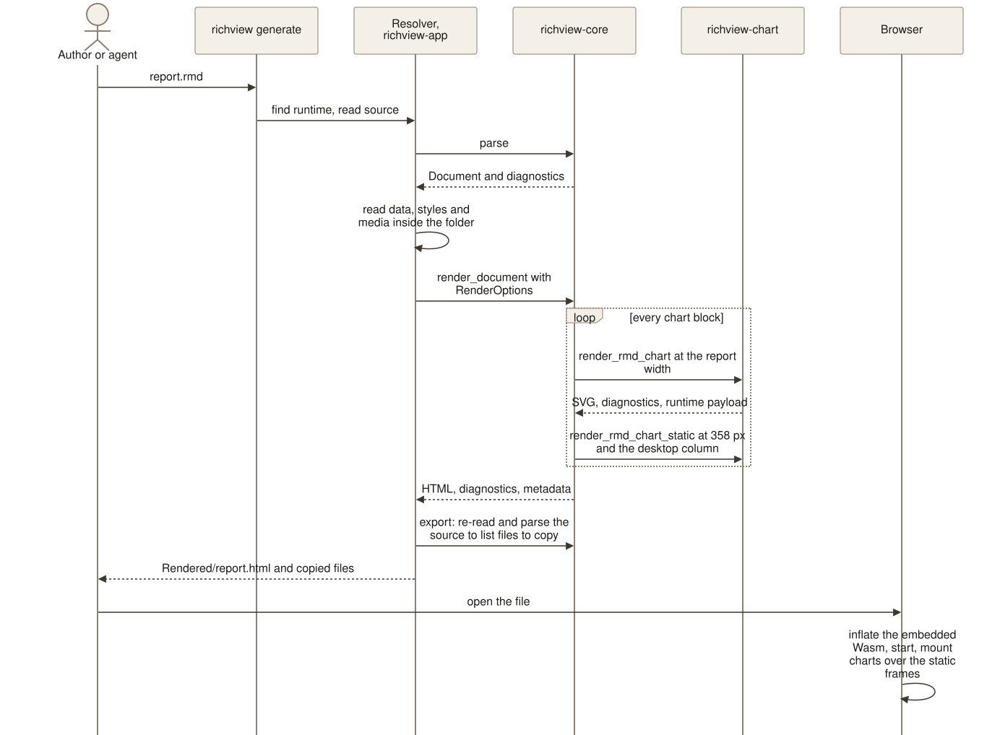

`richview generate` from the author's command to the reader's browser: one parse for rendering, one more in the export stage, and three engine renders per chart, one for diagnostics and the runtime payload and two static frames. Mermaid source under [Diagram sources](#source-render-sequence).

### What one report file carries

Re-run: the `init` template (a big number, a bar chart and a callout, `styles: [sleek]`) generated from the worktree root is 2,314,593 bytes with status `clean` and one info diagnostic, `chart.font-bounds-estimated`. One `<script type="module">` of 2,137,024 bytes is 92.3% of the file: the wasm-bindgen bindings plus the gzip Wasm as base64 (2,016,716 bytes, 87.1%). Part 03's summary and ARC-06 quote the 87% of the Wasm alone, and [Performance](performance.md#load-size-and-first-paint) measures 90% for bindings plus Wasm in its own small fixture of 2,370,813 bytes. Style elements take 116,622 bytes. The file has no Content-Security-Policy. The same template generated in a folder outside the checkout, without `RICHVIEW_PUBLIC_DIR`, fails with `report.output.runtime` and exit code 1; with the variable set it renders. The crate README still promises a static fallback without the runtime (`crates/richview-app/README.md:14`), which the code and `crates/richview-app/tests/installed_assets.rs:284-302` rule out.

### In the browser

When the file opens, the module script decodes the base64, pipes it through `DecompressionStream('gzip')` and starts the module (`crates/richview-core/src/render.rs:888-941`). `start()` injects the chart CSS, mounts every embedded chart over its static frame, installs `window.__richview` (`output`, `settled()`, which rejects after 30 s naming what is pending, and `pending()`), then runs the authoring, landing, homepage and reel controllers, which return early when their page anchors are missing. Afterwards it re-lays out charts on resize, theme and font events and settles them before printing (`crates/richview-site/src/browser.rs:385-517`).

Native renders compile the five font catalogs in and embed the faces a report uses. The Wasm build leaves the catalogs out, so a page that renders in the browser fetches the staged `richview-fonts.css` (432,785 bytes) and passes it to core with `provide_font_catalog` (`crates/richview-core/src/lib.rs:7-9`, ARC-62).

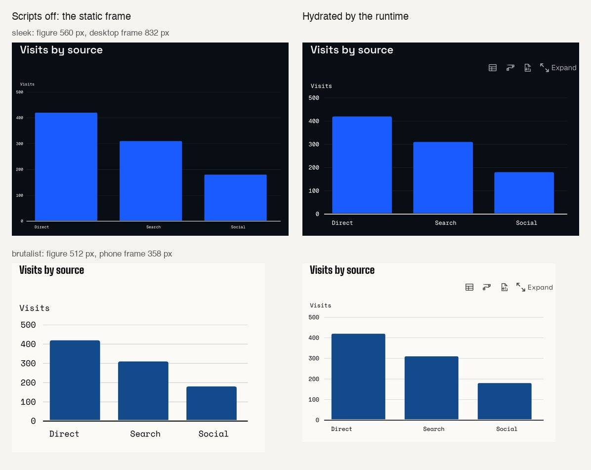

The `init` template's bar chart in sleek (top) and brutalist (bottom), with scripts off on the left and hydrated on the right, all at the same scale. With scripts off, sleek shows its 832 px frame in a 560 px figure, so tick labels are 10 px tall against 16 px once hydrated; brutalist shows its 358 px frame in a 512 px figure, so they are 25 px against 17 px, and the figure is 21 px taller until the runtime redraws it. The chart actions appear only after hydration. Source: `richview generate` from the `b4db233` release build, opened in headless Chromium (Playwright 1.63) at 1440×900, figure captures at 2x shown at 1x, 2026-10-22. Cards: ARC-05 (D-INTERACTIVITY), FEA-CH-64 (F-CORE-STATIC-CHART-FRAMES) and PRF-38 (P-HYDRATION-MATCH), the last two withdrawn after ARC-05's answer.

### One operation, five surfaces

| Surface | Validate | Check | Render | Publish |
| --- | --- | --- | --- | --- |
| CLI | `validate` → `{blocks, diagnostics, ok}` | `check` → `{status, diagnostics, charts}`, no `ok` | `generate` | `publish`, over HTTP |
| MCP | `richview_validate` | `richview_check` | `richview_render` | `richview_publish`, `server` required, `token` optional |
| HTTP host | none | none | `POST /api/render`, no token | `POST /api/reports`, bearer token |
| Editor service | `validate` plus its own field checks (`crates/richview-editor/src/authoring.rs:370-392`) | none | `preview`, `export` | `publish` through `richview_app::cli::publish` (`crates/richview-editor/src/main.rs:248-253`) |
| Wasm API | `validate` | `check` | `render`, `render_compat`, `worker_request` | `createPublishRequest` builds a request and sends nothing |

The surfaces wrap the same core, but not identically. Re-run: a bar chart whose `encoding` names fields that do not exist (`x: nope, y: missing`) passes `richview validate` with `ok: true` and `richview check` with `status: clean`, while the editor reports an `authoring.field` error (ARC-08 source). The vocabulary drifts too: `learn` names five MCP tools while MCP serves seven, the other two being `richview_asset_put` and `richview_asset_verify` (`crates/richview-app/src/asset_upload/mod.rs:315`, `crates/richview-app/src/asset_upload/mod.rs:326`), and `llms.txt` and the skill teach six chart types and three styles against nine and five in the code (ARC-09).

> **ARC-08 (D-ONE-OPERATION-LAYER), proposed.** Core exposes one function per operation (validate, check, render, build publish request), each returning one result type with the diagnostics contract `{level, code, message, path, line?, tag?, details?}`, and every rule lives in core. Export and publishing are host services on top. A surface only decodes input, calls the operation and encodes the result; machine-readable outputs share one envelope including `ok`. Native and Wasm builds of one commit return identical diagnostics and byte-identical HTML, chart geometry models and vector output, and a contract test runs every fixture through CLI, MCP, HTTP, editor and Wasm. WebGL pixels differ by GPU and are not compared; the geometry model every renderer draws is. Browser glyph measurement is a host-side stage of `check` that runs only where a browser exists and says so.
>
> **ARC-09 (D-SINGLE-SOURCE), proposed.** Core's schema registry is the only definition of tags, fields, enums, chart types, style names, diagnostic codes and MCP tools. The build generates editor completion tables, TypeScript declarations, `learn` reference sections, MCP input schemas, the facts in `skill/`, `llms.txt` and the reference tables in the spec and docs; a gate regenerates them and fails on any difference. Agents learn RichView only from `richview learn`, `richview_learn`, the skill, `llms.txt` and the MCP tool descriptions, so each is generated from core or tested against it, and the drift above is fixed and cannot come back (Daniel's INT-21 answer, INT-66).

### Runtime model

> **ARC-05 (D-INTERACTIVITY), Daniel's answer, 2026-10-26.** Chosen option: Frame and notice only. RichView goes all in on WebGL for very high performance with many points. All major browsers must work, Safari, Firefox and Chrome in reasonably recent versions; where JavaScript or WebGL is unavailable, the chart's frame shows a notice that the chart cannot be displayed. No static snapshot, image or table fallback is built.
>
> **ARC-06 (D-RUNTIME-SPLIT), proposed.** Two Wasm modules come from one workspace. The report runtime carries the WebGL chart renderer and chart interaction, table sorting, chart actions, theme switching, the `window.__richview` hook and, if FEA-CH-59 keeps it, browser glyph measurement, and no parser, Markdown, YAML, sanitizer, validator, knowledge or site code. The site runtime carries playground authoring, the source buffer, landing and homepage motion, showcase controls and docs gallery helpers; reports never load it. Exported files embed the report runtime, so they open offline (INT-04). A report host serves stored reports small: it links the report runtime from one content-hashed, immutably cached URL on the same host, and keeps every runtime version a stored report links; the self-contained file stays downloadable. Trusted previews (VS Code, playground, landing demo) link their host's copy, and source never selects runtime code. PDF export prints the report rendered for PDF, whose charts are the engine's vector output, so it needs no WebGL. A gate fails if the report runtime links site modules.
>
> **ARC-07 (D-RUNTIME-EMBED), proposed.** The `richview` binary embeds the report runtime at build time, as it already embeds the font catalogs, so exports are self-contained from any directory; a build without the runtime fails, nothing silently degrades to a report whose charts show only their frame and notice, no flag or variable selects a runtime from disk, and the binary reports the embedded runtime hash. Only the report host produces the hosted page that links the runtime from its content-hashed route.

Today the PDF printer prints a separate PDF-mode render ([The native path](#the-native-path)), as ARC-06 and FEA-RP-43 keep it; under Daniel's INT-31 answer the charts in that render become the engine's vector output, so printing needs no WebGL.

PRF-31 (P-RUNTIME-DELIVERY) proposes a cap of 512 KiB after gzip for the report runtime and asks whether it still holds now that the WebGL renderer joins it; exports embed the runtime and a report host serves it once from a content-hashed URL (INT-04, ARC-06). Budgets and measurements are in [Performance](performance.md). Daniel's ARC-05 answer settles June decision dec-49 ("Canvas opt-in out of v1") the other way: WebGL is the default, not an opt-in. FEA-CH-47 (F-CHART-DOWNLOADS) draws the PNG download through the WebGL renderer, and the open WebGL stack choice (raw WebGL2 from Rust, `wgpu` or another) is ARC-18's.

## Native and WebAssembly hosts

### Where each host runs

| Host | Target | Report inputs | Runtime in what it shows | Writes |
| --- | --- | --- | --- | --- |
| `richview generate` | Native | The report folder, through the resolver | Embeds bindings and gzip Wasm from the public directory | `Rendered/<name>.html` and copied files; with `--to pdf` only `Rendered/<name>.pdf` |
| `richview check`, `richview validate` | Native | The report folder, through the resolver | Not loaded | Nothing |
| `richview serve` | Native, `127.0.0.1:4711` | The report folder; the page polls `/__revision` every 500 ms and reloads | Embedded, served by the full report-host router (`/api/render` and the static site answer too) | A preview store in `<cwd>/tmp/richview-preview` (`crates/richview-app/src/cli.rs:372-394`) |
| `richview server`, `richview-server` | Native, `127.0.0.1:8080` by default | Resolved bytes in the request: source, a folder inventory and `data` | Embedded in every stored report | The data directory, `./data` by default |
| `richview mcp` | Native, stdio | `input_path` through the resolver, or source with a folder inventory | Embedded | `Rendered/`: the HTML export, or with `output: pdf` only the PDF |
| `richview-editor` with VS Code | Native process spawned by the extension | The saved file's folder, through the resolver | Preview links the extension's copy through `runtime_url`; export embeds | `Rendered/` on export, HTML only |
| PDF printer | Native, driving a local Chromium | A PDF-mode render (`output: pdf`) with the runtime embedded, staged as `report.html` in a temporary browser directory; no HTML export is written | The embedded runtime runs inside Chromium until `settled()` | `Rendered/<name>.pdf` |
| Playground | Wasm, rendering in a worker | Pasted source, or `?src=` with files beside it on that origin | Preview iframe (`sandbox="allow-scripts"`) links the site's copy; "Download report" embeds gzip Wasm | Browser downloads only |
| Landing demo | Wasm | The demo source injected at build time, then the visitor's edits | First view: a report the build prerendered natively with the runtime embedded, one file per builtin style name, 2.3 to 2.4 MB each (`demo-sleek.html` is 2,316,232 bytes); re-renders after an edit, a style switch or a reset link the site's copy through `runtime_url` (`assets/landing/index.html:134`, `crates/richview-build/src/main.rs:483-499`, `crates/richview-site/src/browser/homepage.rs:212-243`) | Nothing |
| Exported or stored report | Wasm | None | Embedded | Nothing |
| Showcase, `/reel/` | Wasm site controllers | Prerendered pages | Linked from the site | Nothing |
| Signup Worker | JavaScript on Cloudflare | None | Serves the static files | D1 rows |

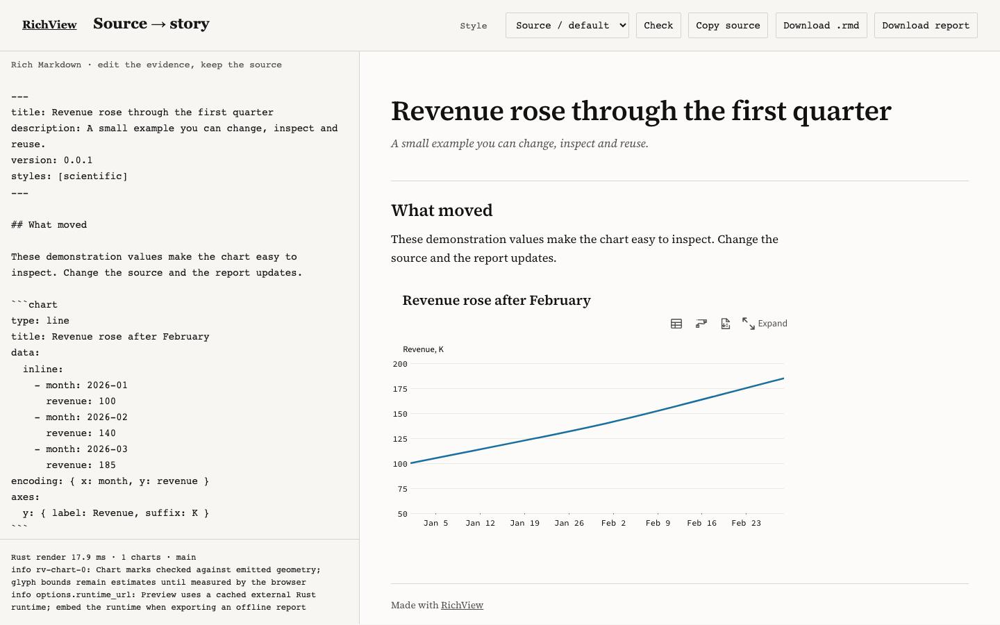

The playground, a WebAssembly host: source on the left, the preview iframe on the right, and the diagnostics pane under the editor reporting "Rust render 17.9 ms · 1 charts · main", an info diagnostic for `rv-chart-0` (glyph bounds stay estimates until the browser measures them) and the info diagnostic `assets.runtime-external`, which the pane shows by its path `options.runtime_url`: "Preview uses a cached external Rust runtime; embed the runtime when exporting an offline report". That linked runtime is the same 4.4 MB module the site serves, including the playground and reel code. Source: `/playground` on a loopback `richview-server` of `b4db233`, 1440×900, 2026-10-21. Cards: ARC-06 (D-RUNTIME-SPLIT), ARC-38 (C-WEB-PLAYGROUND).

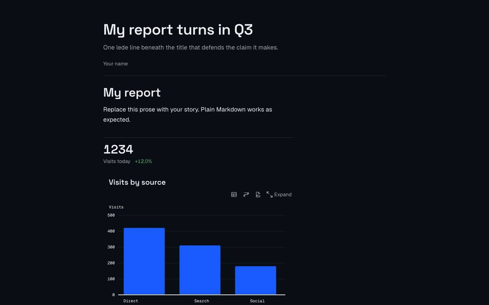

`richview serve` of the `init` template, a native host: the report as the native renderer wrote it, with the hydrated chart actions (Table, SVG, CSV, Expand) above the bar chart. Source: `richview serve` on loopback port 47912 from the `b4db233` release build, headless Chromium, 1440×900, 2026-10-22. Card: FEA-SF-08 (F-APP-CLI-SERVE).

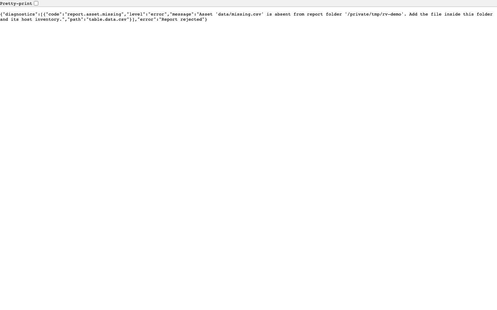

The same preview after a table referencing the missing `data/missing.csv` was appended: the page is replaced by the raw JSON error `report.asset.missing`, with the report folder's absolute path in the message. FEA-SF-08 proposes keeping the last good render under a banner instead. Source: same session, 2026-10-22.

### The WebAssembly module

`richview-build` compiles `richview-site` for `wasm32-unknown-unknown` at `opt-level = "s"` and binds it with wasm-bindgen 0.2.129, `--target no-modules` (`crates/richview-build/src/main.rs:63-115`). The local build's module is 4,366,342 bytes raw and 1,512,537 bytes gzip; a browser received 1,520,124 gzip bytes, 96.6% of today's gate budget of 1.5 MiB (1,572,864 bytes), which PRF-30 and PRF-31 would replace with one budget per runtime (`checks-performance.md` in docs/lockdown/evidence).

The module exports its functions and the `NativeSchema` class generated from Rust in `crates/richview-site/src/browser.rs` and `crates/richview-site/src/browser/reel.rs`, from `render`, `parse`, `check`, `validate` and `learn` to `worker_request`, `reel_seek` and `start`; wasm-bindgen adds its own `initSync` loader. Twelve of the functions are TypeScript-era bindings, Rust functions named `*_legacy` exported under plain names such as `render`, `parse` and `check` (`crates/richview-site/src/browser.rs:168-367`). The engine adds 13 raw `rv_*` functions that nothing calls (`richview-chart/src/wasm.rs`). All of this was re-run from `dist/web/richview_site.d.ts` and `dist/web/richview_site_bg.wasm.d.ts`. The same module is copied into the VS Code package's generated `web/` folder and wrapped by the generated npm facades, whose files richview.ai serves under `/bindings/core/` and `/bindings/charts/` (re-run: `/bindings/core/index.browser.js` and `/bindings/charts/index.js` answer 200; the folders themselves answer 404).

> **ARC-04 (D-WASM-BOUNDARY), proposed.** Browser and Worker modules use wasm-bindgen, pinned in `Cargo.lock` and checked against the installed CLI by the build; each module exposes one generated API, and the handwritten `extern "C"` exports and the engine's `cdylib` crate type are removed. Every Wasm build uses one profile (`opt-level = "s"`, LTO, one codegen unit), native binaries keep `opt-level = 3`, and the build manifest records profile and runtime hashes.
>
> **ARC-36 (C-WEB-WASM-API), proposed.** One generated API per runtime: for the report runtime mount, settle, measure and chart actions, with `window.__richview` as the only public contract (TYP-97); for the site runtime render, validate and check for the playground, plus page boot (TYP-75). The twelve `*_legacy` bindings and the `render_compat` path go.

## Components

Part 03 gives every component a `C-` ID and one card; the tables follow its groups. Seven component pages describe their components in depth: [Chart engine](components/chart.md), [Report core](components/core.md), [Native app](components/app.md), [Editor](components/editor.md), [Web](components/web.md), [Cloud and hosts](components/cloud.md) and [Build](components/build.md). Sizes are lines of Rust in tracked `.rs` files under each crate's `src/` at `b4db233` (re-run with `git ls-files`). The last column condenses the card's proposal: keep means the component and its responsibility stay, and whether its code is ported or rewritten follows INT-49 (D-REWRITE-BASIS); change names what moves.

### Engine and core

| Component | Path | Today | Proposed outcome |
| --- | --- | --- | --- |
| `C-RICHVIEW-CHART`, chart engine | `richview-chart/` | Scales, layout, marks, labels, SVG and native readability diagnostics for the nine source chart types, including the temporal engine for date x axes, and pure interaction state; also a `richview-chart` CLI that reads files, a `web/` page and raw `rv_*` Wasm exports. 19,437 lines in the 35 files under `src/` (ARC-25's 17,617 counts only the top-level `src/*.rs` files; all 66 `.rs` files of the crate, tests included, hold 24,161); depends only on serde, serde_json and serde_path_to_error (`richview-chart/Cargo.toml:14-17`) | Keep, change: no I/O, CLI or raw exports; owns the geometry model every renderer draws and the vector renderer for PDF and thumbnails, while the WebGL renderer lives in the report runtime; the temporal JSON spec becomes internal (ARC-18, ARC-25) |
| `C-RICHVIEW-CORE`, core | `crates/richview-core/` | Pure parser, validator, style cascade, Markdown, block and report renderer, fonts, motion CSS, `learn` knowledge and publish request; depends on `richview-chart`. 6,805 lines in 12 files; no filesystem, network or process access (`crates/richview-core/src/lib.rs:1-9`) | Keep, change: owns every validation rule and the vocabularies agent-facing documents are generated from; the TypeScript-era compatibility layer goes (ARC-09, ARC-26) |

### Native host: `richview-app`

| Component | Path | Today | Proposed outcome |
| --- | --- | --- | --- |
| `C-RICHVIEW-APP`, native host crate | `crates/richview-app/` | Binaries `richview` and `richview-server` (the second only calls `cli::run_server`); 6,463 lines in 14 files. Every native dependent compiles all of it, including axum, tokio, reqwest and rusty-s3 | Keep, change: host services under thin transports, optional capabilities (browser service, asset upload, connector core) behind Cargo features (ARC-27) |
| `C-APP-CLI` | `crates/richview-app/src/cli.rs` | Ten commands: `generate`, `validate`, `check`, `init`, `learn`, `mcp`, `publish`, `serve`, `server`, `asset`; most have no help description | Keep, change: commands only decode arguments and call operations (ARC-28); the command list is FEA-SF-01; adds `image search` and `image use` (FEA-RP-62) |
| `C-APP-RESOLVER`, resolver and exporter | `crates/richview-app/src/resolver.rs` | Reads the report folder, resolves data, styles and media inside it under a 64 MiB budget, loads the runtime from the public directory and writes `Rendered/` | Keep, change: the only reader of report inputs; the runtime comes from the binary (ARC-29) |
| `C-APP-PDF-EXPORT` | `crates/richview-app/src/export_pdf.rs` | Prints a PDF-mode render through a local Chromium-family browser, version 131 or later, over a DevTools pipe with the network blocked; macOS and Linux only | Keep, change: one optional browser host service shared with `check`'s browser pass (ARC-30) |
| `C-APP-HTTP-SERVER`, HTTP host | `crates/richview-app/src/server.rs` | Axum router: publish, read, render and regenerate APIs, report pages, raw source, the `richview serve` preview and the whole static site as fallback | Keep, change: becomes RichView Cowork's first cut (INT-83): reads follow sharing (OPN-54), writes authenticated, link-preview thumbnails served under the story's access rule, no site routes (ARC-31, ARC-24, ARC-69) |
| `C-APP-REPORT-STORE` | `crates/richview-app/src/storage.rs` | Filesystem store of `{slug, version}` folders with `latest.txt`; keeps 50 versions per slug | Keep, change: a `Store` interface over the filesystem in the server core Cowork and Publish share, no pruning, a byte quota (ARC-32) |
| `C-APP-MCP` | `crates/richview-app/src/mcp.rs` | MCP over stdio with seven tools (render, validate, check, publish, learn, and the two asset tools) and two resources | Keep, change: tool schemas and descriptions generated from core or tested against it (Daniel's INT-21 answer), token from the host environment; stdio only in the rewrite (ARC-33); nine tools with the two image tools (FEA-RP-62, FEA-SF-09) |
| `C-APP-ASSET-UPLOAD` | `crates/richview-app/src/asset_upload/` | S3-API uploader that prints integrity-pinned references no report block consumes | Keep, change: uploads for RichView's managed hosting and authors' own stores, with integrity-pinned references sources accept (Daniel's INT-31 answer; ARC-34, TYP-41) |

### Browser runtime and site: `richview-site`

| Component | Path | Today | Proposed outcome |
| --- | --- | --- | --- |
| `C-RICHVIEW-WEB`, browser host | `crates/richview-site/`, `assets/` | Compiles core and engine into one Wasm library together with every page controller and the reel; 14,969 lines in 14 files | Keep, change: split into a report runtime and a site runtime; draws charts with WebGL and shows ARC-05's notice when WebGL is missing (ARC-35) |
| `C-WEB-WASM-API` | `crates/richview-site/src/browser.rs`, `crates/richview-site/src/browser/reel.rs` | The generated functions and the `NativeSchema` class, including the twelve TypeScript-era bindings (Rust `*_legacy` functions exported as `render`, `parse`, `check` and nine more) and three `reel_*` functions; the site runtime installs no `window.__richview`, which belongs to the report runtime | Keep, change: one generated API per runtime (ARC-36) |
| `C-WEB-CHART-HOST`, live chart chrome | `crates/richview-runtime/` (the retired SVG host in `crates/richview-site` is deleted) | Mounts live charts over their static frames: tooltips, zoom, keyboard, Table, SVG, CSV and Expand | Keep (ARC-37): mounts each chart's WebGL view in its reserved box; motion is part of INT-12's craft, with INT-61 as the floor; behaviour is Parts 04a and 04b |
| `C-WEB-PLAYGROUND` | `assets/playground.html`, `crates/richview-site/src/browser/authoring.rs`, `crates/richview-site/src/source_buffer.rs` | In-browser editor at `/playground` and `/app`: rendering in a Rust worker, a sandboxed preview, downloads | Keep, change: on the site runtime; `?src=` same-origin only (ARC-38, ARC-66) |
| `C-WEB-LANDING` | `assets/landing/`, `crates/richview-site/src/browser/homepage.rs`, `crates/richview-site/src/browser/landing.rs` | Home page with the two-file demo (prerendered with the runtime embedded, then re-rendered live with the site's copy) and the signup form; the scroll stage is dormant on `main` because its anchors are missing | Keep, change: built and deployed from `prod` only (ARC-39) |
| `C-WEB-CHART-EXAMPLES` | removed in S27-720 | `/charts/` redirects to `/docs/charts`; its three datasets are in `benchmarks/fixtures/time-series/`, two of them also as docs gallery examples | Dropped (ARC-40) |
| `C-WEB-SHOWCASE` | `assets/showcase/`, `crates/richview-site/src/browser/showcase.rs` (1,864 lines) | The flagship under 23 treatments (sleek, scientific, brutalist and 20 studio variants from `assets/showcase/themes.json`), with compare (no key until it returns with a visible control) and citations; the report's own Expand is the one chart modal | Keep, change: the five styles of STY-05 as pills, and the studio variants as extended themes written as `.rstyle.yaml` files in a secondary dropdown (ARC-41) |
| `C-WEB-REEL` | `assets/reel/`, `crates/richview-site/src/reel.rs`, `crates/richview-site/src/reel_audio.rs`, `crates/richview-site/src/browser/reel.rs`, `crates/richview-site/src/bin/richview-reel.rs` | A 15-second motion reel, its player and its frame and soundtrack exporter, compiled into the product | Drop from the product (ARC-42) |
| `C-DOCS-SITE` | `docs/public/`, `crates/richview-build/src/documentation.rs`, `assets/docs/docs.css` | Six guides rendered by RichView at build time; chrome inserted by string replacement; code highlighted twice | Keep, change: generated reference tables and one declared docs layout (ARC-43) |

How these look today: the [landing page](screenshots.md#landing-page), [playground](screenshots.md#playground), [charts](screenshots.md#charts), [flagship showcase](screenshots.md#flagship-showcase), [chart and table interactions](screenshots.md#chart-and-table-interactions), and the docs and reel under [other surfaces](screenshots.md#other-surfaces).

### Editor

| Component | Path | Today | Proposed outcome |
| --- | --- | --- | --- |
| `C-RICHVIEW-EDITOR`, editor service | `crates/richview-editor/` | One native process speaking line-delimited JSON-RPC with the whole source in every request: snippets, format, outline, complete, validate, preview, export, publish; 1,350 lines; depends on all of `richview-app` | Keep, change: Language Server Protocol plus RichView methods, depending on core and host services only (ARC-44) |
| `C-VSCODE-EXTENSION` | `packages/vscode/` | `extension.cjs` (326 lines, 16,945 bytes) spawns the editor binary, hosts the preview webview and keeps the publish token in SecretStorage; never published. No screenshot: the extension cannot run headless on the capture machine ([gaps](../lockdown/screenshots/INDEX.md#gaps)) | Keep, change: thin adapter over the service, listed on the VS Code Marketplace and on Open VSX (INT-71; ARC-45, FEA-SF-21) |

### Build, packages, CI and tooling

| Component | Path | Today | Proposed outcome |
| --- | --- | --- | --- |
| `C-RICHVIEW-BUILD` | `crates/richview-build/` | One run builds the native binaries, the Wasm module, the npm facades, the VS Code package contents, the docs, the flagship and the `dist/web` site of 81 MB (81,073,727 bytes, re-run). The checks evidence measured 154 s cold and 106 s after a one-file engine edit on 2026-10-21 (not re-run) | Keep, change: product and site targets and a build manifest with hashes; on Claw Mini every stream builds in one shared Cargo target, and the build refuses to stage another checkout's artifacts (ARC-46, DEL-22) |
| `C-RICHVIEW-BENCH` | `crates/richview-bench/` | Native render latency and peak memory over four workloads | Keep, change: committed, hashed fixtures and machine-readable receipts (ARC-47) |
| `C-PKG-CORE` | `packages/core/` | Generated Node and browser facade over the Wasm core; never published to npm; gate scripts import it and richview.ai serves its files under `/bindings/core/` | Drop from the first cut (ARC-48) |
| `C-PKG-CHARTS` | `packages/charts/` | Generated chart facade re-exporting core; never published; its files are served under `/bindings/charts/` | Drop (ARC-49) |
| `C-CI` | `.github/workflows/ci.yml` | One workflow on pushes and PRs to `main` with 44 `run` steps; per the history evidence, no job has started after 2026-10-13 (not re-run) | Keep, change (ARC-50): calls the gate command; DEL-39 (G-HOSTED-CI) sets its role and triggers, and once enabled it runs only on `pre-prod` and `prod` and by manual dispatch (DEL-81) |
| `C-AGENT-HARNESS` | `CLAUDE.md`, `.claude/` | Contributor guide plus nine agent definitions last changed on 2026-10-11 | Change: one `AGENTS.md` imported by `CLAUDE.md`, no agent definitions; it describes the `dev`, `pre-prod` and `prod` model of DEL-81 (ARC-51) |
| `C-FONT-PIPELINE` | `scripts/fonts/`, `crates/richview-core/assets/fonts-*.css`, `richview-chart/assets/optical-fonts.bin` | Pinned, hash-checked upstream faces turned into committed catalogs, manifest, licence notices and metric tables | Keep, change: outputs committed, checks in the gate (ARC-62) |
| `C-VERIFY-HARNESS` | `scripts/` | 75 tracked files, about 13,800 lines: 41 `verify-*` checks, the browser harness, design review, benchmark drivers | Keep, change: reaches the product only through binaries and runtime APIs (ARC-63) |
| `C-BENCH-LABS` | `benchmarks/` | Chart-craft lab of 50 reports, a local Highcharts 13.1.1 comparison and the chart-review report; the build publishes the review pages | Keep, change: local only; the side-by-side comparison with Highcharts and ECharts is INT-12's bar for charts; review reports become gate fixtures (ARC-64) |

### Agent knowledge and content

| Component | Path | Today | Proposed outcome |
| --- | --- | --- | --- |
| `C-SKILL` | `skill/SKILL.md`, `skill/reference/anti-slop.md` | Agent guide that still teaches six chart types, three styles, named frontmatter data (which the parser rejects) and `--allow-network` (ignored) | Keep, change: facts generated from core; it shows how to use the storytelling tools and promises no result (Daniel's INT-21 and INT-77 answers; ARC-52) |
| `C-LLMS-TXT` | `llms.txt` | Agent summary; never staged, so `https://richview.ai/llms.txt` returns 404 (re-run) | Keep, change: generated and served at the site root (ARC-53) |
| `C-EXAMPLES` | `examples/`, `assets/landing/anchor/` | Tutorial reports, the home page demo and the flagship with its frozen Python research pipeline | Keep, change: every example renders in the gate as a fixture (ARC-54) |
| `C-LOCKDOWN-TOOLING` | docs/lockdown/, docs/guide/, tools/lockdown-app/ | This lockdown, this guide and the loopback review app: uncommitted files in the local lockdown worktree, whose branch has no commits past `b4db233` and no copy on GitHub | Keep, as tooling that never ships (ARC-65); DEL-45 (G-LOCKDOWN-HOME) would merge them first into `dev` |

### Deployment components

| Component | Path | Today | Proposed outcome |
| --- | --- | --- | --- |
| `C-CLOUDFLARE-TEASER` | `wrangler.toml`, `cloudflare/` | Worker `richview-teaser`: static `dist/web` plus `POST /api/interest` into D1 behind a rate limit; its README calls the config "assets-only", which it is not | Keep, change: deployed to richview.ai only from `prod`, and to the hidden `dev` preview only when the website's code changes; signup rules in Rust behind a thin Worker (ARC-55, Daniel's ARC-22 answer) |
| `C-CONTAINER-DEPLOY` | `Dockerfile`, `packages/server/fly.toml` | Image that runs `richview-server` with the site tree; a Fly app definition from the May TypeScript scaffold | Change: self-host image of RichView Cowork without the site tree; Fly configuration deleted (ARC-56) |

### Branch-only components (draft PRs and PR #70)

| Component | Where | Today | Proposed outcome |
| --- | --- | --- | --- |
| `C-RICHVIEW-PUBLISH`, Publish and News | PR #70 | Git-managed publication with its own builder crate, Worker gateway, private R2 releases, Durable Object ledger and Cloudflare Access; live as news.richview.ai ([screenshots](screenshots.md#richview-news)) | Rebuilt in Rust on the server core it shares with Cowork (INT-35, INT-83); PR #70 was merged into `main` as it is on 2026-10-26, and the RichView News session keeps improving News on its JavaScript until the rewrite reaches Publish (ARC-57) |
| `C-VOICE-DASHBOARD` | PR #64 | Voice-to-dashboard demo crate: about 1,960 lines of Rust and a 347-line browser script | Not in RichView: the demo lives outside this repository (Daniel's INT-34 answer; ARC-58) |
| `C-APP-CONNECTORS` | PR #66 | SQL, MetricFlow and cache data sources through bundled DuckDB in `richview-app` | The connector core RichView builds, standard on every RichView server, with PR #66's work entering it (Daniel's OPN-63 answer; ARC-59) |
| `C-GALLERIES` | PR #65 | `/typography/`, `/chart-gallery/`, `/famous-charts/`; deployed once, 404 now | Drop (ARC-60) |
| `C-DEV-HARNESS` | PR #68 | Python runner, build-lock and artifact-ownership checks, and [a current-architecture map](https://github.com/1vecera/richview/blob/bba45ab/docs/architecture-current.md) (branch head `bba45ab`) | Fold into the gates (ARC-61) |

## Layers and dependencies

### Crates today


Dependencies read from the crate manifests at `b4db233`; arrows point from a crate to what it depends on, dotted arrows from the JavaScript around the crates. Mermaid source under [Diagram sources](#source-crates-today).

Three places in this graph carry today's problems. `richview-editor`, `richview-build` and `richview-bench` depend on all of `richview-app` (`crates/richview-editor/Cargo.toml:9-12`, `crates/richview-build/Cargo.toml:9-12`), so each compiles the HTTP host, MCP, the PDF printer and the S3 uploader. `richview-site` is one library whose `start()` boots the authoring, landing, homepage and reel controllers (`crates/richview-site/src/lib.rs:1-9`, `crates/richview-site/src/browser.rs:428-457`), so every report that embeds it carries site code. `richview-chart` is also a `cdylib` with raw `rv_*` exports and ships a CLI binary that reads files (`richview-chart/Cargo.toml:11-12`, `richview-chart/src/bin/richview-chart.rs:12-29`), the one place where a library crate does I/O.

### Proposed layers

> **ARC-01 (D-LAYERING), proposed.** The rewrite is organised in layers with dependencies pointing only downwards: Engine (`richview-chart`, no RichView crate); Core (`richview-core`: format, validation, styles, renderer, knowledge; depends on Engine); Host services (resolver, export, store, browser host service for PDF and measurement, native; depend on Core and Engine); Hosts (CLI, HTTP host, MCP, editor service, and the report and site runtimes in Wasm; depend on Core and Engine, and native hosts also on host services); Adapters (VS Code extension, Cloudflare Workers, generated JavaScript glue; each depends on one host or runtime); Content and tools (site pages, docs, examples, build, bench, verification scripts, benchmark labs, font pipeline, lockdown app; may use any layer, nothing depends on them). Cargo, not review, then enforces ARC-06 and ARC-27.
>
> **ARC-02 (D-CORE-PURE), proposed.** `richview-core` and `richview-chart` perform no filesystem, network, process, environment or clock access. Hosts resolve styles, data, media and font catalogs into typed render options, and core never receives a path or URL to load. Host-only state (`_renderHeight`, `_xWindow`, `_csvNumericText`, `_facetColorScope`) travels in typed options outside the document, so source cannot set it (TYP-11). Command-line tools live outside the library crates, and a gate fails if either library gains an I/O-capable dependency or uses `std::fs`, `std::net`, `std::process` or `std::env`.

Today two things break ARC-02: the engine crate ships the file-reading `richview-chart` CLI shown above, and source can set the underscore keys. Re-run: `_renderHeight: 900` in a bar chart block makes both static frames 900 px tall, against the spec's "No author pixel height" (`docs/RMD-SPEC.md:90`).

> **ARC-17 (D-WORKSPACE-LAYOUT), proposed.** `richview-site` splits into two crates, `richview-runtime` (report runtime) and `richview-site` (site runtime); the site crate may depend on the runtime crate and the reverse fails the build. The server core that RichView Cowork and Publish share joins the workspace (INT-83, INT-35; crate names and split open). `richview-chart` loses its CLI, raw exports and `web/`; core loses the compatibility layer and keeps asset references for hosted assets; `richview-app` separates services from transports; the editor gains LSP framing. `packages/core`, `packages/charts`, `packages/cli`, `packages/server` and the reel leave the workspace. The card's table maps every other crate and folder to its layer and to the card that decides its change.
>
> **ARC-16 (D-REPO-TOPOLOGY), proposed.** The product is one Cargo workspace in `1vecera/richview` (INT-50), with accepted siblings as crates on the shared core; S27-409 and S27-410 close as superseded. Publication content such as News lives in a separate content repository that consumes a RichView build; the product repository holds product code, docs, examples and fixtures only.
>
> **ARC-18 (D-CHART-RENDER-PATH), proposed.** `richview-chart` is the only code that computes chart geometry: it produces one geometry model per chart, which every renderer draws and every check measures. A WebGL renderer in the report runtime draws it on the page (Daniel's INT-31 answer), and a vector renderer in the engine draws it for PDF export and the server's link-preview thumbnails (Daniel's INT-31 answer says only PDF export converts charts to vector output, so the thumbnail is a second use that ARC-69 leaves for him to confirm); no third-party chart library is shipped, vendored or loaded, and Highcharts and ECharts run only locally as benchmarks. The WebGL stack (raw WebGL2 from Rust, `wgpu` or another) is an open question for Daniel. ARC-19 (D-CHART-PIPELINE) makes `.rmd` chart blocks the only public chart contract and the temporal JSON spec internal.


The layers ARC-01 proposes, not today's graph: only native hosts use host services, every host and host service may use Core and Engine directly, and content and tools may use any layer while nothing depends on them. ARC-17 adds one edge inside the Wasm runtimes: the site runtime may depend on the report runtime, never the reverse. Mermaid source under [Diagram sources](#source-proposed-layers).

### Where JavaScript lives

Handwritten JavaScript in product paths is two files today: `packages/vscode/extension.cjs` (326 lines) and `cloudflare/interest-worker.mjs` (65 lines), whose consent and validation rules for the signup exist only there. The rest is generated or tooling: wasm-bindgen emits `richview_site.js` (120,030 bytes in the local build), the build writes the `worker.js` and `bootstrap.js` loaders, and `scripts/`, `benchmarks/` and `docs/evidence/` hold Node, Python and R test and evidence tools. PR #70 adds 3,998 lines of JavaScript (merged into `main` as it is on 2026-10-26, INT-52, and ported to Rust when the rewrite reaches Publish): 2,329 in its Worker, editor, policy, auth and repository modules, which hold Publish's access and editorial rules (`cloudflare/publish/policy.mjs` and `worker.mjs`, cited in ARC-03's conflicts), and the rest in tests and operator scripts.

> **ARC-03 (D-JS-BOUNDARY), proposed.** Rust owns parsing, validation, rendering, diagnostics, interaction state, authoring, storage, access, publication and signup rules. Handwritten JavaScript is allowed only in the VS Code adapter, Cloudflare Worker adapters (routing, bindings, identity hand-off; the signup's consent and validation run in Rust compiled to Wasm), a third-party source-editor library with mounting glue on server pages, for a signed-in author's quick source edit (INT-26), generated wasm-bindgen glue and worker bootstraps, a narrow landing animation layer where JavaScript is the correct repair (S27-653), and development tooling that never ships. Each handwritten product file names its host reason in its header, and a gate checks product paths against the allowlist. PR #70's JavaScript, merged as it is (INT-52), stays outside the allowlist until the rewrite reaches Publish and ports it to Rust. Custom TypeScript components in a report are a possible later extension (INT-28), not part of the rewrite.

### Dependencies, licences and platforms

| Topic | Today at `b4db233` | Source |
| --- | --- | --- |
| Engine | serde, serde_json and serde_path_to_error only | `richview-chart/Cargo.toml:14-17` |
| Core | Adds `pulldown-cmark`, `ammonia`, `regex`, `csv`, `url`, `latex2mathml` and the deprecated `serde_yaml` 0.9.34 | `crates/richview-core/Cargo.toml:13-23` |
| Native host | Adds `axum`, `tokio`, `clap`, `reqwest` with rustls, `rusty-s3`, `fs2`, `sha2`, `flate2` and `tower-http` | `crates/richview-app/Cargo.toml:21-43` |
| Builder | Adds `syntect` | `crates/richview-build/Cargo.toml:17` |
| Licence and advisory checks | None in any gate | `.github/workflows/ci.yml` |
| Toolchain | Rust 1.99.0 with the `wasm32-unknown-unknown` target | `rust-toolchain.toml` |
| Build profiles | Release: `opt-level = 3`, LTO, one codegen unit, `panic = "abort"` and `strip`; the builder overrides the Wasm build to `opt-level = "s"` | `Cargo.toml:12-17`, `crates/richview-build/src/main.rs:304` |
| Platforms | macOS arm64 for development and the gate; Linux x64 for the container and the one prerelease's CLI. PDF export fails with `export.platform` on Windows and other non-Unix systems | `crates/richview-app/src/export_pdf.rs:191-198` |
| Binary sizes | `richview` 8,976,352 bytes, `richview-server` 6,638,992 and `richview-editor` 6,443,200 in the local macOS arm64 release build (re-run) | `target/release/` |

> **ARC-68 (D-DEPENDENCIES), proposed.** A dependency enters only with its purpose stated in the PR and a licence on an MIT-compatible allowlist (MIT, Apache-2.0, BSD, ISC, Zlib, Unicode-3.0, BlueOak-1.0.0; OFL for fonts); a dependency gate such as `cargo deny` plus an npm licence check covers licences, duplicates and advisories. Core and engine take only pure dependencies, deprecated crates such as `serde_yaml` do not enter the rewrite (TYP-02), heavy optional capabilities sit behind Cargo features, and Highcharts stays a local reference.
>
> **ARC-67 (D-PLATFORMS), proposed.** RichView supports macOS on arm64 and Linux on x64; the gate proves macOS and the container build proves Linux. Other targets may build from source without a promise, Windows stays unsupported, and a platform is added only with a gate that runs on it.

## Safety boundaries

| Boundary | Today | Proposed |
| --- | --- | --- |
| Report folder | Every reference stays inside the folder after symlink resolution, explicit `--style` paths included since PR #15 (`crates/richview-app/src/resolver.rs:245-267`); `crates/richview-app/README.md:31` and `docs/RUST-ARCHITECTURE.md:19` still call those paths caller-authorised. `richview serve` writes its preview store outside the folder | ARC-10 (D-RESOLVER-BOUNDARY): local hosts read only the named folder through the resolver and write only `Rendered/`; remote hosts accept resolved bytes only |
| Network | `--allow-network` is accepted and ignored since PR #15 (`crates/richview-app/src/resolver.rs:200-206`), while the crate README (`crates/richview-app/README.md:35`) and `docs/RUST-ARCHITECTURE.md:19` describe DNS-pinned HTTPS loading and the skill tells agents to pass `--allow-network` (`skill/SKILL.md:10`) | ARC-11 (D-NETWORK-POLICY): no host fetches report inputs; the flag and its docs go. A URL data source is fetched by the reader's browser when the report opens, and Unsplash photos hotlinked with a credit are the one remote-media exception (OPN-63, FEA-RP-62) |
| Style values | Re-run: with `styles: [sleek, report.rstyle.yaml]`, a `chart.palette` entry containing `</style><script>alert(1)</script>` lands as one live script in the report, and so it does with `sleek-dark`; with `sleek-light` or `scientific` there is none. The dark builtin is the trigger: core passes `chart` keys through `_ => true`, and for printing it resolves the cascade again with `sleek-light` in the dark style's place and writes that cascade's palette and ramp values raw into the print stylesheet (`crates/richview-core/src/style.rs:628-652`, `crates/richview-core/src/style.rs:870-927`) | ARC-12 (D-STYLE-BOUNDARY): every style value passes a closed grammar in core and reaches CSS, SVG or HTML only through a typed serializer; a hostile-value fixture covers every key through the light, dark and print paths. OPN-16 would fix it in the rewrite, not in legacy code |
| Raw HTML | Raw HTML in Markdown passes an ammonia allowlist that keeps `class`, `id` and comments (`crates/richview-core/src/markdown.rs:226-292`) | ARC-13 (D-HTML-SAFETY): raw HTML never renders, escaping happens at every sink, and the report runtime is the only script |
| Embeds and previews | HTTPS embeds from an allowlist, `allow-same-origin` only for built-in hosts; the schema default lists six hosts and the renderer seven. Playground and landing previews run in `sandbox="allow-scripts"` iframes | ARC-14 (D-SANDBOX): the current policy with one allowlist constant |
| Content Security Policy | Re-run: richview.ai sends `nosniff` and `Referrer-Policy`, no CSP; the native host serves reports, APIs and the site from one origin | ARC-15 (D-SERVE-ISOLATION): a strict CSP on every report host and as `<meta>` in exported files, allowing `images.unsplash.com` for hotlinked photos (FEA-RP-62) and requests only to the URLs a report's data sources declare (OPN-63); a separate report origin from Cowork's first cut, because every RichView server has sign-in and private reads (FEA-SF-19) |
| Browser sources | The playground's `?src=` fetches any URL the browser can reach with CORS, then files beside it on that origin (`crates/richview-site/src/browser/authoring.rs:444-456`) | ARC-66 (D-BROWSER-SOURCES): same origin only |
| Publish credentials | The CLI keeps the token out of report files, requires HTTPS except on loopback, follows no redirects and redacts the token; the host compares it in constant time and answers 503 when none is configured. The MCP publish tool takes `token` as an argument | ARC-23 (D-PUBLISH-CREDENTIALS): tokens only from the host environment, `--token` or VS Code secret storage, never from report files or MCP arguments; upload and data-source credentials follow the same rules, and connector credentials live only in the configuration of the server that offers the connector (OPN-63) |
| Published records | `publish` sends `report_folder`, whose `root` is the author's absolute local folder path (`crates/richview-app/src/cli.rs:476`, `crates/richview-app/src/resolver.rs:377`). The host stores it in `assets.json`, and `GET /api/reports/{slug}/v/{version}` returns it with the source, HTML and data files, without a token (`crates/richview-app/src/server.rs:390-399`) | TYP-65 (T-STORED-REPORT): local paths are never stored, and style and data files are readable only through the authenticated API; ARC-31 (C-APP-HTTP-SERVER) puts the stored bundle behind the token |

## Storage and identity

### The report folder

Locally a report is a folder with exactly one `.rmd`, optional `.rstyle.yaml` files, and data and media referenced by report-relative paths; generated output goes to its `Rendered/` subfolder (`crates/richview-core/src/folder.rs:97-185`). A draft needs no metadata; publication requires a `title` and a SemVer `version`, and a missing `description` is only a warning (`crates/richview-core/src/parser.rs:712-751`). TYP-39 (T-REPORT-FOLDER) proposes the path rules, explained in [Format and types](format-and-types.md#report-folder-and-output).

### Published reports

A published report is identified by `{slug, version}`. How the slug and version are derived, what the publish request carries and what republishing does are in [Format and types](format-and-types.md#report-identity-and-publishing), with their cards TYP-60 to TYP-67, TYP-95 and TYP-96. This section covers the store.

```text
<data-dir>/
  .publish.lock
  <slug>/
    latest.txt          the version most recently created, not the highest
    <version>/
      source.rmd
      rendered.html
      meta.json         slug, version, frontmatter, updated_at, content_sha256
      assets.json       styles, data, report_folder
```

Writes: the CLI preflights the source and its files, then sends the publish request; the host checks the token, requires a title and a version, renders the source itself with its own runtime, refuses hard errors and stores the result, and client HTML is never accepted (`crates/richview-app/src/server.rs:220-324`). A write takes an in-process mutex and an `fs2` file lock and commits a staging directory by rename. `latest.txt` moves to every newly created version, and beyond 50 versions per slug the lowest are deleted, so their permalinks break (`crates/richview-app/src/storage.rs:13`, `crates/richview-app/src/storage.rs:56-118`). `content_sha256` hashes the `.rmd` source only, and no engine or runtime build is recorded.

Reads are public: `/r/{slug}` (latest, `no-cache`), `/r/{slug}/v/{version}` (`public, max-age=31536000, immutable`), `/raw/...`, the `/api/reports` listing and each version's stored record at `/api/reports/{slug}/v/{version}`, data files and local folder path included. `POST .../regenerate` re-renders the stored inputs with the current engine, writes nothing and needs no token (`crates/richview-app/src/server.rs:350-448`).

> **ARC-21 (D-STORE-MODEL), proposed.** A report is `{slug, version}` with semantic versions; once stored, a version's source, resolved resources, rendered HTML, link-preview thumbnail and metadata never change and nothing prunes them. Each version records its content hash over the whole publish request (TYP-95) and the hash of the engine and runtime build that rendered it, and the host keeps every runtime build a stored version links. Re-rendering with a newer engine is a comparison tool and never replaces the stored artifact. Owner is a role under the enterprise-grade roles every RichView server has (FEA-SF-19).
>
> **ARC-32 (C-APP-REPORT-STORE), proposed.** A `Store` interface over the current filesystem backend, in the server core Cowork and Publish share; the 50-version pruning goes and a byte quota bounds growth; an S3-compatible backend is added when Publish's releases or a self-hoster need it, and whether Publish's releases stay in R2 is open (ARC-57).

### Other state RichView keeps

| State | Where | Identity | Card |
| --- | --- | --- | --- |
| Update signups | Cloudflare D1 database `richview-interest`, table `subscribers(email, consented_at, consent_version)`; no IP or user agent | Normalised email as primary key; consent version `richview-updates-2026-10-05` | ARC-55, INT-72 |
| RichView News releases (PR #70) | Private R2 bucket `richview-news-private` and a SQLite Durable Object `Publication` | Release hash and generation; live release `33843a62…`, generation 5, content commit `7e7d9f8` (re-run `/_status`) | ARC-57 |
| Uploaded assets | S3-compatible stores named in `stores.yaml`; a multipart resume journal under `$XDG_STATE_HOME/richview/uploads` | SHA-256 integrity reference | ARC-34 |
| Build output | `dist/web` (81 MB: 81,073,727 bytes in 354 files, re-run), `packages/*/dist`, `packages/vscode/{bin,web,font-licenses}` | None: no manifest records inputs, outputs or hashes | ARC-46 |
| `serve` preview | `<cwd>/tmp/richview-preview` | Same layout as the store | ARC-10, FEA-SF-08 |

## Publishing paths


How a report leaves the author's machine today, including the static site and the branch-only News. Mermaid source under [Diagram sources](#source-publishing-paths).

| Path | How it works today | Status |
| --- | --- | --- |
| Self-contained file | `generate`, `richview_render` and the editor's export write one HTML file with fonts, styles, data, media and the runtime embedded, and copy referenced local files beside it; the playground's "Download report" writes the same kind of file | Works; it is what readers can open offline |
| PDF | `generate --to pdf` or MCP `output: pdf` renders the report in PDF mode and prints that render through a local Chromium; no HTML is written | Works on macOS and Linux; FEA-RP-43 (F-EXPORT-PDF) would define its pagination bar; PR #22 left eleven pagination findings open (ARC-30) |
| Report server | CLI, MCP and VS Code send the publish request to `POST /api/reports`; the host renders and stores | Works on loopback; no production host runs the Rust server. The CLI and VS Code default to `https://richview.uk`, which serves the v2 site and answers API paths with HTML (OPN-04) |
| Static site | `richview-build` prerenders the flagship, docs, landing demos and chart-review pages into `dist/web`; an agent with authorization deploys it with Wrangler, for bounded releases through `scripts/stage-docs-flagship.py` (`README.md:83-99`) | The site has no publish API (re-run: `/api/reports` answers 404 on richview.ai) |
| RichView Publish | Git content on `publish/news`, a browser editorial desk opening PRs, an operator-side publisher building releases into private R2 | Branch-only at `b4db233`; PR #70 was merged into `main` as it is on 2026-10-26 (INT-52), and the RichView News session improves it and repairs its publishing path (ARC-57, OPN-03) |

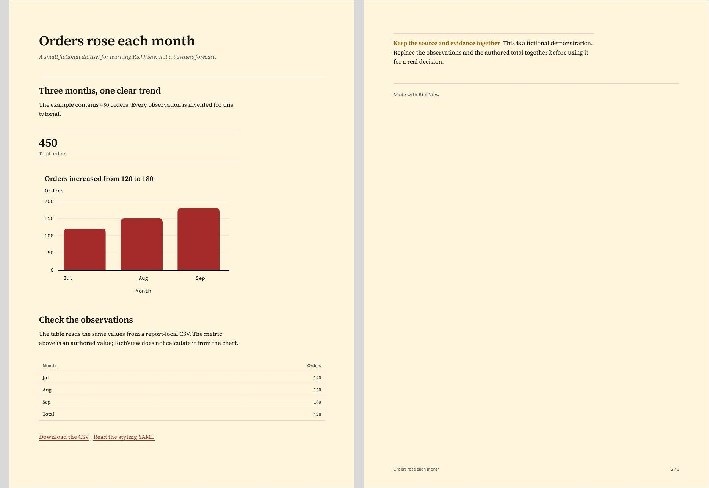

`examples/first-report` printed with `richview generate --to pdf`: two A4 pages in the light print styles, the second holding only the closing callout and the "Made with RichView" line above the running title and page number. Source: the `b4db233` release build with Chrome for Testing, 2026-10-22, as recorded by FEA-SF-06 (F-APP-PDF-EXPORT). Cards: FEA-RP-43 (F-EXPORT-PDF), ARC-30 (C-APP-PDF-EXPORT).

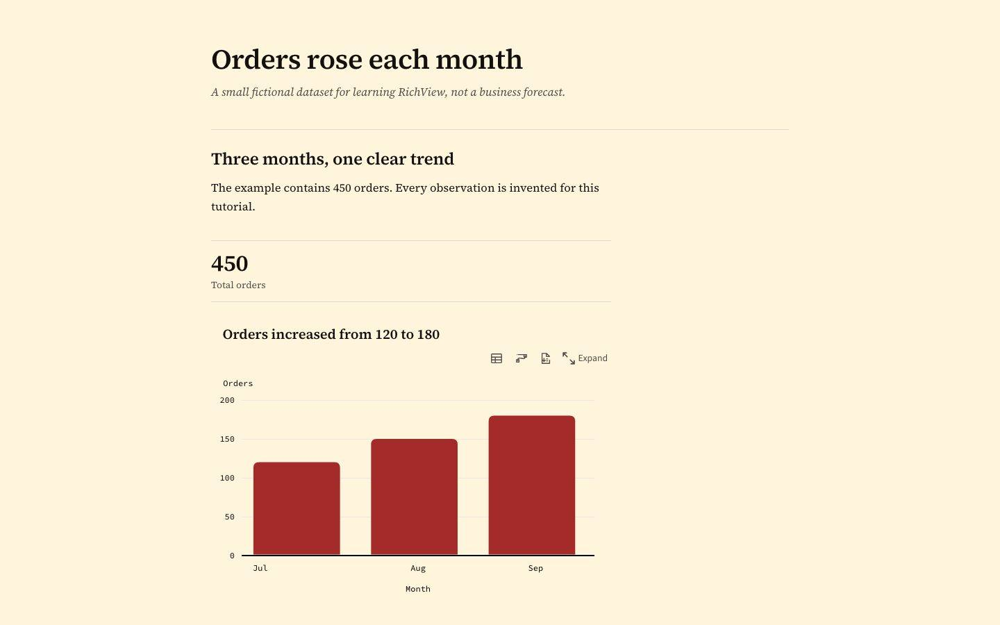

The report-server path end to end: the tutorial report "Orders rose each month" published to a loopback `richview server` and read at `/r/first-report`, the stored HTML with its embedded runtime and hydrated chart actions. Source: `richview server` on port 47911 with a temporary data directory, `b4db233` release build, headless Chromium, 1440×900, 2026-10-22. Cards: ARC-20 (D-PUBLISH-CONTRACT), FEA-SF-14 (F-APP-SERVER-REPORT-PAGES).

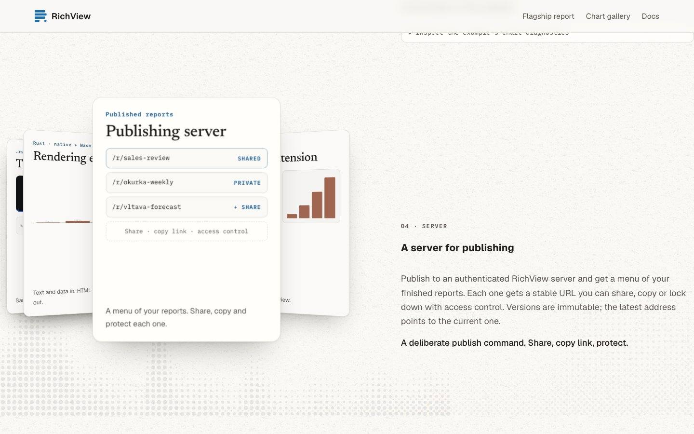

What richview.ai promises for the same element: "a menu of your finished reports", each to "share, copy or lock down with access control", with a mock `/r/okurka-weekly` marked private. The host has public reads, a JSON listing and no access control; `docs/public/publishing.md:128` says "bearer authentication protects writes, not report reads". Source: https://richview.ai/#element-server (PR #69 content), 1440×900, 2026-10-21. Cards: ARC-20, FEA-SF-18 (F-REPORT-MENU), FEA-SF-19 (D-ACCESS-CLAIM).

> **ARC-20 (D-PUBLISH-CONTRACT), proposed.** Core builds one publish request (TYP-66): source, style references, the report's resolved files and slug, with the version from the frontmatter. A report host checks the bearer token, re-renders from source with its own engine, rejects hard errors and stores the result and the story's link-preview thumbnail; clients never upload HTML. CLI, MCP and VS Code require an explicit server URL. RichView runs hosted Cowork at app.richview.ai and, only on request, Publish servers for customers under their own DNS; anyone can self-host Cowork as a binary or container (INT-36, ARC-22). Publish, rebuilt on the server core it shares with Cowork, uses the same request and never adds a second rendering path (INT-35, INT-83). Private reads are not claimed until a host implements them (FEA-SF-19).
>
> **ARC-24 (D-SITE-SPLIT), proposed.** The report host, RichView Cowork's first cut, serves `/r/:slug`, `/r/:slug/v/:version`, `/raw/…`, each version's link-preview thumbnail, the publish and read APIs, the content-hashed runtime and font routes, `/health`, and the sign-in, report menu and governance pages its roles bring; published HTML links the runtime and fonts from those immutably cached routes (INT-04). The website is a separate static build deployed to richview.ai, and `richview serve` keeps a loopback preview of one report folder. Site paths requested from the report host return 404.
>
> **ARC-31 (C-APP-HTTP-SERVER), proposed.** Becomes RichView Cowork's first cut (INT-83). Reads follow sharing (OPN-54): a report is private by default, its author shares it with their organization or with anyone on the web, and `/r`, `/raw`, per-slug info, the report list and the link-preview thumbnail answer each caller only for reports shared with them, so a link preview never reveals a private story (Daniel's INT-07 answer). Every write, regenerate and the stored bundle need an authenticated caller with that right; `POST /api/render` is dropped (FEA-SF-17); per-route body and concurrency limits replace today's single 32 MiB limit; the therichview.com redirect goes. Identity, roles, the governance section and approvals live in the server core Cowork shares with Publish (FEA-SF-19), and the publish token stays the bearer credential of the account-free CLI, MCP and VS Code.
>
> **ARC-69 (D-LINK-PREVIEW-RENDER), proposed.** The server core renders each version's thumbnail when it stores the version, as a 1200×630 PNG: the story's title and byline in its own style over its lead chart, or its cover image when it has no chart (FEA-SF-55). The lead chart is drawn from the engine's geometry model by the vector renderer PDF export also uses and rasterized natively in Rust, so no WebGL and no browser are needed. The thumbnail belongs to the immutable version, and the host serves it from a versioned route under the story's own access rule; `richview serve` renders the same thumbnail on demand.

## Deployments: what runs where

`main` at `b4db233` is deployed nowhere: the live site is a later branch build, and the earlier legacy hosts predate it. Since 4 October agents have deployed under batch or task authorizations, PRs #65, #69 and #70 went live from unmerged branches, and there was no `dev`/`prod` split (`history-prs.md` in docs/lockdown/evidence). The table gives every host today and its end state, which combines Daniel's ARC-22 answer with the one-off steps Part 08 times before the rewrite, each on his go; most of those steps ran on 2026-10-27, and the status follows the table; [Delivery](delivery.md) covers who deploys what from which branch afterwards (DEL-40, G-DEPLOY-OWNER), and [What RichView is for](purpose.md#domains-and-hosting) the domain decisions.

### Hosts today and proposed

| Host or channel | Today | Built from | Proposed | Cards |
| --- | --- | --- | --- | --- |
| richview.ai | Cloudflare Worker `richview-teaser`: Workers Static Assets for `dist/web`, `POST /api/interest` into D1 with a rate limit of 10 per 60 s (`wrangler.toml`). Re-run: the home page is 28,225 bytes with `#rv-field`, against `main`'s 28,159 bytes without it | `task/s27-653-site` (PR #69) at `7b23a22`, Worker version `7f3bef0d…`, deployed 2026-10-19 (stated in the S27-653 deploy receipt that OPN-01 cites) | The same Worker serves the static site and signup, deployed only from `prod` (Daniel's ARC-22 answer). First `main` is made equal to the live build by merging PR #69, which records production without approving its design; no legacy hotfix ships, because the live page was never advertised (OPN-01, OPN-13, OPN-43, FEA-SF-30, all answered) | ARC-22, ARC-55, OPN-01, OPN-02, OPN-13, OPN-43, FEA-SF-30 |
| The Worker's workers.dev address | The same Worker, because `wrangler.toml` sets `workers_dev = true`; re-run: 200, 28,225 bytes | Same | Kept and hidden behind a Cloudflare Access sign-in Daniel holds, as the `dev` preview of richview.ai; it redeploys from `dev` only when the website's code changes (Daniel's ARC-22 and OPN-44 answers) | INT-46, ARC-22, OPN-44, DEL-40 |
| Report server | None in production; `richview server` runs on loopback only | Not applicable | RichView Cowork: self-hosters run the binary or container; RichView also runs hosted Cowork at app.richview.ai, free up to limits, and Publish servers for customers on request, under their DNS (Daniel's INT-36 and ARC-22 answers) | ARC-22, ARC-56, INT-36, INT-83 |
| news.richview.ai | Worker `richview-news`: private R2, Durable Object, Cloudflare Access ([wrangler.publish.toml](https://github.com/1vecera/richview/blob/3f5c35f/wrangler.publish.toml) on PR #70's branch head `3f5c35f`); the publisher's launch agent disabled since 2026-10-20 (OPN-46) | PR #70 branch code; content `publish/news` at `7e7d9f8` | RichView's own Publish server, public, and it stays published (Daniel's ARC-22 answer). The RichView News session keeps improving it on PR #70's code, merged as it is (look, real reports, editor login), and repairs the publishing path with a credential scoped to the new repository; deploys on Daniel's go | ARC-22, ARC-57, INT-74, OPN-03, OPN-46 |
| richview.uk | The v2 marketing app behind Cloudflare, origin not recorded; still the CLI and VS Code default server | v2 | Redirects 301 to richview.ai now; no product default | INT-47, OPN-04 |
| app., docs. and api.richview.uk | The v2 app shell, v2 docs and v2 API; api is a CNAME of the Fly app `richview-api`, whose `/api/reports` lists seven reports without a token (OPN-45's check on 2026-10-22, not re-run here) | v2 | Its reports exported; app. and docs. redirect with the apex, api. leaves DNS, and the Fly app and its database are destroyed; Daniel confirmed he owns the app (OPN-45, answered) | OPN-45 |
| richview-v3.fly.dev | Fly app `richview-v3`, the May TypeScript scaffold; lists `v3-launch` without a token. Re-run: `/health` 200, header `x-richview: v3` (the Rust host sends `v3-rust`) | Around `ae2a1cb`, 2026-05-21 (inferred in OPN-05) | Its one report exported, then the app and its volume destroyed | INT-47, OPN-05 |
| therichview.com | An expired Squarespace page, 404; `main`'s server still redirects it to richview.uk | None | The domain is allowed to lapse and the redirect code goes (Daniel's ARC-22 answer) | ARC-22, INT-47 |
| npm, VS Code Marketplace, Open VSX | Nothing. Re-run: npm answers 404 for `@richview/core` and `@richview/charts`; the Marketplace finds no `richview.richview-vscode`, and Open VSX answers 404 | None | No npm packages; the VS Code extension is published on the VS Code Marketplace and on Open VSX (Daniel's INT-71 answer) | INT-71, DEL-41, FEA-SF-21, ARC-48, ARC-49 |
| GitHub | Private `1vecera/richview`; one prerelease, `chart-refinements-2026-10-12`, with a Linux x64 CLI, a VSIX and package tarballs | `5d47fbd`, older than `main` | Builds from `prod` are offered, and Daniel's INT-71 answer changes INT-41's "no releases" for these builds and the extension listings; how they are versioned and published is open (INT-41, DEL-41). The old prerelease and its assets are deleted and the tag stays as a history marker (OPN-28) | INT-71, INT-41, OPN-28 |
| Hosted CI | `ci.yml` on pushes and PRs to `main`; per the history evidence, every run from 2026-10-14 to 2026-10-19 ended without starting a job, a billing block under the previous owner (not re-run) | Not applicable | Never a merge gate; automatic triggers off until Daniel confirms an Actions budget that stops at $0, and then only on `pre-prod` and `prod` and by manual dispatch, because merges into `dev` take only the fast gate | DEL-39, DEL-81, ARC-50 |
| Local machines | Builds, checks and the lockdown app on 127.0.0.1:4790 run on the development hosts | Worktrees | The gate runs on Claw Mini; nothing deploys from task branches or worktrees, and `dev` deploys only the hidden preview | DEL-22, DEL-40, DEL-06 |


What answers where on 22 October 2026. Mermaid source under [Diagram sources](#source-deployments).

> **ARC-22 (D-DEPLOY-TOPOLOGY), Daniel's answer, 2026-10-26.** Option 1, with these changes:
>
> | Host | Decision |
> | --- | --- |
> | richview.ai | Static site plus signup, deployed only from `prod` (ARC-55). |
> | richview-teaser.vecera.workers.dev | Kept and hidden (Cloudflare Access, DEL-40). It is the `dev` preview of richview.ai. It redeploys from `dev` only when the website's code changes, not on every `dev` change. |
> | Hosted RichView Cowork | At app.richview.ai, free up to limits and paid beyond (INT-36). Deploys from `prod` on Daniel's go. |
> | Publish servers for customers | Set up on request only, under the customer's DNS (INT-36). Nothing runs until a customer asks. |
> | news.richview.ai | RichView's own Publish server, public. It stays published. |
> | Managed hosting for large data and media | As proposed (INT-27, INT-36); not discussed further here. |
> | richview-v3.fly.dev | Shut down (after export, INT-47). |
> | richview.uk | 301 to richview.ai, as proposed. |
> | therichview.com | The domain is allowed to lapse; its redirect code is removed. |
>
> Every production deployment goes through the `prod` gate on Daniel's go. Fly configuration is deleted (ARC-56).
>
> **ARC-55 (C-CLOUDFLARE-TEASER), proposed.** Keep the Worker as the static site host and signup endpoint, deployed to richview.ai only from `prod` and to the hidden richview-teaser.vecera.workers.dev preview only when the website's code changes, serving the site build of ARC-24; the signup's consent and validation rules move to Rust compiled to Wasm behind a thin Worker; its README is corrected. Open: whether the preview serves `/api/interest`, and which Workers the preview needs. Whether signup stays is FEA-SF-31 (D-SIGNUP), which keeps it exactly as long as INT-72 (D-SUBSCRIBERS) keeps the update list.
>
> **ARC-56 (C-CONTAINER-DEPLOY), proposed.** The Dockerfile stays as the self-host image for RichView Cowork, running `richview server` without the site tree and with the same roles and governance as hosted Cowork; self-hosters get it through INT-71's install paths, and whether a container image is among the builds from `prod` is open (DEL-41). `packages/server/fly.toml` and the orphan `packages/server/` and `packages/cli/` folders are deleted, and the Fly apps are destroyed once their reports are exported (OPN-05, OPN-45).

Status on 2026-10-27, from [DELIVERY.md](../lockdown/DELIVERY.md#outward-actions-waiting-for-daniels-go): Daniel gave his go for the cleanup batch and it ran. Both Fly apps are destroyed after backups; richview.uk, app.richview.uk and docs.richview.uk return 301 to richview.ai through a Worker, and `api.richview.uk` has no DNS record; Cloudflare Access covers the workers.dev preview, which answers with a redirect to the Access sign-in; `main` was renamed `prod`, and DEL-81 later renamed `dev` to `pre-prod` and made a new `dev` the default branch. Deploying PR #69 to richview.ai was not part of that batch.

### Live versus `main`

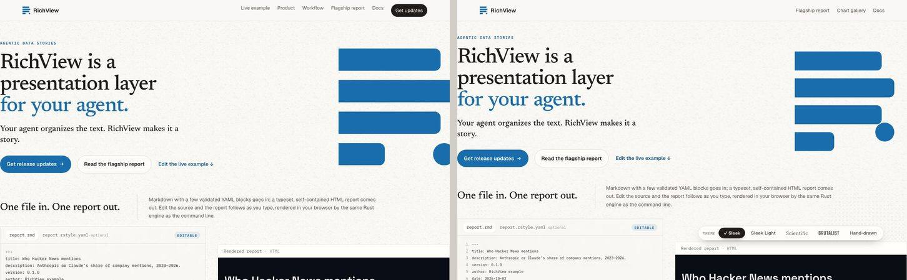

Left: the home page of `main` at `b4db233` from a local release build, with six header links and a mark that runs past the right edge. Right: richview.ai serving PR #69's build, with three header links, line numbers in the demo editor and a visible style switcher. No commit on `main` produced the live page. Source: the composite on [Delivery](delivery.md#starting-point) of `product/landing/landing-desktop-viewport.jpg` and `live/richview-home-desktop-01-hero.jpg`, both 1440×900, 2026-10-21. Cards: OPN-01 (D-PROD-BASELINE), OPN-13 (D-SITE-PR69).

| Route or behaviour | richview.ai (PR #69 build) | `main` build | Re-run 2026-10-22 |
| --- | --- | --- | --- |
| Home navigation and motion | Flagship report, Chart gallery, Docs; `#rv-field` and `#rv-stage` restore the scroll stage | Live example, Product, Workflow, Flagship report, Docs, Get updates; the stage code returns early | Live home has `rv-field` and `rv-stage`; `dist/web/index.html` has neither |
| `/docs/charts` | 200, the nine-type chart gallery | Not built; [docs/public/charts.md](https://github.com/1vecera/richview/blob/7b23a22/docs/public/charts.md) exists only on PR #69's branch (here at the deployed commit `7b23a22`) | 200, 338,127 bytes |
| Chart chrome | PR #69's `52d07db`: visible action labels, a more transparent tooltip, the rectangle clamp (OPN-13) | Icon actions | Not re-run |
| `/showcase` | 404 | 404: the alias points at a `showcase.html` the build never makes | 404 |
| `/showcase/chart-review/standard/` | 200, a redirect page to the sleek review, linked from nowhere | Built | 200 |
| `/reel/`, `/charts/`, `/bindings/core/index.browser.js` | 200 | Built | 200; the folder `/bindings/core/` answers 404 because it has no index file |
| `/llms.txt` | 404 | Not staged | 404 |
| `/health`, `/api/reports` | 404, static site | Answered by the native host | 404 |
| CSP header | None | None on any host | None |

## Branch-only components

PR #70, merged into `main` as it is on 2026-10-26 (INT-35, INT-52), is the only change with a separate architecture of its own. RichView Publish turns a Git content tree (`publications/news/` on the long-lived `publish/news` branch) into a publication: a browser editorial desk opens pull requests on `publish-edit/*`, an operator-side publisher builds immutable releases with a `richview-publish` crate that reuses the resolver, renderer and Wasm runtime, and the `richview-news` Worker serves them from private R2 through a Durable Object ledger and Cloudflare Access ([docs/publish/README.md](https://github.com/1vecera/richview/blob/3f5c35f/docs/publish/README.md) at the branch head `3f5c35f`). It keeps its access and editorial rules in 2,329 lines of Worker and editor JavaScript, out of the 3,998 lines of JavaScript the branch adds, and builds its runtime at `opt-level = 3`, both against ARC-03 and ARC-04. Since the repository transfer its GitHub bridge is inferred to be broken (OPN-03), and the publisher has been disabled since 2026-10-20.

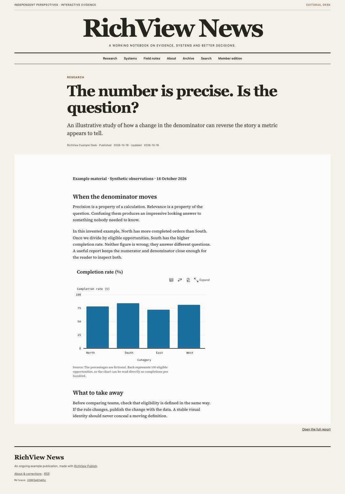

A News story page: Publish's masthead and navigation around a RichView report shown in an iframe (`/_content/<id>/report.html?embed=1`), with the same chart actions as an exported report, and the release hash in the footer. Source: https://news.richview.ai/stories/measurement-gap (PR #70 branch), 1440×900, full page resampled to 1080 px wide, 2026-10-21. Cards: ARC-57 (C-RICHVIEW-PUBLISH), INT-35 (D-SCOPE-PUBLISH), INT-74 (D-NEWS-DEMO).

> **ARC-57 (C-RICHVIEW-PUBLISH), proposed.** Rebuild in the rewrite on the shared server core; #70 runs News until then. Publish is built in Rust: a builder that renders every item through the core's publish contract (ARC-20), and a server on the server core it shares with RichView Cowork (INT-83), which holds storage, identity, enterprise-grade roles managed in a governance section (FEA-SF-19), approvals and the author's quick source edit (INT-26). Roles and approvals live in that server core, never in the core. Content lives in its own repository (ARC-16), and FEA-BR-23 to FEA-BR-30, FEA-BR-44 to FEA-BR-46 and FEA-BR-49 are the requirements. PR #70 is merged as it is, JavaScript included, so News keeps running and improving; the rewrite carries over its behaviour and decisions, not its code, and ports the JavaScript gateway and desk to Rust when it reaches Publish (INT-52, OPN-14). news.richview.ai is RichView's own Publish server and always public (ARC-22); items go public through OPN-54's workflow, and live connectors are standard on Publish as on every server (OPN-63). Open: where the rewrite's Publish runs, whether its releases stay in R2, which branch News deploys from, and when News cuts over (INT-74).

The other branch-only components touch the core architecture at one point each: PR #66's connectors would link DuckDB into every native build unless they sit behind a feature; Daniel's OPN-63 answer makes live connectors standard on every RichView server, with RichView building the connector core and PR #66's work entering it, while the core itself never queries data (ARC-59, INT-08); PR #64's dashboard is a separate crate with a handwritten browser UI, and Daniel's INT-34 answer keeps it outside this repository (ARC-58); PR #65's galleries were static pages (ARC-60); and ARC-61 would fold PR #68's harness into gate rules. PRs #62, #63, #67 and #69 add features rather than components; Part 04d records them, and OPN-06 to OPN-13 decide each PR.

## Method and sources

Read at `b4db233` in the lockdown worktree: every crate manifest; `crates/richview-core/src/{lib,render,style}.rs`; `crates/richview-app/src/{assets,resolver,server,storage,cli,mcp,export_pdf}.rs` and `asset_upload/mod.rs`; `crates/richview-site/src/{lib,browser}.rs` and `browser/{homepage,charts,reel}.rs`; `crates/richview-editor/src/main.rs`; `crates/richview-build/src/main.rs` and `documentation.rs`; `assets/landing/index.html`; `packages/vscode/extension.cjs`; `cloudflare/interest-worker.mjs`; `wrangler.toml`; `Dockerfile`; `packages/server/fly.toml`; and `.github/workflows/ci.yml`. On PR #70's branch head `3f5c35f`: `wrangler.publish.toml`, the Publish README and the line counts of the JavaScript the branch adds. Line counts come from `git ls-files`.

Re-run on 22 October 2026 with the `b4db233` release build (`target/release/richview` 3.0.0-alpha.0 with the staged `dist/web`):

- `richview init` and `richview generate --format json` from the worktree root, with the report's script and style bytes measured; the same `generate` from a folder outside the checkout, with and without `RICHVIEW_PUBLIC_DIR`.
- `richview validate` and `richview check` on a bar chart with missing encoding fields.
- The `chart.palette` injection probe with `sleek`, `sleek-dark`, `sleek-light` and `scientific` in the cascade, and the `_renderHeight: 900` probe.
- The `init` template in all five builtin styles, opened in headless Chromium (Playwright 1.63) at 1440×900 with scripts off and hydrated, measuring figure widths, the frame shown and tick-label heights, with the captures shown under [In the browser](#in-the-browser).
- The build output: the export lists of `dist/web/richview_site.d.ts` and `richview_site_bg.wasm.d.ts`, the byte count of `dist/web`, which of its HTML pages load the runtime, and the six prerendered landing demos.
- Read-only requests: richview.ai (`/` with its navigation compared against the `main` build, response headers, `/docs/charts`, `/charts/`, `/reel/`, `/showcase`, `/showcase/chart-review/standard/`, `/bindings/core/`, `/bindings/core/index.browser.js`, `/bindings/charts/index.js`, `/llms.txt`, `/api/reports`, `/health`), the workers.dev address, `https://news.richview.ai/_status` and `/stories/measurement-gap`, `https://richview.uk/`, `https://richview-v3.fly.dev/health`, `https://therichview.com/`, the npm registry, the VS Code Marketplace and Open VSX, and `git ls-remote` for the branch heads this page pins.

The probe files were deleted afterwards. Not re-run here: PDF export (the capture is FEA-SF-06's run), the MCP session, the editor and VS Code, publishing to a loopback host (Part 04c's captures), the richview.uk subdomains and the Fly app `richview-api` (OPN-45), the S27-653 deploy receipt (OPN-01), the News publisher state (OPN-46), the hosted CI history and the build times. Evidence, in docs/lockdown/evidence: `product.md`, `history-prs.md`, `checks-performance.md`, `intent-notion-site.md` and `format-types.md`. Cards: the part file `03-architecture.json` in docs/lockdown/parts, with Parts 01, 02, 04a to 04d, 05, 07 and 08 where cited. Screenshots: `INDEX.md` in docs/lockdown/screenshots gives most captures' sources. These files open only in the worktree, not from the app.

The diagrams are drawn from the Mermaid sources under [Diagram sources](#diagram-sources) with Mermaid 11.17.2 in headless Chromium and saved as SVG in `docs/guide/img/`, because the lockdown app shows Mermaid only as source. Change a source, then re-render its SVG.

This page was written on 22 October 2026 and revised on 27 October 2026 for Daniel's answers (ARC-05 and ARC-22, and the answers in Parts 01, 02, 04 and 08 that bind Part 03) and the revised Part 03 cards; its Today facts date from 21 and 22 October. Related pages: feature behaviour is in Parts 04a to 04d, field types in [Format and types](format-and-types.md), styles in [Styles](styles.md) and Part 06 ([open in the app](http://127.0.0.1:4790/#/part/06-styles)), budgets in [Performance](performance.md), and branches, gates and deploy authority in [Delivery](delivery.md).

Linear's component labels are aliases, not lockdown IDs: C-RICH-MARKDOWN, C-THEMES and C-RENDERER are ARC-26; C-CHART-ENGINE is ARC-25; C-SERVER is ARC-31 with ARC-32; C-CLI-MCP is ARC-28 with ARC-33; C-VSCODE is ARC-45; C-PUBLISH is ARC-57; C-DASHBOARDS is ARC-58; C-WEBSITE is ARC-38 to ARC-43 and ARC-55, with ARC-64 for the chart-review pages.

Error found in another lockdown file while this page was revised, not yet fixed there:

- ARC-06's why says the landing demo loads the site's copy through `runtime_url`; that holds only for its live re-renders, since its first view embeds the runtime.

## Diagram sources

### Source: system map

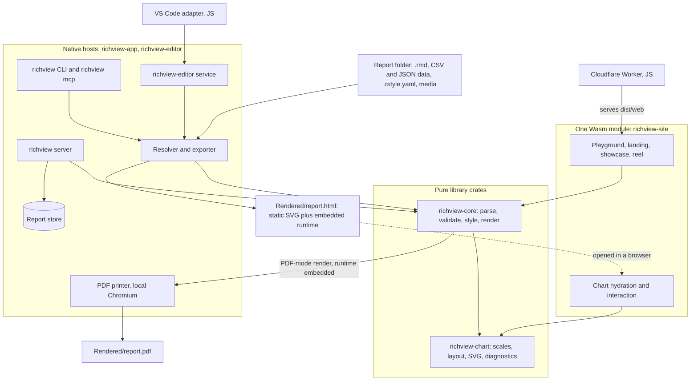

### Source: crates today

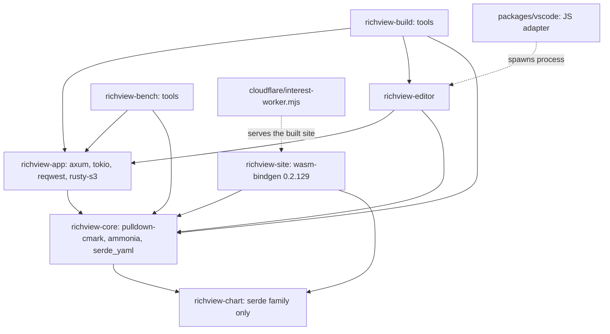

### Source: proposed layers

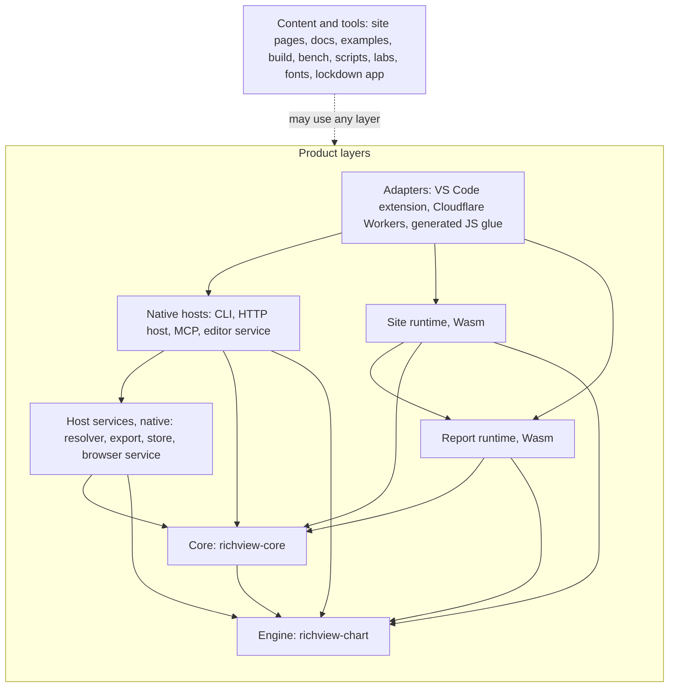

### Source: render sequence

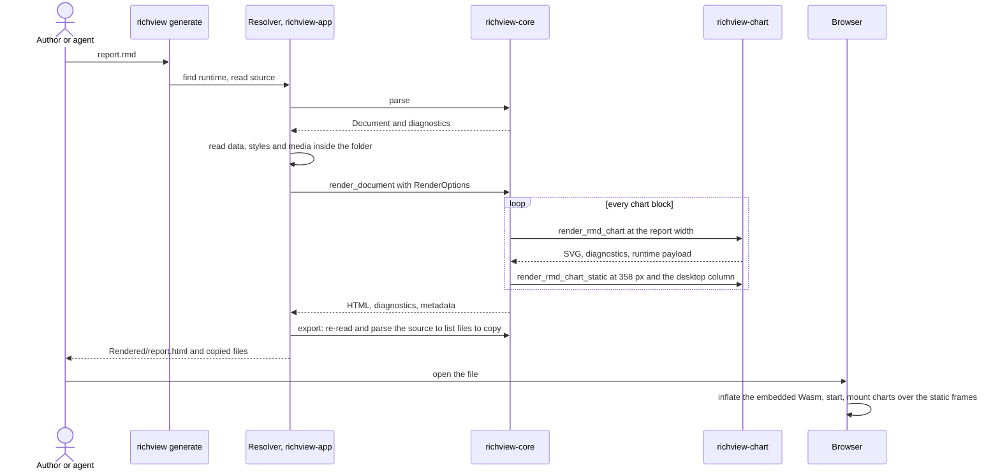

### Source: publishing paths

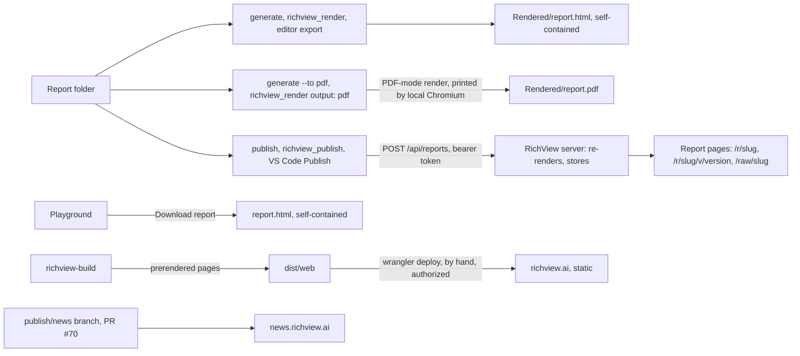

### Source: deployments

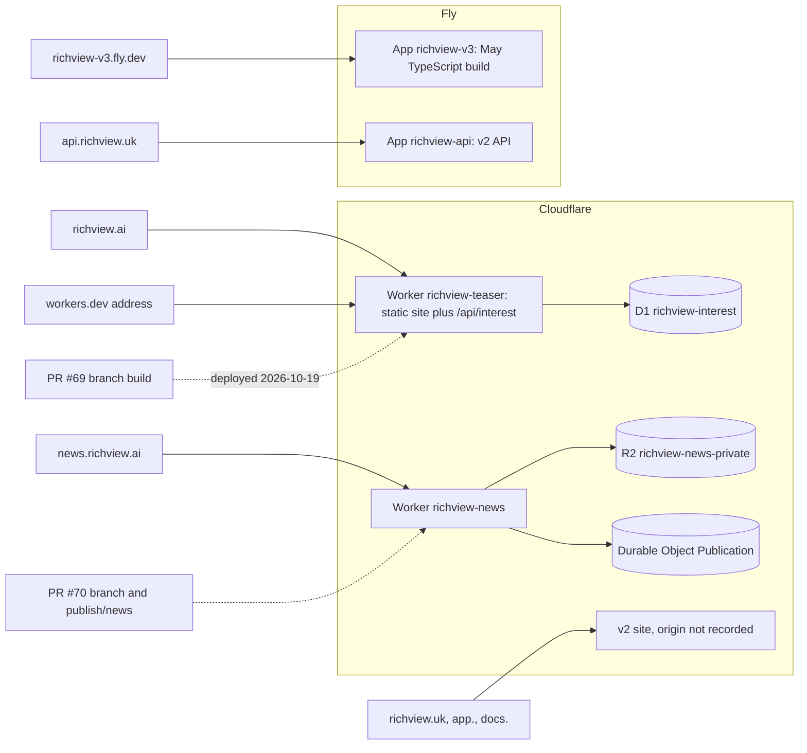
