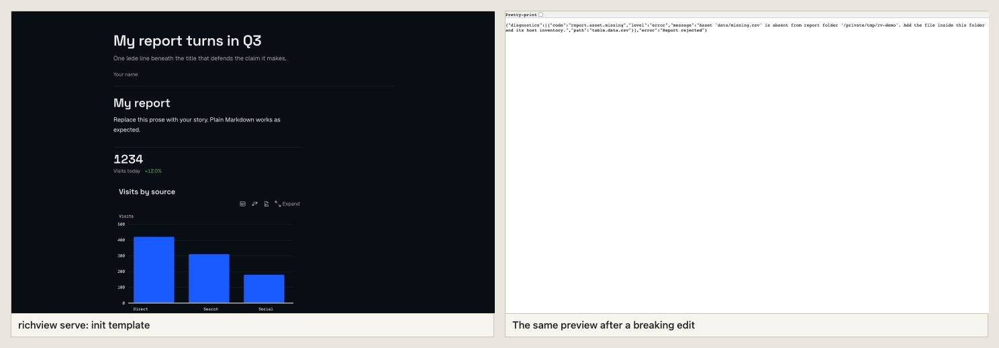
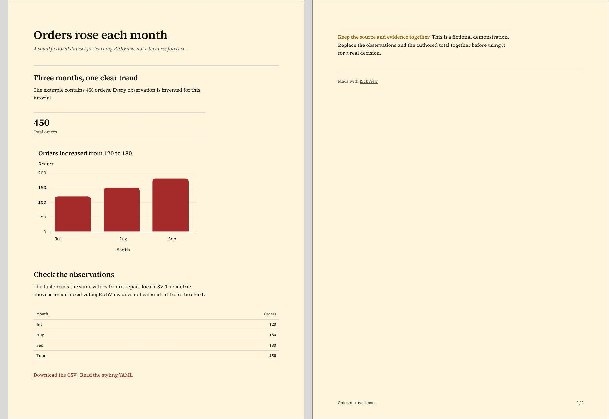

# Native app: CLI, MCP, report host and publishing

This page describes `richview-app`, the native host crate (C-RICHVIEW-APP, card ARC-27), as it stood on `main` at `b4db233` (the branch renamed `prod` on 27 October, DEL-02): the `richview` command line, the MCP server, the resolver and exporter, the PDF printer, the HTTP report host and its store, the three publish clients and the asset uploader, with the decisions and proposals that carry them into the rewrite. Part 04c (`04c-features-surfaces`, its CLI, MCP, publishing and report-host groups) and Part 03 had no recorded answer on 22 October 2026. By 27 October Daniel had answered FEA-SF-19, ARC-22 and the Part 01 and Part 08 cards that set this component's scope, and the open cards of both parts were rewritten to follow those answers. A quote headed Daniel's answer, or a cell that begins Decided, states an answer; every other proposal below still awaits Daniel in [Part 04c](http://127.0.0.1:4790/#/part/04c-features-surfaces) and [Part 03](http://127.0.0.1:4790/#/part/03-architecture) of the lockdown app.

Related pages: [Architecture](../architecture.md#native-host-richview-app) for where the crate sits; [Format and types](../format-and-types.md#report-identity-and-publishing) for the publish request, stored record and routes, and its [agent-facing contracts](../format-and-types.md#agent-facing-contracts) for the JSON envelopes; [Report core](core.md) for what a rendered report contains; [Editor](editor.md) for the VS Code client; [Cloud and hosts](cloud.md) for where RichView's servers run and what became of the legacy hosts; [Build](build.md) for the build that stages the runtime this crate looks for; [Performance](../performance.md) for budgets; the [guide index](../README.md) for labels, IDs and links.

Statements marked re-run were checked on 22 October 2026 with the release build of `b4db233` in the lockdown worktree (`target/release/richview` 3.0.0-alpha.0); everything else comes from the card or evidence named beside it, as [Method and sources](#method-and-sources) details.

## At a glance

| Question | Today on `main` | Proposed | Cards |
| --- | --- | --- | --- |
| What is it? | One crate with two binaries, `richview` (8,976,352 B) and `richview-server` (6,638,992 B); 3,698 lines of source, a 2,765-line asset uploader and 29 tests (re-run) | Host services (resolver, export, store, browser) behind thin transports (CLI, HTTP, MCP), optional capabilities behind Cargo features, one binary; `richview server` starts RichView Cowork, one of the two RichView server forms (INT-83) | ARC-27, ARC-08, FEA-SF-20, INT-83 |
| Who calls it? | People in a terminal, agents through MCP or the CLI, and the editor service, which links the whole crate | The same, all through one operation layer that returns the same JSON on every surface; RichView has no chat interface and makes no model calls, so the author's own agent does all language work (INT-25) | ARC-08, TYP-68, TYP-69, INT-25 |
| How well do agents use it? | Not measured: `richview learn`, the skill and `llms.txt` list six chart types and three styles where the code has nine and five (INT-21) | Agent-native is a headline bet (INT-21): an agent learns, writes, renders, checks and publishes on its own, the learn bundle, skill and tool descriptions are generated from or tested against the code (INT-66), and scored fresh-agent runs on real tasks, tracked over time, show where agents stumble and drive changes to those surfaces | INT-21, FEA-SF-65, FEA-SF-47, FEA-SF-48, INT-69, DEL-78 |
| What does it write? | `Rendered/<stem>.html` inside the report folder; `serve` also creates an empty `<cwd>/tmp/richview-preview` | `Rendered/` only, from any working directory, with the report runtime embedded in the binary | FEA-SF-05, ARC-07, ARC-29 |
| Where does it work? | `validate`, `check`, `publish` and `learn` anywhere; `generate` and MCP `richview_render` refuse any report with a chart (`report.output.runtime`) unless a staged `dist/web` is found, which in practice means running from the repository root (re-run, `publish` by code reading) | From any directory: the runtime is compiled into the binary | ARC-07, FEA-SF-05 |
| How is a report shared? | `richview publish` sends source and resolved files to a report host, which renders and stores a version; the CLI and VS Code default to `https://richview.uk`, a v2 page with no report API | The same contract with an explicit server, `--new` before a new address, and a 409 for a changed republish; the server is RichView Cowork or RichView Publish, and app.richview.ai is RichView's own hosted Cowork (INT-36, INT-83) | ARC-20, FEA-SF-12, FEA-SF-51, TYP-63, INT-36 |
| What does a shared link show? | A published report carries no `og:` metadata and no preview image (FEA-SF-55) | Every story at an address unfurls as a designed 1200×630 thumbnail in its own style with its title (INT-07); the server core renders it natively from the geometry model when it stores a version, and serves it under the story's own access rule; a private story gives an anonymous request a plain RichView card | ARC-69, FEA-SF-55, FEA-RP-51, INT-07 |
| What can anyone read on a host? | Report pages, raw source, the list of every report, the full stored bundle including data, plus anonymous render and regenerate | Decided (OPN-54): reads follow sharing. On Cowork a report is private until its author shares it with an organization or the web, and each caller's list shows only what is shared with them. The full bundle, regenerate and every write need a role with that right (FEA-SF-15, FEA-SF-16); no render API (FEA-SF-17) | FEA-SF-14 to FEA-SF-17, FEA-SF-19, ARC-31, OPN-54 |
| Are versions permanent? | No: each publication keeps 50 versions of a slug and deletes the rest, lowest SemVer first, and `/r/{slug}` follows publication order, not version order | Permanent until the owner deletes one (410); latest is the highest release or the owner's pin | FEA-SF-54, TYP-64, TYP-96 |
| Is it fast and lean enough? | Process-cold `generate` and the MCP tools meet their proposed limits; on 2026-10-21 the flagship permalink took 81 ms p95, the server peaked at 1,068 MiB during four concurrent dense renders and the MCP server held 1,567 MiB after 20 dense renders (not re-run) | Permalink ≤ 25 ms p95; server ≤ 512 MiB at peak over four concurrent dense publishes and 100 reads; MCP server ≤ 256 MiB after 100 dense renders; budgets for cold CLI runs, MCP latency, PDF and install size | PRF-15, PRF-42, PRF-44, PRF-11, PRF-12, PRF-16, PRF-39 |
| How is it tested? | `verify-native.mjs` and the crate's Rust tests pass; hosted CI has not run a step since 2026-10-13 | A check and a tier for each new behaviour (FEA-SF-62): public-surface snapshots of commands, MCP schemas and routes, loopback publish and host checks and the `serve` browser suite in the release run on `pre-prod`; PDF output in the full run; the crate's unit tests in the fast gate on `dev` (DEL-81); fresh-agent runs scored at each candidate (FEA-SF-65) | DEL-14, FEA-SF-62, DEL-81, FEA-SF-65 |

## What the app is for

`richview-app` does everything that touches the machine for the pure core: it inventories a report folder, resolves data, styles and media inside it, embeds the runtime, writes `Rendered/`, drives a browser for PDF, stores published versions and serves them. ARC-27 (C-RICHVIEW-APP) proposes to keep that responsibility and change the shape: services separate from transports, so the editor, build and bench would stop compiling an HTTP server, a browser driver and an S3 client they never call. Daniel's answers rest on it: INT-21 (D-BET-AGENT-NATIVE) makes agent-native authoring a headline bet, so the CLI and MCP are how an agent learns, writes, renders, checks and publishes; INT-25 (D-NOT-CHAT) keeps RichView a tool the author's agent calls, with no chat interface, model calls or stored model keys; INT-04 (D-ARTIFACT) makes the output one self-contained file by default, linked on a server; INT-36 (D-PUBLISH-TARGET) shares a story as that file, a PDF or one of RichView's two servers, Cowork and Publish, which anyone can self-host and RichView also runs as paid services (INT-83; [Cloud and hosts](cloud.md#what-the-rewrite-runs-where)); and INT-08 (D-CORE-JOBS) says the core never queries data, with one exception on a RichView server, where a report can link datasets through the server's connectors (OPN-63) ([What RichView is for](../purpose.md#the-product-family-and-what-the-rewrite-builds)).

> **INT-21 (D-BET-AGENT-NATIVE), Daniel's answer, 2026-10-27.** Yes, a headline bet, 100%. RichView is agent-native: an agent learns, writes, renders, checks and publishes RichView on its own. It learns the format from `richview learn` or the `richview_learn` MCP tool, works through MCP or CLI JSON output, and every error names the line and the fix. The learn bundle, skill and MCP tool descriptions are generated from, or tested against, the same code as the renderer (INT-66), so today's drift (six chart types and three styles in `llms.txt` and the skill, against nine and five in the code) is fixed and can't come back.
>
> RichView invests heavily in how agents discover, learn and use it. Measuring how well agents use RichView is a feature: fresh-agent runs on real tasks, scored and tracked over time, show where agents stumble, and RichView is changed so agents understand it as easily as possible. A fresh agent with only these surfaces produces a clean report (INT-69).

> **INT-25 (D-NOT-CHAT), Daniel's answer, 2026-10-26.** RichView is a tool the author's agent calls. People bring their own agent; RichView has no chat interface, makes no LLM or speech-to-text calls, stores no model keys (no BYOK), runs no agent loop and does not generate slides or decks from prompts. The author's own agent does all language work. The main way to work is local: the author's agent uses RichView through its CLI and MCP server. A RichView server may at most expose MCP to an agent; it never adds a chat interface. Voice and chat front ends are sibling demos, never core (INT-34).

> **INT-83 (D-SCOPE-COWORK), Daniel's answer, 2026-10-26.** Chosen option: Today's report host becomes Cowork, as the proposal says. The RichView server is the way people host their things, and it comes in exactly two forms: you run either RichView Cowork or RichView Publish. There is no third, stripped-down server. Cowork focuses on people publishing reports locally, inside their own organisation. Over time Cowork may also store data-source credentials, such as SQL credentials, so its reports can read live data, like Publish's connector path (INT-24); not in its first cut.

| Module at `b4db233` | Lines | Does | Proposed |
| --- | --- | --- | --- |
| `crates/richview-app/src/cli.rs` | 703 | Ten commands, pretty and JSON output, the publish client | ARC-28 (C-APP-CLI): commands decode arguments and call operations; FEA-SF-01's command list |
| `resolver.rs` | 673 | Report-folder inventory, data, styles, media and fonts, runtime embedding, `Rendered/` output | ARC-29 (C-APP-RESOLVER): the only module that reads report inputs; dead parameters and the runtime lookup go |
| `export_pdf.rs` | 862 | Chromium over a CDP pipe, settle, print to A4 or Letter | ARC-30 (C-APP-PDF-EXPORT): one browser host service behind a Cargo feature, also used by `check`'s browser pass |
| `server.rs` | 652 | Report pages, raw source, read and publish APIs, render API, preview, static site fallback | ARC-31 (C-APP-HTTP-SERVER): Cowork's first cut; reports, raw source and thumbnails only, reads that follow sharing (OPN-54), a role on every write, regenerate and the bundle; no render API, no site routes |
| `storage.rs` | 333 | Filesystem store per `{slug, version}` with a publish lock | ARC-32 (C-APP-REPORT-STORE): a `Store` interface over the same backend; no pruning; a byte quota; an S3-compatible backend when Publish's releases or a self-hoster need it |
| `mcp.rs` | 415 | Stdio JSON-RPC, seven tools, two resources | ARC-33 (C-APP-MCP): nine tools, the five core tools, the two asset tools and the two image tools (FEA-RP-62), with schemas generated from or tested against core; the token only from the host environment |
| `asset_upload/` | 2,765 | `richview asset` put, verify and abort against S3-compatible storage | ARC-34 (C-APP-ASSET-UPLOAD): kept as a Cargo feature and finished, with source support for its pinned references (INT-31, TYP-41) |
| `assets.rs`, `lib.rs`, two `bin/` stubs | 60 | Runtime directory lookup, the 32 MiB input limit, entry points that exit 2 on error | Folded into ARC-07's embedded runtime |

## How it works

Every command reads one report folder: the folder that holds exactly one `.rmd` source, its data, styles and media. A second `.rmd` in the same folder is refused with `report.root.shared` and the message "contains multiple .rmd sources … Move each independent report and its assets into its own folder" (re-run). The resolver loads only files inside that folder, inlines chart and table data, resolves style references and embeds media and fonts, then hands core a fully resolved document; core never touches the file system (ARC-10, D-RESOLVER-BOUNDARY; [Safety boundaries](../architecture.md#safety-boundaries)). Output always lands in `Rendered/`: `-o elsewhere.html` writes `Rendered/elsewhere.html`, and a path outside the folder fails with `report.output.escape` (re-run, `crates/richview-app/src/resolver.rs:564-601`).

The HTML a command writes embeds the browser runtime as base64 gzip, so the report needs nothing else. The binary does not carry that runtime: it looks for a staged copy in `RICHVIEW_PUBLIC_DIR` (or `--public-dir`), then in `dist/web` under the working directory, then in `../share/richview/web` and `../public` relative to the executable's own folder (`crates/richview-app/src/assets.rs:6-32`). For `target/release/richview` those last two would sit under `target/`, which holds neither, so in practice only a run from the repository root finds the runtime. Without one, `generate` still exports a report that has no chart (`ok: true`, `interactive: false`) but refuses any report with a chart with `report.output.runtime`, "Interactive chart runtime is missing. Build/package RichView with richview-build before exporting this report." (`resolver.rs:631`); a fresh `init` fails this way because its template has a chart. `validate`, `check`, `publish` and `learn` never load the runtime and work from any directory (re-run from a report folder inside the repository and from one outside it, except `publish`, whose client resolves without the runtime by design: `crates/richview-app/src/cli.rs:403-412`). ARC-07 (D-RUNTIME-EMBED) would compile the runtime into the binary instead, so an export would work from any directory and `--public-dir` would leave every command.

The CLI prints a human summary by default and a JSON object with `--format json`. A successful `generate` returns `{ok, output, blocks, diagnostics, renderDiagnostics, interactive}`; a failure returns `{ok: false, error, diagnostics}` with exit 1, but only under `--format json`. Without it, `main` prints `richview: ` followed by the error, which is often a serialized JSON array, and exits 2 (re-run). TYP-68 (T-CLI-JSON), inferred, would set one envelope for every command, and FEA-SF-07 (F-CLI-HUMAN-OUTPUT) one line format for people.

`richview serve` renders the report in memory on every request to `/`, serves it with `Cache-Control: no-store`, and the page polls `/__revision` to reload after a change. It also creates a preview store at `<cwd>/tmp/richview-preview`, which stays empty: the process has no token, so a publish to it answers 503. The same process serves the playground and the site files from `--public-dir` and answers `GET /api/reports` (re-run). A source that is broken at startup stops the command with exit 2; a source that breaks while the preview runs replaces the page with the JSON error.

`richview mcp` speaks JSON-RPC over stdio, one message per line. `initialize` echoes whatever protocol version the client sends (re-run with `1999-01-01`) and returns the instructions "Use richview_learn to load the authoring contract. Edit source, render, then inspect geometry with richview_check." The server lists seven tools and two resources. Each tool calls the same resolver and core functions as its CLI command through its own glue code, which ARC-08 (D-ONE-OPERATION-LAYER) would replace with one operation layer. Only `richview_render` loads the runtime, so only it fails away from the repository root, and only for a report with a chart (re-run; `crates/richview-app/src/mcp.rs:178-189`).

Publishing has a client side and a host side. The client (`richview publish`, `richview_publish` and VS Code's Publish command, which calls the same function) validates the source, builds a request `{slug, source, styles, data, report_folder}`, and posts it with a bearer token to `<server>/api/reports`: HTTPS only, plain HTTP only to `localhost`, `127.0.0.1` or `[::1]`, no redirects, a 30 s timeout, a response capped at 32 MiB and the token redacted from errors (`crates/richview-app/src/cli.rs:428-504`). The host refuses with 503 "Server has no API token configured" when it has no token and with 401 on a wrong one (`crates/richview-app/src/server.rs:220-238`; both re-run), compares tokens in constant time, re-renders the source with its own engine and stores the result. Clients never upload HTML (ARC-20, D-PUBLISH-CONTRACT; [Publishing paths](../architecture.md#publishing-paths)).

The store writes each version into a staging directory and renames it into place under an interprocess lock: `<data>/<slug>/<version>/` holds `source.rmd`, `rendered.html`, `meta.json` and `assets.json`, and `<slug>/latest.txt` names the version published last. An existing `{slug, version}` is returned unchanged whatever the new content. After each new version the store keeps 50 versions of that slug, the one just published and the 49 highest others by SemVer, and deletes the rest, lowest first: a low version published late goes at the next publication while older, higher versions stay, and a name the SemVer parser rejects, such as `01.0.0`, ranks below every SemVer version (`crates/richview-app/src/storage.rs:13`, `:72-74`, `:101-111`, sort at `:260-267`). [Storage and identity](../architecture.md#storage-and-identity) has the full model.

## How it looks

The terminal is the main face of this component. These transcripts were re-run on 22 October 2026 with the `b4db233` release build; scratch paths are shortened to `<scratch>`.

```text
$ richview --help
Rich Markdown: native Rust generation, publishing and agent tools

Usage: richview <COMMAND>

Commands:
  generate
  validate
  check
  init
  learn
  mcp
  publish
  serve
  server
  asset     Upload, verify and abort integrity-pinned remote data and media
  help      Print this message or the help of the given subcommand(s)
```

Ten commands, and only `asset` says what it does. `generate --help` describes `-o`, `--to`, `--page`, `--browser` and `--settle-timeout` but leaves `--theme`, `--style`, `--public-dir`, `--allow-network`, `--format` and `--report-card` without a word (capture `product/cli/help.txt` in the lockdown screenshots). FEA-SF-01 (F-CLI-COMMANDS) would give every command a one-line description.

```text
$ richview init demo
Created <scratch>/demo/report.rmd
Try: richview serve <scratch>/demo/report.rmd

$ richview init demo
richview: [{"level":"error","code":"report.root.shared","message":"Duplicate report inventory path 'report.rmd'. Supply one unambiguous source and asset inventory.","path":"report.rmd"}]
(exit 2)
```

The second `init` writes nothing, which is right, but says so through a raw JSON error about an inventory, with exit 2. FEA-SF-02 (F-APP-CLI-INIT) proposes "<path> already exists; nothing was written" and exit 1. The template it writes has the title "My report turns in Q3", `version: 0.0.1`, `theme: auto`, `styles: [sleek]`, no `slug`, a big number, an inline bar chart and a callout.

```text
$ richview validate report.rmd
Valid — 3 rich blocks

$ richview check report.rmd
Diagnostics: clean
[info] chart.font-bounds-estimated: Chart marks checked against emitted geometry; glyph bounds remain estimates until measured by the browser (rv-chart-1)
[info] Chart marks checked against emitted geometry; glyph bounds remain estimates until measured by the browser

$ richview generate report.rmd
Generated <scratch>/demo/Rendered/report.html (3 rich blocks)
[info] Chart marks checked against emitted geometry; glyph bounds remain estimates until measured by the browser
```

`check` prints its one diagnostic twice, both times from the same diagnostic list: once in the "Diagnostics:" summary with its code and chart id, once as a bare `[level] message` line (`crates/richview-app/src/cli.rs:320-324`, `:559-581`). Neither line carries a file or line number. On the 22-block fixture, `generate` prints the same info line nine times (capture `product/cli/generate-pretty-fixture.txt`). FEA-SF-07 proposes `<file>:<line> <level> <code>: <message>`, identical info lines collapsed with a count, and diagnostics on standard error.

```text
$ cd <scratch>/demo          # the init template, anywhere but the repository root
$ richview generate report.rmd
richview: [{"level":"error","code":"report.output.runtime","message":"Interactive chart runtime is missing. Build/package RichView with richview-build before exporting this report.","path":"<scratch>/demo/Rendered/report.html"}]
(exit 2)

$ richview generate report.rmd --format json
{"diagnostics":[{"code":"report.output.runtime","level":"error","message":"Interactive chart runtime is missing. …","path":"…/Rendered/report.html"}],"error":"[{\"level\":\"error\",\"code\":\"report.output.runtime\",…}]","ok":false}
(exit 1)

$ cd <scratch>/plain         # a report with prose only, same place
$ richview generate report.rmd --format json
{"blocks":0,"diagnostics":[],"interactive":false,"ok":true,"output":"<scratch>/plain/Rendered/report.html",…}
(exit 0)
```

Away from the repository root a fresh `init` cannot be generated because its template has a chart, while a report without a chart exports. The failure envelope repeats the diagnostics as a JSON string inside `error`, and one failure exits 2 in pretty mode but 1 with `--format json`. TYP-54 (T-DIAG-STATUS), inferred, would make every error exit 1 and keep exit 2 for usage errors; TYP-68, inferred, would never serialize diagnostics into `error`.

What FEA-SF-02 and FEA-SF-07 would print instead, applied to today's template; proposed, not built:

```text
$ richview init demo
<scratch>/demo/report.rmd already exists; nothing was written
(exit 1)

$ richview generate report.rmd
report.rmd:21 info chart.font-bounds-estimated: Chart marks checked against emitted geometry; glyph bounds remain estimates until measured by the browser
Generated <scratch>/demo/Rendered/report.html (3 rich blocks)
```

The diagnostic line would go to standard error and the result line to standard output; line 21 is where the template's chart starts.

An agent's first exchange with `richview mcp`, re-run, requests shortened and the tool list reduced to names:

```text
→ {"method":"initialize","params":{"protocolVersion":"1999-01-01",…}}
← {"protocolVersion":"1999-01-01","serverInfo":{"name":"richview","version":"3.0.0-alpha.0"},"capabilities":{"resources":{},"tools":{}},"instructions":"Use richview_learn to load the authoring contract. Edit source, render, then inspect geometry with richview_check."}
→ {"method":"tools/list"}
← richview_render, richview_validate, richview_check, richview_publish, richview_learn, richview_asset_put, richview_asset_verify
→ {"method":"resources/list"}
← richview://spec/rmd "Rich Markdown spec", richview://examples/hello-world "Example: hello-world.rmd"
```

The server accepts a protocol version dated 1999 and lists seven tools with hand-written schemas (the full list is the capture `product/cli/mcp-tools-list.txt`, 12,107 B). FEA-SF-10 (F-APP-MCP-TRANSPORT) would answer with a supported version, FEA-SF-09 (D-MCP-SURFACE) lists nine tools, the five core tools, the two asset tools that return with uploads (INT-31) and the two image tools of FEA-RP-62, and TYP-69 (T-MCP-TOOLS), inferred, would generate their schemas from core.

```text
$ richview publish report.rmd --server http://127.0.0.1:47933
Published http://127.0.0.1:47933/r/my-report-turns-in-q3
(exit 0)

$ # same version 0.0.1, prose changed
$ richview publish report.rmd --server http://127.0.0.1:47933 --format json
{"created":false,"ok":true,"permalink":"http://127.0.0.1:47933/r/my-report-turns-in-q3/v/0.0.1","slug":"my-report-turns-in-q3","url":"http://127.0.0.1:47933/r/my-report-turns-in-q3","version":"0.0.1"}
(exit 0)

$ # without RICHVIEW_TOKEN
richview: Missing API token. Set RICHVIEW_TOKEN or pass --token.
(exit 2)

$ # with a wrong token
richview: Publish failed: 401 Unauthorized — {"error":"Unauthorized"}
(exit 2)
```

The init template has no `slug:`, so the address comes from the title. The changed republish reports `ok: true`; only `created: false` reveals that nothing was stored, and the pretty output prints "Published <url>" either way. The raw source at `/raw/my-report-turns-in-q3` still held the first prose afterwards (re-run). TYP-63 (D-TYP-REPUBLISH) would turn this case into `publish.version-exists` with HTTP 409; FEA-SF-13 (F-REPORT-SLUG-STABILITY) would add the `publish.slug-derived` warning.



`richview serve` in its two states, assembled for this page from two captures. Left: the `init` template as the preview serves it, with the hydrated chart actions above the bar chart. Right: the same preview after a table referencing a missing `data/missing.csv` was appended; the page is replaced by the raw JSON error `report.asset.missing`, with the report folder's absolute path in the message, and the browser's JSON viewer. Source: `richview serve` on loopback from the `b4db233` release build, headless Chromium, 1440×900 each, 2026-10-22 (`surfaces/serve-preview-desktop-viewport.jpg` and `surfaces/serve-preview-broken-desktop-viewport.jpg` in the lockdown screenshots). Card: FEA-SF-08 (F-APP-CLI-SERVE), which would keep the last good render under a diagnostics banner instead.



`examples/first-report` printed by `richview generate --to pdf`: two A4 pages, the second holding only the closing callout, the colophon and the running title with "2 / 2". The chart prints without its action row. Source: the `b4db233` release build with Chrome for Testing, 2026-10-22, as recorded by FEA-SF-06 (F-APP-PDF-EXPORT). What the PDF should contain and how it paginates is FEA-RP-43 (F-EXPORT-PDF) on [Report core](core.md).

The same tutorial report published to a loopback `richview server` and read at `/r/first-report` is shown on [Architecture](../architecture.md#publishing-paths) at desktop width and on [What RichView is for](../purpose.md#who-it-is-for) on a phone: the stored HTML with its embedded runtime, identical to the exported file. A published report has no host chrome around it, and the host has no page of its own except `GET /health`, which answers `{"engine":"rust","ok":true}` with the header `x-richview: v3-rust` (re-run).

## Features

Each table follows a group of Part 04c, with the Part 03 and 05 cards that decide the same component. The first column is the card, with the entity it defines or decides and, unless the card is observed, its confidence: *inferred*, the proposer's reading of several sources, or *stated*, written in a ticket, document or note but not verified. "Today" is `main` at `b4db233`; "Proposed" condenses the card as it stands on 27 October 2026, and a cell that begins Decided states Daniel's answer. The *report card* is the diagnostics block that `generate --report-card` appends to a report and the editor's preview always shows (FEA-RP-31, F-CORE-REPORT-CARD). Evidence entities with no card of their own are mapped under [Method and sources](#evidence-entities-without-their-own-card).

### Commands and terminal output

| Card | Today on `main` | Proposed |
| --- | --- | --- |
| FEA-SF-01 (F-CLI-COMMANDS) | Ten commands: `generate` (alias `g`), `validate`, `check`, `init`, `learn`, `mcp`, `publish`, `serve`, `server`, `asset`. `--help` describes only `asset`. `generate`, `check`, `serve` and `publish` share `--theme`, `--style`, `--public-dir`, `--allow-network` and `--format`; `generate` adds `--report-card`; `validate` takes only `--format` (re-run) | Ten commands, each with a one-line description in `--help`: `init`, `validate`, `check`, `generate`, `serve`, `publish`, `server` (starts RichView Cowork; whether it becomes `cowork` is open), `asset` (`put`, `verify`, `abort` and a download subcommand), `learn` and `mcp`, plus `image` with `search` and `use` (FEA-RP-62, accepted) and `report` if FEA-SF-53 is accepted. Flags that leave: `--allow-network`, `--public-dir` and `--theme` everywhere, `--report-card` on `generate` and `--format` on `serve`. `--version` prints the build commit and the embedded runtime hash; the `richview-server` and `richview-chart` binaries are removed |
| FEA-SF-02 (F-APP-CLI-INIT) | Writes the template above; never overwrites, but refuses through `report.root.shared` and exit 2 (re-run); prints "Try: richview serve" | Writes the build-embedded `examples/hello-world/` with `slug`, the default style, one metric, one chart reading `data/visits.csv` and one callout; renders and checks with no warning; "<path> already exists; nothing was written", exit 1; the success line names `serve` and `check` |
| FEA-SF-03 (F-APP-CLI-VALIDATE) | Parses, checks block schemas and resolves files without rendering; "Valid — N rich blocks"; no `--publish` flag (re-run) | The same, plus `--publish` for TYP-07's publish rules, on the MCP tool too |
| FEA-SF-04 (F-APP-CLI-CHECK) | Renders and checks chart geometry at one width, `--chart-width` 720 by default (range 240 to 4096) | Checks each chart at the widths figures occupy (358 px and the style's measure) unless `--chart-width` is repeated; FEA-CH-59's browser pass where a browser exists; exit 1 only on an `error` |
| FEA-SF-05 (F-APP-CLI-GENERATE) | Writes `Rendered/<stem>.html`; `-o` stays inside `Rendered/`; a report with block errors is written and exits 1; away from the repository root it refuses a report with a chart (re-run) | Works from any directory; repeatable `--style` overrides for this output only; no `--report-card` (FEA-RP-31) and no `--theme` (FEA-RP-33) |
| FEA-SF-07 (F-CLI-HUMAN-OUTPUT) | `[level] message` lines on standard output, duplicates included; failures as `richview: <serialized JSON>` | `<file>:<line> <level> <code>: <message>` on standard error, identical info lines collapsed, the result line on standard output, one sentence per failure |
| TYP-68 (T-CLI-JSON), inferred | Envelopes differ per command; the failure envelope nests the diagnostics as a string in `error` (re-run) | One envelope for every command and the MCP tools ([Agent-facing contracts](../format-and-types.md#agent-facing-contracts)) |
| FEA-SF-47 (F-CORE-LEARN) | `learn [section]` prints five hand-written sections; a section prints its body only; an unknown section lists the five names | Byte-identical text on the CLI and MCP; five sections, vocabulary generated from core and the prose checked against the code by the docs gate (INT-66, DEL-18); the same error on both surfaces, naming the sections; names only what ships (INT-65); a fresh agent that has read it writes a correct first draft, which FEA-SF-65 measures (INT-69) |
| FEA-RP-62 (F-UNSPLASH-IMAGES), accepted | No image commands | Decided (accepted by Daniel, 2026-10-26): `richview image search <query>` and `richview image use <id> [--as block\|title-image]`, with the MCP tools `richview_image_search` and `richview_image_use`, find an Unsplash photo and return paste-ready YAML; `use` registers the download once and search never does; the key comes only from `UNSPLASH_ACCESS_KEY` and never appears in sources, output or agent context; neither runs during a render or check (ARC-11) |

### Live preview

| Card | Today on `main` | Proposed |
| --- | --- | --- |
| FEA-SF-08 (F-APP-CLI-SERVE) | `serve <input> [-p 4711] [--bind 127.0.0.1]`; renders in memory per request and creates an empty `<cwd>/tmp/richview-preview`; reloads through `/__revision`; also serves the playground, the site files and `GET /api/reports`; no report card; a broken source at startup exits 2 with `report.asset.missing` and the absolute path, and a break while running shows the JSON error (re-run) | Reloads within a second of any change in the folder except `Rendered/`; diagnostics in a banner outside the report's HTML; a hard error keeps the last good render under the banner and recovers when fixed; a source broken at startup shows the banner; writes nothing outside `Rendered/`; serves only the preview, its runtime, its revision poll and, at `/thumbnail`, the link-preview thumbnail as it would be published (ARC-69); `--bind` stays for phone checks |

### PDF

| Card | Today on `main` | Proposed |
| --- | --- | --- |
| FEA-SF-06 (F-APP-PDF-EXPORT) | `generate --to pdf`, or an `-o` name ending in `.pdf`, writes `Rendered/<stem>.pdf`, with `--page a4\|letter` and `--settle-timeout 30`. The browser is `--browser`, `RICHVIEW_BROWSER`, the first Chromium-family name on `PATH` or, on macOS, Chrome, Chromium or Edge in Applications; one older than Chrome 131 still prints, with the warning `export.browser-version` that the running title and page numbers may be missing. A CDP pipe with a temporary profile and blocked network; builds for systems other than Unix, such as Windows, fail with `export.platform` (`crates/richview-app/src/export_pdf.rs:19-20`, `:113-166`, `:191-198`, `:623-625`) | The same flags and `.pdf` rule; one sentence naming `--browser` when no browser is usable; no PDF in VS Code or the playground; pagination fixtures in the release run on `pre-prod` (DEL-81, OPN-52) and again in the prod-candidate gate (DEL-33), not in the fast gate on `dev` |
| ARC-30 (C-APP-PDF-EXPORT) | One module used only by PDF | One browser host service behind a Cargo feature, shared with `check`'s glyph measurement (FEA-CH-59); macOS and Linux only (ARC-67, inferred) |

### MCP server

| Card | Today on `main` | Proposed |
| --- | --- | --- |
| FEA-SF-09 (D-MCP-SURFACE) | Seven tools: `richview_render` (no hints set: not read-only, not idempotent), `richview_validate`, `richview_check` and `richview_learn` (read-only, idempotent), `richview_publish` (open-world, idempotent), `richview_asset_put` (open-world, idempotent) and `richview_asset_verify` (read-only, open-world, idempotent) (re-run) | Nine tools: `learn`, `validate`, `check`, `render` and `publish`, each running its CLI twin and returning the same JSON, plus `asset_put` and `asset_verify`, which return with uploads (INT-31, FEA-SF-50), and `image_search` and `image_use` (FEA-RP-62, accepted); no tool deletes, pins or regenerates; credentials only from the host environment (ARC-23), the Unsplash key only from `UNSPLASH_ACCESS_KEY` (FEA-RP-62); descriptions generated with the learn bundle (INT-66) |
| FEA-SF-10 (F-APP-MCP-TRANSPORT) | Stdio, one message per line; `initialize` echoes any requested protocol version; `richview_render` of a report with a chart works only where a staged runtime is found, the other tools anywhere (re-run) | Answers the client's version when supported, otherwise the latest supported (2025-06-18 today); works from any directory; generated `instructions`; the docs show one client configuration |
| FEA-SF-11 (F-APP-MCP-RESOURCES) | `richview://spec/rmd` returns the learn bundle, not the format spec; `richview://examples/hello-world` returns the `init` template; `resources/templates/list` is empty (re-run) | The spec resource serves the generated format reference; the example serves the real `examples/hello-world/report.rmd` |
| TYP-69 (T-MCP-TOOLS), inferred | Tool input schemas hand-written in `mcp.rs`; `richview_publish` accepts a `token` argument | Schemas generated from core; no `token` argument ([Agent-facing contracts](../format-and-types.md#agent-facing-contracts)) |
| ARC-23 (D-PUBLISH-CREDENTIALS) | The MCP tool takes the token from its arguments or the environment | Tokens only from the host environment, `--token` or VS Code secret storage; never from source or tool arguments |

### Agent use

| Card | Today on `main` | Proposed |
| --- | --- | --- |
| FEA-SF-65 (F-AGENT-USE-MEASURE) | Nothing measures how well agents use RichView. The `learn` workflow section lists five tools where the server exposes seven | Measuring agent use is a feature, not only a gate (INT-21). A harness runs fresh agents, Claude Code and Codex first, in an empty sandbox outside every checkout with only the installed CLI and MCP server, on real tasks drawn from a rotating set built on real reports. It scores each run: whether `check` ended clean and on which attempt, attempts and tool calls, the errors and diagnostics met and which the agent misread, and whether the report meets the brief's checkable facts. Scores are kept per agent product, build and task and tracked over time, and each place agents stumble becomes a change to `learn`, the skill, a tool description or a diagnostic. The score judges the agent surfaces, not whether the story argues well (INT-77); the harness is development tooling, not a `richview` command; a public claim about agent success needs a demonstration on richview.ai (INT-23) |
| FEA-SF-48 (F-SKILL-AGENT-GUIDE) | The skill and `llms.txt` list six chart types and three styles; the code has nine and five (INT-21) | Both generated from or checked against the code (INT-21, INT-66), so the drift cannot return; the skill stays a short guide to judgement and workflow that sends the agent to `richview learn` for every fact; the site serves it at `richview.ai/skill/SKILL.md`, and `llms.txt` is generated from core and the accepted lockdown; the docs gate fails when either names a tag, chart type, style, flag or tool the code lacks (DEL-18) |
| INT-69 and DEL-78 | No fresh-agent test is among the checks below | INT-69 sets the bar a run must clear: a sourced report with prose, at least three chart types and a table, no error diagnostics, and a clean `check` by the second attempt without reading RichView's source, with at least two agent products. DEL-78 runs the harness as a gate at each candidate and weekly on the `pre-prod` head, where DEL-81 runs the long suites, as a pass rate over three runs per product; whether an Opus run counts toward DEL-81's limit of two Opus agents at once is open |

### Publishing clients

| Card | Today on `main` | Proposed |
| --- | --- | --- |
| FEA-SF-12 (F-APP-CLI-PUBLISH) | CLI: `--server` or `RICHVIEW_SERVER`, default `https://richview.uk`; `--token` or `RICHVIEW_TOKEN`; `--slug`; `--theme` accepted and never sent. MCP: `server` required, token from an argument or the environment. VS Code: setting `richview.server`, default `https://richview.uk`, token per server in SecretStorage | All three require an explicit server (TYP-67, OPN-04), take the token as ARC-23 allows, derive the slug from `--slug`, frontmatter, then title, return the same result with slug, version, `url` and `permalink`, and confirm a new address (`--new`, `new: true`, a dialog); no client accepts `--style` or `--theme`. In VS Code publishing is one click: a Publish button on an open `.rmd` and a right-click command in the editor and the explorer (FEA-SF-30) |
| FEA-SF-13 (F-REPORT-SLUG-STABILITY) | A slug derived from the title moves the report to a new address when the title changes; no warning; `init` writes no slug | `init` writes `slug:`; deriving the slug adds the warning `publish.slug-derived`; every result names the slug used |
| FEA-SF-51 (F-PUBLISH-NEW-ADDRESS), stated | A first publish creates any new slug without a question (re-run) | `publish.new-slug`, HTTP 409, unless the request says `new: true`; later versions of a stored slug need nothing |
| OPN-04 (D-DEFAULT-PUBLISH-HOST) | `richview.uk` serves the v2 marketing page (re-run, 13,512 B) and answers API paths with HTML | Decided (accepted by Daniel, 2026-10-26; done on 27 October): richview.uk, app. and docs. answer 301 to richview.ai through the Worker `richview-uk-redirect`, and `api.richview.uk` has no record; the frozen CLI and VS Code keep their default, the rewrite has none ([Cloud and hosts](cloud.md#legacy-hosts)) |

> **OPN-04 (D-DEFAULT-PUBLISH-HOST), accepted by Daniel as proposed, 2026-10-26.** On Daniel's go, the apex richview.uk 301-redirects to richview.ai now, as part of the lockdown cleanup, not at launch; `www.richview.uk` does not resolve. The app., docs. and api. subdomains follow OPN-45. The frozen legacy CLI and VS Code keep their `https://richview.uk` default; the rewrite has none. therichview.com needs nothing now: it shows a Squarespace "Website Expired" page, the domain is allowed to lapse, and the server code that redirects it goes (ARC-22, INT-47).

### Report host

| Card | Today on `main` | Proposed |
| --- | --- | --- |
| FEA-SF-14 (F-APP-SERVER-REPORT-PAGES) | `/r/{slug}` serves the version published last (`no-cache`); `/r/{slug}/v/{version}` sends `public, max-age=31536000, immutable` although the store may prune that version (FEA-SF-54); `/raw/…` serves `text/markdown` (re-run) | `/r/{slug}` serves the highest release by SemVer or the owner's pin; a version stays until the owner deletes it, then answers 410, and only to a caller who may read the story (anyone else gets the answer for a missing one, FEA-SF-64); versions are cached as immutable only for a story shared with anyone on the web and `private, no-store` for any other (INT-07); raw source stays readable wherever its report is, and carries the source's full digits, which FEA-CH-37 keeps from readers: DEL-80 holds the choice |
| FEA-SF-15 (F-APP-SERVER-READ-API) | `GET /api/reports` lists every slug, version and frontmatter to anyone; `GET /api/reports/{slug}/v/{version}` returns the whole bundle, data and absolute folder path included, without a token (re-run) | Reads follow the server's roles and sharing (FEA-SF-19, OPN-54): the list shows only the reports the caller may see, per-slug info and versions answer only a caller who may see that report, and the full bundle needs a role with that right (TYP-70); the list feeds the report menu (FEA-SF-18); there is no separate list token |
| FEA-SF-16 (F-APP-SERVER-REGENERATE) | `POST …/regenerate` re-renders a stored version without storing it and needs no token (re-run: 200); `docs/public/publishing.md:53` says it is authenticated | Token-only; returns the new render plus `changed` |
| FEA-SF-17 (F-APP-SERVER-RENDER-API) | `POST /api/render` renders any source that comes with a `report_folder` inventory, without a token; without the inventory it answers 422 `report.root.missing`. A one-line source returned 2,371,299 B of JSON, 2,366,308 characters of it HTML (re-run) | Dropped: nothing uses it, and OPN-54's answer leaves a render API to the agents. Remote rendering happens through publishing, which renders on the server, or a local binary |
| FEA-SF-18 (F-REPORT-MENU), stated | No page lists reports; only the JSON API | Built, as FEA-SF-30 decides: the report menu at `/` of RichView Cowork. A signed-in user sees the reports shared with them, each with Open, Copy link, versions, raw source, Share and Protect, and a "private" badge on a report not shared with anyone on the web. There is no list token: the menu uses the server's sign-in. It is served with ARC-15's CSP and from a different origin from the reports |
| FEA-SF-19 (D-ACCESS-CLAIM) | Every stored report is public to anyone with its address, while the live home page promises "access control" and a "private" badge | Decided (Daniel's answer below): full, enterprise-grade roles and access control on both servers, from the server core they share; the CLI, MCP server and VS Code extension stay free of accounts |
| FEA-SF-20 (F-APP-CLI-SERVER) | `richview server` and the identical `richview-server` binary: `PORT` 8080, `RICHVIEW_BIND` 127.0.0.1, `RICHVIEW_DATA_DIR` `./data`, `RICHVIEW_TOKEN`, `RICHVIEW_PUBLIC_DIR`, `RICHVIEW_PUBLIC_URL`; also serves the whole website and `/showcase` (a file the build never creates); redirects `therichview.com` to `richview.uk` (re-run: 301) | RichView Cowork (INT-83): today's report host renamed, with roles and a governance section from the server core it shares with Publish (FEA-SF-19). The same options, `--port`, `--bind`, `--data-dir`, `--token` and `--public-url`; starts read-only without a token and says so; serves TYP-70's routes, `/health`, the report menu, the sign-in and governance pages and each version's thumbnail, plus content-hashed runtime and font routes that stored reports link (INT-04, ARC-06); no site paths and no therichview.com redirect; the `richview-server` binary goes. Open: whether the command stays `richview server` or becomes `richview cowork` |
| FEA-SF-52 (F-PUBLISHED-LINKED-FILES) | A link such as `data/orders.csv` in a published report resolves to `/r/data/orders.csv` or `/r/<slug>/v/data/orders.csv`, both 404 | The request carries every linked file; the host serves each at `/r/{slug}/v/{version}/files/{path}` and rewrites the link; a missing file fails with `report.asset.missing` |
| FEA-SF-53 (F-REPORT-OWNER-ACTIONS), inferred | No client deletes, pins or regenerates | `richview report delete\|pin\|unpin\|regenerate` with `--server`, the token and `--format`; `delete` confirms unless `--yes`; nothing in MCP or VS Code |
| ARC-24 (D-SITE-SPLIT) | The host also serves the landing page, playground, showcase, docs, `/charts/` and `/reel/` from `--public-dir` (re-run: all 200) | The host, Cowork's first cut, serves reports, raw source, each version's thumbnail, the publish and read APIs, the content-hashed runtime and font routes, `/health` and the sign-in, menu and governance pages; the site is a separate static build on richview.ai (ARC-55); site paths answer 404 |
| ARC-69 (D-LINK-PREVIEW-RENDER) | A published report carries no `og:` metadata and no preview image (FEA-SF-55); `richview serve` has no thumbnail | The server core renders each version's thumbnail when it stores the version: a 1200×630 PNG with the story's title and byline in its own style over its lead chart, or its report-local or pinned cover image (FEA-RP-62; a hotlinked Unsplash cover is not fetched, so it is left out, ARC-11), drawn natively from the engine's geometry model by the vector renderer PDF export also uses, so the server needs no browser and no GPU. Daniel's INT-31 answer says only PDF export converts charts to vector output, so this is a second use that he may decline. It is stored with the immutable version, served from a versioned route under the story's own access rule, and `og:image` points at it (FEA-RP-51). A story shared only with signed-in readers gives an anonymous request, a link-preview crawler included, a plain RichView card that names nothing of the story (INT-07, OPN-54). `richview serve` renders the same thumbnail on demand and offers it at `/thumbnail` (FEA-SF-08); a self-contained file and a local preview carry no thumbnail tags. Time and stored bytes need a budget in Part 07, which has none yet |
| ARC-15 (D-SERVE-ISOLATION) | `nosniff` and `strict-origin-when-cross-origin` on every response; no Content Security Policy on the host or in exported files (re-run) | A CSP on every report response and in a `<meta>` tag of every export: scripts only by the runtime's hash (on a host, its content-hashed URL with an integrity hash) plus `'wasm-unsafe-eval'`, `base-uri 'none'`, `frame-ancestors` per host, `connect-src` only to the URLs a report's URL data sources declare (OPN-63) and `images.unsplash.com` for hotlinked photos (FEA-RP-62); reports served from a dedicated origin from Cowork's first cut (FEA-SF-19) |

> **FEA-SF-19 (D-ACCESS-CLAIM), Daniel's answer, 2026-10-26.** Full, enterprise-grade roles and access control, not a basic set with a proxy in the meantime.
>
> Both RichView servers, Cowork and Publish, have a governance section where an admin manages users, roles and who can see, edit, delete and share each report, at the level enterprises expect. They get it from the server core they share. The protection is the same wherever the server runs: hosted by RichView, in a customer's container, or on the customer's own server.
>
> The CLI, MCP server and VS Code extension stay free of accounts. Reports are served from a separate report origin before read protection ships (ARC-15). Agents decide the technical details, such as the identity source, single sign-on and audit logging, to meet the enterprise bar.

> **OPN-54 (D-XPART-HOST-ACCESS), Daniel's answer, 2026-10-26.** Reads follow sharing, as simply as this:
>
> - **RichView Cowork:** everything is private by default. The author shares a report with their organization or with anyone on the web.
> - **RichView Publish (such as RichView News):** a publishing workflow that can require an editor's approval.
>   - An editor's own publish lands as private; the editor makes it public before anyone sees it.
>   - When an author who isn't an editor submits a report and an editor approves it, it becomes public automatically.
> - **Report lists:** anyone sees only the reports shared with them, and these roles come from FEA-SF-19.
>
> Whether a server render API exists, and how tokens work, are technical details the agents decide.

### Store

| Card | Today on `main` | Proposed |
| --- | --- | --- |
| FEA-SF-54 (F-REPORT-STORE-BEHAVIOUR), stated | A new version is stored once; any republish of a stored version returns it unchanged with `ok: true`; each publication keeps the new version and the 49 highest others by SemVer and deletes the rest; `latest.txt` follows publication order | New version stored once with a content hash and the engine build; same content returns `created: false`; changed content is `publish.version-exists` (409); a quota breach is `publish.quota` (507); nothing is pruned; a deleted version answers 410 and can never be published again |
| ARC-21 (D-STORE-MODEL) | Immutability by convention, bounded by the 50-version cap; `content_sha256` covers the source only | Permanent versions, each recording its content hash over the whole request (TYP-95), the hash of the engine that rendered it and its link-preview thumbnail (ARC-69); re-rendering never replaces a stored artifact; who may see, edit, delete and share a version follows the roles (FEA-SF-19) |
| ARC-32 (C-APP-REPORT-STORE) | The filesystem backend called directly | A `Store` interface over the same backend, in the server core Cowork and Publish share; an S3-compatible backend when Publish's releases or a self-hoster need it, and whether the releases use it or stay in R2 is open (ARC-57) |
| TYP-60, TYP-62 (T-REPORT-SLUG, T-REPORT-VERSION), inferred | Slugs of 1 to 80 characters of `[a-z0-9-_]`; versions up to 64 bytes | Grammar in [Format and types](../format-and-types.md#report-identity-and-publishing) |

### Resolver and runtime

| Card | Today on `main` | Proposed |
| --- | --- | --- |
| ARC-29 (C-APP-RESOLVER) | Resolves data, styles, media and fonts inside the folder; takes `_allow_network` and `_explicit` parameters it ignores; finds the runtime on disk; the editor and MCP resolve through it | The only reader of report inputs; dead parameters and the runtime lookup removed; the `serve` preview store goes |
| ARC-07 (D-RUNTIME-EMBED) | Runtime looked up in a staged tree; without one, a report with a chart cannot be exported (re-run) | Runtime embedded at build time; a build without it fails; the binary reports the runtime hash |
| ARC-11 (D-NETWORK-POLICY) | `--allow-network` is accepted everywhere and does nothing: remote fetching was removed in PR #15 | No host fetches report inputs while rendering or checking: remote data, styles and media are saved into the report folder first, and the flag and its documentation go. The one exception is a block's URL data source, which the reader's browser downloads when the report opens (OPN-63). Hosted assets enter only as integrity-pinned references, read from a verified local copy (ARC-34) |
| TYP-39, TYP-43 (T-REPORT-FOLDER, T-RESOURCE-LIMITS) | One source per folder; each file read capped at 32 MiB (`crates/richview-app/src/lib.rs:14`); all data, media and styles one report resolves capped at 64 MiB together (`resolver.rs:12`); a source capped at 16 MiB by core's parser (`crates/richview-core/src/lib.rs:54`), checked again by the host (`server.rs:150`); request bodies capped at 32 MiB (`server.rs:87`) | Path and limit rules in [Format and types](../format-and-types.md#report-folder-and-output) |

### Asset upload

| Card | Today on `main` | Proposed |
| --- | --- | --- |
| FEA-SF-50 (F-APP-ASSET-PUT) | `richview asset` put (single PUT up to 16 MiB, multipart parts of at least 8 MiB, up to 9,000 parts, 5 GiB, a resumable journal under `$XDG_STATE_HOME/richview/uploads`), verify and abort, exit codes 2, 3 and 4; MCP tools `richview_asset_put` and `richview_asset_verify` with progress notifications. "Report sources do not read these references yet" (`docs/public/publishing.md:59`) | Kept and finished (INT-31, ARC-34): `asset put`, `verify`, `abort` and a download subcommand, each with `--stores` and `--format`, and the MCP tools `richview_asset_put` and `richview_asset_verify` with progress notifications. An upload goes to RichView's managed hosting for large data and media (INT-27) or the author's own S3-compatible store and prints a pinned reference that `src` and `data` accept (TYP-41); a verified local copy keeps renders and checks offline (ARC-11); private by default, public only with `--public` (INT-79); credentials only from the host environment or a profile's credentials file (ARC-23). Open: the download subcommand's name, where the local copy lives, how an author signs in to managed hosting, and its quotas |

## Checks that cover it

| Check | What it covers | Result | Gap |
| --- | --- | --- | --- |
| Crate Rust tests | 29 tests (re-run count): `tests/native_contract.rs` (17: authentication, immutable versions, latest, raw, regeneration, listing, path escapes, compression, MCP names and resources, store pruning), `tests/report_folders.rs` (4), `tests/installed_assets.rs` (2), one CLI test and five asset-upload tests | All pass in the 2026-10-21 workspace run (438 tests, 42.9 to 44.4 s) | Several tests assert today's behaviour that Part 04c changes, such as pruning at 50 and the public list |
| `scripts/verify-native.mjs` | The release CLI's `generate`, `validate` and `check`, MCP with seven tools and two resources, a loopback server and the publication store | Pass, 4.0 s (2026-10-21) | Runs from the repository root, where `dist/web` exists, so it cannot see the `report.output.runtime` failure |
| `scripts/verify-docs.mjs` | The published tutorial through native, MCP and browser boundaries | Pass, 8.3 s | The same |
| `scripts/verify-exports.mjs` | PDF output with qpdf and Poppler | Not run: qpdf missing on Claw Mini | No PDF check has run on this host |
| `scripts/verify-assets.mjs` | Upload, resume, verify and abort against a local Garage store | Not run: Garage missing | Unverified on `b4db233` |
| Hosted CI (`.github/workflows/ci.yml`) | Runs `verify-native.mjs` and the Rust tests | No job has started since 2026-10-13 (billing) | Nothing gated PRs #60 and #61 |

Results and times come from the checks and performance evidence (`checks-performance.md` in docs/lockdown/evidence); the test count was re-run. FEA-SF-62, inferred, names a check and a tier for each new behaviour of this part, and the tiers follow DEL-81. The crate's unit tests also run in the fast gate on `dev` when a change can affect them. The host checks run in the release run on `pre-prod`, per batch of merges: public-surface snapshots of the commands, flags and help text, the MCP tool names and schemas and the route map (DEL-53); `check` at figure widths; `init` then `generate` in an empty directory outside the checkout; the editor's diagnostics equal to `richview validate`; MCP `initialize`; loopback publish with `--new`, unchanged republish, version conflict and `publish.slug-derived`; latest by SemVer and pin, delete with 410, linked files, and a list that shows each caller only what is shared with them; a story's link-preview tags and thumbnail, with a private story revealing nothing to an anonymous request (FEA-SF-64); and the docs-match-code check (DEL-18). `serve`'s last good render gets a browser suite (DEL-15) in the release run. PDF output (qpdf and Poppler) and the VS Code publish and packaging checks run in the full run on `pre-prod` before a candidate and on each candidate (DEL-24, DEL-33). FEA-SF-65's fresh-agent runs are scored per agent product and build at each candidate and on the schedule DEL-78 sets. A check that is not built yet is reported as unrun until it exists (DEL-08). DEL-81 lets steps, tiers and thresholds change when they slow development, while DEL-68 says no agent skips a step; how the two fit is open for Daniel. The budgets in the At a glance row are PRF-11 (P-CLI-COLD), PRF-12 (P-MCP-TOOLS), PRF-15 (P-HTTP-READ), PRF-16 (P-PDF-EXPORT), PRF-39 (P-INSTALL-SIZE), PRF-42 (P-SERVER-MEMORY) and PRF-44 (P-MCP-MEMORY) on [Performance](../performance.md); the server's 1,068 MiB peak came from a sequence through `POST /api/render`, which FEA-SF-17 drops. Budgets for the thumbnail's render time and stored bytes are not set (ARC-69).

## Known defects

OPN-22 (D-LEGACY-DEFECTS) proposes that each defect below becomes a rewrite fixture, a regression test the rewrite must pass, decided in the card named, and that none is patched in legacy code (FEA-SF-30: no hotfixes). In the Seen column, *re-run* means checked for this page with the release build; *capture* names a lockdown screenshot; *card probe* is a probe the card reports, not repeated here; *code reading* means read in the code at `b4db233` but not run.

| Defect on `main` | Seen | Decided in |
| --- | --- | --- |
| Away from the repository root, `generate` and `richview_render` refuse any report with a chart, the `init` template included, with `report.output.runtime` | Re-run | ARC-07, FEA-SF-05, FEA-SF-10 |
| A second `init` fails through `report.root.shared` and exit 2 instead of saying the file exists | Re-run | FEA-SF-02 |
| `--help` describes one command of ten and leaves most flags blank | Re-run | FEA-SF-01 |
| Pretty-mode failures print serialized JSON; the JSON envelope nests diagnostics as a string; one failure exits 2 or 1 depending on `--format` | Re-run | FEA-SF-07, TYP-68, TYP-54 |
| `check` prints each diagnostic twice; `generate` repeats identical info lines | Re-run | FEA-SF-07 |
| A broken source replaces the `serve` page with raw JSON that includes the absolute folder path | Capture, 2026-10-22 | FEA-SF-08 |
| `serve` creates an empty `<cwd>/tmp/richview-preview` and serves the playground and `/api/reports` | Re-run | FEA-SF-08, ARC-29 |
| A changed republish of a stored version reports success and prints "Published <url>" | Re-run | TYP-63, FEA-SF-54 |
| `--theme` on `publish` is accepted and never sent | Code reading (`cli.rs`) | FEA-SF-12 |
| The publish default is `https://richview.uk`, a v2 marketing page | Re-run | OPN-04, TYP-67; richview.uk has answered 301 to richview.ai since 27 October, and the frozen CLI keeps the default |
| Each publication deletes all but 50 versions of a slug, lowest SemVer first, while their permalinks promise `immutable` | Code reading (`storage.rs:101-111`) | TYP-64, FEA-SF-54 |
| `/r/{slug}` follows publication order: 0.1.1 published after 0.2.0 becomes latest | Re-run | TYP-96, FEA-SF-14 |
| A published version's bundle, served without a token, carries the absolute path of the author's report folder | Re-run | FEA-SF-15, TYP-65, TYP-66 |
| Anyone can list every report, read full bundles with data and absolute paths, render and regenerate | Re-run | FEA-SF-15 to FEA-SF-17, ARC-31 |
| Linked files in published reports return 404 | Card probe | FEA-SF-52 |
| MCP `initialize` echoes any protocol version, including `1999-01-01` | Re-run | FEA-SF-10 |
| The spec resource returns the learn bundle, the example resource the `init` template | Re-run | FEA-SF-11 |
| `--allow-network` does nothing; resolver parameters `_allow_network` and `_explicit` are dead | Code reading | ARC-11, ARC-29 |
| No CSP on host responses or exported reports | Re-run | ARC-15 |
| `publishing.md:53` claims regenerate requires authentication | Re-run (anonymous 200) | FEA-SF-16, DEL-18 |
| The server still redirects `therichview.com` to `richview.uk` | Re-run | FEA-SF-20, INT-47; the Fly host that ran it was destroyed on 27 October |

## Branch-only additions

None of this is on `main`. Both pull requests were open drafts that branch from `b4db233` when this page was captured on 22 October. Daniel's answers of 26 October settle where each goes: PR #66's connector work enters the connector core RichView builds for every server (OPN-63), and the voice-dashboard demo of PR #64 stays outside RichView (INT-34). Part 08 decides what happens to each PR (OPN-10, OPN-08) and Part 04d what its features become.

| PR | What the branch adds to the native app | State observed | Decided in |
| --- | --- | --- | --- |
| #66 data connectors (`feat/s27-650-data-connectors` at `4ecef05`) | Chart and table `data.sql` through bundled DuckDB, `data.metricflow` through the host's `mf query`, and `data.cache` snapshots with SHA-256 fingerprints, freshness keys (`ttl`, `freshness`, `refresh`) and provenance; a per-report `report.connectors.yaml` plus a trusted `connectors.toml`, selected with `--connectors` or `RICHVIEW_CONNECTORS`; snapshots under `.richview-cache/` in the report folder | Code reading: queries run inside `generate` and `check`, not in a refresh step; DuckDB opens read-only but `enable_external_access` is never set, so report SQL could reach host files (not exploited); `data.sql.params` are hashed into the cache key but never bound; `data.cache` fingerprints its key alone; `serve` resolves without the connector registry; +708 `Cargo.lock` lines | OPN-10 (close #66; its work enters the connector core); ARC-59 (C-APP-CONNECTORS); OPN-63 (answered); FEA-BR-14 to FEA-BR-16, FEA-BR-43; TYP-79 |

> **OPN-63 (D-XPART-CONNECTORS), Daniel's answer, 2026-10-26.** Live data connectors are standard on every RichView server, Cowork and Publish, whether local or hosted. RichView builds the connector core, and PR #66's work enters it (FEA-BR-01).
>
> - **Connectors on a server:** each server offers a set of connectors to set up. Named people manage them, and specific people are granted access to each one, under the governance roles (FEA-SF-19).
> - **SQL as a data source:** a report can use SQL against a connector where today it would link to a CSV or another file.
> - **Not a full CMS:** Publish's publishing setup is a light workflow (OPN-54), not a full CMS.
> - **Offline HTML:** a self-contained HTML file sent around never queries live data. The one exception is a data source pointing to a URL: the file downloads the data from that address, so the data updates when what the URL points to changes. There's no warning, because the reader already trusts the sender of the HTML.
> - **Credentials:** they stay in the server's configuration and never appear in `.rmd` files, report folders, rendered output, MCP arguments or agent context (ARC-23).
>
> The agents decide the technical details, such as which engines back the connector core and whether DuckDB or MetricFlow adapters are part of it.

ARC-59 (C-APP-CONNECTORS), proposed, follows that answer: RichView builds the connector core in the rewrite and PR #66's contract (named connectors, bounded read-only queries, bound parameters, snapshots with freshness and provenance; TYP-79, FEA-BR-14 to FEA-BR-16, FEA-BR-43) and code enter it, ported only where they meet the accepted cards. Each server offers a set of connectors; named people manage them and access is granted per person under the governance roles (FEA-SF-19). A report block uses SQL against a connector where it would otherwise name a CSV file, the server runs the query and stores a snapshot, and credentials stay in the server's configuration (ARC-23). `richview-core` stays pure, and the editor, build and bench do not compile connector engines (ARC-27). Which engines back the core, and whether PR #66's DuckDB and MetricFlow adapters are among them, are the agents' choice; the DuckDB file-read exposure the branch has (`enable_external_access` never set) is closed before any adapter ships (FEA-BR-14). INT-83 keeps stored SQL credentials out of Cowork's first cut while OPN-63 makes connectors standard on every server, so whether Cowork's first cut carries them is open.

PR #64 (`s27-651-voice-dashboard` at `81110e0`) adds no native-app code: its `richview-voice-dashboard` crate depends only on core and the chart engine, as the component table on [Architecture](../architecture.md#branch-only-components-draft-prs-and-pr-70) records (ARC-58, C-VOICE-DASHBOARD). It is a voice-to-dashboard demo: voice capture with server-side ElevenLabs Scribe, a keyword planner choosing one of three dashboards, six tiles drawn with `render_rmd_chart_static`, receipts under each tile, cross-selection, three data adapters (`offline-capture`, `local-metricflow`, `remote-mcp`) and private local saves. In the run's own captures four of six tiles read "Unavailable from this adapter" after a cross-selection. INT-34 (answered below) keeps the demo out of RichView, OPN-08 closes the PR and moves the demo's branch to wherever Daniel keeps it, and FEA-BR-11 records what it built; whether dashboards ever join RichView is INT-33, which says they do not in the rewrite.

The PR #64 demo built from `81110e0` and captured by the Part 04d stage on 2026-10-22 (captures kept locally, not committed, because they show business metrics from another project's dataset), after the typed request "Create a dashboard that shows how my sales are performing": six tiles from the local Okurka MetricFlow adapter, each with its row count, metric names, a `release_authority: false` badge and its semantic request. The months on the revenue bars run out of order (Jul 26, Apr 26, Dec 25 …). It is shown as the reference FEA-BR-11 records, not as a rewrite target: INT-34 (D-SCOPE-VOICE-DASHBOARD) keeps the demo out of RichView, and INT-25 calls voice and chat front ends sibling demos, never core (ARC-58).

> **INT-34 (D-SCOPE-VOICE-DASHBOARD), Daniel's answer, 2026-10-26.** The voice-to-dashboard demo (PR #64) does not enter RichView. It lives outside this repository, possibly in a separate repository of its own.

## Method and sources

Re-run on 22 October 2026 in the lockdown worktree with the `b4db233` release build: `richview --version` and every command's `--help`; `init` twice; `validate`, `check` and `generate` on the `init` template from the repository root, including `-o` inside and outside `Rendered/`; `generate` of the `init` template and of a prose-only report from a report folder inside the repository and from a temporary directory outside it, pretty and JSON; a stdio MCP session (initialize with protocol `1999-01-01`, ping, tools/list, resources/list, resources/read, resources/templates/list, `richview_learn` with an unknown section, and `richview_validate`, `richview_check` and `richview_render` from outside the checkout); two loopback `richview server` sessions with temporary data directories and a token (publishing 0.2.0 then 0.1.1, a changed republish, publishing without and with a wrong token, `GET /api/reports`, a version bundle, `regenerate`, cache headers, `/raw`, the site fallback routes and a `therichview.com` host header); a third loopback server for `POST /api/render` with and without a `report_folder` inventory; two `richview serve` sessions (status, size and cache header of `/`, `/__revision`, `/api/reports`, `/playground`, a publish without a token, the preview directory's contents and a source missing a CSV at startup); line and test counts with `git ls-files`; and the code at `crates/richview-app/src/cli.rs`, `assets.rs`, `resolver.rs`, `server.rs`, `storage.rs`, `mcp.rs`, `export_pdf.rs`, `asset_upload/mod.rs` and `crates/richview-app/Cargo.toml`. The serve composite was assembled for this page from two `surfaces/` captures taken on 22 October 2026 for Part 04c, which the screenshot index does not list yet. On 27 October 2026 the decisions, proposals and quotes were brought up to date with the cards and Daniel's answers; the Today, re-run and capture facts keep their 22 October dates.

Not re-run here, taken from the cards that report them: PDF export, asset upload, the latest-pointer probe, linked files on a published report, the PR branch code and every timing and memory figure (Part 07 and the checks and performance evidence). Feature inventories come from the product evidence, test results from the checks and performance evidence, and the PR states from the history evidence, all in docs/lockdown/evidence; the evidence wrongly says the MCP spec resource returns the format spec (`product.md:217`), which this page corrects.

Cards used: Part 04c's CLI, MCP, publishing and report-host groups (FEA-SF-01 to FEA-SF-20, FEA-SF-47, FEA-SF-48, FEA-SF-50 to FEA-SF-55, FEA-SF-62, FEA-SF-64 and FEA-SF-65); Part 03's ARC-07, ARC-08, ARC-10, ARC-11, ARC-15, ARC-20, ARC-21, ARC-23, ARC-24, ARC-27 to ARC-34 and ARC-69, with ARC-22, ARC-55, ARC-57 and ARC-67 cited and the branch cards ARC-58 and ARC-59; INT- cards in Part 01 (INT-04, INT-07, INT-08, INT-21, INT-25, INT-31, INT-34, INT-36, INT-69 and INT-83), DEL-78 in Part 02, FEA-RP-51 and FEA-RP-62 in Part 04b, TYP- cards in Part 05, PRF- cards in Part 07, OPN- cards in Part 08 and FEA-BR- cards in Part 04d. They are in the worktree's docs/lockdown/parts folder, in 04c-features-surfaces.json and 03-architecture.json among others.

Repository files at `b4db233` (private repository; the links need access): [CLI](https://github.com/1vecera/richview/blob/b4db233/crates/richview-app/src/cli.rs), [resolver](https://github.com/1vecera/richview/blob/b4db233/crates/richview-app/src/resolver.rs), [HTTP host](https://github.com/1vecera/richview/blob/b4db233/crates/richview-app/src/server.rs), [store](https://github.com/1vecera/richview/blob/b4db233/crates/richview-app/src/storage.rs), [MCP server](https://github.com/1vecera/richview/blob/b4db233/crates/richview-app/src/mcp.rs), [PDF printer](https://github.com/1vecera/richview/blob/b4db233/crates/richview-app/src/export_pdf.rs), [runtime lookup](https://github.com/1vecera/richview/blob/b4db233/crates/richview-app/src/assets.rs), [publishing guide](https://github.com/1vecera/richview/blob/b4db233/docs/public/publishing.md).

### Evidence entities without their own card

The product evidence (`product.md` in docs/lockdown/evidence) names more features than Part 04c carries cards for. Each is decided by the cards on the right.

| Entity in the product evidence | Where it is decided |
| --- | --- |
| F-APP-CLI-LEARN | FEA-SF-47 (F-CORE-LEARN) |
| F-APP-CLI-MCP | FEA-SF-09 (D-MCP-SURFACE), FEA-SF-10 (F-APP-MCP-TRANSPORT) |
| F-APP-CLI-JSON-ERRORS | TYP-68 (T-CLI-JSON), FEA-SF-07 (F-CLI-HUMAN-OUTPUT) |
| F-APP-MCP-RENDER, -VALIDATE, -CHECK, -LEARN, -PUBLISH | FEA-SF-09, TYP-69 (T-MCP-TOOLS); publish also FEA-SF-12 |
| F-APP-CLI-ASSET, F-APP-ASSET-VERIFY, F-APP-ASSET-RESUME-ABORT, F-APP-MCP-ASSET-TOOLS, F-APP-MCP-PROGRESS | FEA-SF-50 (F-APP-ASSET-PUT), ARC-34 (C-APP-ASSET-UPLOAD) |
| F-APP-RESOLVE-REPORT-FOLDER, -DATA, -STYLES | ARC-29 (C-APP-RESOLVER), ARC-10 (D-RESOLVER-BOUNDARY), TYP-39, TYP-43 |
| F-APP-RESOLVE-NETWORK | ARC-11 (D-NETWORK-POLICY) |
| F-APP-SERVER-HEALTH, F-APP-SERVER-LEGACY-REDIRECT | FEA-SF-20 (F-APP-CLI-SERVER), TYP-70 (T-HTTP-API), INT-47 (D-LEGACY-DOMAINS) |
| F-APP-SERVER-PUBLISH-API | ARC-20 (D-PUBLISH-CONTRACT), TYP-66 (T-PUBLISH-REQUEST), TYP-70 |
| F-APP-SERVER-RAW-SOURCE | FEA-SF-14 (F-APP-SERVER-REPORT-PAGES) |
| F-APP-SERVER-STATIC-SITE | ARC-24 (D-SITE-SPLIT), FEA-SF-20 |
| F-APP-SERVER-PREVIEW | FEA-SF-08 (F-APP-CLI-SERVE) |
| F-APP-SERVER-HARDENING | ARC-31 (C-APP-HTTP-SERVER), ARC-15 (D-SERVE-ISOLATION), TYP-43 |
| F-APP-STORE-IDENTIFIERS, -IMMUTABLE-VERSIONS, -LATEST-POINTER, -RETENTION | FEA-SF-54, ARC-21, ARC-32, TYP-60 to TYP-64, TYP-96 |
| F-APP-EXPORT-RENDERED, F-APP-RESOLVE-MEDIA | FEA-RP-40 and FEA-RP-42 on [Report core](core.md) |
