# Chart engine

This page describes RichView's charts as they stood on `main` at `b4db233`: the engine `richview-chart` (C-RICHVIEW-CHART, card ARC-25), which draws every chart as SVG, and the live chart chrome of the browser host (C-WEB-CHART-HOST, ARC-37), which makes it interactive, with the Part 04a decisions and proposals that carry both into the rewrite. Part 04a (`04a-features-chart`, 77 cards) has two answers from Daniel, FEA-CH-01 (the richest chart library) and FEA-CH-37 (precision), both of 26 October 2026. His answers to ARC-05 and INT-31 of the same day move the page from SVG to WebGL and withdraw the static frames (FEA-CH-64). The other FEA-CH proposals were revised for these answers on 26 and 27 October and still await Daniel in [Part 04a of the lockdown app](http://127.0.0.1:4790/#/part/04a-features-chart).

Related pages: [Report core](core.md) for the report around a chart; [Web](web.md) for [`/charts/`](web.md#chart-examples-page-and-reel), the showcase's ["Inspect chart" lightbox](web.md#flagship-showcase) and the [docs chart gallery](web.md#docs); [Architecture](../architecture.md#engine-and-core) for where the engine sits; [Format and types](../format-and-types.md#chart-block) for chart fields; [Styles](../styles.md) for [palettes](../styles.md#palettes) (STY-22, STY-23), [negative heatmap values](../styles.md#negative-values) (STY-56), the [measure](../styles.md#layout) (STY-30) and [chart text, chrome, readout and actions](../styles.md#surfaces-marks-and-chart-chrome) (STY-39 to STY-42); [Performance](../performance.md) for budgets; the [guide index](../README.md) for labels, IDs and links.

Statements marked re-run were checked on 22 October 2026 with the release build of `b4db233` in the lockdown worktree (`target/release/richview` 3.0.0-alpha.0); everything else comes from the card or evidence named beside it, as [Method and sources](#method-and-sources) details.

## At a glance

| Question | Today on `main` | Proposed or decided | Cards |
| --- | --- | --- | --- |
| What is it? | A Rust crate whose `src/` holds 19,437 lines in 35 files (24,161 lines in all 66 Rust files, tests and examples included; re-run), with two painters: a general painter for `.rmd` charts (`rmd_render.rs`, 6,927 lines) and a calendar engine for date x axes (`render.rs`, 1,693 lines) behind a JSON time-series spec; also a CLI and raw Wasm exports. The live chart chrome is the browser host's `charts.rs` (5,059 lines) | One pure engine crate with one painter that produces one geometry model per chart; a WebGL renderer in the report runtime draws it on the page and a vector renderer draws it for PDF export; the JSON spec becomes internal; no CLI, no I/O, no raw exports; the chrome stays in the report runtime | ARC-25, ARC-37, ARC-18, FEA-CH-15, FEA-CH-74 |
| Which charts? | Nine types: line, area, bar, scatter with bubbles, pie, heatmap, histogram, boxplot and interval | Decided (FEA-CH-01): the richest chart library, at least every type that ggplot2, Plotly, ECharts, Highcharts and Power BI define, likely around 30, plus a map element, a flow element and normal and pivot tables | FEA-CH-01, FEA-CH-75, FEA-CH-76 |
| How does a chart reach a reader? | Native SVG at the default chart width of 720 px for diagnostics and the runtime payload, static frames at 358 and 832 px, then Wasm hydration in the browser | Decided (ARC-05): a WebGL chart drawn at the width its reserved figure box has, in recent Safari, Firefox and Chrome; no static frames (FEA-CH-64 is withdrawn); where JavaScript or WebGL is missing the frame shows a notice, with no snapshot, image or table; PDF export draws vector output. Which width `check` measures at is open | ARC-05, INT-31, ARC-18, FEA-CH-64, TYP-71 |
| What does it check? | Its own geometry: clipping, collisions, dropped labels, ambiguous data; text bounds are estimates | The geometry model both renderers draw, plus zero crossings, year axes, contrast, missing fields and palettes; a browser glyph pass only if the WebGL page lays chart text over the canvas (open) | FEA-CH-58 to FEA-CH-60, FEA-CH-69, FEA-CH-30 |
| What can a reader do? | Hover or tap readouts, legend toggles, zoom on numeric and calendar x, Table, SVG and CSV downloads, Expand | One targeting rule per type, icon actions named on hover and focus at the title row's right end, with a Download menu (PNG, and SVG only if FEA-CH-46 keeps it, open), one modal | FEA-CH-39 to FEA-CH-50 |
| How is it tested? | 283 Rust tests, 20 chart browser suites, a 540-figure review matrix; hosted CI has not run a step since 2026-10-13 | `dev` runs the fast gate, unit tests only; the release run on `pre-prod` runs the browser suites, the review matrix and a pixel diff for what a batch of merges affects; a chart type is accepted only with its full contract (FEA-CH-75) | DEL-15, DEL-16, DEL-19, DEL-81, FEA-CH-75 |
| What is wrong? | Every chart defect the probes found, from a line that doubles back to unreadable axis text, passed `check` as clean | OPN-22 proposes each as a rewrite fixture; FEA-CH-60 adds checks for the classes `check` missed | OPN-22, FEA-CH-60 |

## What the engine is for

The engine turns one validated chart block, its resolved rows, a width and the active style's chart tokens into SVG, plus a record of what it could not show well. Its README calls it "RichView's shared Rust chart renderer. Native reports, the CLI and the browser use the same chart math and SVG geometry" (`richview-chart/README.md:3`). In the rewrite it produces one geometry model per chart, which a WebGL renderer draws on the page and a vector renderer draws for PDF export (INT-31, ARC-18). Part 01 gives it two guarantees ([What RichView is for](../purpose.md)). INT-11 (D-MAX-EVIDENCE), answered by Daniel on 26 October 2026, does not maximize the truthfulness of the evidence: a story stays traceable and editable, every chart can show where its data came from, and presentation choices that trade literal precision for readability, such as smoothed curves, are the author's to make; the numbers rule is FEA-CH-37's answer below. INT-18 (D-BET-SELF-CHECKING) proposes that every chart reports machine-readably what it could not show well and that RichView never reports clean for a chart it cannot bind or read; its checks are syntax- and geometry-level and judge no story's quality (INT-77, answered 27 October). Today's `check` breaks INT-18: every defect the probes found passed as clean, and FEA-CH-60 lists the checks it would add.

It is the sixth chart stack since May 2026: inline ECharts, a D3 engine for lines, a pure-TypeScript SVG engine (PR #1), ECharts rendered to SVG on the server in its own repository (PR #4), a Rust time-series engine with a Wasm runtime (PR #9), and the shared Rust engine for every chart type (PR #10, 4 October). The PR #9 engine survives inside the crate as the calendar painter, which is why a line over dates and a line over numbers are drawn by different code and look and behave differently (FEA-CH-15).

| Part of the crate | Today | Proposed (ARC-25) |
| --- | --- | --- |
| `.rmd` entry points | `render_rmd_chart(chart, rows, width, theme)` returns SVG, diagnostics and the runtime payload; `render_rmd_chart_static` draws a frame at a given width. Core calls both (`crates/richview-core/src/render.rs:146-209`) | Keep as the engine's contract with core, returning the geometry model, its diagnostics and the vector output (ARC-25, ARC-18) |
| General painter | `richview-chart/src/rmd_render.rs` and its per-type modules draw all nine types | The only painter; its output is the geometry model both renderers draw |
| Calendar engine | `richview-chart/src/render.rs`, `spec.rs` and `rmd.rs`: lines and areas whose x values are all calendar strings are bridged into a temporal JSON `Spec` and drawn here | Merged into the one painter; its calendar scale stays (FEA-CH-15, FEA-CH-74) |
| JSON time-series spec | Public: `render_svg`, the `richview-chart` CLI (`validate`, `render`, `from-rmd`) use it; the `/charts/` page that also did is gone (S27-720) | Internal; the CLI goes (ARC-19), and `/charts/` is dropped (ARC-40) |
| Browser side | Thirteen raw `rv_*` exports in `richview-chart/src/wasm.rs`, which nothing in the repository calls; all chart chrome lives in the report runtime, `crates/richview-runtime` (ARC-37) | Raw exports and the `cdylib` crate type go (ARC-04); interaction state stays pure functions the browser host drives; the WebGL renderer lives in the report runtime, because the engine does no I/O (ARC-18, ARC-35) |
| Dependencies | `serde`, `serde_json`, `serde_path_to_error`; MIT, `publish = false`; the manifest still describes a "Time-series charting engine" and points at the old repository name | No I/O inside the crate (ARC-02, ARC-18) |

Today the engine draws; the browser host's chart chrome mounts a live chart over each static frame and adds readouts, zoom, keyboard access, the Table and the actions. Part 03 keeps the chrome in the report runtime and changes what it mounts, a WebGL view in a reserved box instead of a live chart over a frame:

> **ARC-37 (C-WEB-CHART-HOST), proposed.** Keep. Responsibility: mount each chart's WebGL view in its reserved figure box, or ARC-05's notice when WebGL is unavailable (Daniel's INT-31 answer, ARC-05), and provide tooltips, zoom, keyboard access, table view, chart actions (download, CSV, expand) and, if FEA-CH-59 keeps it, browser glyph measurement in the report runtime. Path: `crates/richview-site/src/browser/charts.rs` (5,059 lines) and `crates/richview-site/src/browser/charts/`. Motion here (entrances, transitions, zoom) is part of the craft Daniel's INT-12 answer sets: delightful and smooth, with INT-61 as the floor and PRF-21 and PRF-27 as the measured frame budgets. Action row, modal, tooltip and controls are decided in parts 04a and 04b (D-CHART-ACTIONS, D-CHART-MODAL, D-CONTROLS-PR62, D-CHART-POLISH-PR67).

## How a chart is drawn

This section first describes `main`, whose static frames Daniel's ARC-05 answer removes, and then what the rewrite draws instead.

Widths on this page: the *phone column* is 358 px, a 390 px phone less two 16 px gutters; the *measure* is the style's text column, where default figures sit, 512 to 576 px in the builtins (STY-30); the *desktop column*, also called the report width, is the style's `report-max-width` less 48 px, 832 px in every builtin because each sets 880 px, and it is what desktop Expand widens a chart to today and what a `wide: true` figure would take (TYP-89); a *frame* is a static SVG drawn at one width; the *default chart width* is the 720 px at which the engine renders each chart for its diagnostics.

Core asks the engine for each chart three times (`crates/richview-core/src/render.rs:127`, `crates/richview-core/src/render.rs:715-745`; the probe's frames confirm the widths). The first render, at the default chart width (`RenderOptions.width`, which `check --chart-width` and the MCP `chart_width` argument change), produces the diagnostics and the JSON payload the runtime hydrates. Two static frames follow, at the phone column and at the desktop column. CSS shows the frame nearest the figure's width, switching at their geometric mean, 546 px, so charts are readable before and without scripts. In the browser the Wasm runtime mounts a live chart over the frame and redraws it at the figure's real width; the whole sequence is drawn on [Architecture](../architecture.md#from-a-report-folder-to-html).

Default figures fall between the two frames: 512 to 576 px at the builtin measures. Sleek, sleek-light and scientific figures, 560 to 576 px wide, therefore show the 832 px frame scaled down, with chart text at 67 to 69% of its size, and brutalist and hand-drawn figures, 512 and 544 px wide, show the 358 px frame scaled up, at 143 to 152%, until the runtime replaces them, the defect that ARC-05's answer removes together with the frames (FEA-CH-64 is withdrawn). Height comes from the ratio, not from a pixel field: pie 1:1, scatter 4:3, every other general-painter chart 16:9 with at least 120 px of plot, and calendar charts 2:1 with a 250 px floor (`richview-chart/src/rmd_render.rs:571-587`, `richview-chart/src/render.rs:373-379`). The probe's string-year line came out 358 × 250 and 832 × 416 (re-run).

Which width the rewrite's `check` measures at is open (OPN-58 decides the conflict): FEA-SF-04 and FEA-CH-59 measure at the phone column, 358 px, and the style's measure, 512 to 576 px, while TYP-71 keeps the `width` render option at 720 px, a width no reader sees unless the figure is `wide: true`.

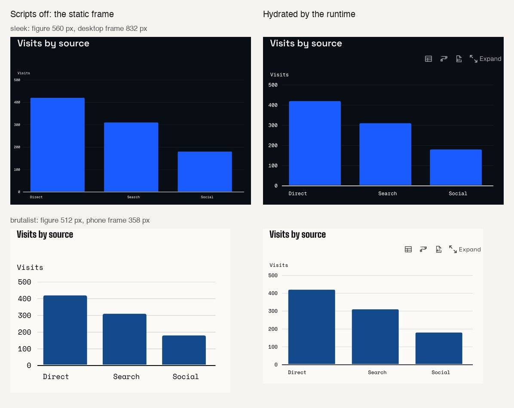

The `init` template's bar chart in sleek (top) and brutalist (bottom), scripts off on the left and hydrated on the right, at one scale (headless Chromium at 1440 × 900, 2026-10-22, from [Architecture](../architecture.md#in-the-browser)). Sleek's 560 px figure shows the 832 px frame shrunk and brutalist's 512 px figure the 358 px frame enlarged, until the runtime redraws each at its real width. The rewrite draws no frames (ARC-05), so no chart text is ever shown scaled.

> **ARC-05 (D-INTERACTIVITY), Daniel's answer, 2026-10-26.** Chosen option: Frame and notice only. RichView goes all in on WebGL for very high performance with many points. All major browsers must work, Safari, Firefox and Chrome in reasonably recent versions; where JavaScript or WebGL is unavailable, the chart's frame shows a notice that the chart cannot be displayed. No static snapshot, image or table fallback is built.
>
> **FEA-CH-64 (F-CORE-STATIC-CHART-FRAMES), proposed.** Withdrawn. Daniel's ARC-05 answer builds no static snapshot, image or vector frame per chart, so nothing is drawn at fixed widths before the runtime. Before the runtime starts, each figure holds its final box, sized from the geometry model's aspect ratio, with its title, subtitle, caption and source note in HTML. The WebGL renderer then draws at the exact width the figure occupies, so no chart text is ever shown scaled. Without JavaScript or WebGL the box shows ARC-05's notice. The widths `check` measures stand on their own (FEA-SF-04, STY-30, TYP-89).

Part 07 budgets the result. PRF-38 (P-HYDRATION-MATCH), which would have held frame text within 5% of its hydrated size, is withdrawn with the frames; its remaining bar moves to PRF-35 (P-LAYOUT-SHIFT), which caps layout shift from navigation until every chart is mounted at 0.01, including the moment the WebGL renderer takes over each figure, in a figure that reserved its final box. The small report fails PRF-35 today ([Performance](../performance.md#load-size-and-first-paint)).

In the rewrite the engine's geometry model is drawn twice and shown once. Daniel's INT-31 and ARC-05 answers make WebGL the default renderer on every page, for very high performance with many points, in recent Safari, Firefox and Chrome. A vector renderer in the engine crate draws the same model for PDF export, which may take time, and for the server's link-preview thumbnails (ARC-18, ARC-69). Daniel's INT-31 answer says only PDF export converts charts to vector output, so the thumbnail's use of the vector renderer is a second use that ARC-69 asks him to accept. A chart that cannot be drawn shows ARC-05's notice in its frame, and the title, caption and source note stay as HTML. Two choices are open for Daniel: the WebGL stack (ARC-18: raw WebGL2 through `web-sys`, `wgpu`, or a JavaScript library that ARC-03 would have to allow) and how the page draws chart text (FEA-CH-30).

## How it looks

No image on this page shows a proposed look: each shows `main` or an open branch. PR #69's labelled Table, SVG and CSV actions (the CPI and gallery captures below) predate FEA-CH-43's icon group at the title row's right end (Daniel, 9 Nov 2026).

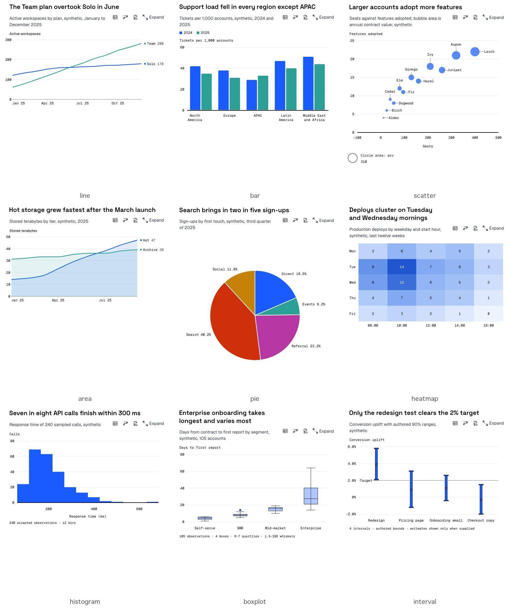

The lockdown fixture's nine charts in sleek-light, cropped to each figure (560 px wide at a 1440 × 900 viewport, `richview generate report.rmd --style sleek-light` at `b4db233`, 2026-10-21; sheet assembled for this page). The fixture is a synthetic report with every chart type and rich block; its source is docs/lockdown/screenshots/product/fixture/source/report.rmd in the lockdown worktree. What `main` does here and Part 04a would change: line and area name each series at its end with its last value (FEA-CH-27 would drop the value); month ticks carry two-digit years, `Jan 25` (FEA-CH-25); the scatter names all twelve accounts, several through leaders, on a seats axis that starts at −100 (FEA-CH-28, FEA-CH-19); the pie runs alphabetically from 12 o'clock, Direct, Events, Referral, Search, Social, while the source lists Search first (FEA-CH-09); the heatmap prints every cell and draws no key (FEA-CH-34); the histogram, box plot and interval carry method notes such as "R-7 quartiles · 1.5-IQR whiskers", which FEA-CH-14 would put in plain words, dropping the interval's note unless rows were excluded; and the interval's "Target" label runs into the 2.0% tick (FEA-CH-32). The scientific crops, one per type with longer notes, are on [Screenshots](../screenshots.md#charts).

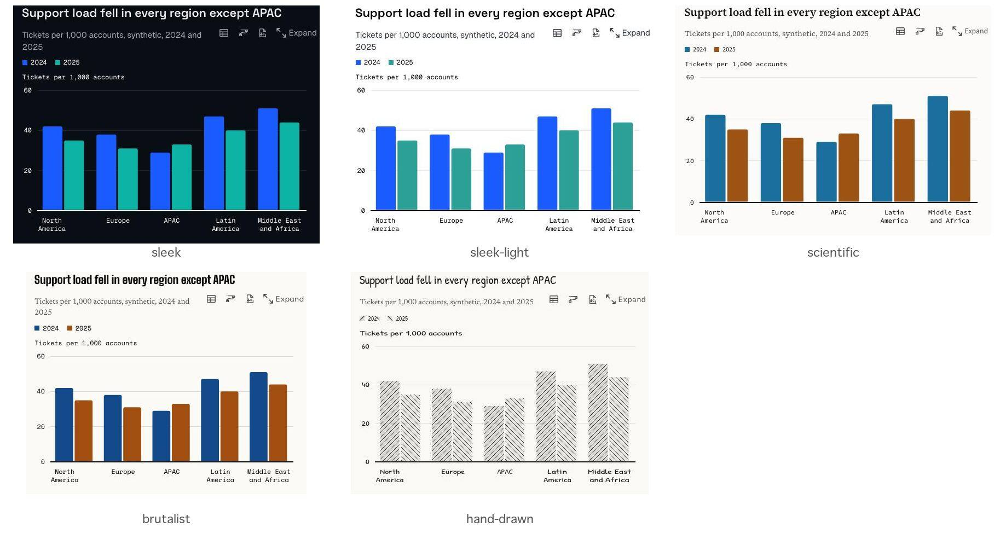

One bar chart in the five builtin styles, from the same fixture renders. The geometry is shared and the style supplies faces, ink, palette and surface: sleek on its dark surface, sleek-light on white, scientific and brutalist on warm paper with their own palettes, and hand-drawn in greys with hatch decals, the only style where colour is not the cue (FEA-CH-57). Every style shows the same action row, three unlabelled icons and a labelled Expand (FEA-CH-43). How each style should look is on [Styles](../styles.md#the-five-styles) (STY-09 to STY-13). The rewrite names `sleek-light` Air and makes Sleek the default (STY-05, STY-06).

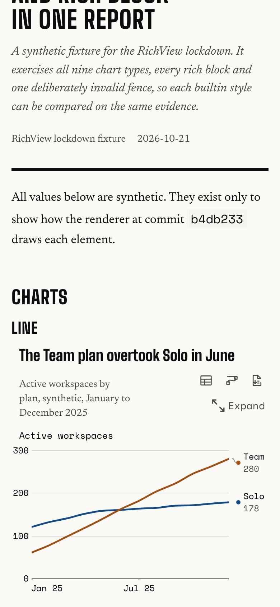

The fixture in brutalist on a 390 px phone (390 × 844 at 2×, 2026-10-21): the action group wraps onto two lines and each end name breaks onto two lines ("Team / 280").

## Features

Each table follows a group of Part 04a. The first column is the card, with the entity it defines or decides and, unless the card is observed, its confidence: *inferred*, the proposer's reading of several sources, or *stated*, with the request behind it where there is one. "Today" is `main` at `b4db233`; facts from open branches or live sites say so. "Proposed" condenses the card: "Keep. New:" separates today's behaviour from what the card adds, while a plain "Keep;" cell lists what the card writes down without this page checking which parts `main` already has. A cell that begins Decided restates Daniel's answer; every other cell is a proposal, revised for his answers of 26 and 27 October. Evidence entities with no card of their own are mapped at the end of the section.

### Chart types and engines

| Card | Today on `main` | Proposed or decided |
| --- | --- | --- |
| FEA-CH-01 (D-CHART-TYPES) | Nine types in the engine and in core's schema; `docs/public/index.md:77` and the live docs index still say six (TYP-04) | Decided (Daniel, 26 October): the richest chart library, at least every chart type ggplot2, Plotly, ECharts, Highcharts and Power BI define, likely around 30 rather than nine, the list compiled from those libraries; plus a map element, a flow element and better tables, normal and pivot; a type is accepted into `pre-prod` only with its full contract (FEA-CH-75, FEA-CH-76) |
| FEA-CH-02 (F-CHART-LINE) | One path per series. Numeric x joins rows in source order, so x = 3, 1, 4, 2 draws a line that doubles back on itself (re-run; [probe sheet](#known-defects)) | A 2.5 px path per series joined in axis order; the doubled-back line becomes a fixture |
| FEA-CH-03 (D-CURVES) | Monotone curves by default; `style.curve` adds `linear` and three step forms; `style.curvature` shortens the handles. S27-635, which called the earlier curves "dodgy", is still in Brain Dump | Keep: monotone by default, so a segment never overshoots its two observations; the curve is the author's choice and none is ruled out for fidelity (INT-11); linear and three step forms for held values; readouts, Table and CSV show the observations at the author's precision, never interpolated points |
| FEA-CH-04 (F-CHART-AREA) | Translucent fill to zero; calendar areas fill at 13%, other areas at 18% | One `area-opacity` token for every area; no band between two series |
| FEA-CH-05 (F-CHART-STACKING), inferred | No `.rmd` bar or area stacks; only histogram colour groups and the JSON spec's areas stack | Opt-in `stack: true` for bars and areas; negatives stack downward; hiding a layer restacks; layers and total are each rounded to the chart's precision |
| FEA-CH-06 (F-CHART-BAR) | One bar per category and series slot; a group without a value shows `n/a` at the baseline; a repeated slot rejects the panel with `chart.ambiguous-bar-slot` and "Cannot draw these bars"; the rounded value end is capped at 15% of thickness; bars turn horizontal when names do not fit | Keep |
| FEA-CH-72 (F-CHART-BAR-SELF-COLOUR) | The same field on x and colour draws one full-width bar per category in palette colours 1, 2, 3 and no `n/a` | Keep as a rule; distinct fields keep grouped slots |
| FEA-CH-07 (F-CHART-SCATTER) | Points at 72% opacity, 4:3 by default; `encoding.size` draws area-true bubbles, the largest 16 px in radius, with a reference circle ("Circle area: acv 310"); negative or non-numeric sizes are omitted with a `chart.invalid-bubble-size` error and missing ones with a `chart.missing-bubble-size` warning (`richview-chart/src/rmd_render.rs:1882-1887`) | Keep; axes change under FEA-CH-19 and point names under FEA-CH-28 |
| FEA-CH-08 (F-CHART-PIE) | Sums per category; names and shares around the disk or a wrapped key; slices and colours alphabetical: Search, Referral, Direct in the source draw as Direct, Referral, Search (re-run; probe sheet) | Source order clockwise from 12 o'clock; never merged into "Other"; `<0.1%` and `>99.9%`; negative values are errors |
| FEA-CH-09 (D-CHART-ORDER) | Bars, legends and facets follow first-seen order; pies are alphabetical; Table and CSV columns are alphabetical (TYP-25) | First-seen source order in every type, for categories, series, legend, palette slots and columns |
| FEA-CH-10 (F-CHART-HEATMAP) | Cells on the style's three-stop OKLCH ramp from zero to a rounded largest magnitude; negative values on a second arm with the hue turned 150° (`richview-chart/src/rmd_render.rs:3857-3858`); values printed in cells of at least 40 × 20 px; row names wrap and the grid transposes when that names every column; `n/a` cells; duplicate coordinates reject the panel | Keep: the card writes down today's heatmap. Hand-drawn's turned greys stay grey, so −40 and +40 share one near-black; STY-56 (inferred) would hatch negative cells ([Styles](../styles.md#negative-values)) |
| FEA-CH-11 (F-CHART-HISTOGRAM) | Sturges bins or authored `count`, `extent` and `edges`; `count`, `proportion` or `density`; lower-inclusive intervals and counted exclusions (`chart.binning`, `chart.excluded-observations`); untitled axes get the field name and the measure | Keep. New: no invented axis titles (FEA-CH-20) |
| FEA-CH-12 (F-CHART-BOXPLOT) | R-7 quartiles, whiskers to the last observation inside 1.5 × IQR, outliers drawn | Keep; a box is never presented as a confidence interval |
| FEA-CH-13 (F-CHART-INTERVAL) | Authored lower and upper bounds with caps; an estimate only when supplied; RichView computes no interval; reversed bounds and repeated pairs are errors; clipped ranges warn `chart.clipped-interval` while readouts keep the full values | Keep |
| FEA-CH-14 (D-CHART-METHOD-NOTES), inferred | Notes name methods: "105 observations · 4 boxes · R-7 quartiles · 1.5-IQR whiskers"; the interval's note reads "4 intervals · authored bounds · estimates shown only when supplied" | Computed charts carry one plain-language note ("box = middle half, line = median"); method names move to readouts and `check`; bars and intervals carry a note only when rows were excluded, so the interval loses its note |
| FEA-CH-15 (F-CHART-TIMESERIES-SPEC) | All-calendar x goes to the calendar engine, which invents a "Value" axis title (re-run), fills at 13% and has its own end names, readouts, Table, zoom and accessible names | One painter; calendar x changes only the scale: calendar ticks, one label row and gap breaks |
| FEA-CH-16 (F-CHART-TRANSFORMS) | Rebase, year-over-year, range presets, navigator, zero toggle, panes and a secondary axis exist only in the JSON spec behind `/charts/`; Enter on a focused `.rmd` calendar chart rebases it with no way back | Build only what `.rmd` reaches: rebase and year-over-year only as authored chart controls, the `controls:` fields PR #62 adds (TYP-77), with a visible way back; the rest is dropped |
| FEA-CH-74 (D-CHART-CALENDAR-MERGE) | Eighteen calendar-only behaviours, from the "Value" title to the 250 px floor | Each listed with the card that decides it, and each a fixture rendered at `b4db233` beside the rewrite |
| FEA-CH-17 (F-CHART-DECIMATION) | Calendar charts above six observations per pixel draw mean lines with min–max bands and a note at the top right; numeric x keeps the first, last, lowest and highest point of each pixel column (M4 sampling) and reports an info `chart.decimation` | Proposed extension (S27-888): every point by default up to the automatic ceiling, then disclosed M4 for line/area or pixel-cell representatives plus extremes for scatter. Explicit all has no ceiling; extrema or dense-band policies remain explicit line/area choices. Automatic policies and every actual reduction report density and kept/total counts. Interpolation stays separate, and readouts, Table and CSV keep every observation at author precision |
| FEA-CH-18 (F-CHART-SOURCE-FAILURE) | A chart that cannot be drawn keeps its frame with a centred reason, such as "Cannot draw these bars / Repeated observations"; in a faceted chart only the bad panel fails (re-run); invalid time series no longer fall back to categories | Keep |
| FEA-CH-75 (G-CHART-TYPE-CONTRACT), inferred | Nine types with no written per-type contract; the review matrix covers 3 fixed cases (DEL-19) | A type lands in `dev` with its schema, `learn` entry, golden input, edge fixtures and unit tests of its geometry and checks; it is accepted into `pre-prod`, and `learn`, the docs and every count list it, only when the release run shows its row in FEA-CH-69's table with a test per check, geometry checks at 320, 390 and 1440 px in every style, values at the author's precision, interaction and motion tests, its accessible summary, vector output in a PDF pagination fixture, captures per style at 390 and 1440 px, a local comparison with the libraries that define the type, and an entry in the all-types performance fixture (PRF-07) |
| FEA-CH-76 (G-MAP-FLOW-PIVOT), inferred | Not built; no feature card specifies the map, flow and pivot-table elements yet | Specs first, then these checks. Map: data from the report folder or shipped with RichView, never a server at read time; projected positions match known coordinates; zoom and pan pass model tests. Flow: the same source gives the same layout natively and in Wasm; no clipped labels or edges through nodes; readable as an ordered list. Pivot table: every aggregation equals a reference computation, totals add up, sorting and expand or collapse work by keyboard, print shows every row, the CSV equals the display |

> **FEA-CH-01 (D-CHART-TYPES), Daniel's answer, 2026-10-26.** RichView aims to be the richest chart library: it supports at least every chart type the major charting packages define, namely ggplot2, Plotly, ECharts, Highcharts and Power BI. That is likely around 30 types rather than nine; the exact list is compiled from those libraries.
>
> Beyond charts, RichView adds:
>
> - a map element;
> - a flow element: flowcharts modelled on Nova flow, but done more meaningfully and fully ported to Rust;
> - much better tables, with the best styling, as both normal tables and pivot tables.

The rows above and the sections below describe the nine types `main` draws; every other type, the map, the flow element and the pivot table get feature cards before they are built (FEA-CH-39, FEA-CH-76), and FEA-CH-75 sets what each type must carry before `pre-prod` accepts it.

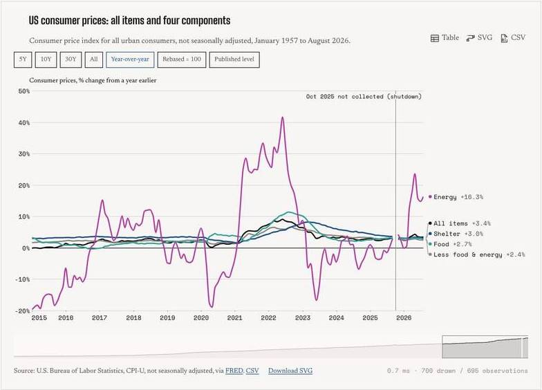

The CPI chart on `/charts/`, live on richview.ai (PR #69 content, 2026-10-21, 1440 px wide): range presets, Year-over-year, Rebased = 100 and Published level buttons and an always-on navigator strip, all declared in the internal JSON spec that no `.rmd` author can write. The Table, SVG and CSV actions carry text labels because the live site runs PR #69, whose commit `52d07db` labels every chart action; on `main` they are bare icons (FEA-CH-43). FEA-CH-16 would keep rebase and year-over-year only as authored chart controls with a visible way back to values, would drop the presets and the navigator, and would turn the page's datasets into `.rmd` examples (ARC-40, FEA-SF-44).

### Axes, ticks and number formats

| Card | Today on `main` | Proposed or decided |
| --- | --- | --- |
| FEA-CH-19 (F-CHART-AXES) | Bars, areas and percentage axes keep zero. A bubble scatter with x from 12 to 400 starts its axis at −100 in a 512 px figure and at −200 in the phone frame (re-run; probe sheet), and the fixture's seats axis at −100; calendar zoom refits y | No axis crosses zero unless the data or a bound do; lines get up to a third of their range of room toward zero; zoom never rescales y |
| FEA-CH-20 (D-AXIS-TITLES) | Calendar charts invent "Value" (re-run; probe sheet) or append the unit, as in the playground's "Revenue, K"; histograms print the field name and the measure | An axis title only when authored, above the axis, never rotated, never a field name |
| FEA-CH-21 (D-AXIS-FORMATS) | Numeric years compact: 1700 to 1780 prints `1.70k · 1.72k … 1.78k` (re-run; probe sheet). Branch only: PR #67 adds `format: year` as an opt-in | Integers from 1000 to 2999 print as plain years by default; `format: year` forces it and `format: number` turns it off |
| FEA-CH-22 (D-AXIS-COMPACT) | Any axis reaching 1,000 compacts (`0k · 0.5k · 1.0k`); zero carries the suffix; `format: currency` always prints `$`, so a EUR suffix gives `$0k  EUR`; axes print `k` where tables print `K` | Compact only from 10,000, within FEA-CH-37's three-digit rule; axes abbreviate to `K`, `M` and `B`, tables, readouts and metrics write the scale word; zero prints `0`; currency from `unit`, never an assumed dollar; percentage axes omit forced zero decimals when tick spacing is whole, retaining shared precision for fractional steps |
| FEA-CH-23 (F-CHART-AXIS-NOTATION) | Percent multiplies by 100 and prints one `%`; scientific notation prints `1.2e-6` | `1.2 × 10⁻⁶`; named units scale (`KBD` to `MBD`); one unit per label |
| FEA-CH-24 (F-CHART-TICKS) | About one label per 90 px on numeric x and horizontal-bar value axes and one per 52 px of plot height on the general painter's vertical value axes, 4 to 9 labels (`richview-chart/src/rmd_render.rs:1971`, `richview-chart/src/rmd_render.rs:3550`, `richview-chart/src/rmd_render.rs:1729-1732`); the calendar engine takes the finest interval that fits, so the playground's three monthly points get weekly ticks, and its value axis targets 40 px | One density rule, never finer than the data's spacing; the same data at the same width gets the same ticks inline, expanded or after a resize |
| FEA-CH-25 (D-CALENDAR-LABELS), inferred | Two-digit years on month and quarter labels, so `Jan 26` can mean January 2026 or 26 January; yearly string data prints `Jan 05 · Apr 05` in the 832 px frame and `Jan 05 · Jul 05` in a 512 px figure (re-run); day ticks carry no year | The first label and each year change carry the four-digit year (`Nov 2025 · Dec · Jan 2026`); month names follow `axes.x.locale` |
| FEA-CH-26 (F-CHART-CATEGORY-LABELS) | One line, a balanced two-line wrap, every k-th ordered period, or horizontal bars; names are never ellipsised; one that still does not fit is a `chart.label-dropped` warning | The same layouts; the warning becomes `chart.label-unfit` and thinning `chart.label-thinned` (info) |
| FEA-CH-73 (F-CHART-CATEGORY-PERIODS), inferred | Month, quarter and day categories print a two-digit year on every label (`Aug 25`), though the module comment promises `Aug 2025` | FEA-CH-25's label rule on category axes; labels never rotated or staggered |

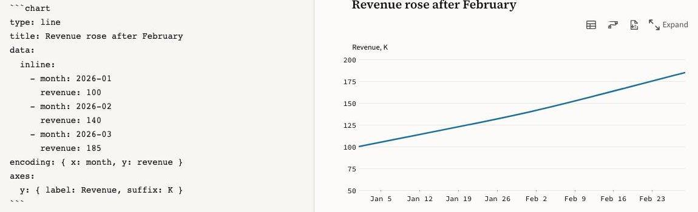

The playground's default source and preview on `main` (`/playground` on the local build, 1440 × 900, 2026-10-21; cropped for this page from the full capture on [Screenshots](../screenshots.md#playground)): three monthly values drawn by the calendar engine on weekly ticks from `Jan 5` to `Feb 23`, under the axis title "Revenue, K" that the engine built from the authored label and suffix. FEA-CH-24 would put month ticks under monthly data, and FEA-CH-20 would print only the authored "Revenue", with the unit on the tick labels.

### Labels, annotations and series identity

| Card | Today on `main` | Proposed or decided |
| --- | --- | --- |
| FEA-CH-27 (D-SERIES-CUES), stated in S27-654 | End names with the last value, a dot, and a leader when pushed apart. Branch only: PR #67 left the cues unfinished | Name alone; line at right, area at left sharing the y-axis margin. Leaders after 4 px; area displacement at most half a y-tick spacing, otherwise legend. The all-shown legend stays through hiding; series focus/restoration stays. Conditional line-style cue; names toggle series |
| FEA-CH-28 (D-LABEL-DENSITY), stated in S27-654 | Up to 64 candidates ranked by isolation, with a leader for any label more than 12 px from its point: the fixture scatter names all 12 points | Sparse names/highlights remain. Automatic exact primary values on bars/large stack parts and bounded line/unstacked-area/density; five total, three below 480 px. Line/area kinds are atomic across shown series: last, first, extremes; no partial last-value group. Dense/ambiguous extras and tiny stack parts off; bullet/hierarchy/circle deferred; no new switch |
| FEA-CH-29 (F-CHART-LABEL-PLACEMENT), inferred | Three placement routines (point and annotation search, end-name column, pie layout); drop reasons in free text; heatmap values that do not fit are skipped without a record | Shared measured placement and existing drop reasons. A complete own-bar/part value may use its interior at 4.5:1 contrast, with backing over its own hatch; other text/marks/strokes stay clear. Exact observation/series identity, no numeric toggle buttons; unused top margin allowed without moving data |
| FEA-CH-30 (D-CHART-TEXT-METRICS) | Every chart label is forced to the engine's estimated width with `textLength` and `lengthAdjust="spacingAndGlyphs"`; static frames assume a 0.6 em advance | Layout in the geometry model with the bundled fonts' real advances and no `textLength`; exports embed their fonts. Open for Daniel: how the WebGL page draws chart text, in WebGL from the bundled faces, as HTML over the canvas or as SVG over the canvas; the answer decides the browser glyph check (FEA-CH-59), assistive access (FEA-CH-55), the PNG (FEA-CH-47) and part of the runtime's size (PRF-31) |
| FEA-CH-31 (F-CHART-INK-ALIGN), stated in S27-633 | Title, first x label and first mark share one left ink edge, tested by the `ink-alignment` suite at 2×; S27-633 is still in Brain Dump | Keep, within 1 px at 2× in every style whose chart title sits at the plot's left edge (STY-39), without moving data; a style that moves the title aligns the first label and mark only |
| FEA-CH-32 (F-CHART-ANNOTATIONS) | `point`, `text`, `line`, `range` and `band` anchored to data; calendar charts overlay them in source coordinates | The same five kinds through the shared search; text without room is omitted and reported; pencil marks in Hand-drawn. Assumed: annotation text is placed before the highlight names and before every point name, value and inside name the chart adds, which move or are left out and recorded; a note keeps clear of drawn lines where a clear place exists; a horizontal rule's label stands above or below its rule, never on it |

### Legends and keys

| Card | Today on `main` | Proposed or decided |
| --- | --- | --- |
| FEA-CH-33 (F-WEB-CHART-LEGEND) | A legend above the plot only when series are not named directly; hover emphasises, click hides, a hidden entry is struck through at 45%; under 600 px more than six entries fold to two rows behind a "+N" button; a reader can hide every group and leave an empty chart | Keep. New: the last visible series cannot be hidden |
| FEA-CH-34 (D-HEATMAP-KEY), inferred | No colour key since PR #40 | A compact key under the plot only when some cell is too small to print its value |

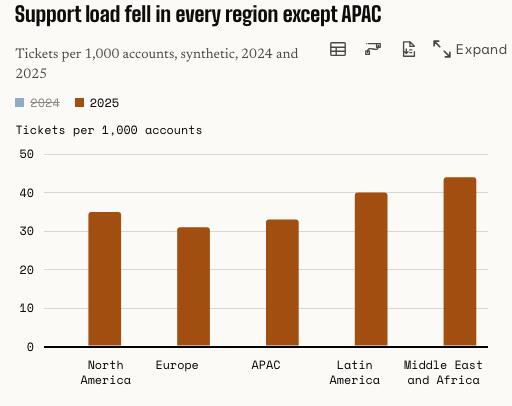

Clicking the 2024 entry hides that series and strikes the entry through (brutalist, 1440 × 900, 2026-10-21).

### Facets

| Card | Today on `main` | Proposed or decided |
| --- | --- | --- |
| FEA-CH-35 (F-CHART-FACETS) | One panel per value. Only bar, scatter, histogram, boxplot and interval keep the parent's colours; in pie panels "Zed" took slot 2 in one and slot 1 in the other. Frames switch to two columns at a 600 px chart width while the runtime uses a 650 px viewport query, so a 512 px figure shows two columns once hydrated (probe sheet); each panel has its own Table and CSV | Two columns from a 600 px figure width by one rule in the geometry model, so default 512 to 576 px figures stack their panels in one column and only a `wide: true` figure gets two; the parent's colours in every type; one action group for the figure |
| FEA-CH-36 (D-FACET-SCALES) | Each panel computes its own ranges: a North panel read 0 to 20 beside a South panel at 0k to 3k (re-run; probe sheet) | Shared value and x ranges by default; `style.facet_scale: free` frees them and says so under the plot |

### Exact values and missing data

| Card | Today on `main` | Proposed or decided |
| --- | --- | --- |
| FEA-CH-37 (F-CHART-EXACT-READOUTS), stated in S27-572 | Readouts and Table keep the source's decimal text, except calendar charts with `format: percent` or `currency`, which round to one or two decimals and hard-code `$` | Decided (Daniel, 26 October): a three-digit default, at most three significant digits, four at most, with a scale word; readers never get more precision than the author chose, in readouts, tooltips, Table, CSV and every export, and the more exact source values cannot be retrieved; the author sets more or fewer digits per chart or element, tooltips may carry more than labels, and there is no warning at publish time |
| FEA-CH-38 (F-CHART-MISSING-DATA) | Lines and fills break with butt caps; breaks under 3 px get a 1 px rug mark; calendar series break past 1.5 times their typical spacing; `n/a` for bars and cells; "No observation" in readouts | Keep: missing values never become zero and never appear as observations; excluded rows are counted. New: an author may bridge a gap with `style.gaps: bridge`, drawn only, so readouts, Table and CSV still read "No observation" |
| FEA-CH-70 (F-CHART-NUMERIC-LIMITS) | Unrepresentably small numeric text is a source error, not zero; pie totals beyond the finite range are `chart.value-overflow`; quartiles and fences are overflow-safe; interval bounds compare as decimal source text and collapsed intervals warn `chart.collapsed-interval`; the `numeric-safety` suite drives 12 channels | Keep. New: stack totals follow the same rule if FEA-CH-05 adds stacking; interval bounds show at the author's precision |

> **FEA-CH-37 (F-CHART-EXACT-READOUTS), Daniel's answer, 2026-10-26.** Numbers follow a three-digit rule by default: at most three significant digits, four at most, with a scale word, for example 1.23 million, 167.5 thousand or 167 thousand.
>
> Readers never get more precision than the author chose to show. Readouts, tooltips, the Table view, CSV and every export show values at the author's chosen precision; the underlying, more exact source values cannot be retrieved. Otherwise what a reader can dig out would differ from what the author and reviewers saw, and could disclose how precise the author's calculations are.
>
> The author can set more or fewer digits, per chart or per element, and can give tooltips a higher precision than labels; readers then see that precision, and no more. There is no warning at publish time.

`main` shows the source's full decimal text in readouts, Table and CSV, and three data-integrity suites assert every source digit. The rewrite changes both (DEL-16, DEL-80), and FEA-CH-45, FEA-CH-48 and FEA-CH-77 carry the precision into the Table, CSV and accessibility layer.

### Reader interactions and readouts

The interactions run in the browser host's chart chrome (ARC-37, C-WEB-CHART-HOST) on state the engine computes; authors write no interaction fields (TYP-21).

| Card | Today on `main` | Proposed or decided |
| --- | --- | --- |
| FEA-CH-39 (F-CHART-INTERACTION-POLICY), stated | Calendar lines and areas read every series at the nearest x; numeric and category lines select one observation within 24 px of the pointer | One table: lines and areas read all series at the nearest x, scatter the point under the pointer, filled marks by containment; zoom only on numeric or calendar x; each type FEA-CH-01 adds, and the map and flow elements, get a row before they are built |
| FEA-CH-40 (F-CHART-READOUT-CONTENT) | Calendar readouts list series by height ("Team 13,000.0%" above "Solo 12,000.0%" although Solo comes first); generic readouts print raw field names ("s Team", "v 170") and an unlabelled x | Every value named, by authored label, then series name, then field; series in legend order; derived values marked as derived; every value at the chart's readout precision (FEA-CH-37) |
| FEA-CH-41 (F-CHART-HIT-TESTING) | A hover sweep across a two-series numeric line showed a readout at 9 of 68 positions; the same data on calendar x at 68 of 68 | Lines snap to the nearest x everywhere over the plot with a crosshair; points within radius plus 4 px; a tap keeps its readout until dismissed; a scroll never selects |
| FEA-CH-42 (D-TOOLTIP), stated in S27-654 | A translucent panel with a 6 px background blur; S27-654 reports values appearing and disappearing, never diagnosed | The style's own raised surface, opaque, no blur, gliding about 120 ms between observations and holding about 300 ms on exit |
| FEA-CH-71 (D-CHART-SOURCE-UPDATE), inferred | Only the `/charts/` JSON editor updates a chart in place; the playground and VS Code re-render from scratch, so every edit resets the chart | An in-place re-render keeps what still applies: hidden series, a zoom window inside the new data, an open Table, the expanded view |

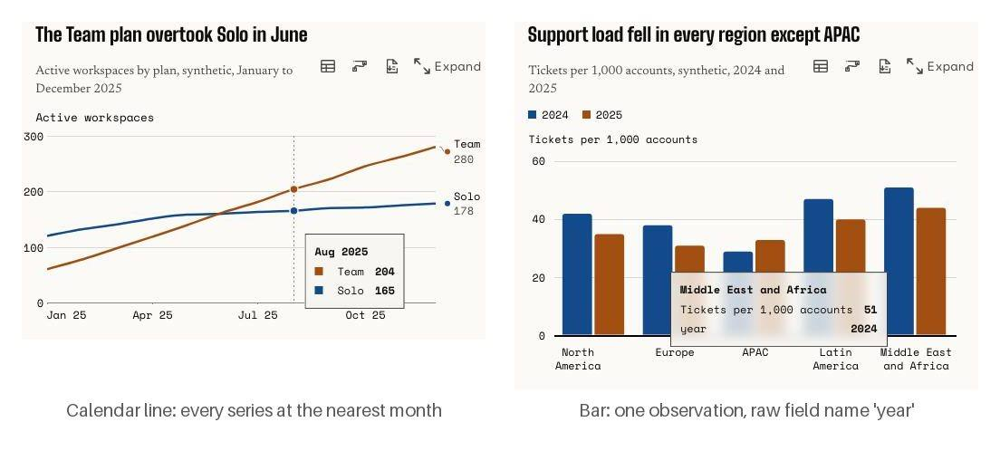

Hover readouts in the fixture, brutalist at 1440 × 900 (2026-10-21; sheet assembled for this page). The calendar line reads every series at the nearest month under a dashed crosshair, Team above Solo because Team is higher, although Solo comes first in the source (FEA-CH-40). The bar reads one observation and names it "Tickets per 1,000 accounts" by its authored axis label but "year" by its raw field name. Both panels are translucent with a 6 px background blur, which FEA-CH-42 and STY-41 (S-TOOLTIP) would replace with the style's own raised surface, opaque and without blur.

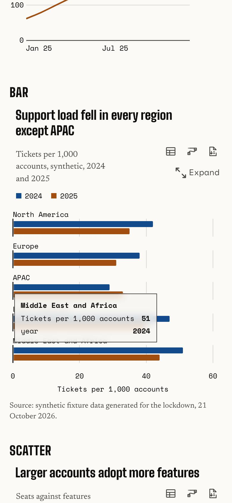

A tap on a bar in brutalist on a 390 px phone (2×, 2026-10-21): the bars are horizontal because the region names do not fit, and the readout reads "Middle East and Africa · Tickets per 1,000 accounts 51 · year 2024", with the raw field name `year` (FEA-CH-40); the panel covers the Latin America name. The scatter's desktop readout, whose first line is the unlabelled x value, is on [Screenshots](../screenshots.md#chart-and-table-interactions).

### Figure actions, expanded view and table

| Card | Today on `main` | Proposed or decided |
| --- | --- | --- |
| FEA-CH-43 (D-CHART-ACTIONS), stated in S27-654 | Table, SVG and CSV are unlabelled icons; Expand and Reset zoom show text; each facet panel has its own Table and CSV | One group at the right end of the title row, the figure's top right: **Table**, **Download** (a menu with PNG, and SVG if FEA-CH-46 keeps it), **CSV** and **Expand**, as icons alone at every width, each named by its accessible name and on hover and keyboard focus (Daniel, 9 Nov 2026); under the title on a figure too narrow for both; one group for a faceted figure |
| FEA-CH-44 (D-CHART-MODAL), stated in S27-632 and S27-654 | Desktop Expand widens the chart inline and becomes "Contract"; phones open a dialog; the showcase adds an "Inspect chart" lightbox | One near-fullscreen modal on every device with a visible Close; state kept both ways; no inline widening; the lightbox goes |
| FEA-CH-68 (D-CHART-MODAL-PORTRAIT) | On an upright phone the expanded figure is laid out in landscape and turned a quarter (PR #61); title, actions and readout read sideways | Keep the quarter turn; never lock the screen orientation |
| FEA-CH-45 (F-WEB-CHART-TABLE) | Rows of the source with every field, columns alphabetical, 1,000 at a time; calendar lines and areas show the engine's pivot instead (Time and one column per series, zoom window only, newest first) | The chart's source rows in source column order, limited to the fields the chart references plus `encoding.detail` (TYP-36), the same for every chart, each number at the chart's readout precision and never more (FEA-CH-37); derived values stay in readouts |

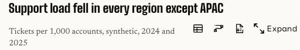

The action row in brutalist at 1440 px: Table, Download SVG and Download CSV as bare icons, then "Expand" (2026-10-21). FEA-CH-43 and STY-42 (S-ACTION-LOOK) would label all four. The capture had keyboard focus on Download SVG, yet it shows no focus ring: `main` draws the 2 px accent ring that STY-38 (S-HOVER-FOCUS) asks for only on `:focus-visible` (`richview-chart/src/svg.rs:62`), which the capture did not trigger, so the image says nothing about how focus looks ([screenshot gaps](../../lockdown/screenshots/INDEX.md#gaps)).

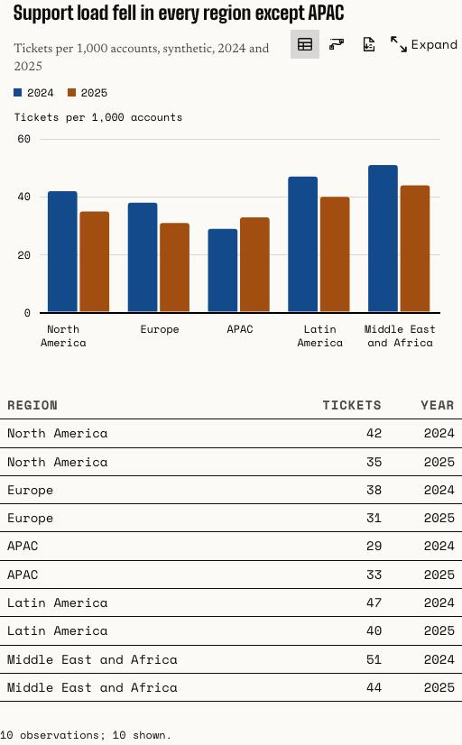

Table on the fixture's bar chart in brutalist at 1440 px (2026-10-21): the action shows pressed, and a table of all ten observations opens under the chart with the columns Region, Tickets and Year, alphabetical where the source has region, year, tickets (TYP-25), ending "10 observations; 10 shown." FEA-CH-45 would keep the table and put its columns in source order.

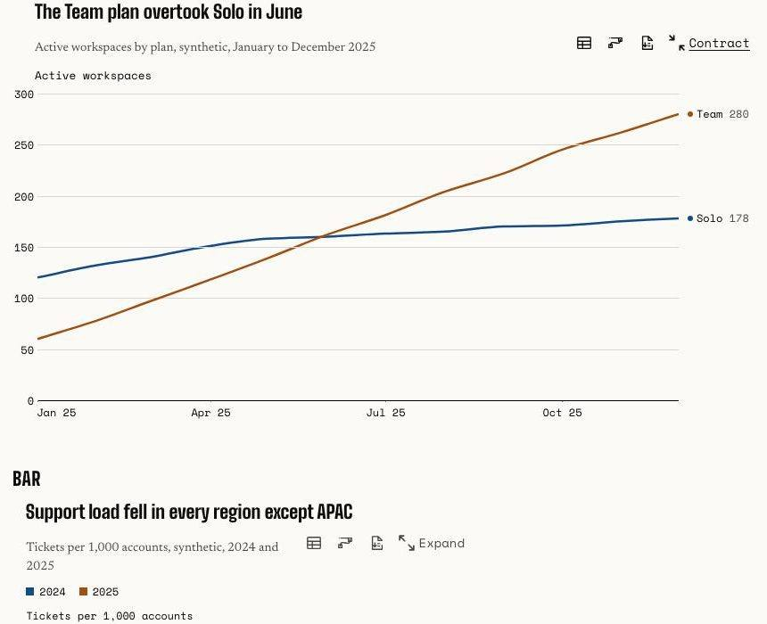

Desktop Expand in brutalist at 1440 × 900 (2026-10-21; cropped for this page): the line chart widens inline from the 512 px measure to the 832 px report width and the control reads "Contract", while the bar chart below stays at the measure. FEA-CH-44 would replace this inline widening with one modal.

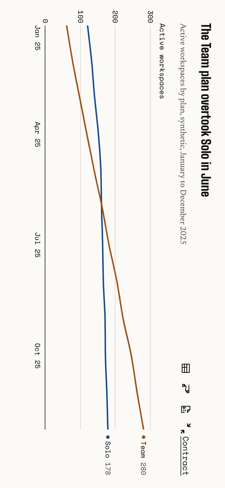

Expand on a 390 px phone held upright: the dialog turns the figure a quarter, so the line uses the screen's height as its width; the control reads "Contract" (brutalist, 2×, 2026-10-21). FEA-CH-68 would keep the turn and FEA-CH-44 would give the modal a visible Close.

### Downloads

| Card | Today on `main` | Proposed or decided |
| --- | --- | --- |
| FEA-CH-46 (F-WEB-CHART-SVG-DOWNLOAD) | `chart.svg` with the chart styles inside and no `@font-face` (10,768 bytes in the screenshots stage's download), so text falls back to system fonts outside the report | Open for Daniel: whether an SVG download stays, since only PDF export converts charts to vector (INT-31). If it stays: saved as currently shown from the engine's vector renderer, named after the title, with subsets of its fonts embedded; facets as one SVG. If not: PNG only |
| FEA-CH-47 (F-CHART-DOWNLOADS), stated in S27-654 | No PNG on `main`. Branch only: PR #67's PNG draws on flat white in every style | PNG at twice the on-screen size, drawn through the WebGL renderer on the style's chart surface; if drawing fails the reader is told and offered the CSV; without WebGL there is no Download menu (ARC-05) |
| FEA-CH-48 (F-WEB-CHART-CSV-DOWNLOAD) | `chart.csv` with every field of every row, columns alphabetical (TYP-25) | The original rows with the fields the chart references plus `encoding.detail` (TYP-36), in source column order, numbers rounded to the chart's readout precision and never more digits than readers see (FEA-CH-37), named after the title; facets in one file |

The downloaded SVG opened on its own, with its fallback fonts, is shown on [Screenshots](../screenshots.md#chart-and-table-interactions).

### Zoom and navigation

| Card | Today on `main` | Proposed or decided |
| --- | --- | --- |
| FEA-CH-49 (F-WEB-CHART-ZOOM-PAN) | Drag to zoom, Shift-drag to pan, pinch and drag inline on touch; calendar zoom refits y (a line read 100–250 zoomed against 0–300 unzoomed), numeric zoom keeps it | Zoom along x only on line, area and scatter; vertical scroll always scrolls the page; touch zoom only in the expanded view; y never rescales |
| FEA-CH-50 (F-WEB-CHART-OVERVIEW) | Only calendar charts show an overview strip after a zoom | The strip after any zoom on line and area charts with numeric or calendar x; never before a zoom |

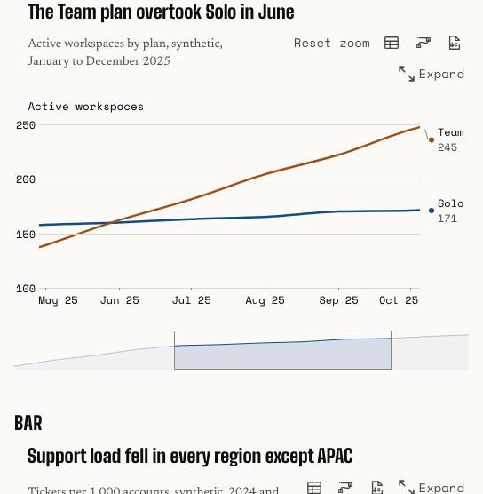

After a drag across the fixture's calendar line (brutalist, 1440 px, 2026-10-21): the window from May to October 2025, "Reset zoom", the overview strip under the plot, and a y axis refitted to 100–250, dropping zero.

### Motion

| Card | Today on `main` | Proposed or decided |
| --- | --- | --- |
| FEA-CH-51 (D-MOTION) | Charts below the first screen animate once when half in view: lines sweep in 700 ms, bars grow 500 ms with a 40 ms stagger capped at 320 ms, pies 700 ms, points 400 ms, labels fade 200 ms after their marks; S27-634 removed the per-bar tick | Keep these entrances as the starting point, with one deceleration curve and no intermediate data values; from 2,000 marks, fades instead; a review agent judges each entrance against INT-12's bar, delightful and smooth, with INT-61 as the floor; the Playfair example's entrance becomes a fixture |
| FEA-CH-52 (F-CHART-INTERACTION-MOTION) | Emphasis dims others to 30% in 150 ms; zoom transitions take about 620 ms, during which the plot's left edge jumps up to 8 px as the margin follows the widest tick | The same quiet timings, which INT-12 treats as a floor, not a ceiling; zoom keeps the left edge fixed and never shows values between observations; there is no static frame to cross-fade from (ARC-05) |
| FEA-CH-53 (D-MOTION-UNBUILT), stated in S27-616 | The hover "pop" and shadows S27-616 asked for were described but never built | OHLC, histogram, treemap, sunburst, scatter and packed-bubble selection follows the mark's true shape with a soft contour, using the style's ink and surface. It fades in over 120 ms without a pulse; reduced motion shows it at once. Fills, mark size and painted names stay. Ordinary pie keeps its 6 px pop-out. The readout keeps the style's floating shadow. |
| FEA-CH-54 (F-CHART-SETTLED-STATE) | Reduced motion renders the settled state; printing settles running transitions (PR #61) | Print, PDF and image downloads always show the settled chart; `motion.enabled: false` renders charts and blocks settled |

Chart motion is visible only in a browser; the lockdown captures are stills. Daniel's INT-12 answer of 27 October sets the bar for all of it: delightful and smooth, the whimsical quality of Studio Ghibli meeting the polish of Apple's website animations, with INT-61 as the floor. What else moves in a report is FEA-RP-35, on [Report core](core.md#motion).

### Accessibility

| Card | Today on `main` | Proposed or decided |
| --- | --- | --- |
| FEA-CH-55 (F-CHART-A11Y), inferred | Only calendar charts get a generated summary in their accessible name; other SVGs are named by their title; only bars are named with their readout's words; line points have no named marks | Every chart named by its title plus a one-sentence summary per type, on the figure's HTML because a canvas exposes nothing, and kept when the chart shows ARC-05's notice; the live chart one focusable region; the Table the full non-visual equivalent. Open for Daniel: how a screen-reader user walks the data, through a generated ARIA layer that names every mark, keyboard steps announced by the readout's live region, or both |
| FEA-CH-56 (F-WEB-CHART-INSPECTION) | Arrows step through observations, + and − zoom; Enter rebases a focused calendar chart; one Escape clears the selection and the zoom together, and in the dialog closes it first | Escape clears one thing at a time, then closes the modal; Enter on the chart does nothing; focus survives redraws |
| FEA-CH-57 (F-CHART-DECALS) | Hatches and dashes only where a style turns `chart.decals` on, which only Hand-drawn does; the showcase adds dashes at runtime | When a chart needs a legend and two visible series fail the palette rule (STY-22) under colour-vision simulation, or the style is greyscale, hatches, dashes and hollow markers in six shapes switch on, in the legend too; a style can force them with `decals: true` |
| FEA-CH-77 (G-CHART-A11Y-CHECK), inferred | No chart accessibility gate; the repository has no accessibility audit (DEL-58), and an automated audit would see a WebGL canvas only as its container's name | Whatever layer FEA-CH-55 chooses is checked against the geometry model: every figure has a name and summary in its HTML, also under ARC-05's notice; summary facts match the data at the author's precision; a mark layer lists every mark with the readout's text; keyboard inspection reaches every mark in order; the Table shows the source rows at the author's precision; nothing in the DOM carries more digits than the author chose (FEA-CH-37); the VoiceOver pass stays a standing gap |

### Self-measurement diagnostics

| Card | Today on `main` | Proposed or decided |
| --- | --- | --- |
| FEA-CH-58 (F-CHART-NATIVE-DIAGNOSTICS) | Each render returns per-chart checks as `chart.<kind>` diagnostics; every chart in the probe added only an info `chart.font-bounds-estimated` (re-run) | Keep, on the geometry model both renderers draw; bounds from real font metrics, final or estimated depending on how the WebGL page draws text (open, FEA-CH-30) |
| FEA-CH-59 (F-CHART-BROWSER-MEASUREMENT) | The runtime measures glyph boxes after fonts load and publishes them in `data-rvc-diagnostics` and an `rvc:diagnostics` event, but `richview check` reports native estimates only | Open, follows FEA-CH-30: with text drawn in WebGL, native geometry only and no browser pass; with text laid over the canvas, `check` runs the glyph pass in the local headless Chromium that PDF export already uses, at the widths FEA-SF-04 checks, and reports `chart.font-bounds-estimated` when no browser is available |
| FEA-CH-60 (D-CHART-CHECK-GAPS) | `check` reported clean for the doubled-back line, the `1.70k` years, the alphabetical pie, the −200 tick, independent facet scales and a bar whose `encoding` names fields that do not exist (re-run; probe sheet) | Warnings for zero crossings, year compaction, ticks finer than the data, text below 4.5:1 on its real surface, missing fields and failing palettes, each read from the geometry model and style tokens; the snapshot-size check goes with the snapshot (ARC-05) |
| FEA-CH-69 (F-CHART-CHECKS-BY-TYPE) | `series-differentiation` and `aggregation` run only on calendar charts; unfitting names share `label-dropped` with optional drops | A table of shared and per-type checks, kept in step with `richview learn` |

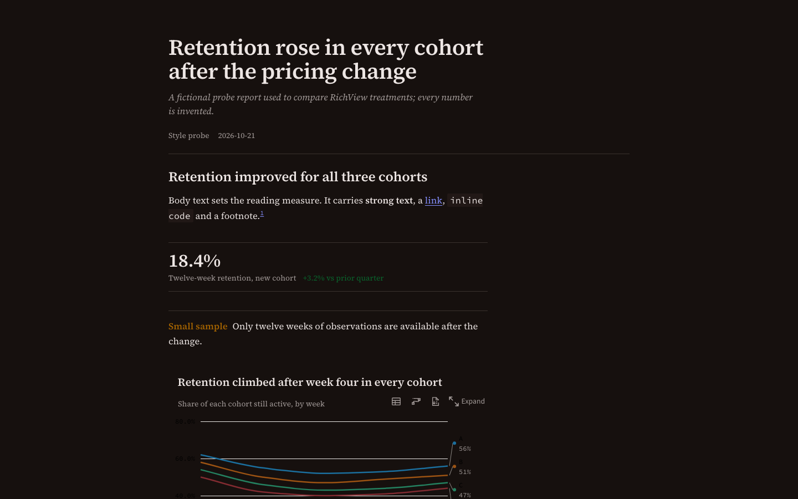

Scientific with `--theme dark`: the chart's axis text sits at 1.11:1 against its surface, and `check` reports clean (styles probe, 1440 × 900, 2026-10-21). FEA-CH-60 would add the contrast check, and FEA-RP-33 would remove `theme` altogether.

### Palettes on charts

| Card | Today on `main` | Proposed or decided |
| --- | --- | --- |
| FEA-CH-61 (F-CHART-PALETTES) | Eight OKLCH colours per style, six greys in Hand-drawn (`richview-chart/src/rmd_render.rs:1181-1240`). An integration test (`crates/richview-core/tests/palettes.rs`) holds the builtins to 3:1 for the first four colours and, between neighbouring colours only, ΔE×100 ≥ 15, or 8 under colour-vision simulation. The warning for more series than colours fires only on calendar charts, from nine series (`richview-chart/src/rmd_render.rs:1465-1466`), so Hand-drawn's seventh and eighth series repeat silently | Slots in first-seen order; `style.palette` per chart; the ramp for sequential values; `chart.series-differentiation` on every chart at the palette's length |
| FEA-CH-62 (D-PALETTE-ENFORCEMENT) | Authored palettes are not checked; the showcase lifts weak slots to 3.03:1 and adds dashes at runtime | Every palette a chart uses is checked on its real surface; a failure warns and turns decals on; colours are never changed silently |
| FEA-CH-63 (F-CHART-ENTITY-COLOURS) | The showcase hard-codes slots for OpenAI, Anthropic and Google; no field maps a category to a colour | A frontmatter `colors` map per report; no entity names in product code |

### Frames, sizing, embedding and print

| Card | Today on `main` | Proposed or decided |
| --- | --- | --- |
| FEA-CH-64 (F-CORE-STATIC-CHART-FRAMES) | Frames at 358 and 832 px; default figures are 512 to 576 px wide, so pre-hydration text is 67 to 152% of its size | Withdrawn: no static frames (ARC-05). Each figure holds its final box, sized from the geometry model's aspect ratio, and the WebGL chart draws at its exact width |
| FEA-CH-65 (F-CHART-RATIO) | `style.ratio` sets height from width; the general painter keeps a 120 px plot; calendar charts are at least 250 px tall plus 150 px per extra pane | Grow taller, never wider, only for content the ratio cannot hold; one 120 px plot minimum for every chart |
| FEA-CH-66 (F-CHART-STANDALONE-SVG) | Calendar lines get `fill: none` only from the report's chart stylesheet; on the PR #70 News dashboard, which lacks it, line paths fill as black wedges and chart text turns serif | Every SVG the vector renderer emits (PDF charts, and the SVG download if FEA-CH-46 keeps it) draws correctly on its own; the style supplies only variables with safe fallbacks; no SVG reaches a report page |
| FEA-CH-67 (F-CORE-PRINT) | Print drops actions, overview, readout and brush, keeps a chart whole and at most 60% of the page high, and prints dark styles light | Keep; legend entries print as text; an expanded chart prints in place; a chart that does not fit the page floats to the next one (FEA-RP-43); in PDF export every chart is vector output from the engine's vector renderer (INT-31). Open for Daniel: what browser Print shows for a WebGL chart (FEA-RP-34) |

The fixture's charts on paper are in the PDF sheet under [How it looks on Report core](core.md#how-it-looks).

### Evidence entities without their own card

| Entity in the product evidence (`product.md`) | Where it is decided |
| --- | --- |
| F-CHART-BUBBLE, bubble sizing | FEA-CH-07 (F-CHART-SCATTER) |
| F-CHART-SOURCE-CSV, original-data CSV | FEA-CH-48 (F-WEB-CHART-CSV-DOWNLOAD) and TYP-36 (D-TYP-DATA-PROJECTION) |
| F-CHART-BROWSER-API, `ChartView` and `mount_chart` | ARC-25, ARC-36 (C-WEB-WASM-API) and TYP-97 (T-REPORT-RUNTIME-API) |
| F-CHART-CLI, the `richview-chart` binary | ARC-25: it would be removed with the public JSON spec (ARC-19) |
| F-CORE-STATIC-CHART-FRAMES, F-CORE-PRINT | FEA-CH-64 (withdrawn) and FEA-CH-67 above |

## Checks that cover it

| Check | What it covers | Result on 2026-10-21 | Gap |
| --- | --- | --- | --- |
| Engine Rust tests | 153 unit tests in `richview-chart/src`, 129 integration tests in 30 files (`richview-chart/tests/`, per type and per contract: histogram, boxplot, interval, heatmap cells and coordinates, bar paint and decals, step and monotone curves, numeric safety, exact temporal readouts, SVG export, ink alignment, facet colours) and 1 doc test | All pass, 2.3 s warm; counts re-run from `#[test]` attributes | Behaviour the probes found wrong is untested, not failing |
| Core tests that render charts | `palettes.rs`, `figures.rs`, `fonts.rs` and the histogram, boxplot, interval and decimal contracts in `crates/richview-core/tests/` | All pass | The same |
| Chart browser suites | `figure-expand`, `chart-keyboard`, `numeric-zoom`, `numeric-safety`, `source-tables`, `temporal-fidelity`, `temporal-decimals`, `csv-decimals`, `histograms`, `boxplots`, `intervals`, `chart-readouts`, `step-curves`, `line-smoothing`, `bar-paint`, `ink-alignment`, `facet-export` in Chromium and WebKit, and `motion-runtime` in Chromium | All pass in both engines | Firefox not run on this host |
| Chart review matrix | `scripts/verify-chart-review.mjs`: 3 cases × 5 styles × 4 widths, 60 pages and 540 figures, asserting no collisions or clipping, one calendar label row, no heatmap colour bar, alignment within 1.5 px and contained tooltips | Pass, 0 findings, 136 s | No pixel comparison between builds; crowded event labels at 390 px passed ([Screenshots](../screenshots.md#charts)) |
| Theme-switch proof | `scripts/verify-authoring.mjs` | Fails since `39b301f` (2026-10-15) changed bar ends; not in CI | DEL-17 decides its replacement |
| Performance | Today's budgets: dense zoom (4.5 ms of layout, 54.6 ms to two frames) and a cold `/charts/` mount (277.3 ms). The chart kernel benchmark, which no budget covered, was probed for PRF-19 on 2026-10-22 | Today's budgets hold on the 2026-10-21 capture host ([Performance](../performance.md#captures-hosts-and-load)); the PRF-19 probe meets its proposed limits; proposed PRF-35 fails and PRF-38 is withdrawn with the static frames | See [Performance](../performance.md#browser-interaction) |
| Hosted CI | `.github/workflows/ci.yml` runs the Rust tests, the browser suites and the review matrix; the theme-switch proof is not in it | No job has started since 2026-10-13 (billing) | Nothing gated PRs #60 and #61 |

Sources: the checks evidence (`checks-performance.md` in docs/lockdown/evidence) for runs and times; the counts were re-run. Proposed: DEL-15 (G-BROWSER-CHROMIUM), DEL-16 (G-DATA-INTEGRITY) and DEL-19 (G-VISUAL-MATRIX) with DEL-27 and DEL-28's captures and pixel diff run in the release run on `pre-prod`, for what a batch of merges affects, while `dev` runs only the fast gate (DEL-81, [Delivery](../delivery.md)); the suites that assert on chart SVG in the DOM move their chart assertions to the geometry model, because the page draws charts with WebGL (INT-31, DEL-64); FEA-CH-59, FEA-CH-60 and FEA-CH-69 extend `check` itself; FEA-CH-74 and OPN-22 turn each defect below into a fixture; FEA-CH-75 sets what each chart type ships with; PRF-19 (P-CHART-KERNEL), PRF-20 (P-ZOOM), PRF-21 (P-CHART-FRAME) and PRF-35 budget the engine, and PRF-38 is withdrawn.

## Known defects

OPN-22 (D-LEGACY-DEFECTS) proposes that each defect below becomes a rewrite fixture, decided in the card named, and that none is patched in legacy code. In the Seen column, *re-run* means checked for this page with the release build, and *probe sheet* that the sheet below shows it; *capture*, *fixture* and *live capture* name lockdown screenshots of `main`'s fixture or of a live site; *card probe* and *card measurement* are a probe or measurement the card reports, not repeated here; *styles probe* is the Part 06 probe; *Architecture re-run* is a check made for the Architecture page; *code reading* means read in the code at `b4db233` but not run.

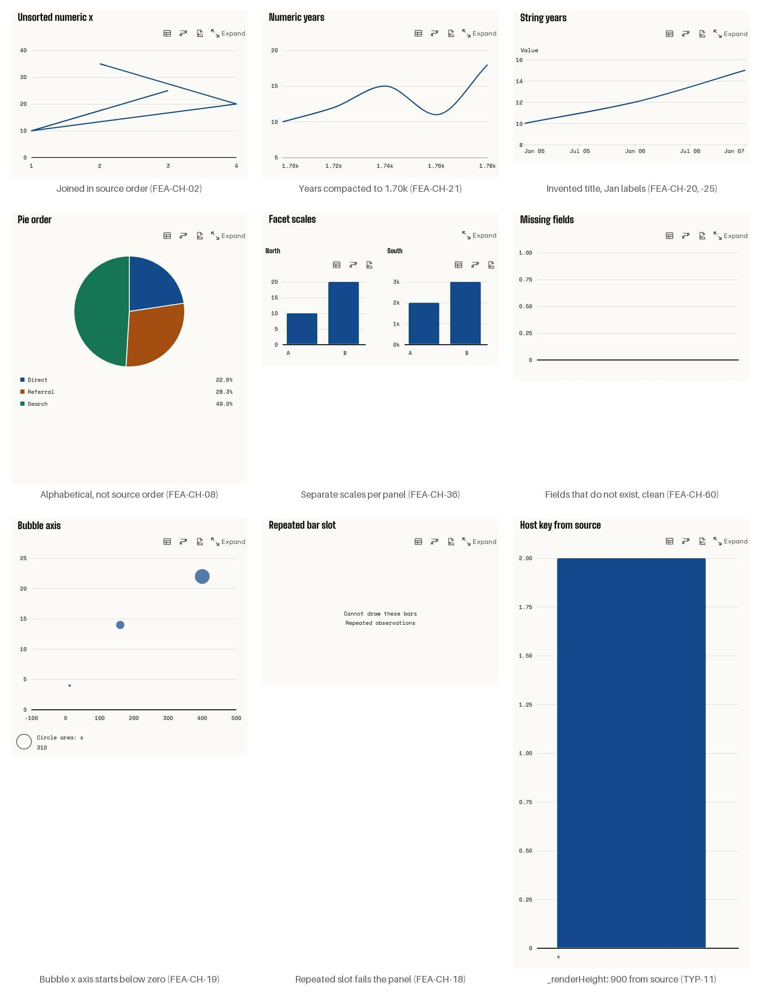

The chart probe in brutalist, the style used when none is given, hydrated at 1440 × 900 with reduced motion, each figure 512 px wide (`richview generate` with the `b4db233` release build, opened in headless Chromium, 2026-10-22; sheet assembled for this page). Left to right and top to bottom: x = 3, 1, 4, 2 joined in source order, so the line doubles back (FEA-CH-02); years from 1700 to 1780 printed as `1.70k` (FEA-CH-21); three yearly string values under an invented "Value" title, on ticks from `Jan 05` to `Jan 07` (FEA-CH-20, FEA-CH-25); Search, Referral, Direct in the source drawn alphabetically (FEA-CH-08, FEA-CH-09); a North panel at 0 to 20 beside a South panel at `0k` to `3k`, each with its own Table and CSV (FEA-CH-36, FEA-CH-22, FEA-CH-43); a bar whose `encoding` names fields that do not exist, drawn empty (FEA-CH-60, TYP-15); bubbles at x from 12 to 400 on an axis from −100 (FEA-CH-19); a repeated bar slot failing its panel, which FEA-CH-06 and FEA-CH-18 would keep; and `_renderHeight: 900` from source making a one-bar figure 973 px tall (TYP-11). `richview check` reports every chart clean except the repeated slot, a `chart.ambiguous-bar-slot` error (re-run).

| Defect on `main` | Seen | Decided in |
| --- | --- | --- |
| Numeric x joins in source order, so a line doubles back | Re-run; probe sheet | FEA-CH-02 |
| Year axes print `1.70k`; month and quarter labels print two-digit years | Re-run; probe sheet | FEA-CH-21, FEA-CH-25, FEA-CH-73 |
| Calendar charts invent a "Value" axis title or append the unit | Re-run; probe sheet; playground capture | FEA-CH-20 |
| Pie slices and colours run alphabetically | Re-run; probe sheet; fixture | FEA-CH-08, FEA-CH-09 |
| A non-negative bubble axis crosses zero (−100 at 512 px and in the fixture, −200 on phones) | Re-run; probe sheet; fixture | FEA-CH-19 |
| Facet panels use independent scales; pie, line, area and heatmap panels recolour per panel | Re-run and probe sheet (scales); card probe (colours) | FEA-CH-35, FEA-CH-36 |
| `check` is clean for encoding fields that do not exist | Re-run; probe sheet | TYP-15, FEA-CH-60 |
| Host-internal `_renderHeight: 900` in source renders a 900 px chart | Re-run; probe sheet | TYP-11, ARC-02 |
| Monthly data drawn on weekly ticks | Playground capture | FEA-CH-24 |
| Calendar zoom refits y and drops zero | Capture | FEA-CH-19, FEA-CH-49 |
| Numeric lines show a readout at 9 of 68 hover positions | Card probe | FEA-CH-41 |
| Readouts print raw field names, list calendar series by height | Captures; card probe | FEA-CH-40 |
| Enter rebases a calendar chart with no undo; one Escape clears selection and zoom together | Card probe | FEA-CH-16, FEA-CH-56 |
| Table, SVG and CSV are unlabelled icons; downloads are named `chart.svg` and `chart.csv` | Capture | FEA-CH-43, FEA-CH-46, FEA-CH-48 |
| Downloaded SVG text falls back to system fonts | Capture | FEA-CH-46 |
| Static frames render pre-hydration text at 67 to 152% of its size | Card measurement | ARC-05 (no static frames; FEA-CH-64 withdrawn) |
| Chart text at 1.05 to 1.11:1 under an explicit `theme`, reported clean | Styles probe | FEA-RP-33, FEA-CH-60 |
| The fixture scatter names all 12 points, several through leaders | Fixture | FEA-CH-28 |
| Heatmap cell values that do not fit are dropped without a record | Code reading (`richview-chart/src/rmd_render.rs:4189-4216`) | FEA-CH-29 |
| Hand-drawn series seven and eight repeat colours without a warning | Code reading | FEA-CH-61 |
| A reader can hide every series and leave an empty chart | Card probe | FEA-CH-33 |
| Calendar SVG relies on report CSS: black wedges on the News dashboard | Live capture (PR #70 content); code reading | FEA-CH-66 |
| `chart.palette` and `chart.ramp` values reach CSS without a grammar check | Architecture re-run | TYP-51, OPN-16 |

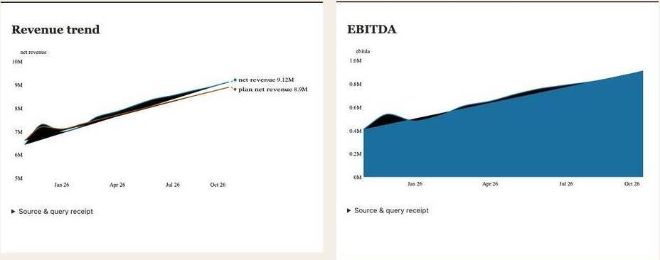

The Revenue trend and EBITDA tiles of the example trading-desk dashboard on news.richview.ai (PR #70 content, 2026-10-21, 1440 px wide). The calendar engine writes line paths without a `fill` and leaves `fill: none` and the chart font to `CHART_CSS`, which the page must carry once (`richview-chart/src/svg.rs:30`, `richview-chart/src/svg.rs:332`, `richview-chart/src/svg.rs:501`). FEA-CH-66 found that the dashboard pages lack it, so each line fills black against its own chord, also on top of the EBITDA area, and the chart text falls back to a serif face; the card would make every chart SVG draw correctly on its own.

## Branch-only additions

All nine open draft PRs branch from `b4db233`; none is merged. Three change engine files: #62 (7 files, 1,352 lines added), #67 (2 files) and #69 (2 files); the same three change the browser chart host, and the others only use the engine (re-run with `git diff --shortstat`). Part 08 decides what happens to each PR and Part 04d what its features become; [Architecture](../architecture.md#branch-only-components) places the branch-only components.

| PR | Chart work on the branch | State observed | Decided in |
| --- | --- | --- | --- |
| #62 playable charts | A chart `controls:` list with `playback`, `filter`, `metric` and `variant`; buttons for the first selector, dropdowns after; `rv:control` events; Gapminder and indicator examples | Built at `a703897` on 2026-10-22: works on the Gapminder scatter; the variant fixture's base view fails (`chart.ambiguous-bar-slot`, "Cannot draw these bars") and its Share pie sums both years; on the indicator line playback and metric change nothing and stack another drawing per change; Table and CSV ignore the selection; axes refit on every frame | OPN-06 (fold, do not merge); FEA-BR-01 (Daniel, 26 October: all four kinds of control enter the first cut), FEA-BR-02 to FEA-BR-07, FEA-BR-31 to FEA-BR-34, FEA-BR-36; TYP-77 |
| #67 chart polish | `axes.x.format: year` as an opt-in, `encoding.highlight` with sparse labels, one modal Expand, PNG plus a Download menu, labelled actions that collapse to icons under 520 px, a lighter but still blurred readout, a clamp on negative SVG sizes | Incomplete; its executor stopped on 2026-10-19 | OPN-11 (fold Daniel's chart calls); FEA-CH-21, FEA-CH-28, FEA-CH-42 to FEA-CH-47, FEA-BR-19, TYP-78 |
| #69 site round, live on richview.ai | Commit `52d07db` gives every chart action a visible text label, makes the readout more transparent (82% to 70% surface, still blurred 6 px) and clamps negative rectangle sizes; the docs chart gallery; text claiming that `encoding.y2:` adds a dual axis, a channel that exists nowhere in the code | Live on 21 and 22 October | OPN-13, accepted by Daniel on 26 October: #69 is merged into `main` as it stands, as the record of production, so `main` takes the labels, the readout and the clamp, and the `y2` text; its chart chrome then enters the rewrite in the form that FEA-CH-43, STY-41, STY-42 and FEA-BR-19 decide; FEA-BR-22, FEA-BR-41; TYP-04 |
| #65 galleries | Famous-chart recreations and a sourced chart gallery in five styles | Rendered with `main` on 2026-10-22, only Gapminder keeps its original form; Rosling's fence fails to parse | OPN-09; FEA-BR-12, FEA-BR-41 |
| #70 News | Dashboard pages that embed charts outside a report | Black wedges and a "plan gap lo" axis title live on news.richview.ai | OPN-14; FEA-BR-30, FEA-CH-13, FEA-CH-66 |
| #64 voice dashboard | Six tiles drawn with `render_rmd_chart_static` | Reference only | OPN-08; FEA-BR-11 |
| #63 tabs | Charts in hidden panels; the controller sends `rv:panel-hidden` and `rv:panel-shown`, which no chart handles | Hidden charts keep running; the PR is marked work in progress with every gate unchecked | OPN-07; FEA-BR-10 |

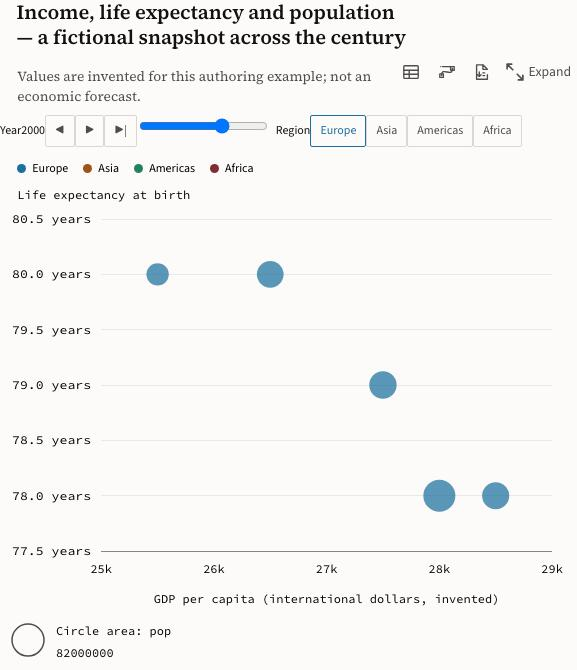

The PR #62 Gapminder example in scientific, built from `a703897` on 2026-10-22: playback chrome with the label "Year2000" touching its value and the browser's own blue slider, and region buttons with Europe pressed, above a bubble scatter of invented data. Daniel's FEA-BR-01 answer brings all four kinds of authored controls (playback, filter, metric and variant) into the first cut; FEA-BR-34 decides how they look.

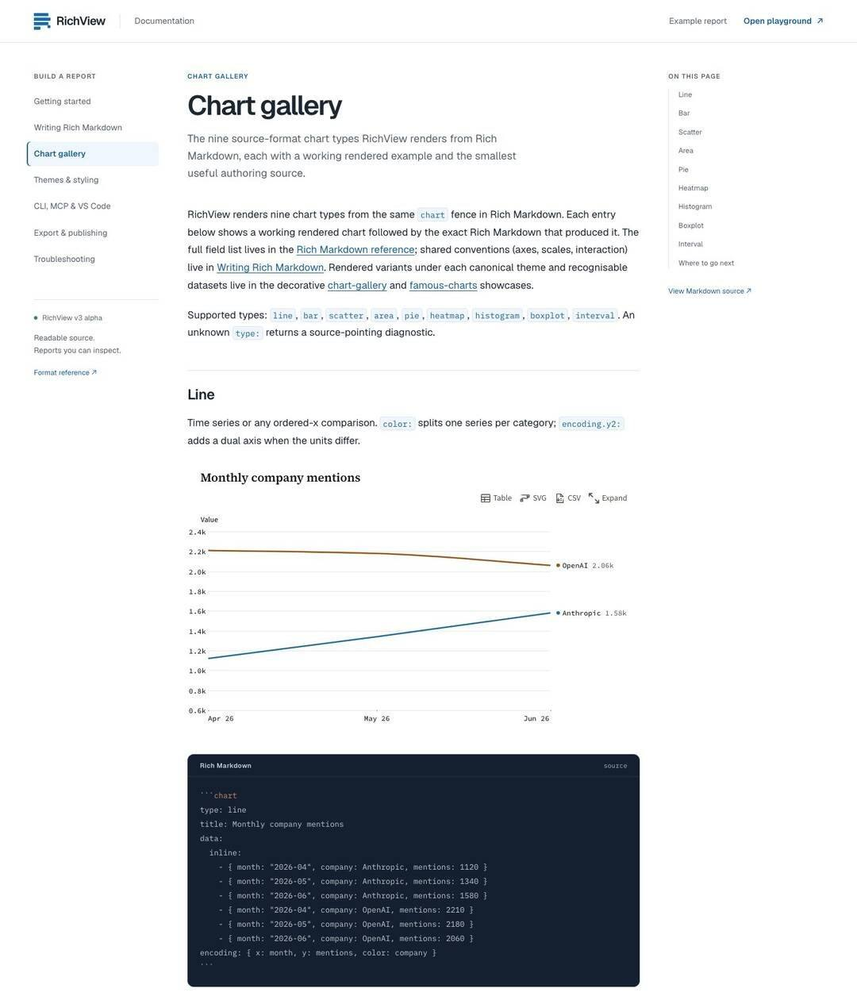

The docs chart gallery live on richview.ai (PR #69 content, 2026-10-21): labelled actions, which `main` lacks; a calendar line under an invented "Value" title; invented data with no source line; and, above the chart, the `encoding.y2` claim.

## Method and sources

Re-run on 22 October 2026 in the lockdown worktree with the `b4db233` release build: an eight-chart probe (unsorted numeric x, numeric years, string years, a three-slice pie, a faceted bar, a bar with missing encoding fields, a bar with `_renderHeight: 900`, a bubble scatter) through `richview generate --format json` and `richview check --format json`, with the frame SVGs read for paths, ticks and titles; the same probe rendered twice and from a second folder, byte-identical each time; for the probe sheet, the same charts with non-collinear values for the unsorted line, plus a repeated bar slot, rendered, checked and opened in headless Chromium (Playwright, its own temporary profile) at 1440 × 900 and 390 × 844 with reduced motion; a faceted bar with one failing panel; line counts with `git ls-files` and test counts from `#[test]` attributes; and the code at `richview-chart/src/lib.rs`, `rmd_render.rs` (ratio, palettes, ticks, heatmap scale, bubble sizes, theme and CSS guards), `render.rs` (calendar frame sizing), `color.rs` (the palette rule), `wasm.rs`, `richview-chart/Cargo.toml`, `crates/richview-core/src/render.rs` (frames), `crates/richview-core/tests/palettes.rs` and `crates/richview-site/src/browser/charts.rs` (bindings, legend folding). The nine-type and five-style sheets were assembled from the fixture crops in docs/lockdown/screenshots/product/fixture; the readout, playground and Expand images from the captures their captions name; the CPI and News dashboard images are crops of the 2026-10-21 full-page captures in docs/lockdown/screenshots/live.

Not re-run here, taken from the cards that report them: browser interaction probes (hover sweeps, readout order, keyboard behaviour, zoom), downloads, facet colour probes, the theme contrast measurements, PR branch builds and every timing. Test results come from the 2026-10-21 run in the checks evidence (`checks-performance.md`), the engine lineage from the history evidence (`history-prs.md`) and feature inventories from the product evidence (`product.md`), all in docs/lockdown/evidence. Screenshot capture details are in the screenshot index (`INDEX.md` in docs/lockdown/screenshots); the branch captures were taken by the Part 04d stage and are not in it. This page was revised on 27 October 2026 for Daniel's answers (ARC-05, INT-31, INT-11, INT-12, INT-77, FEA-CH-01, FEA-CH-37, FEA-BR-01, OPN-13) and the Part 04a cards revised for them; its Today facts date from 21 and 22 October.

Repository files at `b4db233` (private repository; the links need access): [engine README](https://github.com/1vecera/richview/blob/b4db233/richview-chart/README.md), [engine manifest](https://github.com/1vecera/richview/blob/b4db233/richview-chart/Cargo.toml), [general painter](https://github.com/1vecera/richview/blob/b4db233/richview-chart/src/rmd_render.rs), [calendar engine](https://github.com/1vecera/richview/blob/b4db233/richview-chart/src/render.rs), [temporal spec](https://github.com/1vecera/richview/blob/b4db233/richview-chart/src/spec.rs), [core renderer](https://github.com/1vecera/richview/blob/b4db233/crates/richview-core/src/render.rs), [browser chart host](https://github.com/1vecera/richview/blob/b4db233/crates/richview-site/src/browser/charts.rs), [format spec](https://github.com/1vecera/richview/blob/b4db233/docs/RMD-SPEC.md). Cards: `04a-features-chart.json` in docs/lockdown/parts, with ARC-25 and ARC-37 in Part 03, Part 04d for branches, TYP- cards in Part 05, STY- cards in [Part 06](http://127.0.0.1:4790/#/part/06-styles), PRF- cards in Part 07 and OPN- cards in Part 08.
