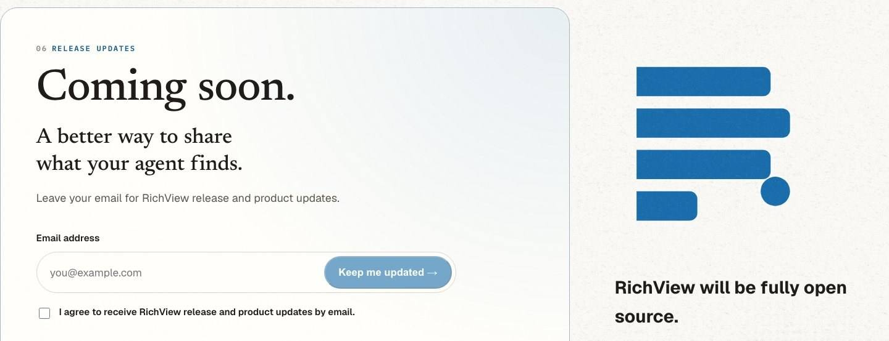
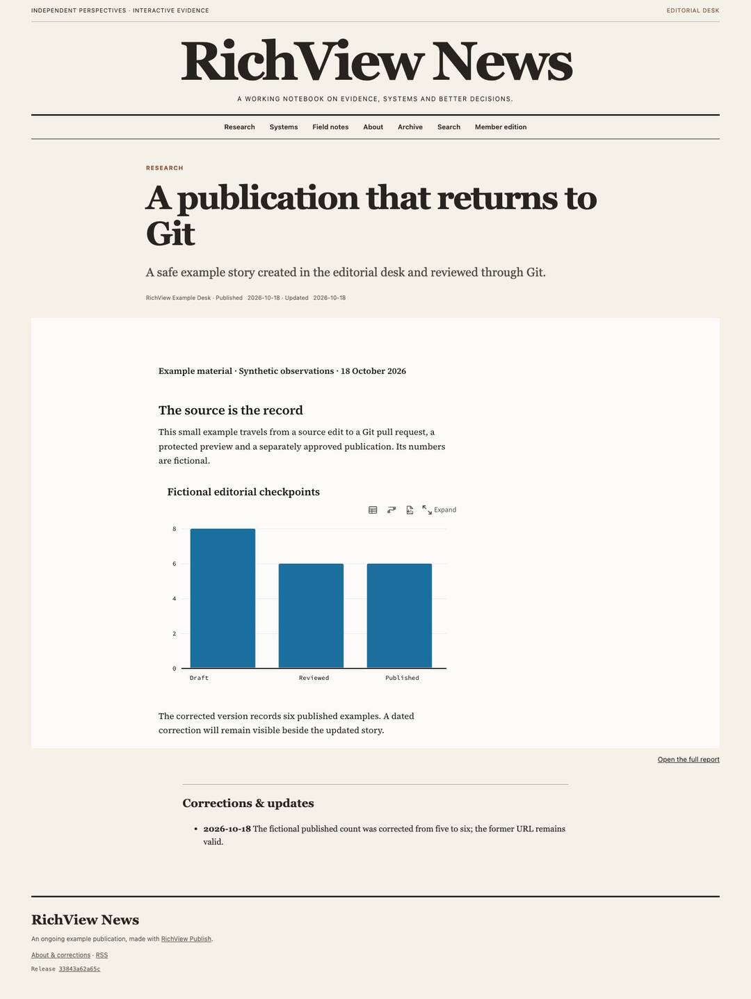
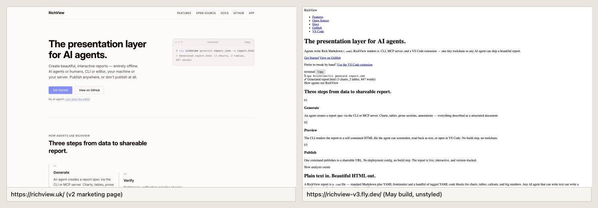

# Cloud and hosts: richview.ai Worker, News, container and legacy hosts

This page describes where RichView runs outside a checkout, as it stood on 22 October 2026, with the cleanup of 27 October recorded where it changed a host: the Cloudflare Worker behind richview.ai and its signup (C-CLOUDFLARE-TEASER, card ARC-55), the container image and Fly configuration on `main` (C-CONTAINER-DEPLOY, ARC-56), RichView News and the Publish platform behind it, which on 22 October existed only on the PR #70 branch and which Daniel's answers of 26 October merged into `main` as they are (C-RICHVIEW-PUBLISH, ARC-57), and the legacy hosts, most of them retired on 27 October. The deployment map is ARC-22 (D-DEPLOY-TOPOLOGY); the hosting intent is Part 01's INT-27, INT-35, INT-36, INT-46, INT-47, INT-48, INT-72, INT-74 and INT-83; the one-off actions are Part 08's OPN- cards; who may deploy is DEL-40 (G-DEPLOY-OWNER). None of these cards had a recorded answer on 22 October 2026. By 27 October Daniel had answered ARC-22, INT-27, INT-35, INT-36, INT-46, INT-83, OPN-01, OPN-04, OPN-05, OPN-25, OPN-43, OPN-44, OPN-45, OPN-47, OPN-48 and OPN-65 among others, and the open cards were rewritten to follow those answers. A quote headed Daniel's answer, or a cell that begins Decided, states an answer; every other proposal still awaits him in [Part 03](http://127.0.0.1:4790/#/part/03-architecture), [Part 01](http://127.0.0.1:4790/#/part/01-intent) and [Part 08](http://127.0.0.1:4790/#/part/08-open-work) of the lockdown app.

Related pages: [Web](web.md) for the pages the Worker serves; [Native app](app.md#report-host) for the report host the container runs; [Architecture](../architecture.md#deployments-what-runs-where) for the deployment diagram; [Delivery](../delivery.md#hosted-ci-deployment-and-releases) for the deploy and rollback rules; [What RichView is for](../purpose.md#domains-and-hosting) for domains as product intent; the [guide index](../README.md) for labels, IDs and links.

Statements marked re-run were checked on 22 October 2026 with read-only GET requests to every hostname on this page and in the code at `b4db233` and on the PR #70 branch; deploy history, the News publisher's log and its launchd state come from the cards that report them, as [Method and sources](#method-and-sources) details. Nothing was posted to the signup route, no Cloudflare or Fly account was queried, the D1 list was not read, and `api.richview.uk/api/reports`, which lists personal data, was not requested.

Status on 27 October 2026, from the cleanup record in [Delivery](../delivery.md#what-needs-daniels-authorization) and `docs/lockdown/DELIVERY.md`, which rechecked the hosts live at 22:40 that day; this page did not repeat those requests. Daniel gave his go for the whole cleanup batch ("yes go all"), and these steps are done and verified:

- Full backups first, in `~/archive/richview-legacy/2026-10-27/` on Claw Mini, including the `richview-api` database; then the Fly apps `richview-v3` and `richview-api` were destroyed (OPN-05, OPN-45).
- richview.uk, app.richview.uk and docs.richview.uk answer 301 to richview.ai through the Worker `richview-uk-redirect`, and their old Pages projects are deleted (OPN-04, OPN-45). The `api.richview.uk` DNS record is deleted (with a restore record in the ticket) and no longer resolves.
- A Cloudflare Access application, "RichView teaser dev preview", covers richview-teaser.vecera.workers.dev and admits only Daniel's account email. The address answers 302 to cloudflareaccess.com; richview.ai still serves publicly (OPN-44). Daniel's own first sign-in through Access is not yet exercised.
- The README pointer was added and the old public repositories archived (OPN-25, OPN-65); the October supervisor, its launch agent and the app delegations were retired, so only DEL-40 authorizes deploys (OPN-47).
- `main` was renamed `prod`, and `dev` is the default branch (DEL-02, DEL-81).

Deploying PR #69 to richview.ai again was not part of that batch: richview.ai keeps serving the Worker version built from #69's branch until Daniel gives a go. The Today columns below keep their 22 October facts; the Decided cells and the Status columns carry what changed.

Terms: the *legacy hotfix* was the single commit that OPN-43 (D-HOTFIX-CONTENTS) proposed to deploy to richview.ai before the rewrite; Daniel's FEA-SF-30 answer rules it out, so no hotfix ships (OPN-43, OPN-02). *News deployments* come from PR #70's code, merged into `main` as it is on 26 October (INT-35, INT-52, OPN-14), and `publish/news`, made by the RichView News session on Daniel's go; Daniel decided on 2026-10-23 that News is not frozen (INT-74, D-NEWS-DEMO).

## At a glance

| Question | Today | Proposed | Cards |
| --- | --- | --- | --- |
| What serves richview.ai? | The Worker `richview-teaser`: Static Assets from a locally built `dist/web` plus `POST /api/interest` into D1; version `7f3bef0d…`, built from the unmerged PR #69 branch at `7b23a22` and deployed on 2026-10-19 | The same Worker, deployed only from `prod` on Daniel's go, with the signup rules in Rust behind a thin Worker adapter; `dev` deploys to the hidden workers.dev preview behind Cloudflare Access when the website's code changes (ARC-22, DEL-40) | ARC-55, OPN-01, DEL-40, ARC-22 |
| Which hosts answer? | richview.ai and its workers.dev twin, news.richview.ai, richview.uk with its app., docs. and api. subdomains, and richview-v3.fly.dev; therichview.com is an expired Squarespace page (re-run). None serves `main` | Decided (ARC-22, answered): richview.ai; hosted Cowork at app.richview.ai; news.richview.ai, RichView's own Publish server, always public; Publish servers for customers under their own DNS, on request only; the hidden `dev` preview; everything else redirected or retired. Done on 27 October: richview.uk, app. and docs. answer 301 to richview.ai, `api.richview.uk` has no record and both Fly apps are destroyed; therichview.com lapses | ARC-22, INT-36, INT-46, INT-47, OPN-04, OPN-05, OPN-44, OPN-45 |
| Who deploys, from what? | Whoever runs Wrangler with the managed Cloudflare credentials, from a local tree; task agents deployed #65, #69 and #70 from unmerged branches; no CI job deploys | Only `prod`, on Daniel's go, by one named owner who records version IDs and asset hashes and checks the live routes; `dev` deploys to the hidden preview without a grant (DEL-06, DEL-40); News is the recorded exception, from #70's code on his go | DEL-40, OPN-01, DEL-06, OPN-47 |
| What does signup keep? | Email, consent time and consent version in D1; no mail provider, no read or export route, no IP address or user agent stored | Unchanged while INT-72 keeps the list; "Get updates" and a new consent version | FEA-SF-31, INT-72 |
| What is News? | A Publish demonstration running PR #70's code with content from the `publish/news` branch, release generation 5; publishing has failed since 2026-10-18 and the publisher has been disabled since 2026-10-20 | RichView's own Publish server, always public; improved now by the RichView News session on #70's code, merged into `main` as it is on 26 October (look, real reports, editor login), with its publishing path repaired; it moves onto the rewrite's Publish when that can serve it (INT-74, INT-35) | INT-74, OPN-03, ARC-57 |
| Does RichView host reports? | No production report host; the Dockerfile builds an image nobody deploys; the Fly app named in `packages/server/fly.toml` runs a May TypeScript build | Yes, as paid services: hosted Cowork at app.richview.ai, free up to limits and paid beyond, and Publish servers set up on request under a customer's DNS (INT-36); anyone can self-host Cowork or Publish, and the image is the self-host path (ARC-56); the Fly configuration is deleted and the Fly apps are destroyed (27 October) | INT-36, INT-83, INT-48, ARC-22, ARC-56, DEL-41 |
| What needs Daniel's go? | The root README asks for explicit authorization per deployed route; task agents held scoped deploy authority and used it from unmerged branches | Each deploy, redirect, export and destroy in [Actions on Daniel's go](#actions-on-daniels-go), one at a time; his go of 27 October covered the cleanup batch, and everything else still waits | DEL-05, DEL-40 |

## What the hosting is for

INT-48 (D-HOSTING) keeps richview.ai and its docs on Cloudflare, Daniel's choice of 2026-10-04: one Worker serving static assets plus the email signup, whose consent records in D1 are personal data RichView operates. Daniel's INT-36 answer (D-PUBLISH-TARGET) has RichView run hosted services: a story is shared as its HTML file, as a PDF, or through one of RichView's two servers, Cowork and Publish (INT-83), which anyone can self-host and RichView also runs, hosted Cowork at app.richview.ai and Publish servers set up on request under a customer's DNS, free up to limits and paid beyond. INT-27 adds RichView-managed hosting for large data and media, and INT-30 makes these paid services how RichView earns. Their providers are open (INT-48); AWS hosting with startup credits returns as one provider option. News is RichView's own Publish server and always public (ARC-22), and INT-35 (D-SCOPE-PUBLISH) makes Publish part of the rewrite.

| Component | Files | Runs where | Proposed |
| --- | --- | --- | --- |
| Site Worker `richview-teaser` | `wrangler.toml`, `cloudflare/interest-worker.mjs` (65 lines), `cloudflare/migrations/0001_interest.sql`, `cloudflare/README.md` | Cloudflare: the richview.ai custom domain and `richview-teaser.vecera.workers.dev` | ARC-55: keep, change; deployed from `prod` to richview.ai and from `dev` to the hidden workers.dev preview |
| Local signup review | `wrangler.interest-preview.toml`, `scripts/verify-interest.mjs` (52 lines), `scripts/verify-cloudflare.mjs` (35 lines) | Loopback `wrangler dev` with a local D1 | Kept as ARC-55's local-only review configuration |
| RichView News and Publish | PR #70 branch at `3f5c35f`: [wrangler.publish.toml](https://github.com/1vecera/richview/blob/3f5c35f/wrangler.publish.toml), [cloudflare/publish](https://github.com/1vecera/richview/tree/3f5c35f/cloudflare/publish), [crates/richview-publish](https://github.com/1vecera/richview/tree/3f5c35f/crates/richview-publish), [scripts/publish](https://github.com/1vecera/richview/tree/3f5c35f/scripts/publish); content on `publish/news` | Worker `richview-news` with private R2, a Durable Object and Cloudflare Access; a publisher job on Claw Mini, disabled | ARC-57: News improved now on #70's code, merged into `main`; Publish rebuilt in Rust on the shared server core |
| Container image | `Dockerfile`, `.dockerignore` | Nowhere; built locally only | ARC-56: the self-host image for Cowork, without the site tree |
| Fly app | `packages/server/fly.toml` | `richview-v3.fly.dev` runs the May TypeScript build, not this image | Decided (OPN-05, accepted): destroyed on 27 October; ARC-56: delete the file |
| v2 stack | none in this repository | richview.uk, app.richview.uk and docs.richview.uk behind Cloudflare; api.richview.uk on the Fly app `richview-api` | Decided (OPN-04, OPN-45): redirected, backed up and retired; done on 27 October |
| Hosted Cowork | none yet | `app.richview.ai`, a new hostname | INT-36, ARC-22: Cowork's first cut run by RichView, free up to limits and paid beyond; deploys from `prod` on Daniel's go |
| Publish servers for customers | none | Under each customer's own DNS and hosting | INT-36, ARC-22: set up on request only; nothing runs until a customer asks |
| Managed hosting for large data and media | none | A RichView hostname, so a provider move keeps pinned references valid | INT-27, INT-48, ARC-34: provider, hostname, quotas and pricing open |

### What the rewrite runs where

> **ARC-22 (D-DEPLOY-TOPOLOGY), Daniel's answer, 2026-10-26.** Option 1, with these changes:
>
> | Host | Decision |
> | --- | --- |
> | richview.ai | Static site plus signup, deployed only from `prod` (ARC-55). |
> | richview-teaser.vecera.workers.dev | Kept and hidden (Cloudflare Access, DEL-40). It is the `dev` preview of richview.ai. It redeploys from `dev` only when the website's code changes, not on every `dev` change. |
> | Hosted RichView Cowork | At app.richview.ai, free up to limits and paid beyond (INT-36). Deploys from `prod` on Daniel's go. |
> | Publish servers for customers | Set up on request only, under the customer's DNS (INT-36). Nothing runs until a customer asks. |
> | news.richview.ai | RichView's own Publish server, public. It stays published. |
> | Managed hosting for large data and media | As proposed (INT-27, INT-36); not discussed further here. |
> | richview-v3.fly.dev | Shut down (after export, INT-47). |
> | richview.uk | 301 to richview.ai, as proposed. |
> | therichview.com | The domain is allowed to lapse; its redirect code is removed. |
>
> Every production deployment goes through the `prod` gate on Daniel's go. Fly configuration is deleted (ARC-56).

> **INT-36 (D-PUBLISH-TARGET), Daniel's answer, 2026-10-26.** Stories are shared as the self-contained HTML file, as a PDF, and through RichView's servers, which come in two forms: RichView Cowork and RichView Publish (INT-83).
> - Anyone can self-host Cowork or Publish.
> - RichView also runs hosted Cowork itself, typically at app.richview.ai: people share reports there, including with outside parties. It is free up to limits and paid beyond them; the limits cover how many reports and files an account has and how large they are. Hosted RichView may later have features of its own.
> - RichView also sets up and runs a Publish server for a customer under the customer's own DNS records, so it lives on their website.
> These paid services are how RichView makes money. Pricing, limits and which features are hosted-only are open.

> **INT-35 (D-SCOPE-PUBLISH), Daniel's answer, 2026-10-26.** RichView Publish is a full member of the RichView family and part of the rewrite. PR #70 is merged into `main` (2026-10-26) and its work continues from there. RichView Publish and RichView Cowork (INT-83) share one RichView server core: an internal component, not a product of its own, that powers both. Publish carries the basic roles and approvals and the live-connector path (INT-06, INT-24); its brief and Git-native loop (INT-22, FEA-BR-26) remain the spec it is rebuilt against (INT-49, INT-52).

> FEA-SF-19 (later) makes these roles full, enterprise-grade roles and access control on both servers.

> **INT-83 (D-SCOPE-COWORK), Daniel's answer, 2026-10-26.** Chosen option: Today's report host becomes Cowork, as the proposal says. The RichView server is the way people host their things, and it comes in exactly two forms: you run either RichView Cowork or RichView Publish. There is no third, stripped-down server. Cowork focuses on people publishing reports locally, inside their own organisation. Over time Cowork may also store data-source credentials, such as SQL credentials, so its reports can read live data, like Publish's connector path (INT-24); not in its first cut.

> **DEL-40 (G-DEPLOY-OWNER), Daniel's answer, 2026-10-26.** Chosen option: Deploy on a separate go in the packet. Only `prod` deploys richview.ai, on Daniel's go. `dev` deploys to a preview of richview.ai (a separate hostname such as preview.richview.ai) behind a sign-in Daniel holds, enforced by Cloudflare Access; it serves as the pre-production check. The other targets follow the proposal's table.

## How it works

### richview.ai site Worker

`wrangler.toml` declares the Worker `richview-teaser` with `cloudflare/interest-worker.mjs` as its entry, Workers Static Assets from `./dist/web` under the binding `ASSETS` with `html_handling = "auto-trailing-slash"` and `run_worker_first = ["/api/*"]`, the D1 database `richview-interest` as `INTEREST_DB`, the rate limit `SIGNUP_RATE_LIMIT` at 10 requests per 60 s, the custom domain richview.ai and `workers_dev = true`. Every path outside `/api/` is an asset lookup: a file answers 200, a `.html` path redirects (307) to its extensionless form, a directory gains its slash, and anything else is 404 (re-run: `/impressum.html` to `/impressum`, `/docs` to `/docs/`). Under `/api/` only `/api/interest` exists; every other path answers 404 `{"ok":false,"message":"Not found."}` (re-run: `/api/reports`). Response headers come from the staged `_headers` file, described on [Web](web.md#navigation-routes-headers-and-previews). Because `workers_dev = true`, every deployment also answers at `richview-teaser.vecera.workers.dev`, signup route included (re-run: the same 28,225-byte home page; `GET /api/interest` 405). Since 27 October the Cloudflare Access application "RichView teaser dev preview" covers that address, which answers 302 to cloudflareaccess.com, while richview.ai still serves publicly (OPN-44, ARC-22).

### Signup

The home page's last section posts `{email, consent, website}` as same-origin JSON to `POST /api/interest`; `website` is a honeypot that must be present and empty. The Worker answers the first check that fails, in this order (`cloudflare/interest-worker.mjs:38-62`):

| Check | Status | Message |
| --- | --- | --- |
| The method is POST | 405, with `Allow: POST` | "Use the signup form." |
| `Origin` is the site and `Sec-Fetch-Site` is not cross-site | 403 | "Please sign up from the RichView website." |
| The D1 and rate-limit bindings exist | 503 | "Signup is not available yet. Your email has not been saved." |
| The rate limit, keyed on the `cf-connecting-ip` header and never stored; invalid attempts count too | 429, with `Retry-After: 60` | "Too many attempts. Please wait a minute and try again." |
| The body is `application/json` of at most 1,024 bytes, by its `Content-Length` and counted while streaming, and valid UTF-8 JSON; `consent` is exactly `true`; `website` is an empty string; the trimmed, lowercased address has at most 254 printable ASCII characters and exactly one `@`, with a dot after it | 400 | "Enter a valid email address and agree to RichView updates." |
| D1 acknowledges the insert | 200 `{"ok":true}`, for new and known addresses alike | none |
| Anything after the bindings check fails, the rate limiter and the insert included | 503 | "We could not confirm your email was saved. Please try again later." |

The insert writes `(email, consented_at, consent_version)` with `ON CONFLICT(email) DO NOTHING`, so a repeat keeps the first consent, and the Worker logs no input. The consent version is `richview-updates-2026-10-05`; the table is `subscribers(email TEXT PRIMARY KEY NOT NULL, consented_at, consent_version) WITHOUT ROWID`. No route reads, exports or mails the list. `richview server` does not implement the route, so a local preview shows the form's error state, as `cloudflare/README.md` intends.

### Deploys

No CI job deploys. The root README's Cloudflare section (`README.md:83-99`) describes a bounded release run by hand: build the exact commit, stage only the authorized routes over a snapshot of production with `scripts/stage-docs-flagship.py`, which writes a manifest of SHA-256 hashes, dry-run `wrangler deploy --assets`, deploy after authorization with `--keep-vars`, verify asset hashes and interactions on both richview.ai and the workers.dev address, and keep the previous version ID for rollback. A plain `wrangler deploy` uploads whatever the deploying machine's `dist/web` holds (ARC-55). The production version `7f3bef0d-72d8-4f20-9ef4-478091be7ee6` went out from `task/site` at `7b23a22` at about 02:32 CEST on 2026-10-19, to richview.ai and the workers.dev address, with `9582ef8a-f49f-4726-b584-e74a7a046a4a` recorded as the rollback target (OPN-01, from the deploy receipt); PR #69's own checklist still leaves its deploy unchecked (DEL-40). PRs #65, #69 and #70 all went live from unmerged branches (OPN-01). Since 27 October only DEL-40 authorizes a deploy: OPN-47 retired the October supervisor and its deploy authority and removed the app delegations of the October issues.

### RichView News

news.richview.ai runs PR #70's code, which was merged into `main` as it is on 26 October (INT-35, INT-52, OPN-14), with content from the `publish/news` branch. A second Worker, `richview-news` (`wrangler.publish.toml` on the branch: `workers_dev = false`, `preview_urls = false`, a 1,000 ms CPU limit), serves immutable releases from a private R2 bucket, keeps the publication's state in a Durable Object (`Publication`) and puts the editorial desk and the member edition behind Cloudflare Access. The `richview-publish` crate builds releases, and an operator-side publisher (`scripts/publish/publisher.mjs --watch` on the branch, run by launchd on Claw Mini) turns approved Git changes into releases through the gateway's `/_publish/sync`. Re-run: the home page answers 200 with "Latest perspectives — RichView News"; `/_status` reports `state: live`, release `33843a62…`, generation 5, `paused: false` and commit `7e7d9f8`; `/feed.xml`, `/sitemap.xml` and `/search.json` answer 200; `/internal` and `/_editor/` redirect (302) to the Cloudflare Access login; `/r/publishing-loop` redirects (308) to `/stories/returning-to-git`; `robots.txt` disallows `/_` and `/internal`; the footer still links `github.com/richview-universe/richview-v3`, which returns 404 to visitors (OPN-27). Nothing can be published: the publisher's cycles failed because `/_publish/sync` answered 503 at 21:17 UTC on 2026-10-18 and 502 three times on 2026-10-19, and the publisher has been disabled since Daniel paused all RichView services on 2026-10-20 (OPN-03, from the publisher log and the supervisor's scope brief). OPN-03, inferred, adds a second break from the repository transfer: the gateway and the publisher name the old repository and refuse GitHub's redirect.

### Container image and Fly

The `Dockerfile` builds in `rust:1.99.0-bookworm` with the `wasm32-unknown-unknown` target and `wasm-bindgen-cli` 0.2.129, runs `cargo run --release --locked -p richview-build`, and copies `richview-server`, `richview` and the whole `dist/web` tree (as `/app/public`) into `debian:bookworm-slim`. There it runs as the unprivileged user `richview` (uid 10001) with `RICHVIEW_BIND=0.0.0.0`, `RICHVIEW_DATA_DIR=/data`, `RICHVIEW_PUBLIC_DIR=/app/public` and `PORT=8080`, and starts `richview-server`. No token is baked in, so until the operator sets one the server answers publish requests with 503 "Server has no API token configured" (`crates/richview-app/src/server.rs:220-230`). Its first line says it "does not deploy"; no CI job builds it, and it was not built for this page. `packages/server/fly.toml`, last changed on 2026-10-04 for the native server, names the Fly app `richview-v3` in `ams` with a 10 GB volume at `/data`, forced HTTPS, machines that stop when idle (minimum zero), a `/health` check every 30 s and a second `[[services]]` block holding only a port and a protocol; its header says "Applying it is a separate, explicitly authorized deployment." The live app of that name still ran the May TypeScript build on 22 October (re-run: `/health` answers `{"ok":true}` and the home page carries the v2-era title); it was destroyed on 27 October after its report was exported (OPN-05).

## How it looks



The signup section of richview.ai: "06 Release updates", "Coming soon.", the call to action "Leave your email for RichView release and product updates.", the address field with "Keep me updated →", the consent checkbox "I agree to receive RichView release and product updates by email." and, beside it, "RichView will be fully open source.". Source: https://richview.ai/#signup (PR #69 content), 1440×900, 2026-10-21, cropped for the guide above the privacy line; `main` has the same text. Cards: FEA-SF-31 (D-SIGNUP) keeps the form while INT-72 (D-SUBSCRIBERS) keeps the list, and INT-72 keeps the call to action and the consent wording under the 2026-10-05 consent version, since subscribers get release updates (FEA-SF-30, answered); INT-39 (D-OPEN-SOURCE-CLAIM) sets the open-source sentence beside the form: "RichView will be open source under the MIT licence." until launch.

What a script or agent sees, re-run on 22 October 2026:

```text
$ curl -s https://richview.ai/api/interest
{"ok":false,"message":"Use the signup form."}
$ curl -s https://richview.ai/api/reports
{"ok":false,"message":"Not found."}
$ curl -s https://news.richview.ai/_status
{"state":"live","release":"33843a62a65ce8c6344c7b3e9ed9e6a5bc4344a4cc804c7ec198d52cb04c0158","generation":5,"paused":false,"commit":"7e7d9f8015e4ffff9d3a9abde4349d2a62ca7217"}
$ curl -s https://richview-v3.fly.dev/health
{"ok":true}
```



A story on news.richview.ai: the masthead "RichView News" with "A working notebook on evidence, systems and better decisions.", the navigation (Research, Systems, Field notes, About, Archive, Search, Member edition) and an "Editorial desk" link, the story "A publication that returns to Git" with its report shown in a frame, "Corrections & updates" under it, and the footer "Release 33843a62a65c", the release `/_status` reports. Source: https://news.richview.ai/stories/returning-to-git, 1440×900, full page resampled to 1080 px wide, 2026-10-21 (screenshot index). Cards: INT-74 (D-NEWS-DEMO) keeps the site live and improving on #70's code; FEA-BR-44 (F-PUBLISH-STABLE-LINKS) and FEA-BR-46 (F-PUBLISH-STATUS) would carry the corrections list and the release status into a rebuilt Publish. The News home page is on [Screenshots](../screenshots.md#richview-news).

## Features

The first column is the card, with the entity it defines or decides and, unless the card is observed, its confidence: *inferred*, the proposer's reading of several sources, or *stated*, written in a ticket, document or note but not verified. "Today" is live on 22 October 2026 or `main` at `b4db233`, as the row says; "Proposed" condenses the card as it stands on 27 October 2026, and a cell that begins Decided states Daniel's answer. Evidence entities with no card of their own are mapped under [Method and sources](#evidence-entities-without-their-own-card).

### Site Worker, domain and deploys

| Card | Today | Proposed |
| --- | --- | --- |
| ARC-55 (C-CLOUDFLARE-TEASER) | `richview-teaser`: Static Assets plus the signup route, D1 and a rate limit; serves PR #69's build | Keep, change: deployed to richview.ai only from `prod` through the Part 02 gate, and from `dev` to the hidden workers.dev preview behind Cloudflare Access only when the website's code changes (ARC-22, DEL-40); serves ARC-24's static site build; the signup's consent and validation rules move to Rust compiled to Wasm behind a thin Worker adapter (ARC-03, INT-52); its README corrected. Open: whether the `dev` preview serves `/api/interest`, and against which D1 database |
| ARC-22 (D-DEPLOY-TOPOLOGY) | Nine RichView hostnames answer (re-run), none serving `main` | Decided (Daniel's answer above): richview.ai a static site with signup, deployed only from `prod`; the workers.dev address kept and hidden as the `dev` preview; hosted Cowork at app.richview.ai; Publish servers for customers on request only; news.richview.ai public; managed hosting for large data and media as proposed; richview-v3.fly.dev shut down; richview.uk a 301; therichview.com lapses. Every production deployment goes through the `prod` gate on Daniel's go, and the Fly configuration is deleted (ARC-56) |
| INT-46 (D-DOMAIN) and OPN-44 (D-WORKERS-DEV-HOST) | The home page names richview.ai as canonical, but the workers.dev address serves every page and the signup, and its docs pages carry no canonical link | Decided (INT-46 and OPN-44, both accepted by Daniel on 26 October): richview.ai is the only canonical origin. The workers.dev address is kept, not switched off: it is the `dev` preview, hidden behind a Cloudflare Access sign-in Daniel holds, in place since 27 October, and redeployed from `dev` only when the website's code changes. INT-46's text says the address is "switched off or redirected"; OPN-44 and ARC-22, answered later, keep it hidden, so they win |
| OPN-01 (D-PROD-BASELINE) | Production is Worker version `7f3bef0d…` from PR #69's branch; `main` differs | Decided (accepted by Daniel on 26 October): production is Worker version `7f3bef0d…` from PR #69's branch, which stays the rollback target; `main` is made equal to it by merging #69 (OPN-13) and takes no legacy hotfix (FEA-SF-30, OPN-02); `main` was renamed `prod` on 27 October (DEL-02). A new deploy of #69 waits for Daniel's go |
| DEL-40 (G-DEPLOY-OWNER) | Task agents held scoped deploy authority and deployed from unmerged branches | Decided (Daniel's answer, 2026-10-26): only `prod` deploys richview.ai, on his go, through a deploy card naming the commit and targets; `dev` deploys to a hidden preview of richview.ai behind a sign-in he holds, enforced by Cloudflare Access, as the pre-production check (DEL-06, ARC-22). One owner deploys the exact tree, records previous and new version IDs and asset hashes in a receipt and runs the route check (DEL-59) against the live routes; binding, D1, DNS and Access changes are listed as one-way doors. News is the recorded exception, from #70's code and `publish/news` on his go, until it moves onto the rewrite's Publish |
| INT-48 (D-HOSTING) | Cloudflare for the site; a Fly configuration; AWS asked for in the LinkedIn carousel request | richview.ai and its docs stay on Cloudflare, and the `dev` preview is the hidden workers.dev address; News stays on its Cloudflare Worker until it moves onto the rewrite's Publish. Cowork and Publish are portable software anyone can run, and RichView also runs them as paid hosted services (INT-36); managed hosting for large data and media serves from a RichView hostname, so a provider move keeps pinned references valid (INT-27, TYP-41). Open: the providers for hosted Cowork, the customers' Publish servers and the data and media hosting, such as Cloudflare R2 or AWS S3 with the AWS startup credits; the data and media hostname; whether a credit application is part of the rewrite |
| FEA-SF-46 (F-SITE-ROUTES) | Unlinked public routes beside the pages | The committed route map, on [Web](web.md#navigation-routes-headers-and-previews) |

### Signup and the update list

| Card | Today | Proposed |
| --- | --- | --- |
| FEA-SF-31 (D-SIGNUP) | The form and Worker described [above](#signup) | Sign-ups collected exactly while INT-72 keeps the list, with the same rules; if the list is retired, the form, the Worker route and the privacy page's signup section go |
| INT-72 (D-SUBSCRIBERS), stated | The call to action and consent promise "release" updates; no written rule on who controls the list, how long it is kept or when anyone is emailed | The list stays private to Daniel and carries into the rewrite untouched (OPN-02); exported, deleted or moved only on his instruction, each entry kept until its owner withdraws consent or the list is retired; nothing sent without his approval of that mailing, the mail provider and double opt-in decided then; the call to action and the consent keep their wording, since subscribers get release updates (FEA-SF-30), under the existing 2026-10-05 consent version |

### Container image and report hosting

| Card | Today | Proposed |
| --- | --- | --- |
| ARC-56 (C-CONTAINER-DEPLOY) | An image of the report host that also serves the whole site tree; never built in CI or deployed | The self-host image for RichView Cowork running `richview server` (FEA-SF-20), with the same enterprise roles and governance section as hosted Cowork (FEA-SF-19), without the site tree; self-hosters get it through INT-71's install paths; whether a container image is among the builds from `prod` is open (DEL-41); `packages/server/fly.toml` and the orphan `packages/server/` and `packages/cli/` folders deleted; the Fly apps `richview-v3` and `richview-api` destroyed on 27 October after their reports were exported (OPN-05, OPN-45) |
| INT-36 (D-PUBLISH-TARGET) | The CLI and VS Code publish to `https://richview.uk` by default; RichView operates no report host | Decided (Daniel's answer above): stories are shared as the HTML file, as a PDF and through RichView's two servers, Cowork and Publish; anyone can self-host either; RichView also runs hosted Cowork, typically at app.richview.ai, free up to limits and paid beyond, and sets up and runs a Publish server for a customer under the customer's DNS; these paid services are how RichView makes money, and pricing, limits and hosted-only features are open. The CLI and VS Code have no default server ([Native app](app.md#publishing-clients)) |
| INT-83 (D-SCOPE-COWORK), INT-27 (D-NOT-SAAS) | No hosted Cowork and no managed hosting | Decided (Daniel's answers, 2026-10-26): today's report host becomes Cowork, and the RichView server comes in exactly two forms, Cowork and Publish, with no third; hosted Cowork limits cover how many reports and files an account has and how large they are; hosting for large data and media is a paid service served from a RichView hostname; each hosted service gets a cost estimate before it serves anyone (INT-30, INT-15) |
| DEL-41 (G-NO-RELEASES), inferred | One GitHub prerelease exists ([Build](build.md#packages-and-releases)) | The pipeline publishes builds from `prod` and the VS Code extension on the VS Code Marketplace and Open VSX (INT-71) and nothing else: no npm or crates.io packages; each publication needs Daniel's go (DEL-05). Open: how builds and listings are versioned, whether builds are GitHub releases, whether one go covers the `prod` merge and its publication, and the publisher identity |

### RichView News and Publish

| Card | Today | Proposed |
| --- | --- | --- |
| ARC-57 (C-RICHVIEW-PUBLISH) | A live Worker with R2, a Durable Object and Access; a JavaScript gateway and desk; a Rust builder; an operator-side publisher | Rebuilt in the rewrite on the shared server core: a Rust builder that renders every item through the publish contract (ARC-20) and a server on the core Cowork shares (INT-83) with its roles, approvals and the author's quick source edit (INT-26, FEA-SF-19); content in its own repository (ARC-16); FEA-BR-23 to FEA-BR-30, FEA-BR-44 to FEA-BR-46 and FEA-BR-49 are its requirements; any Cloudflare adapter is thin (ARC-03, INT-52). Until it serves News, the RichView News session improves News on #70's code and `publish/news` and owns the publisher job, the Access token rotation, the bridge credential (re-scoped to 1vecera/richview) and `publish.yml` (OPN-03, OPN-46); #70's JavaScript is ported, not carried (INT-49, INT-52). Items go public by OPN-54's workflow |
| INT-35 (D-SCOPE-PUBLISH) | The Publish request made Publish current scope on 2026-10-18 | Decided (Daniel's answer above): Publish is a full member of the RichView family and part of the rewrite; PR #70 was merged into `main` as it is on 26 October, and its work continues from there; Publish and Cowork share one server core, an internal component and not a product; Publish carries the basic roles and approvals and the live-connector path, and FEA-SF-19, answered later, makes the roles enterprise-grade on both servers; its brief and Git-native loop stay the spec |
| INT-74 (D-NEWS-DEMO) | News calls itself "the maintained demonstration of RichView Publish" and links the old repository | News is RichView's own Publish server at news.richview.ai, always public (ARC-22), an instance of Publish. It stays online and is improved now by the RichView News session on #70's code, merged into `main` as it is, and on `publish/news`: look, real reports, editor login; each deployment on Daniel's go. Its publishing path and editor are repaired with a credential scoped to the new repository, and its copy stays true and drops the link to the private repository (OPN-27). When the rewrite's Publish can serve it, News moves onto it as its first production instance and #70's JavaScript gateway and editor retire. Open: when it cuts over, and which branch it deploys from now that #70's branch is fully merged |
| OPN-03 (D-NEWS-LIVE), inferred | Readers get the current release; nothing can be published | The RichView News session repairs News publishing as part of its work: the bridge reads 1vecera/richview, or a content repository of its own, with a new repository-scoped credential, and the desk and editor login work again; each News deployment is on Daniel's go; the lockdown neither freezes nor takes down News; when the rewrite's Publish can serve it, a deployment from `prod` replaces this one |
| OPN-46 (D-NEWS-PUBLISHER) | The publisher's launch agent is disabled but installed with `RunAtLoad` and `KeepAlive`; the News Worker holds a `GITHUB_TOKEN` secret nothing uses | The lockdown does not remove the publisher job or revoke the credential: the News session owns both, re-enables or replaces the publisher, and replaces the bridge credential with one scoped to 1vecera/richview, revoking the old one once the new one works, each step on Daniel's go; when News moves onto the rewrite's Publish, the #70 publisher is removed and its credential revoked, again on his go |
| OPN-14 (D-PUBLISH-PR70) | Draft PR #70, not merged on 22 October | Merged into `main` as it is, JavaScript included, on 26 October, so the News work lands and continues (INT-35, INT-52); not the rewrite's base: the rewrite carries over its behaviour and decisions, not its code, and ports its JavaScript to Rust. Its spec stays recorded in FEA-BR-23 to FEA-BR-30, FEA-BR-44 to FEA-BR-46 and FEA-BR-49, with TYP-80 and TYP-81 for its formats. Open: how ARC-03's allowlist check treats #70's JavaScript until the port |

## Legacy hosts

| Host | Today (re-run unless marked) | Decided, and status on 27 October | Cards |
| --- | --- | --- | --- |
| richview.uk | 200, 13,512 B: the v2 marketing page "RichView — The presentation layer for AI agents", behind Cloudflare. OPN-04 records that it claims "source-available under Elastic License 2.0" and "Seven chart types", links the private richview-v2 repository and answers `/api/reports` and `/health` with its HTML and 200. It is the default publish server of the legacy CLI (`crates/richview-app/src/cli.rs:122`) and VS Code extension (`packages/vscode/package.json:108`) | Decided (OPN-04, accepted by Daniel): a 301 to richview.ai now rather than at launch; `www.richview.uk` does not resolve; the frozen legacy CLI and extension keep their default, the rewrite has none. Done on 27 October through the Worker `richview-uk-redirect`; rechecked live at 22:40: 301 to `https://richview.ai/` | OPN-04, INT-47, INT-36 |
| app.richview.uk, docs.richview.uk | 200, 3,050 B and 23,128 B: the v2 app shell and the v2 docs, "JSON in, HTML report out" (OPN-45) | Decided (OPN-45, OPN-04): redirected to richview.ai together with the apex. Done on 27 October: both answer 301 to richview.ai, and their old Pages projects are deleted | OPN-45 |
| api.richview.uk | `/health` 200: status ok, version 0.0.1, `db: ok`. A CNAME of the Fly app `richview-api`, whose `/api/reports` lists seven v2 reports with author names, user IDs and content previews to anyone (OPN-45; not requested here) | Decided (OPN-45; Daniel owns and pays for the Fly app, so no one else had to agree): the reports exported for the archive, the host removed from DNS, the app and its database destroyed. Done on 27 October: a full backup first, including the `richview-api` database, in `~/archive/richview-legacy/2026-10-27/` on Claw Mini; the Fly app destroyed; the DNS record deleted (restore record in the ticket); it no longer resolves | OPN-45 |
| richview-v3.fly.dev | `/health` 200 `{"ok":true}`; `/` 200, 12,733 B, unstyled, the v2-era title and `npx @richview/cli generate report.rmd`; `/api/reports` lists the 2026-05-21 sample report `v3-launch` without a token (card) | Decided (OPN-05, accepted): `v3-launch` exported and the app and its volume destroyed now. Done on 27 October, after a backup; the app no longer answers | OPN-05, INT-47, ARC-56 |
| therichview.com | 404, Squarespace's "Website Expired" page; `richview server` still answers that host with a 301 to richview.uk (`crates/richview-app/src/server.rs:107-122`) | Decided (ARC-22): the domain is allowed to lapse; the redirect code goes. Nothing needed at the domain now | INT-47, TYP-67 |
| richview-teaser.vecera.workers.dev | 200: the whole richview.ai site and its signup route | Decided (OPN-44, ARC-22): kept and hidden as the `dev` preview of richview.ai, redeployed from `dev` only when the website's code changes. Since 27 October a Cloudflare Access application covers it and admits only Daniel's account email; it answers 302 to cloudflareaccess.com. Daniel's own first sign-in is not yet exercised | OPN-44, INT-46, ARC-22 |
| Old organization | `richview-universe/richview-charts` and `richview-docs` are public and unarchived, describing an ECharts engine and the v1 SaaS (GPT-4 chart generation, Highcharts); the organization's private repositories anchor the redirect from the old repository URL (cards) | Decided (OPN-25, OPN-65, both accepted): each repository gets a README pointer to richview.ai and is archived; done on 27 October. "Steven" was an agent persona, so no message was owed (OPN-48, OPN-24). The organization stays and the old repository name is never reused (OPN-26) | OPN-25, OPN-65, OPN-26, OPN-48, INT-40 |



The two legacy hosts that still serve pages, each the first 1440×900 screen shown at half size, captured for this page with headless Chromium on 2026-10-22. Left, richview.uk: the v2 marketing page "The presentation layer for AI agents." with its header (Features, Open Source, Docs, GitHub, App) and a terminal showing `npx richview generate report.json -o report.html`. Right, richview-v3.fly.dev: the May TypeScript build, rendered without styles, advertising `npx @richview/cli generate report.rmd` under the navigation Features, Open Source, Docs, GitHub, VS Code. Both hosts changed on 27 October: richview.uk now answers 301 to richview.ai and the Fly app no longer answers. Cards: OPN-04 (D-DEFAULT-PUBLISH-HOST), OPN-05 (D-FLY-LEGACY), INT-47 (D-LEGACY-DOMAINS).

## Actions on Daniel's go

Each action below changes a live host, an account or a repository, so each waits for Daniel's explicit go at the time it is taken ([Delivery](../delivery.md#what-needs-daniels-authorization)). On 27 October he gave his go for the whole cleanup batch ("yes go all"); the Status column records what that did and what still waits. Undo says what a later change of mind could still reverse.

| Action | Card | Status on 27 October | Undo |
| --- | --- | --- | --- |
| Deploy the legacy hotfix to richview.ai, with `workers_dev = false` | OPN-43, OPN-44 | Withdrawn: no hotfix ships (FEA-SF-30, OPN-43) | None needed; a Worker rollback to `7f3bef0d…` stays the rollback target (OPN-01) |
| Switch the workers.dev address off in its own one-line deploy | OPN-44 | Withdrawn: the address is kept and hidden behind Access (OPN-44, ARC-22) | None needed |
| Put a Cloudflare Access sign-in in front of the workers.dev address | OPN-44, DEL-40 | Done; Daniel's own first sign-in is not yet exercised | Remove the Access application |
| Deploy news.richview.ai from #70's code (by the RichView News session), the recorded exception to DEL-40's prod-only rule | INT-74; OPN-03 | Open: each News deployment waits for Daniel's go, and which branch it deploys from is open | A Worker rollback to the version it replaces |
| 301-redirect the apex richview.uk to richview.ai | OPN-04, INT-47 | Done | Remove the redirect; browsers that saw the 301 may keep it cached |
| Export the `richview-api` reports, redirect app. and docs. to richview.ai, remove api.richview.uk from DNS, destroy the Fly app and its database, and retire the origin behind the apex, app. and docs. | OPN-45 | Done, after full backups in `~/archive/richview-legacy/2026-10-27/`; the old Pages projects are deleted | The redirects and DNS can be restored; the destroyed app, database and origin cannot, so the backup came first |
| Export `v3-launch`, then destroy the Fly app `richview-v3` and its volume | OPN-05 | Done | None after the destroy; the export keeps the one report |
| Remove the News publisher's launch agent and revoke the GitHub credential behind News's `GITHUB_TOKEN` | OPN-46 | Changed: the News session owns both, and each step stays on Daniel's go | The launch agent can be reinstalled from the kept configuration; a revoked credential can only be replaced by a new one |
| Archive `richview-universe/richview-charts` and `richview-docs` (and `1vecera/RichTemplates`) with a README pointer to richview.ai | OPN-25, OPN-65; OPN-48 | Done; no message to anyone was owed, since "Steven" was an agent persona | An archived repository can be unarchived; the README commit stays in its history |
| Create the private phone-preview Worker that review packets update | DEL-31, OPN-66 | Withdrawn: no separate Worker; the `dev` preview carries the before-and-after report | None needed |
| Deploy PR #69's build to richview.ai again | OPN-01, DEL-40 | Open: not part of the cleanup batch; richview.ai keeps serving `7f3bef0d…` until Daniel's go | A Worker rollback to the previous version |

## Checks that cover it

| Check | What it covers | Result | Gap |
| --- | --- | --- | --- |
| `verify-cloudflare.mjs` | Applies the migration to a local D1, starts `wrangler dev` with `wrangler.interest-preview.toml` on loopback and runs `verify-interest.mjs` and `verify-homepage.mjs` against it, without credentials or hosted resources | Pass, 15.5 s in Chromium on 2026-10-21; a CI step, but hosted CI has not run since 2026-10-13 | Never touches the deployed Worker or its bindings |
| `verify-interest.mjs` | The Worker as a module: 503 without bindings, 429 when limited, 400 for each invalid body, 403 cross-origin, 405 for GET, 400 for a 2,000-byte body, 503 when D1 fails, 200 with exactly one write; then the local D1: normalised, deduplicated storage that keeps the first consent, 404 for `/api/subscribers`, 429 with `Retry-After: 60` within eleven attempts, three columns | Pass, inside the run above | Its URL guard allows only `127.0.0.1`, by design |
| Post-deploy verification | The root `README.md` asks the deployer to verify asset hashes, interactions and private-path rejection on both hosts | Manual; the deploy receipt is kept outside the repository | DEL-40 (answered) requires a deploy receipt and the route check (DEL-59) after each deploy |
| Container image | Nothing builds or starts it | Not run | ARC-56 keeps it as the self-host path with no proof that it builds |
| News | PR #70's `publish.yml` validates publication pull requests without production credentials; [scripts/publish/verify-platform.mjs](https://github.com/1vecera/richview/blob/3f5c35f/scripts/publish/verify-platform.mjs) on the branch | Owned by the RichView News session on PR #70 (ARC-57) | — |

Checks evidence: `checks-performance.md` in docs/lockdown/evidence. Gate rules for deploys are in [Delivery](../delivery.md#hosted-ci-deployment-and-releases).

## Known defects

A defect on a host retired on 27 October is recorded as it stood on 22 October; the last column names the card that decides it and, where it applies, what was done on 27 October. In the Seen column, *re-run* means checked for this page with a read-only request; *code reading* means read in the code at `b4db233` but not run; *card* means reported by the card named and not repeated here; *capture* means a lockdown screenshot of the live site.

| Defect | Where | Seen | Decided in |
| --- | --- | --- | --- |
| `cloudflare/README.md` calls `main` "this branch", says no live Worker or binding is changed and that `wrangler.toml` "remains the production assets-only configuration", while the file declares the Worker, D1, the rate limit and the domain | `main` | Code reading | ARC-55 |
| richview.ai serves the unmerged PR #69 build, not `main` | Live | Re-run | OPN-01, OPN-13 (accepted: #69 is merged as the record of production) |
| The whole site and the signup route also answer at the workers.dev address | Live | Re-run | OPN-44 (kept and hidden behind Access since 27 October), INT-46, ARC-22 |
| Deploys went out from unmerged branches (#65, #69, #70); #69's deploy checklist is unchecked although deployed | Live | Card | DEL-40, OPN-47 (the October deploy authority ended on 27 October) |
| The signup promises "release" updates, which INT-41 (D-RELEASE) ruled out until Daniel's INT-71 answer offered builds from `prod` and two extension listings | `main` and live | Capture | INT-72, FEA-SF-30 (the wording stays: subscribers get release updates) |
| `packages/server/fly.toml` targets the Rust image while the app of that name runs the May TypeScript build; a stray `[[services]]` block | `main` | Code reading | ARC-56, OPN-05 (the app was destroyed on 27 October) |
| The container image serves the whole site tree beside the report host | `main` | Code reading | ARC-56 |
| `richview server` still redirects therichview.com to richview.uk | `main` | Code reading | INT-47 |
| The CLI and VS Code publish to richview.uk by default, a host that answers API paths with HTML and 200 | `main`, live | Code reading, card | INT-36, OPN-04 (richview.uk answers 301 to richview.ai since 27 October; the frozen clients keep the default) |
| richview.uk and its app. and docs. subdomains serve v2 claims and link a private repository | Live | Re-run (200), card | OPN-04, OPN-45 (redirected on 27 October) |
| api.richview.uk lists seven v2 reports with personal data to anyone | Live | Card | OPN-45 (record deleted and app destroyed on 27 October, after a backup) |
| richview-v3.fly.dev lists a stored report without a token | Live | Card | OPN-05 (destroyed on 27 October) |
| News cannot publish: sync answered 503 and 502, the publisher is disabled, and the bridge is presumably broken by the transfer | Live | Card | OPN-03, OPN-46 (the RichView News session repairs it) |
| News links the old repository URL, 404 for visitors | Live | Re-run (link), card | INT-74, OPN-27 |
| News's dashboard page draws black wedges in its line charts | Live | Capture | FEA-CH-66 ([Chart engine](chart.md#known-defects)), FEA-BR-30 |

## Branch-only additions

On 22 October none of this was on `main`. Daniel's answers of 26 October merged PR #70 into `main` as it is (INT-35, INT-52, OPN-14), keep #69 as the record of what richview.ai serves (OPN-01, OPN-13) and close #65's work into the docs gallery (OPN-09).

| PR | Hosting work on the branch | State observed | Decided in |
| --- | --- | --- | --- |
| #70 RichView Publish and News (`feat/richview-publish` at `3f5c35f`) | Worker `richview-news` (`wrangler.publish.toml`); gateway, policy, editor desk and repository bridge in [cloudflare/publish](https://github.com/1vecera/richview/tree/3f5c35f/cloudflare/publish); the `richview-publish` builder crate; publisher, upload and Access-runner scripts; `publications/news/`; a `publish.yml` workflow. 26 commits, 52 files, +7,243/−8: 3,998 lines of `.mjs` and 1,031 of Rust | Live as news.richview.ai at release generation 5 (re-run); content PRs #71 and #72 merged into `publish/news`, #73 to #75 closed by design; conflicts with #64 on `Cargo.lock` and duplicates a patch of #68; merged into `main` as it is on 26 October (INT-35, INT-52) | OPN-14, ARC-57, INT-35, INT-74 |
| #69 site round (`task/site`) | The build richview.ai serves | Live since 2026-10-19; richview.ai keeps serving it until a new deploy on Daniel's go | OPN-01, OPN-13 ([Web](web.md#branch-only-additions)) |
| #65 galleries (`publish-galleries`) | Three gallery pages, deployed and later replaced by #69's docs gallery | Their routes answer 404 (re-run) | OPN-09 ([Web](web.md#branch-only-additions)) |

### Publish in the rewrite

Daniel's INT-35 answer makes Publish a full member of the RichView family and part of the rewrite, and INT-31 puts it in scope: it is built in Rust on the server core it shares with Cowork (ARC-57). These Part 04d and Part 05 cards are its requirements; each says "Built with Publish in the rewrite" (FEA-BR-23 to FEA-BR-30, FEA-BR-44 to FEA-BR-46 and FEA-BR-49, with TYP-80 and TYP-81 for its formats). FEA-BR-23, FEA-BR-25 to FEA-BR-29, FEA-BR-45, TYP-80 and TYP-81 are stated: they rest mainly on PR #70's documents and the Linear issue for Publish, not on running code. FEA-BR-24, FEA-BR-30, FEA-BR-44, FEA-BR-46 and FEA-BR-49 are observed. INT-35 says Publish carries the basic roles and approvals; FEA-SF-19, answered later, makes the roles enterprise-grade on both servers, and OPN-54 sets how items go public.

| Card | Proposed |
| --- | --- |
| FEA-BR-23 (F-PUBLISH-LAYOUTS-THEMES), TYP-81 (T-SITE-CONFIG) | One Git folder per publication with one `site.yaml` and one folder per item; two layouts (Broadsheet, Dispatch) and two themes for the publication's own pages (Paper, Ink); at most 20 sections, 12 navigation links and 4 lead items; unknown keys fail; items rendered by the report renderer, each keeping the RichView style its frontmatter names, and shown in a frame; an item with an `embed` block fails the build |
| TYP-80 (T-PUBLISH-META) | Adopted as an optional `publish:` namespace that core validates, so every host reports the same diagnostics, with `cover_credit` required for a hotlinked Unsplash cover (FEA-RP-62); only Publish acts on it. Open: whether `publish.slug` replaces the top-level `slug`, and how `state` and `audience` map onto private and public (FEA-BR-25) |
| FEA-BR-24 (F-PUBLISH-FEEDS-SEARCH) | Feeds, sitemap and search cover only published public items, even for signed-in readers; reserved routes cannot be slugs |
| FEA-BR-25 (F-PUBLISH-ACCESS), FEA-BR-45 (F-PUBLISH-MODE) | Reader, Editor, Super editor and a publishing service on the shared server core; identity from an existing provider through verified signed tokens, no stored passwords; every route checks audience and scope; the member edition at `/internal` is a view, never the boundary; a Publish publication is external, and a wholly internal one is Cowork's job (INT-83). Open: whether Publish also keeps `mode: internal` |
| FEA-BR-26 (F-PUBLISH-GIT-LOOP), FEA-BR-27 (F-PUBLISH-EDITORIAL-DESK) | Every change a pull request, validated by a trusted builder with a protected preview; a change from an author who isn't an editor needs an editor's approval of that exact head and goes public once approved, and an editor's own change lands private until the editor makes it public (OPN-54); the browser desk offers two actions, approving a pending change and the author's quick source edit (INT-26), with its rules in Rust on the shared server core; #70's JavaScript desk is ported, not carried (INT-52) |
| FEA-BR-28 (F-URGENT-HIDE) | A hide enforced at the gateway before Git, refused on every route and old release, lifted only by a different super editor; a hide button in the browser would be a third action that INT-26 does not name, so it needs Daniel's go |
| FEA-BR-29 (F-PUBLISH-RELEASES), FEA-BR-49 (F-PUBLISH-LIMITS) | Immutable releases from pinned source, atomic activation, stale jobs rejected, rollback that keeps access floors, an offline builder; named errors over 1,000 items, 20 MiB per object or 256 MiB per release |
| FEA-BR-44 (F-PUBLISH-STABLE-LINKS), FEA-BR-46 (F-PUBLISH-STATUS) | Permanent ids with `/r/<id>`, 308 redirects from former slugs, a dated corrections list; `/_status` with release, commit, generation and pause state, and a change counts as delivered only when `/_status` shows its commit. Open: Cowork serves `/r/<slug>` (FEA-SF-14), so the prefix needs one meaning on both servers or Publish another |
| FEA-BR-30 (F-PUBLISH-DASHBOARD-SNAPSHOT) | Reports and static pages only; dashboard pages return only with a dashboard product (INT-33) |

## Method and sources

Re-run on 22 October 2026, read-only: GET requests to richview.ai (`/api/interest`, `/api/reports`, `/impressum.html`, `/docs`), `richview-teaser.vecera.workers.dev` (`/`, `/api/interest`), news.richview.ai (`/`, `/_status`, `/feed.xml`, `/sitemap.xml`, `/search.json`, `/internal`, `/_editor/`, `/r/publishing-loop`, `/about`, `/robots.txt`), richview.uk, app.richview.uk, docs.richview.uk, `api.richview.uk/health`, `richview-v3.fly.dev` (`/`, `/health`) and therichview.com; the code at `wrangler.toml`, `wrangler.interest-preview.toml`, `cloudflare/interest-worker.mjs`, `cloudflare/README.md`, `cloudflare/migrations/0001_interest.sql`, `Dockerfile`, `.dockerignore`, `packages/server/fly.toml`, `README.md:83-99`, `scripts/verify-cloudflare.mjs`, `scripts/verify-interest.mjs` and `crates/richview-app/src/server.rs`; `git log` of the hosting files; and `wrangler.publish.toml` and the file list of the PR #70 branch with `git show` and `git ls-tree`. The legacy-host composite was captured for this page; the other images come from the lockdown screenshots. The 27 October status comes from the cleanup record in `docs/lockdown/DELIVERY.md`, whose live recheck at 22:40 that day this page did not repeat; the Today columns, re-run facts and captures keep their 22 October dates.

Not re-run, taken from the cards that report them: the deploy receipt and Worker version IDs (OPN-01), the News publisher log, its launchd state and the operator configuration on Claw Mini (OPN-03, OPN-46), DNS records (OPN-04, OPN-45), the content of `api.richview.uk/api/reports` (OPN-45) and `richview-v3.fly.dev/api/reports` (OPN-05), and the GitHub organization's state (OPN-25, OPN-26). Two sources disagree with what they cite: the product evidence places the Worker configuration at cloudflare/wrangler.toml, but it is `wrangler.toml` at the repository root; and OPN-03's question dates the publishing outage to 2026-10-19, while the publisher log it cites records the first failed cycle at 21:17 UTC on 2026-10-18, which this page follows.

Repository files at `b4db233` (private repository; the links need access): [Worker configuration](https://github.com/1vecera/richview/blob/b4db233/wrangler.toml), [signup Worker](https://github.com/1vecera/richview/blob/b4db233/cloudflare/interest-worker.mjs), [Cloudflare README](https://github.com/1vecera/richview/blob/b4db233/cloudflare/README.md), [D1 migration](https://github.com/1vecera/richview/blob/b4db233/cloudflare/migrations/0001_interest.sql), [Dockerfile](https://github.com/1vecera/richview/blob/b4db233/Dockerfile), [Fly configuration](https://github.com/1vecera/richview/blob/b4db233/packages/server/fly.toml), and on the PR #70 branch the [News Worker configuration](https://github.com/1vecera/richview/blob/3f5c35f/wrangler.publish.toml) and the [publisher](https://github.com/1vecera/richview/blob/3f5c35f/scripts/publish/publisher.mjs). Cards: ARC- in Part 03 (03-architecture.json in the worktree's docs/lockdown/parts), INT- in Part 01 (INT-27, INT-30, INT-35, INT-36, INT-46, INT-48, INT-72, INT-74 and INT-83 among them), DEL- in Part 02, FEA-SF- in Part 04c, FEA-BR- in Part 04d, TYP- in Part 05 and OPN- in Part 08.

### Evidence entities without their own card

| Entity in the product evidence | Where it is decided |
| --- | --- |
| F-CF-STATIC-SITE, F-CF-INTEREST-SIGNUP, F-CF-RATE-LIMIT | ARC-55 (C-CLOUDFLARE-TEASER), FEA-SF-31 (D-SIGNUP), FEA-SF-46 (F-SITE-ROUTES) |
| F-DEPLOY-CONTAINER, F-DEPLOY-FLY | ARC-56 (C-CONTAINER-DEPLOY), OPN-05 (D-FLY-LEGACY) |
| F-PUBLISH-NEWS-SITE | INT-74 (D-NEWS-DEMO), OPN-03 (D-NEWS-LIVE) |
| F-PUBLISH-SITE-CONFIG | FEA-BR-23, TYP-81 (T-SITE-CONFIG) |
| F-PUBLISH-MEMBER-EDITION | FEA-BR-25 (F-PUBLISH-ACCESS), FEA-BR-45 (F-PUBLISH-MODE) |
