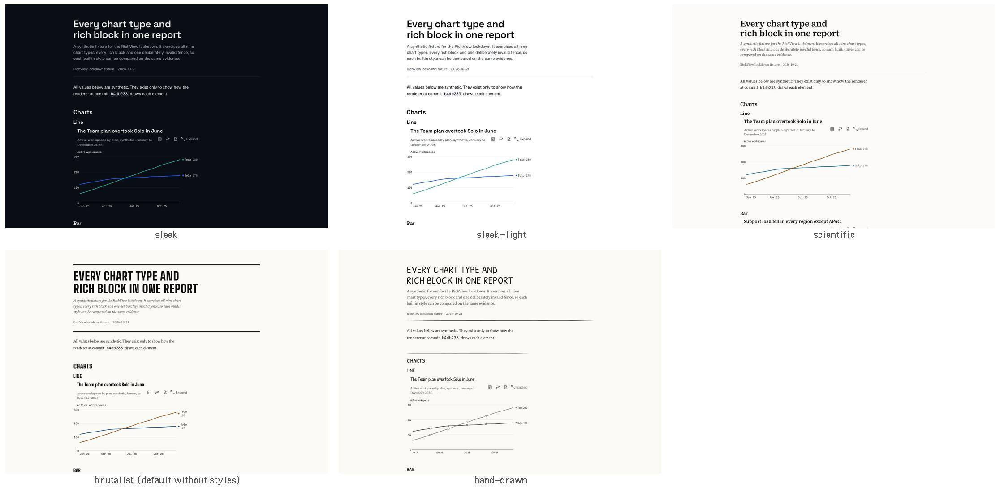
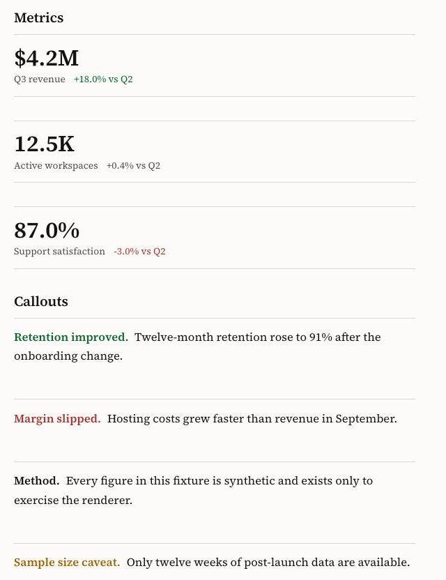
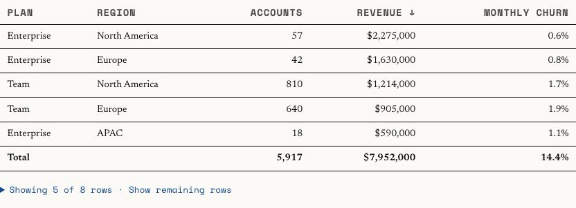
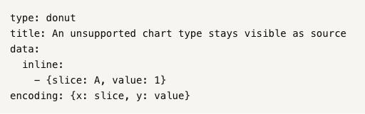
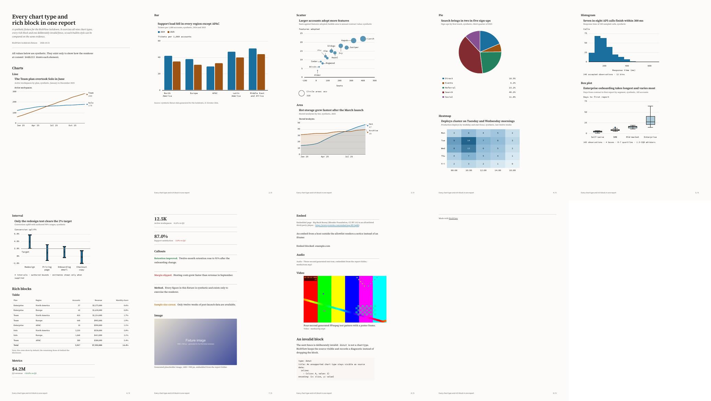
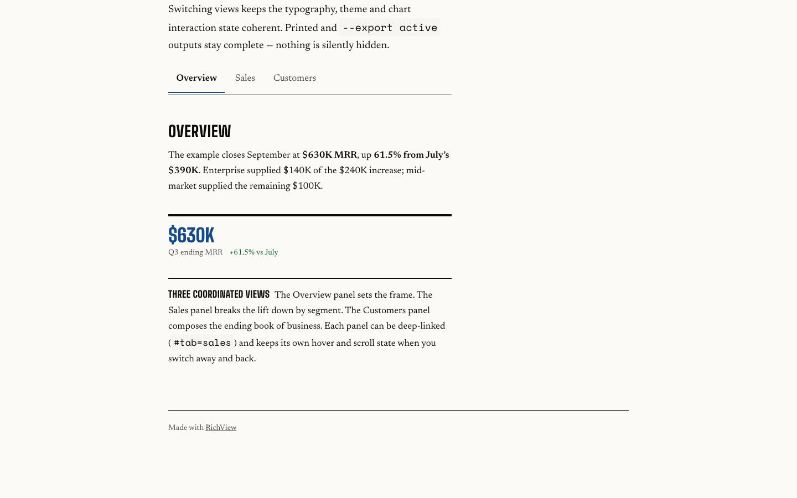
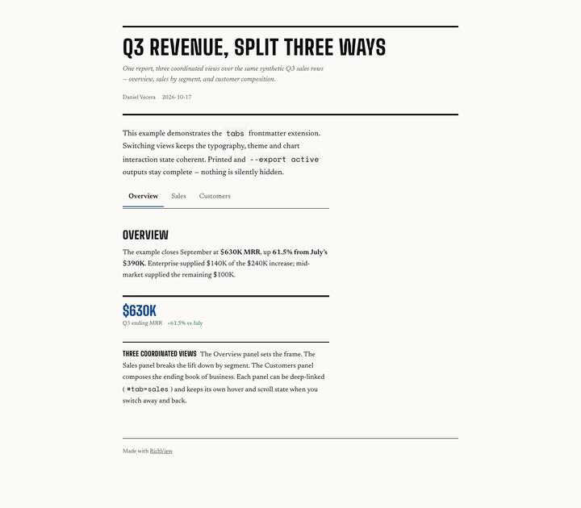

# Report core

This page describes `richview-core`, the report core (C-RICHVIEW-CORE, card ARC-26): the parser, validator, style cascade and renderer that turn one `.rmd` file into one HTML report, as it stood on `main` at `b4db233`, with the Part 04b proposals for the rendered report. Part 04b (`04b-features-report`, 62 cards) has one answer from Daniel, FEA-RP-62 (Unsplash photos, accepted 2026-10-26); every other FEA-RP proposal below follows his answers in Parts 01, 02 and 08 and awaits him in [Part 04b of the lockdown app](http://127.0.0.1:4790/#/part/04b-features-report). The page was revised on 27 October 2026.

Related pages: [Chart engine](chart.md) for charts; [Format and types](../format-and-types.md) for the fields, values and diagnostic codes of the format; [Native app](app.md) for the CLI, MCP server and HTTP host that call the core, [Editor](editor.md) for the VS Code preview and [Web](web.md#playground) for the browser playground, compared on [Architecture](../architecture.md#one-operation-five-surfaces); [Styles](../styles.md) for [the five styles and the default](../styles.md#catalogue-default-names-and-selector) (STY-05, STY-06), [fonts](../styles.md#typography-and-fonts) (STY-27 to STY-29) and the [measure](../styles.md#layout) (STY-30); [Performance](../performance.md#load-size-and-first-paint) for report weight; the [guide index](../README.md) for labels, IDs and links.

Statements marked re-run were checked on 22 October 2026 with the release build of `b4db233` in the lockdown worktree (`target/release/richview` 3.0.0-alpha.0); everything else comes from the card or evidence named beside it, as [Method and sources](#method-and-sources) details.

## At a glance

| Question | Today on `main` | Proposed | Cards |
| --- | --- | --- | --- |
| What is it? | A pure Rust crate whose `src/` holds 6,805 lines in 12 source files (10,283 lines in all 23 Rust files, tests included; re-run), with no filesystem, network or process access; it depends on `richview-chart` and nine libraries and runs natively and as Wasm | Keep; it owns every validation rule and the vocabularies that agent-facing documents are generated from (Daniel's INT-21 answer); the TypeScript-era compatibility layer goes | ARC-26, ARC-02, ARC-08, ARC-09 |
| What goes in and out? | Source text plus data, styles and media the host has already read, in `RenderOptions`; out come one HTML string, diagnostics and metadata with status `clean` or `issues` | The same contract with typed options; a missing input fails only its element | TYP-71, FEA-RP-30 |
| How heavy is a report? | A one-paragraph report is 2,366,338 bytes, 90% of it the module script that carries the whole Wasm runtime, site code included, although the report has no chart or table (re-run) | The report runtime only in reports with a chart or table, a minimal readiness hook in the others (FEA-RP-38); the report runtime at most 512 KiB after gzip (PRF-31). ARC-06 and PRF-31 embed the full report runtime in every exported report, so FEA-RP-38's minimal build waits for OPN-53 | FEA-RP-38, PRF-31, ARC-06, PRF-32, OPN-53 |
| Which style applies without one? | `brutalist`, while `richview init` writes `styles: [sleek]` | Sleek (today's Sleek Dark) everywhere, with Air, its light counterpart, for print and PDF (Daniel's STY-05 and STY-06 answers) | FEA-RP-32, STY-06 |
| What does a broken draft look like? | An invalid fence stays as YAML with nothing marking it; a misspelled tag and an unbalanced formula pass as clean and an HTML comment ships (re-run); one missing file stops the whole render | A one-line notice in place, an error at its line, and the rest of the draft still written; publish and PDF refuse it | FEA-RP-29, FEA-RP-30, FEA-RP-57 |
| How is it tested? | 91 Rust tests, 14 unit and 77 integration in 10 files; one takes 26.6 s; no accessibility, no-script or hostile-input check | A fast gate of unit tests in `dev`; accessibility, no-script, hostile-input and PDF checks in the release run on `pre-prod` (DEL-81) | DEL-25, DEL-56 to DEL-58, DEL-81 |

## What the core is for

The crate's own header states its contract: "Parsing, styles, rendering, diagnostics and authoring knowledge are pure: callers resolve external references and supply their bytes through [`RenderOptions`]. The same crate runs natively and in WebAssembly without a filesystem, network, process or JavaScript engine" (`crates/richview-core/src/lib.rs:1-9`). Purity lets every surface share one renderer and keeps everything that touches files in the hosts ([Architecture](../architecture.md#safety-boundaries)). It does not make the output identical: the surfaces call the core in different ways, the VS Code preview always appends the report card while `serve` never does, the playground links a cached runtime instead of embedding one, and Wasm builds load a staged font catalog (`crates/richview-core/src/lib.rs:7-9`). Identical output across surfaces is ARC-08's proposed contract, and no test checks it today.

> **ARC-26 (C-RICHVIEW-CORE), proposed.** Keep, change. Responsibility: parse `.rmd`, validate every block and field against the schema registry, resolve the style cascade, render self-contained HTML (chart figure frames with their reserved box and notice, fonts, motion CSS, runtime slot), produce diagnostics and the `learn` knowledge, and build publish requests. It owns every validation rule (ARC-08) and the vocabularies that `learn`, the skill, `llms.txt` and the MCP descriptions are generated from (ARC-09, Daniel's INT-21 answer); style grammars are closed with escaping sinks (ARC-12); host-only state travels as typed options (ARC-02); the compatibility layer (`render_compat`, `parse_schema`, `compat.rs` defaults, schema-name strings) is removed. Linear's labels C-RICH-MARKDOWN, C-THEMES and C-RENDERER all point here.

| Module | Lines | Today | Proposed |
| --- | --- | --- | --- |
| `parser.rs` | 751 | Frontmatter, CommonMark fence scanning, the nine rich tags, block schemas, block data rules and publish validation | One schema registry (ARC-09, TYP-03); eight tags, `big` retired (TYP-09) |
| `markdown.rs` | 580 | pulldown-cmark with GFM tables, strikethrough, task lists, footnotes, definition lists, MathML and smart punctuation; ammonia sanitizing; source notes, wikilinks and `[!quote]` | Raw HTML never renders; wikilinks and `[!quote]` go (FEA-RP-12 to FEA-RP-14) |
| `blocks.rs` | 870 | HTML for tables, metrics, callouts, images, audio, video and embeds; value formatting | FEA-RP-19 to FEA-RP-28 |
| `render.rs` | 956 | The pipeline, chart frames, header and footer, CSS assembly, runtime embedding, the report card, metadata and the TypeScript-era `render_compat` (`crates/richview-core/src/render.rs:578`) | The report card goes (FEA-RP-31), and `render_compat` with the compatibility layer (ARC-26) |
| `style.rs` | 976 | The cascade, builtin styles and aliases, font catalogs, `--rv-*` custom properties, print rules | Closed grammars and one serializer at every sink (ARC-12, TYP-51) |
| `folder.rs` | 291 | The report-folder contract: one `.rmd` per folder, report-relative paths | TYP-39 |
| `asset.rs` | 711 | The integrity-pinned `AssetRef` type, which no block consumes | Kept for hosted assets, with source support for the reference (TYP-41, ARC-34) |
| `compat.rs` | 493 | TypeScript-era layer: `parse_schema`, schema defaults and the publish request | Removed (ARC-26) |
| `authoring.rs` | 338 | Chart types and key and value completion tables for the editor and playground | Generated from the registry (ARC-09) |
| `highlight.rs` | 537 | Highlighting for Rich Markdown, YAML and shell, used only by the site | Reports get none (FEA-RP-17) |
| `knowledge.rs` | 37 | The `learn` bundle: five hand-written sections | Vocabulary generated, prose checked (FEA-SF-47) |
| `lib.rs` | 265 | Public types: `Diagnostic`, `Document`, `RenderOptions`, `Output`, `Page` and the size limits | TYP-43, TYP-53, TYP-71 |

The crate also bundles five style files (`sleek`, `sleek-light`, `scientific`, `brutalist`, `hand-drawn`), five font stylesheets (one still named `editorial`), a font manifest, 11 font licences, `report.css` and `print.css` (`crates/richview-core/assets/`). Its dependencies are `serde`, `serde_json`, `serde_yaml`, `pulldown-cmark`, `ammonia`, `regex`, `csv`, `url`, `latex2mathml` and `richview-chart` (`crates/richview-core/Cargo.toml`).

## How a report is rendered

Every surface calls the same exported functions, `parse`, `validate`, `validate_publish`, `render` and `check` (`crates/richview-core/src/lib.rs:27-51`), but not in the same way ([Architecture](../architecture.md#one-operation-five-surfaces)). The host first reads the data, styles and media inside the report folder into `RenderOptions.data`; `parse` splits the source into frontmatter, a Markdown body with numbered placeholders and the rich blocks with their source lines; `render` cascades the styles, renders each block and chart, and assembles one HTML page with its CSS, runtime script and `metadata._richview`. [Architecture](../architecture.md#from-a-report-folder-to-html) walks through each stage with its code.

The defaults are a 720 px chart width, no report card, report output, A4 pages and a runtime codec of `raw`, which the native resolver switches to gzip (`crates/richview-core/src/lib.rs:119-165`, `crates/richview-app/src/resolver.rs:529`); sources are capped at 16 MiB and rendered reports at 64 MiB (`crates/richview-core/src/lib.rs:54-56`). The same source rendered twice, and again from another folder, produced byte-identical HTML (re-run).

A report with one paragraph, no chart and no style is 2,366,338 bytes: the module script carrying the bindings and the gzip Wasm runtime as base64 is 2,137,024 bytes, 90% of the file; style elements with embedded font faces take 177,947 bytes; and the file carries licence notices for eleven font families (re-run). It is heavier than the three-block `init` template that [Architecture](../architecture.md#what-one-report-file-carries) measures at 2,314,593 bytes because, with no style named, it renders in brutalist, whose style elements weigh 177,947 bytes against sleek's 116,622. [Performance](../performance.md#load-size-and-first-paint) owns the weight budgets and measures its own small fixture, `examples/sales-report` in scientific, at 2,370,813 bytes.

> **FEA-RP-01 (F-REPRODUCIBLE-RENDER), proposed.** Rendering reads the report folder and writes only under `Rendered/`; it never rewrites the `.rmd`, its data or its styles. The same source, inputs, styles and build give byte-identical HTML and the same PDF pages, and nothing time-, machine- or path-dependent enters the HTML.
>
> **FEA-RP-38 (F-SELF-CONTAINED-HTML), proposed.** Every exported report is one HTML file that opens from disk, offline, in the browsers FEA-RP-59 names. Inline: styles, the faces the style uses and the notices for those faces only, block data, local media and, only when the report has a chart or table block, the report runtime (ARC-06, PRF-31). A report without either carries a minimal report runtime holding only the readiness hook (FEA-RP-37) and, when it has embeds, their loader (FEA-RP-56), so `window.__richview` exists in every report. Embeds and hosted assets referenced through pinned asset references are the only network use, and the render metadata of a report with either records `offline: false` (TYP-32). Nothing is fetched at runtime: no showcase themes, chart specs or fonts. A report host serves the same report with the runtime linked and offers the self-contained file as a download (INT-04).

FEA-RP-38 conflicts with two cards it cites: ARC-06 (D-RUNTIME-SPLIT) and PRF-31 (P-RUNTIME-DELIVERY) embed the full report runtime in every exported report and define no minimal runtime. OPN-53 (D-XPART-REPORT-RUNTIME) decides, and FEA-RP-38 waits for it.

## How it looks

No image on this page shows a proposed look: those in this section show `main` at `b4db233`, and the two under Branch-only additions show PR #63's branch.

The lockdown fixture's first screen in the five builtin styles, cropped from 1440 px full-page renders (`richview generate report.rmd --style <name>` at `b4db233`, 2026-10-21; sheet assembled for this page). The fixture is a synthetic report with every chart type and rich block; its source is docs/lockdown/screenshots/product/fixture/source/report.rmd in the lockdown worktree. One source, five appearances: the title face, the deck, the byline, the rules and the first chart all follow the style. The byline prints the date as typed, `2026-10-21` (FEA-RP-50). The full pages are linked from [Screenshots](../screenshots.md#report-output); how each style should look is on [Styles](../styles.md#the-five-styles) (STY-09 to STY-13).

Metrics and callouts in scientific (`richview generate report.rmd --style scientific` at `b4db233`, 1440 × 900, 2026-10-21; cut for this guide from the scientific full page linked under [Report output](../screenshots.md#report-output)). Each metric is a stat line between hairlines with its delta in the trend's colour, and the negative delta prints with a hyphen, `-3.0%`, where FEA-RP-23 would print a true minus, `−3.0%`; each callout's kind shows only as the colour of its run-in title (FEA-RP-25).

The table block in brutalist (1440 px, 2026-10-21): sorted by revenue, five of eight rows with "Showing 5 of 8 rows · Show remaining rows", and a total row that sums the monthly churn rate to 14.4% (FEA-RP-21). Opening the rest adds a second table whose columns do not line up ([Screenshots](../screenshots.md#chart-and-table-interactions)).

A chart fence with `type: donut` stays in the report as its YAML, with nothing marking it as failed (brutalist, 2026-10-21). FEA-RP-29 would add a one-line notice naming the error and its line.

The fixture as an A4 PDF in scientific, nine pages (report-rendering stage, 2026-10-21): the metrics split across pages 6 and 7, the invalid fence prints as YAML on page 8, and page 9 holds only the colophon (FEA-RP-43, FEA-RP-44, FEA-RP-06). The embed, audio and video appear as their paper stand-ins (FEA-RP-45). The media crop is on Screenshots under [Rich blocks](../screenshots.md#rich-blocks), the report card under [Report output](../screenshots.md#report-output) and the `theme` override under [The theme override](../screenshots.md#the-theme-override).

## Features

Each table follows a group of Part 04b. The first column is the card, with the entity it defines or decides and, unless the card is observed, its confidence: *inferred*, the proposer's reading of several sources; *stated*, with the request behind it; or *unknown*, no evidence either way. "Today" is `main` at `b4db233`; "Proposed" condenses the card, and says so where it goes against a request of Daniel's. Format entities from the product evidence that Part 05 or another part decides are mapped at the end of the section.

### Document and header

| Card | Today on `main` | Proposed |
| --- | --- | --- |
| FEA-RP-01 (F-REPRODUCIBLE-RENDER) | Byte-identical HTML across runs and folders for the probe (re-run); the native exporter copies inputs into `Rendered/` | Never rewrite sources; byte-identical HTML and PDF pages for the same inputs and build |
| FEA-RP-02 (F-CORE-HTML-DOCUMENT) | Charset, viewport, title and `<meta name="generator" content="richview/3.0.0-alpha.0">`; `lang` is always `en` (re-run) | `lang` from frontmatter, the Content Security Policy of ARC-15, a `color-scheme` meta and a generator naming the build commit; one `<article>` with header, main and footer |
| FEA-RP-51 (F-LINK-PREVIEW-META), inferred | No `<meta name="description">` and no Open Graph tags (re-run) | `description` and `og:description` from `description`, `og:title`, `og:type: article`; a story at an address on a host also gets `og:image` pointing at its thumbnail, and a private story serves no title, description or image to anyone not signed in (Daniel's INT-07 answer; FEA-SF-55, ARC-69) |
| FEA-RP-03 (F-REPORT-HEADER) | Title, `description` as a deck, `subtitle` and the date as typed (re-run); a path-only `title_image` reuses the title as alt text; three alias keys | Header image, the only `<h1>`, one deck, a byline with the date in the report language's long form; `alt` required, `""` decorative |
| FEA-RP-52 (F-HERO-IMAGERY), inferred | `title_image` takes the image fields, but `fit` has no visible effect; credits sit in captions by convention | Chosen, replaced or removed through `title_image`; crop like an image block; a `credit` field printed under the image (Daniel's FEA-RP-62 answer); a header graphic states no unsourced figure; header imagery is one of the tools RichView gives authors, and no check judges whether it suits the story (INT-77) |
| FEA-RP-04 (F-HEADER-DECK), inferred | `description` prints as a deck and `subtitle` after it in the same style: two decks (re-run) | One deck, `description`; `subtitle` leaves the format through the migration |
| FEA-RP-05 (F-PROLOG) | Frontmatter `prolog` renders as Markdown at the top of the body (re-run); no example uses it | Drop it; the migration moves it into the body |
| FEA-RP-06 (F-COLOPHON), inferred | Every report ends "Made with RichView", linking to richview.ai; in the fixture PDF it sits alone on the last page | Keep, switchable off in a style with `colophon: hide` (STY-04); never alone on a printed page |

### Markdown

| Card | Today on `main` | Proposed |
| --- | --- | --- |
| FEA-RP-07 (F-CORE-MARKDOWN) | CommonMark with GFM tables, strikethrough, task lists and definition lists | Keep; right-aligned table columns use tabular figures; wide tables scroll in their own box |
| FEA-RP-08 (F-SMART-PUNCTUATION) | Curly quotes, dashes and ellipses, always English quote marks | Quote marks follow the report language; never inside code, math, URLs or flags |
| FEA-RP-09 (F-CORE-SOURCE-NOTES) | An italic `Source:` or `Note:` paragraph right after a block becomes its note; the flagship has 18; nothing flags a chart without one | Keep; `check` warns `block.source` for a chart or table without a note, as Daniel's INT-13 answer says |
| FEA-RP-10 (F-FOOTNOTES) | A definition renders where it is written with the bare id `1` and no link back (re-run) | Numbered endnotes in a "Notes" section with links both ways and namespaced ids |
| FEA-RP-11 (F-MATH) | `$…$` and `$$…$$` render as MathML; `$\frac{1$` stays literal text with no diagnostic (re-run) | Keep; unconvertible TeX shows as code and warns `markdown.math` |
| FEA-RP-12 (F-WIKILINKS) | `[[slug\|label]]` links to `/r/<slug>`, broken offline and under any other path | Drop; `[[…]]` renders as its label and warns |
| FEA-RP-13 (F-PULL-QUOTE) | `[!quote]` at the start of any paragraph becomes a small `<cite>` line; nothing makes it a pull quote | Drop; a quotation is a block quote ending in "— Name" |
| FEA-RP-14 (F-RAW-HTML) | Raw HTML passes the sanitizer with `class` and `id` kept, so `` survives; `style` and `onclick` vanish without a warning; `<!-- private note -->` ships, all with status clean (re-run) | Raw HTML never renders: each tag is removed with a `security.html` warning; comments never reach output |
| FEA-RP-15 (F-LINKS) | Other schemes become `href="#"` with an unlined `security.link`; a root-relative or missing link target stops `generate` without a line; bare URLs are not linked | Safe schemes and report-relative files; a bad link keeps its text with an error at its line; bare URLs link as in GFM |
| FEA-RP-16 (F-MARKDOWN-IMAGES) | Uncapped width: a 1600 px image scrolls the page sideways; a missing file aborts the render | Never wider than the measure; bracket text as `alt`; captions belong to the image block |
| FEA-RP-17 (F-CODE-BLOCKS) | `pre code` falls back to the browser's monospace, so the fixture PDF draws 137 glyphs in Menlo; the highlighter is used only by the site | Preformatted text in the style's mono face. SQL, Rich Markdown, YAML and shell distinguish values with the style's own inks. All code is displayed as text |
| FEA-RP-18 (F-HEADINGS) | A body `#` heading renders as a second `<h1>` (re-run); headings get no ids | The title is the only `<h1>`; body levels shift down when needed; every heading gets a stable id |
| FEA-RP-53 (F-NESTED-BLOCKS) | A `table` fence in a callout renders as YAML and the report stays clean; a rich fence in a list item or quote is lifted out and splits it | Rich blocks only at the top level; a nested one is `block.nested` (error) with the not-rendered notice |

### Tables and metrics

| Card | Today on `main` | Proposed |
| --- | --- | --- |
| FEA-RP-19 (F-CORE-TABLE) | Columns from the data come out alphabetical: keys `year, n` render as `n, year` (re-run); numbers align left without `format` or `align`; overflow rows form a second table after the total | One semantic table, columns in source order, numbers right-aligned with tabular figures, overflow in a disclosure that continues the same columns, total last |
| FEA-RP-20 (F-TABLE-TITLE), inferred | No title; a benchmark's `title` is ignored without a diagnostic | Optional `title` as `<caption>` and accessible name |
| FEA-RP-21 (F-TABLE-TOTALS) | `total: true` sums every all-numeric column, rates and years included: years 2024 and 2025 total `4049.0`, the "Total" label disappears and a count prints as `6.0` (re-run); churn totals 14.4% | `total` as a list of columns, or `true` skipping percent columns with a `table.total` warning; sums in their column's format |
| FEA-RP-22 (F-WEB-TABLE-SORT) | Sorting replaces the table, so focus drops and an opened overflow closes; no way back to the author's order; header buttons are dead without the runtime | Sort in place, ascending, descending, then the author's order, announced by `aria-sort`; plain headers before the runtime |
| FEA-RP-54 (F-TABLE-CELL-TEXT) | Cells are escaped text: Markdown shows as raw syntax with no diagnostic | Cells show values as written; an info `table.markdown` note for Markdown-looking inline cells |
| FEA-RP-23 (F-CORE-BIG-NUMBER) | `metric` and `big` render a stat line; `format: percent` with `unit: "%"` on 68.2 prints `6820.0%%`; a zero delta prints `0.0%`; negative deltas use a hyphen (re-run, capture) | Value in the display face at the style's `h1` size, then label and a signed delta in the trend's colour, defaulting to the sign (TYP-88), with a true minus; `%` printed once (TYP-27) |
| FEA-RP-24 (F-METRIC-ROW), unknown | Consecutive metrics stack as separate ruled lines; the fixture PDF splits a group of three across pages | Keep them stacked at every width; no evidence records Daniel's preference, and the card recommends no option |

### Callouts, media and embeds

| Card | Today on `main` | Proposed |
| --- | --- | --- |
| FEA-RP-25 (F-CORE-CALLOUT) | `kind` (`up`, `down`, `neutral`, `hold`) shows only as the title's colour; without a title the kind is invisible | An aside under one rule; the title's words carry the meaning; a non-neutral callout without a title warns `callout.title` |
| FEA-RP-26 (F-CORE-MEDIA) | Images stay inside the measure; `fit: cover` never crops because the decoded image's ratio replaces the declared one | `width` and `height` set the ratio and `fit` places the image; `wide: true` (TYP-89) is the only way to widen |
| FEA-RP-27 (F-MEDIA-PLAYERS) | Audio and video sit 40 px right of the measure and embed each file twice, in `<source>` and in a fallback download link | Figures flush with the measure, native controls, each file embedded once, nothing autoplays |
| FEA-RP-55 (F-MEDIA-CAPTIONS), inferred | No caption or transcript field; players carry no `<track>` | Optional WebVTT `captions` for video and a `transcript` for audio and video |
| FEA-RP-62 (F-UNSPLASH-IMAGES), accepted by Daniel on 2026-10-26 | Not on `main` at `b4db233`; PR #102 builds it | Image blocks and `title_image` take a `credit` (author, author_url, source, source_url) printed as "Photo by <author> on Unsplash" with links, and an `images.unsplash.com` photo without a credit warns; `richview image search` and `use`, with the MCP tools `richview_image_search` and `richview_image_use`, find a photo and return paste-ready YAML; photos are hotlinked, so they show only online, and the key comes only from `UNSPLASH_ACCESS_KEY` |
| FEA-RP-28 (F-CORE-EMBED) | A sandboxed HTTPS iframe from an allowlist; a blocked URL prints "Embed blocked: host" with a warning only, so publishing proceeds; `youtube-nocookie.com` is blocked because the compatibility defaults replace the allowlist that includes it (`crates/richview-core/src/compat.rs:264-273`) | A blocked embed is an error with the not-rendered notice; one allowlist (TYP-33) |
| FEA-RP-56 (F-EMBED-LOADING) | A lazy iframe loads from the third-party host as the reader scrolls near it | Loads only on request, from a card with the caption, host and a link |

### Failures in drafts

| Card | Today on `main` | Proposed |
| --- | --- | --- |
| FEA-RP-29 (F-NOT-RENDERED) | An invalid fence shows as raw YAML; a blocked embed or image prints a one-line text; a missing input renders nothing because the render stops | Every failed block renders a one-line notice ("Chart not rendered: … (line N)") and, where the source is the problem, its source; publish and PDF refuse |
| FEA-RP-57 (F-NEAR-MISS-TAG) | A fence tagged `tabel` renders as a code listing and the report stays clean (re-run) | A one-letter miss, swap or plural warns `block.unknown-tag` naming the nearest tag |
| FEA-RP-58 (F-FRONTMATTER-FAILURE) | Unreadable frontmatter is a warning: a probe with an unclosed quote rendered "Untitled report" in the default style with `ok: true` | An error at the YAML line; the body still renders with a notice in place of the title; publish refuses |
| FEA-RP-30 (F-PARTIAL-RENDER) | One missing CSV, image or linked file stops native `generate`: no HTML and no lines in the diagnostics (re-run with the fixture's media removed: four `report.asset.missing` errors) | A missing input fails only its element with an error at its line; the draft is written and the command exits 1 |
| FEA-RP-31 (F-CORE-REPORT-CARD) | `--report-card` appends a card whose heading counts 2 findings while its ledger lists 15, 13 of them info; its status class never matches the CSS; the VS Code preview always shows it, `serve` never | Drop the in-report card; findings appear in CLI and MCP output, the editor's Problems panel and preview banners. Part 04c follows this card (FEA-SF-05, FEA-SF-08, FEA-SF-23), but TYP-71 still keeps the `reportCard` option and TYP-98 returns preview HTML "with the report card"; answer those together |

### Styles, theme and print

| Card | Today on `main` | Proposed |
| --- | --- | --- |
| FEA-RP-32 (F-CORE-STYLE-CASCADE) | Frontmatter `styles`, then `--style`, merged leaf by leaf; `brutalist` without any (`crates/richview-core/src/render.rs:82-125`); `editorial` maps to `brutalist` with a warning, `sleek-dark` is an alias of `sleek` | The default builtin underneath (STY-06, STY-17); every element follows the style; switching style changes no content |
| FEA-RP-33 (F-THEME-OPTION) | `theme: light\|dark` overrides seven page tokens but not chart ink, leaving chart text at 1.05:1 or 1.11:1 while `check` is clean; it also makes the runtime fetch `/showcase/themes.json` | Remove `theme` and `--theme`; dark and light are separate builtins chosen through `styles` |
| FEA-RP-34 (F-REPORT-PRINT) | One print stylesheet; browser print keeps live players and embed frames, which only PDF output replaces | One stylesheet for print and PDF with the same stand-ins; light paper (STY-21); charts as FEA-CH-67 |

### Motion

| Card | Today on `main` | Proposed |
| --- | --- | --- |
| FEA-RP-35 (F-CORE-MOTION) | Only chart data moves since commit `4167940` (2026-10-11) removed the text and chart fades; Daniel's 2026-06-27 feedback had asked for "beautiful soft animations of chart and texts", and no later statement of his asks for still text | Delightful and smooth motion, as Daniel's INT-12 answer asks: chart data moves as FEA-CH-51 and FEA-CH-52 say, and blocks below the first screen enter once with a soft fade-up of about 300 ms, which the runtime applies, so print, PDF and a report without scripts show everything at rest; all of it passes INT-61's phone-smoothness floor |
| FEA-RP-36 (F-REDUCED-MOTION) | Reduced motion renders charts settled through gated keyframes | A floor for the whole page, followed live if the preference changes; the WebGL renderer reads the preference itself and draws only settled frames |
| FEA-RP-37 (F-WEB-SETTLE-HOOK) | `window.__richview` with `output`, `settled()` and `pending()` exists only in reports that embed the runtime | Every report exposes it; `settled()` resolves when fonts, mounts and entrances finish, or rejects after 30 s naming what is pending |

### Output, data and media

| Card | Today on `main` | Proposed |
| --- | --- | --- |
| FEA-RP-38 (F-SELF-CONTAINED-HTML) | One file that opens offline; 2.37 MB for one paragraph (re-run) | The report runtime only with a chart or table; a minimal hook otherwise; nothing fetched at runtime; a host serves the same report with the runtime linked (INT-04). ARC-06 and PRF-31 embed the full runtime in every exported report, so OPN-53 decides |
| FEA-RP-59 (F-BROWSER-SUPPORT) | No stated floor; the HTML needs module scripts with top-level `await`, `DecompressionStream`, container queries, `:has()` and, for printing folded rows, `::details-content` | Baseline widely available on each `prod` merge; newer features only with a complete fallback |
| FEA-RP-39 (F-READABLE-WITHOUT-SCRIPTS) | Text, tables and static chart frames show without scripts; sort buttons are present but dead | Everything readable before and without the runtime; each chart keeps its box, title, caption and source note and shows a notice that it cannot be displayed, with no snapshot, image or table (ARC-05); controls appear only once it runs |
| FEA-RP-40 (F-APP-EXPORT-RENDERED) | `generate` copies every data and media file into `Rendered/` although each is already inside the HTML: 0.5 MB of copies beside the fixture's 3.5 MB file | Only files that relative Markdown links point to are copied (TYP-42) |
| FEA-RP-41 (F-BLOCK-LOCAL-DATA) | Each chart or table names `inline`, `csv` or `json`; frontmatter `data` is an error (since 2026-10-04) | Keep; only the fields a block uses are embedded (TYP-36). A URL source is downloaded by the reader's browser when the file opens, and a SQL source runs on a RichView server through a connector; the core never queries data (INT-08, OPN-63) |
| FEA-RP-42 (F-APP-RESOLVE-MEDIA) | Media from the report folder embedded as base64; audio and video twice; an `https://` source fails the whole render | Embedded once; limits stop the render with the largest files named; remote media wait for pinned references (TYP-41), deferring the LinkedIn carousel request for externally hosted video, pictures and audio |

### PDF and other outputs

| Card | Today on `main` | Proposed |
| --- | --- | --- |
| FEA-RP-43 (F-EXPORT-PDF) | `generate --to pdf` prints through local Chromium: the fixture gives 9 A4 pages, about 490 KB, in 0.8 to 3.1 s, tagged with an outline, but with half-empty pages, a split metric group and a lone colophon; `verify-exports.mjs` did not run in the lockdown checks | Keep, with a pagination bar enforced by fixture tests; charts reach the PDF as the engine's vector output, so printing needs no WebGL (Daniel's INT-31 answer). When the next chart or figure does not fit, the text after it flows up and the figure floats to the top of the next page, as LaTeX floats figures; a gap over a quarter page is accepted only at a section boundary (Daniel's choices of 2026-10-27). The fixtures run in the release run on `pre-prod` for each batch that touches PDF, layout, styles, fonts or charts, and on each prod candidate, not on every `dev` merge (DEL-81, OPN-52) |
| FEA-RP-44 (F-PDF-ERRORS) | A report with errors exits 1 but still writes the PDF, printing the invalid fence as YAML | Refuse: exit 1, list the errors and write nothing |
| FEA-RP-45 (F-CORE-PDF-OPTIONS) | `Output::Pdf` with A4 or Letter and 20, 18 and 22 mm margins swaps in posters, text cards and link cards (`crates/richview-core/src/lib.rs:167-211`) | The same stand-ins in browser print; images at most 60% of the page height |
| FEA-RP-46 (F-EXPORT-CAROUSEL), stated in the LinkedIn carousel request | Not implemented | Dropped: Daniel's INT-31 and INT-77 answers drop the LinkedIn carousel output |
| FEA-RP-47 (F-OUTPUT-MARKERS), stated in the LinkedIn carousel request | Not implemented | Dropped with the carousel: the report HTML and its PDF are the only outputs |
| FEA-RP-48 (F-SCROLLY-STORY), stated in the LinkedIn carousel request | Not implemented; MOTION.md times story steps nobody renders | Built in the rewrite as one element inside a report, its figure moving to each step's state (Daniel's INT-31 answer); one of the tools RichView gives authors, and no check judges whether the story argues well (INT-77) |
| FEA-RP-61 (G-PDF-STYLES), inferred | The fixture PDF was printed in scientific only | The pagination fixtures run in each builtin's paper form (Sleek prints as Air); each chart's vector drawing comes from the same geometry model as the page, and extracted text shows the values the page shows, at the author's precision |

### Accessibility and language

| Card | Today on `main` | Proposed |
| --- | --- | --- |
| FEA-RP-49 (F-A11Y-FLOOR), inferred | No standard named and no automated check; a second `<h1>`, `lang="en"` everywhere, colour-only callout kinds and unnamed tables pass every gate | WCAG 2.2 AA in every builtin at 390 and 1440 px, checked in the release run (DEL-58, DEL-81); how charts meet it as WebGL canvases is FEA-CH-55's open question |
| FEA-RP-50 (F-REPORT-LOCALE) | `lang="en"`, English quotes and separators; the date as typed | `lang` (TYP-08) sets the document language, quotes, number formats and axis locale; the long-form date |
| FEA-RP-60 (F-BUILTIN-STRINGS) | RichView's own words ("Total", "Showing N of M rows", "Made with RichView", chart actions) are English | English in the first cut, whatever `lang` says |

### Format, data and diagnostics

These product-evidence entities belong to the core but are decided as types in Part 05, on [Format and types](../format-and-types.md), or in another part.

| Entity | Today on `main` | Decided in |
| --- | --- | --- |
| F-CORE-PARSE | BOM stripped; frontmatter between `---` and `---` or `...`; CommonMark fences; rich fences must be YAML mappings; a failed fence stays visible as code with an error; a YAML flow mapping silently cut "Tickets per 1,000 accounts" to "Tickets per 1" (screenshot index) | TYP-01, TYP-02 (one YAML profile), TYP-10 |
| F-CORE-FRONTMATTER | `title`, `description`, `version`, `subtitle`, `author`, `date`, `slug`, `tags`, `theme`, `styles`, title image aliases and `prolog`; unknown keys kept | TYP-06, TYP-84, TYP-07, TYP-08 |
| F-CORE-NO-HEADER-DATA | Frontmatter `data` is a `frontmatter.data` error with a migration hint | TYP-35 |
| F-CORE-RICH-TAGS | Nine tags: `chart`, `table`, `big`, `metric`, `callout`, `image`, `embed`, `audio`, `video`; `metric` and `big` are aliases (`crates/richview-core/src/parser.rs:8-10`) | TYP-09: eight tags, `big` retired |
| F-CORE-CHART-VALIDATION | Types, data, channels, locale and style values checked; an untitled chart warns `block.title` and renders a fallback; fields that do not exist pass | TYP-12 to TYP-17; TYP-13 requires titles; TYP-15 checks fields |
| F-CORE-BLOCK-DATA | Exactly one of `inline`, `csv`, `json`, else `data.local`; `id`, `url` and `sql` are errors; hosts resolve files | TYP-35 to TYP-38, TYP-92 |
| F-CORE-RUNTIME-EMBED | The Wasm runtime embedded as base64, raw or gzip, or linked through `runtime_url` for previews | ARC-06, ARC-07, PRF-31, TYP-74 |
| F-CORE-BUILTIN-STYLES | `sleek`, `sleek-dark` (alias), `sleek-light`, `scientific`, `brutalist`, `hand-drawn`; `editorial` deprecated | TYP-52, STY-05, STY-07 |
| F-CORE-FONTS | Five font catalogs compiled into native builds; the Wasm build loads a staged catalog; a missing face warns `style.fonts-unavailable` | STY-27 to STY-29, ARC-62 |
| F-CORE-DIAGNOSTICS | `{level, code, message, path, line?, tag?, details?}` with `error`, `warning`, `info` (`crates/richview-core/src/lib.rs:58-71`); most diagnostics carry no line | TYP-53 to TYP-56 |
| F-CORE-LIMITS | 16 MiB source, 64 MiB report | TYP-43 |
| F-CORE-PUBLISH-VALIDATION | Missing `title` or a non-semver `version` is an error; missing `description` only a warning | TYP-07, TYP-60, TYP-62 |
| F-CORE-REPORT-FOLDER | One `.rmd` per folder; `report_relative_path` rejects escapes; output in `Rendered/` | TYP-39, TYP-42 |
| F-CORE-LEARN | Five sections, `grammar`, `chart-contract`, `style`, `workflow`, `anti-slop`, written by hand (`crates/richview-core/src/knowledge.rs`) | FEA-SF-47, ARC-09 |
| F-CORE-ASSET-REFERENCE | `AssetRef` with URL, size, SHA-256 and type; no block consumes it | TYP-41, ARC-34 |
| F-CORE-COMPAT-API | `render_compat`, `parse_schema`, `create_publish_request`; the JavaScript `render` and `check` still route through `render_compat` | ARC-26, ARC-36, TYP-75 |
| F-CORE-AUTHORING-TABLES | Completion tables for the editor and playground | ARC-09, TYP-03 |
| F-CORE-CODE-HIGHLIGHT, F-CORE-WIKILINKS-QUOTES | See the Markdown table | FEA-RP-17, FEA-RP-12, FEA-RP-13 |
| F-CORE-STATIC-CHART-FRAMES, F-CORE-PRINT | Chart frames and charts on paper | FEA-CH-64 (withdrawn after Daniel's ARC-05 answer), FEA-CH-67 on [Chart engine](chart.md) |

## Checks that cover it

| Check | What it covers | Result on 2026-10-21 | Gap |
| --- | --- | --- | --- |
| Core Rust tests | 14 unit tests and 77 integration tests in 10 files: `contracts.rs` (1,858 lines), `fonts.rs`, `figures.rs`, `palettes.rs`, the histogram, boxplot, interval and numeric-range contracts and two decimal-source suites | All pass in 27.0 s warm; one output-limit test alone takes 26.6 s (`crates/richview-core/tests/contracts.rs:231`) | The silent cases on this page are untested; the slow test breaks a 30 s fast tier (DEL-25) |
| Host checks | `verify-native.ts` (CLI `generate`, `validate`, `check`, MCP, loopback server), `verify-compat.mjs` (Node facades), `verify-types.ts` and `verify-editor.cts` | All pass, under 5 s each | They call the core through each surface but compare no outputs across surfaces (ARC-08) |
| Browser suites that render reports | `browser` (playground: live render, styles, offline download, table sorting), `showcase`, `flagship`, `docs` and `motion-runtime` | All pass in Chromium; `browser` and `showcase` also in WebKit | No no-script reading, accessibility audit or keyboard pass |
| PDF | `scripts/verify-exports.mjs` with Poppler and qpdf | Not run: `qpdf` missing on this host; not in CI | FEA-RP-43 makes pagination a fixture test |
| Theme-switch proof | `scripts/verify-authoring.mjs` | Fails since `39b301f` (2026-10-15); not in CI | DEL-17 |
| Performance | Warm native render: small 0.63 ms, flagship 12.28 ms, dense 113.1 ms p95; process-cold `generate` 23.6 to 191.9 ms | All hold on the 2026-10-21 capture host ([Performance](../performance.md#captures-hosts-and-load)) | Report HTML size has no gate yet (PRF-32); see [Performance](../performance.md#render-latency) |
| Hosted CI | All of the above except PDF, the theme-switch proof and the performance budgets; CI only writes the benchmark fixtures (`richview-bench -- --write-fixtures --fixtures-only`) | No job has started since 2026-10-13 (billing) | — |

Sources: the checks evidence (`checks-performance.md` in docs/lockdown/evidence) and `.github/workflows/ci.yml`; counts re-run. Proposed: DEL-55 (G-SECRET-SCAN), DEL-56 (G-HOSTILE-INPUT), DEL-57 (G-NO-JS-DRILL) and DEL-58 (G-A11Y) join the release run on `pre-prod`, not the fast gate in `dev` (DEL-81, [Delivery](../delivery.md)); ARC-08's contract test runs every fixture through CLI, MCP, HTTP, editor and Wasm and compares results; PRF-10, PRF-11 and PRF-32 budget render time and HTML weight.

## Known defects

OPN-22 (D-LEGACY-DEFECTS) proposes that each defect below becomes a rewrite fixture, decided in the card named, and that none is patched in legacy code. In the Seen column, *re-run* means checked for this page with the release build; *fixture*, *capture* and *PDF capture* name lockdown screenshots of the fixture; *card probe* is a probe the card reports, not repeated here, and *card* a statement in the card without one; *screenshot index* is a note in the screenshot index; *styles probe* is the Part 06 probe; *Architecture re-run* is a check made for the Architecture page; *code reading* means read in the code at `b4db233` but not run.

| Defect on `main` | Seen | Decided in |
| --- | --- | --- |
| A body `#` heading renders a second `<h1>`; `lang` is always `en` | Re-run | FEA-RP-18, FEA-RP-50 |
| HTML comments ship in the published file; raw HTML keeps `class` and `id`; `style` and event handlers vanish silently | Re-run | FEA-RP-14, ARC-13 |
| A misspelled fence (`tabel`) and an unbalanced formula pass as clean | Re-run | FEA-RP-57, FEA-RP-11 |
| Footnote definitions render in place with the bare id `1` | Re-run | FEA-RP-10 |
| Table columns come out alphabetical; totals sum years and rates | Re-run; fixture | FEA-RP-19, FEA-RP-21, TYP-25 |
| `percent` with `unit: "%"` prints `%%`; a non-numeric value with a unit prints `n/a%` | Re-run (`6820.0%%`); card | TYP-27, FEA-RP-23 |
| One missing file stops `generate` with errors that carry no line | Re-run | FEA-RP-30, TYP-56 |
| Unreadable frontmatter renders "Untitled report" with `ok: true` | Card probe | FEA-RP-58 |
| A YAML flow mapping silently truncates a label at a comma | Screenshot index | TYP-02, TYP-10 |
| `youtube-nocookie.com` embeds are blocked by the compatibility defaults | Code reading; first fixture render | TYP-33, ARC-26 |
| Two decks under the title (`description`, then `subtitle`); `prolog` adds a second opening paragraph from YAML | Re-run | FEA-RP-04, FEA-RP-05 |
| Audio and video sit 40 px right of the column and embed their files twice | Fixture captures; card | FEA-RP-27 |
| Markdown images are not capped at the measure | Card probe | FEA-RP-16 |
| `Rendered/` holds copies of every embedded file | Card probe | FEA-RP-40, TYP-42 |
| An explicit `theme` drops chart text to 1.05 to 1.11:1, reported clean, and restyles the report on origins that serve the showcase | Styles probe; captures | FEA-RP-33 |
| The report card counts 2 findings and lists 15, with a status class the CSS never matches | Capture | FEA-RP-31 |
| A PDF of a report with errors is still written; pages split metrics and strand the colophon | PDF capture | FEA-RP-43, FEA-RP-44 |
| Host-internal `_renderHeight` is accepted from source | Re-run | TYP-11, ARC-02 |
| `chart.palette` and `chart.ramp` reach CSS without a grammar check | Architecture re-run | TYP-51, OPN-16 |
| With no style, core uses `brutalist` while `richview init` writes `sleek` | Code reading | STY-06, TYP-52 |
| Parser, schema adapters, editor vocabulary, JS types and `learn` describe the format differently | Card | TYP-03, ARC-09 |

## Branch-only additions

All nine draft PRs branched from `b4db233` and none was merged when this page was written; three change core files (#63, #66 and #67, re-run with `git diff --stat`). PR #70 was merged into `main` as it is on 2026-10-26 (INT-52), Daniel's INT-34 answer keeps PR #64 outside this repository, and his FEA-BR-08 note lets the features of the other PRs enter the rewrite in the form their cards decide. Part 08 decides each PR, Part 04d its features and Part 05 its format.

| PR | Core work on the branch | State observed | Decided in |
| --- | --- | --- | --- |
| #63 multi-tab reports | Frontmatter `tabs: {default, export, panels: [{id, label, from}]}` slicing the body at `## Heading {#id}` anchors; `{#id}` enabled on every heading; diagnostics `frontmatter.tabs`, `tabs.anchor-missing` and, in code only, `tabs.order` | Built at `f1cb254` on 2026-10-22: the runtime tabs work, but without scripts only the default panel shows, against the branch's own spec, and `export: active` strips panels from the HTML itself; every gate in the PR body is unchecked | OPN-07 (fold, do not merge); FEA-BR-08 to FEA-BR-10, FEA-BR-35, FEA-BR-38 to FEA-BR-40, FEA-BR-48; TYP-76 |
| #66 data connectors | `data.sql`, `data.metricflow` and `data.cache` with a per-report connector file and a trusted host config; its example uses callout `kind: note`, which `main`'s validator rejects | Branch code read; one browser verifier stated flaky | OPN-10 (closed; its work enters the connector core, OPN-63); FEA-BR-14 to FEA-BR-16, FEA-BR-43; TYP-79 |
| #67 chart polish | A style key `layout.measure-wide-blocks` that the flagship opts into | Undocumented; reverses table and metric widths in one report | OPN-11; FEA-BR-18, STY-30, TYP-89 |
| #70 RichView Publish | No core file changes: `publish:` frontmatter and a `site.yaml` are read by the separate Publish component (ARC-57) | Live as news.richview.ai; merged into `main` as it is on 2026-10-26 | OPN-14; FEA-BR-23 to FEA-BR-29, FEA-BR-44 to FEA-BR-46, FEA-BR-49; TYP-80, TYP-81 |
| #62 playable charts | No core file changes: the chart block's `controls:` passes through core and the engine resolves it in [`rmd_controls.rs`](https://github.com/1vecera/richview/blob/a703897/richview-chart/src/rmd_controls.rs), new on the branch | See [Chart engine](chart.md#branch-only-additions) | OPN-06; TYP-77 |

The `sales-report-tabs` example from PR #63 at 1440 px, built from `f1cb254` on 2026-10-22: an Overview, Sales and Customers row with the active tab underlined, under a prolog that promises "Printed and `--export active` outputs stay complete — nothing is silently hidden".

The same page with scripts off: the tab row still shows, but only the Overview panel is in view, because the branch writes every other panel with `hidden`, against its own spec. FEA-BR-09 would show every panel under its label before and without the runtime.

## Method and sources

Re-run on 22 October 2026 in the lockdown worktree with the `b4db233` release build: `richview generate --format json` on a core probe (frontmatter with `description`, `subtitle`, `prolog` and `date`; a body `#` heading; an HTML comment; a raw `` with `class`, `id`, `style` and `onclick`; a percent metric with a `%` unit; a metric with a zero delta; a totalled table of years; a `tabel` fence; a footnote; `$\frac{1$`), whose HTML was read element by element and which returned status `clean` with no diagnostics; a one-paragraph report measured by element and checked for its style; a chart probe rendered twice and from a second folder and hashed; the fixture rendered without its media files; line counts with `git ls-files` and test counts from `#[test]` attributes; and the code at `crates/richview-core/src/lib.rs`, `parser.rs`, `render.rs`, `compat.rs`, `knowledge.rs`, `Cargo.toml`, `crates/richview-core/assets/`, `crates/richview-app/src/cli.rs` (the `init` template), `crates/richview-app/src/resolver.rs` (the runtime codec) and `.github/workflows/ci.yml`. The five-style sheet was assembled from the fixture full pages in docs/lockdown/screenshots/product/fixture.

Not re-run here, taken from the cards that report them: PDF export and its timings, browser sorting and printing, media and embed behaviour, the frontmatter, link and image probes, theme contrast, the branch builds and every performance number. Test results come from the 2026-10-21 run in the checks evidence (`checks-performance.md`) and inventories from the product evidence (`product.md`) and the format and types evidence (`format-types.md`), all in docs/lockdown/evidence. Screenshot capture details are in the screenshot index (`INDEX.md` in docs/lockdown/screenshots); the metrics and callouts crop was cut for this guide, and the PDF sheet, the theme captures and the branch captures were taken by later lockdown stages, so none of them is in it.

Repository files at `b4db233` (private repository; the links need access): [crate header and public types](https://github.com/1vecera/richview/blob/b4db233/crates/richview-core/src/lib.rs), [parser](https://github.com/1vecera/richview/blob/b4db233/crates/richview-core/src/parser.rs), [renderer](https://github.com/1vecera/richview/blob/b4db233/crates/richview-core/src/render.rs), [blocks](https://github.com/1vecera/richview/blob/b4db233/crates/richview-core/src/blocks.rs), [Markdown](https://github.com/1vecera/richview/blob/b4db233/crates/richview-core/src/markdown.rs), [styles](https://github.com/1vecera/richview/blob/b4db233/crates/richview-core/src/style.rs), [compatibility layer](https://github.com/1vecera/richview/blob/b4db233/crates/richview-core/src/compat.rs), [knowledge](https://github.com/1vecera/richview/blob/b4db233/crates/richview-core/src/knowledge.rs), [format spec](https://github.com/1vecera/richview/blob/b4db233/docs/RMD-SPEC.md). Cards: `04b-features-report.json` in docs/lockdown/parts, with ARC-26 and the other ARC- cards in Part 03, FEA-SF- cards in Part 04c, Part 04d for branches, TYP- cards in Part 05, STY- cards in [Part 06](http://127.0.0.1:4790/#/part/06-styles), PRF- cards in Part 07 and OPN- cards in Part 08.
