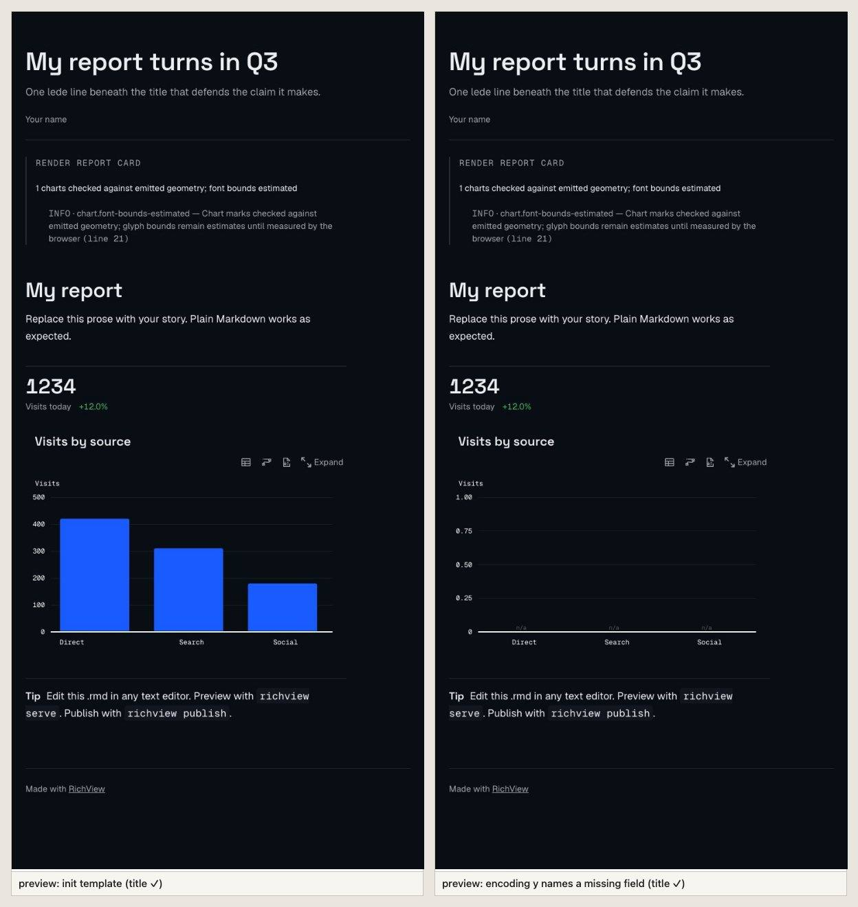
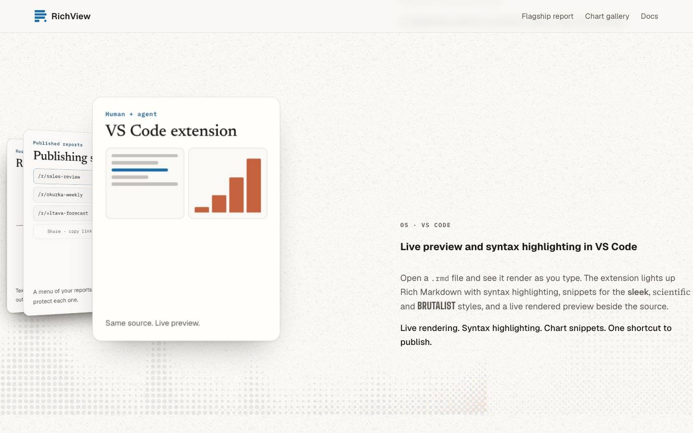

# Editor: VS Code extension and editor service

This page describes RichView's editor integration as it stood on `main` at `b4db233`: the VS Code extension `richview-vscode` (C-VSCODE-EXTENSION, card ARC-45) and the native editor service `richview-editor` it starts (C-RICHVIEW-EDITOR, ARC-44), with the proposals that would carry them into the rewrite. The features are Part 04c's VS Code group (FEA-SF-21 to FEA-SF-27 and FEA-SF-59) plus the publish client in FEA-SF-12, and the protocol is TYP-98 (T-EDITOR-PROTOCOL) in Part 05; none has a recorded answer on 27 October 2026, so every proposal below awaits Daniel in [Part 04c of the lockdown app](http://127.0.0.1:4790/#/part/04c-features-surfaces). Daniel's answers of 26 October bear on the editor through other cards: INT-26 (no browser editor, ever), INT-71 (the extension is listed on the VS Code Marketplace and on Open VSX), INT-25 (the author's own agent does all language work), FEA-SF-30 (one-click and right-click publish) and FEA-BR-08 (tabs are kept).

Related pages: [Native app](app.md) for the CLI, MCP server and report host the extension reuses; [Report core](core.md) for the report the preview shows; [Architecture](../architecture.md#editor) for where the editor sits among the crates; [Performance](../performance.md#memory) for the memory budget; the [guide index](../README.md) for labels, IDs and links.

There is no view of VS Code itself: the extension cannot run headless on the capture host, and no VSIX was built or installed for the lockdown ([screenshot gaps](../../lockdown/screenshots/INDEX.md#gaps)). FEA-SF-21 to FEA-SF-27 and FEA-SF-59 are therefore proposed without seeing the extension; the closest views are the preview HTML the service returns and the home page's description of the extension, both under [How it looks](#how-it-looks). Statements marked re-run were checked on 22 October 2026 by driving the release `richview-editor` of `b4db233` over its JSON-RPC protocol; behaviour inside VS Code comes from the code and the cards, as [Method and sources](#method-and-sources) details.

Terms: the *report card* is the diagnostics block that `richview generate --report-card` appends to a report and that the editor's preview always shows (FEA-RP-31, F-CORE-REPORT-CARD). *Golden inputs* are the examples INT-55 (D-EXAMPLES-CARRY) would carry into the rewrite, each of which must render in every builtin style without error diagnostics in the release run ([Delivery](../delivery.md#the-gate-commands)).

## At a glance

| Question | Today on `main` | Proposed | Cards |
| --- | --- | --- | --- |
| What is it? | A 326-line JavaScript activation module (`extension.cjs`, 16,945 B) that starts the native `richview-editor` (6,443,200 B; 1,350 lines of Rust source and 17 tests) and talks line-delimited JSON-RPC to it | A thin adapter over a Language Server Protocol service with three custom methods: preview, export and publish | ARC-44, ARC-45, TYP-98 |
| How is it installed? | Built locally for the current platform, then packaged with `vsce`; the README and docs cover `linux-x64` only; never published | Listed on the VS Code Marketplace and on Open VSX, one platform package each for macOS arm64 and Linux x64, built from `prod` and published on Daniel's go; a VSIX file also installs with `code --install-extension` | FEA-SF-21, INT-71, INT-41, ARC-67 |
| What does it offer? | Highlighting, live diagnostics, completion, formatting, outline, folding, 13 `rv-*` snippets, four insert commands, a live preview, Validate, Export and Publish | The same aids plus hover, one Insert Block command, one-click and right-click Publish, no Validate | FEA-SF-22 to FEA-SF-27, FEA-SF-59, FEA-SF-12, FEA-SF-30 |
| Is there a browser editor? | A browser playground with a source pane and live preview ([Web](web.md)); no browser report editor | None, ever: no WYSIWYG or full browser editor; the playground stays; on a Cowork or Publish server the browser only approves a pending change and lets the page's author make a quick source edit | INT-26, FEA-SF-33, FEA-SF-34, INT-83 |
| Does it agree with the CLI? | No: the Problems panel shows editor-only errors, the preview tab shows ✓ while an error stands, and Export drops `theme: dark` (re-run) | Diagnostics equal `richview validate`; Export writes the bytes `richview generate` writes | FEA-SF-24, FEA-SF-27, ARC-08 |
| How much memory? | 1,538 MiB after 75 to 100 previews of the dense fixture | ≤ 256 MiB for dense, ≤ 96 MiB for the flagship | PRF-41 |
| How is it tested? | `verify-editor.cts` drives the real service through a VS Code API double and passes (2.1 s); the real VS Code check has never run on Claw Mini | Editor diagnostics and Export compared with the CLI in the release run, per batch on `pre-prod`; VSIX install and the VS Code check in the full run before a candidate and on each candidate | FEA-SF-62, DEL-14, DEL-33, DEL-81 |

## What the editor is for

The extension is where a person watches an agent's edits land and corrects them by hand: the source on the left, the rendered report on the right, diagnostics under the exact key that caused them. The June context of the Linear issue for the VS Code extension records that "Daniel said the VS Code plugin starts with syntax highlighting, then features like 'add chart' and commands around chart code blocks" (stated, Linear), and its October scope added safe formatting and context-aware completion. Daniel's INT-26 (D-NOT-WEB-EDITOR) answer of 26 October rules out a WYSIWYG or full browser editor for good, leaving VS Code, possibly a RichView desktop app later, and plain text editors as the human authoring surfaces, with the author's own agent doing the language work (INT-25, D-NOT-CHAT). The playground on [Web](web.md) is a try-out, not an editor: FEA-SF-33 keeps it at `/playground` with no account, no upload and nothing stored on a server, and FEA-SF-34 gives it a source pane, a sandboxed live preview, diagnostics, the five style pills and Check.

> **INT-26 (D-NOT-WEB-EDITOR), Daniel's answer, 2026-10-26.** RichView has no WYSIWYG or full browser editor, and never will: people should see and touch what is underneath, the Rich Markdown source. Real authoring happens in the author's editor (VS Code with live preview, or possibly a RichView desktop app later) and through their agent, with Git as the history. The browser playground stays: a source pane with live preview for trying the format and styles, with loading, copying and downloading, and no accounts.
>
> On a RichView server (Publish, Cowork), the browser offers only actions where they make sense:
>
> - approving what gets published: open the pending change online and click yes or no;
> - quick source edits by the page's author: when signed in as its author, Edit opens the page's Rich Markdown source in an embedded VS Code-style editor with syntax highlighting, and the server checks that the edited report still validates and renders before it is saved.

ARC-45 would keep the split the code already has: JavaScript only where VS Code demands it, and all behaviour in Rust. The activation module says so in its first line: "VS Code requires a JavaScript activation module. Product behavior lives in richview-editor." ARC-44 would keep one long-lived native process per workspace and move its custom protocol to the Language Server Protocol, which would also let other editors with LSP clients use it.

People get the extension from the two listings Daniel's INT-71 (D-DISTRIBUTION) answer names, next to the agent-led install of the CLI and its MCP server:

> **INT-71 (D-DISTRIBUTION), Daniel's answer, 2026-10-26.** All three paths. The install page leads with one prompt people give their agent, plus a shell script they can run; both install the CLI with its MCP server, and RichView's servers (Cowork and Publish) where wanted. Building from source works once the source is public (INT-38). Builds from `prod` are offered. The VS Code extension is published on the VS Code Marketplace and on Open VSX. Working as agent plugins may come later, not now. This changes INT-41's "no releases" for these listings.

INT-41 (D-RELEASE) now proposes exactly that: builds from `prod` and the two extension listings, no pre-releases. The publisher identity on both listings, how listing versions are numbered and whether other platforms are listed stay open (FEA-SF-21, DEL-41).

## How it works

The extension activates on the language id `rmd` and refuses to run in an untrusted workspace (`"untrustedWorkspaces": {"supported": false}`), because the service resolves report files from disk. It spawns `bin/richview-editor` from the extension folder, or the path in the machine-scoped setting `richview.binary`, and sends one JSON-RPC 2.0 request per line. It discards the service's standard error ("Never surface stderr from a process handling a publish credential"); if the process exits, every pending request fails with "RichView Rust service stopped. Check richview.binary and the installation." (`packages/vscode/extension.cjs:7-75`).

The service answers nine methods: `snippets`, `snippet`, `format`, `outline`, `complete`, `validate`, `preview`, `export` and `publish`. `snippets` and `snippet` need no source; every other method needs the source, at most 16 MiB, and a request may be at most 24 MiB, beyond which the service answers `-32600` and stops. Invalid JSON gets `-32700` and other failures `-32000` with the diagnostics in `data` (re-run). `outline`, `format` and `complete` work on unsaved text without rendering. `validate` renders the document and adds the service's own authoring checks; `preview` renders with the report card and returns a tab title; `export` writes `Rendered/`; `publish` calls the CLI's publish function (`crates/richview-editor/src/main.rs:141-262`).

Diagnostics run when an `.rmd` opens and 250 ms after each change; a response for an older document version is dropped, and a service failure becomes one `editor.service` error. Each diagnostic carries a source range when the service has one, so an unknown data field underlines the encoding key that names it, `y` in `y: visitz`, rather than the whole line (`extension.cjs:123-145`; re-run). Format Document rewrites YAML spacing only where parsing proves the decoded values identical: `encoding:` followed by `    x:    source` became `  x: source` (re-run). Outline and folding share one cached analysis per document version and cap the outline at 10,000 headings and code blocks.

The preview opens beside the editor as a webview with scripts enabled, restricted to the extension's `web` folder. The extension passes the webview address of its packaged runtime as `runtime_url`, so preview HTML links the runtime instead of embedding 2 MB on every keystroke; the service accepts that address only from the trusted host and never from the source (its test `trusted_editor_runtime_is_external_only_for_preview`). Only one preview request is in flight; newer edits replace the queued one, and the replaced request resolves as cancelled. A file watcher on the report's folder refreshes the preview and diagnostics 150 ms after any change there except `Rendered/`, including writes by agents in other processes, and the preview follows whichever `.rmd` editor is active. When a render fails outright, the panel is blanked and titled "RichView Preview ✕" (`extension.cjs:150-200`, `:312-324`).

Export refuses an unsaved document ("Save the report source before export so the portable folder contains the same source and output.") and asks the service to write `Rendered/<stem>.html` with the embedded runtime. The validate, preview, export, complete and publish calls carry `theme` from the setting `richview.previewTheme` (default `auto`); outline, format and the snippet calls do not (`extension.cjs:102`, `:146-149`, `:205`, `:222`, `:283`). The service applies it to preview and export, where it replaces the source's own `theme` (`crates/richview-editor/src/main.rs:184`). Publish reads `richview.server` (default `https://richview.uk`), takes the token for that server from VS Code's SecretStorage or asks for it once in a masked prompt, refuses a source without title or version, and reports "Published: <url>" with Copy URL and Open in browser (`extension.cjs:229-261`). No command clears or replaces a stored token (code reading).

## How it looks



What the preview panel shows, without VS Code around it: the HTML the editor service's `preview` method returned for the `init` template, rendered in headless Chromium at 720 px and shown here at 600 px, assembled for this page. Left, the template as written; right, the same source with `encoding: { x: source, y: visitz }`, a field the data does not have. Both previews put a "Render report card" block under the header that reads "1 charts checked against emitted geometry; font bounds estimated" with only an info line, and the service titled both tabs "RichView Preview ✓" with "RichView: 1 chart(s), 0 error(s), 0 warning(s)". The right chart draws no bars, only `n/a` at each category on a 0 to 1 axis. For the same broken source the service's `validate`, which feeds the Problems panel, returned "RichView: 1 error(s), 0 warning(s)" with `authoring.field`, "Unknown data field 'visitz'; available: source, visits", on the encoding key `y` (re-run, `b4db233` release build, 2026-10-22). Cards: FEA-SF-24 (F-VSCODE-LINT) and ARC-08 (D-ONE-OPERATION-LAYER) would make the panel and the CLI agree by moving every rule into core; FEA-SF-23 (F-VSCODE-PREVIEW) would move diagnostics to a banner outside the report, as FEA-RP-31 (F-CORE-REPORT-CARD) on [Report core](core.md) decides; FEA-CH-60 would make `richview check` warn about an encoding field missing from the data.

The same contradiction in protocol form (re-run):

```text
→ {"method":"preview","params":{"source":"…y: visitz…","path":"…/report.rmd"}}
← {"title":"RichView Preview ✓","severity":"information","message":"RichView: 1 chart(s), 0 error(s), 0 warning(s)", …}

→ {"method":"validate","params":{"source":"…y: visitz…","path":"…/report.rmd"}}
← {"ok":false,"severity":"error","message":"RichView: 1 error(s), 0 warning(s)",
   "diagnostics":[{"code":"chart.font-bounds-estimated","level":"info","line":21,…},
                  {"code":"authoring.field","level":"error","message":"Unknown data field 'visitz'; available: source, visits","path":"chart.encoding.y","range":{"start":{"line":31,"character":23},"end":{"line":31,"character":24}}}]}

→ {"method":"export","params":{"source":"…theme: dark…","theme":"auto",…}}
← {"path":"…/Rendered/report.html"}          # file starts <html lang="en">
$ richview generate report.rmd                # file starts <html lang="en" data-theme="dark">
```

The `authoring.field` range is zero-based: line 31 is the template's `encoding: { x: source, y: visitz }` line, and characters 23 to 24 cover the key `y`.



How the public site presents the extension: element 05 of the richview.ai home page, "Live preview and syntax highlighting in VS Code", promising "snippets for the sleek, scientific and brutalist styles" and "One shortcut to publish". Snippets exist per block type, not per style, and Publish is a command-palette entry with no key binding. Source: https://richview.ai/ (PR #69 content), 1440×900, 2026-10-21. Card: FEA-SF-30 (F-SITE-HOMEPAGE), answered by Daniel on 26 October: no hotfix to the live page, which was never advertised and changes when the rewrite reaches `prod` (OPN-43); snippets per style are not important, so that line is worded to match what ships; "One shortcut to publish" becomes one-click publish, including right-click publish in the editor (INT-83).

## Features

The first column is the card, with the entity it defines or decides and, unless the card is observed, its confidence: *inferred*, the proposer's reading of several sources. "Today" is `main` at `b4db233`; "Proposed" condenses the card. Evidence entities with no card of their own are mapped under [Method and sources](#evidence-entities-without-their-own-card).

| Card | Today on `main` | Proposed |
| --- | --- | --- |
| FEA-SF-21 (D-VSCODE) | Package `richview-vscode` 3.0.0-alpha.1, publisher `richview`, VS Code ^1.90.0; `cargo run --release --locked -p richview-build` stages the current platform's binary, then `vsce package`; docs install `richview-vscode-linux-x64-3.0.0-alpha.1.vsix`; no `darwin-arm64` package was ever built; trusted workspaces only; `richview.binary` machine-scoped | Listed on the VS Code Marketplace and on Open VSX (INT-71, Daniel's answer), one platform package each for macOS arm64 (ARC-67; built on the gate host) and Linux x64 (built on the Linux host of the prod-candidate check, DEL-22, DEL-33), each with its own binary; a VSIX file also installs with `code --install-extension`; builds from `prod`, published on Daniel's go (DEL-41); trusted workspaces only. Open: the publisher identity, how listing versions are numbered and whether other platforms are listed |
| FEA-SF-22 (F-VSCODE-LANGUAGE), inferred | Language id `rmd`, aliases "Rich Markdown" and `rmd`, for `.rmd`; the R extension's syntax package registers the same id for `.Rmd` and `.rmd` | Language id `richview` with the alias "Rich Markdown"; the file extension stays `.rmd` (INT-05); the docs show the `files.associations` line that settles a clash |
| FEA-SF-59 (F-VSCODE-GRAMMAR) | A hand-written TextMate grammar (`text.rmd`): frontmatter and rich fences as YAML, the rest as Markdown; it knows six tags while core parses nine, so `metric`, `audio` and `video` fences highlight as plain code (re-run) | The same grammar with its tag list generated from core's block tags (ARC-09); language configuration kept |
| FEA-SF-23 (F-VSCODE-PREVIEW) | "RichView: Open Live Preview" beside the editor; renders unsaved text; refreshes on edits and folder changes except `Rendered/`; follows the active `.rmd`; ✓, ▲ or ✕ in the title; the report card inside the report; a failed render blanks the panel; `richview.previewTheme` (auto, light, dark) overrides the source | The same, with diagnostics in a banner outside the report's HTML as in `richview serve`; a failed render keeps the last good render under the banner; renders cancellable and coalesced; `richview.previewTheme` goes with `theme` (FEA-RP-33) |
| FEA-SF-24 (F-VSCODE-LINT) | On open and 250 ms after each edit; ranges on keys, values, fields and file references; the editor adds `authoring.key`, `authoring.field` and `resource.resolve`, which `richview validate` does not report (re-run) | Exactly what `richview validate` returns for that source, with precise ranges; render and chart diagnostics move to the preview banner and `richview check`; a stopped service shows one `editor.service` error naming `richview.binary`. Holds only if ARC-08 moves the editor's checks into core, where TYP-55, inferred, renames them `block.unknown-key`, `block.field`, `report.asset.missing` and `data.unresolved` |
| FEA-SF-25 (F-VSCODE-PROVIDERS) | Completion (keys, chart types, enumerated values, data fields from inline or local CSV and JSON), Format Document, outline with breadcrumbs, folding; no hover | All four kept, plus hover over a key, chart type or enumerated value showing its one-line description and allowed values from the generated vocabulary; all five work on unfinished source and never render |
| FEA-SF-26 (F-VSCODE-INSERT-BLOCKS) | 13 `rv-*` snippets in `snippets/rmd.json` (nine chart types, table, big number, callout, frontmatter), generated by the build; four commands: Insert Chart Block (a quick pick of nine types), Table, Big-Number and Callout; no snippet for `image`, `audio`, `video`, `embed` or `metric` | One "RichView: Insert Block" quick pick and the `rv-*` snippets, both generated from the block schemas, one per block and chart type, each rendering clean in every builtin style, checked in the release run (DEL-60, DEL-81); no per-style snippets (FEA-SF-30: not important) |
| FEA-SF-27 (F-VSCODE-EXPORT-VALIDATE) | "Export to Rendered" refuses unsaved sources and writes `Rendered/<stem>.html`, but sends `previewTheme`, so `theme: dark` exports without `data-theme="dark"` (re-run); shows "Exported: <path>". "Validate" repeats live diagnostics with a pop-up summary | Export writes exactly what `richview generate` writes from the saved file, then shows the path with a Reveal action; Validate is dropped; commands appear only for `.rmd` files |
| FEA-SF-12 (F-APP-CLI-PUBLISH), VS Code column | `richview.server` defaults to `https://richview.uk`; token per server in SecretStorage, asked for once; title and version required; Copy URL and Open in browser | Server is a workspace setting asked for once, with no default; token in secret storage per server; the same result as the CLI with Copy link and Open; a dialog naming slug and server before creating another address for a previously published file (FEA-SF-51); publishing is one click: a Publish button on an open `.rmd` and a right-click Publish command in the editor and the explorer, each sending the CLI's request (FEA-SF-30, answered 26 October) |
| ARC-44 (C-RICHVIEW-EDITOR) | Custom line-delimited JSON-RPC; full source on every request; links the whole `richview-app` crate, HTTP server and S3 client included | LSP framing with incremental sync, plus `richview/preview`, `richview/export` and `richview/publish`; depends on core and host services only; validation from core only |
| ARC-45 (C-VSCODE-EXTENSION) | `extension.cjs`, 16,945 B, while `docs/RUST-ARCHITECTURE.md:49` calls it about 8 KiB | Language-client wiring for ARC-44, settings and secret storage only; no default publish server; one package per platform, listed on the VS Code Marketplace and on Open VSX (INT-71) |
| TYP-98 (T-EDITOR-PROTOCOL), inferred | Nine methods; a method name the service does not know, sent without a source, is answered "Missing report source" rather than "Unknown editor method" (re-run) | The method set and payloads in [Format and types](../format-and-types.md#agent-facing-contracts) |
| PRF-41 (P-EDITOR-MEMORY) | Physical footprint after 100 previews in one process: small 4.8 to 5.3 MiB, flagship 153 MiB, dense 1,538 MiB, mostly freed memory the allocator keeps | ≤ 32 MiB small, ≤ 96 MiB flagship, ≤ 256 MiB dense, at most 10 % growth between the 50th and 100th preview |
| PRF-39 (P-INSTALL-SIZE) | Package folder about 12.5 MB before packaging: the binary, 5,998,909 B of web runtime, font licences and the activation module; no VSIX built | Each platform VSIX ≤ 8 MiB; the editor binary ≤ 4 MiB after gzip -9 (3,195,699 B today); growth beyond 64 KiB in one release batch follows PRF-05 |

## Checks that cover it

| Check | What it covers | Result | Gap |
| --- | --- | --- | --- |
| Editor crate Rust tests | 17 tests (re-run count) in `crates/richview-editor/src/main.rs` and `tests/` (authoring, navigation, source ranges): chart snippets render, preview writes nothing, the trusted runtime address, diagnostics ranges | Pass in the 2026-10-21 workspace run | No test compares the editor with the CLI |
| `scripts/verify-editor.cts` | A test-only VS Code API double driving the real packaged service: preview, refresh, diagnostics, formatting, completion, rapid edits, saved data changes, watcher disposal | Pass, 2.1 s (2026-10-21); in `ci.yml` | Not VS Code itself |
| `scripts/verify-vscode.sh` | Installs the VSIX into a private VS Code profile under an offscreen Linux runner: editing, external changes, preview styling, offline export | Never run on Claw Mini: no isolated X11 session, and it must not touch the live desktop | No proof that the extension works in VS Code on `b4db233` |
| `scripts/verify-packaging.py` | A locally packaged VSIX | Not run: the build has no VSIX packaging step | No VSIX size or content check |
| Hosted CI | Runs `verify-editor.cts` | No job has started since 2026-10-13 (billing) | Nothing gated the last merges |

Results come from the checks and performance evidence (`checks-performance.md` in docs/lockdown/evidence); the test count was re-run. Proposed in FEA-SF-62, inferred: an editor host check in the release run that compares the editor's diagnostics with `richview validate` and its Export with `richview generate` on the golden inputs (DEL-14), and, in the full run on `pre-prod` before a candidate and on each frozen candidate, packaging and the VS Code extension check on DEL-22's Linux host, including the last-good-render preview and one-click and right-click publish (DEL-24, DEL-33). Under Daniel's DEL-81 answer the `dev` fast gate runs unit tests only, so the editor crate's tests run there when a change can affect them, and the host checks wait for the release run. PRF-41's memory budget is measured in the full capture ([Performance](../performance.md#memory)).

## Known defects

OPN-22 (D-LEGACY-DEFECTS) proposes that each defect below becomes a rewrite fixture, a regression test the rewrite must pass, decided in the card named, and that none is patched in legacy code. In the Seen column, *re-run* means checked for this page against the service; *code reading* means read in the code at `b4db233` but not run; *card* is a statement in the card, here from comparing manifests; *card probe* is a measurement the card reports, not repeated here; *live capture* is a lockdown screenshot of richview.ai.

| Defect on `main` | Seen | Decided in |
| --- | --- | --- |
| The preview tab shows ✓ and a clean report card while the Problems panel lists an `authoring.field` error; the chart draws nothing | Re-run | FEA-SF-24, ARC-08, FEA-CH-60 |
| Export ignores the source's `theme: dark` because `previewTheme` overrides it | Re-run | FEA-SF-27, FEA-RP-33 |
| A failed render blanks the preview instead of keeping the last good one | Code reading (`extension.cjs:157-169`) | FEA-SF-23 |
| The grammar highlights six of core's nine fence tags | Re-run | FEA-SF-59 |
| Language id `rmd` collides with the R extension's id | Card (manifest comparison) | FEA-SF-22 |
| No snippet or insert command for `metric`, `image`, `audio`, `video` or `embed` | Re-run | FEA-SF-26 |
| The Publish default is `https://richview.uk`, a v2 page | Re-run | FEA-SF-12; OPN-04 (answered: richview.uk redirects to richview.ai, the frozen legacy extension keeps its default, the rewrite has none) |
| No command replaces a stored token, so a wrong or revoked token fails every publish to that server | Code reading (`extension.cjs:246-261`) | No card yet; it would belong in FEA-SF-12's VS Code column |
| Only `linux-x64` is documented; no macOS package was ever built | Card | FEA-SF-21 |
| The home page promises style snippets and "One shortcut to publish" | Live capture | FEA-SF-30 (answered: no hotfix; one-click and right-click publish get built; the snippet line is worded to match what ships) |
| Dense previews grow the service to 1,538 MiB | Card probe | PRF-41 |
| `package.json` names the pre-transfer repository `richview-universe/richview-v3` | Re-run | OPN-27 (D-REPO-URLS): legacy files keep their URLs, and every `repository` field in the rewrite names `1vecera/richview` |

## Branch-only additions

None of this is on `main`.

| PR | Editor work on the branch | State observed | Decided in |
| --- | --- | --- | --- |
| #63 multi-tab reports (`feat/multi-tab-reports` at `f1cb254`) | Tabs in the report format and runtime; its Linear request asked for them in "the authored report format, parser/schema, renderer and relevant browser/editor surfaces" | The PR changed no editor or playground code, nobody checked its tabs in either preview, and its tab warnings point at `frontmatter.tabs` rather than a line; marked work in progress | FEA-BR-08 (answered: keep tabs); OPN-07 (closes #63 unmerged and folds its design into the rewrite's cards); FEA-BR-38 (F-EDITOR-TABS); FEA-BR-08 to FEA-BR-10 |

> **FEA-BR-38 (F-EDITOR-TABS), proposed, inferred.** The VS Code preview and the playground render tabs with the report runtime, so switching, deep links and print behave as in the report, and a re-render keeps the active tab. The schema gives `tabs` completion and hover, and every tab diagnostic carries the line of the offending panel entry or heading.

Daniel kept tabs in his FEA-BR-08 (F-REPORT-TABS) answer of 26 October, so the condition this card used to carry is met; the card itself is still open.

## Method and sources

Re-run on 22 October 2026 in the lockdown worktree: the release `richview-editor` of `b4db233` driven over stdin with `snippets` (12 items, the 13 entries of `snippets/rmd.json` without Frontmatter, or 9 when called with `{"group": "chart"}`; the items carry no group field), `snippet`, `outline`, `format` on deliberately mis-indented YAML, `validate` with a valid source, with `y: visitz` and without a path (`report.root.missing`), `preview` with both sources, `complete`, `publish` to an unreachable loopback port and without title or version, an unknown method and a line of invalid JSON; `export` of a `theme: dark` source with `theme: auto`, compared with `richview generate` on the same folder; the two preview HTML responses rendered in headless Chromium at 720 px; and the code at `packages/vscode/package.json`, `extension.cjs`, `README.md`, `syntaxes/rmd.tmLanguage.json`, `snippets/rmd.json`, `crates/richview-editor/src/main.rs` and `lib.rs`, and `crates/richview-core/src/parser.rs:8-10`. The preview composite was made for this page from those renders.

Not re-run: anything inside VS Code (activation, webview behaviour, SecretStorage, the watcher), packaging, memory and the editor's test run, which come from the cards and the checks and performance evidence in docs/lockdown/evidence; the June and October scope quotes come from the Linear issue for the VS Code extension as cited by the cards. A view of the extension would need the VS Code check's isolated Linux session, which DEL-22, inferred, places in Lenovo's offscreen Linux environment at the candidate tier, with its receipt joining the candidate's; none was captured for this page.

Repository files at `b4db233` (private repository; the links need access): [extension manifest](https://github.com/1vecera/richview/blob/b4db233/packages/vscode/package.json), [activation module](https://github.com/1vecera/richview/blob/b4db233/packages/vscode/extension.cjs), [extension README](https://github.com/1vecera/richview/blob/b4db233/packages/vscode/README.md), [grammar](https://github.com/1vecera/richview/blob/b4db233/packages/vscode/syntaxes/rmd.tmLanguage.json), [editor service](https://github.com/1vecera/richview/blob/b4db233/crates/richview-editor/src/main.rs), [authoring checks](https://github.com/1vecera/richview/blob/b4db233/crates/richview-editor/src/authoring.rs). Cards: Part 04c (04c-features-surfaces.json in the worktree's docs/lockdown/parts), with ARC-44 and ARC-45 in Part 03, TYP-98 in Part 05, PRF-39 and PRF-41 in Part 07 and FEA-BR-38 in Part 04d; INT-25, INT-26, INT-41 and INT-71 are in Part 01, and DEL-14, DEL-22, DEL-24, DEL-33, DEL-60 and DEL-81 in Part 02. The cards are as they stood on 27 October 2026, after Daniel's answers of 26 and 27 October.

### Evidence entities without their own card

| Entity in the product evidence | Where it is decided |
| --- | --- |
| F-EDITOR-RPC | ARC-44 (C-RICHVIEW-EDITOR), TYP-98 (T-EDITOR-PROTOCOL) |
| F-EDITOR-PREVIEW | FEA-SF-23 (F-VSCODE-PREVIEW) |
| F-EDITOR-DIAGNOSTICS | FEA-SF-24 (F-VSCODE-LINT), ARC-08 |
| F-EDITOR-COMPLETION, F-EDITOR-FORMAT, F-EDITOR-OUTLINE | FEA-SF-25 (F-VSCODE-PROVIDERS) |
| F-EDITOR-SNIPPETS | FEA-SF-26 (F-VSCODE-INSERT-BLOCKS) |
| F-EDITOR-EXPORT-PUBLISH | FEA-SF-27 (F-VSCODE-EXPORT-VALIDATE), FEA-SF-12 |
| F-VSCODE-BINARY-TRUST | FEA-SF-21 (D-VSCODE) |
| F-VSCODE-PUBLISH | FEA-SF-12 (F-APP-CLI-PUBLISH), FEA-SF-51 |
