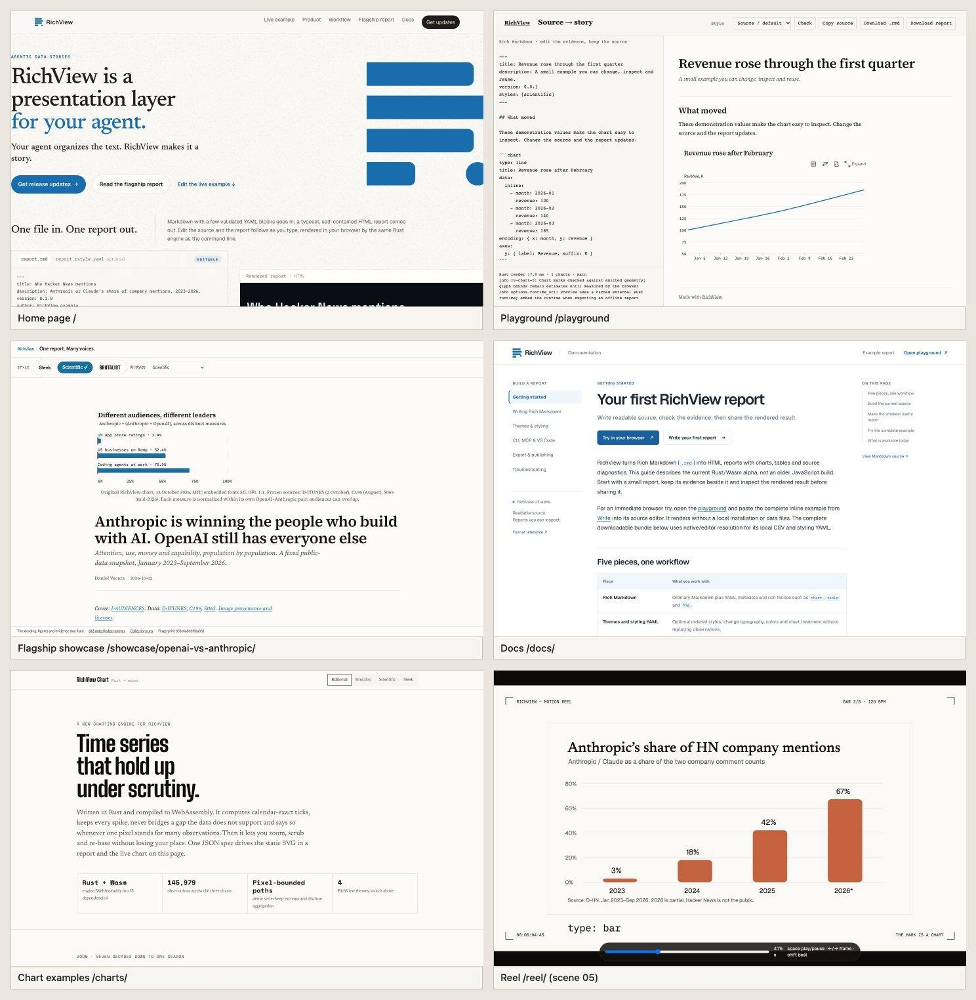
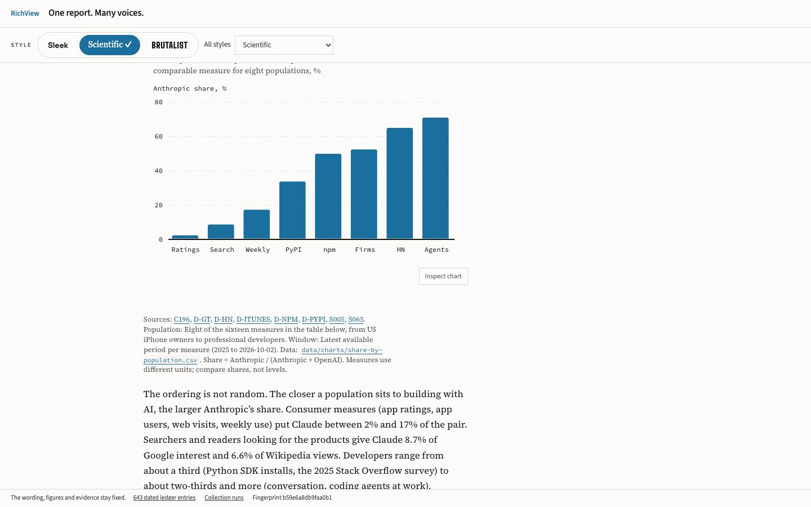
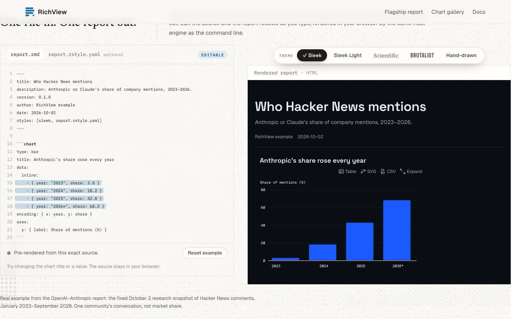
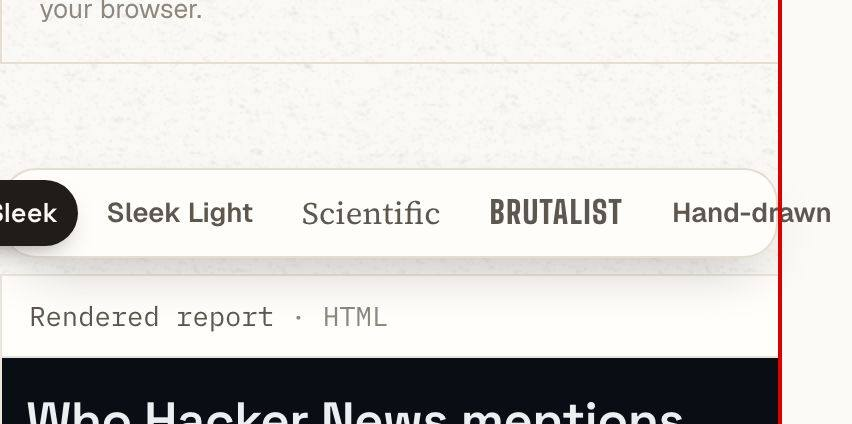
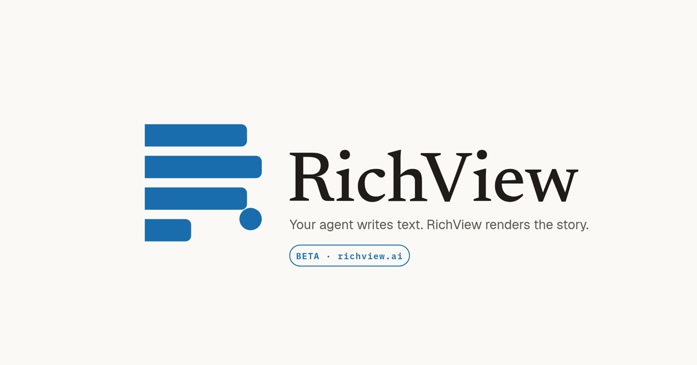
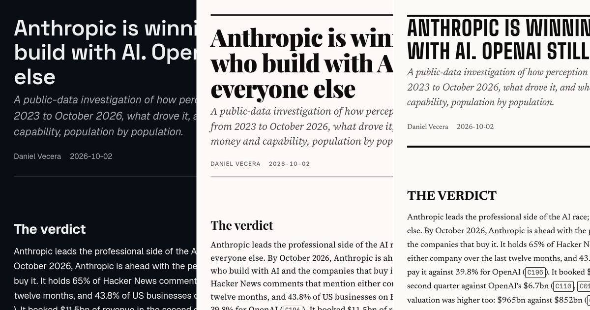
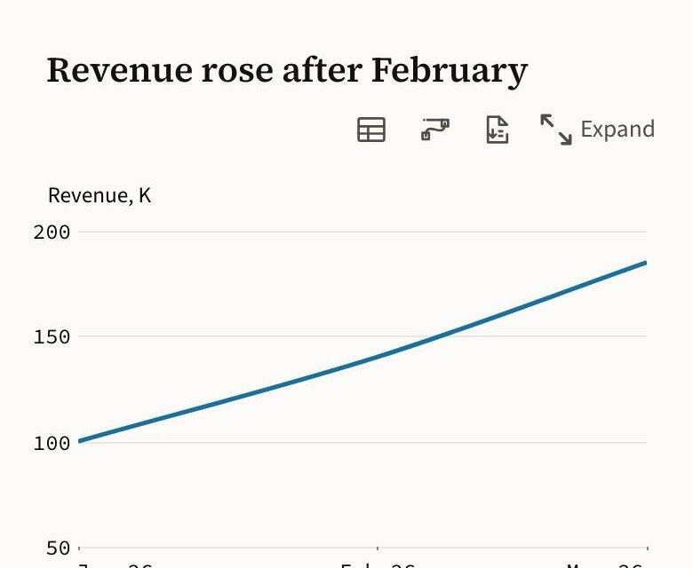
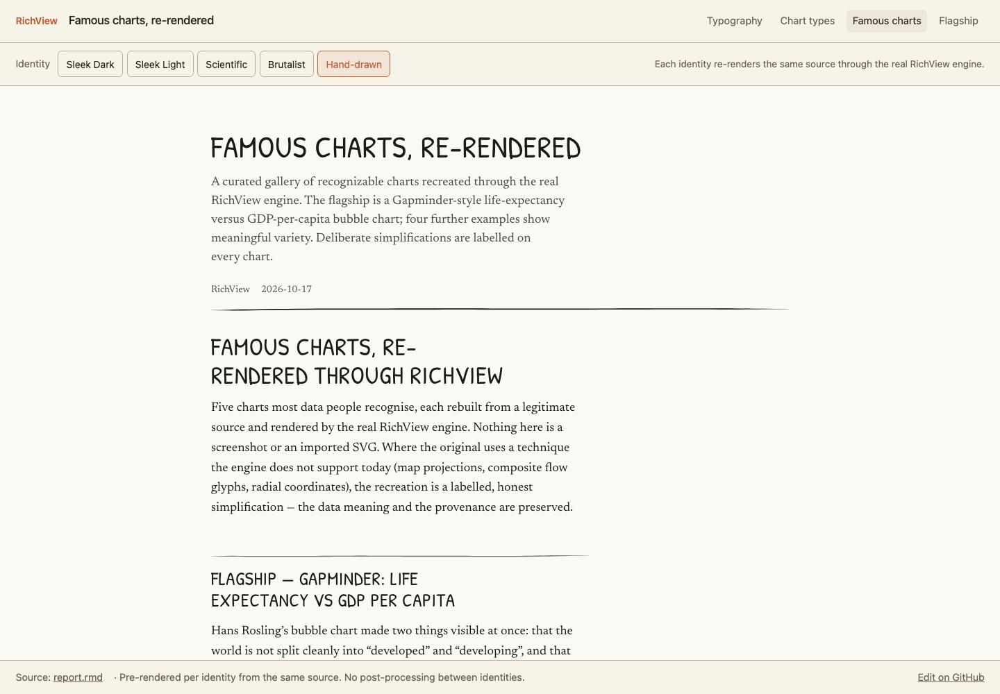

# Web: site, playground, showcase, docs, charts page and reel

This page describes RichView's website and the browser code behind it, as they stood on `main` at `b4db233` and on richview.ai: the home page, playground, flagship showcase, docs, `/charts/`, reel and legal pages, and the browser host that runs them (C-RICHVIEW-WEB, card ARC-35). Each page's component and card are in the [page table](#what-the-site-is-for); the feature cards are Part 04c's site groups (FEA-SF-28 to FEA-SF-46 and FEA-SF-55 to FEA-SF-63), which had no recorded answer on 22 October 2026. By 27 October Daniel had answered FEA-SF-30 (the home page's claims), STY-05 (five styles), INT-02 (the tagline), OPN-43 (no hotfix) and the Part 01 and Part 08 cards that set the site's scope, and the open cards were rewritten to follow those answers. A quote headed Daniel's answer, or a cell that begins Decided, states an answer; every other proposal below still awaits Daniel in [Part 04c of the lockdown app](http://127.0.0.1:4790/#/part/04c-features-surfaces).

Related pages: [Chart engine](chart.md) for the chart controls inside every report (C-WEB-CHART-HOST, ARC-37); [Report core](core.md) for what a report page itself does; [Cloud and hosts](cloud.md#richviewai-site-worker) for the Worker that serves the site and stores signups; [Build](build.md#site-staging) for how the site is staged; [Styles](../styles.md) for styles and motion; [Screenshots](../screenshots.md#landing-page) for the visual tour; the [guide index](../README.md) for labels, IDs and links.

Two sites matter here. `main` at `b4db233` is what the local build stages into `dist/web` (81 MB in 354 files). richview.ai serves a different build: the unmerged PR #69 branch at `7b23a22`, deployed on 2026-10-19, which OPN-01 (D-PROD-BASELINE, accepted by Daniel on 26 October) makes the production baseline: that Worker version stays the rollback target, and `main` is made equal to it by merging #69 (OPN-13, accepted) with no legacy hotfix (OPN-02, FEA-SF-30). Daniel's DEL-06 and DEL-40 answers add a third copy by design: `dev` deploys to a hidden preview of richview.ai, the workers.dev address, which has been behind a Cloudflare Access sign-in since 27 October (ARC-22) and is redeployed only when the website's code changes. Website changes merge into `dev` through the gates without a grant, and nothing is public before `prod`. Statements marked re-run were checked on 22 October 2026 with read-only requests to richview.ai and to a loopback `richview server` serving the `b4db233` build; everything else comes from the card, evidence or capture named beside it, as [Method and sources](#method-and-sources) details.

Terms: a *treatment* is one of the 23 looks the flagship showcase offers in `assets/showcase/themes.json`, the builtin sleek, scientific and brutalist plus 20 studio variants from the June design system, which Daniel's STY-05 answer keeps as extended themes. The *legacy hotfix* was a proposed single commit on `main` that would have fixed the live page before the rewrite; Daniel's FEA-SF-30 answer rules it out (OPN-43, OPN-02): the live page changes only when the rewrite reaches `prod`, and each defect it would have fixed becomes a fixture for the rewrite's site checks.

## At a glance

| Question | Today | Proposed | Cards |
| --- | --- | --- | --- |
| What is it? | A static site of home, playground (also at `/app`), flagship showcase with 23 treatments, six docs guides with a tutorial folder, `/charts/`, `/reel/`, two legal pages and two unlinked chart-review pages, plus mirrors of `assets/`, the runtime's type declarations and generated npm bindings | Home, flagship, docs with a chart gallery, playground and legal pages, served from a committed route map; everything else 404 | FEA-SF-46, ARC-24 |
| Which build is live? | richview.ai serves PR #69 (three-link header, restored scroll motion, `/docs/charts`); `main` has six header links, a dormant motion stage and no gallery | Production is the Worker version richview.ai serves (OPN-01); `main` is made equal to it by merging #69 and takes no hotfix (OPN-13, FEA-SF-30); richview.ai deploys only from `prod`, on Daniel's go, and `dev` deploys to the hidden preview (ARC-22, DEL-40, DEL-06) | OPN-01, OPN-13, OPN-02, ARC-22, DEL-40, DEL-06 |
| What runs in the browser? | One Wasm module for every page: 4,366,342 B raw, 1,512,537 B gzip; a site page loads 1,845,971 B after gzip -9 with the font catalog | A site runtime separate from the report runtime; the site payload ≤ 1.875 MiB after gzip -9 (93.9 % used today) | ARC-06, ARC-36, PRF-30 |
| Does the site tell the truth? | The home page promises a report menu with access control, style snippets, a keyboard shortcut and a release; the share image and the reel say "BETA"; the docs say "RichView v3 alpha" and list six chart types | Decided (FEA-SF-30): the home page promises what the product will do and changes only when the rewrite reaches `prod`, with no hotfix. The report menu is built, publish becomes one click, the open-source line is "RichView is open source and MIT licensed." and style names come from core. The only status word before launch is "Coming soon" (INT-42); counts and names are generated from the code (DEL-18) | FEA-SF-30, INT-42, INT-65, DEL-18 |
| Is it hardened? | `nosniff` and a referrer policy; no Content Security Policy; `Access-Control-Allow-Origin: *` on the runtime files; `robots.txt` is Cloudflare's comment block with no directive (re-run) | A CSP on site pages, ARC-15's policy on reports the site serves, the CORS header only on the runtime files previews load, and RichView's own `robots.txt` | FEA-SF-60, FEA-SF-61 |
| What does a shared link show? | The home page declares `/landing/og.png`, which shows the retired tagline and "BETA · richview.ai"; the flagship declares a collage of its title and verdict; docs, playground and legal pages declare nothing | The home image carries INT-02's two lines and "Coming soon · richview.ai"; the flagship's shows RichView rendering the report in its styles with no finding; every story at an address on a RichView server unfurls with a designed thumbnail of the story in its own style, rendered by the server core, and a private story reveals nothing to an anonymous request ([Readers and link previews](#readers-and-link-previews)) | FEA-SF-55, ARC-69, FEA-RP-51, INT-07, INT-02 |
| How is it tested? | Playwright suites for the playground, home, signup, showcase, flagship, reel and docs pass in Chromium; hosted CI has not run a step since 2026-10-13 | A site gate in the release run on `pre-prod` (DEL-81): every route and a sample of removed ones, page width equal to viewport width and non-zero gutters at 320, 390 and 1440 px, gallery interactions, no policy violations; the deployment owner checks live routes after each deploy | DEL-59, DEL-40, FEA-SF-62, DEL-81 |

## What the site is for

INT-44 (D-WEBSITE-ROLE), stated, makes richview.ai the proof of how beautiful and trustworthy RichView output is, and the way in: its first duty is immediate comprehension, a source beside its rendered story on one screen, and it offers the flagship, the docs with the chart gallery and an update signup (INT-72), claiming nothing the product cannot show. Daniel's answers set the launch and the try path: INT-43 makes launch happen when he says so, with everything live at once; INT-71 gives the install page one prompt for people's agents plus a shell script, builds from `prod` and the extension on the VS Code Marketplace and Open VSX; INT-38 keeps the docs and the site always public and the source private until his word. The site renders with the same Rust engine as the command line, compiled to WebAssembly, so the demo and the playground show what `richview generate` would write. Positioning and claims are decided in Part 01 ([What RichView is for](../purpose.md)); this page covers the pages that carry them.

> **INT-43 (D-LAUNCH), Daniel's answer, 2026-10-26.** Launch is simple: it happens when Daniel says so, and everything goes live at once. That covers:
> - richview.ai drops "Coming soon";
> - the try path (the playground, INT-71's install prompt and script, builds from `prod`, the extension on the VS Code Marketplace and Open VSX, and the source build);
> - the flagship and the docs;
> - the public source (INT-38).
>
> No date is set, and nothing else gates it. Agents keep everything ready so his one word makes it all live. The first posts still go out only after Daniel has reviewed them.

> **INT-71 (D-DISTRIBUTION), Daniel's answer, 2026-10-26.** All three paths. The install page leads with one prompt people give their agent, plus a shell script they can run; both install the CLI with its MCP server, and RichView's servers (Cowork and Publish) where wanted. Building from source works once the source is public (INT-38). Builds from `prod` are offered. The VS Code extension is published on the VS Code Marketplace and on Open VSX. Working as agent plugins may come later, not now. This changes INT-41's "no releases" for these listings.

> **INT-38 (D-SOURCE-VISIBILITY), Daniel's answer, 2026-10-26.** The docs and the website are always public. The source repository stays private until launch: when Daniel decides the work is done, he tells an agent to publish it all, and the source goes public then, as its own explicit step. Before it, the full history is checked for secrets and private data, knowing that the history up to 2026-06-10 was public and may already have been copied, and bundled fonts and assets are checked against their licences (INT-37).

| Page | Source at `b4db233` | Browser controller | Proposed |
| --- | --- | --- | --- |
| Home `/` | `assets/landing/index.html` (388 lines), `homepage.css`, report folder `assets/landing/anchor/`, which the hero, the five styles and the live example share | `crates/richview-site/src/browser/homepage.rs` (695 lines) and `landing.rs` (2,710 lines, motion) | ARC-39 (C-WEB-LANDING): keep, change; built from `prod` only; `prod` serves it static and complete until Daniel accepts the scroll motion with FEA-BR-21's evidence (STY-44) |
| Playground `/playground` | `assets/playground.html` (44 lines), written four times by the build | `crates/richview-site/src/browser/authoring.rs` (1,316 lines) and `crates/richview-site/src/source_buffer.rs` (657 lines) | ARC-38 (C-WEB-PLAYGROUND): keep, change |
| Flagship `/showcase/openai-vs-anthropic/` | `assets/showcase/` and `examples/openai-vs-anthropic/` | `browser/showcase.rs` (1,864 lines) | ARC-41 (C-WEB-SHOWCASE): keep, change |
| Docs `/docs/` | `docs/public/*.md`, `assets/docs/docs.css`, `examples/first-report/` | none; pages rendered at build time by `crates/richview-build/src/documentation.rs` | ARC-43 (C-DOCS-SITE): keep, change |
| `/charts/` | `assets/_redirects` | none; a 301 to `/docs/charts` | ARC-40 (C-WEB-CHART-EXAMPLES): dropped in S27-720 |
| `/reel/` | `assets/reel/` | `src/reel.rs` (1,067 lines), `reel_audio.rs`, `browser/reel.rs`, `bin/richview-reel.rs` | ARC-42 (C-WEB-REEL): drop from the product |
| `/impressum`, `/privacy` | `assets/impressum.html`, `assets/privacy.html` | none | FEA-SF-32: keep |

## How it works

`richview-build` stages the site into `dist/web`; [Build](build.md#site-staging) lists what it copies and renders, including the home page written twice and the playground four times. The home page, playground, flagship, `/charts/` and the reel load `richview_site.js` and `bootstrap.js`, which start the one Wasm module; the playground also starts `worker.js`, which loads the module and the font catalog to render off the main thread. The docs and legal pages on `main` load no script (re-run on the staged files). Rust page controllers find their page by an anchor element and wire the DOM: the home page by `body[data-richview-page="landing"]`, the playground by its source and preview elements, the flagship by `#report-frame` and the reel by `#reel` (`crates/richview-site/src/browser.rs:428-457`, `authoring.rs:326-327`, `:503-505`, `browser/reel.rs:59`); `/charts/` has no controller of its own. ARC-03 (D-JS-BOUNDARY), stated, would allow no product logic in handwritten JavaScript.

The home page shows a prerendered report of the demo source beside the editable source. Typing re-renders in the browser 140 ms after the last keystroke (`crates/richview-site/src/browser/homepage.rs:30`), a failed render is veiled rather than replaced, and Reset restores the example. On `main` the style buttons and the source highlighting never appear: CSS hides them until an `html.js` class is set, only the motion controller sets it, and that controller returns early because the page lacks its `#rv-field` and `#rv-stage` anchors (`crates/richview-site/src/browser/landing.rs:2505-2507`). PR #69 restored the anchors, so richview.ai shows them, together with a scroll-driven logo field Daniel has not accepted on phones (S27-653: "mobile scroll animations look jumpy/weird with visible ticking", stated). The signup form at the end posts to `POST /api/interest`, which only the Cloudflare Worker implements ([Cloud and hosts](cloud.md#signup)); the local server answers it with an error state, as the Worker's README intends.

The playground keeps the whole source in a Rust `SourceBuffer`, editing sources over 128 KiB or 512 lines in bounded windows, renders in the worker after each edit, and shows the report in an `<iframe sandbox="allow-scripts">`, an opaque origin (ARC-14). The toolbar has a style select ("Source / default" plus the five builtins), Check, Copy source, Download .rmd and Download report. `?src=<url>` loads a source and its `report-folder.json` from any URL the browser may fetch; no page links it, and an `#example` handler looks for an element that no longer exists (`crates/richview-site/src/browser/authoring.rs:448-472`). On a phone the preview is a fixed pane of 80 % of the screen height (`assets/playground.html`).

The flagship page renders the report once and restyles it in the browser: each treatment's rules from `assets/showcase/themes.css` and tokens from `themes.json` are applied inside the report frame (`crates/richview-site/src/browser/showcase.rs:564-589`). The style rail offers three pills (Sleek, Scientific, Brutalist) and an "All styles" select over the 23 treatments; the page opens in Scientific. Source references open citation cards from the report's ledger, each chart gets an "Inspect chart" button that opens a second chart modal, and the footer shows "The wording, figures and evidence stay fixed." beside a fingerprint the browser computes over `report.rmd` alone. Seven header controls were removed on 2026-10-13, and FEA-SF-37 deleted the tour, embed mode, the chart-style select and the style drawer with their keys and URL parameters. Compare stays in the code with no key and returns with a visible control (FEA-SF-36/37).

The docs are RichView reports: `documentation.rs` renders each of the six `docs/public/*.md` guides with core, then wraps the result with a top bar, sidebar, table of contents and pager by string replacement and highlights code with `syntect`. A guide fails the build only on an `error` diagnostic. The tutorial folder `examples/first-report` (`report.rmd`, `report.rstyle.yaml`, `data/orders.csv`) is copied to `/docs/example/` and rendered five times: `report.html` with the tutorial's own `styles: [scientific, report.rstyle.yaml]`, then once each with scientific, sleek, brutalist and hand-drawn layered after those; there is no sleek-light render (`crates/richview-build/src/documentation.rs:128-157`).

`/charts/` is the chart engine's own page: three large time series driven by the engine's JSON spec, with theme buttons, Download SVG and an "Edit this chart" JSON editor. `/reel/` plays a 15-second motion piece rendered by Rust in the browser, in ten scenes, from no link anywhere; a capture harness records it as MP4.

## How it looks

The site pages of `main`, each the first 1440×900 screen of the local `b4db233` build, assembled for this page at half size from captures of 2026-10-21. Home: copy starting at the window edge, the six-link header and the two-file demo below, its style buttons hidden. Playground: "Source → story" with the source, its scientific render and the diagnostics pane; three monthly points drawn on weekly ticks. Flagship: the Scientific pill, the "All styles" select and the report's opening chart; the footer carries the fingerprint and "643 dated ledger entries". Docs: "Your first RichView report" with the sidebar's "RichView v3 alpha" label and "Five pieces, one workflow". `/charts/`: "Time series that hold up under scrutiny." with the Editorial, Brutalist, Scientific and Sleek buttons. Reel: scene 05 at 4.75 s with the bars still growing (labels 42 % and 67 % where the data give 42.8 % and 68.2 %). Sources: `product/landing/landing-desktop-viewport.jpg`, `product/playground/playground-desktop-default.jpg`, `product/showcase/showcase-scientific-desktop-viewport.jpg`, `product/docs/docs-index-desktop-full.jpg` (cropped to its top), `product/charts/charts-desktop-viewport.jpg` and `product/reel/reel-desktop-05-chart.jpg` in the lockdown screenshots. Cards: ARC-39, ARC-38, FEA-SF-36, FEA-SF-41, FEA-SF-44 and FEA-SF-45.

The flagship in Scientific on `main`: the pill row with the "All styles" select, a bar chart with the showcase's own "Inspect chart" button under it, the source line with ledger links (C196, D-GT, D-HN …) and the footer with "643 dated ledger entries", "Collection runs" and "Fingerprint b59e6a8db9faa0b1". Source: `/showcase/openai-vs-anthropic/` on the local build, 1440×900, 2026-10-21. Cards: FEA-SF-39 (F-WEB-SHOWCASE-INSPECT) would drop the button so flagship charts use the report's own actions; FEA-SF-63 (F-WEB-SHOWCASE-SHELL) would compute the fingerprint at build time over source, data and ledger; FEA-SF-38 (F-WEB-SHOWCASE-CITATION) would keep the citation cards.

richview.ai serves PR #69's build, which differs from `main` where several of this page's cards decide. Its home page shows the demo's style pills that `main` hides:

The home page's live demo on richview.ai after the jump to `#demo`: `report.rmd` and the optional `report.rstyle.yaml` beside the rendered report, and above the report five pills, Sleek, Sleek Light, Scientific, Brutalist and Hand-drawn, each label in its own style's face, with Sleek checked. The section heading "One file in. One report out." is cut off under the sticky three-link header, a defect no card decides yet (see [Known defects](#known-defects)). Source: https://richview.ai/#demo (PR #69 content), 1440×900, 2026-10-21. Cards: FEA-SF-29 (F-WEB-LANDING-LIVE-DEMO); STY-08 (S-STYLE-SELECTOR) for the pill row, which STY-07 (S-STYLE-NAMES) names Sleek, Air, Scientific, Brutalist and Hand-drawn: Daniel's STY-05 answer renamed today's Sleek Dark to Sleek and Sleek Light to Air.

The same demo on a 390 px phone: the pill row starts off the left edge and runs past the right edge of the screen, marked by a red line added for the capture, so the page is 426 px wide and scrolls sideways. Source: https://richview.ai/ (PR #69 content), 390×844 at 2×, reduced motion, cropped to the switcher, 2026-10-22. Card: OPN-18 (D-FIX-MOBILE-OVERFLOW), not hotfixed (FEA-SF-30): the defect becomes a fixture of the rewrite's site checks, which require page width equal to viewport width on every page at 320, 390 and 1440 px (DEL-59, STY-49).

The share images are the same files on `main` and on richview.ai (re-run: identical SHA-256 for `/landing/og.png` and `/showcase/openai-vs-anthropic/og.png`):

The home page's share image, `/landing/og.png`, 1200×630: the mark, the wordmark, the retired tagline "Your agent writes text. RichView renders the story." and "BETA · richview.ai". Cards: FEA-SF-55 (F-SITE-SHARE-IMAGES) and OPN-20: the rewrite's image carries INT-02's two lines, "Let your agent present." and "Designed, reproducible, versioned.", and "Coming soon · richview.ai"; INT-02 retires both earlier taglines. The live image stays until the rewrite reaches `prod` (FEA-SF-30).

The flagship page's share image, `/showcase/openai-vs-anthropic/og.png` (shown as a JPEG copy), 1200×630: the report's title, author line and verdict with its figures, in three looks side by side, dark sleek, a serif treatment and brutalist. Card: FEA-SF-55 would show RichView rendering the report in its styles with no title, verdict or figure from it (INT-45); the live image stays until the rewrite reaches `prod` (FEA-SF-30).

The playground on `main` at 390×844, cropped for this page to the end of the full-page capture: the default chart "Revenue rose after February" with its month labels (Jan 26, Feb 26, Mar 26) cut by the bottom edge of the fixed preview pane. Source: `product/playground/playground-mobile-default.jpg` in the lockdown screenshots, local `b4db233` build, 2026-10-21. Cards: FEA-SF-34 (F-WEB-PLAYGROUND-LIVE-RENDER); FEA-CH-24 for the weekly ticks the desktop capture shows ([Chart engine](chart.md#axes-ticks-and-number-formats)).

The docs chart gallery that only richview.ai serves, at `/docs/charts`, is shown on [Chart engine](chart.md#branch-only-additions) and [Screenshots](../screenshots.md#other-surfaces). The legal pages, `/impressum` and `/privacy`, were never captured.

Route answers on richview.ai, re-run with read-only requests on 22 October 2026:

| Path | Answer | Proposed (FEA-SF-46) |
| --- | --- | --- |
| `/`, `/landing/` | 200, 28,225 B each: the same home page twice | `/` only |
| `/playground`, `/app` | 200, 3,679 B each | `/playground`; `/app` redirects |
| `/showcase/openai-vs-anthropic/` | 200, 56,701 B | Kept, with per-style renders |
| `/showcase/`, `/chart-gallery/`, `/famous-charts/`, `/typography/` | 404 | `/showcase/` and `/chart-gallery/` redirect; `/famous-charts/` only if FEA-BR-12 keeps the page |
| `/showcase/chart-review/standard/`, `/bar-study-01/` | 200, unlinked review pages | 404 (FEA-SF-40) |
| `/docs/`, `/docs/charts` | 200; the gallery page is 338,127 B | Kept; one page per chart type if FEA-BR-22 is accepted |
| `/docs/reference/RMD-SPEC.md` | 200, raw Markdown, 57,721 B | A rendered format reference |
| `/charts/`, `/reel/` | 200 | `/charts/` redirects to `/docs/charts`; `/reel/` 404 |
| `/showcase/openai-vs-anthropic/source-data.json` | 200, 1,477,639 B | 404 |
| `/assets/_headers`, `/richview_site.d.ts`, `/bindings/core/index.browser.js` | 200 | 404 |
| `/llms.txt`, `/skill/SKILL.md` | 404 | Served (FEA-SF-48, on [Build](build.md#agent-knowledge-skill-and-llmstxt)) |
| `/robots.txt` | 200, 1,248 B of Cloudflare's content-signal comments, no directive | RichView's own file (FEA-SF-61) |
| `/api/interest` (GET) | 405 | Kept as `POST` only (FEA-SF-31) |

## Readers and link previews

> **INT-07 (D-AUDIENCE-READERS), Daniel's answer, 2026-10-27.** Readers open a story on a phone, a desktop or as a PDF with nothing to install, and with no account unless its author shared it only with signed-in readers, such as their organization on RichView Cowork (OPN-54, INT-83). Every story reads completely from 320 px wide upward, works with a keyboard, gives charts and controls accessible names, honours reduced motion, and keeps text and tables legible with scripts disabled. Charts render with WebGL (INT-31) and must work in recent Safari, Firefox and Chrome; where JavaScript or WebGL is unavailable, each chart's frame keeps its title, caption and source note and shows a notice that the chart cannot be displayed, with no snapshot, image or table in its place (ARC-05). Readers can reach each chart’s values, at the precision the author chose (FEA-CH-37), and its sources. Every story with an address also unfurls as a rich link preview wherever its link is shared, in WhatsApp, Slack, iMessage, email or a social post: a designed thumbnail of the story, in its own style, with its title, like the card a shared song gets (FEA-SF-55, FEA-RP-51). A story shared only with signed-in readers shows its title and image only to them, so a link preview never reveals a private story. People who meet RichView through shared stories or posts are readers first. The stories come mostly from analysts and also from other writers, such as journalists and people running their own RichView site or blog (INT-06).

No story thumbnail exists on `main` or on richview.ai, so no capture is shown. The cards that build it:

| Card | Today | Proposed |
| --- | --- | --- |
| FEA-SF-55 (F-SITE-SHARE-IMAGES), story row | Published reports carry no `og:` metadata and no preview image | Every story at an address on a RichView server (Publish, Cowork, managed hosting) gets a thumbnail the server renders once, when the version is stored: 1200×630 with alt text from the story's title, the title and byline in its own style over its lead chart, or over its cover image (FEA-RP-62) when it has no chart, like the card a shared song gets (INT-07). INT-45 still applies only to RichView's own pages: a story's thumbnail shows its author's title |
| ARC-69 (D-LINK-PREVIEW-RENDER) | None | The server core, which Cowork and Publish share, renders each version's thumbnail natively from the engine's geometry model when it stores the version, so no browser and no GPU are needed. It is stored with the immutable version and served from a versioned route under the story's own access rule ([Native app](app.md#report-host)) |
| FEA-RP-51 (F-LINK-PREVIEW-META) | No `og:` tags on a published report | `og:title`, `og:description` and `og:type` `article`; a story at an address on a host also carries `og:image`, its alt text and `twitter:card` `summary_large_image`; a self-contained file opened from disk has no address and no `og:image` |
| STY-70 (S-STORY-THUMBNAIL) | None | The thumbnail follows the story's active style: Sleek's is dark, Air's light, and each style keeps its structural voice (Brutalist's ink bars, Scientific's hairlines, Hand-drawn's pencil rule); title and byline stay inside a safe area; a story with neither chart nor cover image shows title and byline alone; the thumbnail joins each style's review sheet |
| Private stories (FEA-SF-55, FEA-SF-64) | Every stored report is public to anyone with its address | A story shared only with signed-in readers gives an anonymous request, a link-preview crawler included, no title, description or image: a plain RichView card that names nothing of the story. The card is the same for a private, a missing and a deleted story, in status, headers and bytes, so an anonymous request cannot tell them apart. FEA-SF-64's role and route matrix tests this on every route |

## Features

The first column is the card, with the entity it defines or decides and, unless the card is observed, its confidence: *inferred*, the proposer's reading of several sources, or *stated*, written in a ticket, document or note but not verified. "Today" is `main` at `b4db233` unless it says live; "Proposed" condenses the card as it stands on 27 October 2026, and a cell that begins Decided states Daniel's answer. Evidence entities with no card of their own are mapped under [Method and sources](#evidence-entities-without-their-own-card).

### Navigation, routes, headers and previews

| Card | Today | Proposed |
| --- | --- | --- |
| FEA-SF-28 (D-SITE-NAV) | `main`: six header links (Live example, Product, Workflow, Flagship report, Docs, Get updates); live: three (Flagship report, Chart gallery, Docs); privacy and impressum carry their own navigations, and the impressum's Feedback points at `/#feedback`, which exists nowhere | One header on every page, legal pages and docs included: Flagship report · Chart gallery · Docs, with the gallery at `/docs/charts`; the footer repeats them plus Impressum and Privacy; no header button points at the signup; no link to a missing page or anchor |
| FEA-SF-46 (F-SITE-ROUTES) | The routes above plus the whole `assets/` mirror, generated files the home page loads and the site again at `richview-teaser.vecera.workers.dev` | A committed route map, the table above's right column, with per-style renders of the flagship and its source folder beside the page; everything else 404, including `/reel/`, `/landing/`, the chart-review pages and generated files; the release run requests every route and a sample of removed ones (DEL-59, DEL-81), the deployment owner checks them live after each deploy (DEL-40); richview.ai is the only public origin, and the workers.dev address is the hidden `dev` preview behind Cloudflare Access (ARC-22) |
| FEA-SF-60 (F-SITE-HEADERS) | `assets/_headers`: `nosniff` and `strict-origin-when-cross-origin` everywhere, `Access-Control-Allow-Origin: *` on `/richview_site.js`, `/richview_site_bg.wasm` and `/bootstrap.js`; no CSP, no `frame-ancestors` (re-run) | Site pages send a policy limited to richview.ai with the renderer's inline styles and `'wasm-unsafe-eval'`, `base-uri 'none'` and `frame-ancestors 'self'`; reports the site serves carry ARC-15's policy; site suites fail on any violation |
| FEA-SF-61 (F-SITE-CRAWLERS) | Cloudflare-managed `robots.txt`: 24 lines of definitions, no `User-agent` or `Content-Signal` line (re-run) | The site's own file: every crawler may fetch every mapped page, `Content-Signal: search=yes, ai-input=yes, ai-train=yes` (options: no training, or leave Cloudflare's file) |
| FEA-SF-55 (F-SITE-SHARE-IMAGES) | Home declares `/landing/og.png` with the retired tagline and "BETA · richview.ai"; the flagship declares a collage of its title and verdict; other pages declare nothing (both images above) | Home: the mark, the wordmark, INT-02's two lines, "Let your agent present." and "Designed, reproducible, versioned.", and "Coming soon · richview.ai" (INT-42); flagship: the report in its styles without title, verdict or figure (INT-45); docs, gallery, playground and legal pages reuse the home image with their own title and description; every story at an address on a RichView server gets a rendered thumbnail, and a private one a plain card ([Readers and link previews](#readers-and-link-previews)); a site image is a static file and changing one is design-class (DEL-32) |

### Home page

| Card | Today | Proposed |
| --- | --- | --- |
| FEA-SF-56 (F-SITE-HOME-SECTIONS) | Hero, live demo, What is RichView?, five elements, workflow, Why RichView?, flagship, "Coming soon." signup, on `main` and live | Hero: the mark, INT-01's H1, "Presentation layer for your agent" in Daniel's answer of 23 October, and INT-02's tagline, "Let your agent present." with "Designed, reproducible, versioned." beneath it, no eyebrow and no status; live demo; What is RichView?; the five elements, Rich Markdown, styles, renderer, report server and VS Code extension; workflow with commands that exist; INT-03's three value claims, "Keep design consistent", "Make the handoff inspectable" and "Stay in the workflow you know"; the flagship link without its findings; updates with the signup and INT-39's open-source sentence, "RichView will be open source under the MIT licence." before launch and "RichView is open source and MIT licensed." from launch |
| FEA-SF-29 (F-WEB-LANDING-LIVE-DEMO) | Editable `report.rmd` and optional `report.rstyle.yaml`, rendered in the browser 140 ms after typing, a veil on failure, Reset; on `main` the style buttons and highlighting never appear | Kept in an opaque-origin sandbox; the prerendered report of the exact source first; five pills in STY-07's order, Sleek, Air, Scientific, Brutalist and Hand-drawn, each label in its own style's face (STY-05 and STY-08); the extended themes are not offered here; diagnostics under the source; the last good report under "Not updated" on failure; demo and highlighting start whatever the motion layer does (INT-64, G-NO-SILENT-NOOP: code that cannot find what it needs reports it instead of doing nothing) |
| FEA-SF-30 (F-SITE-HOMEPAGE) | Live claims: a menu of reports to "share, copy and protect", "access control" and a "private" badge; "snippets for the sleek, scientific and brutalist styles"; "One shortcut to publish"; "The coming release includes the CLI, MCP tools, report server and extension"; "RichView will be fully open source. The source will be published with the release."; "Versions are immutable"; three style names; release wording in the signup | Decided (Daniel's answer below): no hotfix to the live page, which changes when the rewrite reaches `prod`. The report menu is built (FEA-SF-18) with protection from the enterprise roles (FEA-SF-19); "One shortcut to publish" becomes one-click publish, including right-click publish in the editor; the open-source line is "RichView is open source and MIT licensed." (INT-37); immutable versions are kept and made true (TYP-64, TYP-96); style names come from core (STY-05, DEL-18); the release line and the release-update wording stay; the flagship verdict quote is removed; the Hacker News dots caption shows only while the page renders the dots (STY-44) |
| FEA-SF-57 (F-SITE-DEMO-DIAGNOSTICS) | "Inspect the example's chart diagnostics" fetches `/landing/generated/check.json` (live: 200, 863 B); without JavaScript it says "Loading…" forever | Kept, with `richview check --format json` of the shipped demo written into the page at build time; labelled as the example as shipped |
| FEA-SF-58 (F-SITE-DEMO-STYLE-PAGES) | The build writes six `demo-<style>.html` pages, one per builtin name, including `demo-sleek-dark.html`, a byte-identical copy of `demo-sleek.html`; the styles element links three of them, Sleek, Scientific and Brutalist (re-run on the staged files; `crates/richview-build/src/main.rs:487-499`). The card itself counts five pages | Dropped; the element points to the demo's style pills |
| ARC-39 (C-WEB-LANDING) and STY-44 (D-LANDING-MOTION), stated | Live: a scroll-driven logo field and stage; `main`: dormant, leaving empty bands in the page; 26 `body[data-homepage]` selectors match no markup, which removes the side gutters on both | Built from `prod` only; the scroll story may merge into `dev` at any time but reaches `prod` only when Daniel accepts it in the review packet with FEA-BR-21's evidence, judged by the review agent from real-speed clips (DEL-35); until then `prod` serves the landing static and complete; the bar is smooth and delightful motion (INT-12); selectors without markup deleted or failed by the gate |
| FEA-SF-31 (D-SIGNUP) | Email, consent checkbox and honeypot posted as same-origin JSON to the Worker | Kept exactly while INT-72 keeps the list ([Cloud and hosts](cloud.md#signup)) |

> **FEA-SF-30 (F-SITE-HOMEPAGE), Daniel's answer, 2026-10-26.** The home page promises what the product will do. No hotfixes to the live page: it was never advertised, so it simply changes when the rewrite reaches `prod`.
>
> | Statement | Decision |
> | --- | --- |
> | The report menu: share, copy and protect each one; the "private" badge | Kept. The menu gets built (FEA-SF-18), with protection from the enterprise roles (FEA-SF-19). |
> | VS Code snippets per style | Not important; worded to match what ships. |
> | "One shortcut to publish" | Becomes one-click publish, which the product gets, including right-click publish in the editor (INT-83). |
> | "The coming release includes the CLI, MCP tools, report server and extension" | Kept: they all ship. |
> | Open source | "RichView is open source and MIT licensed." (INT-37) |
> | "Versions are immutable; the latest address points to the current one." | Kept, and made true (TYP-64, TYP-96). |
> | Style names | Name the styles that ship, taken from core (STY-05, DEL-18). |
> | Release updates and the consent text | Kept: subscribers get release updates. |
> | The flagship verdict quote | Removed; the section links the report (INT-45). |
> | The Hacker News dots caption | Shown only while the page renders the dots (STY-44). |

> **INT-02 (D-TAGLINE), Daniel's answer, 2026-10-26.** The tagline is “Let your agent present.” with the line “Designed, reproducible, versioned.” beneath it.
>
> The three words are product properties, and each must stay true:
> - **Designed:** every output comes from a designed style.
> - **Reproducible:** any report can be rendered again from its source.
> - **Versioned:** every published version is kept, so a report can be managed over the long term.
>
> The page lede, `og:title`, share images, posts and the reel use both lines verbatim. “Your agent organizes the text. RichView makes it a story.” and “Your agent writes text. RichView renders the story.” are retired, the latter with its BETA label. The hero has no eyebrow above the H1: “Agentic data stories” is dropped.

### Legal pages

| Card | Today | Proposed |
| --- | --- | --- |
| FEA-SF-32 (F-WEB-LEGAL-PAGES) | `/impressum` and `/privacy` (updated 2026-10-05) with their own navigations; the privacy text still describes fetching external data, loading remote media and "the hosted service" | Static pages with the shared header and footer; the privacy text covers exactly signup storage, the in-browser playground, publishing only to a server the author chooses, embeds as the only third-party content, and no cookies or analytics; once RichView's paid hosted services run, the impressum and privacy text also cover who operates them and what an account, a stored report and an upload hold (INT-36, INT-73); a change is design-class (DEL-32) and merges into `dev` without a grant (DEL-06) |

### Playground

| Card | Today | Proposed |
| --- | --- | --- |
| FEA-SF-33 (D-PLAYGROUND) | Served at `/playground` and `/app`; linked from the docs top bar and "Try in your browser" and from the legal pages; not from the home page since 2026-10-12 | `/playground`, `/app` redirects; linked from the docs only until launch, then from the header; no account, no upload, no server storage |
| FEA-SF-34 (F-WEB-PLAYGROUND-LIVE-RENDER) | Source pane, live render in a worker, opaque-origin preview, diagnostics, a `<select>` of "Source / default" and the five builtins, Check, Copy source, Download .rmd, Download report; `?src=` loads from any origin; a dead `#example` handler | A row of STY-08's five pills instead of the select; with none chosen, the source's styles; the extended themes stay off the playground (FEA-BR-17); the HTML download explains its refusal when the source links local files; `?src=` only from the site's own origin (ARC-66), linked from docs examples as "Open in playground"; the `#example` handler goes |
| FEA-SF-35 (F-WEB-PLAYGROUND-SHARE), inferred | No sharing | "Copy link": source and style compressed into the URL fragment, never sent to a server; over 8,000 characters the button points to Download .rmd |
| ARC-38 (C-WEB-PLAYGROUND) | Runs on the one Wasm module | Runs on the site runtime (ARC-06) |

### Flagship showcase

| Card | Today | Proposed |
| --- | --- | --- |
| FEA-SF-36 (F-WEB-SHOWCASE-FLAGSHIP) | One render restyled in the browser; three pills plus "All styles" over 23 treatments; sources published twice, under `/showcase/openai-vs-anthropic/` and `/examples/openai-vs-anthropic/`; `/showcase/` 404 | One render per style and per extended theme from the release engine; a switch swaps the frame, keeps the reading position and updates `?theme=`; opens in Sleek, the default (STY-06); the five pills of STY-08 or ←/→, with the extended themes only in a secondary dropdown and the compare (FEA-BR-17); one copy of the source folder beside the page; `/showcase/` redirects |
| FEA-SF-63 (F-WEB-SHOWCASE-SHELL) | "One sourced report, 23 styles" and "One report. Every RichView style."; 20 studio variants grouped as "Design explorations"; a 64-bit FNV-1a fingerprint of `report.rmd` alone | Title, description and share text say one sourced report in RichView's five styles, the count generated from the catalogue (DEL-18), with no finding (INT-45); the extended themes are neither counted nor promoted; the footer keeps its sentence with the content hash (TYP-95) over source, data and ledger, computed at build time |
| FEA-SF-37 (D-SHOWCASE-CONTROLS) | Keys `c`, `s` and `t` open compare, the style drawer and the tour with no visible control; URL parameters `compare`, `chart`, `embed`, `tour` | Restores the side-by-side compare as a visible control with its `compare` parameter and `c` key, since STY-05 keeps the showcase's side-by-side view; deletes the tour, embed mode, the share and embed buttons, the chart-style select and the style drawer, with their keys, parameters (`chart`, `embed`, `tour`) and code; pills, ←/→ and `?theme=` stay; no key without a visible control |
| FEA-SF-38 (F-WEB-SHOWCASE-CITATION) | Cards with title, publisher, date, quote, notes and link from the flagship's 643-entry ledger | Kept on the flagship page only, on hover or focus, hidden on leave or Escape; plain links without JavaScript |
| FEA-SF-39 (F-WEB-SHOWCASE-INSPECT) | "Inspect chart" opens a second chart modal beside the report's Expand | Dropped; flagship charts use the report's own actions |
| FEA-SF-40 (F-WEB-SHOWCASE-CHART-REVIEW) | `/showcase/chart-review/standard/` and `/bar-study-01/` live and unlinked (re-run: 200) | Fixtures of the visual gates, built into review output; 404 on the site |
| ARC-41 (C-WEB-SHOWCASE) | `showcase.rs` binds controls that no longer have markup | Runs on the site runtime; dormant controls deleted and compare restored as a visible control (FEA-SF-37); STY-05's five styles are the pills and render through core, and the 20 studio variants become extended themes, rewritten as `.rstyle.yaml` files over a builtin and offered only in the secondary dropdown and the compare, never restyled in the browser from `themes.json` |

> **STY-05 (D-STYLE-CATALOG), Daniel's answer, 2026-10-26.** Five main styles: Sleek (today's Sleek Dark), Air (today's Sleek Light, renamed: it must not be called "Sleek"), Scientific, Brutalist and Hand-drawn.
>
> The showcase's studio themes are kept as extended themes. They are a real feature that shows how many variants RichView can produce, but they are not promoted much and do not appear in the normal style menus; at most they sit in a hidden or secondary style dropdown. The showcase keeps its side-by-side view of different styles and layers, which demonstrates the range.

> **STY-06 (D-DEFAULT-STYLE), Daniel's answer, 2026-10-26.** Chosen option: Sleek (formerly Sleek Dark) is the default everywhere. A report without `styles` renders in it, `init` writes `styles: [sleek]`, and the playground, landing demo and flagship page open in it. Print and PDF use its light counterpart, Air (STY-05, STY-21).

### Docs

| Card | Today | Proposed |
| --- | --- | --- |
| FEA-SF-41 (F-DOCS-GUIDES) | Six guides: "Getting started", "Writing Rich Markdown", "Themes & styling", "CLI, MCP & VS Code", "Export & publishing", "Troubleshooting"; each links its Markdown source; the sidebar says "RichView v3 alpha"; the format reference is the raw `RMD-SPEC.md`; several pages document flags and tools Part 04c removes; the index names six chart types | The same six guides plus the chart gallery and a rendered format reference; every table of commands, flags, tools, keys, chart types and styles generated from core (ARC-09), the build failing when prose names what the code lacks (DEL-18); status "Coming soon" until launch |
| FEA-SF-42 (F-DOCS-TUTORIAL-EXAMPLE) | `examples/first-report` copied to `/docs/example/` and rendered five times, in its own styles and with four of the five builtins layered after them, sleek-light missing; the build fails only on errors | Kept; the release run renders it in every builtin style, fails on an error or an undeclared warning, and runs the guide's commands from a clean directory (DEL-60, DEL-81) |
| FEA-SF-43 (F-DOCS-CHART-GALLERY) | `main`: none. Live (PR #69): one page with all nine types, labelled Table, SVG, CSV and Expand actions that worked on nine of nine figures in a headless probe, and links to three routes that return 404 | `/docs/charts` indexes every supported type with a small live chart and one sentence, nine today and, under Daniel's FEA-CH-01 answer, every type of ggplot2, Plotly, ECharts, Highcharts and Power BI, likely around 30, plus the map and flow elements; `/docs/charts/<type>` shows the live chart, its complete source with Copy and "Open in playground", the fields that matter and every interaction; the release run exercises each page at phone and desktop widths (DEL-59, DEL-81) |
| ARC-43 (C-DOCS-SITE) | Page chrome added by string replacement in rendered HTML; code highlighted by a second `syntect` pass | One declared docs layout; code highlighted once, by core's highlighter; reference tables generated |

### Chart examples page and reel

| Card | Today | Proposed |
| --- | --- | --- |
| FEA-SF-44 (F-WEB-CHARTS-EXAMPLES) | `/charts/`: Mauna Loa CO₂, energy prices and negative German power prices from the engine's JSON spec, theme buttons whose Editorial duplicates Brutalist, Download SVG and an "Edit this chart" JSON editor, under "One JSON spec drives the static SVG in a report and the live chart on this page" | Dropped with its editor and buttons; its datasets become docs gallery examples and performance fixtures; `/charts/` redirects to `/docs/charts` |
| ARC-40 (C-WEB-CHART-EXAMPLES) | `richview-chart/web/` copied by the build | Removed; the cold-mount benchmark moves to the docs gallery |
| FEA-SF-45 (D-REEL) | A Rust/Wasm player at `/reel/`, linked from nowhere; its last scene reads "BETA · richview.ai" and its scenes state the flagship finding ("Anthropic passes OpenAI") | Kept as a video, not a page. No hotfix ships (FEA-SF-30): the MP4 and poster are rendered once with the legacy harness from a local checkout whose final scene carries INT-02's two lines and "Coming soon", neither merged nor deployed (OPN-64), and kept for posts; each post needs Daniel's approval (INT-45); `/reel/` returns 404 |
| ARC-42 (C-WEB-REEL) | `reel.rs`, `reel_audio.rs`, `browser/reel.rs` and `bin/richview-reel.rs` (402,256 B binary) in the workspace | Removed from the workspace |

### Browser runtime

| Card | Today | Proposed |
| --- | --- | --- |
| ARC-35 (C-RICHVIEW-WEB) | One crate (`crates/richview-site/`, 14,969 lines of Rust) compiled to one module for reports, site pages and the reel; controllers return silently when their anchors are missing | Two crates, a report runtime and a site runtime; controllers fail visibly in development (INT-64); no reel; no product logic in handwritten JavaScript |
| ARC-36 (C-WEB-WASM-API) | Generated bindings plus twelve `*_legacy` exports (`render`, `parse`, `check`, `validate`, `learn`, `diagnose`, `renderChart`, `resolveChartTheme`, `resolveStyles`, `customPropertiesToCss`, `learnBundle`, `learnSection`) and a `render_compat` path | One generated API per runtime with TypeScript declarations from core; the site runtime's typed `render`, `validate` and `check` replace the legacy exports; `window.__richview.settled()` stays the readiness contract (TYP-97) |
| PRF-30 (P-WASM-GZIP) and PRF-36 (P-SITE-FIRST-VISIT) | Site payload 1,845,971 B after gzip -9; the home page transfers 3,793,608 B on a first visit, with a 16.3 s load event on the emulated phone profile; the playground's first live chart takes 10.1 s on that profile | Site payload ≤ 1.875 MiB; the home page ≤ 1 MB before the reader scrolls or types, largest contentful paint ≤ 1.5 s on the phone profile; the playground's first chart ≤ 500 ms on desktop ([Performance](../performance.md#load-size-and-first-paint)) |

## Checks that cover it

| Check | What it covers | Result on 2026-10-21 | Gap |
| --- | --- | --- | --- |
| `verify-browser.mjs` | Playground: live Rust render, all chart types, themes, offline HTML download, worker races, paged source editing, undo and redo, table sorting | Pass, 33.9 s Chromium, 46.2 s WebKit; flaky under load on the superseded-edit race (DEL-15) | The last hosted run, on 2026-10-13, failed here waiting for `#chart-style option` |
| `verify-landing.mjs` (imports `verify-homepage.mjs`) | Home controls keep the prerendered first frame | Pass, 10.8 s and 12.5 s | Does not notice that the style buttons never appear on `main` |
| `verify-cloudflare.mjs` | Local `wrangler dev` with local D1: the signup endpoint and the home page, no credentials | Pass, 15.5 s | Chromium only |
| `verify-showcase.mjs`, `verify-flagship.mjs` | Lazy mount and settled state of every showcase chart; the research snapshot through native and browser render and offline export | Pass, 18.7 s and 14.5 s | No check that a treatment looks like its style |
| `verify-reel.mjs` | Seeks, playback, reduced motion, native media output | Pass, 5.8 s | — |
| `verify-docs.mjs` | The published tutorial through native, MCP and browser boundaries, with JavaScript off | Pass, 8.3 s | No check that docs prose matches the code |
| `verify-authoring.mjs` | Theme switching on a report | Fails since `39b301f` (2026-10-15); not in CI | DEL-17 decides its replacement |
| Hosted CI | Runs all of the above except `verify-authoring.mjs` | No job has started since 2026-10-13 (billing) | PR #69 went live from its unmerged branch with no hosted run |

Results come from the checks and performance evidence (`checks-performance.md` in docs/lockdown/evidence). Proposed in FEA-SF-62, inferred, and run in the release run on `pre-prod` per batch (DEL-81): the site gate (DEL-59) requests every mapped and removed route, checks side gutters and page width at 320, 390 and 1440 px, drives every gallery page's interactions at phone and desktop widths and fails on any CSP violation; the playground suite tests share links (DEL-15); counts and names in the docs and site copy are checked against the code (DEL-18); the tutorial and snippets render clean in every style (DEL-60); the route map is a public-surface snapshot (DEL-53); the deployment owner checks the live routes after each deploy (DEL-40). Browser checks hold a real worker reply instead of a timer where they test ordering (FEA-BR-47, on [Build](build.md#branch-only-additions)).

## Known defects

OPN-22 (D-LEGACY-DEFECTS) proposes that each defect below becomes a rewrite fixture, a regression test the rewrite must pass, decided in the card named, and that none is patched in legacy code: OPN-43 (answered) ships no legacy hotfix, so each defect stays live until the rewrite reaches `prod` (FEA-SF-30, OPN-02). In the Seen column, *re-run* means checked for this page; *captures* and *capture* name lockdown screenshots of `main` or of a live site; *card* is a statement in the card without a probe; *contact sheet* is the showcase sheet on [Screenshots](../screenshots.md#flagship-showcase); *code reading* means read in the code at `b4db233` but not run.

| Defect | Where | Seen | Decided in |
| --- | --- | --- | --- |
| No side gutters: copy starts at the window edge | `main` and live | Captures | OPN-17 (not hotfixed; a rewrite fixture), ARC-39 |
| The page is wider than the screen: the mark runs 18 px past 1440 px; phones and tablets scroll sideways | `main`; live | Captures | OPN-18 (not hotfixed; a rewrite fixture) |
| The demo's style buttons and highlighting never appear | `main` | Capture, code reading | FEA-SF-29 |
| The jump to `#demo` hides the section heading under the sticky header | `main` and live | Captures | No card yet; OPN-17 does not cover it ([Screenshots](../screenshots.md#seen-here-not-yet-in-a-part)) |
| Claims the product does not back: report menu, access control, style snippets, shortcut, release | Live | Re-run | FEA-SF-30 (answered), OPN-43 |
| The share image and the reel say "BETA" | Live | Captures | OPN-20, FEA-SF-45, INT-42 |
| The docs say "RichView v3 alpha", list six chart types and tell readers to clone a private repository | `main` and live | Captures | OPN-43, OPN-27, TYP-04 |
| The live gallery links three routes that return 404 and claims an `encoding.y2` dual axis that exists nowhere | Live | Re-run (routes) | OPN-19, TYP-04 |
| The impressum's Feedback link points at `/#feedback`, which does not exist | `main` and live | Card | FEA-SF-28 |
| The privacy page describes remote fetching and a hosted service | `main` and live | Card | FEA-SF-32 |
| Monthly playground data drawn on weekly ticks; diagnostics repeat the path ("chart.type: chart.type: …"); on phones the preview's month labels are cut | `main` | Captures | FEA-CH-24, FEA-SF-34, TYP-53 |
| `?src=` loads report sources from any origin | `main` and live | Code reading | ARC-66 |
| Dormant showcase controls reachable by keys; 23 treatments where five styles ship; every treatment draws the scientific chart palette ([Screenshots](../screenshots.md#seen-here-not-yet-in-a-part)) | `main` and live | Card, contact sheet | FEA-SF-37, STY-05, FEA-SF-36 |
| The flagship's fingerprint ignores data and ledger | `main` and live | Code reading | FEA-SF-63, TYP-95 |
| Unlinked public routes: the `assets/` mirror with `_headers`, a second home page at `/landing/`, `.d.ts` files, `/bindings/`, the 1.48 MB `source-data.json`, the chart-review pages | Live | Re-run | FEA-SF-46, FEA-SF-40 |
| No Content Security Policy on any page | Live | Re-run | FEA-SF-60 |
| `robots.txt` states no policy | Live | Re-run | FEA-SF-61 |
| The site is served again at `richview-teaser.vecera.workers.dev` | Live | Re-run | OPN-44 (answered): kept as the hidden `dev` preview behind Cloudflare Access, which has covered it since 27 October ([Cloud and hosts](cloud.md#richviewai-site-worker)) |
| The tutorial has no sleek-light render | `main` and live | Code reading | FEA-SF-42 |

## Branch-only additions

None of this was on `main` at `b4db233`; PR #69 is what richview.ai serves, and OPN-13 (accepted) merges it into `main` as the record of production.

| PR | Site work on the branch | State observed | Decided in |
| --- | --- | --- | --- |
| #69 site round (`task/s27-653-site` at `5e69843`; live build `7b23a22`) | Restored the landing's scroll stage, cut the header to three links, added the docs chart gallery at `/docs/charts` with labelled chart actions, and the rectangle clamp `52d07db` | Live since 2026-10-19; S27-653's review "not accepted yet": mobile scroll jumpy with visible ticking; WebKit desktop ended on the wrong chapter after a resize cycle | OPN-13 (merge as the record of production, not as acceptance); FEA-BR-21, FEA-BR-22, FEA-SF-28, FEA-SF-43 |
| #65 galleries (`s27-647-publish-galleries` at `850032b`) | Three standalone galleries: famous-chart recreations (Playfair, Snow, Nightingale, Rosling, Gapminder), a sourced example per chart type and a typography specimen, in a shell that remembers the style in `localStorage` | Rendered with `main` on 2026-10-22: only Gapminder keeps its original form and Rosling's never renders; the bar example draws no bars and the interval example fails YAML parsing; routes `/famous-charts/`, `/chart-gallery/` and `/typography/` are 404 live | OPN-09 (close; reuse the content); ARC-60; FEA-BR-12 (Gapminder only), FEA-BR-41 (sourced examples after two fixes), FEA-BR-13 (typography as a golden input), FEA-BR-42 (style only in the URL) |
| #67 chart and flagship polish (`task/s27-654-chart-polish` at `47d8848`) | The flagship's pills in a fixed order, Sleek, Sleek Light, Scientific, Brutalist and Hand-drawn, instead of the three builtins, and the showcase's own "Inspect chart" button removed; the "All styles" select is unchanged from `main`. At `47d8848` only three pills render, because its `themes.json` has no sleek-light or hand-drawn entry; the unpushed local commit `ba394dd` adds them | Incomplete; executor stopped 2026-10-19 | OPN-11 (close unmerged and fold Daniel's chart calls; preserve the unpushed commit first, OPN-15); FEA-BR-17 decides nothing itself (STY-05, STY-07, STY-08, FEA-SF-36 do) |
| #63 multi-tab reports (`f1cb254`) | Tabs in reports; no playground code changed | Work in progress | FEA-BR-08 (answered: keep tabs); OPN-07; FEA-BR-38 asks the playground to render tabs with the report runtime |

The PR #65 gallery shell with the famous-chart page, built from `850032b` and captured at 1440 px by the Part 04d stage on 2026-10-22. ARC-60 (C-GALLERIES) would drop standalone galleries; their content would move into the docs gallery under FEA-BR-12 and FEA-BR-41, and FEA-BR-42, inferred, would keep a style choice in `?theme=` only, never in the browser's storage.

> **FEA-BR-21 (F-WEB-LANDING-MOTION-RESTORED), proposed, stated.** The landing's scroll story reaches prod only when slow and fast scrolling in both directions shows no jumps, flicker or stepping, with no frame interval over 25 ms at 2 px/ms on Chromium's desktop and phone profiles and in WebKit (PRF-27), and the visual review agent sees none in real-speed clips (DEL-35, DEL-68), with WebKit standing in for the iPhone's engine and a real iPhone as Daniel's optional look (PRF-09); chapter boundaries survive resizing, viewport-height changes and a return to the top; the first screen reads before any animation; reduced motion shows everything without motion; nothing shifts layout or overflows sideways. Smooth is the floor: INT-12 asks for motion that is delightful as well, the whimsical quality of Studio Ghibli meets the polish of Apple's website animations, judged by the review agent from the same clips. Evidence goes into the before-and-after report (DEL-69). Until then the landing is static (STY-44).

## Method and sources

Re-run on 22 October 2026: read-only GET requests to richview.ai for every route in the table above, the response headers of `/`, the body of `/robots.txt` and both share images, compared by SHA-256 with the staged files; a loopback `richview server --public-dir dist/web` from the `b4db233` release build for `/`, `/playground`, `/app`, `/showcase/openai-vs-anthropic/`, `/showcase`, `/showcase/`, `/charts/`, `/reel/`, `/docs/`, `/richview_site.js`, `/bootstrap.js`, `/landing/generated/check.json` and `/llms.txt`; the staged tree under `dist/web` (sizes, the six `demo-<style>.html` pages and the tutorial renders); line counts with `git ls-files`; the code at `assets/landing/index.html`, `assets/playground.html`, `assets/showcase/index.html` and `themes.json` (23 entries), `assets/_headers`, `crates/richview-site/src/browser.rs`, `browser/homepage.rs:30`, `landing.rs:2499-2507`, `authoring.rs:314-505`, `showcase.rs`, `browser/reel.rs`, `crates/richview-build/src/main.rs:367-560` and `documentation.rs`; and PR #67's branch with `git diff b4db233 47d8848` and the `themes.json` of `47d8848` and `ba394dd`. The six-page composite was assembled for this page from the product captures of 2026-10-21 listed in its caption, and the phone playground image was cropped for it from the capture its caption names.

Not re-run here, taken from the cards and evidence that report them: browser behaviour (demo rendering, citation cards, keys, playground races, the gallery's actions on richview.ai), the first-visit and payload measurements of Part 07, the PR branch builds, and every suite result. The evidence wrongly lists the showcase treatments in the playground's style select (`product.md:264`; the select holds the five builtins) and describes the landing's live-demo style pills as present (they are hidden on `main`). Screenshot capture details are in docs/lockdown/screenshots/INDEX.md; the branch captures were taken by the Part 04d stage and are not in it, nor is the flagship share image. On 27 October 2026 the decisions, proposals and quotes were brought up to date with the cards and Daniel's answers; the Today, re-run and capture facts keep their 21 and 22 October dates.

Repository files at `b4db233` (private repository; the links need access): [home page](https://github.com/1vecera/richview/blob/b4db233/assets/landing/index.html), [playground](https://github.com/1vecera/richview/blob/b4db233/assets/playground.html), [showcase shell](https://github.com/1vecera/richview/blob/b4db233/assets/showcase/index.html), [site headers](https://github.com/1vecera/richview/blob/b4db233/assets/_headers), [home controller](https://github.com/1vecera/richview/blob/b4db233/crates/richview-site/src/browser/homepage.rs), [landing motion](https://github.com/1vecera/richview/blob/b4db233/crates/richview-site/src/browser/landing.rs), [playground controller](https://github.com/1vecera/richview/blob/b4db233/crates/richview-site/src/browser/authoring.rs), [showcase controller](https://github.com/1vecera/richview/blob/b4db233/crates/richview-site/src/browser/showcase.rs), [docs build](https://github.com/1vecera/richview/blob/b4db233/crates/richview-build/src/documentation.rs). Cards: Part 04c (04c-features-surfaces.json in the worktree's docs/lockdown/parts), with ARC- cards in Part 03 (ARC-69 for the thumbnails), STY- cards in Part 06 (STY-70 for the thumbnail's look), PRF- cards in Part 07, OPN- cards in Part 08, INT- cards in Part 01 (INT-02, INT-07, INT-38, INT-43, INT-71), DEL-06, DEL-40 and DEL-59 in Part 02, FEA-RP-51 in Part 04b and the branch cards in Part 04d.

### Evidence entities without their own card

| Entity in the product evidence | Where it is decided |
| --- | --- |
| F-WEB-LANDING-PAGE, F-WEB-LANDING-SCROLL-STAGE | FEA-SF-56, ARC-39, STY-44, FEA-BR-21 |
| F-WEB-LANDING-SIGNUP | FEA-SF-31 (D-SIGNUP), ARC-55 |
| F-WEB-LANDING-NAV-SIMPLIFIED | FEA-SF-28 (D-SITE-NAV) |
| F-WEB-PLAYGROUND-CHECK, -EXPORT, -LARGE-SOURCE, -LOAD-SOURCE, -STYLE-SELECT | FEA-SF-34 (F-WEB-PLAYGROUND-LIVE-RENDER), ARC-66 (D-BROWSER-SOURCES) |
| F-WEB-SHOWCASE-THEMES, -COMPARE, -TOUR, -SHARE-EMBED, -KEYBOARD, -STYLE-DRAWER | FEA-SF-36, FEA-SF-37, STY-05 (D-STYLE-CATALOG) |
| F-WEB-CHARTS-EDITOR, F-WEB-CHARTS-THEME-BUTTONS, F-WEB-CHART-SPEC-CONTROLS | FEA-SF-44, ARC-40; the JSON-only chart controls are FEA-CH-16 on [Chart engine](chart.md) |
| F-WEB-REEL-PLAYER, F-WEB-REEL-EXPORT | FEA-SF-45 (D-REEL), ARC-42 |
| F-WEB-WASM-RENDER-API, -CHART-API, -STYLE-LEARN-API, F-WEB-WORKER-RENDER, F-WEB-PAGE-BOOT | ARC-36 (C-WEB-WASM-API), TYP-75 (T-JS-API), TYP-97 (T-REPORT-RUNTIME-API) |
| F-DOCS-HIGHLIGHT | ARC-43 (C-DOCS-SITE) |
| F-DOCS-REFERENCE | FEA-SF-41, TYP-04 (D-TYP-DOC-DRIFT) |
| F-EXAMPLES-HOMEPAGE-DEMO, F-EXAMPLES-FLAGSHIP, F-EXAMPLES-TUTORIALS | ARC-54 (C-EXAMPLES), INT-55, FEA-SF-29, FEA-SF-36, FEA-SF-42 |
| F-GALLERY-CHARTS, F-GALLERY-FAMOUS | ARC-60 (C-GALLERIES), FEA-BR-12, FEA-BR-41, OPN-19 (branch-only, above) |
