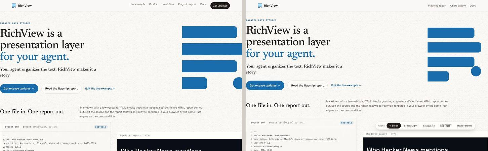
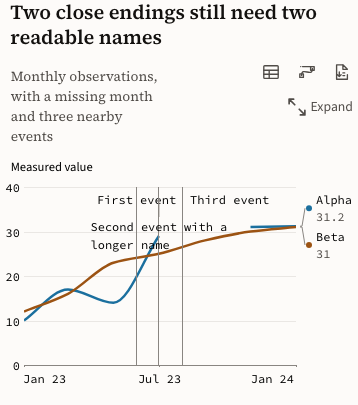
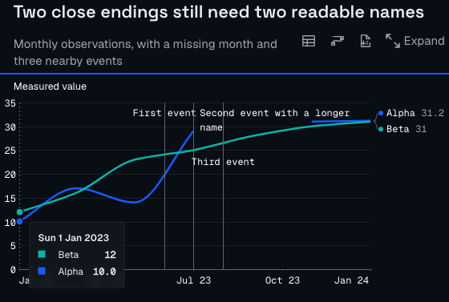
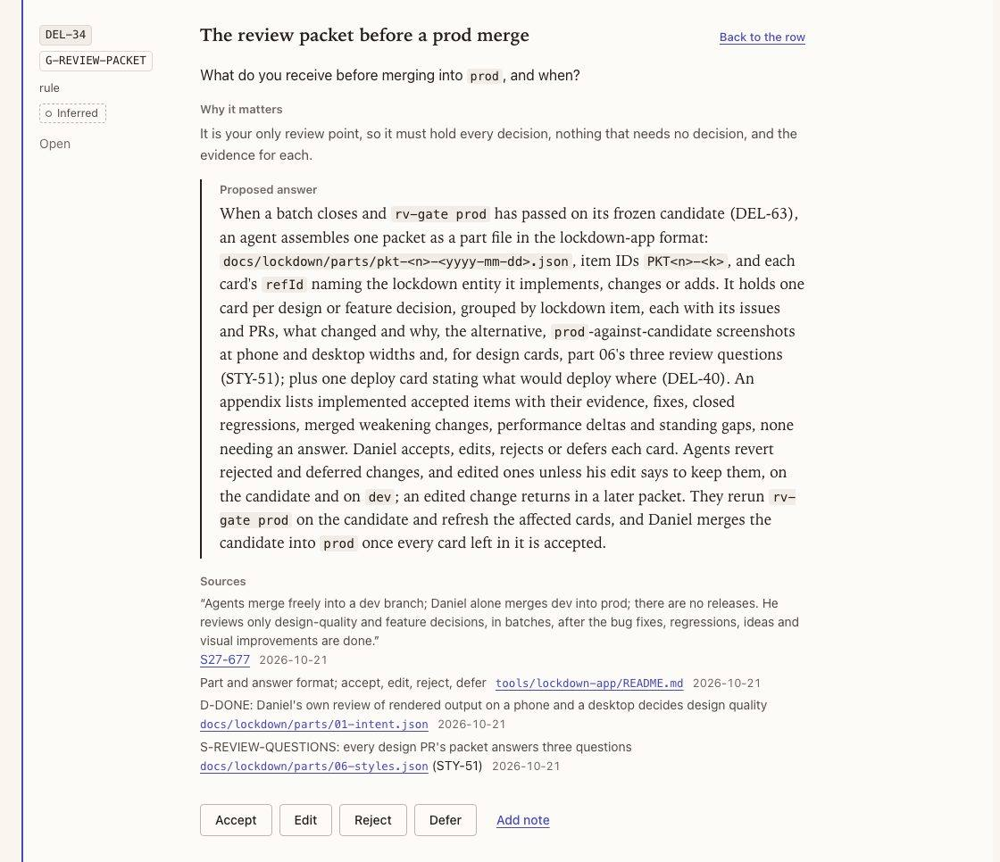
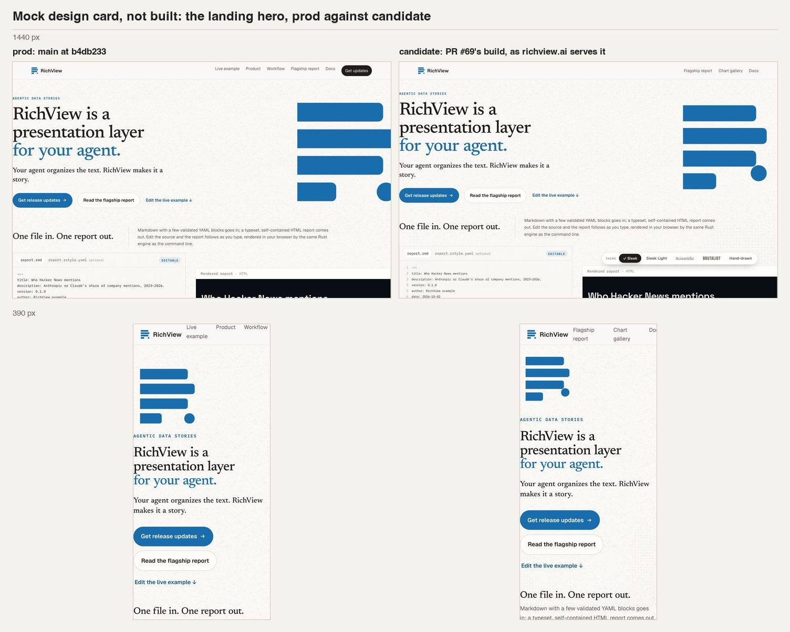

# Delivery

This page explains how a change reaches RichView after the lockdown: the `dev`, `pre-prod` and `prod` branches, the fast gate every push to `dev` passes, the release run that proves each batch on `pre-prod`, test tiers and their measured durations, visual regression and screenshot evidence, the review packet Daniel answers before each `prod` merge, enforcement without GitHub branch protection, hosted CI and deployments, and which effects still need Daniel's authorization. The model started from his 2026-10-21 brief: "We will have a dev and a prod branch. All agents can merge everything into dev as much as they want ... and we merge into prod on my nod. The only thing I want to review is design quality decisions or feature decisions ... after all bug fixes, regressions, ideas and visual improvements are done." (Daniel, 2026-10-21 brief). On 2026-10-27 his DEL-81 answer made development fast: agents merge into `dev` after a unit-test-only fast gate, a release agent proves batches of up to 20 merges on `pre-prod`, and `prod` is cut from `pre-prod` on his go. Linear S27-677 records the same rule: only Daniel gives the go for `prod`, and he reviews design and feature decisions in batches.

Part 02 (`02-delivery`) has 81 cards. Daniel has answered 12 of them: DEL-02 to DEL-07, DEL-37, DEL-40, DEL-68, DEL-69, DEL-71 and DEL-81. His answers bind and are quoted below; DEL-81 is the latest and wins where it differs from an earlier one. Every other DEL- card is a proposal that follows those answers; answer it in [Part 02 of the lockdown app](http://127.0.0.1:4790/#/part/02-delivery). Each card is cited as its item ID followed by the gate or rule it defines, as in DEL-08 (G-DEV-GATE), and each quote carries the card's confidence as the app shows it. 65 of the 81 cards are inferred: the proposer's design, built from several sources. 9 are stated, resting on a brief, ticket or doc: DEL-03, DEL-04, DEL-13, DEL-15, DEL-20, DEL-21, DEL-30, DEL-35 and DEL-81. 7 are observed, resting on code or a measured run: DEL-01, DEL-09 to DEL-12, DEL-14 and DEL-28. Budgets and tier time limits belong to [Performance](performance.md) (Part 07); the repository, hosts, releases and open PRs are decided in [What RichView is for](purpose.md) (Part 01), [Architecture](architecture.md) (Part 03) and Part 08, and the cards here point there.

Facts marked re-run were checked read-only on 22 October 2026 with `gh`, `git` and requests to the live sites. Durations come from two sets of runs on Claw Mini at `b4db233` on 21 October 2026, both with 4 Cargo jobs at reduced priority while other agents used the host: the checks evidence's (`checks-performance.md` in docs/lockdown/evidence), during which the 1-minute load was 2.6–7.3, and Part 02's own, whose load was not recorded.

## At a glance

| Question | Decision or proposal | Cards | Status |
| --- | --- | --- | --- |
| Which branches? | `main` was renamed `prod`. `dev` is the default branch and takes every change; the release agent merges batches of `dev` into `pre-prod`; `prod` is cut from a frozen `candidate/<n>` of `pre-prod` on Daniel's go. The legacy state is a commit in `prod`'s history | DEL-02, DEL-81, DEL-63 | DEL-02 and DEL-81 answered; DEL-63 inferred |
| Who merges into `dev`, and what stops a bad merge? | Any agent, freely and in parallel, after the fast gate: the unit tests a change can affect, ideally under five seconds. No merge lock, no per-merge review, and no commit, pre-push or stop hook beyond the push block. A bad combination surfaces in the release run and is fixed forward | DEL-81, DEL-03, DEL-08, DEL-43 | DEL-03 and DEL-81 answered; DEL-08 inferred; DEL-43 inferred |
| Who does the work? | Development agents in parallel (Sonnet at xhigh for design, Codex `gpt-6.1-sol` at xhigh for everything else, DEL-81 as amended 2026-10-29), one per fully independent piece of work and worktree; one release agent; the checker and the adversarial reviews on Opus, at most two Opus agents at once; the lockdown session splits the work and briefs the agents | DEL-81, DEL-42, DEL-62 | DEL-81 answered; DEL-42 and DEL-62 inferred |
| What proves a batch? | `rv-gate release` on `pre-prod`: the long suites (end-to-end, browsers, visual, data integrity, PDF) for what the batch affects, and a receipt; the release agent fixes forward. `rv-gate full` and `rv-gate prod candidate/<n>` run the full set on the candidate. The steps measured so far take about 15 minutes for a code-changing batch, before the steps not built yet | DEL-08, DEL-24, DEL-28, DEL-33, DEL-71 | DEL-71 answered; DEL-08 and DEL-24 inferred; DEL-28 observed |
| Who moves `prod`? | Only on Daniel's go: an agent runs one command, `rv-gate merge-prod`, for the frozen candidate that passed `rv-gate prod`, and the command accepts only that candidate | DEL-04, DEL-71, DEL-34 | DEL-04 and DEL-71 answered; DEL-34 inferred |
| What does Daniel review? | One packet per candidate in the lockdown app, opening with the before-and-after report: every design and feature change one by one, with screenshots, clips, cause and a one-command revert, plus a deploy card; fixes, implemented items and closed regressions sit in an appendix that needs no answer. A review agent on the model he uses judges visual and motion quality first | DEL-32, DEL-34, DEL-35, DEL-68, DEL-69 | DEL-68 and DEL-69 answered; the rest inferred or stated |
| How much does Daniel review during the rewrite? | While `prod` holds legacy output, nearly every rendering PR changes a capture and counts as `design`. Those changes come batched: one card per rewritten component per packet, showing legacy `prod` against the candidate in every style at phone and desktop widths; accepting it sets that component's new `prod` baseline | DEL-29, DEL-32, DEL-64 | inferred |
| How is it enforced on GitHub Free? | A committed pre-push hook blocks agent pushes to `prod`, `pre-prod`, `main` and `candidate/*`. There is no gate user, no machine account, no paid plan and no deny list; agents have all other access, and the audit catches an occasional slip afterwards | DEL-37, DEL-38, DEL-81 | DEL-37 answered, as DEL-81 changes it; DEL-38 inferred |
| Hosted CI? | Never a gate; every workflow disabled until an Actions budget that stops at $0 exists, then an advisory subset | DEL-39 | inferred |
| Deploys and releases? | A deploy is a separate go on a packet card. Website changes merge into `dev` like any other change and show on the hidden `dev` preview; only `prod` deploys richview.ai, on Daniel's go. Builds from `prod` and the extension listings come under INT-71, each publication on his go | DEL-40, DEL-06, DEL-41 | DEL-06 and DEL-40 answered; DEL-41 inferred |
| Rollback? | A bad `dev` merge is reverted with an ordinary revert and a failed release run is fixed forward; a failed deploy may roll back to the previous `prod` deployment without asking | DEL-47, DEL-48 | inferred |
| How is agent use measured? | Fresh-agent runs on real tasks, scored and tracked over time, at each candidate and weekly, so RichView changes until agents understand it as easily as possible | DEL-78, FEA-SF-65, INT-69 | proposed, from Daniel's INT-21 answer |

Answer first the cross-part contradictions in Part 08 that decide Part 02 cards: OPN-50 (D-XPART-PERF-GATE) for the performance set per release batch, OPN-51 (D-XPART-PROD-EVIDENCE) for the receipt a `prod` merge needs, OPN-52 (D-XPART-PDF-FIXTURES) for the PDF fixtures in the release run, OPN-55 (D-XPART-TIER-HOST) for the fast tier's hosts and OPN-66 (D-XPART-PHONE-CHECK) for the real-phone check; the cards they cite then follow them. Then answer the gate commands (DEL-08 with DEL-51), the review path (DEL-32 to DEL-36 and DEL-63) and the agent measurement (DEL-78 with FEA-SF-65). [Where to answer](#where-to-answer) has the links, and [Conflicts to answer together](#conflicts-to-answer-together) lists each conflict with the card that decides it.

## How a change reaches prod

```text
Linear issue → worktree from origin/dev → branch <kind>/s27-<n>-<slug>
  → rv-gate fast before every push: the unit tests the change can affect, clippy, rustfmt
  → rebase on origin/dev, push or merge into dev, naming Refs S27-<n>
      (no merge lock, no per-merge review; testing beyond the fast gate is the agent's call)
  → release agent: a batch of up to 20 merges, rv-gate release: dev merged into pre-prod,
      the long suites for what the batch affects, a receipt; fixes forward until it works together
  → packet batch closes (a Linear milestone) → rv-gate full on pre-prod
  → candidate/<n> cut from pre-prod → rv-gate prod candidate/<n>
  → review packet and before-and-after report in the lockdown app: design, feature and deploy cards
  → Daniel answers → agents revert rejected and deferred work → rv-gate prod again
  → on Daniel's go: rv-gate merge-prod candidate/<n> --go "<his words, date>" moves prod
  → deploy from prod only on Daniel's go on the packet's deploy card

prod: today's main, renamed; holds the legacy state until the first rewrite merge from pre-prod
  → a legacy hotfix only on Daniel's authorization, on a new branch from the legacy commit;
    how it reaches richview.ai is open (DEL-65)

Deploy targets: richview.ai (only from prod, on Daniel's go); a hidden preview of richview.ai
from dev behind a Cloudflare Access sign-in Daniel holds, redeployed only when the website's
code changes; hosted Cowork and customer Publish servers from prod on his go; news.richview.ai
on his go
```

On 2026-10-27 `main` had been renamed `prod`, `dev` was the default branch and `pre-prod` existed (DEL-02, DEL-81). `tools/rv-gate/` implements `rv-gate fast`, `rv-gate release`, `rv-gate full`, `rv-gate prod` and `rv-gate merge-prod` (AGENTS.md). `rv-gate steps` lists 49 steps: 36 built and 13 that report `unrun` with their reason (docs match, golden inputs, accessibility, site routes, cross-style values, motion, journeys, the cross-surface contract test, performance budgets, the VS Code check, the VoiceOver pass, the fresh-agent run and the hosted smoke check). The registry still labels some steps `pre-pr` and `integration`; DEL-81's tiers are fast, release and full.

## Starting point

> **DEL-01 (G-BASELINE), proposed, observed.** The delivery model is designed for the setup below; changing any part of it, such as a paid GitHub plan, a separate agent identity, a collaborator, a public repository or paid hosted CI, is its own decision (DEL-37, DEL-39). The table is the pre-rewrite baseline of 21 and 22 October 2026. Daniel's later answers have changed parts of it: the branches are `prod`, `pre-prod` and `dev`, with `dev` the default (DEL-02, DEL-81), and a committed pre-push hook is the only block on agents, with no deny list, no separate gate user and no GitHub login removed (DEL-37).

| Fact | Observed | Checked |
| --- | --- | --- |
| Repository | `1vecera/richview`, private, owned by Daniel's personal account on GitHub Free; default branch `main`; 9 open draft PRs, #62 to #70, all into `main` | re-run |
| GitHub controls | Branch protection and rulesets return HTTP 403, "Upgrade to GitHub Pro or make this repository public to enable this feature."; `allow_auto_merge` is false; squash, merge and rebase are all allowed | re-run |
| Identity | Daniel's account is the only collaborator; it opened 74 of 75 PRs and merged 60 of 61, so GitHub cannot tell Daniel from an agent. Agents on Claw Mini can also use write tokens of other accounts; Daniel's DEL-37 answer leaves them in place and relies on the audit | 2026-10-22 |
| Access | `stevenoliver7` lost access in the transfer and gets none: "Steven" was an agent persona, not a person, so no one is invited (OPN-24, D-STEVEN-ACCESS and OPN-48, both answered); the previous organization's Claude GitHub apps no longer cover the repository (DEL-01) | collaborators and invitations re-run |
| Agent settings | `.claude/settings.json` starts every Claude Code session as the `richview` orchestrator (`:40`) and allows `npx`, every `git push` and `curl` (`:7`, `:14`, `:24`); its only push-related denials are `git push --force` and `-f` (`:34-35`). `wrangler` 4.151.0 is a dev dependency (`package.json:27`). Daniel's DEL-37 answer keeps no deny list at all | `b4db233` |
| Build lock | Agents on Claw Mini run heavy builds one at a time through a shared build helper outside the repository: one lock, two Cargo jobs, incremental builds off and a 5 GiB disk floor (`docs/development-harness.md` on PR #68's branch; S27-647 to S27-654). This page calls it the host's build lock and reads PRF-02's "build coordinator's exclusive lock" and the "host benchmark lock" of DEL-51 and DEL-62 as holding it alone for a timing capture. AGENTS.md now has every stream and subagent build in one shared Cargo target, `~/tmp/richview-rewrite/target`, with a 10 GiB disk floor (Daniel, 2026-10-29; it was 40) (DEL-22) | stated |
| Production | richview.ai serves unmerged PR #69, and `richview-teaser.vecera.workers.dev` returns the identical 28,225-byte home page because `wrangler.toml:5` sets `workers_dev = true`. news.richview.ai serves content from `publish/news`: its status endpoint `/_status` reports a live release built from the branch's last commit, `7e7d9f8`, at generation 5, a counter that rises with each release or rollback. Its code comes from PR #70's branch and is newer than the copy on `publish/news`, which stops 21 commits behind the PR's head: the status response has a `paused` field that first appears in `3c3b6f5`, one of those 21 commits | re-run |
| Hosted CI | No job has started since 2026-10-13. Every later run ended within 25 s, nearly all within 10 s; the seven runs the checks evidence sampled, from 2026-10-12 to 2026-10-19, carried the annotation "The job was not started because recent account payments have failed or your spending limit needs to be increased". The last run was on 2026-10-19 and none has run since the transfer. `ci.yml`, `publish.yml` and `richview-chart.yml` can still trigger | re-run |
| Local checks | One full CI-equivalent pass takes about 20 minutes on Claw Mini (1,193 s, sequential, without Firefox); the Rust suite takes 44.2–47.0 s warm, 26.2 s of it in one test binary | 2026-10-21 |
| Visual regression | Screenshots are captured and checked for geometry, never compared between builds | 2026-10-21 |
| Checks outside CI | The theme-switch proof `scripts/verify-authoring.mjs` fails on `main` (`'auto' !== '8px'` at `:40`) and nothing runs it | 2026-10-21 |
| Node | `.node-version` says 20.11.0, CI uses 22 (`.github/workflows/ci.yml:26`), Claw Mini runs 26.5.0 | 2026-10-21 |
| Primary checkout | Claw Mini's primary checkout sits at `5ceb7d4`, 354 commits behind `b4db233`, with TypeScript-era instructions; task worktrees live inside it, so their sessions load its `CLAUDE.md` as a parent file | re-run |



Production drift on 21 October 2026. Left: the home page of `main` at `b4db233` from a local release build, with five header links and a Get updates button, a mark that runs past the right edge and the demo's style pills hidden. Right: richview.ai, which served unmerged PR #69's branch, with three header links, a contained mark, line numbers in the demo editor and a visible style switcher. No commit on `main` produced the live page. Daniel accepted OPN-01 (D-PROD-BASELINE) and OPN-13, which bring #69 into the baseline, and DEL-40 (G-DEPLOY-OWNER) lets only `prod` deploy richview.ai from then on. Sources: `product/landing/landing-desktop-viewport.jpg` (`/` on the local build) and `live/richview-home-desktop-01-hero.jpg` (https://richview.ai/), both 1440×900; the full viewports, scaled to half and placed side by side for this page.

## Branches and authority

> **DEL-02 (G-BRANCHES), Daniel's answer, 2026-10-26.** Chosen option: Rename main to prod.
>
> Two long-lived branches with continuous history and redirected links; open PRs retarget to `prod`, the legacy state is only a commit in its history, and a legacy hotfix needs a new branch.
>
> **DEL-81 (G-FAST-DEV), Daniel's answer, 2026-10-27.** Three branches. Today's `dev` is renamed `pre-prod`; a new `dev` is created from it and becomes the default branch; `prod` moves only on Daniel's go.
>
> - **Development agents** run in parallel, as many as there are fully independent pieces of work, each in its own worktree. They merge into `dev` freely. No commit, pre-push or stop hooks slow them down.
> - **Testing in `dev` is at the agent's discretion.** The fast gate is unit tests only, ideally under five seconds. Agents run browser, visual or end-to-end checks when they judge it useful, for example to see a new chart.
> - **Impact tracing.** Dependencies between crates, modules and suites are traced automatically, so the fast gate and the release run only the tests a change can affect; tests that cannot be affected are not run.
> - **The release agent** merges `dev` into `pre-prod` after a batch of changes (three, five or ten, by their size and significance). It runs the long-running suites (end-to-end, browsers, visual, data integrity, PDF) on the combined state, for what the batch affects, and fixes forward until everything works together.
> - **`prod`** is cut from `pre-prod` on Daniel's go, after the full run (DEL-04, DEL-71 apply to that step).
> - **The lockdown session leads:** it splits the work into independent streams, briefs the agents, and relays Daniel.
>
> Amended by Daniel on 2026-10-27:
> - **Batches:** a release batch holds up to 20 merges.
> - **Anything that slows development can change:** steps, tiers, hooks, reviews and thresholds. Broad end-to-end coverage at release is what lets small changes move fast.
> - **Models:**
>   - Development agents and their subagents run on Sonnet.
>   - The checker and the adversarial reviews run on Opus.
>   - At most two Opus agents run at once across the build.
>
> Amended by Daniel on 2026-10-29 ("might change in the future, but this is now"), replacing the models above:
>   - The final reviewer, the checker and the adversarial reviews run on Claude Opus at xhigh effort.
>   - Design development runs on Claude Sonnet at xhigh effort: anything whose quality is judged by eye, such as how charts, styles, the site and any other surface look and move, but not the chart engine's correctness.
>   - Everything else runs on Codex (`gpt-6.1-sol`, reasoning effort xhigh) in the Codex TUI: the chart engine, format, renderer logic, app surfaces, Publish, the gate and the release work.
>   - At most two Opus agents run at once across the build.

DEL-81 supersedes, where they differ, DEL-02's two branches (`pre-prod` now sits between `dev` and `prod`), DEL-03 and DEL-08 (every change through the gate into `dev`), DEL-37's pre-push hook on `dev`, DEL-68's process steps on every change (reviews and long suites now run per `pre-prod` batch) and DEL-71's tiers (fast in `dev`, full in `pre-prod`); the DEL-81 card's own conflicts note lists them. Its amendment that anything that slows development can change, steps and reviews included, and DEL-68's answer that no agent removes or skips a step of the process pull apart. DEL-81 is later, and how the two fit is open for Daniel. Until he decides, a change to a step is recorded with its reason in the PR that makes it (DEL-26, DEL-35, DEL-36, DEL-38).

`AGENTS.md` at the repository root carries the working rules that follow from these answers, and this page must not contradict it:

- **Branches.** `dev` is the default branch and development agents merge into it freely. `pre-prod` is written only by the release agent's `rv-gate release`. `prod` moves only by `rv-gate merge-prod candidate/<n> --go "<Daniel's words, date>"`, after a frozen candidate passed `rv-gate prod` and Daniel gave his go for that candidate (DEL-04, DEL-71). The pre-push hook refuses `prod`, `pre-prod`, `main` and `candidate/*` from agent checkouts (DEL-37 as amended by DEL-81).
- **Development agents.** Several run in parallel, one per independent stream, each in its own worktree under `.claude/worktrees/<slug>` from fresh `origin/dev`, on a branch named `<kind>/s27-<n>-<slug>` for one Linear issue. To land work, an agent runs the fast gate, rebases onto `origin/dev` and pushes to `dev` or merges its PR into it. Every commit or PR that lands in `dev` names its issue with `Refs S27-<n>`.
- **The release agent.** After a batch of merges it merges `dev` into `pre-prod`, runs the long suites for what the batch affects, fixes forward until the combined state works and reviews per batch; the release receipt is the evidence (DEL-20, DEL-21). A batch holds up to 20 merges (DEL-81's amendment of 2026-10-27).
- **Models** (DEL-81, amended 2026-10-29). The final reviewer, the checker and the adversarial reviews run on Claude Opus at xhigh. Design development runs on Claude Sonnet at xhigh: anything whose quality is judged by eye. Everything else runs on Codex (`gpt-6.1-sol`, reasoning xhigh) in the Codex TUI. At most two Opus agents run at once across the build.

| Tier | Command | When |
| --- | --- | --- |
| fast | `node tools/rv-gate/rv-gate.mjs fast` | Before every push to `dev`: the unit tests of the changed crates and of the crates that `include_str!` a changed file; `cargo clippy -D warnings` of them and their dependents, tests included; the node tests of the tools whose folder changed; rustfmt on the changed files. `--plan` shows the selection and `--all` runs every crate |
| release | `node tools/rv-gate/rv-gate.mjs release` | The release agent, per batch: `dev` into `pre-prod`, the long suites for what the batch affects, a receipt |
| full | `node tools/rv-gate/rv-gate.mjs full` and `prod candidate/<n>` | On `pre-prod` before a candidate, and on each frozen candidate |

> **DEL-03 (G-DEV-PROD), Daniel's answer, 2026-10-26.** Chosen option: Squash through the gate, as proposed. Before merging, the agent completes every item of the PR checklist, including its set of tests. Open: the Linear board is private, so `Refs S27-<n>` in commits points nowhere for outside readers once the source is public (INT-38); how commits reference work then is still to be decided (DEL-44).

DEL-81 changes the path the answer describes. Agents no longer queue every PR with a gate command that rebases, runs the full gate and squash-merges as its own user: they run the fast gate, rebase onto `origin/dev` and push or merge, and the release run proves the combined state afterwards. The squash method and the completed PR checklist stay where DEL-81 does not differ, and each commit carries `Refs S27-<n>` (DEL-44) and its decision class (DEL-32).

> **DEL-04 (G-PROD-MERGE), Daniel's answer, 2026-10-26.** Chosen option: An agent merges after Daniel's go. A second, automatic set of tests runs on the prod candidate (DEL-33); when it passes, Daniel tells an agent to merge, and the agent merges into `prod` with a single command. Only Daniel gives that go for now; named main collaborators may later. No agent moves `prod` on its own.

In practice (`AGENTS.md`), the single command is `rv-gate merge-prod candidate/<n> --go "<Daniel's words, date>"`, and it accepts only a frozen candidate that passed `rv-gate prod`; `prod` is cut from `pre-prod` (DEL-81).

> **DEL-06 (G-SCOPE-GUARD), Daniel's answer, 2026-10-26, amended 2026-10-27.** Chosen option: Merge into dev, review in the packet.
>
> `dev` evolves on its own against the lockdown's principles, documents and ideas. Feature and design changes merge into `dev` through the gates without asking or pinging Daniel, whether he asked for them or an autonomous loop generated and implemented the idea. Other agents may revert or remove them on `dev`. Gates always run.
>
> Website changes are always okay in `dev`: they merge through the gates like any other change, without a grant, and `dev` deploys to the hidden preview of richview.ai (DEL-40, ARC-22). Nothing becomes public before `prod`, and going public stays on Daniel's go: a `prod` merge or deploy, or a post, release or publication.
>
> Design changes and feature changes are kept clearly separate. `dev` keeps a feature and design log, so Daniel can review every design change and every feature change one by one before anything goes to `prod`.
>
> When Daniel asks for something new that the lockdown does not cover, the agent also proposes the change to the lockdown documents, and Daniel looks at that first.
>
> The trail is complete: every PR is part of the documentation, every change is tracked so any of them can be reverted, and one report shows before and after, both together and step by step, with what caused each change.

DEL-05 (G-AUTHORIZATION), the line between what agents do alone and what needs Daniel's nod, belongs to this group; its table is in [What needs Daniel's authorization](#what-needs-daniels-authorization).

> **DEL-07 (G-SETUP), Daniel's answer, 2026-10-26.** The setup steps are the agents' call: they pick the best order and method, following the accepted branch model (DEL-02: `main` renamed to `prod`, plus `dev`) and the authorization rules (DEL-05). Nothing is in production, so it is fine if things are down for a while during setup.

Status on 2026-10-27, from [DELIVERY.md](../lockdown/DELIVERY.md): `main` was renamed `prod`, `dev` is the default branch and `pre-prod` exists (DEL-02, DEL-81). The setup steps in DEL-07's proposal that create a gate macOS user and remove other accounts' tokens no longer apply (DEL-37). Daniel gave his go for the cleanup batch the same day, and it is done and checked live: the two legacy Fly apps are destroyed after backups to `~/archive/richview-legacy/2026-10-27/` on Claw Mini, richview.uk, app.richview.uk and docs.richview.uk return 301 to richview.ai through the Worker `richview-uk-redirect`, the `api.richview.uk` record is deleted, and a Cloudflare Access application covers richview-teaser.vecera.workers.dev (OPN-04, OPN-05, OPN-44, OPN-45). Still open: Daniel's own first sign-in through Access, and deploying PR #69 to richview.ai, which is not part of that batch.

## The gate commands

> **DEL-08 (G-DEV-GATE), proposed, inferred.** Daniel's DEL-81 answer supersedes the earlier proposal that every change passes one gate into `dev`. `rv-gate` has these commands (`AGENTS.md`, DEL-81): `rv-gate fast` before every push to `dev`; `rv-gate release`, which the release agent runs per batch of up to 20 merges, merging `dev` into `pre-prod` and running the long suites for what the batch affects; `rv-gate full` on `pre-prod` before a candidate; `rv-gate candidate`, which cuts `candidate/<n>` from `origin/pre-prod` (DEL-63); and `rv-gate prod candidate/<n>` on each frozen candidate (DEL-33, DEL-71). `rv-gate steps` lists every step with its tier and cards, and a step that is not built yet reports `unrun` with its reason until it exists.
>
> The fast gate is unit tests only, ideally under five seconds. It runs the unit tests of the changed crates and of the crates that `include_str!` a changed file, `cargo clippy -D warnings` of them and their dependents, the node tests of the tools whose folder changed and rustfmt on the changed files; impact tracing selects what a change can affect. No commit, pre-push or stop hook beyond DEL-37's push block slows development, and an agent runs browser, visual or end-to-end checks in `dev` when it judges them useful.
>
> The release run runs the rest of the registry on `pre-prod`'s combined state, for what the batch affects, from the gate code of the previous release, so that a batch cannot loosen the check that judges it (DEL-36), and the release agent fixes forward until it passes. Only release and candidate receipts are evidence (DEL-20, DEL-21).

At the 22 October baseline there was no single list: `CLAUDE.md:41-49` names nine Node checks, `ci.yml` runs 27 Chromium suites, the docs suite, the review matrix and 46 cross-engine runs (`.github/workflows/ci.yml:34-69`), and PR #68's `integration` suite follows `CLAUDE.md`. The table shows DEL-08's registry in step order, with the gate each card defines and where each step runs; the last three columns describe `b4db233`. Of its cards, DEL-09 to DEL-12, DEL-14 and DEL-28 are observed, DEL-13, DEL-15 and DEL-20 stated, and the rest inferred. Golden inputs are the example reports INT-55 (D-EXAMPLES-CARRY) proposes to carry over, each of which must render in every accepted style without errors ([What RichView is for](purpose.md#what-carries-over-into-the-rewrite)).

| Step | Card | Runs in | Check | Command today | On `b4db233`, Claw Mini | Misses |
| --- | --- | --- | --- | --- | --- | --- |
| Host and toolchain pins | DEL-22 (G-GATE-HOST), DEL-49 (G-TOOLCHAIN-PINS) | release, full | The gate host, Rust 1.99.0, wasm-bindgen 0.2.129, Playwright 1.65.0, one Node version and the macOS build | none | not built | — |
| Registry checks | DEL-23 (G-NONCI), DEL-32 (G-DECISION-CLASS), DEL-36 (G-ORACLE-PROTECTION), DEL-44 (G-LINEAR-TRACKING) | release | Every test entry point is in a tier; each PR declares its decision class and names its issue; no gate step is removed and no threshold raised without a card; every deleted test carries a reason | none | not built | — |
| Public-surface snapshots | DEL-53 (G-SURFACE-SNAPSHOT) | release | CLI commands, flags and help text, MCP tool names and input schemas, the format's JSON schemas, the site route map (FEA-SF-46) and the output contract (TYP-42) match committed snapshots, or the merge's PR declared `feature` or named the accepted items that specify the change | none; `scripts/verify-native.mjs:37` only counts 7 MCP tools and 2 resources | not built | behaviour behind an unchanged signature |
| Format | DEL-09 (G-FMT) | fast (changed files), release | Rust sources are rustfmt-clean | `cargo fmt --all --check` | pass, 0.8 s | behaviour, lints and every non-Rust file |
| Native lint | DEL-10 (G-CLIPPY) | fast (changed crates and dependents), release | Native code, tests and benchmarks have no Clippy warnings | `cargo clippy --workspace --all-targets --locked -- -D warnings` | pass, 0.1–0.6 s warm, 2.9 s after a chart edit, 12.4 s on a first run | code compiled only for wasm32; runtime behaviour |
| Wasm lint | DEL-11 (G-CLIPPY-WASM) | release; fast when a change reaches the browser crate | The browser crate compiles for wasm32 with no warnings | `cargo clippy -p richview-site --target wasm32-unknown-unknown --locked -- -D warnings` | pass, 0.1–2.5 s warm, 19.0 s on a first run | behaviour in a real browser |
| Architecture boundaries | DEL-54 (G-ARCH-BOUNDARIES) | fast (source-only checks), release | Core and chart crates use no `std::fs`, `std::net`, `std::process` or `std::env` and no I/O-capable dependency (ARC-02); handwritten JavaScript is on the allowlist with its host reason (ARC-03); the report runtime links no site module (ARC-06); site selectors match markup (ARC-39) | none | not built | code that keeps a boundary's letter but not its intent |
| Secrets and private data | DEL-55 (G-SECRET-SCAN) | fast (the push's diff), release (the whole batch) | No diff carries credentials, private keys, high-entropy strings, personal email addresses, private Notion or vault links, home paths or subscriber data; allowlist changes count as gate changes | none; a local scanner such as gitleaks with RichView's own patterns | not built | private content in a form no pattern names |
| All Rust tests | DEL-12 (G-TEST-FULL) | fast (the unit tests a change can affect), release (everything the batch can affect, slow tests included) | 438 tests across parser, styles, chart engine, native app, browser crate and editor | `cargo test --workspace --locked` (`-- --include-ignored` once slow tests are marked) | 438 pass, 44.2–47.0 s warm, 83.3 s on the first run after relinking, 104.8 s cold | real browsers, pixels, hosts |
| Release build | DEL-13 (G-BUILD) | release | One release build from `pre-prod`'s combined state in the release target folder `~/tmp/richview-rewrite/target-release`; every later step tests those artifacts by their manifest hashes; fixtures are verified by hash, not regenerated | `cargo run --release --locked -p richview-build` | pass, 2.1 s unchanged to 105.9 s after a chart edit, 153.9 s cold; fixture regeneration 27.3 s today | behaviour |
| Host checks | DEL-14 (G-HOST) | release | The VS Code adapter drives the native editor; CLI, MCP, loopback server and publication store | `verify-editor.cjs`, `verify-native.mjs` | pass, 6.5 s | a real VS Code, remote servers, browsers |
| Chromium behaviour | DEL-15 (G-BROWSER-CHROMIUM) | release, for the suites a batch can affect | Editing, chart interaction, chart-type contracts, the site pages, the motion runtime and the docs tutorial in 21 suites plus the docs suite | `node scripts/verify-<suite>.mjs`, `node scripts/verify-docs.mjs` | pass, 295.7 s | other engines, pixel changes, how motion looks |
| Data integrity | DEL-16 (G-DATA-INTEGRITY) | release | Every value a reader sees equals the source at the author's precision, never more (Daniel's FEA-CH-37 answer); no fabricated, dropped or altered rows; units, calendars and extremes survive interaction, tables, CSV downloads and export | six suites: numeric-safety, numeric-zoom, source-tables, temporal-fidelity, temporal-decimals, csv-decimals | pass, 79.1 s (they assert every source digit today, which the precision rule flips) | other styles and phone widths; animation frames; misleading encodings |
| Cross-style values | DEL-52 (G-CROSS-STYLE-VALUES) | release | Every golden input in every builtin style at 390 and 1440 px shows identical values in text, labels, accessible names, readouts, tables, CSV and chart downloads, equal to the source at the author's precision | none; extends `verify-bar-paint` | not built; likely the largest new step | values inside animation frames |
| Theme-switch proof | DEL-17 (G-THEME-SWITCH-PROOF) | release | A style change reaches everything a report renders, in exported HTML, the native preview and the playground, and changes nothing else | `node scripts/verify-authoring.mjs` (three of five builtins) | **fails** after 1.7 s since `39b301f` (2026-10-15, "Round bar value ends and keep one stable entrance") changed bar ends | pixels, other engines, PDF |
| Docs match the code | DEL-18 (G-DOCS-MATCH-CODE) | release | Agent-facing and public text name the block tags, chart types, styles, MCP tools, CLI commands and routes the code has; generated fragments pass by construction (Daniel's INT-21 answer, INT-66) | none | not built | qualitative claims |
| Golden inputs | DEL-60 (G-GOLDEN-INPUTS) | release | Every golden input, the typography specimen, every editor snippet and the first report render in every builtin style without an undeclared diagnostic; the getting-started commands run from a clean directory | none; the builder renders only the first report per style | not built | how the output looks |
| No-JS reading and runtime drill | DEL-57 (G-NO-JS-DRILL) | release | Every golden input reads completely with scripts off; every chart's frame shows its title, caption, source note and the notice that the chart cannot be displayed, with no static stand-in (Daniel's ARC-05 answer); the interactive check fails with one named error without the runtime and passes with it | none; PR #68's `--drill` covers one example | not built | — |
| Hostile input | DEL-56 (G-HOSTILE-INPUT) | release | Hostile sources and style files through every sink and builtin style, light, dark and print, yield no script, handler, `javascript:` or remote URL, and their diagnostics | none; OPN-16's style-file injection is the first case | not built | classes the corpus does not contain |
| Accessibility | DEL-58 (G-A11Y) | release (automated audit and keyboard pass); each candidate (VoiceOver) | Automated WCAG audit and keyboard pass over the every-block fixture in every builtin at 390 and 1440 px | none | not built | what only a screen-reader user notices |
| Site | DEL-59 (G-SITE) | release | Every route of the route map and a sample of removed ones; side gutters and page width at 320, 390 and 1440 px; gallery interactions | none; `landing`, `cloudflare` and `docs` suites cover parts | not built | how the pages look |
| Visual matrix and diff | DEL-19 (G-VISUAL-MATRIX), DEL-27 (G-VISUAL-SCOPE), DEL-28 (G-VISUAL-DIFF) | release | Geometry of 3 cases × 5 styles × 4 widths; new captures; pixel diff against the previous `pre-prod` head | `node scripts/verify-chart-review.mjs --out <dir> --phase after` | matrix passes with 0 findings in 136.4 s; captures and diff not built (0.7 s when every pair matches by bytes) | see [Visual regression and screenshots](#visual-regression-and-screenshots) |
| Performance | DEL-51 (G-PERF-BUDGETS) | release; the full capture at the candidate | Part 07's budgets and regression baseline; OPN-50 (D-XPART-PERF-GATE) proposes only Part 07's per-batch set, without a load wait | today's harness and `scripts/check-performance.py` | 157.2 s; ends `failed`, 24 of 25, on the Linux-only memory gate | see [Performance](performance.md) |
| Receipt | DEL-20 (G-GATE-RECEIPT) | release, full | The record of the run | none | not built | — |

The measured steps take about 15 minutes for a batch that changes code (rebuild and relinked tests) and about 12.5 minutes when the build is a no-op and the tests are warm, against PRF-51's upper bound of 45 minutes for a release run; every unbuilt step comes on top, and so would DEL-51's load wait, which OPN-50 proposes to drop. That cost is paid once per release batch, not per merge, and impact tracing keeps out the suites a batch cannot affect. Those times used 4 Cargo jobs; agents build through the shared helper with two jobs and incremental builds off, and no step was timed that way. Staying within the limits depends on removing measured waste whose savings are not measured yet: the 78 MB site copy each browser run makes, the 27.3 s fixture regeneration, one integration-test binary per crate, and functional browser suites run in parallel while the performance step runs alone. The WebKit and Firefox loops and the other heavy rows of DEL-71's table run in the full run on `pre-prod` and again on each candidate (DEL-24, DEL-33). DEL-08 recommends the fast gate on `dev` and the release run per `pre-prod` batch (Daniel's DEL-81 model); its other option, the full gate on every merge, is superseded, since it meant about 15 minutes per merge and agents mostly waiting.

One step is missing from DEL-08's registry. FEA-RP-43 (F-EXPORT-PDF) reran its PDF pagination fixtures on every merge, about 1 to 3 s each, while DEL-08 had no PDF step and DEL-33, FEA-SF-06 and FEA-SF-62 run PDF export at the candidate. OPN-52 (D-XPART-PDF-FIXTURES) decides between them and proposes the fixtures in the release run on `pre-prod` whenever a batch touches PDF export, and again in `rv-gate prod`, a failing fixture stopping the release; the fast gate in `dev` does not run them. FEA-RP-43 now places them there, with its LaTeX-style float pagination (Daniel's choice of 2026-10-27).

DEL-15 (G-BROWSER-CHROMIUM) records a known risk in its conflict note: a Linear comment on S27-650 (2026-10-18) found `verify-browser.mjs` load-sensitive. After one isolated pass it failed three times, twice on timeouts and once on the superseded-edit race assertion, and the hosted runs of 2026-10-13 failed in it on a Playwright timeout. Under the proposal a flaky step fails the release run and is fixed at its cause, never retried until green; FEA-BR-47 (G-WORKER-REPLY-HOLD) proposes PR #68's fix for the race, holding a real worker reply instead of waiting on a timer, untested against these failures.

> **DEL-51 (G-PERF-BUDGETS), proposed, inferred.** The performance step runs last and alone under the quiet-CPU protocol (P-QUIET-CPU): it takes the host benchmark lock and waits for a 1-minute load average of 2.0 or less; an attempt that waits 10 minutes counts as inconclusive. It runs the harness in `docs/PERFORMANCE.md`'s order and checks the budgets and the regression baseline part 07 accepts (P-REGRESSION-GATE), plus a short WebKit timing probe of the PRF-21 transitions at 1× CPU, which P-ENGINES requires at the merge-time run, now the release run. Size, memory and instruction-count checks, the delivered Wasm size (G-WASM-SIZE) included, run whatever the load. Two inconclusive timing captures leave the release run "performance inconclusive": the batch is not released, development on `dev` goes on, and the release agent reruns the step on a quiet host with the load record (DEL-62). Memory budgets use part 07's macOS methods (P-OS-SCOPE, P-NATIVE-MEMORY); today's checker still fails on the Linux gate those retire, so it cannot be used unchanged.

DEL-51 and Part 07 still differ on what the release run measures. DEL-51 credits its load wait to PRF-02 (P-QUIET-CPU) and its per-release WebKit probe to PRF-24 (P-ENGINES), but the current PRF-02 drops the wait, PRF-24 times WebKit only in the full capture and on batches that change motion, and PRF-04 (P-GATE-SCOPE) moves the phone profile, PDF, memory sessions and builds to that capture too, which runs daily on `pre-prod` and per candidate. DEL-51's own conflict note records the difference. OPN-50 (D-XPART-PERF-GATE) decides it and proposes Part 07's side: in the release run, Part 07's set for what the batch affects under PRF-02's lock and outside-CPU check, without a load wait; WebKit timing in the full capture and on batches that change motion; the phone profile, PDF export time, memory sessions, build durations and absolute millisecond limits only in the full capture. OPN-50's last sentence still says that DEL-62 keeps an agent cap and that DEL-43's merges wait while a capture holds the lock; DEL-62 and DEL-43 now say neither (DEL-81), so that sentence is out of date. Answer OPN-50 before DEL-51 ([conflicts](#conflicts-to-answer-together)).

## Gate operation

> **DEL-20 (G-GATE-RECEIPT), proposed, stated.** Every release run and every candidate run writes a receipt into the evidence store (DEL-61) on Claw Mini, outside any worktree; a fast-gate run leaves only its output, which is not evidence (DEL-21, DEL-81). A receipt holds commit and tree hashes; toolchain, browser and macOS build versions; the build manifest's artifact hashes; each step's command, result, duration and log path; unrun steps with reasons; and the screenshot manifest. The `pre-prod` merge commit names the release receipt's ID, and the release summary lists the merges the batch covered. A red step stays red until a new run passes; receipts are never edited and are kept for the life of the repository. Logs and run folders are not: the store keeps the run folder only for each open PR's latest run and the latest full and prod runs, so a merged PR's logs go with its run folder while its receipt, with the log paths it recorded, stays.
>
> **DEL-61 (G-EVIDENCE-STORE), proposed, inferred.** Receipts and captures live in one evidence store on Claw Mini outside every checkout, written by the gate (no separate macOS user: DEL-37): receipts as JSON keyed by receipt ID, captures content-addressed by SHA-256. Run folders and logs are pruned to each open PR's latest run plus the latest full and prod runs; receipts and the `prod` captures are never pruned. A daily job copies new receipts and the `prod` captures off the host; agents set it up without asking (DEL-05), and a destination that costs money still needs Daniel's go. If the store is lost, the audit reports every commit it can no longer prove, and the next `rv-gate prod` captures new baselines; lost receipts cannot be recreated. The alternatives are no off-host copy, or receipts in Git, which any agent with a write token could edit.
>
> **DEL-21 (G-HONEST-STATUS), proposed, stated.** Every status an agent reports (PR body, Linear comment, review packet, handoff) names what it rests on and states what passed, what failed and what did not run and why, including failures that existed before the change. A merge into `dev` rests on the fast gate's output and is reported as merged, not as verified. Verified means that the release receipt of the batch holding the change passed; only release and candidate receipts are evidence (Daniel's DEL-81 answer). A build, a screenshot, a review verdict or a Linear state is never reported as verification. Partial work is reported as partial with its gaps named, and warnings are never suppressed to make a check pass.
>
> **DEL-22 (G-GATE-HOST), proposed, inferred.** The release and candidate runs happen only on Claw Mini, the reference host (P-REFERENCE-HOST), under Daniel's normal user (DEL-37). Development streams and their subagents build in one shared Rust target folder, `~/tmp/richview-rewrite/target`, which `source ~/tmp/richview-rewrite/env.sh` sets through `CARGO_TARGET_DIR`; only the release agent's release runs build in a second folder, `target-release`, so a long release build never holds the streams' lock (AGENTS.md). A build command takes the target's lock for its whole run, a `RUSTC_WRAPPER` records which checkout compiled last and touches this checkout's sources when another one did, so the shared target never builds the wrong checkout, and builds refuse to start below 10 GiB of free disk (Daniel, 2026-10-29; it was 40). Gate runs delete their temp folders when they end, pass or fail. Agents on any host merge into `dev` without the gate host; only the release run needs Claw Mini. The one Linux-only check, the VS Code extension check, runs at the candidate tier in Lenovo's offscreen Linux environment, and its receipt joins the candidate's. The Linux `VmHWM` memory gate retires with part 07's macOS methods (P-OS-SCOPE). Pinned versions are DEL-49. The alternatives are Claw Mini only, with the VS Code check as a standing gap, or a Linux runner, which needs a spare machine or paid minutes. A shared Cargo target once ran a builder compiled for another worktree (PR #68), so a green command verified the wrong source; the stamping wrapper removes that path.
>
> **DEL-49 (G-TOOLCHAIN-PINS), proposed, inferred.** The gate refuses to run unless the pins match: Rust 1.99.0 (`rust-toolchain.toml`), wasm-bindgen 0.2.129, Playwright 1.65.0 with its browser builds, one Node version written in `.node-version`, `package.json` and CI, and the gate host's macOS build; each receipt records them (DEL-20). Node is pinned to the version the gate host runs, today 26.5.0. Automatic macOS updates are off on the gate host; any pin change, an OS update included, is its own PR that shows identical captures and timings within the regression margins or declares the change (DEL-28).
>
> **DEL-23 (G-NONCI), proposed, inferred.** Every test entry point belongs to exactly one tier and runs there: each Cargo test target, every `scripts/verify-*` and `scripts/check-*` file, `scripts/design-review/capture.mjs` and `tools/lockdown-app/test/`. An entry point in no tier is fixed into one or deleted (ARC-63). The one exception is the comparison labs' verifiers (`benchmarks/*/verify.mjs`, ARC-64), which need reference libraries outside the repository; the registry lists them as labs with that reason. The release run fails when an entry point is missing from the tier registry. `verify-exports`, `verify-assets`, `verify-packaging` and the VS Code check move into the full tier, which runs on `pre-prod` before a candidate is cut and again on each candidate (DEL-24, DEL-33), with the tools and host DEL-33 and DEL-22 set; no check runs only at `prod` (DEL-71); the authoring check becomes the theme-switch proof (DEL-17).

## Test tiers

Daniel's rule: "a fast tier that covers most changes in the edit loop, under 10 s where possible and 30 s at most on Lenovo including startup, and slower marked tiers … Speed comes from fixing measured waste, never from dropped coverage or hidden skips" (Daniel's standing preferences, Coding progress and verification). Today the repository has no tiers: no `#[ignore]` test, no Cargo feature and no nextest configuration, so the only Rust command is the full suite of 438 tests (194 unit, 243 integration in 46 files, 1 doc test) run through 58 test executables. Daniel's DEL-81 answer sets the fast gate lower still: unit tests only, ideally under five seconds, with impact tracing keeping out the tests a change cannot affect.

Measured on Claw Mini at `b4db233` on 2026-10-21 with 4 Cargo jobs at reduced priority. The checks evidence recorded a 1-minute load of 2.6–7.3 during its runs; Part 02's own runs (the fast and slow tiers, warm lint, the full suite's 44.2–47.0 s and 83.3 s, host checks and the matrix) recorded none. Lenovo was not measured:

| Command | Tests | Warm | After an edit | Notes |
| --- | --- | --- | --- | --- |
| `cargo fmt --all --check` | — | 0.5–0.8 s | — | |
| Native and Wasm Clippy | — | 0.1–2.5 s | 2.9 s (native, after a chart edit) | 12.4 s and 19.0 s on a first run |
| `cargo test --workspace --lib` | 190 | 5.6–5.8 s | 10.7 s after a chart edit | skips all 243 integration tests |
| All tests except the two slow ones (proposed fast tier) | 436 | 9.7–13.7 s | 36.6–61.3 s after a one-line edit | 9.7–11.1 s in an isolated copy, 11.9–13.7 s in the worktree; the checks evidence's earlier run took 10.9–16.0 s |
| The two slow tests (proposed slow tier) | 2 | 33.9 s | — | |
| `cargo test --workspace --locked` | 438 | 44.2–47.0 s | 83.3 s on the first run after relinking, with nothing to compile | 104.8 s cold with the debug build; 43–44 s warm in the checks evidence |
| Release build | — | 2.1 s unchanged | 105.9 s after a chart edit | 153.9 s cold, 1.6 GB peak memory |
| Host checks | 4 | 6.5 s | — | |
| Chromium suites and docs | 28 runs | 374.8 s | — | DEL-15 and DEL-16 together |
| WebKit loop | 23 runs | 356.5 s | — | the full run, on `pre-prod` and on each candidate |
| Chart review matrix | 60 pages | 136.4 s | — | 227 MB of captures |
| Performance harnesses and checker | 25 budgets | 157.2 s | — | |
| Full CI-equivalent pass, sequential, without Firefox | — | 1,193 s | — | about 20 minutes |

Two tests take about 30 of the suite's 44 s: `repeated_embedded_assets_and_complete_report_overhead_have_a_bounded_output` (`crates/richview-core/tests/contracts.rs:231`, 26.2 s, rendering reports up to the 64 MiB output limit of `crates/richview-core/src/lib.rs:56`) and `uploads_resume_from_listed_parts_retry_verify_and_abort` (`crates/richview-app/src/asset_upload/upload.rs:1233`, in a 4.2 s test binary). After an edit the time goes elsewhere: each newly linked test executable costs 0.2–0.6 s on its first launch on macOS, and switching between `-p <crate>` and `--workspace` recompiled 1–41 crates because Cargo resolves features per selection.

> **DEL-24 (G-TEST-TIERS), proposed, inferred.** DEL-81 sets three tiers, and the prod step re-runs the last one (DEL-71). The prod step is not a tier of its own: it re-runs the full set on the frozen candidate.
>
> | Tier | Command | When | Measured on Claw Mini |
> | --- | --- | --- | --- |
> | fast | `rv-gate fast` (DEL-08): the unit tests a change can affect, `cargo clippy -D warnings` of the changed crates and their dependents, the node tests of changed tools and rustfmt on changed files; slow tests ignored | After each series of agent steps; before every push to `dev` | 9.7–13.7 s warm for the 436 whole-workspace tests with slow tests ignored, plus 1–4 s of static checks; 36.6–61.3 s after a one-line edit; impact tracing and the five-second target are not yet measured |
> | release | `rv-gate release` (DEL-08): `dev` merged into `pre-prod`, then the slow tests (`cargo test --workspace --locked -- --ignored`) and the registry's long suites for what the batch affects, with a receipt | Per batch of up to 20 merges, run by the release agent | about 15 min for a code-changing batch; 33.9 s for the two slow tests |
> | full | `rv-gate full` on `pre-prod`, then `rv-gate prod candidate/<n>` (DEL-33) on the frozen candidate: the release run plus every other row of DEL-71's table | Before a candidate is cut, and again on each frozen candidate (DEL-63) | release run plus 6 min of WebKit, plus checks not yet measured |
>
> Every check runs on `pre-prod` at one of these tiers, so the prod step re-runs only what already ran there. Testing in `dev` beyond the fast gate is at the agent's discretion, and anything that slows development can change: tiers, steps, hooks and thresholds (Daniel's DEL-81 answer). Adversarial reviews run per batch beside the release run (DEL-35, DEL-81).
>
> The fast tier meets your rule only when it takes 30 s or less after a one-file edit, rebuild and startup included, on Lenovo and on Claw Mini (DEL-50); today it does not. DEL-81 aims lower: unit tests only, ideally under five seconds, with impact tracing keeping the tests a change cannot affect out of the run. The path there, each step re-measured and followed by the mutation check (DEL-26): DEL-25's waste fixes (one integration-test binary per crate, one package selection), then a measured comparison with cargo-nextest, then more integration tests moved into the slow tests behind fast representatives. Until then the edit loop may run `cargo test --workspace --locked --lib --test <file>` with the integration files that cover the change (190 library tests take 10.7 s after a chart edit), and the fast tier still runs before every push. Duration budgets are part 07's (P-TEST-TIERS). A release that changes motion code, motion tokens or the landing scroll story gets the filmstrips of DEL-30; a release that changes tiers or the gate adds the mutation check (DEL-26) and the drill (DEL-57).
>
> **DEL-25 (G-TEST-FAST), proposed, inferred.** `repeated_embedded_assets_and_complete_report_overhead_have_a_bounded_output` (`crates/richview-core/tests/contracts.rs:231`, 26.2 s) and `uploads_resume_from_listed_parts_retry_verify_and_abort` (`crates/richview-app/src/asset_upload/upload.rs:1233`, in a 4.2 s test binary) are marked `#[ignore = "slow: …"]`, and each gets a fast representative: the output limit through a small injected limit, and upload resume with a test-sized part and single-PUT threshold (fixed today at 8 MiB and 16 MiB). The edit loop also loses its measured waste: one integration-test binary per crate instead of 46 files across 4 crates (`richview-chart` 30, `richview-core` 10, `richview-app` 3, `richview-editor` 3), and one package selection for every tier, because switching `-p` rebuilt up to 41 crates. The tier counts only once these changes are re-measured after an edit (DEL-24).
>
> **DEL-26 (G-MUTATION-CHECK), proposed, inferred.** When the rewrite's tiers are first set, after each test audit (DEL-36) and whenever the gate changes, an agent makes one deliberate mutation per core behaviour in an isolated copy, never a shared worktree, records which tier catches it and restores the source byte for byte. A behaviour that only a slower tier catches gets a fast representative or a named exception in DELIVERY.md. Core behaviours: parsing and schema errors, style cascade, chart scales and geometry, number and date formatting, output bounds, data resolution, immutable publish storage and MCP contracts. The run on `b4db233` for this part mutated four sites:
>
> | Mutation | fast (436) | `--lib` (190) | slow (2) |
> | --- | --- | --- | --- |
> | M1: output limit removed, `crates/richview-core/src/lib.rs:56` | survives | survives | caught |
> | M2: resume re-sends journaled parts, `crates/richview-app/src/asset_upload/upload.rs:567` | survives | caught, by the slow test it contains | caught |
> | M3: pie `<0.1%` label removed, `richview-chart/src/rmd_render.rs:3208` | caught | survives | — |
> | M4: header-data error removed, `crates/richview-core/src/parser.rs:264-266` | survives | survives | — |
>
> It covered three of the eight behaviours (output bounds, number formatting, parsing errors) plus upload resume; style cascade, scales and geometry, date formatting, data resolution, publish storage and MCP contracts were not mutated. M4 survives every tier because `crates/richview-core/src/folder.rs:203-206` adds the same error again during rendering, so no test tells the two checks apart; it needs a fast parser test that asserts the header-data error without rendering. The tiers count as accepted only after a full run with one mutation per behaviour, repeated once DEL-25's representatives exist. Deleting a test needs no mutation proof (Daniel's DEL-68 answer); this run is what shows that, after deletions and tier moves, every core behaviour is still caught at the fast tier. It is a process step (DEL-68), and DEL-81 lets steps change when they slow development; how the two fit is open for Daniel (see conflicts).

> **DEL-50 (G-TIER-HOST), proposed, inferred.** The fast tier is judged as your rule says (DEL-81's own target for it is under five seconds), on Lenovo including startup, and also on Claw Mini, where RichView agents work; both measurements are taken when the tiers are first set and after every tier change, and recorded in DELIVERY.md. Every other tier and budget is judged on Claw Mini (P-REFERENCE-HOST). RichView issues run on Claw Mini by default. An agent on Lenovo works in a Lenovo worktree, runs the fast gate there, rebases and merges into `dev` like any other agent (DEL-81); it never writes receipts, which only the release agent's runs on Claw Mini do, and it runs no other gate step unless DEL-22 assigns Lenovo the VS Code check.

OPN-55 (D-XPART-TIER-HOST) decides between DEL-50 and PRF-01 and proposes DEL-50's side: Claw Mini is the reference host for every budget and gate step, the fast tier must also meet Daniel's rule on Lenovo with startup included, both hosts are measured when the tiers are set and after every tier change, and Lenovo's offscreen Linux runs only the VS Code extension check at the prod candidate (DEL-22). DEL-81 sets what the fast tier is: unit tests only, ideally under five seconds, selected by impact tracing.

PRF-51 (P-TEST-TIERS) proposes the time limits: the fast gate ≤ 5 s target and ≤ 30 s maximum after a one-file edit, all Rust tests ≤ 60 s after an edit, a release run of ≤ 45 minutes as an upper bound that the first release receipt sets, and the prod-candidate gate ≤ 45 minutes with the full performance capture; under OPN-55 its fast-tier row is judged on Lenovo and on Claw Mini. No tier meets its limit after an edit today; [Performance](performance.md#build-and-verification-time) has the numbers.

## Visual regression and screenshots

At the 22 October baseline the automated visual check was the chart review matrix, `scripts/verify-chart-review.mjs`: three fixed cases (the standard 8-chart report, the 18-chart flagship and a one-chart bar study) in the five builtin styles at 1440, 768, 390 and 320 px (`:19-26`), 60 pages and 540 figures, each figure at rest and with a keyboard tooltip, 1,200 captures and 227 MB per run. It asserts geometry: no label collisions or clipping, no page overflow or browser errors, captions, axis titles and legends aligned within 1.5 px, contained tooltips and a working series toggle at 390 px (`:78-124`). Its `--baseline` option only checks that the inputs match and records the baseline commit; it compares no pixels (`:30-34`). `docs/CHART-REVIEW.md:17` says CI runs the matrix on every PR and keeps its screenshots for seven days (`.github/workflows/ci.yml:70-79`), but no CI job has started since 2026-10-13. The design-review capture compares pixels only within one build, settled against reduced-motion frames with 0.5 % tolerance (`scripts/design-review/capture.mjs:145-147`), and was not run for the lockdown.





What the matrix cannot see. Chart 1 of the standard review report, "Two close endings still need two readable names", in scientific at 390 px at rest and in sleek at 1440 px with the keyboard readout on the first month. In scientific the three event labels crowd each other and "Second event with a longer name" sits across the Alpha line. In sleek "First event" runs into the "Second event…" label with no gap, and the open readout covers the "Jan 23" tick. INT-58 (G-LABELS-INTACT) forbids the label defects, yet both captures passed with zero findings. DEL-19 (G-VISUAL-MATRIX) would add two assertions, a minimum gap between annotation labels and no label box crossing a data mark, and until they exist the receipt lists the check as unrun, and a review agent on the model Daniel uses judges annotation labels, its verdict appearing in the before-and-after report (DEL-35, DEL-68, DEL-69). Source: `node scripts/verify-chart-review.mjs --phase after` at `b4db233`, case `standard`, figure crops 01-rest and 01-tooltip, 2026-10-21; the screenshot index records no commit for these two files, but they are byte-identical (SHA-256, checked 2026-10-22) to that run's captures. [Screenshots](screenshots.md) shows the same pair among the chart captures.

> **DEL-27 (G-VISUAL-SCOPE), proposed, inferred.** Every release run captures in Chromium on Claw Mini, on `pre-prod`'s combined state, after fonts load and charts settle, with reduced motion:
>
> | Capture | Styles | Widths |
> | --- | --- | --- |
> | Fixed chart matrix (DEL-19), figures at rest and with a keyboard tooltip | 5 builtins | 1440, 768, 390, 320 |
> | Every-block fixture and typography specimen (FEA-BR-13) | every builtin | 1440, 390, 320 |
> | Site pages: home, docs index, a docs guide, chart gallery, playground with its default example | site | 1440, 390, 320 |
> | Link-preview thumbnail of the fixture story (FEA-SF-55, Daniel's INT-07 answer) | every builtin | 1200×630 |
>
> A declared font that fails to load fails the capture (G-FONTS-LOAD). The accessibility audit (DEL-58) and the site layout checks (DEL-59) run on the same pages. Other golden inputs are rendered and checked (DEL-60) but not captured. Motion is evidenced separately (DEL-30). Style review sheets are not per-release captures: each is generated from the candidate when a style is created or its tokens or structure change, with the content the agents select (STY-68). Adding a capture is an ordinary change. A capture whose page or feature is gone may be removed with its reason, like an obsolete test; removing the capture step itself falls under the open question between DEL-81 and DEL-68 (DEL-36). Only the matrix exists today (136.4 s, 227 MB); the new captures are not built, and their time and storage are not measured. The alternative captures every golden input in every style, roughly a dozen inputs × five styles × three widths more per release run.
>
> **DEL-28 (G-VISUAL-DIFF), proposed, observed.** Each capture is compared with the same capture of the previous `pre-prod` head, the last release. Identical SHA-256 bytes pass; otherwise the gate decodes both images, counts changed pixels and writes a diff overlay and a side-by-side image. The threshold is exact: zero changed pixels unless the PR declares a visual change (DEL-32). Baselines are valid only for the same host, macOS build, browser build, GPU path for WebGL (hardware, or SwiftShader by flag), fonts and Playwright version; an upgrade, an OS update included, is its own PR that shows identical captures or declares the change (DEL-49). Nondeterminism is fixed at its cause, never absorbed by a tolerance. The alternative, a small tolerance such as 0.1 % of pixels, would absorb antialiasing drift and small real regressions with it.

The evidence that exact works: two runs of the matrix on the same build on 2026-10-21, at 20:44 and 21:36 under load, produced 1,200 of 1,200 byte-identical captures (1,202 PNG files with the two report images), and comparing them took 0.74 s because no image had to be decoded. That was measured on SVG charts. Under Daniel's INT-31 answer charts are WebGL canvases, whose pixels depend on the GPU, driver and antialiasing; whether two captures of one build stay byte-identical is unmeasured, and DEL-73 measures it before the chart-engine series merges. If they do not, the exact threshold needs a WebGL-specific answer, such as a pinned software rasteriser for captures or a tolerance, which is open.

> **DEL-29 (G-VISUAL-BASELINE), proposed, inferred.** There are two baselines. The `pre-prod` baseline is the capture of the current `pre-prod` head and advances with each release run, so every batch is compared with what the last release looked like. The `prod` baseline is the capture of the tree `prod` points to; it moves only when a frozen candidate merges into `prod` on Daniel's go (DEL-04, DEL-63), after he has accepted every visual change it contains. While `prod` still holds legacy output, design changes against it are batched per component and style (DEL-64). Captures live outside Git in the evidence store on Claw Mini (DEL-61), content-addressed so unchanged images are stored once (a full capture is 227 MB). The store keeps `prod`, the `pre-prod` head and each release's changed images since the last `prod` merge, and prunes older captures at each `prod` merge. The alternatives are Git LFS (GitHub Free includes 10 GB of storage and 10 GB of bandwidth a month, against 227 MB per full capture) or PNG files in Git.
>
> **DEL-30 (G-MOTION-PROOF), proposed, stated.** A release batch that changes motion code, motion tokens or the landing scroll story gets filmstrips and frame pacing from the release run, and a PR may attach its own. Entrances and pointer sequences come from the existing design-review capture (`scripts/design-review/capture.mjs`, Chromium only, not run in this lockdown). Page-scroll sequences of the landing story at 1440 and 390 px in Chromium and WebKit, scrolling slowly and fast in both directions, are new work with no command and no measured duration. The reduced-motion frame must equal the settled frame (the existing 0.5 % per-chart check). The release run already runs two motion checks (DEL-15): `verify-bar-paint` asserts exactly one entrance animation per bar (the S27-634 tick), and `verify-motion-runtime` covers lazy mount, print, facets and reduced motion. Both read CSS animations on chart SVG today; with WebGL charts (Daniel's INT-31 answer) entrances are drawn frames, so their chart assertions move to the geometry model and the runtime's generated test declarations (TYP-97), and are reported unrun until those exist. Motion changes are always design decisions (DEL-32). The prod-candidate gate repeats the filmstrips for the whole site. A review agent on the model Daniel uses at the time judges smoothness and delight against INT-12's direction from the filmstrips, frame strips and real-speed clips (DEL-35, DEL-75), and its verdict goes into each motion entry of the before-and-after report (DEL-69); Daniel adjusts there if he wants, and looks on a real phone only when he chooses (PRF-09).
>
> **DEL-31 (G-SCREENSHOT-EVIDENCE), proposed, inferred.** Each release receipt lists every changed capture of its batch with before, after and diff images, grouped by style and width, and the release summary carries the counts; a `design` PR may attach its own before-and-after crops from its checkout (DEL-81). Nothing is uploaded to GitHub. Daniel reads packets and the before-and-after report (DEL-69) in the lockdown app on Claw Mini, reached from his computers through an SSH port forward as today; the app gains a read-only route to the evidence store and before, after, diff and contact-sheet views (a setup step, DEL-07), because today it serves images only from `docs/lockdown/screenshots` and `docs/guide`. Each design entry shows `prod` against candidate crops at 1440 and 390 px in the affected styles, with one contact sheet of every change since the last `prod` merge and a drill-down per release and per change. The same report also opens on the `dev` preview, which ARC-22 places at the hidden richview-teaser.vecera.workers.dev behind a Cloudflare Access sign-in Daniel holds, so it reads on a phone without a port forward (DEL-69). The report is uploaded there on its own, since the preview's site redeploys only when the website's code changes (ARC-22). A review agent judges visual and motion quality (INT-67, DEL-68), so Daniel's phone is not the judge, and no separate candidate Worker is created. Open: whether the `dev` preview also serves the frozen candidate's site, so Daniel can try it live on a phone (OPN-66). The alternatives are the lockdown app alone, where a phone needs a port-forwarding app, a private candidate Worker, or images in PR bodies.

PRF-09 (P-REAL-DEVICE) describes the phone check another way: the phone opens the candidate from the gate host over the local network with `serve --bind`. OPN-66 (D-XPART-PHONE-CHECK) decides it and proposes the `dev` preview as the place Daniel looks when he chooses to, with no separate Worker and no `serve --bind`; PRF-09's other rules stand, so Daniel names one reference phone, the phone never passes or fails a budget, and its first-visit time is recorded beside the emulated values when the phone's tools allow.

## Prod review

> **DEL-32 (G-DECISION-CLASS), proposed, inferred.** Every PR declares `decision: none`, `design` or `feature` and names the lockdown items it implements. `feature`: the PR changes scope: it adds or changes a public surface, component, type, style or behaviour that no accepted item specifies, or changes or removes what an accepted item specifies (DEL-06). Removing legacy behaviour that no accepted item specifies is not a feature decision: INT-49 drops it, the PR names INT-49, and the packet appendix lists the removal. `design`: a capture differs from the `prod` baseline, or tokens, typography, motion or public copy change. `none`: everything else, including fixes that restore the `prod` look and implementations of accepted items that change no capture. Implementing an accepted item as written is not a feature decision: the packet appendix lists it with its evidence, and any visual difference makes it a design card. The release run enforces the class: it flags a merge declared `none` when a changed capture differs from the `prod` baseline, and a public-surface snapshot change (DEL-53) unless its PR declared `feature` or named the accepted items that specify it; the release agent fixes forward by reclassifying or reverting. While `prod` still holds legacy output, nearly every rendering PR is `design`; those cards are batched per component and style, not per PR (DEL-64). A PR that changes the website merges into `dev` like any other change and needs no grant (Daniel's DEL-06 answer, amended 2026-10-27); only going public waits for his go.
>
> **DEL-63 (G-BATCH), proposed, inferred.** Two kinds of batch exist. A release batch is the release agent's: up to 20 merges taken from `dev` into `pre-prod` and run through the release run (DEL-81, DEL-08). A packet batch is a Linear milestone in the RichView project: the chief of staff closes it when its issues are merged or deferred and no regression is open against `pre-prod`, or when Daniel asks for a packet. Closing it runs the full run on `pre-prod` and cuts a frozen candidate branch, `candidate/<n>`, from the `pre-prod` head; `rv-gate prod candidate/<n>` runs on it, the packet describes it, and `prod` moves from it by `rv-gate merge-prod` on Daniel's go (DEL-04). The candidate is a frozen state of `pre-prod`, never the moving head, so `prod` still receives only what came through `dev` and `pre-prod` (DEL-02, DEL-81). `dev` and `pre-prod` keep moving meanwhile, and later work waits for the next packet batch. The reverts that Daniel's answers require are made on the candidate and, through ordinary reverts, on `pre-prod` and `dev`; the candidate reruns `rv-gate prod` before the merge. Only the gate writes candidate branches.
>
> **DEL-33 (G-PROD-CANDIDATE), proposed, inferred.** `rv-gate prod candidate/<n>` is not a special suite (DEL-71). It re-runs the full set, every check that already runs on `pre-prod` at any tier (DEL-24), once more on each frozen candidate (DEL-63), which is cut from `pre-prod` (DEL-81), to prove that everything still works after many batches have combined in `pre-prod`. The full set is every row of DEL-71's table: the release run (DEL-08), whose performance step yields the receipt part 07 requires for that commit (P-GATE-SCOPE); the browser matrix, with the WebKit loop (G-BROWSER-WEBKIT: 23 suites, 356.5 s) and the Firefox loop; motion, with site-wide filmstrips (DEL-30); every chart type, map, flow and pivot table in every style; journeys and the role matrix; connectors when the batch touches them; PDF export (`verify-exports.mjs`, with qpdf and Poppler) and asset upload (`verify-assets.mjs`, with Garage); install paths, VSIX packaging (`verify-packaging.py`) and the VS Code extension check on the Linux host DEL-22 names; the full performance capture; accessibility with the screen-reader pass of DEL-58; a fresh-agent run; and the merge audit. Each of these also runs on `pre-prod`, in the release run for what a batch affects and at the latest in the full run before the candidate is cut (DEL-24), so none runs for the first time at `prod`. Adversarial reviews run per `pre-prod` batch (DEL-81) and visual polish happens in `dev`; this step runs no review and only checks that each was recorded (DEL-35). Firefox, qpdf, Poppler and Garage are installed on Claw Mini in setup (DEL-07). A step that cannot run fails the candidate unless DELIVERY.md names it as a standing gap with its reason; standing gaps are listed in every packet appendix, and Daniel is never asked about an unrun check. Measured: the release run's 15 minutes plus 6 minutes of WebKit, about 21 minutes against P-TEST-TIERS's 45-minute limit; every other step is not measured.

Re-run on 2026-10-22: Claw Mini has Poppler but no Playwright Firefox, qpdf or Garage, so three of these steps cannot run there until the setup installs them (DEL-33).

Which commit carries the full performance receipt is OPN-51's (D-XPART-PROD-EVIDENCE) decision. PRF-04 asked for it on the exact `dev` head before DEL-81 made `pre-prod` the branch `prod` is cut from, while DEL-63 and DEL-04 merge a frozen candidate that can differ from every `pre-prod` head by the reverts Daniel's answers require. OPN-51 proposes the candidate's final tree, rerun after any revert, plus the full capture once a day on a changed `pre-prod` head, a failure there bisected and fixed forward by the release agent before the candidate is frozen. `rv-gate prod` then includes the full capture and is judged with it against PRF-51's 45 minutes; DEL-33's 21 minutes covers only the release run and the WebKit loop.

### The prod tests behind Daniel's go

> **DEL-71 (G-PROD-TESTS), Daniel's answer, 2026-10-26.** Option 1, with one principle: the prod gate is not a special suite. It re-runs the same tests that already run in `dev`, all of them, on the frozen candidate (DEL-63), to prove everything still works after many merges have combined in `dev`.
>
> Tests come in tiers that grow as work moves toward `prod`:
> - Ultra-fast checks agents run after each series of steps.
> - More checks before a PR.
> - More before merging into `dev`.
> - Before `prod`, the full set re-runs once more on the combined candidate.
>
> Every row in the proposed table belongs to that full set and must pass: the browser matrix, motion, every chart type in every style, journeys and roles, connectors, PDF, install paths, budgets, accessibility, a fresh-agent run and the merge audit. A row that cannot run fails the candidate unless DELIVERY.md names it as a standing gap.
>
> Adversarial reviews and visual polish happen in `dev`. The prod step only confirms that everything runs. The go card shows the receipt, and the merge command accepts only the named candidate (DEL-04). After each deploy, smoke checks run, and a failure triggers DEL-48's rollback.

The table of the proposal, whose rows the answer makes the full set; each row also runs on `pre-prod` before it runs on the candidate, and DEL-81 reshapes the tiers around it:

| Proves | Suite |
| --- | --- |
| Everything the release run proves, on the candidate's final tree | The release run's steps (DEL-08) |
| Charts mount, draw and read the same in Chrome, Firefox and Safari | Browser matrix with per-engine captures (DEL-73, DEL-74) |
| Motion follows its spec and paces within budget | Motion suite and frame strips (DEL-75); pacing in Chromium and WebKit (PRF-24, PRF-27) |
| Visual and motion quality is reviewed, and the candidate adversarially | A review agent's verdict on every design entry, on the model Daniel uses at the time, and an adversarial review of the candidate (DEL-35, DEL-68) |
| Every chart type, map, flow and pivot table meets its contract in every style | FEA-CH-75, FEA-CH-76 |
| A story travels end to end, and readers see only what is shared with them | Journeys and the role matrix (DEL-76, FEA-SF-64) |
| Live data stays safe, when the batch touches connectors | FEA-BR-50 |
| PDF in every style | FEA-RP-43 with qpdf and Poppler, FEA-RP-61 |
| Install paths and listings | VSIX, the install script and builds from `prod` (DEL-33, INT-71) |
| Budgets | The full capture (PRF-04, OPN-51) |
| Accessibility | DEL-58 and FEA-CH-77 |
| The agent path | A fresh-agent run on this candidate (DEL-78) |
| Every merge accounted for | The audit (DEL-38) |

Under DEL-81 and DEL-35 the adversarial review reads each `pre-prod` batch before its candidate is frozen; the prod step only checks that it ran.

### The review packet

> **DEL-34 (G-REVIEW-PACKET), proposed, inferred.** When a batch closes and `rv-gate prod` has passed on its frozen candidate (DEL-63), an agent assembles one packet as a part file in the lockdown-app format: `docs/lockdown/parts/pkt-<n>-<yyyy-mm-dd>.json`, item IDs `PKT<n>-<k>`, and each card's `refId` naming the lockdown entity it implements, changes or adds. It holds one card per design or feature decision, design cards and feature cards in separate sections, each change taken from `dev`'s feature and design log (DEL-06) and grouped by lockdown item, each with its issues and PRs, what changed and why, the alternative, `prod`-against-candidate screenshots at phone and desktop widths and, for design cards, the review agent's verdict on visual and motion quality (DEL-35) and part 06's three review questions (STY-51); plus one deploy card stating what would deploy where (DEL-40). It opens with the before-and-after report (DEL-69): the candidate against `prod` as a whole and change by change, each change with what caused it. That report is the one large document Daniel's DEL-68 answer asks to see before `prod`. An appendix lists implemented accepted items with their evidence, fixes, closed regressions, deleted tests with their reasons (DEL-36), the sampled `none` merges and what they found (DEL-38), performance deltas and standing gaps, none needing an answer. Daniel accepts, edits, rejects or defers each card. Agents revert rejected and deferred changes, and edited ones unless his edit says to keep them, on the candidate, on `pre-prod` and on `dev`; an edited change returns in a later packet. They rerun `rv-gate prod` on the candidate and refresh the affected cards; once every card left in it is accepted, Daniel gives the go and an agent merges the candidate into `prod` with one command (DEL-04).



What a packet card would look like: the DEL-34 card itself, as the lockdown app shows it. The left column holds the item ID, the entity ID, the kind (rule), the confidence (inferred) and the status (open); the card shows the question, why it matters, the proposed answer, its sources (here S27-677's record of the dev and prod rule, the app's answer format, D-DONE and STY-51's review questions) and the Accept, Edit, Reject and Defer buttons with a note link. A packet card would carry a `PKT<n>-<k>` ID, the entity it implements as its entity ID, and `prod`-against-candidate crops among its images; the before, after and diff views of DEL-31 do not exist yet. Source: http://127.0.0.1:4790/#/part/02-delivery/DEL-34, headless Chromium 153 at 1440×1100 with the card expanded, cropped to the card; captured read-only on 2026-10-22.



A mock of the images one design card would carry under DEL-31 and DEL-34, composed for this page from existing captures; neither the card nor its views exist yet. The pair is a real design change: `main` at `b4db233`, standing in for `prod`, against PR #69's build as richview.ai serves it, standing in for a candidate, at 1440 and 390 px. A real card would add the diff overlay, every affected style, the three STY-51 questions and the answer buttons of the card above. During the rewrite each rewritten component would reach Daniel as one such card per packet, in every style (DEL-64). Sources: `product/landing/landing-desktop-viewport.jpg` and `product/landing/landing-mobile-viewport.jpg` (`/` on the local build of `b4db233`), `live/richview-home-desktop-01-hero.jpg` and `live/richview-home-mobile-01-hero.jpg` (https://richview.ai/), all 2026-10-21, scaled to a half and a third. Cards: DEL-31 (G-SCREENSHOT-EVIDENCE), DEL-34 (G-REVIEW-PACKET), DEL-64 (G-REWRITE-PHASE).

> **DEL-69 (G-CHANGE-REPORT), accepted by Daniel as proposed, 2026-10-26.** The report is generated from `dev`'s change log (DEL-70) for a frozen candidate against `prod`, and on request for any range of `dev` ("what changed since Monday"). Design and feature changes sit in separate sections and never share an entry.
>
> - **Together:** one contact sheet of every changed capture, grouped by style and width, and the net size and timing deltas.
> - **Step by step:** one entry per change, in merge order, with its cause (your request with its quote, an autonomous-loop idea with the principle it pursued, or a bug or regression issue), the lockdown items it touches, its PRs and receipts, and a one-command revert.
> - **Design entries:** `prod`, candidate and diff crops at 390 and 1440 px in every affected style (all five for a style-wide change); for motion, the frame strip at fixed fractions (DEL-75) and a short clip at real speed, before and after side by side; for interaction, a short recording.
> - **Feature entries:** the public-surface diff (CLI, MCP, schema, `learn`), a demo source with its render, and the docs diff.
> - **Reverted and superseded changes** stay listed, linked to what undid them, so the net effect and the history both show.
>
> It opens in the lockdown app with the packet (DEL-31) and on the `dev` preview (DEL-40), so the same entries work on a phone.

> **DEL-68 (G-TRUST-CONTRACT), Daniel's answer, 2026-10-26.** Chosen option: Gates decide none; you see design and feature one by one. The table stands, with two changes.
>
> Tests are not sacred; the process is. Agents may delete tests freely when they are no longer needed: unit tests at will, and end-to-end tests whose feature no longer makes sense. A test audit, run by an agent or on Daniel's request, removes tests that are only formal, test the obvious, test the same thing several times or do not test real functionality. What an agent can never delete or skip is a step of the process: the gates themselves and the adversarial reviews. Elements inside a step may change; the steps stay.
>
> Visual and motion quality is checked automatically too: a review agent, using whichever model Daniel uses at the time (Opus, Codex or another), judges it, and it is handled like design and feature changes. Before anything goes to `prod`, Daniel sees one large document with every change and its details, and can adjust visual and motion quality independently.

The table of DEL-68's proposal, which the answer keeps, with the changes Daniel's later answers make:

| Change | Evidence that is enough | Where you see it |
| --- | --- | --- |
| `none`: fixes, refactors, accepted items implemented with no capture change (DEL-32) | A passing release receipt for its batch (DEL-81); each deleted test listed with its reason (DEL-36) | Packet appendix only, plus the sample below |
| `design`: a capture, motion, token, typography or copy change | Receipt plus its before-and-after entry (DEL-69) and the review agent's verdict (DEL-35) | One by one in the design log before `prod` |
| `feature`: scope added, changed or removed | Receipt, public-surface diff (DEL-53) and its before-and-after entry | One by one in the feature log before `prod` |
| Website change | Merges into `dev` like any other change; it goes public only with `prod`, on Daniel's go (DEL-06, amended 2026-10-27) | With the design or feature entries |
| Raising a threshold, changing the weakening detector, changing `answers/` | None automatic | A card (DEL-36); DEL-81 lets thresholds that slow development change, and which still come to Daniel is open |
| `prod` merge | The prod tests (DEL-71) and his log review | His go |
| Visual and motion quality | A review agent on the model he uses, never tests alone (INT-67) | The before-and-after report; he can adjust it independently |

Each packet, a fresh review agent reads a sample of `none` merges end to end (DEL-38's second option). A defect the gates missed adds a check, and that kind of change moves to one-by-one review until the check exists and has caught a deliberate mutation of the defect (DEL-26).

> **DEL-70 (G-CHANGE-LOG), proposed, inferred.** The release run writes the log, never the agent that made the change: each PR declares its fields, and when the release run takes a batch into `pre-prod` it appends one entry per merge to the evidence store (DEL-61) from those fields and from Git, and copies the entries into the release summary. An entry holds the merge commit, PR, release receipt, class (`design`, `feature` or `none`), cause, lockdown items, changed captures, changed public surfaces, deleted tests with their reasons (DEL-36), the review verdict for a `design` change (DEL-35), performance and size deltas, and the revert command; a later revert or supersession adds an entry that points back.
>
> The PR declares its cause in a required field: `request` (with Daniel's words or the issue that holds them), `loop:<run>` or `issue`. The release run flags a `design` or `feature` PR without a cause, and a PR that is both `design` and `feature`, which is split instead.
>
> An autonomous loop is a recorded run: an ID, the lockdown principle or item it pursues, its time and capacity limit (DEL-62), and one Linear issue per idea with cause `loop:<run>`. Its PRs pass the same fast gate, never touch the gate or `answers/`, and stay inside DEL-06's limit that nothing becomes public before `prod`; its run summary lists every idea tried, merged, reverted or dropped.
>
> **DEL-35 (G-DESIGN-REVIEW), proposed, stated.** Review agents are required steps, not optional sensors (Daniel's DEL-68 answer), and an agent can judge design quality (INT-67). A review agent on the model Daniel uses at the time (Opus, Codex or another) judges the visual and motion quality of every `design` change from its before-and-after entry (DEL-69), against Daniel's INT-12 bar: charts that withstand side-by-side comparison with Highcharts and ECharts (the comparison labs, ARC-64), typography and layout against FT-grade and Wall Street Journal editorial design, and motion that is delightful and smooth, “the whimsical quality of Studio Ghibli meets the polish of Apple's website animations”. An adversarial review, run by an Opus agent, reads each release batch on `pre-prod` before its candidate is frozen (DEL-81). The checker and the adversarial reviews run on Opus, and at most two Opus agents run at once across the build (DEL-81). No agent may skip either review; DEL-81 lets reviews change when they slow development, and how the two fit is open (see conflicts). Their verdicts advise: no merge into `dev` waits for them, a finding counts once it is reproduced and then becomes a fix or a new check, and a review that finds nothing proves nothing on its own. Each design entry in the before-and-after report shows its verdict, and Daniel can adjust visual and motion quality there. The prod step runs no review of its own; it re-runs the tests (DEL-71) and fails the candidate when a design entry has no verdict or the batch's adversarial review did not run. The alternative is reviews that block a merge into `dev` until the finding is fixed or Daniel overrules it.
>
> **DEL-36 (G-ORACLE-PROTECTION), proposed, inferred.** Tests are not sacred; the process is (Daniel's DEL-68 answer). Adding checks merges freely. Agents may delete a test without asking when it is no longer needed: unit tests at will, end-to-end tests whose feature was removed or no longer makes sense, and tests a test audit finds merely formal, testing the obvious or repeating another test. A test audit runs when an agent or Daniel asks for one. A skipped test counts as deleted, and moving a test to a slower tier is an ordinary change. No mutation proof is needed: each deleted test is listed with its reason in the dev change log (DEL-70) and the before-and-after report (DEL-69), and DEL-26's mutation run after each audit shows that every core behaviour is still caught.
>
> An agent can never remove or skip a step of the process: a step of the fast gate or the release run (DEL-08), the prod tests (DEL-71), a capture step (DEL-27) or a required review (DEL-35). Elements inside a step may change; adding or removing a step is Daniel's decision, except where DEL-81 (later) lets steps change because they slow development (see conflicts). Three kinds of change still come to him as cards, because they loosen a check without deleting a test: raising a threshold, budget or baseline (part 07 routes these to him already, P-REGRESSION-GATE; DEL-81 lets thresholds that slow development change, and which thresholds still come to him is open); changing the detector that finds removed steps and raised thresholds; and changing `docs/lockdown/answers/` other than through DEL-66. The release run and its detector run from the gate code of the previous release, never from the batch's own, so a PR cannot loosen the check that judges it. During the rewrite, legacy tests retire through DEL-64's retirement list, which gives each test's reason. The alternatives are a mutation proof for every deleted test, or holding every weakening change for Daniel; his DEL-68 answer rules both out.

### Checks the WebGL-era rewrite adds

DEL-71 was answered after the WebGL and 30-chart-type decisions, so nine more cards define checks that did not exist when DEL-08's registry was first drawn. All are proposals; the step registry above does not list them yet except where `rv-gate steps` shows a step.

| Card | What it proposes | Runs in |
| --- | --- | --- |
| DEL-72 (G-GEOMETRY-ORACLE) | Chart, value, interaction and motion checks read the engine's geometry model through one read-only interface, `window.__richview` (TYP-97), carrying values only at the author's precision; a draw-fidelity check proves the canvas draws the model; ARC-08's cross-surface contract test joins the release run | release |
| DEL-73 (G-WEBGL-CAPTURE) | Before the chart-engine series merges, an agent captures every golden chart 20 times on each path and measures determinism; the exact pixel diff runs on the most deterministic path, expected to be Chromium with a pinned SwiftShader flag; each engine keeps its own baselines | before the series merges, then release and full |
| DEL-74 (G-BROWSER-MATRIX) | A WebGL smoke in Chromium, Firefox and WebKit in every release run; at the candidate the full functional suites in all three engines, per-engine captures, and the smoke in real Safari through `safaridriver` and in the iOS Simulator | release (smoke), candidate (suites) |
| DEL-75 (G-MOTION-TESTS) | Motion is specified as data and a steppable animation clock lets the motion suite step each transition to fixed fractions and assert on the geometry model; frames are diffed exactly; real-speed clips go to the report, where a review agent judges them against INT-12's direction | release, for batches that change captures |
| DEL-76 (G-JOURNEYS) | A journey suite on the release artifacts: author, agent, Cowork (the link preview of a shared story returns its thumbnail, and a private story's preview reveals no title or image), Publish and VS Code | author and agent journeys in every release run; all in the full run and on the candidate |
| DEL-77 (G-HOSTED-SMOKE) | A smoke check per hosted target after every deploy and between deploys: richview.ai, the `dev` preview (an unauthenticated request gets the Access sign-in and no content), hosted Cowork, customer Publish servers and managed hosting; a restore drill per packet | after each deploy, and scheduled |
| DEL-78 (G-FRESH-AGENT-RUN) | Fresh Claude Code and Codex agents in empty sandboxes outside every checkout run real tasks; each run is scored and the scores are tracked over time, so RichView changes until agents understand it as easily as possible (Daniel's INT-21 answer; the feature is FEA-SF-65, INT-69 the bar) | each candidate and weekly |
| DEL-79 (G-TRACEABILITY) | Every accepted item maps to check IDs in the tier registry or is marked `judged`; a generated coverage file shows item, checks and last receipt result | release |
| DEL-80 (G-PRECISION) | DEL-16 and DEL-52 assert values equal the source at the author's precision; a disclosure check scans every output for more digits than the element allows. Open: whether mark coordinates count (FEA-CH-37's follow-up) | release |

## Rewrite and legacy

> **DEL-64 (G-REWRITE-PHASE), proposed, inferred.** Rewritten components replace legacy ones in place, one component per PR series, behind the same entry points; `dev` never runs two implementations side by side. A component PR keeps every legacy test that checks accepted behaviour as an acceptance test and retires the rest on a retirement list in its PR body that gives each test's reason: the rejected or replaced item, or INT-49 for behaviour no accepted item decides; no legacy test stays only to prove that old behaviour survives. It adds OPN-22's fixtures for its component to the fast or slow tier. The release run holds a retirement that gives no reason (DEL-36), and the packet appendix lists the INT-49 retirements so Daniel sees what was dropped. Gate steps that check a replaced component switch to the rewrite's equivalent in the same PR. Releases are still compared with the previous `pre-prod` head (DEL-28). Against the legacy `prod` baseline, design cards are batched per component and style: one packet card per component shows legacy `prod` against the candidate in every style at phone and desktop widths, and Daniel's accept sets that component's new `prod` baseline.
>
> **DEL-65 (G-LEGACY-HOTFIX), proposed, inferred.** No legacy hotfix lands before `main` is renamed `prod` and `dev` is created from it: Daniel's FEA-SF-30 answer rules out hotfixes to the live page (OPN-02, DEL-02, DEL-07). After that the legacy state is a commit in `prod`'s history, and a later legacy hotfix that Daniel authorizes is made on a new branch from that commit, `hotfix/<slug>`, checked with today's local CI-equivalent pass and the visual matrix, with a receipt. It never lands on `dev`; its defect becomes a rewrite fixture (OPN-22). After the first rewrite deploy, no legacy hotfix ships.
>
> Open: how such a hotfix reaches richview.ai while only a candidate from `pre-prod` moves `prod` (DEL-02, DEL-81) and only `prod` deploys richview.ai (DEL-40), for example as a recorded exception merged into `prod` before the first rewrite merge, or deployed from its own branch; and what the audit (DEL-38) accepts for it.

## Enforcement without branch protection

On GitHub Free a private repository gets no protection, rulesets or auto-merge (re-run: HTTP 403 and `allow_auto_merge` false), every collaborator can push to any branch, merge PRs and create releases, and agents hold Daniel's credentials. Instructions do not stop anything: Claude Code treats `CLAUDE.md` as context, and only a permission rule or a hook blocks an action. On 2026-10-27 `.claude/settings.json` holds only an allow list, and Daniel's answer keeps it without a deny list, so the pre-push hook is the one technical block.

> **DEL-37 (G-ENFORCEMENT), Daniel's answer, 2026-10-27.** A push block, with no extra user. A pre-push hook committed in the repository rejects pushes to `prod` and `dev` from agent checkouts. Only the gate's merge and Daniel's go move those branches.
>
> There is no separate macOS user for the gate, no machine account and no paid plan. Daniel accepts the occasional mistake that slips past the hook, and the audit (DEL-38) catches it after the fact: a `dev` commit without a gate receipt, or a `prod` move without his recorded go. No GitHub login is removed from the agents' environment.
>
> Agents have all the access. The repository's `.claude/settings.json` carries no deny list, so agents may run `fly`, `wrangler`, `gh`, `curl` writes, publish commands and the rest. The committed pre-push hook on `prod` and `dev` is the only technical block. Outward actions still follow the go rules (DEL-04, DEL-40): the block is the agreement, not the tooling.

The answer replaces most of the proposal:

| What the proposal weighed | Daniel's answer |
| --- | --- |
| The gate as its own macOS user, with hooks, agent settings that deny `wrangler`, `gh pr merge`, force pushes and the like, and an audit | The hook and the audit only; no separate user, and no deny list |
| A free machine account for agents | No machine account |
| A paid plan with a separate agent identity | No paid plan |
| Removing the tokens of other accounts from the agents' environment | No GitHub login leaves the agents' environment |
| A self-hosted runner on Claw Mini; a public repository | Not part of the answer; each stays an origin setting that needs his go (DEL-05, DEL-39, INT-38) |

What the hook refuses is the one point where the sources differ. The answer, from 13:06 on 2026-10-27, names `prod` and `dev`. DEL-81, answered later that day, lets agents push and merge into `dev`, and `AGENTS.md` lists the refused refs as `prod`, `pre-prod`, `main` and `candidate/*`; the hook installed on this host refuses exactly those, so this page follows `AGENTS.md`. The hook lets the gate's own commands through when `RV_GATE_PUSH` names the branch they write (`candidate`, `pre-prod` or `prod`), and any process can set that variable, so the hook stops mistakes and not a determined agent, which is what the answer accepts. Its source is committed in `tools/rv-gate/lib/hooks.mjs`; `rv-gate install-hooks` installs it per host (here, git's `core.hooksPath` points at `~/.local/share/richview-gate/hooks`), so a checkout on a host that has not run the command has no hook. No collaborator is invited (OPN-24, answered 2026-10-26), so every writer is Daniel or an agent. How Daniel's go is recorded so the audit and the merge command can check it is open (DEL-37, DEL-38).

> **DEL-38 (G-AUDIT), proposed, inferred.** An audit command, which any agent may run (there is no separate gate user, DEL-37), verifies that every `pre-prod` merge since the last `prod` move has a release receipt with a matching tree; that every `dev` commit names its issue and is either in a released batch or waiting for the next one (DEL-81); that `prod` points only at frozen candidates with a candidate receipt and Daniel's recorded go (DEL-04); that every legacy hotfix after the baseline carries Daniel's authorization and its receipt (DEL-65); and that the live deployments match the latest deploy receipt. It runs before every packet and every deploy; a failure stops both and is reported to Daniel. Each packet, a fresh review agent also reads a sample of `none` merges end to end (Daniel's DEL-68 answer); a defect the gates missed adds a check, and that kind of change moves to one-by-one review until the check exists and has caught a deliberate mutation of the defect (DEL-26). The audit and the sample are process steps (DEL-68); DEL-81 lets steps change when they slow development, and how the two fit is open (see conflicts). Command: none yet. Duration: not measured. Agents may also run it on a schedule, for example nightly, without asking (DEL-05). How Daniel's go is recorded so the audit can check it is open (DEL-37).

## Hosted CI, deployment and releases

> **DEL-39 (G-HOSTED-CI), proposed, inferred.** Hosted CI is never a merge gate and never runs the visual diff or the performance budgets, which are valid only on the gate host (DEL-22, DEL-28, P-REFERENCE-HOST). Until Daniel confirms an Actions budget that stops at $0, every workflow that can trigger is disabled:
>
> | Workflow | Where it lives | Triggers today |
> | --- | --- | --- |
> | Rust product checks (`ci.yml`) | `main`, `publish/news` and every PR branch | Pushes and PRs into `main` |
> | Publication validation (`publish.yml`) | `main` since #70's merge (97ac0d0), `publish/news` and PR #70's branch | PRs into `main` or `publish/news` that touch publication paths |
> | richview-chart (`richview-chart.yml`) | one stale branch | Pushes and PRs into `main` that touch `richview-chart/` |
>
> After that, one workflow calls the gate command in a hosted mode (C-CI, ARC-50) that checks the toolchain pins but not the host and runs only the host-independent steps on Linux: fmt, both clippy runs, all Rust tests, the release build, the host checks and the Chromium and WebKit behaviour suites. It runs only on `pre-prod` and `prod` and on manual dispatch, because merges into `dev` take only the fast gate (DEL-81, ARC-50); its result is advisory and listed in the packet appendix. Agents never spend, raise limits or retry billing-blocked runs; receipts report hosted CI as unrun when it did not run.

The numbers behind it, re-run on 2026-10-22: the Rust workflow's 108 green runs since 2026-10-04 had a median of 19.3 minutes (all 140 green runs: 18.1 minutes, because the 32 before 2026-10-04 took under 1.2 minutes each); the last green runs, on 2026-10-12, took 28.9–48.7 minutes with fewer suites; and `ci.yml` as it stood then (last changed 2026-10-15 in `407e62c`) had never run, so a run would probably have taken 45–90 minutes against its 60-minute timeout. GitHub Free gives Daniel's account 2,000 Actions minutes a month for private repositories, shared with its other repositories. Without a payment method GitHub blocks usage at the quota; with one, minutes beyond it are billed unless a budget stops them. The billing failures belonged to the previous owner organization, so whether jobs start under Daniel's account is unknown until one runs.

Current preparation, 2026-10-29 (ARC-50): `ci.yml` is the sole workflow, with `workflow_dispatch` only and read-only repository access. Setup prepares pinned prerequisites and the one check command is `node tools/rv-gate/rv-gate.mjs pre-pr`. The old publication workflow is folded into the gate, with no dependency from the trusted publisher on its Actions status. No workflow run or hosted evidence is claimed.

Status on 2026-10-27, from the tree and `gh workflow list`: `ci.yml` on `dev` is `workflow_dispatch` only, with a header that cites DEL-39 and ARC-50, so it starts nothing by itself. `publish.yml` still triggers on PRs into `main` or `publish/news` that touch publication paths, and `main` was renamed `prod`, so only `publish/news` can trigger it. The `richview-chart` workflow is still registered; its file lives on one stale branch. DEL-39 and ARC-50 (C-CI) agree: the advisory subset runs only on `pre-prod` and `prod` and on manual dispatch.

> **DEL-40 (G-DEPLOY-OWNER), Daniel's answer, 2026-10-26.** Chosen option: Deploy on a separate go in the packet. Only `prod` deploys richview.ai, on Daniel's go. `dev` deploys to a preview of richview.ai (a separate hostname such as preview.richview.ai) behind a sign-in Daniel holds, enforced by Cloudflare Access; it serves as the pre-production check. The other targets follow the proposal's table.

What of the proposal the answer keeps: a deploy is a separate decision, the deploy card in a packet (DEL-34), which names the `prod` commit and its targets. One deployment owner per deploy, named in the card, deploys the exact tree, records previous and new version IDs and asset hashes in a deploy receipt, and runs the site route check (DEL-59) against the live routes. Nothing deploys from task branches or worktrees. Changes to bindings, D1 migrations, DNS or Access are listed in the deploy card as one-way doors. Until Daniel accepts the first rewrite deploy, richview.ai keeps serving the legacy baseline. What the answer changes: `dev` deploys the hidden preview, and DEL-06's amendment of the same week lets website changes merge into `dev` without a grant. DEL-40's proposed text still says nothing deploys from `dev` and its table still lists a private phone-preview Worker; the answer, ARC-22 and DEL-31 (later) replace both with the `dev` preview, and no separate candidate Worker is created. The table below follows the answer and ARC-22:

| Target | Rule |
| --- | --- |
| richview.ai (Worker `richview-teaser`: static site and signup) | Only from `prod`, on Daniel's go (ARC-55); until the first rewrite deploy it serves the legacy baseline, and how a legacy hotfix could reach it is open (DEL-65) |
| `richview-teaser.vecera.workers.dev` | Kept and hidden behind Cloudflare Access, a sign-in Daniel holds: the `dev` preview and the pre-production check; it redeploys from `dev` only when the website's code changes, not on every `dev` change (ARC-22, OPN-44). Whether an agent may deploy it without asking is open: DEL-06 says `dev` deploys there, and `AGENTS.md` lists deploys among the actions that wait for Daniel |
| Hosted Cowork (app.richview.ai) | From `prod` on Daniel's go; provider open (ARC-22, INT-36, INT-48) |
| Publish servers for customers | Set up on request only, under the customer's DNS; nothing runs until a customer asks (ARC-22, INT-36) |
| news.richview.ai (Worker `richview-news`) | Stays published as RichView's own Publish server (ARC-22), on Daniel's go; DEL-40's table, which the answer keeps, names PR #70's branch and `publish/news` as its deploy source, and #70 was merged on 2026-10-26 (OPN-01), so the source is open; it moves onto the rewrite's Publish, deployed from `prod`, once that can serve News (INT-35, INT-74) |
| Managed hosting for large data and media (INT-27) | From `prod` on Daniel's go, like richview.ai; provider and hostname open (INT-48, ARC-22); a change to its storage, access or retention is a one-way door |
| richview.uk | Done on 2026-10-27: richview.uk, app. and docs. return 301 to richview.ai (OPN-04, OPN-45) |
| richview-v3.fly.dev | Done on 2026-10-27: destroyed after backups (OPN-05, OPN-45) |

From 2026-10-04 to 2026-10-18 individual tasks held scoped deploy authority and deployed from unmerged branches (S27-647, S27-653, S27-655), which is how production drifted from `main`; under DEL-05 and DEL-40 no task holds deploy authority. [Architecture](architecture.md#hosts-today-and-proposed) lists what each host runs today.

> **DEL-41 (G-NO-RELEASES), proposed, inferred.** The pipeline creates commits, merges, receipts and deploys, and publishes what Daniel's INT-71 answer offers: builds from `prod` and the VS Code extension on the VS Code Marketplace and on Open VSX. It uploads nothing else: no npm or crates.io packages. Each publication needs Daniel's go, as DEL-05 requires for package uploads. A deploy is identified by its `prod` commit and deploy receipt. Git tags otherwise exist only as history markers that Daniel creates or approves, such as `chart-refinements-2026-10-12` (D-PRERELEASE).
>
> Open: how builds and listing updates are versioned, since both listings need increasing version numbers; whether builds from `prod` are offered as GitHub releases with version tags or as downloads elsewhere; whether Daniel's go for a `prod` merge also publishes them or each publication is a separate go; and the publisher identity for both listings.

Re-run on 2026-10-22: nothing is on a public registry. No RichView crate is on crates.io, `@richview/core` and `@richview/charts` are not on npm, and the extension is on neither the Marketplace nor Open VSX. The only release is the private GitHub prerelease `chart-refinements-2026-10-12`, published on 2026-10-12 with six assets: the core and charts npm tarballs (3.0.0-alpha.0), a Linux x64 CLI, a VSIX, a chart-story zip and a checksum file. OPN-28 (D-PRERELEASE) proposes deleting it and keeping its tag as a history marker. INT-41 (D-RELEASE) is the product rule behind DEL-41; Daniel's INT-71 answer of 2026-10-26 widens it to builds from `prod` and the two extension listings.

## Parallel agents and Linear

> **DEL-42 (G-WORKTREE-ISOLATION), proposed, inferred.** One task is one Linear issue, one worktree under `.claude/worktrees/<slug>` from fresh `origin/dev`, one branch and one PR. Development agents run in parallel, as many as there are fully independent pieces of work, on Sonnet with their subagents; the lockdown session splits the work into independent streams and briefs them (Daniel's DEL-81 answer). Agents never edit another task's worktree or the primary checkout. They record in the issue which modules they will change, and overlapping claims are sequenced. On Claw Mini every stream and subagent builds in the one shared Cargo target, one build at a time under its lock, with a stamping wrapper so that the target never builds another checkout's sources and a disk floor of 10 GiB (Daniel, 2026-10-29; it was 40) (DEL-22, AGENTS.md). Edit-loop results are not evidence; only release and candidate receipts are. The owner deletes its worktree and branch after the merge; nobody deletes another task's worktree or shared caches.

The card's reason is October's collisions: a shared Cargo target ran a builder from another worktree, and five pairs of the open PRs conflicted. The shared target now runs under a lock with a stamping wrapper (DEL-22). The conflicts, re-run on 2026-10-22 with `git merge-tree` on the PR heads, were each in exactly one file:

| PRs | Conflicting file |
| --- | --- |
| #63 and #67 | `crates/richview-site/Cargo.toml` |
| #64 and #66 | `Cargo.lock` |
| #64 and #70 | `Cargo.lock` |
| #65 and #69 | `assets/landing/index.html` |
| #67 and #69 | `richview-chart/src/svg.rs` |

> **DEL-43 (G-MERGE-QUEUE), proposed, inferred.** Merges into `dev` are first come, first served and are not serialized by a lock. An agent fetches `origin/dev`, rebases its branch, runs the fast gate and pushes or merges; if `dev` moved in between, it rebases and pushes again (AGENTS.md). A rebase conflict is the owner's to resolve. Agents may force-push only their own task branch, with lease. When two merges that each passed the fast gate break `dev` together, the release run finds it and the release agent fixes forward (DEL-81, DEL-47). The release agent decides each batch's contents, up to 20 merges, from what has landed in `dev` (DEL-63).
>
> **DEL-62 (G-HOST-CAPACITY), proposed, inferred.** Development agents are not capped by count: the lockdown session sizes the streams to fully independent work (DEL-81), and the real limits are the shared Cargo target's lock (one build at a time), its 10 GiB disk floor (Daniel, 2026-10-29; it was 40) and the host's memory (DEL-22, AGENTS.md). Opus agents, the checker and the adversarial reviews, are capped at two at once across the build (DEL-81). The release run's performance step takes the host benchmark lock, which pauses new heavy work until it ends, and the release agent sizes a batch with that pause in mind. Browser runs reuse one built site instead of copying `dist/web` per run. The chief of staff lowers the number of concurrent heavy streams when more than one release in a day ends “performance inconclusive”.
>
> **DEL-44 (G-LINEAR-TRACKING), proposed, inferred.** Every PR, and every commit that lands in `dev`, names one RichView issue with `Refs S27-<n>`, a non-closing reference (AGENTS.md); the release run reports a merge without one and the audit (DEL-38) fails on it. The release run's tool, not an integration, sets issue states. If Linear's GitHub integration is connected later, its on-merge automation stays off for RichView, because the issue ID in each task branch name links the PR too. Rewrite issues come from accepted lockdown items and packet answers (D-LINEAR-STATE), and agents also open an issue for each bug or regression they find, linked to the accepted item it violates. An issue moves to Working on when an agent starts it. When the release run takes the merge into `pre-prod`, its tool moves the issue to Done for `decision: none`, or to To Review for a design or feature decision. Daniel's packet answer then moves it to Done on accept, back to Que on edit, to Waiting on defer and to Nah on reject, after the revert. Each packet has its own issue listing what the `prod` merge shipped.
>
> Open: how commits and PRs reference work once the source is public: the Linear board stays private, so `Refs S27-<n>` then points nowhere for outside readers (DEL-03, INT-38).

## Lockdown and agent instructions

> **DEL-45 (G-LOCKDOWN-HOME), proposed, inferred.** `docs/lockdown/` (parts, packets, answers, the answer log, GOALS, RULES, BOUNDARIES, EVIDENCE, DELIVERY and `ids.md`), `docs/guide/` and the lockdown app (`tools/lockdown-app/`) are the first change merged into `dev`. Before that merge, the evidence files and sources pass the private-data scan (DEL-55): private links, such as Notion pages and vault paths, are replaced by their titles, so the repository can later go public without rewriting history (D-SOURCE-VISIBILITY). Accepted answers are normative: code or docs that contradict them are bugs, except uncovered work merged under DEL-06, which is a pending card until the packet decides it; each preference has one current answer (G-ONE-ANSWER). Only the lockdown app writes `answers/`, and answers reach `dev` only through DEL-66. The guide changes in the same PR as the behaviour it describes; before a candidate is cut, an agent regenerates the guide's screenshots from the `pre-prod` head's captures in an ordinary PR, so the frozen candidate and the `prod` merge carry them.
>
> **DEL-66 (G-ANSWERS-PATH), proposed, inferred.** The lockdown app runs from its own checkout on Claw Mini, on an `answers/<date>` branch kept on top of `dev`. After each answering session an agent commits the changed answer files and `log.jsonl` exactly as the app wrote them and opens a PR into `dev`. It merges as a `none` PR; the release run checks that every changed answer matches its line in `log.jsonl` and that its `proposedHash` matches the proposal on `origin/dev` at that time, and any other change to `answers/` is held for Daniel (DEL-36). Packet answers take the same path before the `prod` merge.
>
> **DEL-46 (G-AGENT-INSTRUCTIONS), proposed, inferred.** `AGENTS.md` at the repository root holds the one instruction text for coding agents: the branch model, the gate and tier commands, the authorization table and links to the lockdown and the guide; the interim file of D-GUIDE-CLAUDE-MD becomes this file, and its vocabularies are generated fragments (D-TYP-DOC-DRIFT). The root `CLAUDE.md` contains only `@AGENTS.md`, so Claude Code and Codex read the same text. `.claude/rules/anti-slop-design.md` keeps only its path scope and a pointer to the accepted part 06 rules in the guide (D-GUIDE-DESIGN-RULE). `skill/` and `llms.txt` leave `dev` until they are generated from core (D-GUIDE-AGENT-DOCS, ARC-52). `.claude/settings.json` drops the `richview` session agent and carries no deny list (Daniel's DEL-37 answer). Precondition: the primary checkout follows `dev` (D-GUIDE-CLAUDE-MD), or every agent host excludes its `CLAUDE.md` with `claudeMdExcludes`, so no parent file describes an older product. The docs check (DEL-18) covers `AGENTS.md` and the rule file.

Status on 2026-10-27: `dev` has `AGENTS.md` and a `CLAUDE.md` that holds only `@AGENTS.md`; `.claude/agents/` and the `agent` setting in `.claude/settings.json` are gone, and so are `skill/` and `llms.txt`. OPN-30 (D-GUIDE-CLAUDE-MD) and OPN-33 (D-GUIDE-AGENT-HARNESS) are not answered, and the files already follow their proposals. Answer DEL-46 with OPN-30, which proposes the interim file that DEL-46 completes; ARC-51 (C-AGENT-HARNESS) follows DEL-46.

> **DEL-67 (G-AGENT-FLOW), proposed, inferred.** RichView keeps no in-repo multi-agent flow: one Linear issue is one agent session in its own worktree, coordinated through Linear and the chief of staff, and the gate commands and the release agent (DEL-81) are the only shared process. No agent definitions return after D-GUIDE-AGENT-HARNESS removes them, and the `agent` setting goes with them.

## Rollback

> **DEL-47 (G-ROLLBACK-DEV), proposed, inferred.** Any agent reverts a merge with an ordinary revert (`git revert <sha>`) that passes the fast gate and names the original issue. `dev` history is never rewritten. A bad merge does not stop `dev`: development goes on. If a release run fails on the combined state, through a bad combination, a flaky check or a toolchain change, the release agent fixes forward, with a fix or a revert, until `pre-prod` works together (Daniel's DEL-81 answer), and the issue that broke it is reopened. Changes that Daniel's packet answers reject or defer, and edited ones unless his edit keeps them, are reverted the same way, on `dev` and `pre-prod` and on the frozen candidate (DEL-63).
>
> **DEL-48 (G-ROLLBACK-PROD), proposed, inferred.** The deployment owner may roll the deployment back without asking, but only to the previous `prod` deployment, only when post-deploy checks fail, and reports to Daniel at once; any other rollback needs his nod. Cloudflare keeps the last 100 Worker versions and refuses a rollback across incompatible binding changes. Then Daniel chooses: fix forward through `dev` and a new candidate (the default), or reset `prod` to its previous commit himself. Nobody reverts a merge commit on `prod`: the revert would survive later candidates, so the reverted changes would stay missing from `prod` even after they are fixed on `dev`. Until `prod` and live agree again, the audit reports the mismatch.

## What needs Daniel's authorization

> **DEL-05 (G-AUTHORIZATION), Daniel's answer, 2026-10-26.** As proposed, with these changes. Agents may also, without asking:
> - delete other branches, not only their own merged task branch;
> - set up automations themselves (for example workflows and scheduled jobs), within the other limits of this card;
> - talk to other agents and collaborate on tasks: create communication tools such as message boards, and ping other agents with suggestions, through Linear and local helpers such as Herdr.
> Everything else in the "Needs Daniel's explicit authorization" column stays as proposed.

The table below is the proposal's, which the answer keeps, with the rows the later answers change: `main` is now `prod`, DEL-81 puts the fast gate in front of a merge into `dev`, DEL-31 drops the private phone-preview Worker, and DEL-37 removes the gate's user. `AGENTS.md` carries the same two lists.

| Agents may, without asking | Needs Daniel's explicit authorization |
| --- | --- |
| Create worktrees and task branches, push them, and open, update and close their PRs into `dev` | Any change to `prod`: merge, push, revert, reset, legacy hotfix (DEL-65); only `rv-gate merge-prod` on his go moves it (DEL-04) |
| Merge into `dev` after the fast gate and revert `dev` changes (DEL-81) | Deploys and deployment rollbacks, except DEL-48's pre-authorized rollback; Cloudflare, D1, R2, Access, DNS, Fly and secrets; merges into `publish/news` |
| Run local builds, checks, benchmarks and loopback previews; run the gate commands, whose release and candidate runs write receipts and evidence | Origin settings: default branch, renames, new long-lived branches, tags or releases, protection, auto-merge, Actions and workflows that enable hosted runs, runners, webhooks, collaborators, machine accounts, visibility; users and tokens on the gate host |
| Create and update RichView Linear issues, bug and regression issues included (DEL-44); assemble review packets from frozen candidates and open their PRs into `prod` (DEL-63) | Spending: GitHub plan, Actions minutes, paid services |
| Delete task branches, their own and others, and their worktrees | Publication: tags, releases, package uploads, posts, and each publication of builds or the extension listings (DEL-41) |
| Set up automations themselves, such as scheduled jobs and the nightly audit, within the other limits of the card; talk to other agents and collaborate through Linear and local helpers such as Herdr | Weakening a release check beyond DEL-36's mutation proof; changing an accepted lockdown answer |

Daniel's go on a packet's deploy card authorizes exactly the deploy it names (DEL-40). The answer lets agents set up automations "within the other limits of this card": the origin-settings and spending rows and DEL-39's rule that hosted CI stays off until a $0 budget exists are those limits, which is this page's reading and not a sentence of the answer. No gate user exists (DEL-37), so the row on users and tokens on the gate host stays as `AGENTS.md` has it and covers only what the host still has.

The one-time setup (DEL-07) left its steps to the agents under these rules, and the cleanup batch it needed, which Daniel authorized on 2026-10-27, is done (see [Branches and authority](#branches-and-authority)). The one-off effects still ahead each need his go: the first rewrite deploy, hosted Cowork, any customer Publish server, the managed hosting and News's deploy, and the Access sign-in he has not yet exercised.

## Conflicts to answer together

Part 08's cross-part contradiction cards decide five of these conflicts, and each is answered before the cards it cites, which then follow it: OPN-50 (D-XPART-PERF-GATE) what runs per release batch, OPN-51 (D-XPART-PROD-EVIDENCE) which receipt `prod` needs, OPN-52 (D-XPART-PDF-FIXTURES) PDF in the release run, OPN-55 (D-XPART-TIER-HOST) the fast tier's host and OPN-66 (D-XPART-PHONE-CHECK) the phone check. None is answered. DEL-81 moved the per-merge gate to the release run, and those cards were revised to follow it. Answer each remaining group together, or one answer will contradict the other. In the first two, DEL-51 still credits its load wait and its release-run WebKit probe to Part 07 cards that no longer require them, and the current Part 07 card is the one to weigh. [Performance](performance.md#conflicts-to-answer-together) points here for every conflict between Parts 02 and 07 and lists Part 07's conflicts with other parts.

### With Part 07

- **Busy host.** DEL-51 (G-PERF-BUDGETS) waits for a 1-minute load of 2.0 or less, up to 10 minutes per attempt. PRF-02 (P-QUIET-CPU) drops the wait, holds the build lock alone, checks the CPU used outside the capture's own processes and judges per-release costs against base runs interleaved in the same capture. OPN-50 decides it and proposes PRF-02's side: no load wait. DEL-62 (G-HOST-CAPACITY) no longer caps development agents by count; it names the shared target's lock, its 10 GiB disk floor (Daniel, 2026-10-29; it was 40) and the host's memory as the limits, and the chief of staff lowers the number of heavy streams when more than one release in a day ends "performance inconclusive". OPN-50's last sentence, which keeps DEL-62's cap and DEL-43's waits, predates that.
- **What runs per release batch.** DEL-51 runs every budget in the release run, and adds a short WebKit probe it credits to PRF-24. The current PRF-04 (P-GATE-SCOPE) runs a per-release set estimated at 4 minutes and the full capture daily on a changed `pre-prod` head and on each candidate; PRF-24 (P-ENGINES) times WebKit only in that capture and in release runs that change motion. DEL-33 has no daily full capture. OPN-50 decides it and proposes Part 07's per-release set, with WebKit timing, the phone profile, PDF export time, memory sessions, build durations and absolute limits in the full capture; OPN-51 (D-XPART-PROD-EVIDENCE) adds the daily capture DEL-33 lacks.
- **Fast gate time.** DEL-81 aims at five seconds and PRF-51 allows 30 seconds at most. The measured time after a one-file edit is 36.6–61.3 seconds and 9.7–13.7 seconds warm (DEL-24), and the shared target runs with incremental builds off (`AGENTS.md`), which nobody has timed against either number.
- **Which receipt `prod` needs.** PRF-04 cuts `prod` only from a `pre-prod` head with a passing full receipt for the exact candidate; DEL-63 merges a frozen candidate that is cut from `pre-prod`, changes only by the reverts Daniel's answers require and is gated again by `rv-gate prod`, while `pre-prod` keeps moving. OPN-51 decides it and proposes the candidate's final tree, rerun after any revert, with the full capture also daily on a changed `pre-prod` head and `rv-gate prod` judged with it against PRF-51's 45 minutes. DEL-33's 21 minutes covers only the release run and the WebKit loop.
- **Regressions and the packet.** DEL-34 lists performance deltas in an appendix that needs no answer; PRF-05 (P-REGRESSION-GATE) puts a cost beyond its margins on the feature or design card that causes it, and DEL-36 holds any raised baseline for Daniel. DEL-81 lets thresholds that slow development change; which of them still come to Daniel is open.
- **The fast tier's host.** Daniel's rule names Lenovo; PRF-01 and PRF-51 judge every budget on Claw Mini; DEL-50 measures the fast tier on both, and no Lenovo timing exists yet. OPN-55 (D-XPART-TIER-HOST) decides it and proposes DEL-50's side: the fast tier on both hosts, Claw Mini as the reference for everything else, and Lenovo's offscreen Linux for the VS Code extension check only (DEL-22).
- **The phone check.** PRF-09 (P-REAL-DEVICE) lets Daniel open the `dev` preview or, from the gate host over the local network, `serve --bind`, as an optional look; DEL-31 judges layout and motion on a phone through the `dev` preview at the hidden workers.dev address behind Access, because the lockdown app listens on 127.0.0.1 only and rejects other Host headers (tools/lockdown-app/server.mjs). OPN-66 (D-XPART-PHONE-CHECK) decides it and proposes the `dev` preview alone, with no `serve --bind`; the preview redeploys only when the website's code changes, so it shows the site as of that change and not the moving `dev` head or the frozen candidate.
- **OS updates.** DEL-28 and DEL-49 make any macOS update its own PR that shows identical captures and timings within the regression margins or declares the change; PRF-01 re-captures every budget and starts a new baseline only for a new macOS major version, host, toolchain or Playwright version.

### With other parts and earlier rules

- **Process steps against fast development.** DEL-68 (answered 2026-10-26) says no agent skips a step of the process, and its audit sample and the required review agents of DEL-35 follow it. DEL-81's amendment (2026-10-27, later) says anything that slows development can change: steps, tiers, hooks, reviews and thresholds. The later answer wins where they differ, but which steps may change is not stated. DELIVERY.md records the same question for Daniel.
- **Batch size.** DEL-81's text says three, five or ten merges and its amendment says up to 20; DEL-63, DEL-08 and DEL-24 follow the amendment.
- **What the hook blocks.** DEL-37's answer names `prod` and `dev`; DEL-81 lets agents push to `dev`; `AGENTS.md` and the installed hook name `prod`, `pre-prod`, `main` and `candidate/*`. This page follows `AGENTS.md`.
- **PDF in the fast gate.** FEA-RP-43 (F-EXPORT-PDF), FEA-SF-06 and OPN-52 (D-XPART-PDF-FIXTURES) now agree that the pagination fixtures run in the release run for batches that touch PDF export and again on the candidate, and that the fast gate does not run them; DEL-33 and DEL-71 run the rest of PDF verification in the full run. OPN-52 stays open until Daniel answers it.
- **Merge authority before the lockdown.** Almost every brief before 2026-10-21 required Daniel's authorization for every merge; DEL-03 overrides that for `dev` only, and DEL-81 lets agents merge into `dev` after the fast gate. S27-616's mandatory design critiques give way to DEL-35's review agents.
- **A collaborator.** OPN-24 (D-STEVEN-ACCESS) proposed inviting a collaborator, whom hooks and agent settings would not bind. Daniel's answer (2026-10-26) invites no one: "Steven" was an agent persona, and `prod` stays Daniel's, so no unbound account can move `prod`.
- **Gates that depend on other parts.** Daniel's FEA-BR-01 and FEA-BR-08 answers keep controls and tabs, so FEA-BR-33 (G-CONTROL-STATES) and FEA-BR-37 (G-BROWSER-CONTROLS-TABS) add steps to the release run, which now runs once per batch of up to 20 merges; FEA-BR-33 also notes that PRF-11 caps `check` at half the time of `generate`, which a chart with hundreds of states can exceed.

## Where to answer

Open [Part 02 in the lockdown app](http://127.0.0.1:4790/#/part/02-delivery) and go to a card with `#/part/02-delivery/<item>`, for example http://127.0.0.1:4790/#/part/02-delivery/DEL-08. Accept keeps a proposal as written (where options are listed, the proposal is the recommended option), edit replaces it with your text, reject drops it from the rewrite and defer leaves it open. DEL-02 to DEL-07, DEL-37, DEL-40, DEL-68, DEL-69, DEL-71 and DEL-81 are answered and bind. Answer Part 08's OPN-50, OPN-51, OPN-52, OPN-55 and OPN-66 first, starting at http://127.0.0.1:4790/#/part/08-open-work/OPN-50: they decide which side of the conflicts above holds. Then DEL-01, which frames everything else, the gate (DEL-08 with DEL-51 and DEL-24), the release batches and the review path (DEL-32 to DEL-36, DEL-63 and DEL-70), and the checks DEL-72 to DEL-80 add.

## Appendix: gates other parts define

Part 02 defines one G- ID per card, all named above. Parts 01, 04a, 04b, 04c and 04d define 20 more; this table shows which Part 02 step checks each. "Inferred" marks a mapping no card states.

| ID | Defined in | Checked by |
| --- | --- | --- |
| G-STYLE-REACHES-CHARTS | INT-56 | DEL-17's theme-switch proof |
| G-FONTS-LOAD | INT-57 | DEL-27: a declared font that fails to load fails the capture |
| G-LABELS-INTACT | INT-58 | DEL-19's matrix, once it gains its two annotation-label assertions; until then judged by the review agent (DEL-35) |
| G-CHROME-RECEDES | INT-59 | No Part 02 card cites it; judged by the review agent on design changes (DEL-35, DEL-69); inferred |
| G-READING-MEASURE | INT-60 | No Part 02 card cites it; DEL-19's alignment assertions and DEL-59's gutter and width checks cover parts of it (inferred); STY-30 sets the measure |
| G-MOTION-SMOOTH | INT-61 | DEL-30's motion evidence, DEL-75's motion suite and PRF-27's frame-interval budget; the real phone (PRF-09) is an optional look |
| G-AS-DECIDED | INT-62 | DEL-06's scope guard, enforced through DEL-32's decision class and DEL-70's change log |
| G-ONE-ANSWER | INT-63 | DEL-45: accepted answers are normative and only the lockdown app writes them; DEL-66 carries them into `dev` |
| G-NO-SILENT-NOOP | INT-64 | Cited by ARC-07, ARC-35, ARC-39 and FEA-SF-29 but by no Part 02 card; the closest steps are DEL-54's selector check, DEL-57's runtime drill and DEL-27's font check (inferred) |
| G-HONEST-CLAIMS | INT-65 | DEL-18 for docs and DEL-21 for status reports |
| G-AGENT-DOCS-CURRENT | INT-66 | DEL-18 |
| G-CHART-TYPE-CONTRACT | FEA-CH-75 | The full run's every-chart-type row (DEL-71, DEL-33); its captures are DEL-27's and its motion tests DEL-75's |
| G-MAP-FLOW-PIVOT | FEA-CH-76 | The same row (DEL-71, DEL-33); the pivot-table checks use DEL-16's reference computations |
| G-CHART-A11Y-CHECK | FEA-CH-77 | DEL-58's accessibility audit, in the full run (DEL-71); the VoiceOver pass stays a standing gap |
| G-PDF-STYLES | FEA-RP-61 | The PDF row of DEL-71 (DEL-33), beside FEA-RP-43's pagination fixtures in the release run |
| G-ROLES-MATRIX | FEA-SF-64 | DEL-76's journeys and the role matrix, in the full run (DEL-71) |
| G-CONTROL-STATES | FEA-BR-33 | `richview check` resolves every reachable state up to 1,000 per chart; golden inputs with controls check clean in every state in the release run (DEL-08) |
| G-BROWSER-CONTROLS-TABS | FEA-BR-37 | A `controls` and a `tabs` suite join DEL-15 in the release run |
| G-WORKER-REPLY-HOLD | FEA-BR-47 | Browser checks hold a real worker reply instead of waiting on a timer; the playground suite in DEL-15 adopts it |
| G-CONNECTOR-TESTS | FEA-BR-50 | Fast safety cases in the fast gate when a change touches the connector path; the conformance suite in the release run for such a batch and in full at the candidate (DEL-81, DEL-71) |

Card text also uses gate names that no card defines. G-WASM-SIZE is the delivered-Wasm check inside DEL-51, G-BROWSER-WEBKIT the WebKit loop inside DEL-33, and G-ARTIFACT-PROOF DEL-13's rule, cited by TYP-42, that every later check tests the built artifacts, never a dev-server preview. G-REPORT-FOLDER, G-RENDERED-OUTPUT and G-OPTIONAL-STYLE are labels from S27-578 and S27-581 (2026-10-04) that TYP-39, TYP-42 and TYP-45 now propose as types ([Format and types](format-and-types.md)).
