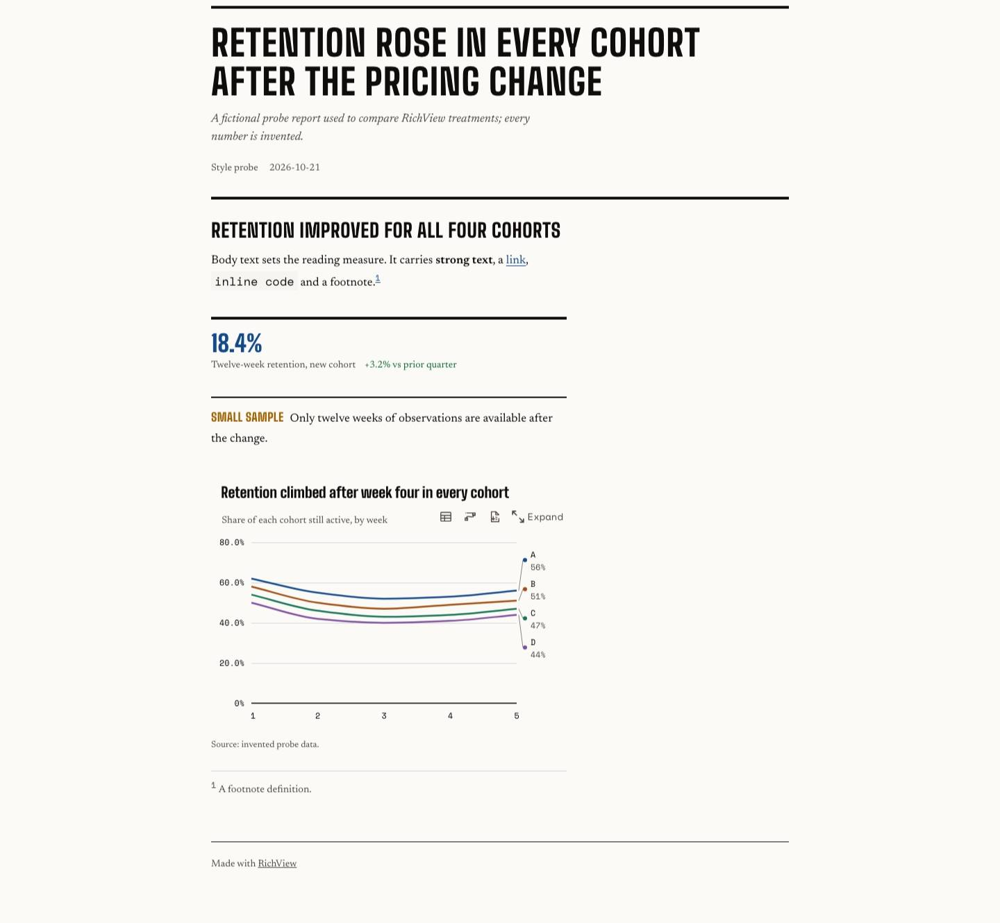
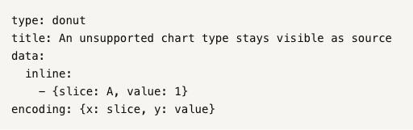
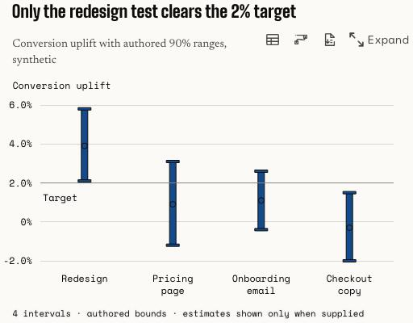
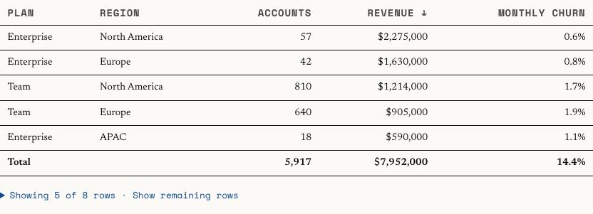
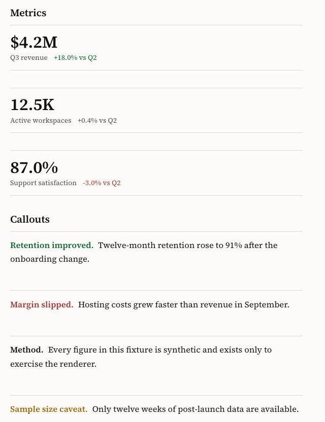
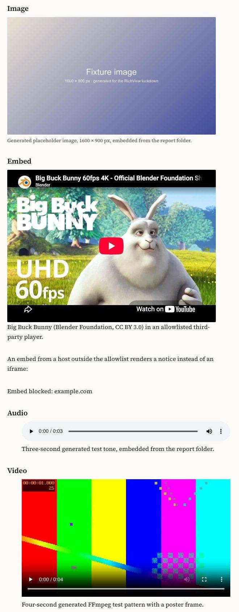
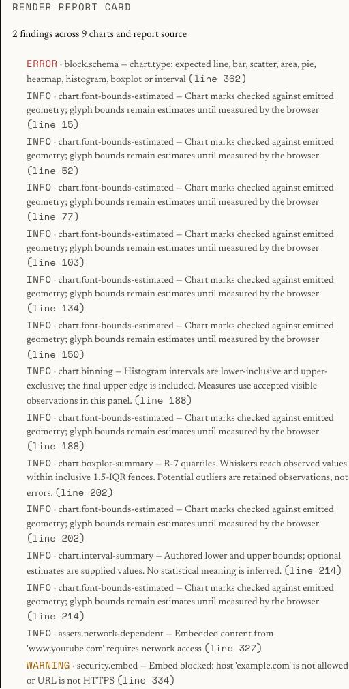

# Format and types

Rich Markdown (`.rmd`) is RichView's only authoring format: an agent writes one plain-text file beside its data, and RichView renders it into a sourced report. This page describes that format and every type around it: the document and its YAML, frontmatter, the rich blocks and their fields, chart types and channels, data sources and the report folder, style files, diagnostics, report identity, and the JSON that agents parse from the CLI, MCP, HTTP and JavaScript surfaces. Each section gives the state of `main` at `b4db233`, then the part 05 proposals that would settle it. No part 05 card has an answer from Daniel yet, so every TYP- card below is a proposal awaiting him; his answers to cards in other parts bind and are cited where they change a proposal. Answer the 99 cards in [part 05 of the lockdown app](http://127.0.0.1:4790/#/part/05-types) (`05-types`), or open an area's first card from [At a glance](#at-a-glance). The full current specification is [docs/RMD-SPEC.md](../RMD-SPEC.md); [where the spec disagrees with the code](#where-the-spec-disagrees-with-the-code) lists the places it is wrong. Part 05 settles names, types, defaults, validation and failure modes; rendered behaviour belongs to the component pages, such as [Chart engine](components/chart.md) and [Report core](components/core.md), and visual choices to part 06 (`STY-`), described on [Styles](styles.md). [What RichView is for](purpose.md) explains why the source is plain text and the output one self-contained file (INT-04), [Performance](performance.md) what that file weighs, and [Delivery](delivery.md) the checks that keep generated agent docs in step with the code.

A fact marked (re-run) was checked on 22 October 2026 with the release build of `b4db233`; [Sources](#sources) says how and where the probes are. When this page was first written that day, all eleven parts were marked ready and no part had a recorded answer. Daniel answered 77 cards between 23 and 27 October, none of them in part 05, and this page was revised on 27 October to follow those answers and the cards revised after them; the app's left rail shows the current status. Part 03 was revised after part 05: where a part 05 card still lists a conflict that the revised `ARC-` card no longer has, this page says so. In the lockdown app, links to evidence files, captured output and report sources do not open yet, because the app sends them to the lockdown branch on GitHub, which is not pushed; open them from `docs/lockdown/` in the lockdown worktree. The [guide index](README.md) explains the labels, IDs and links.

## Terms used on this page

- **Rich block**: a fenced code block whose tag names a block type; RichView decodes its YAML body and renders it.
- **Calendar chart**: a `line` or `area` chart whose `x` values are all date strings (TYP-90 gives the grammar). The calendar engine draws it (`richview-chart/src/render.rs`, `richview-chart/src/spec.rs`) from its own JSON time-series `Spec`; the calendar bridge (`richview-chart/src/rmd.rs`) converts the chart block into that `Spec`. Every other chart goes through the general painter (`richview-chart/src/rmd_render.rs`). [Chart engine](components/chart.md) describes both.
- **Facet**: `encoding.facet` names a field, and the chart splits into one panel per value of it.
- **Readout**: the panel of exact values that appears when a reader points at, taps or focuses a mark (FEA-CH-40).
- **Operations**: `validate` parses the source and checks the folder; `check` also renders the charts and runs their checks; `generate` writes the report into `Rendered/`; `publish` sends it to a server. [Diagnostics](#diagnostics) lists which rules each runs today.
- **Corpus**: the 125 `.rmd` files tracked at `b4db233`: nine examples, the landing demo, 59 benchmark reports and 56 chart-refinement cases in `docs/evidence/chart-refinements`.
- **Golden inputs**: the eleven corpus sources that INT-55 (D-EXAMPLES-CARRY) proposes as fixtures that render in every accepted style without an error.
- **Fixture**: the synthetic lockdown report with all nine chart types, every rich block and one invalid fence ([source](../lockdown/screenshots/product/fixture/source/report.rmd)).
- **dec-N**: decision N of the June decision surface, `architecture.html` of 21 June 2026 in the design-system repository, as the history evidence quotes it.
- **Evidence IDs**: a `D-` ID quoted without an item ID, such as D-CHART-CONTRACT, is a row of the history evidence's decision table, not a lockdown card.

## At a glance

| Area | Today at `b4db233` | Main proposed change | Cards |
| --- | --- | --- | --- |
| [Document and YAML](#document-and-yaml) | Frontmatter, CommonMark and rich YAML fences; the YAML library decides what values mean; five hand-kept vocabularies disagree | One strict YAML profile; one schema registry generates validators, types, editor vocabulary, spec and agent docs, so agent-facing text cannot drift (INT-21); optional `format: rmd/1`; one letter case per surface | [TYP-01](http://127.0.0.1:4790/#/part/05-types/TYP-01) to TYP-05, TYP-82, TYP-83 |
| [Frontmatter](#frontmatter) | Mistyped fields dropped with a warning that has no line; unknown keys silent; every report `lang="en"`; `description` optional | `description` required to publish; new `lang` and `format`; `tabs` (FEA-BR-08); warnings at the key's line; unknown keys warn | [TYP-06](http://127.0.0.1:4790/#/part/05-types/TYP-06) to TYP-08, TYP-84 |
| [Rich blocks](#rich-blocks) | Nine tags, `metric` an alias of `big`; unknown and `_`-prefixed keys pass through to the output | Eight tags, `metric` only; unknown keys warn and are dropped; `_` keys reserved; per-block `wide` | [TYP-09](http://127.0.0.1:4790/#/part/05-types/TYP-09) to TYP-11, TYP-89 |
| [Chart block](#chart-block) | Nine types; required channels and field names partly checked only at render or only in VS Code; title optional | Channel matrix and field checks at `validate` in every host, with a row for each type FEA-CH-01 adds; title required; `stack`; `controls` (FEA-BR-01); one `curve` field; ratios 0.5 to 6 | [TYP-12](http://127.0.0.1:4790/#/part/05-types/TYP-12) to TYP-22, TYP-85, TYP-86, TYP-90 |
| [Values and formats](#values-and-formats) | Five formats in tables and metrics, two on axes; `suffix` on axes, `unit` on metrics; English separators | One vocabulary and one `unit` rule everywhere; currency formats removed; every number rounded to the author's significant digits (FEA-CH-37); separators follow `lang` | [TYP-23](http://127.0.0.1:4790/#/part/05-types/TYP-23), TYP-87 |
| [Tables, metrics and callouts](#tables-metrics-and-callouts) | Columns derived in alphabetical order; `68.2%%`; deltas grey unless `trend` is set | Source column order; units printed once; `trend` defaults to the sign of `delta` | [TYP-24](http://127.0.0.1:4790/#/part/05-types/TYP-24) to TYP-28, TYP-88 |
| [Media, embeds and Markdown](#media-embeds-and-markdown) | `alt` optional; a blocked embed only warns; two different embed host lists | Image `alt` and media `title` required; a `credit` field for Unsplash photos (FEA-RP-62); a blocked embed is an error; one host list | [TYP-29](http://127.0.0.1:4790/#/part/05-types/TYP-29) to TYP-34 |
| [Data](#data) | One of `inline`, `csv`, `json` per block; file content, not the key, picks the parser; every column of a file ships | The key picks the parser; one missing-value rule for every block; only referenced fields ship, rounded to the author's precision; `data.sql` on a RichView server and `data.url` in the browser (OPN-63) | [TYP-35](http://127.0.0.1:4790/#/part/05-types/TYP-35) to TYP-38, TYP-91, TYP-92 |
| [Report folder and output](#report-folder-and-output) | One `.rmd` per folder; a remote image fails the whole render; data files copied into `Rendered/` | A plain remote file is an error on its own element, with pinned asset references and credited Unsplash photos as the exceptions; only linked files copied; every renderable report fits a publish request | [TYP-39](http://127.0.0.1:4790/#/part/05-types/TYP-39) to TYP-43 |
| [Style files](#style-files) | One bad leaf skips the whole file; the chart section is unchecked, so a style file can put a live `<script>` into a report | A bad leaf skips only itself; a closed grammar on every leaf; every CSS sink refuses unsafe values; rich style files with safe and experimental marks (STY-14) | [TYP-44](http://127.0.0.1:4790/#/part/05-types/TYP-44) to TYP-52, TYP-93, TYP-99 |
| [Diagnostics](#diagnostics) | `{level, code, message, path, line?, tag?, details?}`; many without a line; `validate` misses chart and field errors | Adds `fix`, `expected`, `retry`, `file`, `column`; a line on every source diagnostic; each operation runs every earlier rule | [TYP-53](http://127.0.0.1:4790/#/part/05-types/TYP-53) to TYP-59, TYP-94 |
| [Report identity and publishing](#report-identity-and-publishing) | Changed content under an existing version reports success; `latest` is the last publish; the 51st publish deletes the lowest SemVer version | Conflict on changed content; `latest` by SemVer with an owner pin; no automatic deletion | [TYP-60](http://127.0.0.1:4790/#/part/05-types/TYP-60) to TYP-67, TYP-95, TYP-96 |
| [Agent-facing contracts](#agent-facing-contracts) | Mixed letter case; `check` has no `ok`; MCP `isError` on any error diagnostic; a public endpoint exposes data and local paths | camelCase JSON with `ok` everywhere; `isError` only when a call cannot run; a token on publishing, stored records and compute routes | [TYP-68](http://127.0.0.1:4790/#/part/05-types/TYP-68) to TYP-75, TYP-97, TYP-98 |
| [Pending format extensions](#pending-format-extensions) | Only on open PR branches | Tabs and chart controls are adopted (FEA-BR-08, FEA-BR-01); Publish metadata, the Publish site file and SQL connectors are proposed as adopted (INT-31, OPN-63); label highlights wait on part 04d | [TYP-76](http://127.0.0.1:4790/#/part/05-types/TYP-76) to TYP-81 |

## The format in one example

A report is a folder with exactly one `.rmd`, its data, optional `.rstyle.yaml` files and media; rendering writes `Rendered/<name>.html` inside it. This example shows all three parts of the format: frontmatter, Markdown body and rich fences. It is the first 57 lines of the styles evidence's probe report, with the heading corrected from three cohorts to the four in its data ([full source](../lockdown/evidence/format-probes/example/report.rmd), which adds a source note and a footnote; 18 of the 20 chart rows are cut here):

````markdown
---
title: Retention rose in every cohort after the pricing change
description: A fictional probe report used to compare RichView treatments; every number is invented.
version: 0.0.1
author: Style probe
date: 2026-10-21
---

## Retention improved for all four cohorts

Body text sets the reading measure. It carries **strong text**, a [link](https://example.com), `inline code` and a footnote.[^1]

```metric
value: 0.184
format: percent
label: Twelve-week retention, new cohort
delta: 0.032
delta_label: vs prior quarter
trend: up
```

```callout
kind: hold
title: Small sample
body: Only twelve weeks of observations are available after the change.
```

```chart
type: line
title: Retention climbed after week four in every cohort
subtitle: Share of each cohort still active, by week
data:
  inline:
    - {week: 1, cohort: A, share: 0.62}
    - {week: 2, cohort: A, share: 0.55}
    # 18 more rows for cohorts A to D
encoding: {x: week, y: share, color: cohort}
axes:
  y: {format: percent}
```
````



`title` is the headline, `description` the italic lede, `author` and `date` the meta line; the `##` heading and the body follow. The `big` block is a stat line whose delta takes the `up` colour from `trend`, the `hold` callout's title runs into its body, and the chart's `title` and `subtitle` head the figure beside its Table, SVG, CSV and Expand actions; `encoding.color` draws one labelled line per cohort, and `axes.y.format: percent` labels the axis. The italic `Source:` paragraph under the chart becomes its source note, and the footnote closes the body. `version` renders nothing; it is publication identity. Source: the example rendered with `richview generate --style brutalist` at `b4db233`, captured headless at 1440 px wide with reduced motion, cropped below the colophon, 2026-10-22. Cards: TYP-06 (T-FRONTMATTER), TYP-26 (T-BLOCK-METRIC), TYP-28 (T-BLOCK-CALLOUT), TYP-12 (T-BLOCK-CHART).

`richview init` writes a similar starter with a metric, a bar chart and a callout ([captured output](../lockdown/screenshots/product/cli/init.txt)); it uses a `big` fence, which TYP-09 renames, and sets `styles: [sleek]`, which stays valid: Sleek is the default style and keeps the id `sleek` (STY-05, STY-06, TYP-52). The [lockdown fixture](../lockdown/screenshots/product/fixture/source/report.rmd) exercises all nine chart types, every rich block and one invalid fence; [Screenshots](screenshots.md#charts) shows what it renders.

## Document and YAML

A report is one UTF-8 file: optional YAML frontmatter, a CommonMark body, and fenced code blocks whose tag names a rich block. RichView decodes each rich fence's YAML body through that tag's schema and splices the rendered block back into the Markdown; any other fence stays a code block, so the source still reads as Markdown in any viewer.

| Rule | Today at `b4db233` |
| --- | --- |
| File | At most 16 MiB, else `source.limit` and no output; a leading byte-order mark is dropped (`crates/richview-core/src/parser.rs:14-23`) |
| Frontmatter | Only when line 1 is exactly `---`; it ends at the next `---` or `...` line; `theme: auto` is inserted when absent |
| Unclosed frontmatter | `frontmatter.unclosed` warning at line 1; the text renders as Markdown |
| Unreadable frontmatter | Invalid YAML (`frontmatter.yaml`) or a value that is not a mapping (`frontmatter.type`) warns at line 1; the block is cut and the report renders as `Untitled report` (re-run) |
| Rich fence | A CommonMark fenced block whose trimmed, lowercased info string is a rich tag, so a `Chart` tag is a chart (re-run); its body must be a YAML mapping |
| Failed fence | Stays visible as a code block; an `error` diagnostic carries the fence line, counted from line 1 of the file |
| Any other fence | An ordinary code block, for example `mermaid` or `python` |

> **TYP-01 (T-RMD-DOCUMENT), proposed.** The model stays as described: frontmatter, CommonMark body, rich fences, and failed fences visible as code with an error at their line. The `<!--richview:block:N-->` placeholders that splice rendered blocks into the Markdown are internal and not part of the format.

YAML is parsed by `serde_yaml 0.9.34+deprecated` with its defaults (`Cargo.lock:1933-1934`), so the library decides what a value means and never says so. Probe results (re-run):

| Source | Read today as | Under TYP-02 |
| --- | --- | --- |
| `title:` written twice | The second value, silently | `yaml.duplicate-key` error at the second key |
| `007` | The string `"007"` | String |
| `0b11` | The number 3 | String |
| `0x10`, `0o17`, `1e3` | 16, 15, 1000.0 | Numbers |
| `1_000`, `yes`, `2026-10-04` | Strings | Strings |
| `.inf` | null | Error |
| An anchor `&row` and its alias `*row` | Expanded | `yaml.unsupported` error |
| A merge key `<<: *row` | A literal field named `<<` holding the mapping | `yaml.unsupported` error |
| `{label: Tickets per 1,000 accounts}` | Label `Tickets per 1` plus a stray key `000 accounts`, no diagnostic | The stray key warns `block.unknown-key` (TYP-10); quoting the label fixes it |

> **TYP-02 (T-YAML-DIALECT), proposed.** Frontmatter, rich fences and style files share one strict profile of the YAML 1.2 core schema: duplicate keys, anchors, aliases, merge keys, explicit tags and non-finite numbers are errors; `yes`, `no`, `on`, `off`, unquoted dates, `1_000` and `0b11` are strings; integers with a leading zero stay strings, a deliberate deviation from YAML 1.2 that keeps today's reading; `0x10`, `0o17` and `1e3` are numbers. The parser is a maintained YAML 1.2 implementation, not the deprecated `serde_yaml`. Alternatives: today's parser defaults, or the strict profile with anchors allowed.

Five hand-kept lists describe the format today, and they disagree; [other documents](#where-the-spec-disagrees-with-the-code) drift further.

| List | Where | Drift |
| --- | --- | --- |
| Parser | `crates/richview-core/src/parser.rs:269-704` | Accepts `locale` on every axis, while the spec and the editor offer it on `x` only |
| Public schema adapters | `crates/richview-core/src/compat.rs:53-349` | `BigSchema` accepts only `big`; only these adapters reject `headers` and `cache` under `data`; their dropped-label `reason` enum rejects two reasons the engine emits |
| Editor vocabulary | `crates/richview-core/src/authoring.rs:6-156` | Offers `rotate` on every annotation kind; leaves `sleek-dark` out of the `styles` completions |
| JavaScript declarations | `assets/node/core-api.d.ts` | `Media` lacks `alt` and `title`; the diagnostic type lacks `details` |
| `richview learn` text | `crates/richview-core/src/knowledge.rs:11-19` | Names five MCP tools where seven exist; calls `sleek-dark` canonical |

Names mix letter cases: `.rmd` fields are snake_case (`max_rows`, `delta_label`), style tokens kebab-case (`bg-elev`), chart style keys camelCase (`barRadius`, `fontFamily`), MCP arguments snake_case (`input_path`, `chart_width`), and JSON output mixes cases (`renderDiagnostics` in the CLI, `updated_at` in server responses). No source declares a format version; rendered HTML carries `<meta name="generator" content="richview/3.0.0-alpha.0">` (re-run).

> **TYP-03 (D-TYP-VOCABULARIES), proposed.** Every name, type, default, enum, range, description and diagnostic code on this page lives once in the schema registry of ARC-09 (D-SINGLE-SOURCE), which generates the validators, `.d.ts` files, editor vocabulary, spec tables, `learn` text and MCP input schemas, as Daniel's INT-21 answer requires of the agent-facing text; today's drifts become fixtures for the generation check.
>
> **TYP-04 (D-TYP-DOC-DRIFT), proposed.** The spec generated from that registry is the one canonical format reference. `llms.txt`, the skill, the quickstart, `richview learn`, public docs and `CLAUDE.md` link to it and embed only generated fragments (tags, chart types, tools, field tables), never hand-written counts, under the drift check of INT-66 (G-AGENT-DOCS-CURRENT). This is the form of Daniel's INT-21 answer: the learn bundle, the skill and the MCP tool descriptions are generated from, or tested against, the same code as the renderer, so the drift cannot come back.
>
> **TYP-82 (D-TYP-NAMING-CASE), proposed.** `.rmd` fields are snake_case, style-file keys kebab-case, and every JSON and JavaScript name camelCase: `barRadius` becomes `bar-radius`, `input_path` becomes `inputPath`, `report_folder` becomes `reportFolder`, `updated_at` becomes `updatedAt`. Alternatives: snake_case for every agent-facing name, or today's spellings with permanent aliases.
>
> **TYP-05 (D-TYP-FORMAT-VERSION), proposed.** Frontmatter may carry `format: rmd/1`; absent means the current major version, and a renderer rejects a higher major with `frontmatter.format`. Additive fields keep the version; renames and removals bump it. The migration writes the marker into every source it rewrites, rendered HTML names `richview rmd/1` as its generator, and the stored version's metadata records the format. In June, dec-4 planned a frontmatter `format: rmd/0.1` discriminator, dec-9 demoted it to optional generator metadata until a real grammar break was on the roadmap, and the publish plan kept the pin out of frontmatter; none was built, and OPN-38 (D-DEC-UNBUILT) drops them and points here. Alternatives: absent means legacy, a pin recorded only outside the source as in June, or no marker.

## Frontmatter

Frontmatter is the report's header and identity. Drafts need none of it; publishing needs `title` and `version` today. A known field with the wrong type is dropped with a `frontmatter.type` warning that carries a path but no line: `author: 42`, `tags: [1]` and `styles: scientific` all warned this way, and the last one fell back to the default style (re-run; `crates/richview-core/src/parser.rs:200-267`). Unknown keys stay in the metadata without a diagnostic, as the spec promises (`docs/RMD-SPEC.md:50`), so a typo such as `descripton:` loses the lede silently.

| Field | Today at `b4db233` | Proposed (TYP-06 unless noted) |
| --- | --- | --- |
| `title` | String; the `<h1>` and the HTML `<title>`; `Untitled report` when absent; required to publish | Same |
| `description` | String; the lede under the title. Publishing computes a `publish.description` warning when it is missing, and the CLI discards it (`crates/richview-app/src/cli.rs:438-440`) | Required to publish (TYP-07) |
| `subtitle` | String; a second line after the lede | Kept unless FEA-RP-04 folds it into `description` |
| `author` | String; escaped text in the meta line, never Markdown | Same |
| `date` | Any string, printed as written in `<time datetime>`; an unquoted YAML date stays a string | `YYYY-MM-DD` or RFC 3339; other shapes warn `frontmatter.date` and print as written |
| `version` | Semver-shaped string, trimmed; leading zeros and `+build` pass; `version: 1.0` is a YAML number and is dropped with `frontmatter.type` | Strict SemVer without build metadata (TYP-62) |
| `slug` | String; its grammar is checked only when publishing | One slug grammar (TYP-60) |
| `tags` | List of strings, metadata only; a single string is dropped | A single string is one tag |
| `theme` | `auto` (default), `light` or `dark`; other values warn `frontmatter.theme` and reset to `auto`; `--theme` overrides it; PDF output is always light | Same, unless FEA-RP-33 removes it |
| `styles` | List of builtin names or report-local style files; a single string is dropped and the default style renders | A single string is one entry; references per TYP-45 |
| `title_image` | Path or image mapping for a header image; `title-image` and `image` are aliases | `title_image` only; the aliases fail with `frontmatter.renamed` and migrate |
| `prolog` | Markdown before the body; a value that is not a string is ignored without a diagnostic | Kept unless FEA-RP-05 moves it into the body |
| `tabs` | Absent on `main`; PR #63 adds it | New optional mapping (TYP-76, Daniel's FEA-BR-08 answer): tabbed panels; invalid tabs warn and the report renders without tabs |
| `data` | Hard error `frontmatter.data`: data lives in blocks | Same |
| `lang` | Absent; every report is `<html lang="en">` (`crates/richview-core/src/render.rs:353`) | New BCP 47 tag, default `en` (TYP-08) |
| `format` | Absent | New, optional `rmd/1` (TYP-05) |
| Unknown keys | Kept in the metadata, no diagnostic | `frontmatter.unknown-key` warning naming the nearest known key (TYP-84) |

> **TYP-06 (T-FRONTMATTER), proposed.** The vocabulary in the right-hand column, with one header-image key and every frontmatter warning at its key's line. Removals that part 04b decides join the migration: `subtitle` (FEA-RP-04), `prolog` (FEA-RP-05) and `theme` (FEA-RP-33). Daniel's FEA-BR-08 answer adds `tabs` (TYP-76), and `publish` (TYP-80) is proposed as an optional namespace.
>
> **TYP-07 (D-TYP-DESCRIPTION), proposed.** Publishing requires a non-empty `title`, `description` and `version`, as S27-418 (2026-06-20) and dec-8 state; a missing one is `publish.metadata` and nothing is stored. `validate --publish` and the MCP `publish` flag run the same rules before any upload, and the server runs them again. A published story's link preview (Daniel's INT-07 answer) is built from fields that already exist: `description` feeds `og:description` (FEA-RP-51), and the host sets the `title` and the byline (`author`) over the lead chart or header image in the thumbnail it renders (FEA-SF-55); INT-07 adds no required field. Alternatives: a warning shown everywhere, or optional.
>
> **TYP-08 (T-REPORT-LANG), proposed.** Optional `lang` sets `<html lang>`, the default `axes.x.locale` where one of the five supported locales matches, the smart-quote style and number separators; an unsupported tag still sets `<html lang>` and warns `frontmatter.lang`. Reader UI strings (Table, CSV, Expand) stay English. Alternatives: English only, or full localisation.
>
> **TYP-84 (D-TYP-FRONTMATTER-KEYS), proposed.** An unknown key is `frontmatter.unknown-key` (warning) at its line, naming the nearest known key; it stays in the metadata and renders nothing. This reverses `docs/RMD-SPEC.md:50`; no example uses an unknown key. Alternatives: silent, as today, or an error.

## Rich blocks

Nine fence tags are rich blocks today (`crates/richview-core/src/parser.rs:8-10`), each rendering one kind of element:

| Tag | Renders | Fields |
| --- | --- | --- |
| `chart` | A figure: title, subtitle and an inline SVG chart with readouts and the Table, SVG, CSV and Expand actions | [Chart block](#chart-block) |
| `table` | A data table with column formats, a sort, an optional totals row and a fold after `max_rows` rows | [Tables, metrics and callouts](#tables-metrics-and-callouts) |
| `big`, or its alias `metric` | A headline number with its label and an optional delta coloured by `trend` | [Tables, metrics and callouts](#tables-metrics-and-callouts) |
| `callout` | A short finding or caveat whose run-in title takes the colour of its `kind` | [Tables, metrics and callouts](#tables-metrics-and-callouts) |
| `image` | A report-local image or `data:` URI embedded in the HTML, with an optional caption | [Media, embeds and Markdown](#media-embeds-and-markdown) |
| `audio`, `video` | The browser's native player for a report-local file embedded in the HTML | [Media, embeds and Markdown](#media-embeds-and-markdown) |
| `embed` | An iframe of a page on an allowed third-party host, such as a YouTube video | [Media, embeds and Markdown](#media-embeds-and-markdown) |

`metric` is an alias of `big` with the same schema and renderer; the public `BigSchema` adapter accepts only `big` (`crates/richview-core/src/compat.rs:57`), and no example uses `metric`. A body that is not a mapping is `block.type`, invalid YAML `block.yaml`, and a field that breaks its rule `block.schema`. Each is an error at the fence line; the fence stays visible as code, the rest of the report renders, and `generate` writes the HTML but exits 1 (re-run with `type: donut` and with `kind: note`).



The fixture's `type: donut` fence as a draft reader sees it: the YAML kept as a code block. Its diagnostic is `block.schema` at line 362 with path `chart.type` ([captured JSON](../lockdown/screenshots/product/cli/validate-json-fixture.txt)). Source: the [fixture](../lockdown/screenshots/product/fixture/source/report.rmd) rendered with `richview generate report.rmd --report-card`, element crop at 1440×900, 2026-10-21. Cards: TYP-10 (D-TYP-UNKNOWN-KEYS); FEA-RP-29 (F-NOT-RENDERED) would add a one-line notice above the kept source.

Unknown keys pass through. They stay on the block and travel into the chart's runtime payload (an unknown `base` key did, re-run); the CLI, MCP and server say nothing, and only VS Code warns `authoring.key` (`crates/richview-editor/src/authoring.rs:360-372`). A typo therefore fails somewhere else or nowhere: `colour: year` inside `encoding` was ignored and the grouped bar chart failed as `chart.ambiguous-bar-slot`, and `axes.y.lable` dropped the axis title without a word (re-run). Four host-internal keys are honoured from source: `_renderHeight`, `_xWindow`, `_csvNumericText` and `_facetColorScope`. `_renderHeight: 900` drew a 900 px chart (re-run), against the spec's "No author pixel height" (`docs/RMD-SPEC.md:90`). Parsing also inserts defaults that then appear in payloads: table `max_rows: 20`, `total: false` and `sort.dir: asc`; image `fit: contain`; embed `height: 420` and a six-host `allow` list (`crates/richview-core/src/compat.rs:249-277`).

> **TYP-09 (T-RICH-FENCE), proposed.** Eight tags with one name each: `chart`, `table`, `metric`, `callout`, `image`, `audio`, `video`, `embed`, matched case-insensitively. A `big` fence is `block.renamed` (error) naming `metric`, never a silent code block, and the migration renames it in the five golden inputs that use it, the `init` template, the snippets, the tests and `components.big` in the five builtin styles. This reverses dec-7 (2026-06-21), which kept `big` because a rename would break every source "for zero agent-observable benefit" and planned one `media` tag for audio and video; both remain options, as does today's alias.
>
> **TYP-10 (D-TYP-UNKNOWN-KEYS), proposed.** In every host, an unknown key at any depth is `block.unknown-key` (warning) at its line with the nearest known key, and it is dropped before rendering, so it never reaches HTML or payloads. A known key with an invalid value is `block.schema` (error), and publish refuses the report. Alternatives: an error for unknown keys too, or today's silent pass-through, which the history evidence (D-CHART-CONTRACT) recommended keeping.
>
> **TYP-11 (D-TYP-INTERNAL-KEYS), proposed.** Keys starting with `_` are reserved: in source they are unknown keys, warned and dropped. Render height, zoom window, CSV numeric text and facet colour scope travel in typed options or the payload, never inside the authored block.
>
> **TYP-89 (D-TYP-BLOCK-WIDTH), proposed.** `wide: true` (default `false`) lets a `chart`, `table`, `image`, `video` or `embed` take the full report width instead of the text measure; `metric`, `callout` and `audio` have no `wide`. The CSS hooks exist without a source field (`crates/richview-core/assets/report.css:102-112`); today only the chart's Expand toggle sets `rv-chart--full`. Alternatives: PR #67's report-wide `layout.measure-wide-blocks`, which FEA-BR-18 drops, or no opt-in.

The [Expand capture](../lockdown/screenshots/product/interactions/interaction-expand-desktop.jpg) shows the two widths `wide` would choose between: an expanded line chart across the report width above a bar chart at the text measure (fixture in brutalist, 1440×900, 2026-10-21).

## Chart block

A chart block names a type, its data and the data field behind each channel; scales, colours, label placement and readability checks come from the engine and the style. Charts are responsive: there is no pixel height and no interaction field.

### Chart fields

| Field | Today at `b4db233` | Proposed |
| --- | --- | --- |
| `type` | `line`, `bar`, `scatter`, `area`, `pie`, `heatmap`, `histogram`, `boxplot` or `interval`; anything else is `block.schema` | The same nine, growing to every type of the major chart libraries (TYP-12, FEA-CH-01) |
| `title` | String. A missing title only warns `block.title`; the caption then shows no title and the accessible name falls back to "Chart" (re-run), or to a generated date-range sentence on calendar charts (part 05's run) | Required on every chart; missing is `block.schema` (TYP-13) |
| `subtitle` | String; the dek under the title | Same |
| `data` | One of `inline`, `csv`, `json` ([Data](#data)) | Same |
| `encoding` | Channel to field-name mapping; each value must be a string | Channel matrix checked at `validate` (TYP-14) |
| `axes` | Options for `x`, `y` and `color` | TYP-16 |
| `style` | `palette`, `ratio`, `orientation`, `curve`, `line.smoothing`, `curvature` | TYP-17 |
| `annotations` | List of `point`, `line`, `text`, `range` and `band` | TYP-19 |
| `binning` | Histogram only; on any other type `block.schema` | Unchanged (TYP-20) |
| `ratio` at the top level | Undocumented; honoured only by calendar line and area charts | Removed and migrated to `style.ratio` (TYP-85) |
| `stack` | Absent | New boolean for bar and area charts with `encoding.color` (TYP-12, FEA-CH-05) |
| `wide` | Absent | New (TYP-89) |
| `controls` | Absent on `main`; PR #62 adds it | New (TYP-77, Daniel's FEA-BR-01 answer): playback, filter, metric and variant, in author order |

> **TYP-12 (T-BLOCK-CHART), proposed.** The right-hand column is the whole top-level vocabulary: `type`, `title`, `data` and `encoding` required; `subtitle`, `axes`, `style` and `annotations` optional; `binning` on histograms only; `stack` only on bar and area charts with `encoding.color`, elsewhere `block.schema`; `wide` only with TYP-89; `controls` with TYP-77. The type list is nine today and grows to every type of the major chart libraries (FEA-CH-01; TYP-14's open item). There is no pixel height and no interaction field; `controls` joins with Daniel's FEA-BR-01 answer, and `highlight` (TYP-78) is still a pending extension.
>
> **TYP-13 (D-TYP-UNTITLED-CHART), proposed.** A chart `title` is required: a missing or empty title is `block.schema`, so the chart stays visible as code in drafts and publish refuses the report, and the title is both the caption heading and the chart's accessible name. Daniel's INT-13 answer (D-MAX-AUTHORING) lists a title that states the chart's claim among what a chart needs, with its type, data, encodings and a source note. The schema checks only that a title is present and non-empty; no check judges whether it states a claim or reads well (Daniel's INT-77 answer). The history evidence (D-CHART-CONTRACT) recommends keeping the warning, and OPN-36 (D-DEC-KEEP) records dec-10 as "a chart without a title warns". Alternatives: a warning plus a visible derived title, or today's warning without one.

The fixture's interval chart shows how the fields map onto a figure. This is the body of its `chart` fence:

```yaml
type: interval
title: Only the redesign test clears the 2% target
subtitle: Conversion uplift with authored 90% ranges, synthetic
data:
  inline:
    - {test: Redesign, low: 0.021, high: 0.058, uplift: 0.039}
    - {test: Pricing page, low: -0.012, high: 0.031, uplift: 0.009}
    - {test: Onboarding email, low: -0.004, high: 0.026, uplift: 0.011}
    - {test: Checkout copy, low: -0.020, high: 0.015, uplift: -0.003}
encoding: {x: test, y: uplift, lower: low, upper: high}
axes:
  y: {label: Conversion uplift, format: percent}
annotations:
  - {kind: line, at: {y: 0.02}, text: Target}
```



`title` and `subtitle` head the figure; `x` gives the categories, `lower` and `upper` the ranges and `y` the estimate circles; `axes.y` sets the axis title and percent labels; the `line` annotation draws the Target rule at 2%. No field asks for the footer "4 intervals · authored bounds · estimates shown only when supplied": the engine writes it (`richview-chart/src/rmd_render/interval.rs:420-423`), and FEA-CH-14 (D-CHART-METHOD-NOTES) would drop it, since the chart computes nothing and excludes no rows. Source: the [fixture](../lockdown/screenshots/product/fixture/source/report.rmd) rendered with `richview generate report.rmd --style brutalist`, figure crop at 1440×900, 2026-10-21. Cards: TYP-12 (T-BLOCK-CHART), TYP-14 (T-CHART-ENCODING), TYP-19 (T-CHART-ANNOTATION).

### Chart types and channels

Each channel names one data field. Today only the histogram, boxplot and interval rules run when the source is parsed; the rest run when the chart renders, so `validate` passes them and only `check` or `generate` fails, or nothing fails at all. In this table, "at render" means only `check` and `generate` report it, "unused" means accepted and ignored, and "rejected" means `block.schema` (`crates/richview-core/src/parser.rs:334-383`, `richview-chart/src/rmd_render.rs:1658-1668`).

| Type today | `x` | `y` | `lower`, `upper` | `color` | `size` | `label` | `facet` |
| --- | --- | --- | --- | --- | --- | --- | --- |
| `line`, `area` | Optional | Required at render | Rejected | Optional series | Unused | Unused | Optional |
| `bar` | Optional; without it no bars and no diagnostic | Required at render | Rejected | Optional series | Unused | Unused | Optional |
| `scatter` | Required numeric, at render | Required at render | Rejected | Optional group | Optional bubble area | Optional point names | Optional |
| `pie` | Optional; without it one 100% slice and no diagnostic | Required non-negative, at render | Rejected | Unused | Unused | Unused | Optional |
| `heatmap` | Required column, at render | Required row, at render | Rejected | Required numeric value, at render | Unused | Unused | Optional |
| `histogram` | Required numeric, at parse | Rejected | Rejected | Optional stack | Rejected | Rejected | Optional |
| `boxplot` | Optional category | Required numeric, at parse | Rejected | Optional | Rejected | Rejected | Optional |
| `interval` | Required category, at parse | Optional estimate | Required, at parse | Optional | Rejected | Rejected | Optional |

A bar chart without `encoding.y` passed `validate` and failed `check` with `chart.missing-encoding` (re-run); the empty bar chart and the single pie slice are part 05's runs.

> **TYP-14 (T-CHART-ENCODING), proposed.** Required (R) and rejected (X) channels are checked at parse in every host, as in the table below; value rules (numeric, non-negative, one value per bar slot) stay `chart.*` errors on resolved data. Channels accepted but unused today become errors. There is no `y2` channel, although PR #69's docs describe one, and a `detail` channel exists only if TYP-36 adopts it. The rows cover the nine types built today. Daniel's FEA-CH-01 answer makes RichView the richest chart library: at least every chart type ggplot2, Plotly, ECharts, Highcharts and Power BI define, likely around 30. Each added type gets its row here, with its channels, before it is built, and the registry generates every list of types from this table (TYP-03). Open item: compile the type list from those five libraries.

| Type, proposed | `x` | `y` | `lower`, `upper` | `color` | `size` | `label` | `facet` |
| --- | --- | --- | --- | --- | --- | --- | --- |
| `line`, `area` | R | R | X | O series | X | X | O |
| `bar` | R category | R | X | O series | X | X | O |
| `scatter` | R | R | X | O group | O | O | O |
| `pie` | R category | R | X | X | X | X | O |
| `heatmap` | R column | R row | X | R value | X | X | O |
| `histogram` | R | X | X | O stack | X | X | O |
| `boxplot` | O category | R | X | O | X | X | O |
| `interval` | R category | O estimate | R | O | X | X | O |

The `x` values decide the axis of a line or area chart, and TYP-14 keeps today's rule: a calendar axis when every `x` is a date string, a numeric axis when every `x` is a number or numeric string, otherwise categories. Bar `x` is always categorical and scatter `x` always numeric. Only strings count as dates, so quoted years (`"2020"`) drew a calendar chart through the calendar engine at 720×360, and unquoted `2020` a numeric axis at 720×405 (re-run); one malformed `x` turns a calendar axis into a numeric or category axis. TYP-90 (T-TEMPORAL-VALUE) writes down the date grammar, which no document stated (`richview-chart/src/time.rs:133-238`):

| Form | Example | Precision |
| --- | --- | --- |
| `YYYY` | `2020` | Year |
| `YYYY-MM` | `2020-03` | Month |
| `YYYY-MM-DD` | `2020-03-31` | Day |
| Date, then `T`, `t` or a space, then `HH:MM` | `2020-03-31T14:05` | Minute |
| The same with `:SS` | `2020-03-31 14:05:09` | Second |
| The same with a fraction of 1 to 9 digits after `.` or `,` | `2020-03-31T14:05:09.5` | Millisecond; digits beyond three are dropped |

A date-time may end in `Z` or `z`, `±HH`, `±HHMM` or `±HH:MM`; without an offset it is UTC. Surrounding spaces are ignored. Out-of-range fields (month 13, 30 February, 25:00, an offset of 24 hours) make the value a non-date. TYP-90 keeps these rules as they are.

### Axes, style and ratio

| Field | Today at `b4db233` | Proposed |
| --- | --- | --- |
| `axes.x.label`, `axes.y.label` | Axis titles | Same |
| `axes.color.label` | Names heatmap values in readouts, although the spec calls it retained metadata (`richview-chart/src/rmd_render.rs:160-168`) | Same, documented |
| `axes.*.format` | Any string; axes implement `percent` and `currency` (`$`) only, and print every other name as plain numbers | The shared vocabulary of [Values and formats](#values-and-formats); an unknown name is `block.schema` |
| `axes.*.suffix` | Unit text after the value | Renamed `unit` |
| `axes.*.digits` | Absent | New: significant digits for that axis's labels (TYP-23, Daniel's FEA-CH-37 answer) |
| `axes.*.locale` | `en-US`, `en-GB`, `cs-CZ`, `de-DE` or `ja-JP`; accepted on every axis, read only from `x` | `axes.x.locale` only, defaulting from `lang` |
| `axes.y.min`, `axes.y.max` | Finite numbers with `min` below `max`; histograms need `min: 0` | Same |
| `style.palette` | `editorial` (deprecated), `brutalist`, `scientific`, `sleek`, `sleek-dark`, `sleek-light`, `hand-drawn`; omitted, the chart inherits the report style | A builtin name from part 06's catalogue (TYP-52) |
| `style.ratio` | A positive number or any string; `W:H` is parsed and anything else silently keeps the type's default (`ratio: wide` did, re-run) | `W:H` or a number between 0.5 and 6, else `block.schema` (TYP-85) |
| `style.orientation` | `auto`, `vertical` or `horizontal` for bar, boxplot and interval; histograms take `auto` or `vertical` | Same |
| `style.curve` | `linear`, `monotone`, `step`, `step_before` or `step_after` | Same, default `monotone` |
| `style.line.smoothing` | `straight`, `monotone` (default) or `current` (monotone at 0.75); cannot be combined with `curve` | Retired and migrated to `curve` and `curvature` |
| `style.curvature` | Number from 0 to 1 | Same, default 1 |

Default ratios are 16:9, except scatter at 4:3 and pie at 1:1 (`richview-chart/src/rmd_render.rs:571-587`); calendar line and area charts use 2:1, or 1.45 with several panes (`richview-chart/src/render.rs:373`). At 720 px a calendar line chart is 360 px tall and a bar chart 405 px (re-run); the spec's 16:9 for every line and area chart is wrong (`docs/RMD-SPEC.md:100`).

> **TYP-16 (T-CHART-AXES), proposed.** The axis fields above: `unit` replaces `suffix`, `format` takes the shared vocabulary, and `locale` lives on `axes.x` only. The migration renames `suffix` in the histogram, boxplot and interval examples and in 52 benchmark reports; the card misses seven chart-refinement cases that also use it ([Proposed breaking changes](#proposed-breaking-changes-typ-83)).
>
> **TYP-17 (T-CHART-STYLE), proposed.** One interpolation field: `style.curve` with `style.curvature`, set report-wide as `chart.curve` and `chart.curvature` in a style file. `line.smoothing` retires: `straight` becomes `curve: linear`, `monotone` stays monotone, and `current` becomes monotone with `curvature: 0.75`. This goes against S27-635 (2026-10-13, still in Brain Dump), which asks to keep a `style.line.smoothing` enum "so themes can opt in"; themes keep that opt-in through `chart.curve`. The alternative keeps `line.smoothing`, extended with the step forms, and retires `curve`.
>
> **TYP-18 (D-TYP-RATIO), proposed.** One default-ratio table for code and spec: line and area 2:1 on a calendar axis and 16:9 otherwise, bar, heatmap, histogram, boxplot and interval 16:9, scatter 4:3, pie 1:1. The alternative, 16:9 for every Cartesian chart, makes every calendar chart 12.5% taller. Each type that Daniel's FEA-CH-01 answer adds gets its default ratio in this table when it is specified (TYP-14).
>
> **TYP-85 (D-TYP-RATIO-GRAMMAR), proposed.** `style.ratio` is `W:H` or one positive number, between 0.5 and 6 for every type; anything else, including names such as `wide`, is `block.schema`. In the 125 corpus sources it is always `16:9` (69 charts) or `4:3` (one); the card's source says 126. Alternatives: any positive ratio with a warning outside the range, or today's silent per-engine fallbacks.

### Annotations and binning

| `kind` | Anchor | `text` | Extra |
| --- | --- | --- | --- |
| `point` | `at` | Required | |
| `line` | `at` | Optional | |
| `text` | `at` | Required | `rotate` in degrees |
| `range` | `from`, `to` | Optional | |
| `band` | `from`, `to` | Optional | |

An anchor maps data field names, or the axis aliases `x` and `y`, to string or number values: Cartesian coordinates, a pie slice by its category field or `name`, a heatmap cell, or `value` plus the measure for histograms (`at: {value: 10, count: 4}`). Today the parser type-checks `rotate` on every kind and the engine rotates every kind, while the spec and the public schema allow it on `text` only and the editor offers it everywhere; anchor keys that are neither fields nor aliases are not checked; an anchor that matches no mark warns `chart.unresolved-annotation`; a label with no clear position is dropped and recorded (`crates/richview-core/src/parser.rs:494-545`, `richview-chart/src/rmd_render.rs:3010-3018`).

> **TYP-19 (T-CHART-ANNOTATION), proposed.** The five kinds above. `x` and `y` always mean the `encoding.x` and `encoding.y` roles, also on horizontal bars and transposed heatmaps. An anchor key that is neither a data field nor an alias is `block.field` (error); `rotate` on any kind other than `text` is `block.schema`, which breaks no corpus source.

| `binning` field | Rule today, kept by TYP-20 (T-CHART-BINNING) |
| --- | --- |
| `count` | Integer from 1 to 256; default Sturges, `ceil(log2 n) + 1`, capped at 256 |
| `extent` | `[lo, hi]`, finite and increasing; observations outside are excluded and counted |
| `edges` | 2 to 257 strictly increasing finite numbers; not combined with `count` or `extent` |
| `measure` | `count` (default), `proportion` or `density` |

Intervals include their lower edge and exclude their upper edge, except the last; edges resolve over the whole dataset before facets. `binning` is the only chart object that already rejects unknown keys (`richview-chart/src/binning.rs:36-66`).

### What block YAML cannot reach

`.rmd` has no authored interaction field: every chart gets the reader interactions defined for its type in part 04a (readouts, legend toggles, Table, SVG, CSV, Expand, zoom where it applies). The calendar engine's typed JSON `Spec` has panes, transforms, a view window, range presets, a navigator, a secondary unit axis, stacking, end labels and gap limits, and the `/charts/` page uses them ([full page](../lockdown/screenshots/product/charts/charts-desktop-full.jpg), 2026-10-21: range presets, year-over-year and rebased views, an overview strip and a two-pane chart). The calendar bridge passes only the chart's title, its subtitle as the `Spec`'s `description`, `axes.x.locale`, the y-axis label, format, suffix and limits, the curve, the annotations, and a ratio between 0.5 and 6 as `aspect` (`richview-chart/src/rmd.rs:69-273`). The `richview-chart` binary reads that JSON with `data.url` resolved next to the spec file, outside any report-folder rule.

> **TYP-21 (T-CHART-INTERACTION), proposed.** No authored interaction fields; author-level controls arrive only through T-CHART-CONTROLS (TYP-77), which Daniel's FEA-BR-01 answer brings in. The alternative exposes the engine's interaction options.
>
> **TYP-22 (T-ENGINE-CHARTSPEC), proposed.** The engine's JSON `Spec` is internal and may change freely behind the `.rmd` contract, as ARC-19 (D-CHART-PIPELINE) and INT-32 (D-SCOPE-CHARTS) decide; its standalone examples become engine tests, and the `richview-chart` binary takes `.rmd` chart blocks under the report-folder rules or is dropped.
>
> **TYP-86 (D-TYP-TEMPORAL-FEATURES), proposed.** Stacking (`stack: true`) and precision (`digits`, per chart or element, under Daniel's FEA-CH-37 answer) become fields. Gaps, series end labels and tick choice stay automatic (FEA-CH-38, FEA-CH-27, FEA-CH-23); the display multiplier `scale` and observation notes are not offered; panes, the secondary axis, range presets, negative-area colours and the `demo` stamp go (FEA-CH-16); rebase and year-over-year exist only as reader controls under TYP-77, which Daniel's FEA-BR-01 answer keeps. Alternatives also expose `zero`, `decimals` and `max_gap`, or panes and the secondary axis.

### Field checks

No host but VS Code checks that referenced fields exist. A line chart with `y: nosuchfield`, a table whose `columns` and `sort` name missing keys, and a bar chart over a semicolon-separated CSV that parsed as one column all rendered without an error or a warning about the fields (re-run); VS Code reports the same mistakes as `authoring.field` errors (`crates/richview-editor/src/authoring.rs:374-391`).

> **TYP-15 (D-TYP-FIELD-CHECKS), proposed.** Core validation resolves each block's data and checks every field reference: `encoding` channels, `facet`, table `columns[].key` and `sort.key`, and annotation anchor keys other than `x`, `y` and the pie's `name`. A missing field is `block.field` (error) at the referencing line, listing the available fields and the closest match; the CLI, MCP, HTTP, JavaScript and the editor run the same check. Alternatives: a warning in every host, or the editor only, as today.

## Values and formats

| Where | Formats today | Unit |
| --- | --- | --- |
| Table column and metric `format` | `currency` (`$` and a grouped whole number), `currency_compact` (`$` with K, M or B), `percent` (×100, one decimal), `number` (grouped, up to three decimals), `number_compact` (K, M or B); any other name prints the value as written (`crates/richview-core/src/blocks.rs:241-294`) | `unit` on metrics; none on table columns |
| `axes.*.format` | `percent` and `currency` (`$`); anything else, including the other three names, prints plain numbers with automatic k, M and B (`richview-chart/src/rmd_render.rs:588-603`) | `suffix` |

Grouping is always English. On axes the magnitude units `k` or `K`, `M` and `KBD` scale up once at 1,000 (`K` reads `M`, `KBD` reads `MBD`); tables print them literally.

Precision is the author's call, and readers never get more than the author chose to show (Daniel's FEA-CH-37 answer, 2026-10-26). Numbers follow a three-digit rule by default: at most three significant digits, four at most, with a scale word, such as 1.23 million, 167.5 thousand or 167 thousand. Readouts, tooltips, the Table view, CSV and every export show values at the author's precision; the more exact source values cannot be retrieved. The author can set more or fewer digits per chart or element, and give tooltips a higher precision than labels. There is no warning at publish time. TYP-23, TYP-27, TYP-36 and TYP-37 carry this into the format.

> **TYP-23 (T-VALUE-FORMAT), proposed.** One vocabulary for table columns, metrics and axes: `number` (grouped, never scaled), `number_compact` (a scale word such as `1.23 million`; K, M and B on axes), `percent`, `year` only if FEA-CH-21 keeps it, or no format, which prints a number as `number` below 10,000 and `number_compact` from 10,000, text as written, and labels axes automatically. Every number is rounded to a precision in significant digits: three by default and four at most (FEA-CH-37). `digits` on a chart, an axis, a table column or a metric sets it; a chart's `readout_digits` sets its readouts, Table and CSV, and may exceed its labels; readers never see more digits than these allow, anywhere. `unit` exists on columns, metrics and axes with one rule: a unit that is or ends in a currency symbol (`$`, `US$`, `€`, `£`, `¥`) leads the value, any other unit follows it, and `percent` prints its `%` once. Axis magnitude units scale as today; separators follow `lang`; an unknown name is `block.schema`.
>
> **TYP-87 (D-TYP-CURRENCY), proposed.** `currency` and `currency_compact` are removed: money is `number` or `number_compact` with a currency `unit`, so any currency works. Money is rounded like any number, to three significant digits by default (FEA-CH-37), so cents print only where the author's precision reaches them. The migration rewrites both names with `unit: $`; `examples/sales-report` and two chart-refinement cases use them ([Proposed breaking changes](#proposed-breaking-changes-typ-83)). Alternatives: keep the names and add an ISO `currency` field, or keep today's lists.

## Tables, metrics and callouts

| Table field | Today at `b4db233` | Proposed |
| --- | --- | --- |
| `data` | Required; rows are mappings | Same; row mappings are the only shape (TYP-24) |
| `columns` | Optional list of `{key, label, format, align}`, `align` being `left`, `center` or `right`; without it the columns are the first row's keys in alphabetical order | Adds `unit` and `digits` (TYP-23); derived columns keep source order (TYP-25) |
| `sort` | `{key, dir}` with `dir` `asc` (default) or `desc`; nulls, then numbers, then text | Same |
| `max_rows` | Positive integer, default 20; the rest folds behind "Showing N of M rows"; PDF prints every row | Same |
| `total` | Boolean, default false; sums every column whose cells are all numeric | Same; FEA-RP-21 would also accept a list of columns |
| `title` | Not a field; `benchmarks/chart-regression/report.rmd:178` sets one and it is ignored | A caption and accessible name only if FEA-RP-20 is accepted; otherwise an unknown-key warning |
| `wide` | Absent | With TYP-89 |
| `columns[n].heat`, `heat_scale` | Absent | A shade by value on a numeric column, `true`, `sequential` or `diverging`, on its own scale or one for the table (FEA-RP-69) |
| `sortable` | Absent; every table sorts | Default true; `false` keeps the headings plain (FEA-RP-22) |
| `filter` | Absent | `auto` (a filter box for more than 10 rows), `true` or `false` (FEA-RP-70) |

The fixture's table sets these options after eight inline rows of plan, region, accounts, revenue and churn:

```yaml
columns:
  - {key: plan, label: Plan}
  - {key: region, label: Region}
  - {key: accounts, label: Accounts, format: number, align: right}
  - {key: revenue, label: Revenue, format: currency, align: right}
  - {key: churn, label: Monthly churn, format: percent, align: right}
sort: {key: revenue, dir: desc}
max_rows: 5
total: true
```



Sorted by revenue, descending, with five of eight rows and the rest behind the disclosure. The totals row also sums the monthly churn rate to 14.4%, because `total` sums every all-numeric column. Source: the [fixture](../lockdown/screenshots/product/fixture/source/report.rmd) rendered with `richview generate report.rmd --style brutalist`, element crop at 1440×900, 2026-10-21. Cards: TYP-24 (T-BLOCK-TABLE), TYP-87 (D-TYP-CURRENCY) for the `currency` column, FEA-RP-21 (F-TABLE-TOTALS) for the total.

A cell that is one whole http(s) URL renders as a link with the host as its text, and ISO dates and identifier-like tokens do not wrap (`crates/richview-core/src/blocks.rs:577-646`). Column order is alphabetical because `serde_json` is built without `preserve_order` (`crates/richview-core/Cargo.toml:15`; its `Cargo.lock:1897-1907` entry lists no `indexmap`): inline rows `{zeta, alpha, mid}` rendered as `alpha, mid, zeta`, and a CSV with the header `zip,name,flag,amount` as `amount, flag, name, zip` (re-run).

> **TYP-24 (T-BLOCK-TABLE), proposed.** The table vocabulary in the right-hand column with row mappings as the only data shape; the column-oriented series form left open by S27-580 is not adopted. `columns` and `sort` keys must exist (TYP-15).
>
> **TYP-25 (D-TYP-COLUMN-ORDER), proposed.** Source order end to end: the CSV header order, or the first JSON or inline row's key order followed by new keys in first-seen order, drives derived columns, chart Table views, CSV downloads and payloads. Alternatives: alphabetical, as today, or a required `columns` list.

| Metric field | Today at `b4db233` | Proposed |
| --- | --- | --- |
| `value` | Number or string, required; a numeric string is formatted like a number | Same; any other string renders as written, without format or unit (TYP-27) |
| `label` | String | Same |
| `format` | The table vocabulary | The shared vocabulary (TYP-23) |
| `unit` | Currency units lead and others follow; dropped entirely with `format: currency` or `currency_compact`, and doubled with `percent` (`crates/richview-core/src/blocks.rs:297-304`) | Printed once by the unit rule (TYP-27) |
| `digits` | Absent | New: significant digits (TYP-23, FEA-CH-37) |
| `delta` | Number, printed as a signed percent with one decimal | Same: a fraction, printed at the metric's precision (TYP-27, FEA-CH-37) |
| `delta_label` | String after the delta | Same |
| `trend` | `up`, `down` or `flat`; sets the delta's colour; absent means `flat` | Defaults to the sign of `delta` (TYP-88) |

Observed (re-run): `format: percent` with `unit: "%"` printed `68.2%%`; `value: "n/a"` with the same printed `n/a%`; `delta: -0.05` with `trend: up` printed `-5.0%` in the up colour; `delta: 0.1` without `trend` printed `+10.0%` in the flat colour; `format: currency` with `unit: EUR` printed `$1,200`.

> **TYP-26 (T-BLOCK-METRIC), proposed.** The metric vocabulary above, under the fence tag `metric` (TYP-09).
>
> **TYP-27 (D-TYP-METRIC-UNIT), proposed.** Metrics follow the unit rule of TYP-23, so a `%` unit with `format: percent` prints once; numeric strings are formatted as today; any other string renders as written; `delta` prints at the metric's precision, three significant digits by default (FEA-CH-37). Alternatives: every string as written, or today's doubled units.
>
> **TYP-88 (D-TYP-METRIC-TREND), proposed.** `trend` defaults to the sign of `delta` (`up` above zero, `down` below, `flat` at zero); an author sets it when a fall is good news, such as lower costs, and a trend that disagrees with the sign is not a diagnostic. Alternatives: colour from the sign only, or flat unless set, as today.

| Callout field | Today at `b4db233`, kept by TYP-28 |
| --- | --- |
| `kind` | `up`, `down`, `neutral` or `hold`; required; colours the title |
| `body` | Markdown string; required; images resolve like body images |
| `title` | Optional; runs into the first paragraph, or stands on its own line when the body opens with another block |

`kind: note`, which PR #66's example uses, is `block.schema` today (re-run). `evidence/product.md` (F-CORE-CALLOUT) says `title` is required and `kind` defaults to `neutral`; the code requires `kind` and `body` (`crates/richview-core/src/parser.rs:615-625`).



The fixture's three metrics, the first written as `big` and the others as `metric`, render alike: `currency_compact` prints `$4.2M`, `number_compact` `12.5K` and `percent` `87.0%`, and each delta takes the colour its authored `trend` names (up, flat, down). The four callouts follow, one per `kind`, each run-in title in its kind's colour. Source: a crop of the [scientific full page](../lockdown/screenshots/product/fixture/fixture-scientific-desktop-full.jpg) made for [Screenshots](screenshots.md#rich-blocks), 2026-10-21. Cards: TYP-26 (T-BLOCK-METRIC), TYP-87 (D-TYP-CURRENCY), TYP-88 (D-TYP-METRIC-TREND), TYP-28 (T-BLOCK-CALLOUT).

## Media, embeds and Markdown

| Field | `image` today | `audio` today | `video` today | Proposed |
| --- | --- | --- | --- | --- |
| `src` | Required: a report-relative path or a safe `data:` URI; local files are embedded as base64 | Same | Same | Same; a pinned asset reference or, for an image, a credited `images.unsplash.com` photo (TYP-40, TYP-41) |
| `alt` | Optional | Accepted | Accepted | Image: required, `""` for a decorative image (TYP-29). Audio and video: removed |
| `title` | Unvalidated label fallback | Accessible-name fallback | Accessible-name fallback | Image: removed. Audio and video: the required accessible name (TYP-30, TYP-31) |
| `caption` | Escaped figcaption | Same | Same | Same |
| `fit` | `contain` (default), `cover` or `fill` | | | Same |
| `credit` | | | | Image only, new: `{author, author_url, source, source_url}` for a hotlinked Unsplash photo, shown as "Photo by <author> on Unsplash" with links (TYP-29, Daniel's FEA-RP-62 answer) |
| `width`, `height` | Positive integers | Accepted, unused | Positive integers | Image and video: size hints. Audio: removed |
| `poster` | | | Image path; without one, PDF output warns `export.video-poster` and prints a text card | Same |
| `wide` | | | | Image and video, with TYP-89 |

A `src` or `poster` that is not a `data:` URI must name a file in the report folder; otherwise the render stops, with `report.asset.escape` for a remote URL or any other path that leaves the folder and `report.asset.missing` for an absent file (`crates/richview-core/src/folder.rs:218-261`; [Report folder and output](#report-folder-and-output)). A `data:` URI of the wrong media type, or not in base64, warns `security.media` at the fence line: in `src` the block renders only the line "image source blocked" (or audio, or video), while in `poster` the poster is dropped and the video renders without one (`crates/richview-core/src/blocks.rs:660-705`; re-run). No `b4db233` example has an audio or video block, an image `title` or a media `alt`, so the moves in TYP-29 to TYP-31 break no corpus source.

| Embed field | Today at `b4db233` | Proposed |
| --- | --- | --- |
| `url` | An absolute URL, else `block.schema`. A URL that is not HTTPS, carries credentials or names a host outside `allow` warns `security.embed` and renders an "Embed blocked" placeholder | The same conditions are an error: drafts still show the placeholder, publish refuses the report (TYP-32) |
| `allow` | Host list that replaces the default; subdomains match; parsing inserts a six-host default | One seven-host list for the default and the sandbox (TYP-33) |
| `height` | Positive integer, default 420 | Same |
| `caption` | Default "Embedded content"; also the frame's title | Same |
| `wide` | Absent | With TYP-89 |

Frames from the renderer's seven-host list (`youtube.com`, `www.youtube.com`, `youtube-nocookie.com`, `vimeo.com`, `player.vimeo.com`, `gist.github.com`, `codepen.io`) get `allow-scripts allow-same-origin allow-presentation`; other author-allowed hosts get `allow-scripts allow-presentation` (`crates/richview-core/src/blocks.rs:789-870`). Because parsing inserts the six-host list without `youtube-nocookie.com` (`crates/richview-core/src/compat.rs:264-274`), a privacy-preserving YouTube embed is blocked by default (re-run), yet it gains same-origin rights once an author allows it. An embed marks the report as not offline (`assets.network-dependent`), and PDF output prints a link card instead of the frame.



From the top: the image block with its caption; an allowed YouTube embed; an embed from a host outside the list, printed as the line "Embed blocked: example.com" with only a `security.embed` warning today; the audio and video players with their captions, set 40 px off the text column by the browser's default `figure` margin. Source: a crop of the [scientific full page](../lockdown/screenshots/product/fixture/fixture-scientific-desktop-full.jpg) made for [Screenshots](screenshots.md#rich-blocks), 2026-10-21. Cards: TYP-29 (T-BLOCK-IMAGE), TYP-30 (T-BLOCK-AUDIO), TYP-31 (T-BLOCK-VIDEO), TYP-32 (T-BLOCK-EMBED), TYP-33 (D-TYP-EMBED-LIST).

> **TYP-29 (T-BLOCK-IMAGE), proposed.** Image `alt` is required, with `""` marking a decorative image; `title` is removed and the migration moves it into an empty `alt`. A new `credit` mapping `{author, author_url, source, source_url}` renders as "Photo by <author> on Unsplash" with links, and an `images.unsplash.com` photo without one warns; the credit is a field, not caption text, and `title_image` takes it too (Daniel's FEA-RP-62 answer). The one remote photo source is an `images.unsplash.com` URL with a `credit`. The alternative keeps `alt` optional.
>
> **TYP-30 (T-BLOCK-AUDIO) and TYP-31 (T-BLOCK-VIDEO), proposed.** Audio is `src`, a required `title` and an optional `caption`, played with native controls; video adds `poster`, size hints and `wide`. `alt` moves into an empty `title`, and audio sizes are dropped.
>
> **TYP-32 (T-BLOCK-EMBED), proposed.** A blocked embed is `security.embed` at error level, so a published report never shows an empty frame; the alternative is today's warning. The card lists a conflict with ARC-14 (D-SANDBOX), but the revised ARC-14 leaves the level to this card.
>
> **TYP-33 (D-TYP-EMBED-LIST), proposed.** One constant list of seven hosts, `youtube-nocookie.com` included, used for both the default `allow` and the sandbox rights. Alternatives: six hosts, or no default.

The body is CommonMark plus these extensions (`crates/richview-core/src/markdown.rs`):

| Syntax | Today at `b4db233` |
| --- | --- |
| GFM tables, strikethrough, task lists, footnotes, definition lists | Standard HTML |
| `$…$` and `$$…$$` | MathML; unsupported TeX warns `markdown.math`; currency such as `$13.07bn vs ~$4.6bn` stays text |
| `[[Target]]` and `[[Target\|label]]` | A link to `/r/<slug>`; this slug keeps Unicode letters (`/r/průzkum-žluťoučkého-koně` in part 05's run), unlike the publish slug |
| `> [!quote] Author` | A pull quote with attribution |
| A wholly italic paragraph right after a rich block that starts with `Source:`, `Sources:`, `Note:` or `Notes:` | That block's source note |
| Straight quotes and dashes | Curly quotes and dashes, never inside code |
| Link targets | `http`, `https`, `mailto`, `tel`, a `#` anchor, or a file in the report folder. Another scheme loses the link: it becomes `href="#"`, keeps its text and warns `security.link` without a line. A `//host` or `/`-rooted target, or a relative target missing from the folder, stops the render with `report.asset.escape` or `report.asset.missing`, without a line (re-run; `crates/richview-core/src/folder.rs:73-85`, `crates/richview-core/src/markdown.rs:108-118`) |
| Markdown image `src` | A report-relative path or a base64 `data:image/` URI; a remote URL fails the whole render with `report.asset.escape` |
| Raw HTML and comments | Sanitized: `class` and `id` survive, `on*` handlers and `style` are stripped silently, `<script>` and `<iframe>` are removed with `security.html`, a remote `` survives with an `assets.external-reference` note, and comments reach the output (part 05's run) |
| Heading anchors `{#id}` | Not enabled; PR #63 enables them |

> **TYP-34 (T-MARKDOWN-EXT), proposed.** This list is the whole Markdown contract, with smart punctuation following `lang` and wikilinks using the publish slug function of TYP-60. Part 04b decides three rows: FEA-RP-12 and FEA-RP-13 would drop wikilinks and pull quotes, and FEA-RP-14 settles raw HTML, which INT-28 (D-NOT-CODE-CUSTOMIZATION) removes from authoring; FEA-RP-15 (F-LINKS) would render every refused link as its text with a diagnostic at its line, a `security.link` warning for other schemes and `//host`, and an error that still writes the draft for `/`-rooted and missing files; Markdown images follow TYP-40. Heading anchors `{#id}` enter with T-TABS (TYP-76), which Daniel's FEA-BR-08 answer adopts; where they are allowed is FEA-BR-48's.

## Data

| Key | Today at `b4db233` |
| --- | --- |
| `data.inline` | A list of row mappings written in the block |
| `data.csv` | A report-relative path to a CSV file |
| `data.json` | A report-relative path to a JSON file |
| None of the three, or several | `data.local` error at the fence line; `validate`, `check` and `generate` all fail and nothing is written (re-run; `crates/richview-core/src/folder.rs:186-207`) |
| `data.id`, `data.url`, `data.sql` | The same, with the message "Header IDs, remote URLs and SQL loading are not report-local" (re-run for `url`) |
| `headers`, `cache` beside a valid key | Pass core validation; only the public schema adapter rejects them |
| Frontmatter `data` | `frontmatter.data`, a hard error (re-run) |

Core does no I/O: hosts read the files and pass their content, and a missing one is `data.unresolved`. Any `data.*` error aborts the whole render (`crates/richview-core/src/render.rs:137-145`). Blocks may share a file. S27-579 (2026-10-04) moved data out of frontmatter into the consuming block.

| CSV input | Today at `b4db233` |
| --- | --- |
| Header | The first row; names trimmed, non-empty and unique, else `data.csv.header` |
| Empty cell | null |
| `true`, `false` | Booleans |
| `1.50` | The number 1.5 |
| `00123` | The string `"00123"`, sorted as text and never totalled |
| `9007199254740993`, `1.234567890123456789` | Text kept as written, sorted by exact decimal value |
| A row with the wrong number of cells | `data.csv` error |
| Delimiter | Comma only; a semicolon file parses as one column, and a chart over it reported nothing (re-run) |

Booleans, `1.50`, `00123` and the long integer were re-run (the table payload carries the integer as text and sets `_csvNumericText`); the other rows follow the [format evidence](../lockdown/evidence/format-types.md). A JSON file may be an array of row objects or `{"inline": [...]}`; nested objects and arrays print as JSON text in table cells (`{"x":1}`, `[1,2]`, re-run). The file content, not the key, picks the parser: content starting with `[` or `{` is read as JSON under `csv:`, and anything else as CSV under `json:` (`crates/richview-core/src/blocks.rs:66-108`; a CSV-keyed JSON file loaded as JSON, re-run).

Missing values mean different things per block. The calendar engine treats empty, `.`, `na`, `n/a`, `nan`, `null` and `none`, in any case, as missing and rejects comma-grouped numbers; other charts turn any non-numeric cell into a gap; tables keep the text. A bar chart with `n/a`, `1,234` and `NA` warned `chart.non-numeric-y` ("3 nonnumeric observations render as gaps"), while a calendar line with `1,234` failed with `chart.source-error` ("contains a comma") (re-run; `richview-chart/src/data.rs:214-245`). Every column of a referenced file ships: resolved rows go into the chart payload whole, readouts list every field of a row, and the file is copied into `Rendered/` (copy re-run; `crates/richview-app/src/resolver.rs:624-671`).

> **TYP-35 (T-DATA-SOURCE), proposed.** Exactly one of `inline`, `csv`, `json`, `url` or `sql`; `id` stays a `data.local` error, and so do `headers` and `cache` next to a valid key, in core too. `url` is an absolute `https` URL that the reader's browser downloads when the report opens, never a render or a check (OPN-63, ARC-11). `sql` names a connector and a query that a RichView server's connector resolves (TYP-79, OPN-63); anywhere else it is `data.unresolved`. Core does no I/O. Daniel's INT-08 answer sets the limit: RichView is not a BI tool and the core never queries data; only a RichView server loads data, through its connectors. What a render draws for a `url` block before the browser fetches it is open (ARC-11).
>
> **TYP-37 (T-DATA-CSV), proposed.** Today's typing rules, written down: UTF-8, byte-order mark dropped, RFC 4180 quoting, comma delimiter, every cell trimmed, ragged rows an error with the file line, missing markers per TYP-91. "Kept as written" governs parsing, sorting and totals only; readers see every number at the author's precision (FEA-CH-37). There is no `delimiter` option; field checks (TYP-15) catch a misread file. The alternative adds `delimiter`, which then needs decimal-comma parsing too.
>
> **TYP-38 (T-DATA-JSON), proposed.** A JSON file is an array of flat objects whose values are strings, finite numbers, booleans or null; any other shape is `data.json` naming the row and key. The `{"inline": [...]}` wrapper goes; no `b4db233` data file uses it.
>
> **TYP-102 (T-DATA-PARQUET), proposed.** `data.parquet` names a Parquet file in the report folder. Native hosts read it in the confined SQL worker with DuckDB's Parquet reader, only the columns the report's blocks name and every row of them; core receives typed rows and never the file's bytes. One file gives at most 1,000,000 rows and 16 MiB of the columns read. A larger file is aggregated by report SQL through a `parquet` connector, so each chart embeds its aggregate and a report with many charts over one file stays small. The alternatives are a pure Rust reader in the resolver, which parses a hostile file in the host process, or no Parquet.
>
> **TYP-92 (D-TYP-DATA-FORMAT-SNIFF), proposed.** The key decides: `csv:` content parses as CSV and `json:` content as JSON, and content that does not parse as declared fails at its block. The alternative is today's content sniffing.
>
> **TYP-91 (D-TYP-MISSING-VALUE), proposed.** One rule for inline, CSV and JSON data in every block: null, an empty cell, or `.`, `NA`, `N/A`, `NaN`, `null` or `none` in any case is missing. Charts draw it as a gap and count it; tables print it as written, sort it last and leave it out of totals. Any other text in a numeric chart channel, comma-grouped numbers included, is `chart.non-numeric` (error) naming the row and value. Alternatives: every non-numeric cell a gap with a warning, or only null and empty cells missing.
>
> **TYP-36 (D-TYP-DATA-PROJECTION), proposed.** A chart embeds only the fields its `encoding`, `facet` and annotations reference, plus those listed in a new `encoding.detail`; a table embeds its `columns`, or every column without them; data files are not copied into `Rendered/`. Readouts, Table views and CSV downloads then show those fields only. Numbers are embedded already rounded to the most precise setting the author shows for that block (FEA-CH-37), so the HTML holds no digit a reader is not meant to see. Inline data stays visible in the published source. Alternatives: referenced fields only, or full rows, as today.

## Report folder and output

Every render needs an explicit report folder: one `.rmd` directly inside it, no other `.rmd` anywhere below it (`report.root.shared`), at most 10,000 entries (`report.root.unresolved`), and no symlinked root or source (`report.root.escape`); no host infers a report from its working directory (`crates/richview-core/src/folder.rs:104-181`, `crates/richview-app/src/resolver.rs:315-384`). S27-581 (2026-10-04) records the rule: every report in its own folder, failing fast otherwise, with output in `Rendered/`. Every referenced file (data, styles, header image, media, posters, Markdown images and relative links) must be a report-relative path: non-empty, without a leading `/`, `..`, `\`, `:`, `?`, `#`, `%` or NUL, resolving through symlinks to a regular file inside the folder. An escape is `report.asset.escape` and an absence `report.asset.missing`; both stop the render, and the message names the absolute folder path with no line (re-run). `--allow-network` is accepted and ignored (re-run; `crates/richview-app/src/resolver.rs:201-205`): nothing is ever fetched, so a remote image `src` fails the whole render today.

Native renders write `Rendered/<source basename>.html`, or `.pdf` with `--to pdf`; `-o` must name a file directly in `Rendered/`. Collisions are `report.output.collision`, a symlinked output `report.output.escape`, and charts without a built runtime `report.output.runtime`. The HTML embeds styles, fonts, data, local media and the chart runtime, yet every referenced local file is also copied beside it with the same relative path (a CSV went to `Rendered/data/`, re-run; `crates/richview-app/src/resolver.rs:555-673`).

| Limit | Today at `b4db233` | Proposed (TYP-43) |
| --- | --- | --- |
| `.rmd` source | 16 MiB, `source.limit` | Same |
| One resolved dataset | 16 MiB, `data.limit` | Same |
| Resolved data, media and styles together | 64 MiB in native hosts (`crates/richview-app/src/resolver.rs:12`) | Same; the error names the largest files |
| Report HTML and accumulated blocks | 64 MiB, `render.output-limit` (`crates/richview-core/src/lib.rs:54-56`) | Same |
| HTTP and MCP request body, host file read | 32 MiB (`crates/richview-app/src/lib.rs:14`) | Same |
| Publish request body | 32 MiB, the same host limit, so a report with more than about 23 MiB of files renders but cannot be published | 104 MiB: 64 MiB of files as base64 plus a 16 MiB source |
| Editor service request | 24 MiB (`crates/richview-editor/src/main.rs:11`) | Same |
| Entries in a report folder | 10,000 | Same |
| Chart width | Core 240 to 8192, else a `render.width` warning and 720; CLI, MCP and server 240 to 4096, else a hard error with `diagnostics: null` (re-run) | 240 to 4096 everywhere; outside is `options.width` (TYP-72) |

> **TYP-39 (T-REPORT-FOLDER), proposed.** The folder contract above in every host, with escape and absence errors at the referencing line and report-relative paths in messages. `--allow-network` is removed; `docs/RUST-ARCHITECTURE.md:19`, `crates/richview-app/README.md:35` and `skill/SKILL.md:10` still describe opt-in network loading.
>
> **TYP-40 (D-TYP-REMOTE-MEDIA), proposed.** Report-local or pinned. Every image, audio file, video, poster and header image comes from the report folder or, now that Daniel's INT-31 answer brings uploads and hosted assets into the rewrite, from a pinned asset reference (TYP-41) on RichView's managed hosting or the author's own host. A plain remote media `src`, poster, header image or Markdown image is `report.asset.remote` (error) at its line, telling the author to download the file or upload it as a pinned reference. The one exception is an `images.unsplash.com` photo on an image block or `title_image` with a `credit`, which is hotlinked as Daniel's FEA-RP-62 answer accepts; without a credit it warns. Only that element is dropped (a Markdown image shows its alt text), so the draft stays viewable, and publish refuses the report. Renders never fetch a pinned asset; they read its verified local copy (ARC-11, TYP-41). Besides hotlinked Unsplash photos, `embed` is the only remote content that is not pinned. A raw HTML `` with a remote URL, which passes today with an info, falls under the same rule unless FEA-RP-14 removes raw HTML. Alternatives: report-local only, which keeps reports offline but makes large media travel inline, or allow remote media with a diagnostic, as `docs/RMD-SPEC.md:323` describes.
>
> **TYP-41 (D-TYP-ASSET-REF), proposed.** In the rewrite (Daniel's INT-31 answer). Besides report-relative paths and `data:` URIs, `src` and `data` accept an integrity-pinned `AssetRef` mapping as PR #22's type defines it (`crates/richview-core/src/asset.rs:14-283`): `url` (HTTPS), `bytes`, `sha256`, `type`, `visibility` (`public` or `private`), and optional `duration` and `width` and `height`. `url` points at RichView's managed hosting (INT-27) or the author's own HTTPS host or S3-compatible bucket; a presigned URL is never a reference. Renders and checks never fetch (ARC-11): they read a verified local copy that the upload keeps (ARC-34, FEA-SF-50), and a missing or mismatched copy is an error at the field's line. The published page links the asset and the reader's browser loads it from its host; the runtime checks a dataset's SHA-256 before use. A plain remote URL stays an error (TYP-40). Open: what the self-contained file and the PDF hold for a hosted asset (TYP-42), how a private asset reaches its readers, and where the verified local copy lives. The alternative defers it with ARC-34, which contradicts INT-31.
>
> **TYP-42 (T-RENDERED-OUTPUT), proposed.** `Rendered/<basename>.html` (or `.pdf`) stays the output contract; the HTML is self-contained and opens offline from any location, and only files that relative Markdown links point to are copied beside it. Two exceptions follow Daniel's INT-31 and FEA-RP-62 answers: a hosted asset behind a pinned reference (TYP-41) and a hotlinked Unsplash photo are not inline, so the file shows them only online; what the file and the PDF hold for them is open. The report host's hosted page links the runtime and fonts instead of embedding them and offers the self-contained file as a download (INT-04, TYP-70). The runtime includes the WebGL renderer, which must run in recent Safari, Firefox and Chrome even from a file opened from disk (ARC-05, unproven; DEL-74); without WebGL each chart's frame shows a notice, and a PDF's charts are vector output (FEA-RP-43). The alternative keeps copying every referenced file.
>
> **TYP-43 (T-RESOURCE-LIMITS), proposed.** The limits in the right-hand column, enforced the same way in every host, so publishing is never the step that fails. Alternatives: lower the resolved-resource limit to about 23 MiB, or keep today's numbers.

## Style files

An author style file is a YAML mapping. Its supported settings and value grammars come from the style catalogue. A style reference names a preset or a file in the report folder. Later settings win. The preset owns the internal tokens, layout, chart, component and motion definitions. See the [style YAML reference](../public/style-yaml.md) and [worked style examples](../public/styles.md).

Each retired leaf produces one `style.retired` warning with the file location and migration advice. Unknown leaves, invalid supported values and protected page mechanics keep their own diagnostics. Other valid settings in the file apply.

> **TYP-51 (D-TYP-STYLE-INJECTION), proposed.** Two layers, both required. Every style leaf that can reach CSS, SVG or HTML has a closed grammar checked when the style loads, with no section exempt, so invalid values never enter the cascade. Every sink writes through one typed serializer that refuses any value containing `;`, `{`, `}`, `<`, `>`, `\`, `@` or `url(`: a refusal means a grammar is missing, and the render fails with an internal error naming the key. A regression test renders this probe through the light, dark and print paths. Sinks that escape instead would render a harmless but wrong value without notice. The card lists ARC-12 (D-STYLE-BOUNDARY) as describing an escaping serializer; the revised ARC-12 leaves refuse-or-escape to this card, and OPN-16 (D-FIX-STYLE-INJECTION) leaves the fix to the rewrite rather than a legacy patch. Alternatives: validate at load with escaping sinks, validation only, or escaping only.
>
> **TYP-44 (T-STYLE-FILE).** Validate each author setting independently against the catalogue. Builtins load their design definitions with the internal grammar.
>
> **TYP-45 (T-STYLE-REF), proposed.** A `styles` entry or `--style` value is a builtin name or a report-relative path ending in `.rstyle.yaml`; anything else is `style.unknown` (error) listing the builtins. Inline style YAML becomes a typed API option, never parsed from a string, and URLs are not accepted. Every `b4db233` style file already ends in `.rstyle.yaml`. Alternatives: any local `.yaml` or `.yml` file, as the spec allows, or also URLs, as S27-417 asked in June.
>
> **TYP-46 to TYP-50.** The preset loader validates its token, layout, component, motion and chart values. STY-73 defines the settings an author can use. Font roles can name a bundled family or a WOFF2 file within the report folder. Chart palettes take a builtin palette or a list of colours the engine can draw.
>
> **TYP-52 (T-STYLE-BUILTINS), proposed.** Builtin names are an enum generated from the catalogue part 06 settles: `sleek` (the default), `air`, `scientific`, `brutalist` and `hand-drawn` (Daniel's STY-05 and STY-06 answers; STY-07), one name each, no aliases, and the same names serve as chart palette names. An unknown name is `style.unknown` (error) listing the builtins. A retired name (`editorial`, `sleek-dark`, `sleek-light`) is `style.renamed` (error) naming its replacement (`brutalist`, `sleek`, `air`), and the migration rewrites it; `richview init`'s `styles: [sleek]` and the landing demo's `sleek` stay valid. The extended themes STY-05 keeps are style files shown by the flagship page, not builtin names (ARC-41, TYP-93).
>
> **TYP-93 (D-TYP-STYLE-FORMATS), proposed.** `.rstyle.yaml` is the only style format: the showcase's `richview-showcase-themes/1` JSON (23 themes in `assets/showcase/themes.json`, with keys such as `dashes`, `symbols` and `measures` that no style file has) retires. The extended themes Daniel's STY-05 answer keeps are rewritten as `.rstyle.yaml` files, each over one of the five builtins, which his STY-14 answer's rich style files can express, and the showcase renders them through the engine (ARC-41). Keys that exist only in the showcase format leave unless part 06 adds them to T-STYLE-CHART, and its layout keys are mechanics no author's style file sets (OPN-59). The alternative types it as a second format.
>
> **TYP-99 (T-CSS-CUSTOM-PROPERTIES), proposed.** The `--rv-*` properties are generated from the style schema, one per token and layout key and one fixed property per chart key; no other `--rv-*` name is written from style input, and source cannot set them.

## Diagnostics

Every surface returns the same record today (`crates/richview-core/src/lib.rs:58-71`):

| Field | Today at `b4db233` |
| --- | --- |
| `level` | `error`, `warning` or `info`, stored as a free string |
| `code` | `family.kind`, for example `block.schema` |
| `message` | Prose; asset and folder messages embed the author's absolute folder path (re-run) |
| `path` | `chart.type` for a block field, `frontmatter.author`, `styles[1].tokens.accent`, `rv-chart-0` for a chart finding, `options.width` |
| `line` | Present on diagnostics scoped to a rich block, such as `block.*`, `chart.*` and `security.embed`, where it is the fence line; absent on frontmatter fields, styles, Markdown, report-folder and asset-path errors (re-run) |
| `tag` | The rich tag of a block-scoped diagnostic |
| `details` | The chart engine's original finding, on chart diagnostics |



The report card that `generate --report-card` adds to a draft: one line per diagnostic record with its level, code, message and line. The heading counts two findings, the `block.schema` error and the `security.embed` warning, while the list also shows every info record. Source: the [fixture](../lockdown/screenshots/product/fixture/source/report.rmd) rendered with `richview generate report.rmd --report-card`, element crop at 1440×900, 2026-10-21. Cards: TYP-53 (T-DIAGNOSTIC), TYP-54 (T-DIAG-STATUS).

`status` is `issues` when any error or warning exists and `clean` otherwise; `ok` means no error, and the CLI exits 1 when it is false (`crates/richview-core/src/render.rs:364-373`, `crates/richview-app/src/cli.rs:548-550`). `error` covers two outcomes: a block shown as code while the HTML is still written (`ok: false`, exit 1), and a hard failure with no output, whose JSON repeats the diagnostics array as a string inside `error` (both re-run). `check` returns no `ok` and exits 0 when only warnings exist (re-run). `status` is only `clean` or `issues`; `unmeasured` was removed (TYP-54). `validate` parses the source and checks the folder and its assets; data typing, chart value rules and chart checks run only in `check` and `generate`, field checks only in VS Code, and publish rules only during `publish`. A chart without `encoding.y` and a calendar chart whose data holds `1,234` both passed `validate` (re-run).

In the codes below, E, W and I are the levels error, warning and info.

| Family | Codes today, with level |
| --- | --- |
| `source` | `limit` (E) |
| `frontmatter` | `yaml`, `type`, `unclosed`, `version`, `theme` (W); `data` (E) |
| `block` | `yaml`, `type`, `schema` (E); `title` (W) |
| `data` | `local` (E, found at parse; every operation stops, `validate` included); `unresolved`, `limit`, `json`, `csv`, `csv.header` (E, abort the render) |
| `report` | `root.missing`, `root.invalid`, `root.escape`, `root.shared`, `root.unresolved`, `asset.escape`, `asset.missing`, `output.escape`, `output.invalid`, `output.collision`, `output.runtime` (E) |
| `render` | `output-limit` (E); `width` (W) |
| `publish` | `metadata` (E); `description` (W, never shown by the CLI) |
| `style` | `unresolved` (E); `yaml`, `type`, `schema`, `retired`, `unknown`, `alias`, `fonts-unavailable` (W) |
| `security` | `media`, `embed`, `link`, `image`, `html`, `runtime-url` (W) |
| `assets` | `network-dependent`, `external-reference`, `runtime-external` (I); any of them sets `offline: false` |
| `markdown` | `math` (W) |
| `chart` | `chart.<check kind>` at the check's level; `label-dropped` (I) for each dropped label; `font-bounds-estimated` (I) on every chart |
| `export` | 13 PDF codes (E, W and I) |
| VS Code only | `authoring.key` (W), `authoring.field` (E), `resource.resolve` (E) |
| JavaScript adapters and uploader | `schema.invalid`, `options.style`, `style.properties`, `render.output.invalid`, `render.page.invalid`; `asset.*` |

Each chart also returns a diagnostics object (re-run): `chartId`, `sourceLine`, `chartType`, `engine` (always `rust-svg`, calendar charts included), `measured: false`, `geometryMeasured: true`, `fontBounds` and `measurement` (fixed prose), `status`, `checks`, `droppedLabels` and `dimensions {width, height}` ([captured](../lockdown/screenshots/product/cli/check-json-fixture.txt)). A check is `{kind, severity, message}` with optional `region`, `related`, `path` (a JSON pointer), `hint`, `facet` and counts. The engine emits 37 kinds:

| Severity | Check kinds today |
| --- | --- |
| error | `ambiguous-bar-slot`, `ambiguous-missing-cell`, `ambiguous-numeric-cell`, `invalid-bubble-size`, `invalid-color-values`, `missing-color-values`, `missing-encoding`, `negative-pie-value`, `non-numeric-x`, `unlocated-color-values`, `value-overflow`, `histogram`, `boxplot`, `source-error`, `unknown-annotation`, `unsupported-chart` |
| warning | `clipped-distribution`, `clipped-interval`, `clipped-measure`, `clipping`, `collapsed-interval`, `empty-region`, `excluded-observations`, `fixed-height`, `label-collision`, `label-dropped`, `missing-bubble-size`, `non-numeric-y`, `series-differentiation`, `source-warning`, `unresolved-annotation` |
| info | `aggregation`, `binning`, `boxplot-summary`, `decimation`, `interval-summary`, `label-thinned` |

`chart.label-dropped` therefore has two levels: a warning check for category names that do not fit, and an info diagnostic for every dropped label (`richview-chart/src/rmd_render.rs:3503`, `crates/richview-core/src/render.rs:680-694`). A dropped label is `{text, reason, wouldBeAt?, collidedWith?, kind?}`. The engine emits three reasons, checked against the public schema's enum (`collision`, `out-of-bounds`, `density`; `crates/richview-core/src/compat.rs:345-349`): `density` passes (`richview-chart/src/rmd_render.rs:1462`, `richview-chart/src/rmd_render.rs:2069`, `richview-chart/src/rmd_render/histogram.rs:301`), while `no collision-free position` (`richview-chart/src/rmd_render.rs:777`) and `label density limit` (`richview-chart/src/rmd_render.rs:2395`) fail it.

> **TYP-53 (T-DIAGNOSTIC), proposed.** One record everywhere: `level`, `code`, `message` (report-relative paths only), optional `fix` (one sentence), optional `expected` (the allowed values or grammar), `retry` on host failures only, `path`, `file` when the cause is not the `.rmd`, 1-based `line` and `column`, `tag` and `details`. One path grammar for every diagnostic, chart checks included: dot-separated keys with `[n]` indices rooted at the tag (`chart.encoding.y`, `table.columns[2].key`), at `frontmatter`, at `styles[n]`, or at `rows[n].field`. This adopts dec-65's fields (2026-06-21) with flat `file`, `line` and `column` instead of its nested `location`; ARC-08 (D-ONE-OPERATION-LAYER) lists a shorter record and should point here. Alternatives: `fix` only, or message only, as today.
>
> **TYP-54 (T-DIAG-STATUS), proposed.** `error` means something is not rendered as authored (a block shown as code, an element dropped, or no output) and publish refuses; `warning` means rendered but possibly misleading; `info` is disclosure. `status` stays `clean` or `issues`; `ok` (no error) is on every command and tool result; `output` is the written path or null; exit codes are 0 when `ok`, 1 on any error and 2 for usage errors. Drafts with block errors are still written. `unmeasured` goes.
>
> **TYP-94 (T-OPERATION-SCOPE), proposed.** Each operation runs every rule of the one before it, in every host: `validate` covers the YAML profile, frontmatter, block schemas, required and rejected channels, the folder and its assets, style loading, data typing and field checks, plus the publish rules with `--publish`; `check` adds chart rendering and every chart check at the requested width; `generate` adds the output, its limits and the `export.*` checks; `publish` runs `validate --publish` in the client and `generate`'s rules again on the server, with identity and storage rules. The same input gives the same diagnostics from every surface. Every rule checks structure, sources, labelling or chart geometry; none judges a story's quality (Daniel's INT-77 answer).
>
> **TYP-55 (T-DIAG-CODES), proposed.** Every code is listed once in the schema registry with its level, meaning, whether it carries a line, and a fix; a code never changes level, and renaming or removing one is a format change. New codes: `yaml.duplicate-key`, `yaml.unsupported`; `frontmatter.date`, `lang`, `format`, `unknown-key`, `renamed`; `block.unknown-key`, `field`, `renamed`; `report.asset.remote`; `options.width`; `publish.slug`, `version-exists`, `quota`; `style.unknown-key`, `font-missing`; `chart.non-numeric`; `chart.label-unfit` for category names that do not fit. Removed or folded: the `assets.*` family (into `report.asset.remote`), `style.retired` and `style.alias` (into `unknown-key` and `renamed`), `publish.description` (into `publish.metadata`), `render.width` (into `options.width`), `block.title` (into `block.schema` if titles are required), `chart.font-bounds-estimated` and `chart.unmeasured` (into the `measurement` field), the VS Code-only codes (into core codes), `schema.invalid` and `asset.*`. `security.embed` and `style.unknown` become errors.
>
> **TYP-56 (D-TYP-LINES), proposed.** Every diagnostic derived from source carries `line` and, where known, `column`: frontmatter fields at their key, block fields at the field's own line rather than the fence, Markdown issues at the construct, asset references at the reference, style and data issues at their line in `file`. Only option, limit and environment diagnostics have no position, and the editor converts these positions into ranges. The alternative keeps the fence line only.
>
> **TYP-57 (T-CHART-DIAGNOSTICS), proposed.** `{chartId, line, type, status, measurement, checks, droppedLabels, width, height}`: `chartType` becomes `type`, `sourceLine` becomes `line`, `dimensions` flattens to the nominal chart size in px from the geometry model, and `engine`, `fontBounds`, `geometryMeasured` and `measured` give way to `measurement`, `estimated` natively or `measured` by the browser runtime (a browser glyph check, if FEA-CH-59 keeps one).
>
> **TYP-58 (T-CHART-CHECK), proposed.** `{kind, level, message, fix?, path?, region?, related?, facet?}` plus documented counts: `level` replaces `severity`, `fix` replaces `hint`, and `path` uses the TYP-53 grammar, and `region` is `{x, y, w, h}` in the geometry model's px units, which the WebGL page and the PDF's vector output share (Daniel's INT-31 answer). Each kind has one fixed level; `unknown-annotation` and `unsupported-chart` go as unreachable, `missing-encoding` is caught earlier as `block.schema`, the warning `label-dropped` becomes `label-unfit`, and `non-numeric-y` and `source-warning` follow TYP-91. The never-emitted `metric` and `threshold` fields go.
>
> **TYP-59 (T-DROPPED-LABEL), proposed.** `reason` is `collision`, `out-of-bounds` or `density`: the engine reports "no collision-free position" as `collision` and "label density limit" as `density`, and each dropped label appears once as the info diagnostic `chart.label-dropped`.

The error text is part of the product. Daniel's INT-13 and INT-21 answers ask that an error name the line, the problem and the fix, so an agent that has read `richview learn` writes a correct first draft and can repair a report from one result; `fix` in TYP-53 and TYP-56's lines carry that. Under INT-77 RichView's judgment stops at syntax-level analysis: it never judges whether a story argues well, and `richview check` warns about a missing source note (FEA-RP-09) but not about the quality of a title or an interpretation.

## Report identity and publishing

Publishing sends a report to a RichView server that stores it under a slug and version. Behaviour here was read in the code at `b4db233`; the probe runs cited are the format evidence's and part 05's on 2026-10-21, against a loopback server.

| Rule | Today at `b4db233` |
| --- | --- |
| Slug | `--slug` or the MCP `slug`, then frontmatter `slug`, then the lowercased title with every run of characters outside `a-z0-9` turned into one hyphen, cut at 80, then `untitled` (`crates/richview-core/src/compat.rs:17-49`). Accented letters are dropped, not transliterated: "Průzkum žluťoučkého koně v Česku 2026" becomes `pr-zkum-lu-ou-k-ho-kon-v-esku-2026` |
| Slug fallback | Any `frontmatter.*` diagnostic discards the whole frontmatter for the slug, so `tags: [1]` beside `slug: authored-slug` publishes as `untitled` (part 05's run) |
| Slug grammar | 1 to 80 characters of `[a-z0-9_-]` in storage (`crates/richview-app/src/storage.rs:290-301`); wikilinks derive their targets with their own function, which keeps Unicode letters |
| Version | Frontmatter `version` is trimmed and must be SemVer-shaped (`crates/richview-core/src/compat.rs:236-246`); storage also caps it at 64 bytes, on publish only (`crates/richview-app/src/storage.rs:303-311`). Leading zeros and build metadata pass, so `1.0.0+a` and `1.0.0+b` are two stored versions |
| Request | `POST /api/reports` with a bearer token and `{slug, source, styles, data, report_folder}`, where `report_folder.root` is the author's absolute local path (`crates/richview-app/src/cli.rs:476`) |
| Checks | Client: `title` and `version` required, the description warning discarded, folder and slug checks, HTTPS except on loopback, a 30 s timeout, no redirects. Server: token, slug, title and version, one render, refusal on any error diagnostic |
| Republish | An existing `{slug, version}` returns the stored artifact with `ok: true` and `created: false`, even when the content changed (`crates/richview-app/src/storage.rs:72-74`) |
| Content hash | `content_sha256` hashes the `.rmd` source; it is computed after the existence check, stored in `meta.json` and read back, but never compared, so identity is `{slug, version}` alone (see Republish; `crates/richview-app/src/storage.rs:72-85`, `crates/richview-app/src/storage.rs:226-230`) |
| Latest | `latest.txt` is the most recently created version, deliberately even when its SemVer is lower (`crates/richview-app/src/storage.rs:98-100`) |
| Retention | At most 50 versions per slug: the 51st publish deletes the lowest SemVer version other than the one just published, whose permalink then returns 404 although versioned pages are served `immutable, max-age=31536000` (`crates/richview-app/src/storage.rs:13-111`) |
| Stored record | `<slug>/<version>/` with `source.rmd`, `rendered.html`, `meta.json` and `assets.json`, plus `<slug>/latest.txt`, written through a staging folder; `GET /api/reports/{slug}/v/{version}` returns all of it, data files and the absolute folder path included, without a token |
| Default server | `https://richview.uk` (`crates/richview-app/src/cli.rs:122`), which on 2026-10-22 answered `/health` and `/api/reports` with the v2-era marketing page and status 200 (re-run); report footers link `https://richview.ai` (`crates/richview-core/src/render.rs:353`) |

> **TYP-60 (T-REPORT-SLUG), proposed.** One slug function everywhere: 1 to 80 characters of `[a-z0-9-]` without leading, trailing or double hyphens, derived by Unicode decomposition, dropping marks, transliterating the remaining Latin letters, lowercasing and hyphenating, so the Czech title becomes `pruzkum-zlutouckeho-kone-v-cesku-2026`. The alternative keeps `_` in the grammar.
>
> **TYP-61 (D-TYP-SLUG-FALLBACK), proposed.** Each field is validated on its own, so an unrelated frontmatter problem never changes the slug; there is no `untitled` fallback, and without a valid slug publish fails with `publish.slug`. An authored slug that breaks the grammar is an error, never rewritten. The alternative keeps the fallback, with untitled reports colliding.
>
> **TYP-62 (T-REPORT-VERSION), proposed.** `MAJOR.MINOR.PATCH` with an optional pre-release under SemVer 2.0.0 rules: no leading zeros, no build metadata, at most 64 bytes. A YAML number such as `1.0` is `frontmatter.type` with a hint to quote it; new reports start at `0.0.1`, as S27-418 states.
>
> **TYP-95 (D-TYP-CONTENT-IDENTITY), proposed.** `contentSha256` hashes the whole publish request: the source, the ordered style references and every file by path, length and bytes, without slug, version, rendered HTML or engine version, so a re-render never changes identity. dec-67 counted rendered HTML and metadata as part of a version; including them would turn an unchanged republish after an engine upgrade into a conflict. The other alternative is today's source-only hash.
>
> **TYP-63 (D-TYP-REPUBLISH), proposed.** A `{slug, version}` is immutable: identical content returns `ok: true, created: false`, and different content is `publish.version-exists` (HTTP 409, exit 1) naming the stored hash, so the author bumps the version. This reverses dec-73 (2026-06-21), which made idempotency unconditional; its form with a `publish.version-unchanged` warning is the alternative.
>
> **TYP-96 (D-TYP-LATEST), proposed.** `latest` is the highest release by SemVer precedence, pre-releases only while no release exists; the owner can pin it to an existing version with an authenticated `PUT /api/reports/{slug}/latest` and remove the pin with `DELETE`. This reverses today's deliberate publication order; the alternatives are the highest SemVer without a pin, or publication order.
>
> **TYP-64 (D-TYP-VERSION-RETENTION), proposed.** Versions are never deleted automatically: a per-deployment byte quota bounds storage (`publish.quota`, HTTP 507), and deleting a version is an authenticated request that leaves a tombstone, so its permalink returns 410 and the pair can never be published again. This reverses the June plan's 50-version cap, which also specified an environment variable and logging that the code never got; the cap with a tombstone is the alternative.
>
> **TYP-65 (T-STORED-REPORT), proposed.** Slug, version, `contentSha256`, `createdAt`, the validated frontmatter, the source at `/raw/...` and the HTML at `/r/...` all follow the story's access rule (TYP-70): public for a story shared with anyone on the web, readable only by the readers it is shared with otherwise; stored style and data files are readable through the authenticated API only, and local paths are never stored. Each version also stores its 1200×630 link-preview `thumbnail`, rendered once when the version is stored (ARC-69, FEA-SF-55), under the story's own access rule: public for a public story, only signed-in readers for a private one (Daniel's INT-07 answer). Stored files are written once; regeneration renders from them without storing.
>
> **TYP-66 (T-PUBLISH-REQUEST), proposed.** `POST /api/reports` with a bearer token and `{slug, source, styles, files}`: the version travels only in the source's frontmatter, `files` maps each referenced report-relative path to text or base64 content, no host paths are sent, and the server rebuilds the folder inventory and runs the full publish validation before storing. The card lists a conflict with ARC-20 (D-PUBLISH-CONTRACT), but the revised ARC-20 also takes the version from the frontmatter.
>
> **TYP-67 (D-TYP-DOMAIN), proposed.** `server` is required wherever a client publishes (CLI `--server` or `RICHVIEW_SERVER`, the MCP `server` argument, VS Code's workspace setting): an absolute `https` URL without credentials, query or fragment, with `http` allowed on loopback only, and redirects never followed. `richview.ai` is defined once as the canonical host for footers and docs; the therichview.com redirect leaves the server. The product decisions are INT-36, INT-46, INT-47 and OPN-04.

## Agent-facing contracts

Agents parse this output, so its shape is part of the format. INT-81 (D-AGENT-CONTRACTS) proposes that until launch these contracts change only through accepted lockdown items, each with regenerated agent docs.

| CLI command | `--format json` today |
| --- | --- |
| `generate` | `{ok, output, blocks, diagnostics, renderDiagnostics: {status, parse, diagnostics, charts}, interactive}`; PDF output adds `to`, `page`, `pages`, `bytes`, `browser` and `settled`, and omits `interactive` (`crates/richview-app/src/cli.rs:255`, `crates/richview-app/src/cli.rs:278`) |
| `validate` | `{ok, blocks, diagnostics}` |
| `check` | `{status, diagnostics, charts}`, without `ok` |
| `publish` | The server's `{ok, slug, version, url, created, permalink}`, with `url` rewritten to the chosen server and, for a hosted address, `share`: the report's page in the app |
| Any failure | `{ok: false, error, diagnostics}`: a diagnostic failure repeats the array as a string in `error`; any other failure puts text in `error` and `null` in `diagnostics` |

Keys print in alphabetical order on one line, and `learn` prints plain text. Captured runs on the fixture: [validate](../lockdown/screenshots/product/cli/validate-json-fixture.txt), [check](../lockdown/screenshots/product/cli/check-json-fixture.txt) and [generate](../lockdown/screenshots/product/cli/generate-json-fixture.txt).

| MCP tool | Inputs today | Tool hints today |
| --- | --- | --- |
| `richview_render` | `source` or `input_path`, `report_folder`, `theme`, `styles`, `data`, `output_path`, `output`, `page` | Writes files; not idempotent |
| `richview_validate` | `source` or `input_path`, `report_folder`, `theme`, `styles`, `data` | Read-only |
| `richview_check` | The same, plus `chart_width` from 240 to 4096 | Read-only |
| `richview_publish` | The same, plus `server` (required), `token` and `slug` | Reaches the network |
| `richview_learn` | `section`: `grammar`, `chart-contract`, `style`, `workflow`, `anti-slop` or `slides` | Read-only |
| `richview_asset_put` | `path` and `store` (required), `public`, `type` | Reaches the network |
| `richview_asset_verify` | `asset` (required), `store`, `hash` | Reaches the network; read-only |

The server speaks newline-delimited JSON-RPC over stdio, echoes the client's protocol version (default `2025-06-18`) and offers the resources `richview://spec/rmd` and `richview://examples/hello-world` ([tools](../lockdown/screenshots/product/cli/mcp-tools-list.txt), [initialize](../lockdown/screenshots/product/cli/mcp-initialize.txt)). It sets `isError` whenever an error diagnostic exists, so a render that wrote its HTML with one block shown as code returns `isError: true`, while the `richview_check` description says only hard failures set it (`crates/richview-app/src/mcp.rs:25`, `crates/richview-app/src/mcp.rs:286-290`, `crates/richview-app/src/cli.rs:548-550`). A `richview_validate` call with source only fails with `report.root.missing` and `isError: true` (re-run). `richview_render` writes output only with `input_path` (part 05).

| HTTP route | Today at `b4db233` (`crates/richview-app/src/server.rs:64-95`) |
| --- | --- |
| `GET /health` | `{ok: true, engine: "rust"}` |
| `POST /api/render` | Without a token: `{html, has_charts, diagnostics, renderDiagnostics, metadata}`, or 422 `{error: "Render failed", diagnostics}` |
| `GET /api/reports`, `POST /api/reports` | Report summaries; publishing with a bearer token, 503 when the server has none configured |
| `GET /api/reports/{slug}` | `{slug, version, frontmatter, updated_at, versions}`, versions in descending SemVer; 404 for an unknown slug |
| `GET /api/reports/{slug}/versions` | A bare JSON array of version strings in descending SemVer; `[]` with status 200 for an unknown slug (`crates/richview-app/src/server.rs:357-388`, `crates/richview-app/src/storage.rs:245-249`) |
| `GET /api/reports/{slug}/v/{version}` | The whole stored bundle, without a token |
| `POST /api/reports/{slug}/v/{version}/regenerate` | A fresh render, not stored, without a token |
| `GET /r/{slug}`, `/r/{slug}/v/{version}` | HTML; latest `no-cache`, versions `public, max-age=31536000, immutable` |
| `GET /raw/{slug}`, `/raw/{slug}/v/{version}` | The `.rmd` source as `text/markdown` |
| Also | `/__revision` for the preview, trailing-slash aliases, a static fallback that serves the site; host `therichview.com` redirects 301 to `richview.uk` |

Under these surfaces sit the render options, the data a rendered page carries, and the browser, JavaScript and editor interfaces:

| Interface | Today at `b4db233` | Card |
| --- | --- | --- |
| Render options | `styles`, `report_folder`, `data`, `width` (720), `runtime_js`, `runtime_url`, `runtime_wasm`, `runtime_wasm_codec`, `theme`, `source`, `report_card`, `output` (`report` or `pdf`) and `page` (`a4` or `letter`) (`crates/richview-core/src/lib.rs:119-165`); the JavaScript declarations mix `report_folder` with `chartWidth` and `reportCard` | TYP-71 |
| Render metadata | The frontmatter plus `_richview {generator, source, block_count, chart_count, status, offline, interactive, chart_diagnostics}`; `offline` is false whenever an `assets.*` diagnostic exists (`crates/richview-core/src/render.rs:373`) | TYP-73 |
| Chart payload | `<script type="application/json" data-rvc-runtime>` with `{chart, id, kind, motion, theme, width}`, plus `spec`, `children`, `facet` or `output` where they apply; `chart` is the whole authored block, unknown and `_` keys included, with resolved rows in `data.inline` (re-run) | TYP-74 |
| Table payload | `data-rv-table` with `{data, max_rows, total}`, plus `_csvNumericText: true` when a CSV cell keeps numeric-looking text as a string, such as `9007199254740993` (re-run; `crates/richview-core/src/blocks.rs:40-44`) | TYP-74 |
| Report runtime API | `window.__richview` with `output`, the output the page renders for; `settled()`, a promise that resolves once fonts, charts and entrances are done or rejects after 30 s naming what is pending; and `pending()`. PDF export and the screenshot scripts wait on `settled()` (`crates/richview-site/src/browser.rs:380-423`) | TYP-97 |
| Chart browser API | The chart README documents `ChartView(host, payload_json)` and `mount_chart`; the runtime emits `rvc:mount`, `rvc:frame` and `rvc:diagnostics` events and `data-rvc-*` attributes | TYP-97 |
| JavaScript declarations | `assets/node/core-api.d.ts` declares `render`, `check`, `validate`, `diagnose`, `parse`, `resolveStyles`, `customPropertiesToCss`, `createPublishRequest`, the `learn` functions, constants and schema objects with `.parse` and `.safeParse`; its diagnostic type lacks `details`, `Media` lacks `alt` and `title`, and `ChartDiagnostics` lacks `sourceLine`, `geometryMeasured` and `fontBounds` | TYP-75 |
| VS Code editor service | Its own newline-delimited JSON-RPC with nine methods: `snippets` (`group`), `snippet` (`id`), `format`, `outline`, `complete` (`line`, `character`), `validate`, `preview`, `export` and `publish` (`server`, `token`). All but the first two take `source`; those that resolve the report also take `path`, `public_dir` and `styles`; `preview`, `export` and `publish` take `theme`, and `preview` `runtime_url` (`crates/richview-editor/src/main.rs:45-240`) | TYP-98 |

> **TYP-68 (T-CLI-JSON), proposed.** `generate`, `validate`, `check` and `publish` keep `--format pretty|json`; with `json` each prints one flat camelCase object that always has `ok`, `status` and `diagnostics`. `generate` adds `output`, `blocks`, `charts` and `interactive` (and the PDF fields), `validate` adds `blocks`, `check` adds `charts`, and `publish` adds `slug`, `version`, `url`, `permalink` and `created`. `renderDiagnostics` goes; a failure without diagnostics sets `error` to one sentence and `diagnostics` to `[]`, never a serialized array. The alternative is dec-63's envelope `{ok, command, result, diagnostics, version}`, planned in June and never built (OPN-38).
>
> **TYP-69 (T-MCP-TOOLS), proposed.** The report tools take `inputPath` to a `.rmd` in its folder plus the CLI's options (`theme`, `styles`, `chartWidth`, `output`, `page`, `publish`, `server`, `slug`) and no `token`, which comes from the MCP host's environment (ARC-23). `richview_learn` takes an optional `section` and returns text generated from the schema registry that the renderer uses (Daniel's INT-21 answer, INT-66). Every diagnostic a report tool returns carries its line and a `fix` (TYP-53), so an agent can repair an error from one result. They return the CLI object as `structuredContent` with a one-line text summary, and `isError` is true only when the call could not run, so a report with errors returns `ok: false` and `isError: false`; this narrows dec-58, which reserved `isError` for parse, schema and I/O failures. Which tools exist is FEA-SF-09 (D-MCP-SURFACE) in part 04c. A RichView server exposing MCP to an agent, which Daniel's INT-25 answer allows at most, is not part of the rewrite; the rewrite ships stdio MCP only. The alternative takes resolved bytes only and never reads the disk; the card cites ARC-10 (D-RESOLVER-BOUNDARY) for it, but the revised ARC-10 treats the stdio MCP server as a local host that reads the report folder, as this recommendation does.
>
> **TYP-70 (T-HTTP-API), proposed.** Reports, raw sources, report metadata and each story's link-preview thumbnail (Daniel's INT-07 answer, FEA-SF-55) are readable by the readers a report is shared with, or by everyone for a report shared with anyone on the web (OPN-54); a private story's thumbnail needs the same access as the story. A bearer token for a role with that right guards publishing, the stored record, regeneration and `/api/render` (which FEA-SF-17 may drop), plus the delete and pin routes of TYP-64 and TYP-96, and the report list shows only what the caller may see (FEA-SF-15). Access follows the enterprise-grade roles every RichView server has from Cowork's first cut (FEA-SF-19); the account-free CLI, MCP and VS Code publish with a bearer token. A deleted version returns 410. `/health` returns `{ok}`; errors are `{ok: false, error, diagnostics}` with 400, 401, 409, 410, 413, 422, 503 or 507. `/__revision` stays with the local preview, and the aliases and the static site fallback leave the report host (ARC-24). The routes for the two browser actions Daniel's INT-26 answer allows on a server, approving a pending publish and a quick source edit by the page's signed-in author, are open (FEA-BR-27, FEA-SF-20), and so is which of these routes Publish serves besides Cowork (INT-83, FEA-BR-44).
>
> **TYP-71 (T-RENDER-OPTIONS), proposed.** `reportFolder` (required), `files`, `styles`, `theme`, `width` (720), `output`, `page` and `reportCard`; runtime embedding and `source` become host internals. `output: pdf` draws every chart with the engine's vector renderer at its print width, so printing needs no WebGL (Daniel's INT-31 answer, FEA-RP-43); in `report` output a chart that cannot run WebGL shows its frame and a notice, never a snapshot, image or table (ARC-05).
>
> **TYP-72 (D-TYP-WIDTH-RANGE), proposed.** One chart-width range, 240 to 4096 px, checked in core; outside it is `options.width` (error) in every host, with no silent fallback to 720. The alternative is 240 to 8192.
>
> **TYP-73 (T-RENDER-METADATA), proposed.** `metadata` is the validated frontmatter (unknown keys as written) plus `richview: {generator, format, status, delivery, offline, interactive, blockCount, chartCount}`; chart diagnostics live only in `charts`. `delivery` is `embedded` when the runtime and fonts are inline and `linked` for the report host's hosted page (INT-04, TYP-70); `offline` is false when the HTML needs the network: an embed, a hotlinked Unsplash photo (FEA-RP-62) or `delivery: linked`.
>
> **TYP-74 (T-CHART-RUNTIME-PAYLOAD), proposed.** Versioned payloads built from validated fields only, `{v: 1, kind, id, chart, width, theme, motion, …}` for charts and `{v: 1, columns, rows, maxRows, total}` for tables, with rows projected per TYP-36; both stay internal to the runtime.
>
> **TYP-97 (T-REPORT-RUNTIME-API), proposed.** `window.__richview` with `output`, `settled()` and `pending()` is the only public runtime contract; `ChartView`, `mount_chart`, `measure_chart`, `runtime_stats`, `relayout`, the `rvc:*` events, the `data-rvc-*` attributes and the payloads are internal. The alternative keeps `ChartView` and `mount_chart` public, as the chart README documents.
>
> **TYP-75 (T-JS-API), proposed.** Each WebAssembly runtime has one API generated with its `.d.ts` from the schema registry: the site runtime offers `render`, `validate` and `check` for the playground, and the report runtime TYP-97. `parse`, `diagnose`, `renderChart`, the style helpers and the chart constants become internal; the schema objects, `createPublishRequest`, the builtin style sources, the npm package subpaths and the legacy bindings go with the packages (ARC-36, ARC-48, ARC-49, FEA-SF-49).
>
> **TYP-98 (T-EDITOR-PROTOCOL), proposed.** The editor service moves to the Language Server Protocol (ARC-44): diagnostics become `textDocument/publishDiagnostics` with ranges from TYP-56, completion and snippets come from the generated vocabulary, `format` and `outline` become `textDocument/formatting` and `textDocument/documentSymbol`, and `richview/preview`, `richview/export` and `richview/publish` return the CLI objects, with the token from VS Code secret storage. The client no longer sends a runtime URL or public directory.

## Pending format extensions

Five open draft pull requests would extend the format; none is on `main`. Daniel's FEA-BR-08, FEA-BR-01 and OPN-13 answers bring PRs #62 and #63 into the rewrite, so TYP-76 and TYP-77 are adopted; INT-31, INT-35 and OPN-63 bring Publish and connectors in, so TYP-79 to TYP-81 propose adopting them; TYP-78 applies only if part 04d keeps highlights.

| Card | Branch | Type on the branch | Proposed |
| --- | --- | --- | --- |
| TYP-76 (T-TABS) | PR #63, `f1cb254` | Frontmatter `tabs: {default, export, panels[{id, label, from}]}`, heading anchors `{#id}`, codes `frontmatter.tabs` and `tabs.anchor-missing` | Adopted (Daniel's FEA-BR-08 answer); panel ids on the slug grammar; panels out of document order warn `tabs.order` |
| TYP-77 (T-CHART-CONTROLS) | PR #62, `a703897` | Chart `controls` of kinds `playback`, `filter`, `metric` and `variant` | Adopted, all four kinds (Daniel's FEA-BR-01 answer), with named formats instead of d3 strings such as `.0f`, `as` instead of the unrenamed `as_`, and axis fields from TYP-16 |
| TYP-78 (T-CHART-HIGHLIGHTS) | PR #67, `47d8848` | `encoding.highlight: {by, include, priority}` on scatter charts | A top-level `highlight` field, keeping `encoding` one field per channel; unmatched values warn `chart.unresolved-highlight` |
| TYP-79 (T-DATA-CONNECTOR) | PR #66, `4ecef05` | `data.sql`, `data.metricflow` and `data.cache`, with named connectors | Adopt as SQL reference keys in the report (Daniel's OPN-63 answer): connectors are standard on every RichView server and RichView builds the connector core, with PR #66's keys as the starting shape; a self-contained file never queries live data; credentials stay in the server's configuration. S27-650 (2026-10-17) opened the connector track |
| TYP-80 (T-PUBLISH-META) | PR #70, `3f5c35f` | A frontmatter `publish:` mapping of 16 fields, with a second slug | Adopt as an optional namespace: INT-31 (D-SCOPE-CORE) builds RichView Publish; core validates the mapping and only Publish acts on it, including `cover_credit` for a hotlinked Unsplash cover (FEA-RP-62) |
| TYP-81 (T-SITE-CONFIG) | PR #70, `3f5c35f` | A `site.yaml` site configuration, a third YAML file type | Adopt with TYP-80 as one Publish publication's configuration (INT-31, INT-35); `mode: internal` only if FEA-BR-45 keeps it for Publish |

## Where the spec disagrees with the code

[docs/RMD-SPEC.md](../RMD-SPEC.md) (365 lines at `b4db233`) is the most complete description of the current format, and most of it matches the code. These statements do not:

| Spec at `b4db233` | Code at `b4db233` | Card |
| --- | --- | --- |
| Missing publication descriptions warn (`docs/RMD-SPEC.md:9`) | The warning is computed and discarded; publishing prints nothing (`crates/richview-app/src/cli.rs:438-440`) | TYP-07 |
| Unknown rich-block keys have no effect (`docs/RMD-SPEC.md:56`) | They reach the chart payload, and the four `_` keys change the output (re-run) | TYP-10, TYP-11 |
| An untitled chart renders "with a fallback title" (`docs/RMD-SPEC.md:56`) | The caption shows no title; the accessible name is "Chart" (re-run) | TYP-13 |
| `axes.x.locale` (`docs/RMD-SPEC.md:87`) | `locale` is accepted on every axis and read from `x` only (`crates/richview-core/src/parser.rs:384-400`) | TYP-16 |
| `axes.color.label` is retained metadata (`docs/RMD-SPEC.md:88`) | Heatmap readouts print it | TYP-16 |
| No author pixel height (`docs/RMD-SPEC.md:90`) | `_renderHeight: 900` draws a 900 px chart (re-run) | TYP-11 |
| `style.ratio` is a positive number or `W:H` (`docs/RMD-SPEC.md:90`) | Any string passes and an unparsable one silently keeps the default; calendar charts ignore ratios outside 0.5 to 6 and honour an undocumented top-level `ratio` | TYP-85 |
| 16:9 by default for line and area (`docs/RMD-SPEC.md:100`) | 2:1 on calendar axes (re-run) | TYP-18 |
| Each block chooses `csv` or `json` (`docs/RMD-SPEC.md:229-231`) | File content picks the parser (re-run) | TYP-92 |
| External assets are diagnosed and leave `offline` false (`docs/RMD-SPEC.md:323`) | A remote media `src` or Markdown image stops the render with `report.asset.escape` (re-run) | TYP-40 |
| Source cannot execute JavaScript; CSS-bound strings use closed grammars (`docs/RMD-SPEC.md:333-339`) | A style file's `chart.palette` put a live `<script>` into the page (re-run) | TYP-51 |
| The token table (`docs/RMD-SPEC.md:343`) | Omits `chart-ink`, which the code accepts and the builtins set | TYP-46 |
| `sleek` is canonical with `sleek-dark` as its other name (`docs/RMD-SPEC.md:337`), then `sleek` "remains the dark compatibility name" (`docs/RMD-SPEC.md:363`) | One style under two names; `richview learn` calls `sleek-dark` canonical | TYP-52 |

Other documents drift further, which is why TYP-04 would make the generated spec the only reference. `docs/AGENT-QUICKSTART.md:13` says "All six chart types" where nine exist; `llms.txt` lists six chart types and says publication validates the description; `skill/SKILL.md:10` describes named frontmatter data and network loading behind `--allow-network`; `docs/RUST-ARCHITECTURE.md:19` describes opt-in remote HTTPS loading and style paths as caller authority; and the live docs index on richview.ai lists six source-format chart types ([capture](../lockdown/screenshots/live/richview-docs-index-desktop-full.jpg), 2026-10-21).

## Proposed breaking changes (TYP-83)

The proposals above rename or remove names that existing sources use.

> **TYP-83 (D-TYP-MIGRATIONS), proposed.** One migration rewrites a `b4db233` source and its style files in place and adds `format: rmd/1` (TYP-05). A retired name never renders silently: it fails with the diagnostic in the table below, whose `fix` names the replacement. Changes without a mechanical fix fail with their diagnostic and are left to the author: non-numeric text in a numeric chart channel (TYP-91), and an untitled chart if titles become required (TYP-13), though no `b4db233` chart lacks one. Removals that part 04b accepts join the table: `subtitle` (FEA-RP-04), `prolog` (FEA-RP-05), `theme` (FEA-RP-33, used by hello-world, sales-report and the flagship), wikilinks (FEA-RP-12), pull quotes (FEA-RP-13) and raw HTML (FEA-RP-14). API renames change with the contracts, not through the migration. The card lists a conflict with INT-55 keeping the golden inputs unchanged, but INT-55 now asks only that they render without errors; no part 04c card names the command that runs the migration yet.

INT-51 (D-RMD-COMPAT) would carry the known corpus over this way, without a compatibility layer: ten of the eleven golden inputs use at least one renamed name, all but `hello-world`. The table is the card's, plus the chart-refinement cases that the card misses, which INT-55 would keep as regression fixtures.

| Change | Diagnostic | Migration | `b4db233` sources affected |
| --- | --- | --- | --- |
| `big` fence and `components.big` become `metric` (TYP-09) | `block.renamed` | Rename | first-report, sales-report, agent-output, the flagship and its template, the landing demo; the `init` template, snippets, tests; five builtins |
| `axes.*.suffix` becomes `unit` (TYP-16) | `block.renamed` | Rename | histogram, boxplot and interval examples; 52 benchmark reports; seven chart-refinement cases: `bubble-area-reference/facets` and `phone`, `bubble-area/wrapped-empty`, `heatmap-key-endpoints/positive-percent` and `signed-percent`, `percent-unit/axis` and `key` |
| `format: currency` and `currency_compact` (TYP-87) | `block.renamed` | `number` or `number_compact` with `unit: $` | sales-report; chart-refinement cases `bubble-area/wrapped-empty` and `pie-key/tiny-source`. `bubble-area/wrapped-empty` also sets `suffix: USD` on the same axis, so its rewrite must pick one unit |
| `line.smoothing` in charts and styles (TYP-17) | `block.renamed`, `style.renamed` | `curve`, with `curvature: 0.75` for `current`, if TYP-17's `curve` wins | None |
| camelCase chart style keys (TYP-50) | `style.renamed` | kebab-case | Five builtins; the authoring and first-report style files |
| Retired builtin names `editorial`, `sleek-dark`, `sleek-light` (TYP-52) | `style.renamed` | `brutalist`, `sleek` and `air` (STY-05) | The Sleek Light builtin file (`palette: sleek-light`); `sleek` stays valid, so the landing demo and the `init` template do not change |
| Frontmatter `title-image`, `image` (TYP-06) | `frontmatter.renamed` | `title_image` | None |
| Image `title`; audio and video `alt`; audio sizes (TYP-29 to TYP-31) | `block.renamed`, `block.unknown-key` | Move into the empty field, or drop | None |
| Top-level chart `ratio` (TYP-85) | `block.unknown-key` | `style.ratio` | None |
| `_` keys in blocks (TYP-11) | `block.unknown-key` | Remove | None |
| `rotate` on a non-text annotation; rejected channels (TYP-19, TYP-14) | `block.schema` | Remove | None |
| JSON `{"inline": [...]}` wrapper; `headers` and `cache` under `data` (TYP-38, TYP-35) | `data.json`, `data.local` | Unwrap; remove | None |
| Style paths not ending in `.rstyle.yaml` (TYP-45) | `style.unknown` | Rename the file and the reference | None |
| Unread or retired style keys (TYP-50, TYP-49, TYP-48) | `style.unknown-key` | Remove | None |
| CLI `--allow-network` (TYP-39) | A usage error naming the folder rule | Drop the flag | Agent scripts only |

## Decisions this part would reverse

Every card in part 05 is still open, and each quote above names its alternatives. These cards would reverse an earlier decision, a stated wish, the spec or a deliberate choice in today's code:

| Card | Decision | Proposed | Reverses |
| --- | --- | --- | --- |
| TYP-05 (D-TYP-FORMAT-VERSION) | Format marker | Optional `format: rmd/1` | dec-4 and dec-9, and the June publish plan's pin outside frontmatter, which OPN-38 (D-DEC-UNBUILT) drops |
| TYP-07 (D-TYP-DESCRIPTION) | `description` to publish | Required | The spec's warning (`docs/RMD-SPEC.md:9`); matches S27-418 and dec-8 |
| TYP-84 (D-TYP-FRONTMATTER-KEYS) | Unknown frontmatter keys | Warning | The spec's silence (`docs/RMD-SPEC.md:50`) |
| TYP-09 (T-RICH-FENCE) | Tags | Eight, `metric` only | dec-7, which kept `big` and planned one `media` tag |
| TYP-10 (D-TYP-UNKNOWN-KEYS) | Unknown block keys | Warn and drop | `docs/RMD-SPEC.md:56`; the D-CHART-CONTRACT recommendation to keep them |
| TYP-89 (D-TYP-BLOCK-WIDTH) | Full-width opt-in | Per-block `wide` | PR #67's report-wide `layout.measure-wide-blocks` |
| TYP-13 (D-TYP-UNTITLED-CHART) | Chart title | Required | dec-10 as OPN-36 records it, a missing title warns; D-CHART-CONTRACT |
| TYP-17 (T-CHART-STYLE) | Interpolation field | One `curve` field | S27-635, which keeps `line.smoothing` |
| TYP-18 (D-TYP-RATIO) | Calendar default ratio | Keep 2:1 | The spec's 16:9 (`docs/RMD-SPEC.md:100`) |
| TYP-24 (T-BLOCK-TABLE) | Table data shape | Row mappings only | The series form that S27-580 left open |
| TYP-40 (D-TYP-REMOTE-MEDIA) | Remote media | Report-local or pinned, error on a plain remote element; credited Unsplash photos excepted | `docs/RMD-SPEC.md:323` |
| TYP-41 (D-TYP-ASSET-REF) | Pinned remote assets | Accepted into `src` and `data`, with the uploader (INT-31) | Nothing; it answers S27-616 |
| TYP-42 (T-RENDERED-OUTPUT) | Files beside the HTML | Linked files only; hosted assets and Unsplash photos are the exceptions to self-contained | Today's copy of every referenced file |
| TYP-44 (T-STYLE-FILE) | A bad style leaf | Skip the leaf; mechanics keys only in builtins | dec-18, which made unknown leaves errors; also dec-17's shallow merge, which the card does not name; Daniel's 2026-06-21 three-options brief, which his STY-14 answer replaces |
| TYP-45 (T-STYLE-REF) | Style references | Names and `.rstyle.yaml` paths | S27-417 (URLs); the spec's any `.yaml` or `.yml` file |
| TYP-95 (D-TYP-CONTENT-IDENTITY) | Same content | Whole publish request | dec-67, which counted rendered HTML and metadata |
| TYP-63 (D-TYP-REPUBLISH) | Changed content, same version | Conflict | dec-73's unconditional idempotency |
| TYP-96 (D-TYP-LATEST) | Latest version | Highest SemVer, owner can pin | Today's deliberate publication order |
| TYP-64 (D-TYP-VERSION-RETENTION) | Retention | Permanent, with a quota and tombstones | The June plan's 50-version cap |
| TYP-68 (T-CLI-JSON) | CLI JSON | Flat object per command | dec-63's envelope, never built |
| TYP-69 (T-MCP-TOOLS) | MCP `isError` | Only when a call cannot run | Narrows dec-58 |
| TYP-97 (T-REPORT-RUNTIME-API) | Public runtime API | `window.__richview` only | The chart README's public `ChartView` and `mount_chart` |

## Sources

- The code at `b4db233`, cited by path and line. A fact marked (re-run) was checked on 22 October 2026 with the release build of that commit (`target/release/richview` 3.0.0-alpha.0 with the staged `dist/web`) on the probe reports in [format-probes](../lockdown/evidence/format-probes/README.md), which gives each probe's source, command and result. Publishing and storage were read in code only; a statement that rests on a run by the format evidence or by part 05 says so.
- The [format evidence](../lockdown/evidence/format-types.md), whose key findings were re-run for this page, and the [history evidence](../lockdown/evidence/history-prs.md) for the June decisions (dec-) and the open pull requests.
- Part 05 and the cards it cites in other parts, as they stood on 27 October 2026, after Daniel's answers of 26 and 27 October.
- The [screenshot index](../lockdown/screenshots/INDEX.md) for every capture's command, viewport and date; the example capture and the crops in `docs/guide/img/` give theirs in their captions.
