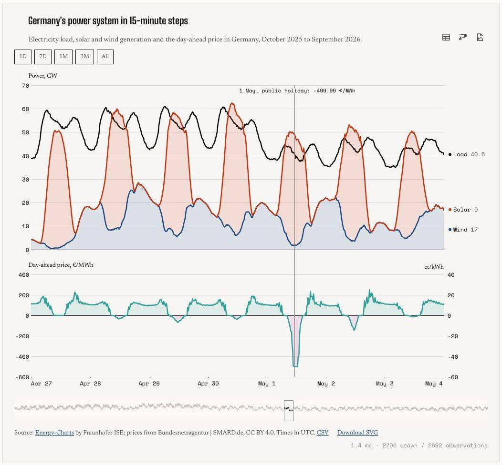
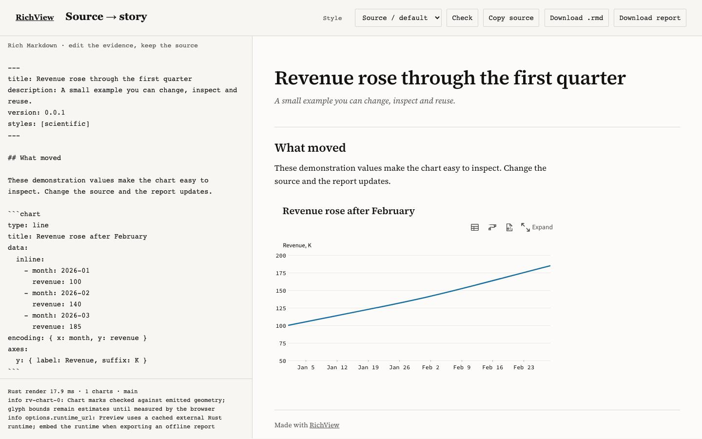
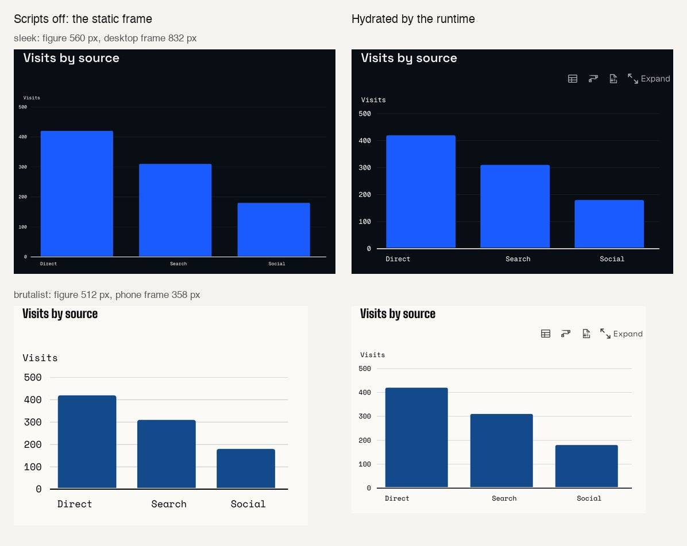
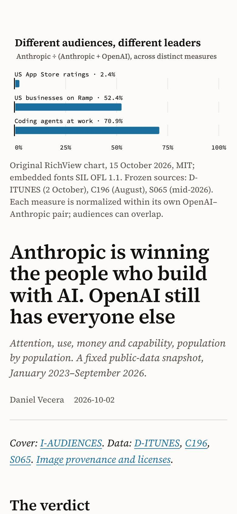

# Performance

This page lists every performance budget RichView has today and every one the lockdown proposes, with each measurement's host, date, machine load and whether it holds. Today's budgets are the 25 endpoints of `docs/PERFORMANCE.md` at `b4db233`. The proposals are the 49 cards of Part 07 (`07-performance`) and one budget in Part 04d, FEA-BR-36 (P-CONTROL-CHANGE), for charts with controls. Neither part has a recorded answer from Daniel, so every PRF- card below is a proposal awaiting him; answer them in [Part 07 of the lockdown app](http://127.0.0.1:4790/#/part/07-performance). This page was revised on 27 October 2026 to follow his answers in other parts that change where and when a budget runs or what it measures: DEL-81 (the fast gate on `dev`, the release run per `pre-prod` batch and the full run before `prod`), INT-12 and INT-17 (craft first; speed and size budgets may be raised when craft needs it), INT-31 and ARC-05 (WebGL charts, no static snapshot, PDF as vector output that may take time) and INT-07 (a link-preview thumbnail for every story). Which tier runs which check and how long the test tiers take is on [Delivery](delivery.md); why speed is a floor rather than a target is INT-16 (D-MAX-SPEED) on [What RichView is for](purpose.md); the runtimes, build profiles and surfaces these budgets measure are on [Architecture](architecture.md). The [guide index](README.md) explains the labels, IDs and links.

Each quoted proposal carries its card's confidence as the app shows it: observed (the card rests on code or a measured run), stated (on a ticket, brief or doc) or inferred (the proposer's reading of several sources). Of Part 07's 49 cards, 34 are observed, 2 stated and 13 inferred; most measurement-policy cards and all three targets beyond today are inferred. In the catalogue tables a card is observed unless its row says otherwise.

Every number below was checked on 22 October 2026 against the compact capture it cites in the lockdown's evidence/performance folder (each file names the raw output it was parsed from and that output's SHA-256) or against the captures committed at `faff365` (2026-10-04) and in `0113da2` (2026-10-12, a capture of `9b300f0`); nothing was re-measured for this page. The live site's headers were requested again the same day. Dates are local (Prague); capture files record UTC, so a probe stamped 2026-10-21T23:35Z is dated 22 October here. Load is the host's 1-minute load average before and after a capture.

## At a glance

| Question | Today | Proposed | Cards | Confidence |
| --- | --- | --- | --- | --- |
| Do today's budgets hold? | 24 of 25 on Claw Mini on 2026-10-21; the 25th, a Linux-only memory gate, cannot run on macOS. The last Linux capture (2026-10-12, a shared host) failed 6 of 25 | Every budget is defined, measured and gated on Claw Mini | PRF-01, PRF-03 | PRF-01 inferred; PRF-03 observed |
| Do the proposed budgets hold? | 15 of 37 budget cards hold where measured (PRF-21 only mostly). 17 fail at least in part: PRF-15, PRF-17, PRF-24, PRF-26, PRF-27, PRF-29, PRF-31, PRF-32, PRF-34 to PRF-37, PRF-41, PRF-42, PRF-44, PRF-50 and PRF-51; PRF-38 is withdrawn, because Daniel's ARC-05 answer builds no static frame to compare. 5 are unmeasured: PRF-18, PRF-25, PRF-28, PRF-33 (for the gallery) and FEA-BR-36 | The rewrite starts with the failures listed as known failures that may not get worse | PRF-08 | inferred |
| Has a budget ever blocked anything? | No. CI never ran the checker, and PR #22 merged on 2026-10-11 with the Wasm 28,470 B over its limit | No budget on `dev`: its fast gate is unit tests only (DEL-81). A short set judges each release batch into `pre-prod`; the full capture runs on `pre-prod` before a candidate, on each prod candidate and daily | PRF-04 | inferred |
| Are costs creeping? | Yes, inside the headroom: the Wasm uses 96.6 % of its limit, the small report's HTML without the runtime doubled since 2026-10-04, and the dense editor and the MCP server each hold about 1.5 GiB after a session | A ratchet against an accepted baseline; growth beyond small margins needs a feature or design card | PRF-05, PRF-08 | inferred |
| How fast is a report on a phone? | On the emulated phone at `b4db233` the small report paints its text at 0.75 s, and the static chart frame arrives with the text (Daniel's ARC-05 answer builds no static frame in the rewrite); the chart turns interactive only at 8.2 s, once the whole 1.76 MB document, runtime included, has arrived | Report runtime ≤ 512 KiB after gzip; phone LCP ≤ 1.5 s; informational target: first chart interactive ≤ 3 s | PRF-31, PRF-34, PRF-60 | PRF-31 and PRF-60 inferred; PRF-34 observed |
| How is memory measured? | Linux `VmHWM` of one benchmark process | macOS physical footprint for processes, renderer memory for pages, with session budgets for the editor, MCP and server | PRF-03, PRF-40 to PRF-44 | observed |
| What is measured at all? | 25 endpoints, desktop Chromium only, reduced motion, no phone, no WebKit timing, no MCP, no PDF | Six fixtures, a desktop and a phone profile, Chromium and WebKit, motion on where it matters | PRF-07, PRF-24 | PRF-07 inferred; PRF-24 observed |

## Captures, hosts and load

Four sets of numbers appear on this page. They come from different machines and partly different fixtures, so read the columns as ranges, not a trend.

| Capture | Commit | Host | Load | What ran | Source |
| --- | --- | --- | --- | --- | --- |
| 10-04 Linux | `faff365`, the integration capture; `docs/PERFORMANCE.md` at `2c926b0` quotes an earlier run that day | Intel i7-12700H, 14 cores and 20 threads, 62.5 GiB visible, Linux, `powersave` governor | 0.92 at the start and 9.69 at the end of the native harness | All 25 budgets: 25 passed, integrity 7 of 7 | `faff365:docs/evidence/integration/performance/gates.json`, `native.json` |
| 10-12 Linux | `9b300f0` | The same CPU as a "shared host", four pinned cores, `quiet_machine: false` | not recorded | All 25: 19 passed, integrity 6 of 7 | `docs/evidence/chart-review/verification.json`, committed in `0113da2` |
| 10-21 M4 | `b4db233` | Claw Mini: Apple M4, 10 cores, 16 GiB, macOS 26.3; Chromium 153 | 4.66 at the start and 3.97 at the end of the native harness; 2.6–7.3 across the whole checks session | All 25 except Linux memory: 24 passed, integrity 7 of 7 | the five `harness-*.json` files |
| Lockdown probes | `b4db233` | Claw Mini; Chromium 153 and WebKit 26.6 through Playwright 1.63.0 | 1.9–4.2 on 2026-10-21, 1.8–3.1 on 2026-10-22 | Everything the budgets never covered | the `probe-*.json` files, `pdf-export.json`, `report-layout.json` and `cli-time-series.json` |

`docs/PERFORMANCE.md:27` asks for "a quiet machine" without defining one. Its 2026-10-04 record calls one of its runs "the quiet run" (`2c926b0:docs/PERFORMANCE.md:86`), and the 2026-10-12 capture records `quiet_machine: false`. The harness itself raises load: the 10-04 native harness started at 0.92 and ended at 9.69. On Claw Mini the 10-21 harness started at 4.66, and a two-minute sample on 2026-10-22 found load 1.77–2.62 with 0.51–1.43 cores busy, the largest share (0.39 core on average) from macOS's `fileproviderd`, which no RichView lock controls (`probe-host-activity.json`). The Linux captures name only their CPU; PRF-01 takes the machine to be Lenovo, which no capture records. The dense fixture's bytes differ between 10-12 and 10-21 (SHA-256 `8089599d…` against `d4a657d6…`), `crates/richview-bench/src/main.rs` changed after `9b300f0`, and the flagship fixture changed between captures, so the dense and flagship rows do not compare like for like.

## Today's 25 budgets

`docs/PERFORMANCE.md:5-19` sets 25 fixed endpoints plus seven evidence-integrity checks (`:21`), judged by `scripts/check-performance.py`. The checker fails on missing, invalid or over-budget evidence, and `:21` says "Do not widen a limit to fit a result". Nothing runs it automatically: CI never did, no merge ever waited for it, and on macOS it ends `failed` by design because the memory gate parses only Linux `VmHWM` (`scripts/check-performance.py:209-223`). Part 07 merges the endpoints into one card per surface, shown in the last column. Bold marks a failure. Times are p95 in milliseconds unless the row says otherwise.

| Endpoint | Limit | 10-04 Linux | 10-12 Linux | 10-21 M4 | Card now |
| --- | --- | --- | --- | --- | --- |
| Warm native render, small | 5 | 0.52 | 1.86 | 0.63 | PRF-10 |
| Warm native render, six types | 10 | 0.43 | 2.42 | 0.68 | PRF-10 |
| Warm native render, flagship | 35 | 7.16 | 25.0 | 12.28 | PRF-10 |
| Warm native render, dense | 250 | 125.1 | **420.4** | 113.1 | PRF-10 |
| Process-cold CLI `generate`, small | 150 | 38.6 | 54.9 | 23.6 | PRF-11 |
| Process-cold CLI `generate`, flagship | 250 | 42.0 | 121.9 | 62.0 | PRF-11 |
| Process-cold CLI `generate`, dense | 400 | 201.6 | **652.0** | 191.9 | PRF-11 |
| Editor preview call, small | 10 | 3.74 | 2.40 | 1.22 | PRF-13 |
| Editor preview call, flagship | 50 | 37.2 | 46.8 | 19.5 | PRF-13 |
| Editor preview call, dense | 400 | 352.2 | 298.4 | 113.9 | PRF-13 |
| HTTP render, one client, small | 200 | 89.2 | 112.9 | 50.3 | PRF-14 |
| HTTP render, one client, dense | 600 | 258.8 | 446.7 | 202.9 | PRF-14 |
| HTTP render, four clients, small | 500 | 138.7 | 165.4 | 58.8 | PRF-14 |
| HTTP render, four clients, dense | 1,500 | 377.1 | 608.9 | 287.1 | PRF-14 |
| HTTP throughput, four clients, small | ≥ 10 req/s | 35.5 | 28.4 | 73.1 | PRF-14 |
| HTTP throughput, four clients, dense | ≥ 4 req/s | 11.7 | 6.8 | 16.5 | PRF-14 |
| Dense zoom, Rust layout and DOM | 16 | 3.9 | 8.7 | 4.5 | PRF-20 |
| Dense zoom, event to two animation frames | 100 | 50.2 | 51.4 | 54.6 | PRF-20 |
| Theme switch, first frame of all 18 charts | 100 | 58.9 | **202.9** | 44.4 | PRF-22 |
| Theme switch, latest chart frames (the same value as the row above in every capture) | 100 | 58.9 | **202.9** | 44.4 | PRF-22 |
| Small source edit to first live chart | 300 | 162.9 | **416.5** | 148.9 | PRF-23 |
| Dense source edit to first live chart, one event | 1,000 | 602.3 | **2,011.5** | 547.4 | PRF-29 |
| Cold `/charts/` mount, one event | 2,500 | 460.2 | 1,122.8 | 277.3 | PRF-33 |
| Native peak memory, Linux `VmHWM` | 256 MiB | 93.9 MiB | 155.1 MiB | **cannot run on macOS** | PRF-40 |
| Delivered Wasm, gzip | 1,572,864 B | 1,542,659 | 1,404,354 | 1,520,124 (96.6 %) | PRF-30 |

The seven integrity checks become PRF-06 (P-EVIDENCE-INTEGRITY). On the M4 the timing limits leave 1.8× (dense edit, zoom frames) to 15× (six types) headroom, and the Wasm limit 3.4 %. Every endpoint that failed on the shared Linux host on 2026-10-12 ran 2.8–4.6× faster on the M4 on 2026-10-21. Some measurements were always disclosures without a limit: the Node boundary, the CSV edit on `/charts/`, the chart kernel and browser memory (`scripts/check-performance.py:305`). The 10-21 Wasm value is the 4,366,342-byte module as the harness's server delivered it with gzip; the same module is 1,516,078 B in the landing probe's transfer, 1,512,537 B as the prebuilt `.gz` file the build writes and 1,505,839 B after gzip -9, the measure PRF-30 proposes.

## Measurement policy

Part 07 first settles where and how anything is measured, because the same budgets pass or fail by host. Several cards rely on the host's build lock, which existed on 22 October outside the repository: a shared build helper on Claw Mini through which agents run heavy builds one at a time, with two Cargo jobs, incremental builds off and a 5 GiB disk floor ([Delivery](delivery.md#starting-point) gives its sources). Since then AGENTS.md has every development stream build in one shared Cargo target behind a 10 GiB free-disk floor (Daniel, 2026-10-29; it was 40), and the release run builds in a second folder so that it never holds the streams' lock. PRF-02 has a timing capture hold the lock alone; under DEL-81 captures run per release batch and in the full run, not on every `dev` merge.

> **PRF-01 (P-REFERENCE-HOST), proposed, inferred.** Claw Mini (Mac mini, Apple M4, 10 cores, 16 GiB, macOS) is the reference host: every budget is defined, measured and gated there, with the Rust toolchain and Playwright browsers the repository pins. A capture from another machine is a disclosure that names its host and is never compared with reference numbers. A new host, macOS major version, toolchain or Playwright version re-captures every budget and starts a new baseline. The alternatives are Lenovo (Linux, continuity with the Linux captures if they ran there, but no current timings) and a dedicated Linux runner (a spare machine or paid minutes). Conflict: Daniel's tier rule names Lenovo (PRF-51, DEL-50). OPN-55 (D-XPART-TIER-HOST) decides it and proposes judging the fast tier on Lenovo too, with Claw Mini the reference host for every other budget and gate step.
>
> **PRF-02 (P-QUIET-CPU), proposed, inferred.** A timing capture holds the host's build lock alone, so no RichView agent build, test or browser starts while it runs; other projects' agents and system services are outside the lock. Under DEL-81 captures run once per release batch into `pre-prod` and in the full run before a candidate, not on every merge into `dev`, so development agents wait only for those windows; the release run builds in its own target folder, so its build never holds the streams' lock. During the capture, CPU used outside the harness's own process tree is sampled every second; if it averages more than one core, or any sample exceeds four, the capture is inconclusive and repeats once, and a second inconclusive capture holds the batch as "performance inconclusive". In the release run, native costs are judged by instruction counts and browser timings against the base build measured interleaved in the same capture, so a busy host slows a capture without changing its verdict; absolute millisecond limits are judged on the full run. A day of logged host activity confirms or resets the one-core and four-core thresholds before the gate goes live. The reason: instruction counts of repeated CLI renders vary by at most 1.5 % once the first run is discarded, while wall-time p95 sits 4–14 % above the median within one capture. Conflict: DEL-51 instead waits for a 1-minute load of 2.0 or less before each release run, and DEL-62 caps agent work so the load can fall that low. The 10-21 harness (start 4.66) and every 10-21 probe that recorded load (start 2.0–4.2) would have waited; three 10-22 probes started at 1.93–1.96, and the 10-04 capture started at 0.92 before its own harness drove load to 9.69. OPN-50 (D-XPART-PERF-GATE) decides it and proposes this card's side: no load wait.
>
> **PRF-03 (P-OS-SCOPE), proposed, observed.** Native processes are budgeted on peak physical footprint as macOS reports it: at exit for the CLI and PDF export, sampled through the session for the editor, MCP and server. Browser pages are budgeted on their renderer's resident memory, read from the process IDs Chromium reports. Timing runs discard the first launch of each newly built binary, which costs 0.2–0.6 s on macOS. The Linux `VmHWM` gate retires; Linux captures may stay as disclosures. Footprint is stricter where the allocator keeps freed memory: the dense editor peaked at 98.6 MiB `VmHWM` on Linux (2026-10-04) but held a 1,538 MiB footprint after 100 previews on macOS (2026-10-22).
>
> **PRF-04 (P-GATE-SCOPE), proposed, inferred.** Three sets, following Daniel's DEL-81 answer. The fast gate, on every push to `dev` (`rv-gate fast`), carries no budget: it is unit tests of what the change can affect, ideally under five seconds, and an agent may run a budget check by hand. The release run, which merges a batch from `dev` into `pre-prod` (`rv-gate release`), runs about 4 minutes of budgets for what the batch affects: sizes, instruction counts and footprints of CLI renders and the chart kernel, native, CLI and MCP latency, and Chromium desktop timings against interleaved base runs. The full run, on `pre-prod` before a candidate, on each prod candidate (`rv-gate full` and `rv-gate prod`, DEL-33) and once a day on a changed `pre-prod` head, takes about 15–20 minutes: all of that plus the phone profile, WebKit, PDF, memory sessions, server and published reads, build and tier durations and every absolute millisecond limit. A release-run failure fails the batch, and the release agent bisects it to the merge that caused it and fixes forward on `dev` or reverts that merge; a full-run failure is bisected the same way before the review packet; `prod` is cut only from a `pre-prod` head with a passing full receipt for the exact candidate. No budget is waived for one batch, and changing a limit is an edit to the lockdown held for Daniel (DEL-36). The durations are the part's arithmetic, not a measurement. Alternatives: everything per release batch (15–20 minutes of exclusive capture each) or inform only, as today. Conflicts: DEL-08 and DEL-51 ran every budget on every merge, which DEL-81 replaces and OPN-50 (D-XPART-PERF-GATE) settles for this card's release-run set; DEL-63 and DEL-33 take a frozen candidate rather than a `pre-prod` head, which OPN-51 (D-XPART-PROD-EVIDENCE) decides for the candidate's final tree, keeping this card's daily capture on `pre-prod`.
>
> **PRF-05 (P-REGRESSION-GATE), proposed, inferred.** Each release run compares its batch's combined `pre-prod` state with the accepted baseline and fails the batch when the Wasm or any fixture's HTML grows by more than 16 KiB, a shipped binary by more than 64 KiB after gzip, the instructions a CLI render or the chart-kernel benchmark executes (median of 7 runs after one discarded run) by more than 5 %, peak footprint by more than 10 %, or a browser endpoint's p95 by more than 20 % against the base build measured interleaved in the same capture; the release agent bisects the failure to the merge that caused it (DEL-81). An improvement beyond the margins lowers the baseline automatically. A regression beyond them merges only inside a declared feature or design PR (DEL-32) whose card states the cost, and Daniel's answer accepts it and raises the baseline; fixes and refactors never raise it. The reason is creep inside the headroom: the small report's HTML without the runtime went from 117,450 B (2026-10-04) to 233,789 B (2026-10-21), mainly because scientific, the style every fixture renders in, went from three to six embedded faces in `beb330f`.
>
> **PRF-06 (P-EVIDENCE-INTEGRITY), proposed, observed.** A capture counts only when it records commit, artifact and fixture hashes, host, OS, toolchain and browser versions, load and outside CPU before, during and after, and sample counts, and the seven integrity checks pass. Limits live in one file; harnesses measure and never judge (today `scripts/benchmark-browser.mjs:306-317` repeats eight limits). Every p95 uses at least 20 samples, 100 when the value is under 10 ms; single-event endpoints repeat at least 5 times, the median must meet the limit and no repeat may exceed 1.5× it. Missing evidence fails. Every harness feeds a budget or is deleted: the Node boundary harness goes with the npm packages, and the comparisons with the TypeScript renderer and the archived Rust preview are deleted.
>
> **PRF-07 (P-FIXTURES), proposed, inferred.** Six fixtures, rendered in scientific except the gallery page, which uses the site's own look: small (`examples/sales-report`), all-types (every chart type and rich block once, also rendered in every builtin style for PRF-35), flagship (`examples/openai-vs-anthropic`), dense (today's 2.03 MB inline-YAML source, 35,040 points in two groups), grid (35,040 rows × 4 series in two panes from a chart-local CSV, as an `.rmd` example of the docs chart gallery) and gallery (the docs chart gallery page with its three time-series examples). Desktop profile: 1440×1000 at 1×, no throttling, loopback. Phone profile: 390×844 at 2× with touch, 4× CPU throttling and Slow 4G (150 ms round trip, 1.6 Mbit/s down, 750 kbit/s up), in Chromium. Each endpoint names its motion mode. Today's six-types fixture covers six of the nine chart types and no table, metric, callout or image, and the browser harness runs only at 1440×1000 with reduced motion, so it never measured an animated frame or a phone. The lockdown probes ran at 1440×900, so their desktop values are disclosures.
>
> **PRF-08 (P-REWRITE-BASELINE), proposed, inferred.** The first accepted baseline is the full capture of the commit `dev` starts from, D-PROD-BASELINE (OPN-01), and the first release run compares its batch with it (DEL-81). Budgets that baseline already fails are listed as known failures in every packet and may not get worse; once a capture meets one, it gates like any other. A rewritten component is a feature PR (DEL-32), so the cost it adds rides on its card. Endpoints of dropped surfaces (`/charts/`, the render API, the npm packages) leave the baseline with the merge that drops them; new endpoints enter with their first full capture. Each packet also reports INT-70's comparison with `b4db233` for every endpoint both trees have. The alternative starts the ratchet only at the first complete rewrite capture.
>
> **PRF-09 (P-REAL-DEVICE), proposed, inferred.** Emulated profiles gate release runs and prod candidates. A real phone is an optional look, not a step: a review agent judges visual and motion quality so Daniel does not have to (Daniel's DEL-68 answer), and WebKit pacing (PRF-24, PRF-27) and the iOS Simulator's Safari smoke (DEL-74) cover the iPhone's engine without hands. When Daniel opens a candidate or a report on his phone, through the `dev` preview (DEL-31) or from the gate host over the local network (`serve --bind`, FEA-SF-08), a jump, tick or dropped frame he sees is a defect against PRF-27 and INT-61 (G-MOTION-SMOOTH), filed like any other. He names one mid-range reference phone once, so such reports compare like with like. The phone never passes or fails a budget automatically. The reason: Playwright cannot throttle WebKit, the engine of every iPhone browser, and Daniel rejected the 2026-10-18 site for "visible ticking" on mobile scroll that no capture had measured (S27-653). Conflict: INT-61's bar is smoothness on a real phone; with the phone optional, emulation, WebKit pacing and the review agent stand in for it. OPN-66 (D-XPART-PHONE-CHECK) decides it.

## Budget catalogue

One row per budget card: the proposed limit, the measurement that exists today on Claw Mini with its date and load, and whether that measurement would meet the proposal. "Harness" is the 2026-10-21 run of `docs/PERFORMANCE.md`'s harnesses, during which the native harness, the only one that records load, read 4.66 at its start and 3.97 at its end; "probe" is a lockdown probe. Rows that say "if" apply only when Parts 01, 03 and 04 keep the surface. Keeling and CPI are the two smaller time series on `/charts/`, the Keeling curve of CO2 at Mauna Loa (822 rows) and US consumer prices (836 rows); the grid is the third.

### Render latency

| Card | Measures | Proposed limit | Today on Claw Mini | Holds today |
| --- | --- | --- | --- | --- |
| PRF-10 (P-NATIVE-RENDER) | Warm native render p95, 100 iterations in one process | small ≤ 5 ms, all-types ≤ 10 ms, flagship ≤ 35 ms, dense ≤ 250 ms (unchanged; all-types replaces six types) | 0.63 / 0.68 (six types) / 12.28 / 113.1 ms; harness 10-21 | yes; all-types not yet captured |
| PRF-11 (P-CLI-COLD) | Process-cold CLI p95, 100 runs after 3 warm-ups | `generate` 150 / 250 / 400 ms (unchanged); `check` and `validate` 75 / 125 / 200 ms | `generate` 23.6 / 62.0 / 191.9 ms and `check` 5.3 / 21.7 / 115.3 ms, harness 10-21; `validate` 3.6 / 7.8 / 56.7 ms, probe 10-22, load 2.5–2.6 | yes |
| PRF-12 (P-MCP-TOOLS) | Warm MCP calls over one stdio server, p95 of 100 (20 for dense) | `richview_render` 50 / 150 / 400 ms; `richview_check` and `richview_validate` 25 / 100 / 300 ms | render 7.3 / 40.9 / 195.5; check 0.5 / 15.5 / 138.8; validate 0.3 / 6.3 / 139.7 ms; probe 10-22, load 2.0–2.4 | yes |
| PRF-13 (P-EDITOR-RPC) | Warm `richview/preview` p95, if the editor service stays (ARC-44) | 10 / 50 / 400 ms (unchanged); diagnostics, completion and formatting at 2× their first capture | 1.22 / 19.5 / 113.9 ms; harness 10-21; the other requests were never timed | yes |
| PRF-14 (P-HTTP-RENDER) | `POST /api/render` with gzip on loopback, if the API stays (FEA-SF-17 proposes dropping it) | unchanged: 200 / 600 ms with one client, 500 / 1,500 ms with four, ≥ 10 / ≥ 4 req/s | 50.3 / 202.9 / 58.8 / 287.1 ms; 73.1 / 16.5 req/s; harness 10-21 | yes |
| PRF-15 (P-HTTP-READ) | Reading a published report from RichView's servers (INT-31, INT-36), and a story's link-preview thumbnail (ARC-69) | flagship permalink ≤ 25 ms over 20 requests on Cowork (INT-83); list, detail, raw source and thumbnail ≤ 5 ms; thumbnail rendering at publish ≤ 2× its first capture | permalink 81.0 ms, 73.8 of it on the wire; list, detail, raw 0.3–1.6 ms; harness 10-21; no thumbnail exists yet | **no**: the server gzips the 4.35 MB file on every read |
| PRF-16 (P-PDF-EXPORT) | `generate --to pdf` wall time (FEA-RP-43); full run only | no absolute limit, because Daniel's INT-31 answer lets the vector conversion take time; recorded for small and flagship, median of 5 with the pinned Playwright Chromium, and fails only above the settle timeout or when the median more than doubles against the baseline | 0.26–0.58 s and 0.76–0.89 s with Chromium headless shell 153; 0.60–2.47 s and 1.19 s with Google Chrome 155, which the CLI finds by default; 10-21 and 10-22, load not recorded | recorded: today's charts are already SVG, so the vector conversion is unmeasured |
| PRF-17 (P-NODE-BOUNDARY) | The Node boundary harness | deleted with the npm packages (ARC-48, ARC-49); a returning package gets dense render-to-JSON ≤ 250 ms p95 and Node peak footprint ≤ 512 MiB | 149.8 ms; Node peak 571 MiB resident; harness 10-21 | memory **no** |
| PRF-18 (P-PUBLISH-SCALE), stated | Publish build at site scale; the rewrite builds Publish (INT-31, INT-35) | 300-item full build and one-item update at 2× their first capture | never timed; S27-655 records 300 fixtures passing | not measured |
| PRF-19 (P-CHART-KERNEL) | `cargo run --release -p richview-chart --example benchmark`, joining the release-run set | grid ingestion ≤ 30 ms; layout p95 ≤ 2 ms (grid) and ≤ 0.5 ms (Keeling, CPI) at 390 and 1,280 px; hover median ≤ 0.01 ms | 10-22, the removed calendar engine: 13.2–13.6 ms; 0.80–0.84 / 0.99–1.02 ms; 0.10–0.27 ms; 0.0006–0.0022 ms (load 2.7–3.1, 6 runs after a warm-up). 11-02, the geometry engine on the docs examples' blocks, one run under build load: no ingestion step, CSV reading is core's; layout p95 46.7–54.1 ms for the 35,040-row power prices (1.87–1.89 s before S27-837 made zoomed layouts linear in the rows) and 0.94–1.50 ms for Keeling and CPI; hover median 0.08–0.09 ms and 0.0017–0.0018 ms. 11-03, after S27-840 lays a zoom frame out from its data state's preparation, 3 interleaved runs as an Interactive job (load 6.4–7.4): power-prices layout p95 3.3–8.6 ms (36–70 ms before) and 0.13–0.38 ms for Keeling and CPI (0.73–1.85 ms before); a new data state's layout on its own is unchanged at p95 38–69 ms; hover median 0.20–0.25 ms timed right after a frame from the preparation, 0.10–0.12 ms right after a layout on its own (same hover code and geometry) | **no**: layout and hover on the grid |

The MCP tools are the surface agents call in loops (INT-69), and no budget or harness covered them before this part. The server lists seven tools today; FEA-SF-09 (D-MCP-SURFACE) proposes nine, with the two image tools of FEA-RP-62. The HTTP render cost is mostly compression: every response embeds the 2.1 MB runtime and the server gzips it per request, and without compression the same renders took 6.7 ms (small) and 109 ms (dense) p95. Versioned permalinks already send `Cache-Control: public, max-age=31536000, immutable` (`crates/richview-app/src/server.rs:432-445`), so passing PRF-15 needs each immutable version compressed once when it is stored, a change ARC-21 and ARC-24 do not propose yet. Export verification (`scripts/verify-exports.mjs`) needs `qpdf`, which Claw Mini lacks.

### Browser interaction

| Card | Measures | Proposed limit | Today on Claw Mini | Holds today |
| --- | --- | --- | --- | --- |
| PRF-20 (P-ZOOM) | 100 keyboard zoom steps on the grid, reduced motion | layout, drawing (WebGL updates) and DOM p95 ≤ 8 ms (was 16); event to two frames ≤ 100 ms | 4.5 ms and 54.6 ms; harness 10-21 | yes (10-12 Linux: 8.7 ms) |
| PRF-21 (P-CHART-FRAME) | Script per frame with motion on, WebGL buffer updates and draw calls included: transitions, entrances, animated zoom; the floor under INT-12's delightful and smooth motion, not its limit | p95 ≤ 4 ms and none over 16.7 ms for charts up to 1,000 rows; grid p95 ≤ 8 ms at 1× and ≤ 16 ms at 4× CPU; Chromium 1× and 4×, WebKit 1× | range presets in Chromium: Keeling 0.9 ms (1×) and 3.1 ms (4×), grid 3.0 and 12.9 ms, probe 10-21, load 4.1–4.2; WebKit 1×: 3 and 6 ms, at most 13, load 2.1–2.2; animated zoom: 6 frames per run, slowest 5.1 ms (Keeling) and 5.8 ms (grid) at 1×, 4.9 and 6.3 ms at 4× | mostly; Keeling's slowest zoom frames, 5.1 ms at 1× and 4.9 ms at 4×, exceed its 4 ms p95 and fail it if more than one frame in 20 is that slow |
| PRF-22 (P-THEME-SWITCH) | 20 warm theme or style switches on the 9-chart flagship; the two old endpoints merge | event to every chart's first new frame p95 ≤ 100 ms | 44.4 ms on 18 charts; harness 10-21 | yes |
| PRF-23 (P-EDIT) | 20 small edits in the playground | first live chart p95 ≤ 200 ms (was 300) | 148.9 ms, maximum 149.3 ms; harness 10-21 | yes |
| PRF-24 (P-ENGINES) | Which engines carry timing budgets (decision) | frame budgets at 1× and layout shift hold in Chromium and WebKit; Chromium in the release run, WebKit in the full run and in the release run of a batch that changes motion; Firefox functional only | WebKit 26.6 shows one late frame per run (31 and 38 ms) that Chromium never showed; Firefox is not installed on Claw Mini | WebKit **no** (PRF-27) |
| PRF-25 (P-INTERACTION), inferred | Hover, series toggle, Table view, expanded view, chart actions | crosshair on the first frame after a move in ≥ 95 % of 100 moves; first changed frame ≤ 100 ms p95; the grid's 35,040-row Table view ≤ 200 ms | never measured in a browser; the kernel's hover lookup takes under 0.003 ms | not measured |
| PRF-26 (P-LOAD-FRAMES) | Longest animation frame from navigation until settled | ≤ 50 ms desktop, ≤ 200 ms phone profile; median of 5 loads | desktop: small 0, flagship 0–55, `/charts/` 64–74, landing 0–104, playground 0–99 ms, the maxima on the first load after the browser started; phone: small 578–585, flagship 551–552, landing 520–526, `/charts/` 240–267, playground 92–95 ms; probes 10-21 and 10-22, load 1.9–2.8 | **no** on the phone for both reports and the landing page, and for `/charts/` on both profiles; on the desktop the landing page and the playground each had one load over 1.5× the limit |
| PRF-27 (P-FRAME-PACING) | Frame intervals while charts animate or a report scrolls at 2 px/ms | no interval over 25 ms, desktop and phone in Chromium, 1× in WebKit; FEA-BR-21 holds the restored landing scroll story to the same bar plus a real iPhone | Chromium at most 16.8 ms over about 400 frames per run; WebKit one 31 ms and one 38 ms interval; scrolling never measured | **no** in WebKit |
| PRF-28 (P-PREVIEW-LIVE), inferred | Last keystroke (or file write) to the painted preview outside the playground | VS Code preview ≤ 400 ms, landing demo ≤ 400 ms, `serve` ≤ 1,000 ms, p95 of 20 | never measured. The VS Code preview requests a render on every change with no debounce (`packages/vscode/extension.cjs:312-314`), waits 150 ms only after another file in the report's folder changes (`:181-188`) and lints after 250 ms (`:144`); the landing demo renders 140 ms after typing stops (`crates/richview-site/src/browser/homepage.rs:30`); `serve` polls every 500 ms (`crates/richview-site/src/browser/authoring.rs:1276-1278`) | not measured |
| PRF-29 (P-EDIT-LARGE) | Edit to the 2.03 MB dense source in the playground | first live chart ≤ 1,000 ms (median of 5, none over 1.5 s), no main-thread task over 50 ms | 547.4 ms in one event; two 57 ms main-thread tasks and a 103.7 ms gap in a 16 ms heartbeat; harness 10-21 | **no**: the task cap fails by 7 ms, twice |
| FEA-BR-36 (P-CONTROL-CHANGE), Part 04d, inferred | A control change (button, dropdown, step or scrubber) on charts up to 1,000 rows; controls enter the rewrite (Daniel's FEA-BR-01 answer) | PRF-20's limits on the desktop profile and on the phone profile at 4× CPU in Chromium; during playback PRF-21 and PRF-27 apply; measured on the Gapminder and indicator golden inputs | never measured; PR #62 drops the whole scene and redraws on every change | not measured |



The grid chart on `/charts/`: German load, solar, wind and the day-ahead price in 15-minute steps, October 2025 to September 2026, 35,040 rows × 4 series in two panes sharing one time axis, shown here on a one-week window. Today's dense-zoom and cold-mount budgets run on this page, and the PRF-21 and PRF-27 pacing probes animated its range presets; the readout under the chart is the page's own record of its last redraw: 1.4 ms of layout and DOM work, 2,700 points drawn for 2,692 observations (`crates/richview-site/src/browser/charts.rs:3155`). S27-720 dropped `/charts/` as ARC-40 (C-WEB-CHART-EXAMPLES) proposes: one week of the dataset is the docs gallery's `german-power-week` example (FEA-SF-43), and the full year is the fixture `benchmarks/fixtures/time-series/de-power-15min.csv` (PRF-07). Source: `/charts/` on the local build of `b4db233`, full-page capture `product/charts/charts-desktop-full.jpg` at 1440×900, cropped for this page; 2026-10-21. Cards: PRF-07 (P-FIXTURES), PRF-20 (P-ZOOM), PRF-21 (P-CHART-FRAME), PRF-33 (P-COLD-MOUNT).



The playground the small-edit budget measures: source on the left, live preview on the right, and a status line under the editor ("Rust render 17.9 ms · 1 charts · main") with the note that the preview uses a cached external runtime and that an offline export embeds it. Each edit waits a 32 ms debounce (`crates/richview-site/src/browser/authoring.rs:523`), then replaces the preview document and remounts the runtime, which is why PRF-61's 100 ms target likely needs the preview updated in place (ARC-38, FEA-SF-34). Source: `/playground` on the local build of `b4db233`, 1440×900, 2026-10-21. Cards: PRF-23 (P-EDIT), PRF-29 (P-EDIT-LARGE), PRF-61 (P-EDIT-INSTANT).

### Load, size and first paint

| Card | Measures | Proposed limit | Today | Holds today |
| --- | --- | --- | --- | --- |
| PRF-30 (P-WASM-GZIP) | Everything a site page loads before it renders: Wasm, its JavaScript and the font catalog, gzip -9 | ≤ 1.875 MiB (1,966,080 B); a release run past 90 % warns in the packet; raised only when visual and motion craft needs it, with the trade recorded (INT-17) and held for Daniel (DEL-36) | 1,845,971 B (93.9 %): Wasm 1,505,839, catalog 325,353, JavaScript 14,779; built files, 10-22 | yes |
| PRF-31 (P-RUNTIME-DELIVERY), inferred | Report runtime size and delivery (decision) | report runtime ≤ 512 KiB after gzip -9, embedded in exported reports and served once from a content-hashed URL by a report host; trusted previews link their host's copy; open whether 512 KiB holds with the WebGL renderer (INT-31, INT-17) | no report runtime exists: every report embeds the full runtime, 2,137,024 B of base64 | **no**; whether 512 KiB is reachable is unmeasured |
| PRF-32 (P-HTML-SIZE) | Rendered HTML per fixture without runtime and media; embedded faces per builtin style; a hosted page with its linked runtime and fonts | small ≤ 224 KiB, flagship ≤ 768 KiB, dense ≤ 2.5 MiB; faces ≤ 160 KiB per style; complete offline flagship ≤ 5 MB; the small fixture hosted ≤ 768 KiB on a first visit, only its HTML on a repeat | small 233,789 B (228.3 KiB); flagship 736,787 B plus 1.48 MB of inline images; dense 2,204,090 B; faces 88,719 B (sleek) to 155,054 B (hand-drawn); offline flagship 4,351,128 B; 10-21 and 10-22 | small **no**, until notices cover only embedded faces (FEA-RP-38); the rest yes |
| PRF-33 (P-COLD-MOUNT) | Cold load until every gallery example is live, desktop, reduced motion | ≤ 1,000 ms or 2× the gallery's first capture, whichever is lower; median of 5 (was 2,500 ms, one run) | `/charts/` 277.3 ms, one event, harness 10-21; the docs gallery is not on `main` | not measured for the gallery |
| PRF-34 (P-FIRST-PAINT) | Largest contentful paint on a first visit; what precedes the first content | phone ≤ 1.5 s, desktop ≤ 200 ms, median of 5; only CSS and embedded fonts before the first content | phone: small 768–780 ms, flagship 1,172–1,188 ms; desktop 56–188 ms; probe 10-21, load 2.4–2.6; 50,726 B of font notices precede `<body>` | timing yes; ordering **no** |
| PRF-35 (P-LAYOUT-SHIFT) | Cumulative layout shift until every chart is mounted, scrolling through the page, including the moment the WebGL renderer takes over a figure (ARC-05) | ≤ 0.01, desktop and phone, Chromium and WebKit | small desktop 0.014–0.015; flagship 0.0025 desktop, 0 phone; `/charts/` 0.003–0.004 desktop, 0.025 phone; probes 10-21 and 10-22 | **no** for the small report on desktop and `/charts/` on the phone |
| PRF-36 (P-SITE-FIRST-VISIT) | Landing and playground first visit, median of 5 | landing LCP ≤ 1.5 s phone and ≤ 200 ms desktop, CLS ≤ 0.01, ≤ 1 MB before the reader scrolls or types; playground first live chart ≤ 500 ms desktop; phone playground reported only | landing: 3,793,608 B, LCP 708–712 ms phone and 48–152 ms desktop, CLS 0.023 and 0.035, load event 16.3 s on the phone, probe 10-21, load 2.7–2.8; playground: 1,858,444 B, first live chart 140–474 ms desktop and 10.1 s phone, probe 10-22, load 2.0–2.4 | **no** for landing bytes and layout shift |
| PRF-37 (P-SITE-DELIVERY) | Caching, compression and bytes per view on richview.ai and on the report host, thumbnails included (decision) | content-hashed names with immutable caching for non-HTML site files, Brotli, a post-deploy check of bytes and headers, bytes per view in every packet; the report host serves its runtime and fonts the same way, and serves stories and thumbnails behind the story's access check with `private, no-store` for any story not shared with anyone on the web (ARC-24, ARC-69, TYP-70) | the live site serves Brotli under fixed names with `cache-control: public, max-age=0, must-revalidate`, re-run 2026-10-22 | **no** |
| PRF-38 (P-HYDRATION-MATCH), stated, withdrawn | Static frame against the first hydrated frame, all-types fixture, every builtin style, 390 and 1440 px | withdrawn: Daniel's ARC-05 answer builds no static snapshot; what remains moves to PRF-35, that the figure's HTML frame and reserved box do not move when the WebGL chart mounts | static frames are drawn at 358 and 832 px while figures sit in a 512–576 px measure, so text shows at 67–69 % (sleek, scientific) or 143–152 % (brutalist, hand-drawn) until the runtime repaints (ARC-05) | withdrawn with the static frame |
| PRF-39 (P-INSTALL-SIZE) | Shipped binaries and the VSIX after gzip -9 | CLI ≤ 5 MiB, editor service ≤ 4 MiB, server ≤ 4 MiB, each platform VSIX ≤ 8 MiB; growth beyond 64 KiB in one release batch follows PRF-05 | 4,422,347 / 3,195,699 / 3,171,499 B; no VSIX built (its folder holds about 12.5 MB before packaging) | yes for the binaries |

The report runtime is the largest single cost. Every report embeds the same base64 runtime, gzip-compressed WebAssembly and bindings (`docs/RUST-ARCHITECTURE.md:21`), which is 90 % of the 2,370,813-byte small offline report. Next to the chart engine it exports the parser, renderer, validator, checker, knowledge bundle, publish-request builder and reel, and its data section carries a 66 KB HTML entity table and font licence texts. Inline base64 is neither cached across reports nor compiled while streaming. On the phone profile the small report moves 1.76 MB: its text paints at 0.75 s and the static chart frame arrives with it, but the chart turns interactive only at 8.2 s, after the whole document, runtime included, has arrived (8.07 s), about 4.7 ms per KB. At PRF-31's 512 KiB it would move about 0.66 MB, roughly 3.1 s at the same rate, which is why PRF-60's 3 s needs the runtime slightly under the limit. ARC-06 (D-RUNTIME-SPLIT) proposes splitting off a report runtime without authoring code; the archived chart-only preview module was 202,298 B after gzip on 2026-10-04, before nine chart types, motion and tables. FEA-RP-38 (F-SELF-CONTAINED-HTML) would give a report without a chart or table only a minimal runtime instead; OPN-53 (D-XPART-REPORT-RUNTIME) decides between them and proposes the one report runtime in every report, as PRF-31 budgets it. Daniel's INT-31 answer adds a WebGL renderer, its shaders and its text data to that runtime, so whether 512 KiB still holds is open for him (PRF-31); his INT-17 answer lets a size budget rise when craft needs it, with the trade recorded.

About 219 KB arrive before the first content: in the small report the style block with six embedded faces ends at byte 167,798, and 50,726 B of font notices for all 11 bundled families follow before `<body>` at byte 218,607; the body, static chart frame included, takes the next 15 KB, and the 2.14 MB runtime script follows at byte 233,774 (`report-layout.json`). In the flagship that runtime script is the end of the file, bytes 2,214,089 to 4,351,128, after 1.48 MB of inline images. It runs only once the whole document has arrived, about 14 s on the phone profile, so no flagship chart turns live before then.



What PRF-38 would have forbidden, before Daniel's ARC-05 answer withdrew it. The `init` template's bar chart with scripts off (left) and after the runtime hydrates it (right), in sleek (top) and brutalist (bottom), at the same scale. Sleek's static frame is drawn at 832 px and shrunk into a 560 px figure, brutalist's at 358 px and enlarged into a 512 px figure, so tick labels jump from 10 to 16 px in sleek and from 25 to 17 px in brutalist when the runtime repaints, and the brutalist figure is 21 px taller until then. The rewrite builds no static frame (ARC-05), so FEA-CH-64 and PRF-38 are withdrawn; each figure instead reserves its final box before the runtime starts, and PRF-35 measures that the WebGL chart mounts into it without a shift. Source: the capture on [Architecture](architecture.md#in-the-browser), `richview generate` from the `b4db233` release build in headless Chromium at 1440×900, 2026-10-22. Cards: PRF-38 (P-HYDRATION-MATCH), FEA-CH-64 (F-CORE-STATIC-CHART-FRAMES), ARC-05 (D-INTERACTIVITY).


The landing page on a phone, the first impression PRF-36 budgets. A first visit transfers 3,793,608 B: the demo frame embeds the full runtime (1,620,570 B) and the page loads the Wasm again (1,516,078 B) plus the font catalog (325,607 B). On the phone profile it paints at 708–712 ms, shifts by 0.035 and fires its load event at 16.3 s. PRF-36 would cap it at 1 MB before the reader scrolls or types, so the demo's runtimes would load only when the reader nears or uses the demo. The capture also shows the zero left gutter, which OPN-17 (D-FIX-HOME-GUTTERS) leaves to the rewrite's site gate, since no legacy hotfix ships (FEA-SF-30). Source: `/` on the local build of `b4db233`, 390×844 at 2×, 2026-10-21; numbers from `probe-landing.json`. Cards: PRF-26 (P-LOAD-FRAMES), PRF-36 (P-SITE-FIRST-VISIT); FEA-SF-29 (F-WEB-LANDING-LIVE-DEMO) decides whether the demo stays.



The offline flagship report the first-paint probe loaded, first screen on a phone. Its header chart is the first inline image in the body, above the title, and the probe recorded an image as the report's largest contentful paint: 1,172–1,188 ms on the phone profile and 76–188 ms on the desktop. Source: the harness's offline render of `examples/openai-vs-anthropic` at `b4db233` in scientific (`flagship-offline_runtime.html`, the SHA-256 `report-layout.json` records), opened from disk in headless Chromium 153 at 390×844 at 2× with reduced motion, 2026-10-22. Cards: PRF-34 (P-FIRST-PAINT), PRF-60 (P-MOBILE-FIRST-VISIT).

### Memory

| Card | Measures | Proposed limit | Today on Claw Mini | Holds today |
| --- | --- | --- | --- | --- |
| PRF-40 (P-NATIVE-MEMORY) | Peak footprint of one complete offline CLI render; replaces the Linux `VmHWM` gate | small ≤ 64 MiB, flagship ≤ 96 MiB, dense ≤ 256 MiB | 22.8–22.9 / 30.4–30.5 / 119.5–121.4 MiB, 7 runs after a warm-up; probe 10-22, load 2.5–2.6 | yes |
| PRF-41 (P-EDITOR-MEMORY) | Editor footprint after 100 sequential previews of one fixture, if the editor stays | ≤ 32 / 96 / 256 MiB, and at most 10 % growth from the 50th to the 100th preview | 5.3 / 153 / 1,538 MiB (dense peak 1,564 MiB); probe 10-22, load 1.9–2.2 | **no** for flagship and dense |
| PRF-42 (P-SERVER-MEMORY) | Server footprint under four concurrent dense publishes, each rendering its thumbnail (ARC-69), and 100 permalink reads; the native server stays as RichView Cowork (INT-31, INT-83) | ≤ 512 MiB at peak, ≤ 128 MiB ten seconds after | resident 35 MiB before the HTTP sequence, 716 MiB after the sequential dense renders, 1,068 MiB peak under four concurrent dense renders, 523 MiB at the end; harness 10-21; the publish workload was never measured | **no** |
| PRF-43 (P-BROWSER-MEMORY) | Renderer resident memory of a settled page, and its growth | ≤ 256 MiB settled; ≤ 10 % growth over 100 zooms, theme switches or edits; playground at 1.25× its first capture | small report 153, flagship 213, `/charts/` 231 MiB against 78 for a blank page; probe 10-22, load 1.9; growth never measured | settled yes; growth not measured |
| PRF-44 (P-MCP-MEMORY) | MCP server footprint after 100 sequential `richview_render` calls on one fixture | ≤ 32 / 96 / 256 MiB, and at most 10 % growth from the 50th to the 100th call | dense: 3 MiB idle, 32 after one render, 750 after 10, 1,567 after 20, 1,510 after 50, probe 10-21, load 3.2–3.4; in the 10-22 latency probe, one server's resident memory, cumulative across its series, rose from 14 to 168 MiB over 100 small renders and from 174 to 294 MiB over 100 flagship renders, load 2.0–2.4 | **no** |

The editor and MCP numbers are mostly memory the macOS allocator keeps, not live data: in the dense editor about 1.1 GiB of freed large blocks stay resident and 316 MiB are swapped out, while live small allocations stay under 80 MiB (`probe-editor-memory.json`). PRF-41 and PRF-44 therefore need memory released after each render, not only fewer allocations. On Linux on 2026-10-04 the same dense editor peaked at 98.6 MiB `VmHWM`, which is why PRF-03's macOS footprint is the stricter measure.

### Build and verification time

| Card | Measures | Proposed limit | Today on Claw Mini | Holds today |
| --- | --- | --- | --- | --- |
| PRF-50 (P-BUILD-TIME) | Optimized build of every shipped artifact, 4 Cargo jobs; judged in the full run, reported by the release run | ≤ 180 s cold, ≤ 60 s after a one-file edit, ≤ 5 s with nothing changed | 153.9 s cold, 105.9 s after touching one file in `richview-chart`, 2.1 s unchanged; peak 1.6 GB of memory; 10-21, load 2.6–7.3 | **no** for the edit build |
| PRF-51 (P-TEST-TIERS) | Wall time of each verification tier | fast gate after a one-file edit ≤ 5 s target, ≤ 30 s maximum (DEL-81); all Rust tests after an edit ≤ 60 s; release run for one batch ≤ 45 min as an upper bound, set by the first release receipt; prod-candidate gate with the full capture ≤ 45 min | 36.6–61.3 s (9.7–13.7 s warm); 83.3 s after a relink (44.2–47.0 s warm); about 12.5–15 min for the former per-merge gate, a batch not measured; not measured, about 35–40 min by estimate; 10-21, 4 Cargo jobs, load not recorded | **no** |

The release profile links the whole program as one unit (`Cargo.toml:12-17`: `lto = true`, `codegen-units = 1`), so any edit relinks everything. Meeting PRF-50's 60 s needs a cheaper native profile that keeps PRF-10 and PRF-11 passing; ARC-04 (D-WASM-BOUNDARY) owns the profiles and asks this part for the before-and-after numbers. Every number in this table used 4 Cargo jobs. Agents' everyday builds go through the host's build lock into one shared Cargo target with two jobs and incremental builds off, and the release run builds in its own folder (DEL-22, DEL-81); nothing was timed that way, and PRF-50 expects it to be slower, so the former per-merge gate's 12.5–15 minutes says little about a release run. [Delivery](delivery.md#test-tiers) has what each tier contains and the measured waste behind its times.

### Beyond today

PRF-60 to PRF-62 propose three informational targets that would never block a merge; every capture would report progress against them in the review packet. None rests on an outside comparison: no other tool's load or frame times were measured, and the Highcharts lab (`benchmarks/highcharts`) compares looks and interactions with a reference library, not speed. Whether these targets go beyond what other tools reach is therefore unknown. Daniel's INT-12 answer sets the side-by-side comparison with Highcharts and ECharts as the craft bar, judged by a review agent on each design change; it is not a speed budget, and no budget in this part may stop a change that craft needs (INT-17).

| Card | Proposed target | Why | Today |
| --- | --- | --- | --- |
| PRF-60 (P-MOBILE-FIRST-VISIT), inferred | Phone profile: the small report's first chart interactive ≤ 3.0 s on a first visit and ≤ 1.0 s on a repeat visit; the flagship's first chart, scrolled into view at once, ≤ 4.0 s | Static frames already show at about 0.75 s; the wait for a working chart is set by bytes, about 4.7 ms per KB on this profile | Interactive at 8.2 s for the small report and 8.4 s for `/charts/`; the flagship's runtime runs only after the whole 4.35 MB document, about 14 s. The flagship target needs the runtime to start before the inline media finish arriving, a report-rendering decision for Part 04b |
| PRF-61 (P-EDIT-INSTANT), inferred | A one-line edit in the small fixture updates the live chart in p95 ≤ 100 ms on the desktop | The landing page promises that the report follows as you type | 149 ms p95, 135 ms median, 32 ms of it debounce |
| PRF-62 (P-DATA-SCALE), inferred | Ten years of quarter-hours (350,400 rows × 4 series, about 15.4 MiB of CSV): native render ≤ 1 s, browser mount ≤ 2 s, zoom ≤ 8 ms of script per frame p95 | Ten times the largest chart measured today, inside TYP-43's limits; dense views already aggregate per pixel (FEA-CH-17), so frame cost need not grow with rows | The largest measured chart is the grid, 35,040 rows × 4 series from a 1,610,725-byte CSV. The ten-year file sits within 4 % of TYP-43's 16 MiB dataset limit |

## Reproduce

Build first, then run the harnesses in `docs/PERFORMANCE.md:25-35`'s order. On 2026-10-21 the four harnesses and the checker took 157.2 s on Claw Mini; the checker ends `failed`, 24 of 25, on macOS because of the Linux memory gate.

```sh
cargo run --release --locked -p richview-build
cargo run --release --locked -p richview-bench -- --write-fixtures --fixtures-only
RICHVIEW_BENCH_ITERATIONS=100 node scripts/benchmark-rust.mjs     # 12.7 s; native render, Linux VmHWM
uv run scripts/benchmark-native.py                                 # 75.9 s; CLI, editor, HTTP, storage reads
node scripts/benchmark-browser.mjs                                 # theme, edits, Wasm bytes
uv run scripts/check-performance.py --evidence-dir tmp/performance # 22 budgets, 7 integrity checks
cargo run --release -p richview-chart --example benchmark          # chart kernel: layout and hover of the docs examples' charts
```

The lockdown probes have no command in the repository. Their scripts sit in the lockdown worktree's ignored `tmp/` (`tmp/prf07-final/`, `tmp/prf-probe/`, `tmp/prf-coverage-07/`) and are lost with the worktree unless copied out first; only their compact outputs are kept, one file per probe, each naming its method, script and SHA-256:

| File in docs/lockdown/evidence/performance | Measures | Date | Load |
| --- | --- | --- | --- |
| `harness-gates.json`, `harness-rust.json`, `harness-native.json`, `harness-browser.json`, `harness-boundary.json` | The 10-21 run of today's harnesses and checker | 10-21 | 4.66 at the start and 3.97 at the end of the native harness; the other four record none |
| `probe-cli.json`, `cli-time-series.json` | `check` and `validate` latency; CLI instruction counts and footprint | 10-21, 10-22 | 2.5–2.6 for `probe-cli.json`; not recorded for the series |
| `probe-mcp-latency.json`, `probe-mcp-memory.json` | MCP tool latency; MCP memory over 50 dense renders | 10-22; 10-21 | 2.0–2.4; 3.2–3.4 |
| `probe-editor-memory.json` | Editor footprint over 100 previews, with `vmmap` rows | 10-22 | 1.9–2.2 |
| `pdf-export.json` | PDF export wall time, instructions and footprint, two browsers | 10-21, 10-22 | not recorded |
| `probe-kernel-benchmark.json` | Chart kernel, 7 runs | 10-22 | 2.7–3.1 |
| `probe-first-paint.json`, `probe-charts-mobile.json`, `probe-scroll-cls.json` | Paint, live charts, long frames and layout shift on both profiles | 10-21, 10-22 | 1.9–2.8 |
| `probe-landing.json`, `probe-playground-cold.json` | First visit to the landing page and the playground | 10-21; 10-22 | 2.7–2.8; 2.0–2.4 |
| `probe-preset-pacing.json`, `probe-preset-pacing-webkit.json`, `probe-zoom-pacing.json` | Script per frame and frame intervals with motion on | 10-21 | 4.1–4.2 (Chromium), 2.1–2.2 (WebKit) |
| `probe-browser-memory.json` | Renderer memory per settled page | 10-22 | 1.9 |
| `probe-sizes.json`, `probe-style-sizes.json`, `report-layout.json` | Built and live file sizes and headers; report size per style; byte layout of two reports | 10-21, 10-22 | not load-dependent |
| `probe-host-activity.json` | Load and busy cores over two minutes | 10-22 | 1.8–2.6 |

Until PRF-06 turns the probes it keeps into maintained harnesses, these numbers cannot be reproduced from the repository alone.

## Conflicts to answer together

Conflicts between Part 07 and Part 02 are listed once, on [Delivery](delivery.md#conflicts-to-answer-together): the busy host, what runs per release batch, the release run's time with two Cargo jobs, which receipt `prod` needs, where a regression is decided, which host judges the fast tier, how the real phone opens the candidate, and when the baseline restarts. In the first two, DEL-51 still credits its load wait and its release-run WebKit probe to PRF-02 and PRF-24, which no longer require them. Part 08's cross-part contradiction cards decide four of them and are answered first: OPN-50 (D-XPART-PERF-GATE) the busy host and what runs per merge, OPN-51 (D-XPART-PROD-EVIDENCE) which receipt `prod` needs, OPN-55 (D-XPART-TIER-HOST) the fast tier's host and OPN-66 (D-XPART-PHONE-CHECK) the phone. The conflicts below involve other parts.

- **Runtime delivery.** PRF-31 keeps embedding the runtime, as `docs/RUST-ARCHITECTURE.md:21`, INT-04 (D-ARTIFACT), ARC-06, ARC-24 and FEA-RP-38 do; choosing a shared runtime from a URL reopens those four cards. The 2026-10-04 reason for the Wasm budget, "cache reuse remains required", cannot hold for an embedded runtime. FEA-RP-38 also gives a report without a chart or table a minimal runtime, where ARC-06 and PRF-31 embed the one report runtime in every report; OPN-53 (D-XPART-REPORT-RUNTIME) decides it and proposes one runtime everywhere, so no second runtime is built or budgeted.
- **Changes the budgets assume.** PRF-15 needs compression at store time, which ARC-21 and ARC-24 do not propose, and its thumbnail budget needs the renderer of ARC-69; PRF-37 adds hashed names and headers to the site build, which ARC-55 does not mention; PRF-32's small-report limit and PRF-34's ordering rule pass only once FEA-RP-38 limits notices to the embedded faces; PRF-38 and FEA-CH-64 are withdrawn with the static frame (ARC-05), and PRF-35 passes only if each figure reserves its final box before the runtime starts.
- **Surfaces that may go.** PRF-13 and PRF-41 apply only if ARC-44 keeps the editor service; PRF-14 dies if FEA-SF-17 drops the render API, as OPN-54 (D-XPART-HOST-ACCESS) proposes; PRF-17 follows ARC-48 and ARC-49; PRF-18 follows INT-35; PRF-20, PRF-33 and PRF-07's grid move with ARC-40 and FEA-SF-44; FEA-BR-36 applies only if FEA-BR-01 keeps controls, and it borrows PRF-20's, PRF-21's and PRF-27's limits, so editing those changes it too.
- **Evidence integrity.** Captures claim exact input signatures, yet the dense fixture's bytes changed between 2026-10-12 and 2026-10-21; PRF-06 makes fixture hashes part of every receipt.

## Where to answer

Open [Part 07 in the lockdown app](http://127.0.0.1:4790/#/part/07-performance) and go to a card with `#/part/07-performance/<item>`, for example http://127.0.0.1:4790/#/part/07-performance/PRF-04; FEA-BR-36 is at http://127.0.0.1:4790/#/part/04d-features-branches/FEA-BR-36. Accept keeps a proposal as written, edit changes a number, scope or method, reject drops it from the rewrite and defer leaves it open; budgets for surfaces that Parts 03 and 04 drop apply only if the surface stays. Answer Part 08's OPN-50, OPN-51, OPN-53, OPN-55 and OPN-66 first, starting at http://127.0.0.1:4790/#/part/08-open-work/OPN-50: they decide where Part 07 and other parts disagree, and the PRF- cards they cite then follow them. Then answer the measurement policy (PRF-01 to PRF-09) before the budgets, together with the Part 02 cards in [Delivery's conflicts](delivery.md#conflicts-to-answer-together).
