# What RichView is for

Part 01 (`01-intent`, 83 cards) had no recorded answer on 22 October 2026. By 27 October 2026 Daniel had answered 33 of its cards, 28 of the 49 key cards among them. A quote that starts "Daniel's answer" states a decision that binds, and every other INT- card below is still a proposal awaiting him; answer those in [Part 01 of the lockdown app](http://127.0.0.1:4790/#/part/01-intent). Proposals are quotes that start with their card or table columns marked Proposed, and "inferred" marks a card whose proposal is the proposer's reading of several sources rather than a position Daniel stated. Where a later answer changes an earlier one, the later one wins and both IDs are named. The [guide index](README.md) explains the labels, IDs and links.

Facts marked as re-run were checked on 22 October 2026 with the release build of `b4db233` (`target/release/richview` 3.0.0-alpha.0 with the staged `dist/web`) or with read-only requests to GitHub and the live sites.

Terms used below:

- **Builtin styles** and **treatments**: the renderer ships five builtin styles, sleek, sleek-light, scientific, brutalist and hand-drawn. The flagship's **showcase** page (`/showcase/openai-vs-anthropic/`) instead offers 23 treatments: three production treatments that share builtin names (Sleek, Scientific, Brutalist) and 20 studio explorations from the June design system, all taken from an older stylesheet snapshot (`assets/showcase/themes.json`, `assets/showcase/themes.css:1`). Daniel's STY-05 answer names the five builtins Sleek (today's `sleek`), Air (today's `sleek-light`, renamed), Scientific, Brutalist and Hand-drawn, keeps the studio explorations as extended themes and makes Sleek the default everywhere (STY-06); this page uses today's ids only where it describes today's code.
- **Reel**: the 15-second motion piece at richview.ai/reel/.
- **Hydrate**: the WebAssembly runtime embedded in a report turns its static SVG charts into interactive ones in the browser. Under Daniel's INT-31 and ARC-05 answers charts are drawn with WebGL by default and have no static fallback.
- **Lockdown fixture**: a synthetic report with all nine chart types, every rich block and one deliberately invalid fence, made for the lockdown's captures.
- **Golden inputs**: the reports INT-55 proposes must render in every accepted style without error diagnostics.
- **Loopback preview**: the preview `richview serve` runs on 127.0.0.1; INT-79 and INT-36 exempt only its renders from the token rule.
- **dec-N** and **D1 to D10**: rows of the June decision surface (83 decisions, 2026-06-21, `architecture.html` in the richview-design-system repository at `8c6a8e0`) and recommendations of the June reposition memo (`6489a06`). OPN-35 (D-DECISION-RECORDS) makes both history that binds nothing unless an accepted card restates it.

## At a glance

| Question | Answer | Cards |
| --- | --- | --- |
| What is RichView? | A presentation layer for your agent (INT-01): a plain-text Rich Markdown file with its data goes in, a sourced, typeset story comes out as one self-contained HTML file, or as a linked page on a RichView server (INT-04). Tagline: "Let your agent present." with "Designed, reproducible, versioned." beneath it (INT-02) | INT-01, INT-02, INT-04 |
| What does it do? | Five jobs: Write, Check, Present, Revise and Share. It is not a BI tool: the core never queries data, and only a RichView server may load data through its connectors | INT-08, OPN-63 |
| For whom? | Analysts, above all data analysts in every industry, who work with a coding agent, and writers in general; and the readers of their stories on phones, desktops and PDF, who also get a link preview for every shared story | INT-06, INT-07 |
| What does it maximize? | Visual and motion craft first, held to Highcharts, ECharts, FT-grade and Wall Street Journal design and to delightful, smooth motion; then trust in the output, extensibility, low cost, a small footprint and speed beyond part 07's budgets. Storytelling is the author's: RichView gives the tools and judges nothing beyond syntax. Traceability, editability and safety are guarantees, not targets, and the budgets are a floor | INT-11 to INT-17, INT-77 to INT-79 |
| Where does it go beyond existing tools? | Agent-native authoring is a headline bet at 100%, and measuring how well agents use RichView is a feature (INT-21, FEA-SF-65). Self-checking charts, one report in many coherent styles and reference-grade charts from the defaults are proposed bets; Git-native publishing is built with Publish | INT-18 to INT-23, INT-76 |
| What will it not be? | A BI tool, a chat product, a WYSIWYG or full browser editor, a CSS or JavaScript escape hatch, a certifier of analysis or a tracker. RichView's software carries no pricing; money comes from paid hosted services | INT-24 to INT-30, INT-80 |
| What does the rewrite build? | The core and its servers: format, chart engine, renderer, CLI with MCP and `learn`, VS Code extension, playground, PDF export, richview.ai with docs and the flagship, and RichView Cowork and RichView Publish on one server core, with scrollytelling and managed data and media hosting; RichView News is one Publish instance, the LinkedIn carousel is dropped, the voice demo stays outside the repository and dashboards are open | INT-31 to INT-36, INT-74, INT-83 |
| What does "rewrite" mean for today's code? | Existing code and tests are evidence, not a base: a module is ported only when it meets every accepted item it touches; the work stays in the existing repository with its history | INT-49 to INT-55, INT-81 |
| Open source? | MIT everywhere; the docs and the website are always public, and the repository stays private until Daniel launches | INT-37 to INT-40 |
| Releases and launch? | Builds from `prod` and the VS Code extension on the Marketplace and Open VSX, no other releases; launch is one word from Daniel and everything goes live at once | INT-41 to INT-45, INT-71 to INT-73 |
| When is the rewrite done? | Every accepted item is on `prod` with its evidence and nothing else was added; a review agent on Daniel's current model judges design quality and he sees every change in the before-and-after report; the flagship bar, the fresh-agent bar and the measured baseline are proposed | INT-67 to INT-70, INT-82 |

Part 01's summary names the answers that shape everything else: the definition INT-01 and the audience INT-06; the bar for craft INT-12 with the order INT-17, the trust target INT-13 and the storytelling stance INT-77, and the floors INT-11 and INT-79; the jobs INT-08; core scope INT-31 with INT-35, INT-83, INT-74 and INT-36; licence, visibility and distribution INT-37, INT-38 and INT-71; and what "rewrite" means, INT-49. Of the 83 cards, 33 are answered; of the 50 still open, 16 are inferred, and the sections below mark each one.

## What RichView is

RichView renders a plain-text Rich Markdown file (`.rmd`) into a report. The source is CommonMark with YAML frontmatter and YAML fences tagged `chart`, `table`, `big` or `metric`, `callout`, `image`, `embed`, `audio` and `video` (`crates/richview-core/src/knowledge.rs:13`), and a chart is one of nine types: line, bar, scatter, area, pie, heatmap, histogram, boxplot and interval (`crates/richview-core/src/parser.rs:309-326`). Rust parses and validates the source, lays out and renders the charts as SVG, writes the HTML, reports diagnostics and drives browser interaction, natively and as WebAssembly (`README.md:3`). [Format and types](format-and-types.md) and [Architecture](architecture.md) cover how.

Today each surface defines the product differently:

| Surface | Definition | Source |
| --- | --- | --- |
| richview.ai and the landing page on `main` | "RichView is a presentation layer for your agent." Lede: "Your agent organizes the text. RichView makes it a story." | `assets/landing/index.html:64-65`; live H1 re-run 2026-10-22 |
| README and contributor guide | "RichView turns Rich Markdown (`.rmd`) into sourced, editable reports." `llms.txt:3` says the same in other words | `README.md:3`, `CLAUDE.md:3` |
| Overview | "a source-centered report product built in Rust" | `docs/OVERVIEW.md:3` |
| GitHub description | "RichView v3 — agent presentation layer … Drastically simplified rewrite of v2." | `1vecera/richview`, re-run 2026-10-22 |
| Publish brief | A family: Rich Markdown is the format, Charts the rendering capability, Reports and Dashboards the publishable experiences, plus Publish, Server and VS Code | Linear, 2026-10-18 |

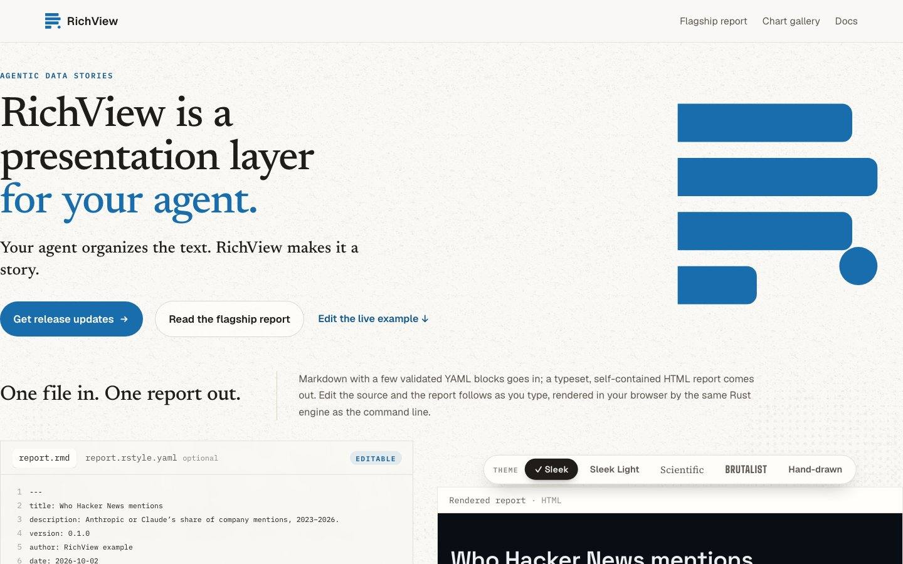

richview.ai on 21 October 2026: the eyebrow "Agentic data stories", the H1, the lede and three calls to action, "Get release updates", "Read the flagship report" and "Edit the live example". The copy starts at the window's left edge because the home page has lost its side gutters, which OPN-17 (D-FIX-HOME-GUTTERS) leaves to the rewrite, since no legacy hotfix ships (FEA-SF-30, OPN-02, OPN-43). The site served the unmerged PR #69 branch, which Daniel's OPN-13 (D-SITE-PR69) and OPN-01 (D-PROD-BASELINE) answers merge so that `main` records production; `main` has the same eyebrow, H1 and lede (`assets/landing/index.html:63-65`) under a six-link header. Source: https://richview.ai/, 1440×900, 2026-10-21. Cards: INT-01 (D-POSITIONING), INT-02 (D-TAGLINE), INT-42 (D-STATUS-LABEL).

> **INT-01 (D-POSITIONING), Daniel's answer, 2026-10-23.** Presentation layer for your agent

The card's option for the June wording reads "agentic presentation layer for data stories", which is not what Daniel said. In his 2026-06-20 voice note RichView is "an agent presentation layer for data stories", and near its end he reads out the headline he had written, "Agented Presentation Layer" (transcript in Daniel's notes: RichView voice dump — agented data storytelling layer (2026-06-20)). The Linear issue that reframed the copy recorded the phrase as "agentic presentation layer", and "agentic" entered the README and `llms.txt` with PR #4 (`5ceb7d4`, 2026-07-07).

> **INT-02 (D-TAGLINE), Daniel's answer, 2026-10-26.** The tagline is “Let your agent present.” with the line “Designed, reproducible, versioned.” beneath it.
>
> The three words are product properties, and each must stay true:
> - **Designed:** every output comes from a designed style.
> - **Reproducible:** any report can be rendered again from its source.
> - **Versioned:** every published version is kept, so a report can be managed over the long term.
>
> The page lede, `og:title`, share images, posts and the reel use both lines verbatim. “Your agent organizes the text. RichView makes it a story.” and “Your agent writes text. RichView renders the story.” are retired, the latter with its BETA label. The hero has no eyebrow above the H1: “Agentic data stories” is dropped.

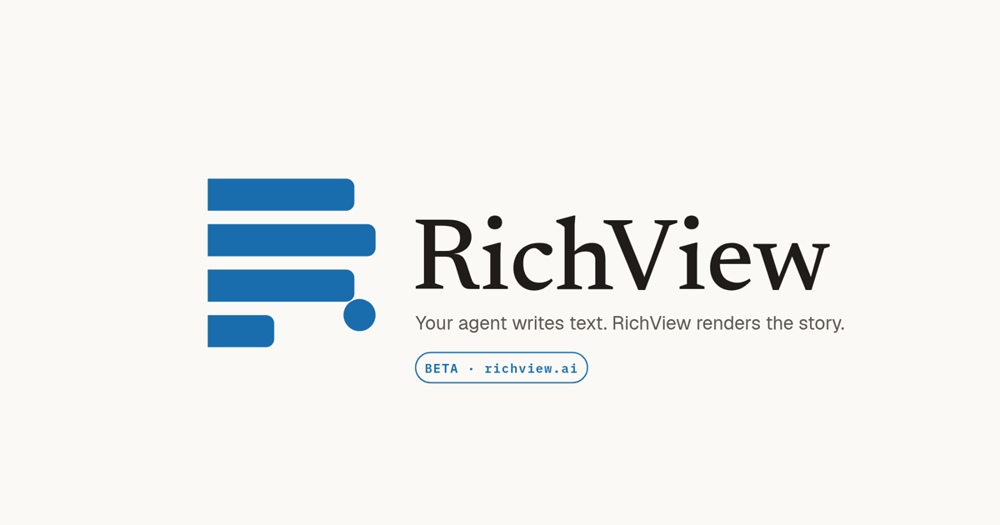

The share image richview.ai serves at `/landing/og.png`, byte-identical to `assets/landing/og.png` on `main`: the old tagline and a "BETA · richview.ai" badge, although Daniel decided on 2026-10-05 for "Coming soon", never "beta". No legacy hotfix ships (Daniel's FEA-SF-30, OPN-02 (D-LEGACY-FREEZE) and OPN-43 (D-HOTFIX-CONTENTS) answers), so OPN-20 (D-FIX-SHARE-IMAGE) leaves the live image as it is, and the rewrite's share image carries INT-02's two lines and "Coming soon · richview.ai" when it reaches `prod`. Source: https://richview.ai/landing/og.png, 1200×630, 2026-10-21. Cards: INT-02 (D-TAGLINE), INT-42 (D-STATUS-LABEL).

> **INT-03 (D-WHY), Daniel's answer, 2026-10-23.** RichView makes three value claims. **Keep design consistent:** typography, chart conventions and styles are reusable decisions, made once and applied to every analysis. **Make the handoff inspectable:** words, chart definitions and data are plain text, and the rendered page travels with its source. **Stay in the workflow you know:** write with your agent, revise in your editor and version the report beside its evidence in Git. The renderer owns charts, layout and typography so the agent can concentrate on the analysis.

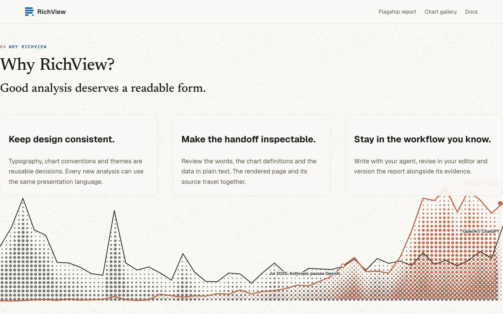

Section 04 of richview.ai, "Why RichView? Good analysis deserves a readable form.", with the three claims INT-03 adopts; `main` has the same text (`assets/landing/index.html:303-307`). Source: https://richview.ai/#why, 1440×900, 2026-10-21. Card: INT-03 (D-WHY).

> **INT-04 (D-ARTIFACT), Daniel's answer, 2026-10-26.** Chosen option: Self-contained by default, linked on a server.
>
> Smaller served pages; two output modes to build and test.
>
> **INT-05 (D-BRAND-NAME), proposed.** The product stays **RichView**, the format **Rich Markdown** with the `.rmd` extension, and style files `.rstyle.yaml`. The rewrite's two servers are **RichView Cowork**, the self-hostable internal server (INT-83), and **RichView Publish**, the external publication server (INT-35). **RichView News** names one Publish instance, RichView's own publication, not a product (INT-74). The known collisions, TRichView (a Delphi rich-text component) and R Markdown’s `.Rmd`, are accepted rather than renamed around; the editor registers its own language id (FEA-SF-22).
>
> **INT-76 (D-ALTERNATIVES), proposed.** RichView is chosen over four alternatives, each for one reason. Over screenshotting a plotted chart and eyeballing it: exact, machine-readable defects at no cost per render. Over raw chart libraries: reference-grade charts from the defaults, with no per-chart tuning, and charts that check themselves. Over chat artifacts and code interpreters: a durable, sourced report the author keeps and versions, not an ephemeral blob. Over BI tools and notebooks: no infrastructure, one file, and checks at the rendering layer rather than only the data layer. Public pages describe these as categories, not named products (INT-23).

The artifact has a price today: the 1,257-byte `examples/first-report/report.rmd` renders to a 2,366,552-byte `Rendered/report.html`, 92% of it script elements that carry the embedded runtime (re-run). July's promise of "zero client-side JS" (docs/OVERVIEW.md line 65 at `5ceb7d4`) no longer holds, because the WebAssembly runtime draws the charts in the browser, with WebGL by default under Daniel's INT-31 and ARC-05 (D-INTERACTIVITY) answers.

## Who it is for

The stated audience has moved with each round:

| Date | Audience | Source |
| --- | --- | --- |
| 2023 | Analysts composing branded web reports in a block editor, with AI drafting charts: the original RichView | Notion "v1 — the original RichView startup" |
| 2026-06-20 | "this whole product is only for people who have coding agents and who use coding agents" | Daniel's voice-note transcript; the Linear issue that scoped the web surface records it as "mostly for people using coding agents" |
| 2026-10-02 | "analysts and developers using coding agents", for interest and feedback | Linear: the Rust chart library and scrolling website briefs |
| 2026-10-10 | Authors working with agents, "their readers on desktop and mobile" and people who find the work through LinkedIn carousels | Linear: the product brief |
| 2026-10-17 | Someone dictating a sales dashboard | Linear: the voice-dashboard brief |
| 2026-10-18 | "a small intelligence or specialist news publisher" | Linear: the Publish and News brief |

> **INT-06 (D-AUDIENCE), Daniel's answer, 2026-10-26.** RichView is built first for analysts, above all data analysts in every industry, who publish internal or external analysis and do that work with a coding agent such as Claude Code, Codex or Cursor. The agent writes and revises the source; the analyst directs, reviews the rendered story and owns its claims. Every authoring capability works for an agent without a GUI. Most of RichView's communication targets analysts.
>
> Writers in general can use it too: analysts and journalists, someone hosting their own small RichView server as a personal site or blog, and later a newsroom. Roles and approvals belong to RichView's servers, never to the core: RichView Publish (external-facing) and an internal-facing server (working name RichView Cowork, sharing much of Publish's core) both have a basic set of roles, such as reader, author, owner, and who may edit, delete and share. RichView is not built for zero-code business users.
>
> FEA-SF-19 (later) replaces the smaller role set with full, enterprise-grade roles and access control on both servers.
>
> **INT-07 (D-AUDIENCE-READERS), Daniel's answer, 2026-10-27.** Readers open a story on a phone, a desktop or as a PDF with nothing to install, and with no account unless its author shared it only with signed-in readers, such as their organization on RichView Cowork (OPN-54, INT-83). Every story reads completely from 320 px wide upward, works with a keyboard, gives charts and controls accessible names, honours reduced motion, and keeps text and tables legible with scripts disabled. Charts render with WebGL (INT-31) and must work in recent Safari, Firefox and Chrome; where JavaScript or WebGL is unavailable, each chart's frame keeps its title, caption and source note and shows a notice that the chart cannot be displayed, with no snapshot, image or table in its place (ARC-05). Readers can reach each chart’s values, at the precision the author chose (FEA-CH-37), and its sources. Every story with an address also unfurls as a rich link preview wherever its link is shared, in WhatsApp, Slack, iMessage, email or a social post: a designed thumbnail of the story, in its own style, with its title, like the card a shared song gets (FEA-SF-55, FEA-RP-51). A story shared only with signed-in readers shows its title and image only to them, so a link preview never reveals a private story. People who meet RichView through shared stories or posts are readers first. The stories come mostly from analysts and also from other writers, such as journalists and people running their own RichView site or blog (INT-06).

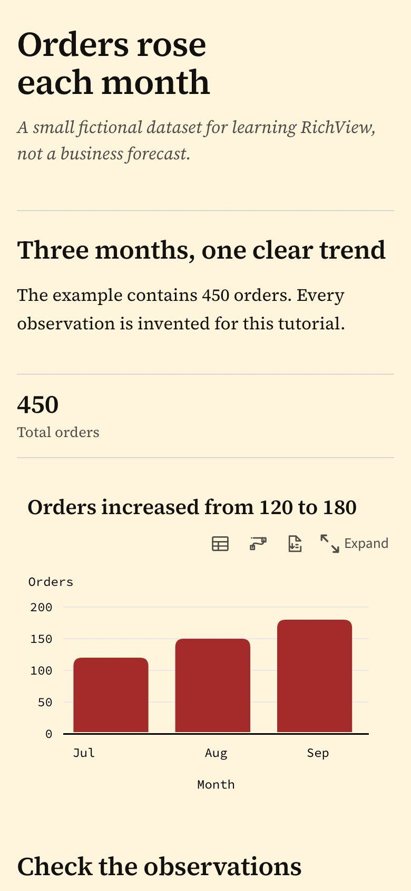

The tutorial report "Orders rose each month" published to a local `richview server` and read at `/r/first-report` in a 390×844 phone viewport: title, lede, metric and chart fit the width, and the chart keeps its actions as icons beside Expand. Source: `richview server` from the `b4db233` release build, headless Chromium, 390×844 at 2x, 2026-10-22; [Architecture](architecture.md#publishing-paths) shows the desktop view. Cards: INT-07 (D-AUDIENCE-READERS), FEA-SF-14 (F-APP-SERVER-REPORT-PAGES).

Every story with an address also unfurls as a rich link preview wherever its link is shared, in WhatsApp, Slack, iMessage, email or a social post: a designed thumbnail of the story in its own style, with its title, like the card a shared song gets (INT-07). Four proposals build it. FEA-SF-55 (F-SITE-SHARE-IMAGES) has the server render a 1200×630 thumbnail once, when the version is stored. ARC-69 (D-LINK-PREVIEW-RENDER) has the server core draw it natively from the chart engine's geometry model, so no browser or GPU is needed. STY-70 (S-STORY-THUMBNAIL) decides how it looks in each of the five styles. FEA-RP-51 (F-LINK-PREVIEW-META) adds the `og:` tags that point to it. A story shared only with signed-in readers shows its title and image only to them, so a link preview never reveals a private story. Today a published report carries no `og:` tags and no thumbnail.

## What it does

> **INT-08 (D-CORE-JOBS), Daniel's answer, 2026-10-27.** RichView does five jobs.
> - **Write:** the agent turns finished analysis into Rich Markdown with chart-local data, guided by `richview learn` and the skill.
> - **Check:** validation and chart diagnostics tell the agent, in machine-readable form, what is broken or unreadable.
> - **Present:** one source renders into a typeset, interactive story in any accepted style.
> - **Revise:** the human reviews the rendered story beside its source in the editor or browser, and the agent fixes it.
> - **Share:** the story leaves as a self-contained file, a PDF or a stable versioned URL.
>
> RichView is not a BI tool: it doesn't run the analysis, and the core never queries data. The one exception is on a RichView server. There, a report can link datasets through the server's connectors (OPN-63), so the server loads the data for it.

Each job has a surface in the `b4db233` build:

- Write: `richview init` scaffolds a report folder, and `richview learn` and the `richview_learn` MCP tool print the grammar, chart contract, styles, workflow and design principles (`crates/richview-core/src/knowledge.rs:13-17`); the agent skill and `llms.txt` repeat them, with the drift described under INT-21.
- Check: `richview validate` and `richview check`, both with `--format json`, mirrored by `richview_validate` and `richview_check`.
- Present: `richview generate`, mirrored by `richview_render`, writes `Rendered/report.html`, or with `--to pdf` a PDF printed by a local Chromium-family browser; styles come from the frontmatter or `--style`.
- Revise: `richview serve` previews a report locally, but a breaking edit turns the preview into raw JSON that stays after the edit is undone, as [Architecture](architecture.md#native-and-webassembly-hosts) shows; FEA-SF-08 (F-APP-CLI-SERVE) would keep the last good render under a banner instead. The VS Code extension (`richview-vscode` 3.0.0-alpha.1, a locally built VSIX, "not Marketplace publication" per `docs/public/tools.md:76`) and the browser playground preview live.
- Share: `richview publish` and `richview_publish` send the source to a RichView server, which stores versions under `/r/<slug>` and `/r/<slug>/v/<version>`; `richview_asset_put` and `richview_asset_verify` upload and check remote data and media. The MCP server's tool list holds these seven tools today (re-run); FEA-SF-09 proposes nine with `richview_image_search` and `richview_image_use` (FEA-RP-62, accepted).

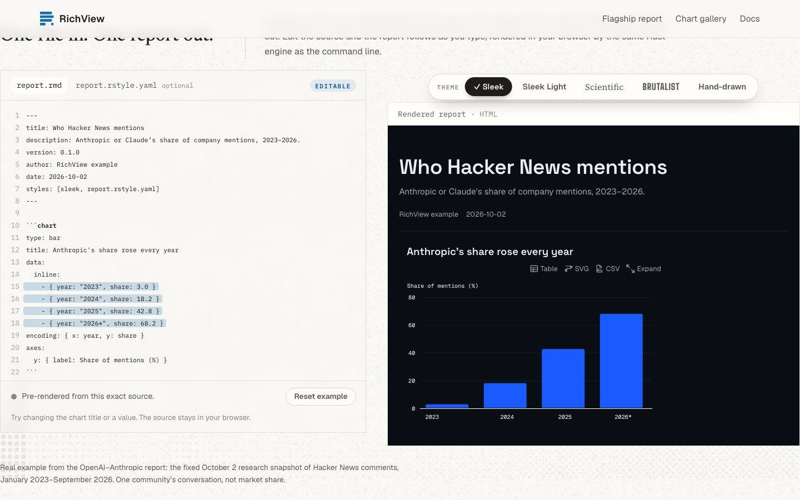

The home page's live demo on 21 October 2026: an editable `report.rmd` (frontmatter and one `chart` fence with inline rows) beside the report pre-rendered from it, with pills for the five builtin styles; the page says edits re-render in the browser with the same Rust engine as the command line. As in the hero, the editor starts at the window's left edge and the report reaches the right one, the gutter defect of OPN-17 (D-FIX-HOME-GUTTERS). On `main` the style pills stay hidden ([Screenshots](screenshots.md#landing-page)). Source: https://richview.ai/#demo (PR #69 content), 1440×900, 2026-10-21. Cards: INT-04 (D-ARTIFACT), INT-08 (D-CORE-JOBS).

## The use case it is built around

INT-09 proposes one end-to-end journey as the reference scenario for the guide and the acceptance tests.

> **INT-09 (D-USE-CASE), proposed, inferred.** An analyst asks their agent for a weekly sales story. The agent runs `richview learn`, creates `reports/weekly-sales/report.rmd` with prose, three charts and a table that read chart-local CSV files, and renders it through `richview_render`. `richview_check` reports a dropped label; the agent shortens it and the check comes back clean. The analyst previews in VS Code, switches style, asks for a sharper headline and exports a PDF. The agent publishes version 0.1.0 to the team’s server and commits source and data to Git. A colleague opens the link on a phone; shared in a chat, the link unfurls as a card with the story’s thumbnail (INT-07). Every step except publishing and the link preview works offline.

Every step of the journey has a command or tool at `b4db233`, but an analyst outside the project cannot complete it today:

- Installing needs access to the private repository and a source build with Rust 1.99, the Wasm target, a C/C++ linker and `wasm-bindgen-cli` 0.2.129 (`docs/public/index.md:23`). No RichView package is on npm (`@richview/cli` and `@richview/core` return 404, re-run) and the extension is not on the Marketplace; INT-71 decides distribution.
- A clean check is not yet trustworthy: `richview check` returns `status: clean` for a chart whose `encoding` names fields absent from its data, and for every chart of a Sleek report checked with `--theme light`, whose chart text is nearly invisible (both re-run; shown under INT-18 below).
- `richview publish` and the extension default to `https://richview.uk` (`crates/richview-app/src/cli.rs:122`, `packages/vscode/package.json:108`), which serves the old v2 site (re-run); "the team's server" has to be one the team runs (INT-36).

PDF export works. On a copy of `examples/first-report`, `richview generate --to pdf` returned `ok: true` and a two-page A4 PDF of 42,821 bytes, with info diagnostics for estimated glyph bounds and two local links (re-run). On the lockdown fixture the export also works, but its code prints in a fallback font (`export.font-fallback`) and the last of nine pages holds only the colophon, which FEA-RP-43 (F-EXPORT-PDF) and FEA-RP-06 (F-COLOPHON) would rule out; [Screenshots](screenshots.md#report-output) shows those pages.

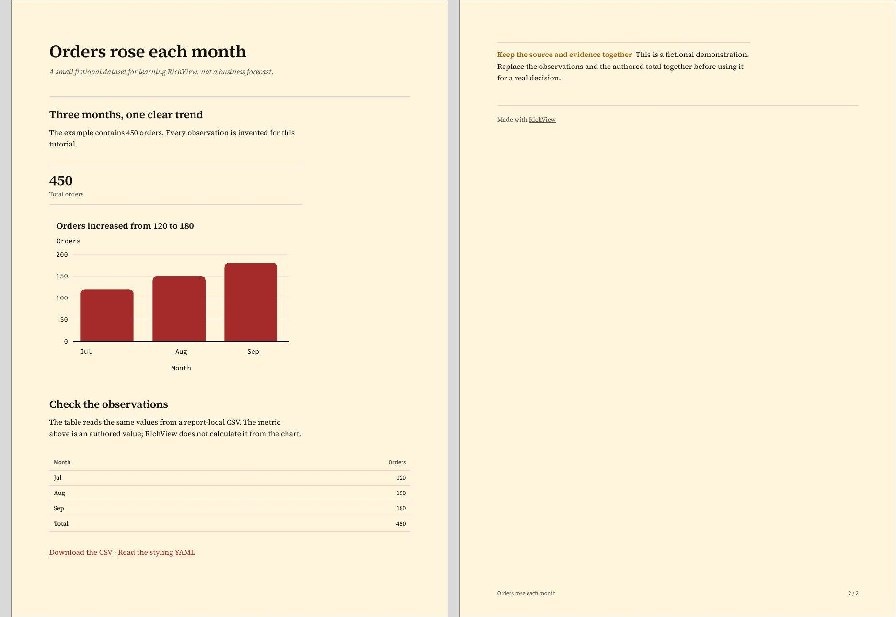

`examples/first-report` printed with `richview generate --to pdf`: two A4 pages, the second holding only the closing callout and the colophon above the running title and page number. Source: the `b4db233` release build with Chrome for Testing, 2026-10-22, as recorded by FEA-SF-06 (F-APP-PDF-EXPORT). Cards: INT-09 (D-USE-CASE), FEA-RP-43 (F-EXPORT-PDF).

> **INT-10 (D-FLAGSHIP-STORY), proposed.** The flagship stays the OpenAI-versus-Anthropic investigation, a fixed research snapshot dated 2 October 2026: 13 sections, 18 charts and a 643-row dated source ledger. It also shows how to use the storytelling tools well (INT-77). The rewrite re-renders it without changing data, wording or sources, in every accepted style. Its header graphic is INT-75. No second flagship is added during the rewrite.
>
> **INT-75 (D-FLAGSHIP-HEADER), proposed.** The flagship’s broken header chart (`examples/openai-vs-anthropic/assets/audiences.svg`) is replaced by a finished header infographic, drawn as native SVG from the report’s own evidence: no new research facts, its sources recorded, alt text written, and its colours and type following the active style, so it reads in every accepted style, on phones and in print.
>
> **INT-45 (D-FLAGSHIP-CLAIMS), proposed.** Marketing shows the flagship as a demonstration of RichView and links to it, but does not restate its findings as claims in posts, share images or on the home page. The report itself carries its title, method, dated sources and limitations. Quoting a finding in a post needs Daniel’s explicit approval of that post.

The flagship at `b4db233` has 13 sections, 18 chart fences, version 0.1.0 and a source ledger of 643 dated rows (`examples/openai-vs-anthropic/report.rmd`, `examples/openai-vs-anthropic/ledger/sources.csv`, re-run). The showcase offers it in 23 treatments, the three production ones and 20 studio explorations (`assets/showcase/themes.json`). They come from an older stylesheet snapshot ("snapshot c617606", `assets/showcase/themes.css:1`) that has no sleek-light or hand-drawn, so today the flagship cannot be shown in two of the five builtin styles, which bears on INT-10, INT-19 and INT-68. Defaults differ by surface: the showcase and the playground open in Scientific (`assets/playground.html:20`), `richview init` and the home-page demo use Sleek (`crates/richview-app/src/cli.rs:594`, `assets/landing/anchor/report.rmd:7`), and a report that names no style falls back to Brutalist (`crates/richview-core/src/render.rs:103-105`). Daniel's STY-05 (D-STYLE-CATALOG) and STY-06 (D-DEFAULT-STYLE) answers settle both: five main styles, Sleek, Air, Scientific, Brutalist and Hand-drawn, with the studio explorations kept as extended themes, and Sleek is the default everywhere.

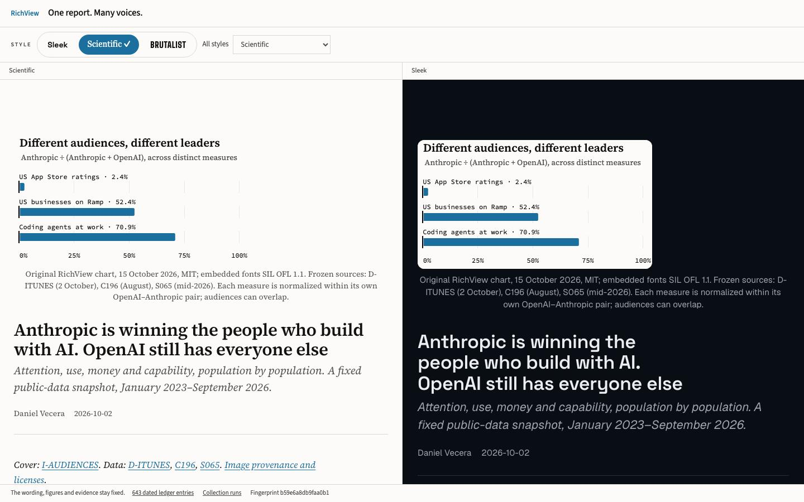

The flagship showcase on `main` in compare mode: Scientific and Sleek side by side with the same headline, byline, figures and source links, above a footer that reads "The wording, figures and evidence stay fixed." with "643 dated ledger entries". In Sleek the header graphic keeps its light chart surface on the dark page: it is a pre-rendered `examples/openai-vs-anthropic/assets/audiences.svg` that no style reaches. Source: `/showcase/openai-vs-anthropic/?theme=scientific&compare=sleek` on the local build of `b4db233`, 1440×900, 2026-10-21. Cards: INT-10 (D-FLAGSHIP-STORY), INT-19 (D-BET-STYLE-RANGE), INT-75 (D-FLAGSHIP-HEADER).

## What RichView maximizes

Daniel's INT-17 answer (2026-10-26) puts visual and motion craft first: when targets conflict, craft wins, because people come to RichView for how their analysis looks. His INT-77 and INT-13 answers of 2026-10-27 then restate two slots of INT-17's order, and where they differ the later answers win: storytelling is not maximized, and the authoring-path slot is now trust in the output. Footprint, file size and speed yield to craft; a size or speed budget may be raised when craft needs it, and the change description records the trade. Safety is never traded, traceability and editability are guarantees rather than ranked targets, and part 07's speed budgets are a floor; speed counts as a target only beyond those budgets, in last place.

| Target | What it means | Card |
| --- | --- | --- |
| Visual and motion craft | Charts that withstand side-by-side comparison with Highcharts and ECharts, typography and layout held to FT-grade and Wall Street Journal editorial design, on desktop, phone and print; delightful, smooth motion, the whimsical quality of Studio Ghibli meeting the polish of Apple's website animations; restraint included; references are benchmarks, never code to copy | INT-12 (D-MAX-CRAFT), answered |
| Storytelling | Not maximized. The story is the author's; RichView gives the tools and judges nothing beyond syntax-level analysis. INT-17 listed it second | INT-77 (D-MAX-STORY), answered |
| Trust in the output | The same source renders consistently and to a high standard every time; saving tokens is not a goal. INT-17 listed "a short authoring path" third | INT-13 (D-MAX-AUTHORING), answered |
| Extensibility | A chart type, block or builtin style is added in one shared implementation that native and browser hosts both use, with a worked example; no plugin API in the rewrite | INT-78 (D-MAX-EXTENSIBILITY) |
| Low, explainable cost | Static hosting where possible, a written cost estimate for each hosted feature, the paid hosted services included, no dependence on one provider without a documented alternative, Cowork runnable as one container | INT-15 (D-MAX-COST) |
| A small footprint | The smallest code and output that deliver the accepted features; growth is explained by an accepted feature or by craft; no line-count target | INT-14 (D-MAX-FOOTPRINT) |
| Speed beyond the budgets | Ranked last: beyond part 07's budgets, which are a floor, RichView adds no code or complexity for benchmark wins | INT-16 (D-MAX-SPEED), inferred |
| Traceability and editability (guarantees, not targets) | Every chart and figure can show where its data came from, and the author can inspect and change every presentation choice; truthfulness of the evidence is not something RichView maximizes | INT-11 (D-MAX-EVIDENCE), answered |

> **INT-17 (D-MAXIMIZE), Daniel's answer, 2026-10-26.** When targets conflict, visual and motion craft wins (INT-12): if a report looks bad, RichView has failed, while a report that is a bit slower or a file that is larger is something RichView survives. People come to RichView for how their analysis looks: perfect text rendering, beautiful charts and images, rich animation. The text carries a report's quality, so storytelling (INT-77) comes right after craft, but the old "80% content, 20% style" framing does not describe why people choose RichView.
>
> Order: visual and motion craft (INT-12); storytelling (INT-77); a short authoring path (INT-13); extensibility (INT-78); low operating cost (INT-15); small footprint (INT-14); speed beyond the budgets (INT-16). Footprint, file size and speed yield to craft; a size or speed budget may be raised when craft needs it, and the change description records the trade.
>
> Guarantees outside the order: RichView is feature-complete for what it accepts and always works; traceability and editability hold (INT-11); safety is never traded (INT-79).
>
> **INT-12 (D-MAX-CRAFT), Daniel's answer, 2026-10-27.** RichView maximizes visual and motion craft until its charts withstand side-by-side comparison with Highcharts and ECharts, and its typography and layout with FT-grade and Wall Street Journal editorial design, on desktop, phone and print. Those are the bar and Daniel's inspirations; they are quality benchmarks, never code or styling to copy. Animation is delightful and smooth: the whimsical quality of Studio Ghibli meets the polish of Apple's website animations, and that is what RichView strives for. Motion that explains structure or change and gives pleasure belongs to the craft (floor INT-61, controls INT-59). Daniel's own polish bar is Mluva. Restraint is part of craft: the right number of lines, marks and colours. A review agent on the model Daniel uses at the time judges craft on each design change, and Daniel sees every change in the before-and-after report before `prod` (INT-67, DEL-68, DEL-69); INT-67 to INT-70 are the bars for done.
>
> **INT-77 (D-MAX-STORY), Daniel's answer, 2026-10-27.** RichView does not maximize storytelling, and it doesn't claim to. The story is the author's: the most beautiful pen does not write a great novel. RichView gives authors and their agents the right tools to argue clearly: headings, charts with their interpretation, annotations, callouts, emphasis, header imagery and the scrollytelling element (FEA-RP-48). `richview learn`, the skill and the flagship (INT-10) show how to use those tools well. Beyond syntax-level analysis (structure, missing sources, unlabelled charts), RichView makes no judgment of a story's quality, and nothing promises that a RichView report argues well. The LinkedIn carousel is dropped (FEA-RP-46).
>
> **INT-13 (D-MAX-AUTHORING), Daniel's answer, 2026-10-27.** RichView does not maximize how little an author or agent writes; saving tokens is not a goal. It maximizes trust in the output: the same source renders consistently and to a high standard every time, so an author can rely on it without checking every page.
>
> A chart still needs its type, data, encodings, a title that states its claim, and a source note under it; `richview check` warns when the note is missing (TYP-12, TYP-13, FEA-RP-09). Good defaults and styles carry quality, so agents don't have to tune every chart. They may write as much as they need, and extra source never costs quality. Errors name the line, the problem and the fix. An agent that has read `richview learn` writes a correct first draft without outside examples. Field-level rules belong to part 05.
>
> **INT-11 (D-MAX-EVIDENCE), Daniel's answer, 2026-10-26.** Truthfulness of the evidence is not something RichView maximizes; RichView maximizes other targets. What RichView guarantees is that a story stays traceable and editable: every chart and figure can show where its data came from, and the author can inspect and change every presentation choice. Presentation choices that trade literal precision for readability, such as smoothed curves on a line chart, are the author's to make and are not ruled out for fidelity.
>
> **INT-79 (D-SAFETY-FLOOR), accepted by Daniel as proposed, 2026-10-26.** Safety is a floor that is never traded. No `.rmd`, data or style file can make RichView emit executable HTML, CSS or script; embeds run sandboxed; outputs never carry credentials, tokens or files from outside the report folder; data-source credentials for live connectors (INT-24) are held only by the Publish host and never appear in report source, agent context, logs or exported files, and the secret scan (DEL-55) covers them; private uploads stay private and public delivery is an explicit choice; every server endpoint that renders, publishes or regenerates requires a token and is bounded, except the loopback preview (ARC-31). ARC-10 to ARC-15, ARC-23, ARC-31 and TYP-51 define the boundaries, and a hostile-input fixture proves them before anything ships.
>
> OPN-63 (later) makes live connectors standard on every RichView server, so whichever server runs a connector holds its credentials, in its own configuration.
>
> **INT-16 (D-MAX-SPEED), proposed, inferred.** Speed is a floor. Interactions and motion stay smooth on a mid-range phone, rendering and preview feel immediate, and every budget in part 07 holds; a size or speed budget may be raised when visual and motion craft needs it, with the trade recorded (INT-17). Beyond the budgets, RichView adds no code or complexity for benchmark wins.

The order is now Daniel's, and his INT-17 answer says the old "80% content, 20% style" framing does not describe why people choose RichView. Earlier inputs were the product brief of 2026-10-10, which lists craft, style identities, motion with storytelling, the authoring path and cost without ranking them; the Rust migration brief (2026-10-04), which put end-to-end performance first; and his 2026-06-20 voice note, "my first thing is, I want to minimize the code footprint". His INT-12 answer also names Mluva (dictated as "Mlouva") as his own polish bar, so OPN-42 (D-DICTATION-OPEN) no longer lists it as unclarified. INT-17's own text still names storytelling second and a short authoring path third; INT-77 and INT-13 restate those slots, and Daniel may want to restate INT-17 itself.

Today the safety floor and the promise of a trustworthy check do not hold (re-run):

- Safety: when a report's style cascade includes Sleek, the `richview init` default, a `chart.palette` value in its `.rstyle.yaml` closes the report's `<style>` element and injects a live `<script>`, and `richview generate` returns `ok: true` with a clean status. The style validator lets the value through (`crates/richview-core/src/style.rs:632-650`), and the print override for Sleek's light counterpart writes it unescaped (`crates/richview-core/src/style.rs:906-927`); with Scientific alone nothing is injected. `POST /api/render` and `POST /api/reports/{slug}/v/{version}/regenerate` check no token, and `GET /api/reports` lists every stored report to anyone (`crates/richview-app/src/server.rs:176`, `:350`, `:401`). OPN-16 (D-FIX-STYLE-INJECTION) leaves the legacy code unpatched and has the rewrite fix it.
- Checks: `richview check` passes charts it cannot bind or read, as the use case above shows; INT-18 (D-BET-SELF-CHECKING) and TYP-15 (D-TYP-FIELD-CHECKS) would close the gap.

## Where RichView goes beyond what exists

Daniel asked "where do we want to go beyond what anyone has ever made" (Daniel, 2026-10-21 brief). Part 01 has five bets. Daniel answered one, agent-native authoring, as a headline bet at 100% (INT-21); the other four are proposals, and Git-native publishing is built with Publish.

> **INT-23 (D-AMBITION), proposed, inferred.** “Competition-winning” and “beyond anything made” are internal review bars and never appear in public copy. Public pages claim only bets demonstrated on richview.ai with real output: self-checking charts (INT-18), one report in many coherent styles (INT-19) reference-grade charts from the defaults (INT-20) and agent-native authoring (INT-21), the last only once scored fresh-agent runs show it (FEA-SF-65, INT-69), each linked to a live example. Comparisons with named products stay in internal reviews.

**Self-checking charts.** The June research named the gap: "No tool in any category returns post-render, machine-readable chart-quality diagnostics to the caller" (Notion "Strategy & business model (parked)", 2026-06-08). Its own kill-review warned that "Geometry is a weekend feature, not a moat", and the same research found that a 2026 vision model reads overlapping labels fine and that agent runtimes adding their own render-and-look loop are the likeliest threat. Both argue for a modest claim, that the edge over screenshots (INT-76) is cost and exactness, rather than for dropping the bet. June's decision surface demoted diagnostics (dec-50); PR #4 kept them on Daniel's call (2026-07-07). Today `richview check --format json` returns, per chart, its `checks`, `droppedLabels`, `geometryMeasured` and `status`, and says whether text bounds are estimates or browser measurements; it has no contrast check and does not notice unbound fields.

> **INT-18 (D-BET-SELF-CHECKING), proposed.** Self-checking charts are a headline bet. Every chart reports, in machine-readable form, what it could not show well, and RichView never reports clean for a chart it cannot bind or read. Today `richview check` reports dropped or truncated labels and why, collisions, clipped marks and whether text bounds were estimated or measured in a browser; the rewrite adds missing encoding fields (TYP-15), contrast against the chart’s actual surface and the other gaps in FEA-CH-60. Checks measure the engine's geometry model: the one model the WebGL renderer draws on the page and the vector renderer draws for PDF export (INT-31, ARC-18), not a browser's SVG. Whether a browser pass still measures chart text depends on how the WebGL page draws it, which is open (FEA-CH-30, FEA-CH-59). Agents get this from `richview check` and `richview_check` and fix the source until it is clean. The claim covers presentation quality only: checks are syntax- and geometry-level, they make no judgment of whether a story argues well (INT-77), and RichView never claims the analysis is true (INT-29). Which checks exist per chart type is decided in part 04.

Daniel's INT-31 answer moves the page to WebGL, so the browser SVG that today's measurement reads no longer exists by default. If chart text is drawn in WebGL from the bundled fonts, the model's text bounds are what readers see and stop being estimates; if it is laid over the canvas as HTML or SVG, the browser still lays text out and only a browser pass measures it (FEA-CH-30).

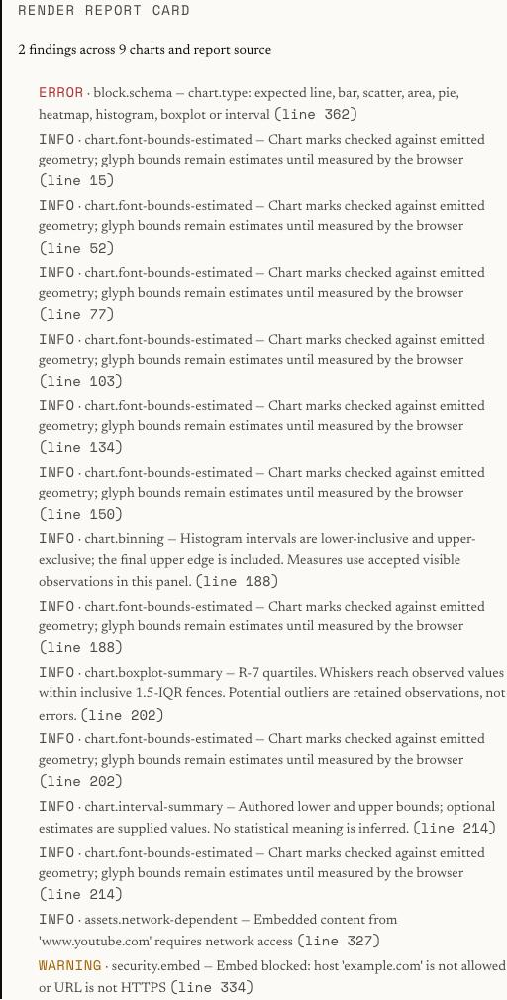

The render report card on the lockdown fixture: an error for an invalid chart type with its source line, a warning for a blocked embed, and an info line per chart saying glyph bounds remain estimates until a browser measures them. Source: `richview generate report.rmd --report-card` on the local build of `b4db233`, 2026-10-21. Card: INT-18 (D-BET-SELF-CHECKING).

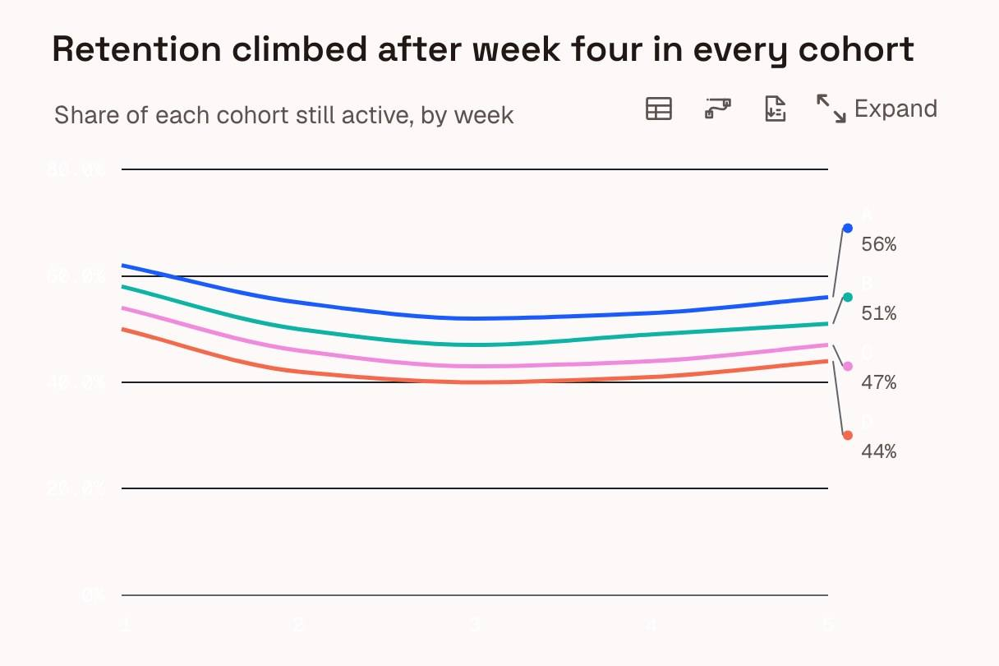

The first chart of the styles probe report in Sleek with an explicit light theme: axis labels and series names are nearly invisible, at 1.05:1 contrast according to the styles evidence, and the gridlines turn dark, yet `richview check --style sleek --theme light` reports all three charts of the report clean (re-run). Source: the probe report from the lockdown screenshots (`styles-design/probe-report.rmd`) rendered with `richview generate --style sleek --theme light` from the `b4db233` release build, cropped to the chart, 1440 px viewport at 2x in headless Chromium, 2026-10-22; the full page is in [Screenshots](screenshots.md#builtin-styles). Cards: INT-18 (D-BET-SELF-CHECKING), INT-56 (G-STYLE-REACHES-CHARTS).

**One sourced report, many coherent styles.** Daniel's 2026-10-02 brief asked for a report where "a visitor selects a theme or charting style and sees the entire presentation transform coherently while the evidence and analytical meaning stay intact"; the showcase heading reads "One report. Many voices." Styles failed to reach charts in seven rounds (INT-56), and the flagship's header ignores the style.

> **INT-19 (D-BET-STYLE-RANGE), proposed.** One report renders in every accepted style with identical data, wording and sources, and each style transforms the whole story coherently: typography, layout, chart palettes, chart text, controls and motion. Switching style shows a different, finished voice, never a half-styled page. The flagship demonstrates it; part 06 decides which styles exist (STY-05).

**Reference-grade charts from the defaults.** Charts were tuned against a local Highcharts 13.1.1 benchmark (PR #14) and later ECharts, Plotly and ggplot2 references (PR #16). Daniel's 2026-10-18 corrections show the engine is not there yet: years printed as "1.70K" and scatter labels "much too dense".

> **INT-20 (D-BET-CRAFT-FROM-YAML), proposed.** A chart with what INT-13 requires (type, data, encodings, a title that states its claim and a source note) renders at the craft level of Highcharts, ECharts and FT and Wall Street Journal graphics with no per-chart tuning, the bar of INT-12: correct ticks and calendar labels, sparse collision-aware labels, direct series names, honest scales, light tooltips and smooth transitions. The engine and the styles own this craft, so the same source renders to the same high standard every time (INT-13); authors add highlights or annotations only to say something. Brevity is not the goal: authors and agents may write as much as they need. RichView’s own engine renders it (INT-53). The bar holds for every type RichView draws, which Daniel's FEA-CH-01 answer sets at least at every chart type of ggplot2, Plotly, ECharts, Highcharts and Power BI, likely around 30, and for the map and flow elements.

**Agent-native authoring.** Today the agent docs drift from the code: `llms.txt:11-13` and `skill/SKILL.md:12` give six chart types and three styles where the code has nine types and five builtin styles, and the learn bundle (`crates/richview-core/src/knowledge.rs:15-16`) names five of the seven MCP tools, gives hand-drawn "monospaced chart text" where the style sets Patrick Hand (`crates/richview-core/assets/hand-drawn.rstyle.yaml:87-88`), and calls stored versions immutable, which they are not (see INT-36 below).

> **INT-21 (D-BET-AGENT-NATIVE), Daniel's answer, 2026-10-27.** Yes, a headline bet, 100%. RichView is agent-native: an agent learns, writes, renders, checks and publishes RichView on its own. It learns the format from `richview learn` or the `richview_learn` MCP tool, works through MCP or CLI JSON output, and every error names the line and the fix. The learn bundle, skill and MCP tool descriptions are generated from, or tested against, the same code as the renderer (INT-66), so today's drift (six chart types and three styles in `llms.txt` and the skill, against nine and five in the code) is fixed and can't come back.
>
> RichView invests heavily in how agents discover, learn and use it. Measuring how well agents use RichView is a feature: fresh-agent runs on real tasks, scored and tracked over time, show where agents stumble, and RichView is changed so agents understand it as easily as possible. A fresh agent with only these surfaces produces a clean report (INT-69).

Measuring how well agents use RichView is a feature (INT-21). FEA-SF-65 (F-AGENT-USE-MEASURE), a proposal, defines it. Fresh agents, Claude Code and Codex first, run real tasks in an empty sandbox with only the installed CLI and MCP server. Each run is scored on whether `richview check` ended clean and on which attempt, the attempts and tool calls used, the errors and diagnostics the agent met and misread, and whether the report meets the brief's checkable facts. Scores are stored per agent product, RichView build and task and tracked over time, and each place agents stumble becomes a change to `richview learn`, the skill, the MCP descriptions, a diagnostic or a default. The score measures RichView's agent surfaces and judges nothing about whether a story argues well (INT-77). INT-69 is the pass line, and DEL-78 runs the harness at each candidate and weekly on the `pre-prod` head.

> **INT-22 (D-BET-GIT-PUBLISHING), proposed, inferred.** Git-native editorial publishing stays a RichView bet: Git is the editorial system, with pull requests, protected previews, approval and automatic publishing, recorded as the spec in FEA-BR-26. It is built with RichView Publish, which the rewrite builds (INT-31, INT-35). Outside Publish, RichView shares through a deliberate `publish` command to a versioned server such as Cowork (INT-36, INT-83), and Git remains the author’s version history.

## What RichView will not be

Daniel answered INT-24 to INT-28; the other cards propose an exclusion, and rejecting a non-goal card lifts the exclusion without building the feature.

| Card | Non-goal | What pulls the other way today |
| --- | --- | --- |
| INT-24 (D-NOT-BI), answered | RichView presents analysis; it does not perform it, and the core never queries data (INT-08). By default it reads data exported into the report folder; live connections are a secondary path through connectors from an existing third-party engine, and OPN-63 (D-XPART-CONNECTORS) makes them standard on every RichView server, Cowork and Publish | SQL, MetricFlow and cached-data connectors in draft PR #66 and a MetricFlow dashboard in draft PR #64, both opened "despite older August scope locks" |
| INT-25 (D-NOT-CHAT), answered | A tool the author's agent calls: no chat interface, no LLM or speech-to-text calls, no stored model keys, no agent loop, no deck generator; the main way to work is local, through the CLI and MCP server | PR #64 builds dashboards from voice or text prompts with server-side speech-to-text |
| INT-26 (D-NOT-WEB-EDITOR), answered | No WYSIWYG or full browser editor, ever; the browser playground stays, and on a RichView server the browser offers only approving what gets published and a quick source edit by the page's author | PR #70's Publish desk includes a browser editor; the home page's "Edit the live example" stays a playground |
| INT-27 (D-NOT-SAAS), answered | A single-user tool first, like Word, with RichView's servers on top for sharing, roles and approvals, like SharePoint on Word; the core has no accounts, and the paid hosted services come on top of it | The home page shows a menu of reports with "private" badges and "access control" (`assets/landing/index.html:202`, `:237`) that the server does not provide |
| INT-28 (D-NOT-CODE-CUSTOMIZATION), answered | Authors customize only through declared, validated vocabulary in block YAML, frontmatter and `.rstyle.yaml`; no raw CSS, JavaScript or HTML, no engine-level chart specs or raw SVG, proven by a hostile-input test on every style key and sink; custom TypeScript components may come later, not in the rewrite | A style palette value injects a live script today; the `/charts/` page, linked from the home page on `main` (`assets/landing/index.html:338`, `:380`), presents "One JSON spec" (`richview-chart/web/index.html:29`), which TYP-22 (T-ENGINE-CHARTSPEC) keeps internal; the `.rstyle.yaml` grammar is broader than Daniel's 2026-06-21 "three options per setting" |
| INT-29 (D-NOT-TRUTH-CERT) | Checks cover structure, data binding and presentation, never the truth of the analysis, and beyond syntax-level analysis they make no judgment of a story's quality (INT-77); wherever checks are described, one sentence says so | Already said in `llms.txt:17` and `skill/SKILL.md:14` |
| INT-30 (D-NOT-MONETIZATION) | RichView's software carries no pricing, plans or paid tiers; money comes only from the paid hosted services of INT-36, and pricing, limits and whether accounts and billing are built before launch are open | Daniel parked monetization on 2026-06-08; his INT-36 answer makes paid hosted services the business model; the product brief's cloud-credit request is hosting cost (INT-48) |
| INT-80 (D-NOT-TRACKING) | No tracking or analytics in reports, the site, the playground or the tools, and no usage data from the CLI, MCP server or editor; the only personal data RichView holds is an address typed into the update sign-up | The privacy page already promises no tracking cookies or analytics (`assets/privacy.html:48`) |

> **INT-24 (D-NOT-BI), Daniel's answer, 2026-10-26.** RichView presents analysis. By default it reads data the agent or the author's pipeline has exported into the report folder. Live connections to data sources are in scope as a secondary path: they belong to RichView Publish, so a CMS-style publishing setup can serve stories from live data. Connectors come from an existing third-party engine that already offers a set of connectors, so RichView does not build them from scratch. Exported data stays the default for every report.
>
> **OPN-63 (D-XPART-CONNECTORS), Daniel's answer, 2026-10-26.** Live data connectors are standard on every RichView server, Cowork and Publish, whether local or hosted. RichView builds the connector core, and PR #66's work enters it (FEA-BR-01).
>
> - **Connectors on a server:** each server offers a set of connectors to set up. Named people manage them, and specific people are granted access to each one, under the governance roles (FEA-SF-19).
> - **SQL as a data source:** a report can use SQL against a connector where today it would link to a CSV or another file.
> - **Not a full CMS:** Publish's publishing setup is a light workflow (OPN-54), not a full CMS.
> - **Offline HTML:** a self-contained HTML file sent around never queries live data. The one exception is a data source pointing to a URL: the file downloads the data from that address, so the data updates when what the URL points to changes. There's no warning, because the reader already trusts the sender of the HTML.
> - **Credentials:** they stay in the server's configuration and never appear in `.rmd` files, report folders, rendered output, MCP arguments or agent context (ARC-23).
>
> The agents decide the technical details, such as which engines back the connector core and whether DuckDB or MetricFlow adapters are part of it.
>
> **INT-25 (D-NOT-CHAT), Daniel's answer, 2026-10-26.** RichView is a tool the author's agent calls. People bring their own agent; RichView has no chat interface, makes no LLM or speech-to-text calls, stores no model keys (no BYOK), runs no agent loop and does not generate slides or decks from prompts. The author's own agent does all language work. The main way to work is local: the author's agent uses RichView through its CLI and MCP server. A RichView server may at most expose MCP to an agent; it never adds a chat interface. Voice and chat front ends are sibling demos, never core (INT-34).
>
> **INT-26 (D-NOT-WEB-EDITOR), Daniel's answer, 2026-10-26.** RichView has no WYSIWYG or full browser editor, and never will: people should see and touch what is underneath, the Rich Markdown source. Real authoring happens in the author's editor (VS Code with live preview, or possibly a RichView desktop app later) and through their agent, with Git as the history. The browser playground stays: a source pane with live preview for trying the format and styles, with loading, copying and downloading, and no accounts.
>
> On a RichView server (Publish, Cowork), the browser offers only actions where they make sense:
> - approving what gets published: open the pending change online and click yes or no;
> - quick source edits by the page's author: when signed in as its author, Edit opens the page's Rich Markdown source in an embedded VS Code-style editor with syntax highlighting, and the server checks that the edited report still validates and renders before it is saved.
>
> **INT-27 (D-NOT-SAAS), Daniel's answer, 2026-10-26.** RichView works first as a single-user tool people download and use themselves, like Microsoft Word: a set of local tools (CLI, MCP, VS Code extension) that create one HTML file, which can be shared and works offline (INT-04). On top of that, like SharePoint on top of Word, RichView's servers (Cowork and Publish) add sharing, roles and approvals (INT-06, INT-83). RichView also runs paid hosted services: hosted Cowork (typically app.richview.ai, free up to limits), Publish servers set up under a customer's own DNS, and hosting for large data and media (INT-31, INT-36). Everything local works without them.
>
> **INT-28 (D-NOT-CODE-CUSTOMIZATION), Daniel's answer, 2026-10-26.** Authors customize through declared, validated vocabulary: block YAML, frontmatter and `.rstyle.yaml` keys. No report or style file can inject raw CSS, JavaScript or HTML, and charts accept no engine-level specs or raw SVG; the rewrite proves this with a hostile-input test on every style key and sink (ARC-12, ARC-13, TYP-51). When authors need more, RichView first adds a validated option or a better default. How much a style file may change is decided in part 06 (STY-14).
>
> Later, RichView may allow custom TypeScript components embedded in a report, so authors can build anything they want. That needs its own spec validation and agent skills, and the skills steer agents to use the defined vocabulary and components first and reach for custom code only when nothing defined fits. This is not part of the rewrite.

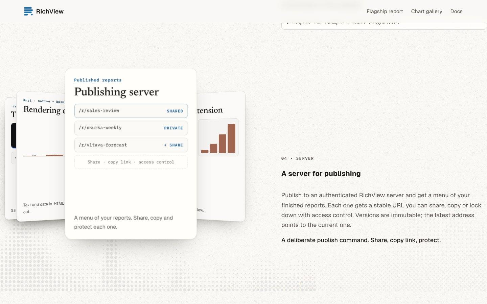

Section 04 of richview.ai, "A server for publishing": a card listing reports marked shared and private over "Share · copy link · access control", and copy promising access control and "Versions are immutable". The server has no private reports or access control, lists every stored report to anyone and deletes old versions (INT-36 below); `main` has the same copy (`assets/landing/index.html:202`, `:237`). Source: https://richview.ai/#element-server (PR #69 content), 1440×900, 2026-10-21. Cards: INT-27 (D-NOT-SAAS), INT-65 (G-HONEST-CLAIMS), FEA-SF-19 (D-ACCESS-CLAIM).

## The product family and what the rewrite builds

Since 17 October the family has grown on unmerged branches, two of which run live. The Publish brief says Daniel's 18 October instruction "is the current product scope and supersedes older narrow August launch framing for this new effort", and the voice-dashboard brief asked for the voice demo "despite older August scope locks". June had said the opposite: "Keep the product narrow: data stories for coding-agent users, not dashboards, not generic BI, not a full chat/web-editor product", and his August life-review voice note said "rather than a sprawling platform". Daniel's INT-31 answer of 2026-10-26 settles the scope: the rewrite builds RichView core and its servers, RichView Cowork and RichView Publish, which share one server core, and RichView News is one Publish instance, not a separate product. The voice demo stays outside the repository, and dashboards stay open (INT-33). This was the largest scope lever in the lockdown.

| Member | Today | Decided or proposed |
| --- | --- | --- |
| RichView core: the format and style cascade, chart engine, report renderer, CLI with MCP and `learn`, VS Code extension, browser playground and preview, PDF export, and richview.ai with its docs and the flagship | On `main` at `b4db233`, with today's report host (`richview server`) | The rewrite builds it: INT-31, answered |
| RichView Cowork | Today's report host, `richview server` | The self-hostable internal server and today's report host renamed; one of exactly two server forms, with no third, stripped-down server; RichView also runs it hosted, typically at app.richview.ai (INT-36): INT-83, answered |
| RichView Publish | Draft PR #70: a Rust crate plus a JavaScript gateway and editor behind Cloudflare Access, merged into `main` on 2026-10-26 | A full member of the family and part of the rewrite, sharing one server core with Cowork; the rewrite carries over its behaviour and decisions, and its JavaScript is ported to Rust when the rewrite reaches Publish: INT-35 and INT-52, answered, with OPN-14 (D-PUBLISH-PR70) |
| RichView News | Live at news.richview.ai from the `publish/news` branch, commit `7e7d9f8` (`/_status`, re-run); its footer links the old repository URL, which now returns 404 to visitors | One instance of RichView Publish, RichView's own publication, always public: INT-31 and ARC-22, answered. It stays online and is improved now, in parallel with the rewrite, until the rewrite's Publish can serve it: INT-74 (D-NEWS-DEMO), proposed. OPN-03 (D-NEWS-LIVE) repairs its publishing path in that work, and OPN-27 (D-REPO-URLS) has that session remove or repoint the dead link |
| Charts as a standalone library | The engine lives in `richview-chart/` (24,161 lines of Rust); `/charts/` presents a JSON chart spec; the public `richview-universe/richview-charts` repository still describes an ECharts renderer (last pushed 2026-07-07) | Internal engine only, with no npm package or public JSON chart API, and the generated npm packages dropped: INT-32 (D-SCOPE-CHARTS), inferred |
| Dashboards | A snapshot page on news.richview.ai; a voice-built dashboard in draft PR #64 | Not in the rewrite; reconsidered after launch as a report layout, not a separate runtime: INT-33 (D-SCOPE-DASHBOARDS), inferred |
| Voice-to-dashboard demo | Draft PR #64: a sibling crate, a JavaScript app and server-side speech-to-text | Does not enter RichView; it lives outside this repository, possibly in a repository of its own: INT-34 (D-SCOPE-VOICE-DASHBOARD), answered |

> **INT-31 (D-SCOPE-CORE), Daniel's answer, 2026-10-26.** The rewrite builds RichView core and its servers:
> - the Rich Markdown format and style cascade, the chart engine and the report renderer;
> - the CLI with MCP and `learn`, the VS Code extension, the browser playground and preview, and PDF export;
> - RichView Cowork, the self-hostable internal server (INT-83), and RichView Publish (INT-35), which share their server core. RichView News is just one instance of Publish, not a separate product (INT-74);
> - richview.ai with its docs and the flagship.
>
> Also in scope: scrollytelling, as one more element inside a broader report (FEA-RP-48); author-hosted assets and uploads (FEA-SF-50, TYP-41); and RichView-managed hosting for large data and media, which RichView runs as a service (this changes INT-27). The LinkedIn carousel output is dropped (FEA-RP-46). Live connectors stay a secondary path of Publish (INT-24, OPN-63). Dashboards and the voice demo stay on their own cards (INT-33, INT-34).
>
> Charts render with WebGL by default; RichView goes all in on it. Only PDF export converts charts to vector output, and that export may take time; it does not have to be instant.
>
> **INT-83 (D-SCOPE-COWORK), Daniel's answer, 2026-10-26.** Chosen option: Today's report host becomes Cowork, as the proposal says. The RichView server is the way people host their things, and it comes in exactly two forms: you run either RichView Cowork or RichView Publish. There is no third, stripped-down server. Cowork focuses on people publishing reports locally, inside their own organisation. Over time Cowork may also store data-source credentials, such as SQL credentials, so its reports can read live data, like Publish's connector path (INT-24); not in its first cut.
>
> **INT-35 (D-SCOPE-PUBLISH), Daniel's answer, 2026-10-26.** RichView Publish is a full member of the RichView family and part of the rewrite. PR #70 is merged into `main` (2026-10-26) and its work continues from there. RichView Publish and RichView Cowork (INT-83) share one RichView server core: an internal component, not a product of its own, that powers both. Publish carries the basic roles and approvals and the live-connector path (INT-06, INT-24); its brief and Git-native loop (INT-22, FEA-BR-26) remain the spec it is rebuilt against (INT-49, INT-52).
>
> FEA-SF-19 (later) makes these roles full, enterprise-grade roles and access control on both servers.
>
> **INT-34 (D-SCOPE-VOICE-DASHBOARD), Daniel's answer, 2026-10-26.** The voice-to-dashboard demo (PR #64) does not enter RichView. It lives outside this repository, possibly in a separate repository of its own.

INT-31 also puts scrollytelling in as one element inside a broader report (FEA-RP-48 (F-SCROLLY-STORY)), drops the LinkedIn carousel (FEA-RP-46 (F-EXPORT-CAROUSEL); INT-77 repeats it) and adds author-hosted assets and uploads (FEA-SF-50 (F-APP-ASSET-PUT), TYP-41 (D-TYP-ASSET-REF)) and RichView-managed hosting for large data and media, which RichView runs as a service (INT-27, INT-36). Charts render with WebGL by default, and only PDF export converts them to vector output, which may take time (ARC-05 (D-INTERACTIVITY), ARC-18 (D-CHART-RENDER-PATH)). Live connectors stay a secondary path, widened by OPN-63 to every RichView server. Per-output markers stay open as FEA-RP-47 (F-OUTPUT-MARKERS).

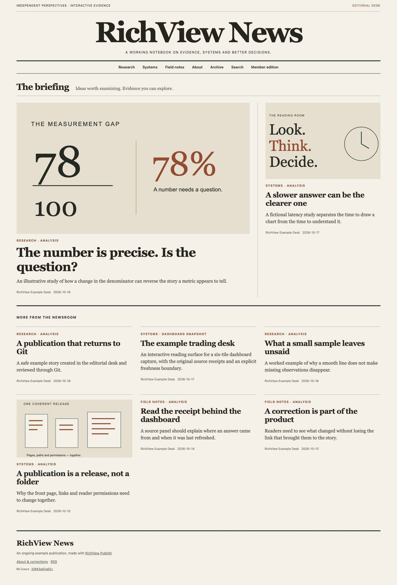

news.richview.ai on 21 October 2026: masthead, sections, a lead story and seven more items by "RichView Example Desk", one of them a dashboard snapshot, and the footer "An ongoing example publication, made with RichView Publish." It runs from the `publish/news` branch (`7e7d9f8`), which shares draft PR #70's earlier history, and OPN-01 (D-PROD-BASELINE) keeps it outside `prod`. Its About page says numerical observations are synthetic unless a story states a dated source. The dashboard page draws black wedges in two charts and shows the raw field name "plan gap lo" as an axis title ([Screenshots](screenshots.md#richview-news)). Source: https://news.richview.ai/, 1440 px viewport, full page resampled to 1080 px, 2026-10-21. Cards: INT-33 (D-SCOPE-DASHBOARDS), INT-35 (D-SCOPE-PUBLISH), INT-74 (D-NEWS-DEMO).

> **INT-36 (D-PUBLISH-TARGET), Daniel's answer, 2026-10-26.** Stories are shared as the self-contained HTML file, as a PDF, and through RichView's servers, which come in two forms: RichView Cowork and RichView Publish (INT-83).
> - Anyone can self-host Cowork or Publish.
> - RichView also runs hosted Cowork itself, typically at app.richview.ai: people share reports there, including with outside parties. It is free up to limits and paid beyond them; the limits cover how many reports and files an account has and how large they are. Hosted RichView may later have features of its own.
> - RichView also sets up and runs a Publish server for a customer under the customer's own DNS records, so it lives on their website.
>
> These paid services are how RichView makes money. Pricing, limits and which features are hosted-only are open.

Daniel's OPN-54 answer (2026-10-26) settles the reading side of INT-36. FEA-SF-15 (F-APP-SERVER-READ-API) and FEA-SF-17 (F-APP-SERVER-RENDER-API) follow it, as ARC-31 does.

> **OPN-54 (D-XPART-HOST-ACCESS), Daniel's answer, 2026-10-26.** Reads follow sharing, as simply as this:
>
> - **RichView Cowork:** everything is private by default. The author shares a report with their organization or with anyone on the web.
> - **RichView Publish (such as RichView News):** a publishing workflow that can require an editor's approval.
>   - An editor's own publish lands as private; the editor makes it public before anyone sees it.
>   - When an author who isn't an editor submits a report and an editor approves it, it becomes public automatically.
> - **Report lists:** anyone sees only the reports shared with them, and these roles come from FEA-SF-19.
>
> Whether a server render API exists, and how tokens work, are technical details the agents decide.

Today the store deletes versions beyond 50 per slug, so old permalinks stop resolving (`crates/richview-app/src/storage.rs:13`, `:101-111`), while the home page says "Versions are immutable" (`assets/landing/index.html:237`); [Format and types](format-and-types.md#report-identity-and-publishing) gives the details.

## Open source, licence and visibility

Today:

- The licence files disagree. `LICENSE` is MIT (copyright Daniel Vecera, 2026) and the Cargo workspace declares MIT (`Cargo.toml:8`), but `LICENSING.md` still describes the June gradient, "everything is MIT except the server", including the removed `@richview/cli` and `@richview/server` packages, and `packages/server/LICENSE` (Elastic-2.0) sits beside nothing but `fly.toml`.
- The site promises what does not exist yet: "RichView will be fully open source. The source will be published with the release. It is not public yet." (`assets/landing/index.html:368-369`). The repository was public until 2026-06-10, when it was set private "until ready to limelight", and moved to Daniel's account as `1vecera/richview` on 2026-10-21; it is private (re-run).
- Three public repositories still describe RichView products that no longer exist (re-run): `richview-universe/richview-charts` ("an Apache ECharts SSR-to-SVG renderer", last pushed 2026-07-07), `richview-universe/richview-docs` ("RichView Platform Documentation", last pushed 2026-02-26) and `1vecera/RichTemplates` (2023 plotting templates, last pushed 2023-04-21).
- The stance has changed twice. Until 2026-06-09 the repository's root licence was Elastic-2.0; that day everything but the server moved to MIT (`ce68a8d`), the gradient `LICENSING.md` still describes. June's decision surface then kept Elastic-2.0 for the server and said "Never market as 'open source'" (dec-81, 2026-06-21), and the 2026-07-07 copy said "source-available" (`5ceb7d4`). On 2026-10-05 Daniel made "RichView will be fully open source" the product direction while asking that the copy not imply the source is public; the same day the LinkedIn carousel handoff warned that open source is still a promise while the repository is private, and his plan for 2026-10-07 repeated it (Notion: 2026-10-07 — Wednesday).

> **INT-37 (D-OPEN-SOURCE), Daniel's answer, 2026-10-26.** Chosen option: MIT everywhere.
>
> Matches `LICENSE`, every crate, the impressum and News About; anyone may host RichView commercially.

The font check has a known case. The landing page declares its web fonts as "Source Serif 4" and "IBM Plex Mono" (`assets/landing/landing.css:26-44`), and the reel uses the same files under the same names (`assets/reel/index.html:13-16`). The files are 250- and 256-glyph subsets whose name tables keep those names (re-run with fontTools on `assets/landing/fonts/`). The repository's own font notes call subsets Modified Versions under the OFL and forbid the reserved names "Source" and "Plex" for them (`scripts/fonts/README.md:71`), which is why the report fonts are named RichView Serif, Sans, Code and Mono; the landing files need a licence review.

> **INT-38 (D-SOURCE-VISIBILITY), Daniel's answer, 2026-10-26.** The docs and the website are always public. The source repository stays private until launch: when Daniel decides the work is done, he tells an agent to publish it all, and the source goes public then, as its own explicit step. Before it, the full history is checked for secrets and private data, knowing that the history up to 2026-06-10 was public and may already have been copied, and bundled fonts and assets are checked against their licences (INT-37).
>
> **INT-39 (D-OPEN-SOURCE-CLAIM), proposed, inferred.** From launch, public pages say “RichView is open source and MIT licensed.” (FEA-SF-30) and link the repository, which goes public at launch with everything else (INT-38, INT-43). Before launch, no public surface states open source as a present fact: a page that mentions it says “RichView will be open source under the MIT licence.” Posts and share images follow the same rule.
>
> **INT-40 (D-LEGACY-REPOS), proposed.** `richview-universe/richview-charts` and `richview-universe/richview-docs` are archived, each with a short README note pointing to richview.ai, now, on Daniel's go (OPN-25). `1vecera/RichTemplates`, the 2023 RichView-branded plotting templates for matplotlib, R, Power BI, Altair and Plotly, is archived the same way, on the same schedule (OPN-65). The private `richview-v2`, `richview-design-system` and other `richview-universe` repositories stay private and unchanged.

## Releases, installation and launch

Daniel's delivery model has no releases: "We will have a dev and a prod branch. All agents can merge everything into dev as much as they want ... and we merge into prod on my nod." (Daniel, 2026-10-21 brief). The Linear issue for the lockdown records it as "Agents merge freely into a `dev` branch; Daniel alone merges `dev` into `prod`; there are no releases." His DEL-81 answer of 2026-10-27 added a third branch: the first `dev` was renamed `pre-prod`, a new fast `dev` is the default branch where development agents merge freely, a release agent merges batches of up to 20 `dev` merges into `pre-prod` and runs the long suites there, and `prod` moves only on his go (DEL-04, DEL-71). How agents deliver and what gates each step is [Delivery](delivery.md).

Today (re-run on 2026-10-22): the repository had no `dev` or `prod` branch yet and `main` was its default branch (on 2026-10-27 `main` was renamed `prod` and `dev` became the default, DEL-02), and it carried one tag and one GitHub pre-release, `chart-refinements-2026-10-12` at `5d47fbd`. The workspace version was `3.0.0-alpha.0` (`Cargo.toml:6`) and the extension's `3.0.0-alpha.1`. Public labels mixed "Coming soon" (the home page), "BETA" (the share image and the reel's last scene, `crates/richview-site/src/reel.rs:401`) and "v3 alpha" (the docs sidebar); no legacy hotfix ships (Daniel's FEA-SF-30, OPN-02 and OPN-43 answers), so the share image's BETA label changes when the rewrite reaches `prod` (OPN-20 (D-FIX-SHARE-IMAGE), INT-42), and the reel's BETA label changes in the one local render that makes the MP4 for posts (FEA-SF-45 (D-REEL)). The reel's final scene also still says the retired "Your agent writes text. RichView renders the story." (`crates/richview-site/src/reel.rs:393`), which INT-02 retires for the reel too; Daniel's OPN-64 (D-XPART-REEL-TAGLINE) answer has every reel render carry the new tagline, so the line changes before the MP4 for posts is rendered. The home page promises "The coming release includes the CLI, MCP tools, report server and extension." (`assets/landing/index.html:293`) and asks for "release updates" (`:68`, `:358`). Nobody outside can install RichView: the only documented path is a source build from the private repository.

> **INT-41 (D-RELEASE), proposed.** RichView publishes only what Daniel's INT-71 answer offers: builds from `prod`, and the VS Code extension on the VS Code Marketplace and on Open VSX. There are no pre-releases and no release cycle beside them: what is on `prod` is what exists. Format versions and stored report versions remain. How these builds and listings are published is G-NO-RELEASES (DEL-41), and the existing pre-release is D-PRERELEASE (OPN-28).
>
> Open: whether builds from `prod` come with version tags, GitHub releases or release notes, and what public meaning crate and extension version numbers carry now that both listings show them (DEL-41).
>
> **INT-71 (D-DISTRIBUTION), Daniel's answer, 2026-10-26.** All three paths. The install page leads with one prompt people give their agent, plus a shell script they can run; both install the CLI with its MCP server, and RichView's servers (Cowork and Publish) where wanted. Building from source works once the source is public (INT-38). Builds from `prod` are offered. The VS Code extension is published on the VS Code Marketplace and on Open VSX. Working as agent plugins may come later, not now. This changes INT-41's "no releases" for these listings.
>
> **INT-42 (D-STATUS-LABEL), proposed.** Until launch (INT-43), the only status word on public surfaces is “Coming soon”, used where a status must be stated: the sign-up section, share images, the reel, docs and posts. The hero shows no status, as Daniel’s 2026-10-12 feedback decided. “Beta”, “alpha”, “preview” and version numbers do not appear on richview.ai, its share images, its docs or in posts. At launch the label goes everywhere at once (INT-43).
>
> **INT-43 (D-LAUNCH), Daniel's answer, 2026-10-26.** Launch is simple: it happens when Daniel says so, and everything goes live at once. That covers:
> - richview.ai drops "Coming soon";
> - the try path (the playground, INT-71's install prompt and script, builds from `prod`, the extension on the VS Code Marketplace and Open VSX, and the source build);
> - the flagship and the docs;
> - the public source (INT-38).
>
> No date is set, and nothing else gates it. Agents keep everything ready so his one word makes it all live. The first posts still go out only after Daniel has reviewed them.
>
> **INT-44 (D-WEBSITE-ROLE), proposed.** richview.ai is the proof of how beautiful and trustworthy RichView output is, and the way in. Its first duty is immediate comprehension: a visitor sees a source beside its rendered story and understands the product in one screen. It shows real output rendered by the current engine and offers the flagship, the docs with the chart gallery and an email sign-up for updates (INT-72). Everything on it is generated by RichView or verified against it, and it claims nothing the product cannot show. Routes, navigation, the playground’s placement and the reel are FEA-SF-46, FEA-SF-28, FEA-SF-33 and FEA-SF-45.
>
> **INT-72 (D-SUBSCRIBERS), proposed.** The update list stays private to Daniel. It stays in D1 and carries into the rewrite untouched (OPN-02); it is exported, deleted or moved only on Daniel’s instruction, and each entry is kept until its owner withdraws consent or the list is retired, as the privacy page says. Nothing is sent to it without Daniel’s explicit approval of that mailing; the mail provider and double opt-in are decided then (FEA-SF-31). The call to action and the consent keep their wording: subscribers get release updates (FEA-SF-30), under the existing 2026-10-05 consent version.

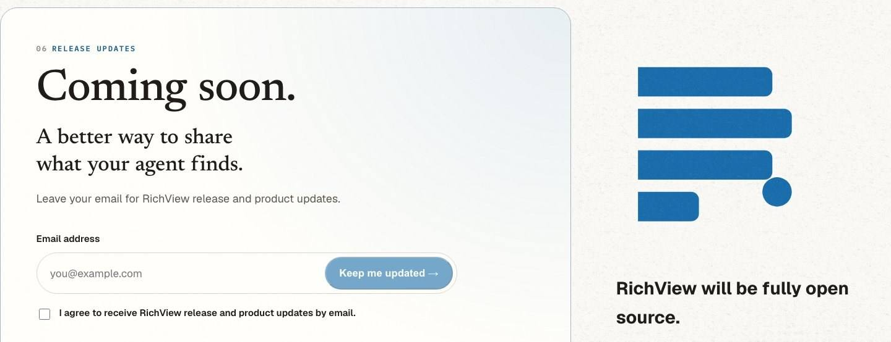

Section 06 of richview.ai: "Coming soon.", the sign-up with the consent "I agree to receive RichView release and product updates by email.", which Daniel's FEA-SF-30 answer keeps (INT-72), and beside it "RichView will be fully open source.", followed below the crop by "The source will be published with the release. It is not public yet.", which the open-source sentence of his FEA-SF-30 answer replaces once the source is public (INT-39). `main` has the same text (`assets/landing/index.html:348-369`). Source: https://richview.ai/#signup (PR #69 content), 1440×900, 2026-10-21, cropped above the privacy line. Cards: INT-39 (D-OPEN-SOURCE-CLAIM), INT-42 (D-STATUS-LABEL), INT-72 (D-SUBSCRIBERS).

> **INT-73 (D-PUBLIC-IDENTITY), proposed, inferred.** RichView presents itself as Daniel’s personal project, as the footer, impressum and licence say today: they name Daniel as its maker and contact. Daniel is its only maker: PR #1, authored as `stevenoliver7`, came from “Steven”, an agent persona, not a second person (OPN-48, OPN-24). Any future contributors are credited in the repository history and, once the source is public, in its contributor list. A team or company identity is decided only together with monetization or a hosted service (INT-30, INT-36). Daniel's INT-36 answer brings both: paid hosted Cowork, Publish servers run for customers and hosting for large data and media are RichView's business model. Open: who sells and operates them, Daniel personally or a company, and so whom their terms, privacy text and impressum name (INT-27, FEA-SF-32). No one else gets repository access (OPN-24).

Daniel leads RichView alone: his OPN-48 (D-RICHVIEW-LEAD) and OPN-24 answers say the earlier "Steven" was an agent persona, not a second person, so no one else is invited and nothing waits on anyone.

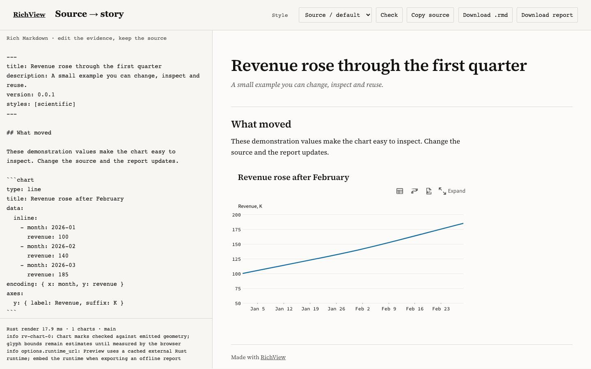

The playground on `main`, which with the home page's editable demo is the only way to try RichView without the source: the example source on the left, its Scientific render on the right, diagnostics below, and Check, Copy source, Download .rmd and Download report. The example's monthly data is drawn on weekly ticks (Jan 5 … Feb 23). Source: `/playground` on the local build of `b4db233`, 1440×900, 2026-10-21. Cards: INT-26 (D-NOT-WEB-EDITOR), INT-71 (D-DISTRIBUTION).

## Domains and hosting

Today `wrangler.toml` serves `dist/web` on richview.ai through the Cloudflare Worker `richview-teaser`, with the sign-up stored in D1 behind a rate limit, and sets `workers_dev = true`, so the same site also answers at `richview-teaser.vecera.workers.dev` (re-run); Daniel's ARC-22 and OPN-44 (D-WORKERS-DEV-HOST) answers keep that address, hidden behind Cloudflare Access, as the `dev` preview of richview.ai. Generated reports link "Made with RichView" to richview.ai (`crates/richview-core/src/render.rs:353`). richview.uk serves the v2 site, "RichView — The presentation layer for AI agents", "source-available under Elastic License 2.0"; richview-v3.fly.dev serves the old TypeScript landing that advertises the unpublished `npx @richview/cli`; therichview.com returns 404 while the server still redirects it (`crates/richview-app/src/server.rs:107-109`) (all re-run). Status on 2026-10-27, after Daniel's go for the accepted cleanup batch (OPN-04, OPN-05, OPN-25, OPN-45, OPN-47, OPN-65): the Fly apps `richview-v3` and `richview-api` are destroyed after backups, richview.uk and its app. and docs. hosts return 301 to richview.ai, the `api.richview.uk` record is deleted, and a Cloudflare Access application hides the `richview-teaser.vecera.workers.dev` preview; [DELIVERY.md](../lockdown/DELIVERY.md#outward-actions-waiting-for-daniels-go) records the checks.

> **INT-46 (D-DOMAIN), accepted by Daniel as proposed, 2026-10-26.** richview.ai is RichView’s only canonical public origin: the site, docs, playground, flagship and every “Made with RichView” link point there, and the host is defined once (TYP-67). news.richview.ai exists only while News is kept (INT-74). The `richview-teaser` workers.dev origin, which serves the whole site and the sign-up API beside richview.ai, is switched off or redirected to richview.ai. No other domain appears in product defaults, docs or generated reports; the CLI and VS Code have no default server (INT-36).
>
> app.richview.ai is the hosted Cowork (INT-36). ARC-22 (later) keeps richview-teaser.vecera.workers.dev, hidden behind Cloudflare Access, as the `dev` preview of richview.ai, and keeps news.richview.ai published as RichView's own Publish server.
>
> **INT-47 (D-LEGACY-DOMAINS), proposed.**
>
> | Host | Today | Outcome |
> | --- | --- | --- |
> | richview.uk | v2 site; CLI and VS Code default | 301 to richview.ai; leaves every product default |
> | app., docs. and api.richview.uk | v2 app, v2 docs and the Fly app `richview-api`, which lists seven v2 reports publicly | app. and docs. 301 to richview.ai with the apex; api. leaves DNS; `richview-api`, which Daniel owns, and its database are destroyed after export (OPN-45) |
> | richview-v3.fly.dev | TypeScript v3 landing; lists `v3-launch` without a token | Shut down after its stored report is exported; Fly configuration deleted (ARC-56) |
> | therichview.com | Expired; server code still redirects it | Allowed to lapse; redirect code removed (TYP-67) |
> | workers.dev origin | Serves the site and sign-up beside richview.ai | Kept, hidden behind Cloudflare Access, as the `dev` preview of richview.ai (ARC-22, OPN-44) |
>
> Each outward step happens only with Daniel’s go-ahead at the time; OPN-04, OPN-05 and OPN-45, all accepted, do them now rather than at launch.
>
> **INT-48 (D-HOSTING), proposed, inferred.** richview.ai and its docs stay on Cloudflare: one Worker serving static assets plus the email sign-up, whose consent records live in D1 behind a rate limit (ARC-55, INT-72). The site's `dev` preview is the hidden richview-teaser.vecera.workers.dev behind Cloudflare Access (ARC-22). That D1 store is personal data RichView operates; its export, deletion requests and any migration follow INT-72. News, RichView's own Publish server at news.richview.ai and always public (ARC-22), stays on its Cloudflare Worker until it moves onto the rewrite's Publish (INT-74). Cowork and Publish are portable software anyone can run; RichView also runs them as paid hosted services: hosted Cowork at app.richview.ai, and Publish servers for customers under their own DNS, set up only on request (INT-36, ARC-22). Managed hosting for large data and media (INT-27) serves assets from a RichView hostname, so a provider move keeps pinned references valid (TYP-41).
>
> Open: the providers for hosted Cowork, the customers' Publish servers and the data and media hosting, such as Cloudflare R2 beside richview.ai or AWS S3 with the startup credits the product brief asked for; the data and media hosting's hostname; whether a credit application is part of the rewrite; and where News runs once it uses the rewrite's Publish. No other migration is part of the rewrite.

## What carries over into the rewrite

"I'm going to rewrite the whole RichView." (Daniel, 2026-10-21 brief). On 2026-10-05 he had chosen to clean up the existing repository rather than start fresh. The cards below say what "rewrite" means. [Architecture](architecture.md) marks each component keep, change or drop; there, keep means the responsibility stays, and whether its code is ported follows INT-49.

> **INT-49 (D-REWRITE-BASIS), Daniel's answer, 2026-10-26.** Rebuild, porting proven modules. The rewrite rebuilds RichView against the accepted lockdown. Existing code and tests are evidence, not a base: a module is ported only when it already meets every accepted item it touches and its tests prove that; otherwise it is rewritten. Nothing survives merely because it exists. Existing tests and fixtures for accepted behaviour become acceptance tests for the new code; tests for rejected behaviour are deleted with it.
>
> RichView is not a production application yet, so nothing needs preservation tests: no test exists only to prove that old behaviour survived. Any feature that is not decided and tracked in the lockdown is dropped, even when today's code has it.
>
> **INT-50 (D-REPO-SPLIT), Daniel's answer, 2026-10-26.** Chosen option: Same repository, history kept.
>
> Evidence stays linkable; one place for everything.

"Today's `main`" in INT-50 was not `b4db233`. Daniel accepted OPN-01 (D-PROD-BASELINE) and OPN-13 (D-SITE-PR69) on 2026-10-26: PR #69 is merged as the record of production, and no legacy hotfix ships (OPN-02 (D-LEGACY-FREEZE), OPN-43 (D-HOTFIX-CONTENTS), FEA-SF-30). `main` was then renamed `prod` and `dev` created from it (DEL-02); DEL-81 later split `dev` into a fast `dev` and `pre-prod`.

> **INT-51 (D-RMD-COMPAT), proposed, inferred.** Existing sources keep working as a product decision, not through preservation tests: no test exists only to prove that older syntax still renders (INT-49), and the golden inputs are acceptance fixtures for accepted behaviour (INT-55). Sources carry over by migration, not by compatibility code. The known corpus, meaning the repository’s examples, the flagship, the golden inputs (INT-55) and the News content on `publish/news`, is migrated in the same merge as each format change, so every source keeps rendering. Custom `.rstyle.yaml` files follow the same rule. The rewrite keeps no compatibility layer for older syntax; format versions follow TYP-05, and frontmatter `data:` stays a hard error (TYP-35). Agent-facing contracts are INT-81.
>
> **INT-81 (D-AGENT-CONTRACTS), proposed, inferred.** Until launch, agent-facing contracts (CLI commands and flags, `--format json` shapes, MCP tool names and schemas, diagnostic codes and the `learn` bundle) are exactly what accepted lockdown items define: a contract no accepted item decides is dropped, even when today's code has it, and no test checks that today's shapes survive (INT-49). They change only through accepted lockdown items, never as a side effect, and each change updates the generated agent docs in the same merge (INT-66). From launch they are stable: changes are additive, and a removal or rename keeps the old form working with a diagnostic that names the replacement until Daniel retires it.
>
> **INT-52 (D-RUNTIME), Daniel's answer, 2026-10-26.** Wherever possible RichView makes the performant choice. The language itself does not matter, but Rust is the obvious way to be both stable and very fast, so RichView stays Rust: one shared core runs natively (CLI, server, MCP) and as WebAssembly in browsers and VS Code, and WebAssembly is what makes charts fast in the browser. Handwritten JavaScript exists only where part 03 allows it (ARC-03), and no product rule exists only in JavaScript in the rewrite's target.
>
> RichView Publish and News (PR #70) are merged now as they are, JavaScript included, so the News work done on other tickets lands and continues. The rewrite carries over what Publish strives for, its behaviour and decisions, not its code: Publish's JavaScript is ported to the Rust target when the rewrite reaches Publish (INT-49).
>
> **INT-53 (D-CHART-SUPPLIER), proposed.** RichView keeps its own Rust chart engine; no third-party chart library renders RichView charts. `richview-chart` is rebuilt under INT-49: its contracts (layout, ticks, labels, diagnostics) are evidence, not a base, and its review corpus carries over as INT-55's fixtures. A module is ported only where it meets every accepted chart item in part 04 that it touches and its tests prove that; otherwise it is rewritten, and engine behaviour no accepted item decides is dropped. Highcharts and ECharts remain local quality references only. The earlier Linear issue that made ECharts the chart supplier is closed.
>
> **INT-54 (D-STYLES-CARRY), proposed.** The five builtin identities carry over as the starting point under Daniel's STY-05 names, `sleek` (the default, STY-06), `air` (today's `sleek-light`), `scientific`, `brutalist` and `hand-drawn`, with their fonts, palettes and font licence notices; the studio variants carry over as extended themes (STY-05, ARC-41). Each style gets its own design review, which also sets its structure (STY-01), and part 06 decides every visual detail; the rewrite invents no new identity before those answers.
>
> **INT-55 (D-EXAMPLES-CARRY), proposed.**
>
> | Corpus | Carries over as |
> | --- | --- |
> | The flagship (`examples/openai-vs-anthropic`); `first-report`, `hello-world`, `sales-report`, `authoring`, `agent-output`, `histogram`, `boxplot` and `interval`; the home-page demo (`assets/landing/demo/`); the standard chart-review report (`benchmarks/chart-regression`) | Golden inputs: each renders in every accepted style with no error diagnostics |
> | 56 before/after cases in `docs/evidence/chart-refinements` | Chart regression fixtures for the accepted chart items they exercise: each fixed defect stays fixed |
> | 50 synthetic reports in `benchmarks/chart-craft` and 8 in `benchmarks/highcharts` | Engine fixtures and local comparison labs; the reference libraries stay outside product builds (ARC-18) |
> | The three JSON examples in `richview-chart/web` | `.rmd` examples and performance fixtures (ARC-40) |
> | The flagship’s research pipeline (`examples/openai-vs-anthropic/research/`, 59 files) | Frozen content, not a fixture (ARC-54) |
>
> Each carried input or case is an acceptance fixture for the accepted items it exercises (INT-49): a case or example, or the part of one, whose feature is rejected or decided nowhere in the lockdown is removed with that feature; examples that part 04d adds join the golden inputs.

## Corrections that must never recur

Eleven proposed rules come from mistakes that came back round after round, and Part 02 proposes the gates that would enforce them ([Delivery](delivery.md)). Rejecting a rule card means the rule does not bind agents.

| Card | Proposed rule | Why it exists |
| --- | --- | --- |
| INT-56 (G-STYLE-REACHES-CHARTS) | A style applies to everything a report renders, charts and PDF included; chart code holds no hard-coded colours or fonts | Styles missed charts in PRs #3, #5, #7, #16, #19 and #52, and still do under an explicit light or dark theme |
| INT-57 (G-FONTS-LOAD) | Every declared font loads, or a check fails; family names are always quoted | The same silent fallback was found in PRs #7, #8 and #9, fixed again in #15, and checked only from #22 |
| INT-58 (G-LABELS-INTACT) | No chart text is clipped, overlapped or garbled at any width; labels are dropped by priority and every drop is reported | Label defects returned in PRs #7, #14, #22, #24, #26 and #40 and in the 2026-10-18 review |
| INT-59 (G-CHROME-RECEDES) | Every control, badge and link serves a named reader task; the default is fewer | Daniel cut controls on 2026-10-12, 2026-10-13 and 2026-10-18 and twice asked for lighter tooltips |
| INT-60 (G-READING-MEASURE) | Text, headings, tables, charts and images share one reading measure and left edge | Corrected on 2026-10-13 and again on 2026-10-18 |
| INT-61 (G-MOTION-SMOOTH) | Motion ships only when smooth on a real phone, otherwise it is removed; smooth is the floor, not the aim (INT-12) | Landing motion removed on 2026-10-13 (PR #58, after the 2026-10-12 feedback), restored on 2026-10-18 and rejected as "jumpy" the same day |
| INT-62 (G-AS-DECIDED) | Agents build accepted text as written, with nothing added or reinterpreted; work the lockdown does not cover may merge into `dev` but reaches `prod` only after Daniel accepts it (DEL-06) | An unrequested tooltip blur (`1d209a8`) and a chart gallery built as one long report |
| INT-63 (G-ONE-ANSWER) | Each preference has one current, dated answer; older sources are history | Superseded preferences came back: Expand/Contract, full-width tables, "source-available" |
| INT-64 (G-NO-SILENT-NOOP) | Code that cannot find what it needs reports it instead of doing nothing | Removing two nodes left the landing motion dormant; removing one attribute cost the home page its gutters |
| INT-65 (G-HONEST-CLAIMS) | Every statement describes only what the build it ships with does | "Access control", six chart types and a "closed vocabulary" the schema did not enforce |
| INT-66 (G-AGENT-DOCS-CURRENT) | Agent-facing docs are generated from, or checked against, the code | `llms.txt` and the skill describe six chart types and three styles, and the agent quickstart six types |

## How success is judged

> **INT-67 (D-DONE), Daniel's answer, 2026-10-26.** The rewrite is done when every accepted product item (feature, component, type, style, rule and budget) is implemented on `prod` with its evidence, every rejected product item is absent, deferred items are not built, and nothing outside the lockdown was added. One-off outward actions (archiving, redirects, shutdowns, deleting the pre-release) are tracked in part 08, and Daniel’s later calls (source visibility, launch) follow their own cards; neither gates done. Parity with the old code is not a goal beyond accepted items. An agent can judge design quality: a review agent on Daniel's current model judges visual and motion quality from rendered output on a phone and a desktop, and the result reaches Daniel in the before-and-after report (DEL-69) before `prod` (DEL-68). Passing tests alone never establish design quality. INT-68 to INT-70 are the specific bars.
>
> **INT-68 (D-DONE-FLAGSHIP), proposed, inferred.** The flagship renders on `prod` in every accepted style at 320, 390 and 1440 px and as a PDF, with identical data, wording and sources across styles, no error or warning diagnostics, no clipped or overlapping text and smooth motion on a phone, at the motion standard of INT-12. A review agent on the model Daniel uses at the time judges it side by side with today’s live flagship (INT-67, DEL-68); the comparison is an entry in the before-and-after report (DEL-69), and Daniel accepts the flagship there as clearly better.
>
> **INT-69 (D-DONE-AGENT-PATH), proposed, inferred.** A coding agent that has never seen RichView, given only `richview learn` or the MCP tools and a dataset, produces a sourced report with prose, at least three chart types and a table. The report renders with no error diagnostics and passes `richview check` by the second attempt, without the agent reading RichView’s source code. The test runs with at least two different agent products. Daniel’s INT-21 answer makes measuring how well agents use RichView a feature: the fresh-agent runs use real tasks and are scored and tracked over time (FEA-SF-65, DEL-78), and this bar is the pass line of that measurement.
>
> **INT-70 (D-DONE-MEASURED), proposed, inferred.** The rewrite reports, against `b4db233`: tracked files, source and test lines and dependencies per component, WebAssembly and rendered-report size, the render and interaction timings of part 07, and check findings on the example corpus. Every part 07 budget holds, and any growth is explained by an accepted feature (INT-14). No line-count target is set.
>
> **INT-82 (D-SUCCESS-SIGNAL), proposed, inferred.** After launch, RichView is judged by one signal: agents reach a clean check unattended and a person keeps the report, by publishing, sharing or committing it. Installs, stars and page views are not targets. Feedback reaches Daniel through the public repository’s issues, open from launch when the source goes public (INT-38, INT-43), and through his own conversations; no launch wedge is named first (INT-43); RichView adds no telemetry to measure it (INT-80).

The baseline INT-70 measures against, re-run: 985 tracked files (194 at `5ceb7d4` on 2026-07-07, when the stated goal was "the minimum surface"), 60,481 lines of Rust of which 24,161 are in `richview-chart`, 125 tracked `.rmd` files, and a 2,366,552-byte render of the 1,257-byte first report.

## Decisions on record

Dated decisions behind these proposals, as recorded. Linear entries are the coordinator's record of Daniel's dictation.

| Date | Decision | Source | Where it stands |
| --- | --- | --- | --- |
| 2026-06-08 | Focus on user value; park monetization and the business model | Notion "Strategy & business model (parked)" | Still parked; INT-30 |
| 2026-06-09 | Keep the brand RichView and the domain richview.uk | June brief, "Daniel: keep" | Brand kept; the product moved to richview.ai; INT-05, INT-47 |
| 2026-06-10 | Repository set private, "keep private until ready to limelight" | Linear: the repository-split decision | Private; transferred on 2026-10-21; INT-38 |
| 2026-06-20 | Data stories only, for coding-agent users only; minimize code; the web is a playground with no chat; content and styles in separate files | Daniel's voice-note transcript; Linear: the web-surface, content-plus-style, copy and vNext issues | Mostly in the code; scope widened in October; INT-06, INT-14, INT-24 to INT-26 |
| 2026-06-21 | Three templates, brutalist the default, sleek and scientific; three options per setting | Daniel's design-system note | Grew to five builtins and 23 showcase treatments; INT-54, STY-05 |
| 2026-08-08 | A focused launch by 31 August as "a curated JSON/data-to-report rendering layer", "rather than a sprawling platform" | Daniel's 2026-08-08 life-review voice note; Linear: the August launch issue | Date passed; overtaken by the October batches |
| 2026-10-02 | The OpenAI-versus-Anthropic flagship (80% substance, 20% presentation); a Rust chart library judged against Highcharts; a style showcase; a motion reel | Linear: the Rust chart library, flagship repair, scrolling website and flagship research briefs | Live; INT-10, INT-20 |
| 2026-10-04 | Rust for the whole product; every report in its own folder; chart data inside each chart; Cloudflare as host | Rust migration brief (`2c926b0`); Linear: the chart-data, report-folder and teaser co-work issues | Shipped; INT-52, INT-48 |
| 2026-10-05 | H1 "presentation layer for your agent"; "Coming soon", never "beta"; "RichView will be fully open source" as direction; clean up the existing repository instead of a fresh one | Linear: the homepage revision and visual motion issues | Live, except the BETA share image and the reel's last scene; INT-01, INT-42, INT-39, INT-50 |
| 2026-10-10 | Product brief: what to maximize, five styles including hand-drawn, PDF and carousel exports, scrollytelling, hosting and AWS credits | Linear: the product brief | Partly shipped; INT-11 to INT-15, INT-31 |
| 2026-10-12 | Lede "Your agent organizes the text. RichView makes it a story."; drop the hero pill and eyebrow | Commit `bcea882` (PR #58, 2026-10-13) | Lede live; a new eyebrow took the old one's place; INT-02 |
| 2026-10-17 | New tracks "despite older August scope locks": galleries, playable charts, tabs, connectors, voice dashboard | Linear: the five track briefs | Draft PRs #62 to #66; INT-24, INT-33, INT-34 |
| 2026-10-18 | RichView Publish and RichView News; publish the site changes right away; later that day, the published site "is not accepted yet" | Linear: the Publish and News brief and the site motion and navigation issue | News live from `publish/news`; INT-35, INT-74 |
| 2026-10-21 | Rewrite; agents merge into `dev`, Daniel alone into `prod`; no releases; he reviews only design-quality and feature decisions | Daniel, 2026-10-21 brief; Linear: the lockdown issue | This lockdown; INT-41, INT-49, INT-67 |
| 2026-10-26 | Review chat, part 01: analysts first (INT-06), craft before everything else (INT-17), MIT everywhere (INT-37), Rust (INT-52), Cowork and Publish on one server core (INT-83, INT-35), paid hosted services (INT-36), launch on Daniel's word (INT-43), `main` renamed `prod` (DEL-02) | Daniel's answers in the lockdown app | The answered cards above |
| 2026-10-27 | Review chat: the quality bar and motion direction (INT-12), storytelling gives tools only (INT-77), trust over tokens (INT-13), agent-native at 100% with agent-use measurement as a feature (INT-21), the five jobs and not-BI (INT-08), a link-preview thumbnail for every story (INT-07), three branches and a release agent (DEL-81), website changes always okay in `dev` (DEL-06) | Daniel's answers in the lockdown app | The answered cards above |

Several earlier inputs were agent or research proposals rather than Daniel's recorded decisions, and the cards treat them as history: the June reposition memo's ten preset questions (`6489a06`), which never received an answer and whose success signal INT-82 revives; the June licence gradient, recorded as accepted with no decider named; and the 2026-06-21 decision surface of 83 decisions, a synthesis of tickets and his voice note of which many were reversed since (history evidence, `history-prs.md`). OPN-35 (D-DECISION-RECORDS) makes all of it history, and OPN-36 to OPN-40 sort every June decision and memo recommendation into kept, superseded, never built, decided elsewhere or retired. The launch wedge that the 2026-08-17 launch plan asked for was never named.

## Where to answer

Four of Part 08's cross-part contradictions cite Part 01 cards: OPN-54 (D-XPART-HOST-ACCESS) for INT-36, OPN-63 (D-XPART-CONNECTORS) for INT-24, OPN-64 (D-XPART-REEL-TAGLINE) for INT-02 and OPN-65 (D-XPART-RICHTEMPLATES) for INT-40. Daniel answered all four on 2026-10-26, so those Part 01 cards follow them. Part 01 groups its own cards as below, with how many of each group's cards he has answered; each link opens the group's first card in the lockdown app.

| Group | Cards | Answered | Open in the app |
| --- | --- | --- | --- |
| Definition and positioning | INT-01 to INT-05, INT-76 | 4 of 6 | [INT-01](http://127.0.0.1:4790/#/part/01-intent/INT-01) |
| Audience | INT-06, INT-07 | 2 of 2 | [INT-06](http://127.0.0.1:4790/#/part/01-intent/INT-06) |
| Jobs, use case and flagship | INT-08 to INT-10, INT-75 | 1 of 4 | [INT-08](http://127.0.0.1:4790/#/part/01-intent/INT-08) |
| What RichView maximizes | INT-11 to INT-17, INT-77 to INT-79 | 6 of 10 | [INT-11](http://127.0.0.1:4790/#/part/01-intent/INT-11) |
| Beyond what anyone has made | INT-18 to INT-23 | 1 of 6 | [INT-18](http://127.0.0.1:4790/#/part/01-intent/INT-18) |
| Non-goals | INT-24 to INT-30, INT-80 | 5 of 8 | [INT-24](http://127.0.0.1:4790/#/part/01-intent/INT-24) |
| Product family and scope | INT-31 to INT-36, INT-74, INT-83 | 4 of 7 | [INT-31](http://127.0.0.1:4790/#/part/01-intent/INT-31) |
| Open source, licence and visibility | INT-37 to INT-40 | 2 of 4 | [INT-37](http://127.0.0.1:4790/#/part/01-intent/INT-37) |
| Public presence and release | INT-41 to INT-45, INT-71 to INT-73 | 2 of 8 | [INT-41](http://127.0.0.1:4790/#/part/01-intent/INT-41) |
| Domains and hosting | INT-46 to INT-48 | 1 of 3 | [INT-46](http://127.0.0.1:4790/#/part/01-intent/INT-46) |
| What carries over | INT-49 to INT-55, INT-81 | 3 of 8 | [INT-49](http://127.0.0.1:4790/#/part/01-intent/INT-49) |
| Corrections never to repeat | INT-56 to INT-66 | 0 of 11 | [INT-56](http://127.0.0.1:4790/#/part/01-intent/INT-56) |
| Success criteria | INT-67 to INT-70, INT-82 | 1 of 5 | [INT-67](http://127.0.0.1:4790/#/part/01-intent/INT-67) |

Sources for this page: the cards of [Part 01](http://127.0.0.1:4790/#/part/01-intent) with each proposal's options, conflicts and sources; the evidence files on intent, Notion and the live sites, history and pull requests, and the product (`intent-notion-site.md`, `history-prs.md` and `product.md`, listed in the [guide index](README.md#sources)); the Linear evidence (not published); the code at `b4db233`; and the screenshot index.
