# RichView in screenshots

RichView turns a plain-text Rich Markdown file (`.rmd`) and its data into one self-contained HTML report; agents drive it through the `richview` CLI and its MCP server, and people can try it in a browser playground. This page shows RichView as it stood on 21 and 22 October 2026: the landing page, playground, charts, builtin styles, rich blocks, report output, preview, publishing and PDF, the flagship showcase, interactions, phones, RichView News, features on the open PR branches and the other surfaces, each image captioned with what it shows and the lockdown cards that decide or would change it.

Images under `product/` show `main` at `b4db233` from a local release build, at 1440×900 on desktop and 390×844 on phones; the reports among them render a synthetic lockdown [fixture](../lockdown/screenshots/product/fixture/source/report.rmd). Images under `live/` show richview.ai and news.richview.ai between 20:27 and 20:31 CEST on 21 October, when they served the unmerged PR #69 and PR #70 work, so neither matches `main`. Daniel accepted OPN-01 (D-PROD-BASELINE) and OPN-13 (D-SITE-PR69) on 26 October 2026: #69 merges into `main` as the record of production, `main` is then renamed `prod` and `dev` is created from it, and #70 is already merged into `main` (26 October). `styles-design/`, `report-rendering/`, `surfaces/` and `delivery/` hold renders that other lockdown stages made from the same commit on 21 and 22 October, `branches/` holds features of PRs #62 to #65, open at the time, built or rendered on 22 October, and `open-work/` holds two richview.ai captures, one of them the share image downloaded from the site. The [screenshot index](../lockdown/screenshots/INDEX.md) gives every capture's URL or command, viewport and method, lists under Gaps what has no capture yet, and marks the 104 captures kept outside the repository to save space as local only; this page links only to committed files. Four images come from `docs/guide/img/`: crops and a contact sheet made for this page from the captures their captions name.

## Reading this page

Each caption says what the image shows, then its source (a path on the local build, a public URL or a command), viewport and date, then the cards that decide it. Statements about the product describe the image, checked in the code at `b4db233` where a file is cited.

Item IDs name the cards of the [lockdown parts](../lockdown/README.md), each followed by the entity it defines or decides, as in OPN-17 (D-FIX-HOME-GUTTERS). The prefix names the part: INT- for 01, DEL- for 02, ARC- for 03, FEA-CH-, FEA-RP-, FEA-SF- and FEA-BR- for 04a to 04d, TYP- for 05, STY- for 06, PRF- for 07 and OPN- for 08. A card is a proposal until Daniel answers it. When this page was revised on 27 October 2026 he had answered 12 of the cards cited here, FEA-BR-01, FEA-BR-08, FEA-CH-01, FEA-SF-30, INT-34, INT-35, OPN-01, OPN-02, OPN-13, OPN-43, STY-05 and STY-06, and the captions say what each decided; every other card cited is still a proposal. To reach one, open its part in the lockdown app and press `/`, or go to `#/part/<part>/<item>`.

In the lockdown app, inline images open full size on click; linked captures, text files and the index do not open there yet, so open them from `docs/lockdown/screenshots/` in the lockdown worktree. The [guide index](README.md) lists the pages that explain the product behind these images, starting with [What RichView is for](purpose.md). Until an agent regenerates these screenshots from the `pre-prod` head's captures in an ordinary PR before a candidate is cut, as DEL-45 (G-LOCKDOWN-HOME) proposes, this page shows `main` at `b4db233` and the live sites of 21 October 2026.

Terms used below:

- **Fixture**: the synthetic lockdown report with all nine chart types, every rich block and one deliberately invalid fence, rendered once per builtin style.
- **Runtime**: the WebAssembly module built from `crates/richview-site` that exported reports and site pages both load; besides charts and tables it carries the playground, landing, showcase and reel code. ARC-06 (D-RUNTIME-SPLIT) would split off a report-only runtime.
- **Treatment**: one of the 23 looks the flagship showcase offers: the builtin sleek, scientific and brutalist plus 20 studio variants from the June design system (`assets/showcase/themes.json`). Daniel's STY-05 answer keeps the 20 as extended themes, out of the normal style menus.
- **Sleek and Air**: Daniel's STY-05 names. Sleek is today's Sleek Dark (`sleek`, `sleek-dark`) and Air is today's Sleek Light (`sleek-light`), renamed because it must not be called Sleek; captions give today's names for what the code does and these for what is decided.
- **Decals**: hatch patterns on bars and areas and dash patterns on lines, so series differ without colour.
- **Report card**: the diagnostics appendix that `richview generate --report-card` adds at the end of a report.
- **Chart review reports**: two fixed synthetic reports that the visual review matrix, DEL-19 (G-VISUAL-MATRIX), renders in all five builtin styles; the site also serves them under `/showcase/chart-review/`.
- **Legacy freeze**: Daniel's FEA-SF-30, OPN-02 (D-LEGACY-FREEZE) and OPN-43 (D-HOTFIX-CONTENTS) answers: today's code takes no feature, design or hotfix work, because the live site was never advertised, so richview.ai changes only when the rewrite reaches `prod`; each defect named below becomes a fixture or check of the rewrite instead.

## Landing page

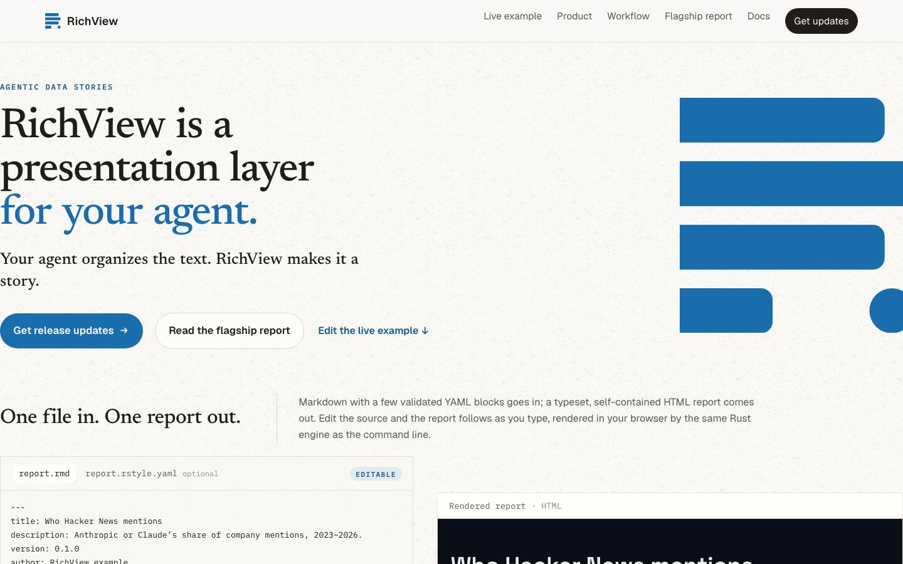

Main's hero: six header links (Live example, Product, Workflow, Flagship report, Docs, Get updates), copy that starts at the window edge, and a mark that runs 18 px past the right edge, so the page is 1,458 px wide. The page's `<body>` lacks the `data-homepage` attribute that 26 `body[data-homepage]` selectors in `assets/landing/homepage.css` require, which OPN-17 names as the cause of the missing gutters. Source: `/` on the local build, 1440×900, 2026-10-21. Proposals: FEA-SF-28 (D-SITE-NAV) would cut the header to Flagship report, Chart gallery and Docs; OPN-17 (D-FIX-HOME-GUTTERS) does not hotfix it, since the live site changes only when the rewrite reaches `prod`: the rewrite's site gate checks the gutters at 320, 390 and 1440 px (STY-49, DEL-27) with this defect as a fixture; ARC-39 (C-WEB-LANDING) would keep the page but delete selectors that match no markup, or fail the gate on them.

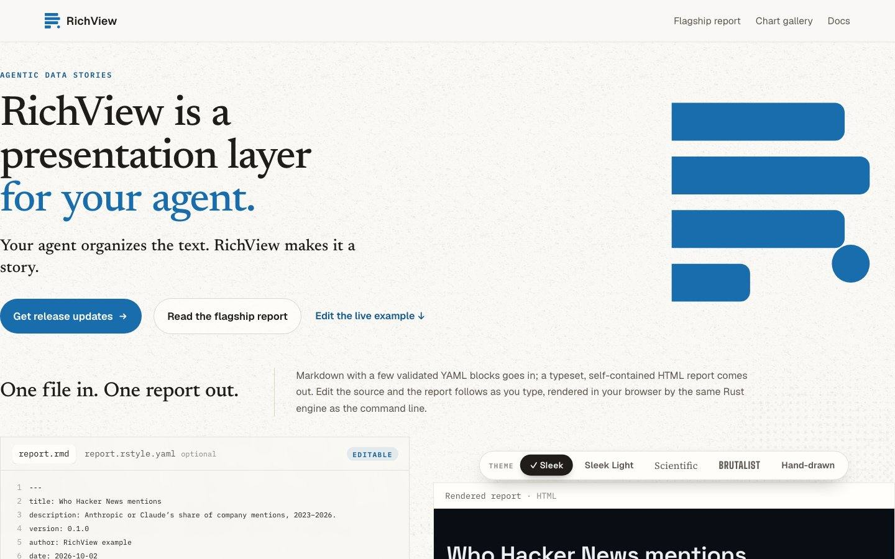

richview.ai's hero: the three-link header that FEA-SF-28 proposes, the same copy and buttons, again starting at the window edge, and the mark inside the window; the demo's style pills show below. Source: https://richview.ai/ (PR #69 content), 1440×900, 2026-10-21. Decided and proposed: Daniel accepted OPN-13 (D-SITE-PR69), which merges #69 into `main` so that the repository records production without accepting its design, and #69's features enter the rewrite, each in the form its own card decides; STY-44 (D-LANDING-MOTION) would keep the scroll story, which may merge into `dev` at any time but reaches `prod` only when Daniel accepts it with the evidence FEA-BR-21 (F-WEB-LANDING-MOTION-RESTORED) names, judged by the visual review agent from real-speed clips, with a real iPhone as his optional look; until then `prod` serves the landing static and complete.

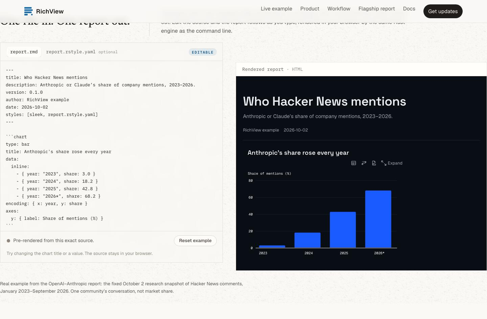

Main's two-file demo: tabs for `report.rmd` and an optional `report.rstyle.yaml`, the source in a plain editor (no line numbers, no highlighting), and beside it the pre-rendered sleek report "Who Hacker News mentions" with icon-only chart actions and Expand. The style buttons never appear: `html:not(.js) .themes {display: none}` (`assets/landing/homepage.css:595`) hides them, only the landing animation code adds the `js` class (`crates/richview-site/src/browser/landing.rs:2587`), and that code returns early on main because `#rv-field` and `#rv-stage` are missing (`crates/richview-site/src/browser/landing.rs:2505`). Source: `/#demo` on the local build, element capture 1440×946, 2026-10-21. Proposal: FEA-SF-29 (F-WEB-LANDING-LIVE-DEMO) would make the demo and its highlighting start on their own, whatever the animation does.

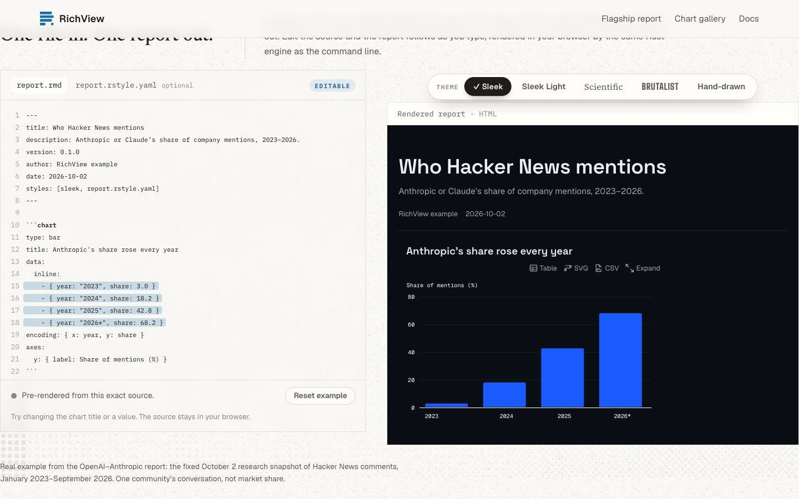

The same section on richview.ai adds line numbers, highlighted data rows, five style pills (Sleek, Sleek Light, Scientific, Brutalist, Hand-drawn), labelled chart actions (Table, SVG, CSV, Expand) and the three-link header. On both sites the editor and the caption under it start at the window edge, and the jump to `#demo` leaves the section's heading under the sticky header, because its scroll margin is another `body[data-homepage]` rule (`assets/landing/homepage.css:90-92`), which no hotfix takes over under the legacy freeze (OPN-17). Source: https://richview.ai/#demo (PR #69 content), 1440×900, 2026-10-21. Proposal: FEA-CH-43 (D-CHART-ACTIONS) would give each interactive chart one action row (Table, a Download menu with PNG and, if FEA-CH-46 keeps it, SVG, CSV, Expand), each action with an icon and a visible text label at every width, wrapping under the subtitle on narrow figures.

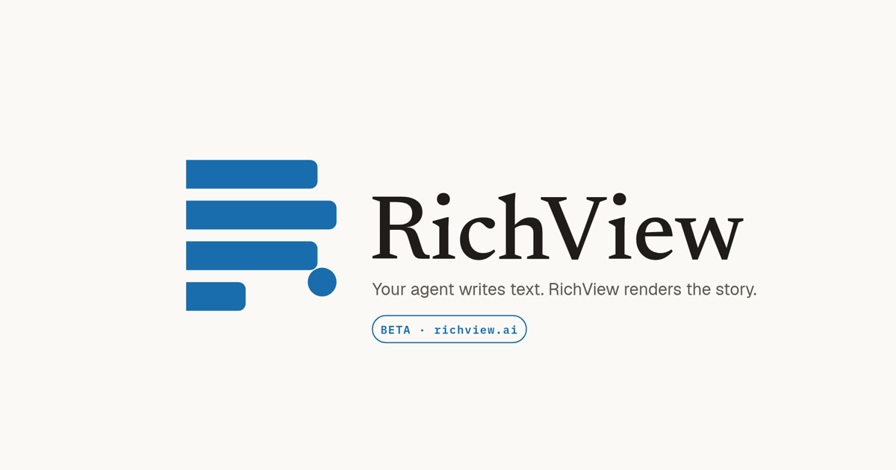

The share image richview.ai serves: "Your agent writes text. RichView renders the story." with a "BETA · richview.ai" badge, byte-identical to `dist/web/landing/og.png` at `b4db233`. Source: downloaded from https://richview.ai/landing/og.png, 1200×630, 2026-10-21. Proposals: OPN-20 (D-FIX-SHARE-IMAGE) does not replace the live image; the rewrite's home share image carries INT-02's two lines, "Let your agent present." and "Designed, reproducible, versioned.", with "Coming soon · richview.ai" (FEA-SF-55); INT-42 (D-STATUS-LABEL) would allow no status word but "Coming soon".

Full pages: main in [part 1](../lockdown/screenshots/product/landing/landing-desktop-full-part1of2.jpg) and [part 2](../lockdown/screenshots/product/landing/landing-desktop-full-part2of2.jpg), where empty bands mark the dormant scroll stage and the "Coming soon." signup section sits near the end; richview.ai in [part 1](../lockdown/screenshots/live/richview-home-desktop-full-part1of2.jpg) and [part 2](../lockdown/screenshots/live/richview-home-desktop-full-part2of2.jpg). Daniel's FEA-SF-30 (F-SITE-HOMEPAGE) answer: the home page promises what the product will do, and the live page gets no hotfix. The report menu, one-click publish, the release contents and immutable versions stay and become true, the flagship verdict quote goes (INT-45), and the style names follow core. FEA-SF-31 (D-SIGNUP) would keep the signup.

## Playground

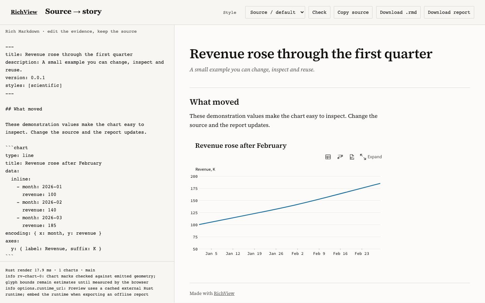

"Source → story": the example source on the left, its scientific render on the right, diagnostics under the source ("Rust render 17.9 ms · 1 charts · main" and two info lines), and a toolbar with a style select ("Source / default"), Check, Copy source, Download .rmd and Download report. The chart draws three monthly points on weekly ticks (Jan 5 … Feb 23). Source: `/playground` on the local build, 1440×900, 2026-10-21. Proposals: FEA-SF-34 (F-WEB-PLAYGROUND-LIVE-RENDER) would keep these controls; FEA-SF-33 (D-PLAYGROUND) would keep the page at `/playground`, linked from the docs until launch; FEA-CH-24 (F-CHART-TICKS) would give monthly data month, quarter or year ticks.

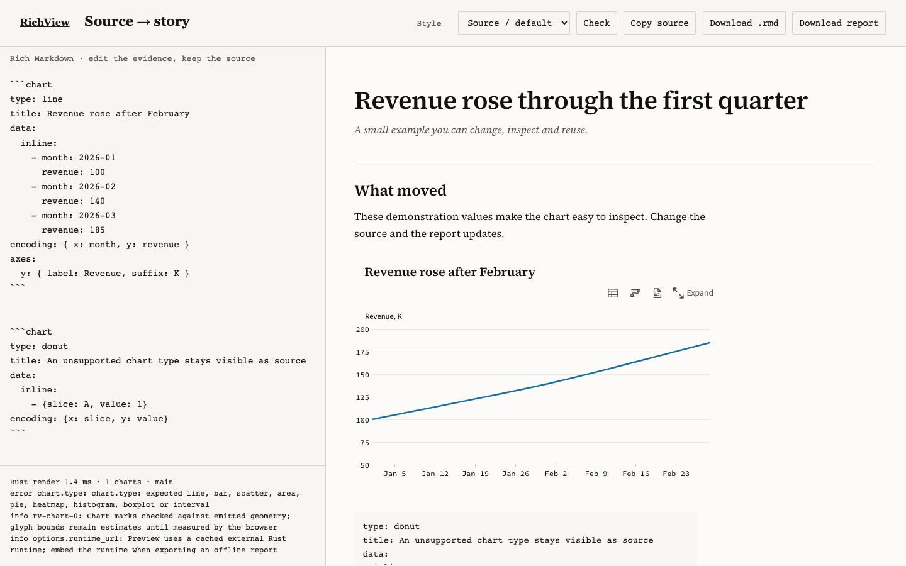

After appending a chart fence with `type: donut`: the preview shows the fence as plain code, and the diagnostics pane reads "error chart.type: chart.type: expected line, bar, scatter, area, pie, heatmap, histogram, boxplot or interval", repeating the path. Source: `/playground` on the local build, 1440×900, 2026-10-21. Proposals: FEA-RP-29 (F-NOT-RENDERED) would put a one-line notice above the kept source; TYP-53 (T-DIAGNOSTIC) would define the diagnostic record.

On a phone the preview is a fixed 80vh pane (`assets/playground.html`) and the chart's month labels are cut at its bottom edge ([capture](../lockdown/screenshots/product/playground/playground-mobile-default.jpg)). richview.ai's playground is [captured too](../lockdown/screenshots/live/richview-playground-desktop-full.jpg).

## Charts

The fixture draws all nine chart types from synthetic data. The crops below come from its scientific render (`richview generate report.rmd --style scientific`, figure crops at 1440×900, 2026-10-21). Daniel's FEA-CH-01 (D-CHART-TYPES) answer replaces the nine with the richest chart library: every chart type of ggplot2, Plotly, ECharts, Highcharts and Power BI, likely around 30, compiled from those libraries, plus a map element, a flow element and better tables, pivot tables included; the nine below are today's set. The docs index on main still names six; Daniel's OPN-43 (D-HOTFIX-CONTENTS) answer sends that to the rewrite's docs, and TYP-04 (D-TYP-DOC-DRIFT) would generate such lists in the rewrite.

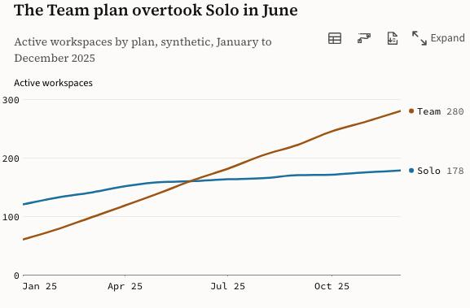

Line: two series named at their line ends with their last values (Team 280, Solo 178), no legend. Proposals: FEA-CH-02 (F-CHART-LINE); the visible change is FEA-CH-27 (D-SERIES-CUES), which would keep the end names and drop the repeated value.

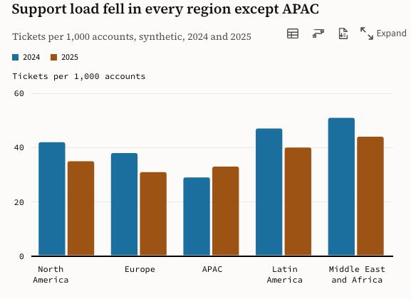

Bar: grouped bars for 2024 and 2025 under a legend, long region names wrapped to two lines. The crop already matches FEA-CH-06 (F-CHART-BAR), FEA-CH-26 (F-CHART-CATEGORY-LABELS) and FEA-CH-33 (F-WEB-CHART-LEGEND).

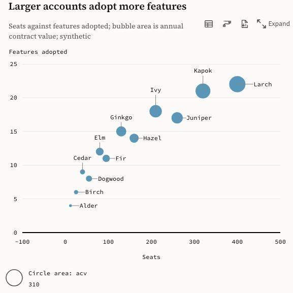

Scatter: bubbles sized by contract value with a reference circle ("Circle area: acv 310"); all twelve points are named, several through leader lines, and the seats axis starts at −100 although no account has negative seats. Proposals: FEA-CH-07 (F-CHART-SCATTER); FEA-CH-19 (F-CHART-AXES) would let no axis cross zero unless the data do; FEA-CH-28 (D-LABEL-DENSITY) would keep labels sparse and allow leaders only for author highlights.

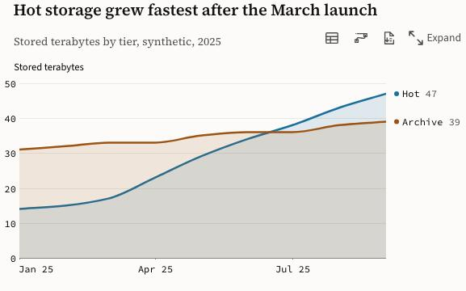

Area: two overlapping areas named at their ends (Hot 47, Archive 39). The crop matches FEA-CH-04 (F-CHART-AREA) and FEA-CH-05 (F-CHART-STACKING); FEA-CH-27 (D-SERIES-CUES) would drop the values 47 and 39 beside the names.

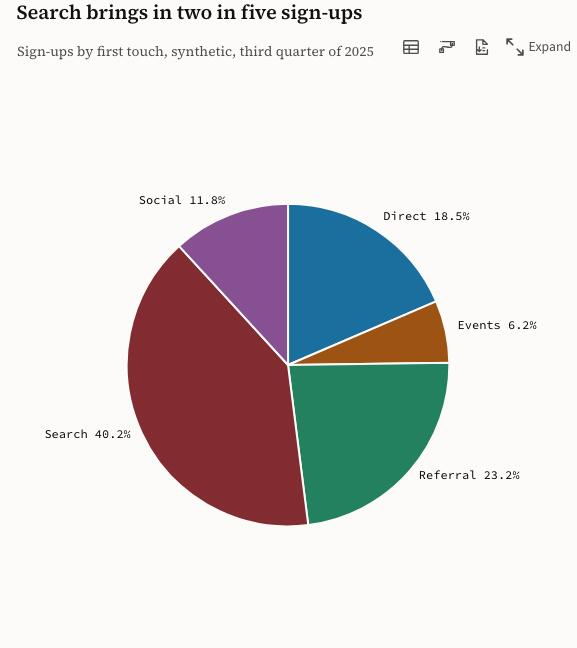

Pie: names and shares around the disk. The slices run alphabetically from 12 o'clock (Direct, Events, Referral, Search, Social), while the source lists them largest first. Proposals: FEA-CH-08 (F-CHART-PIE); FEA-CH-09 (D-CHART-ORDER) would make source order the rule for every chart type.

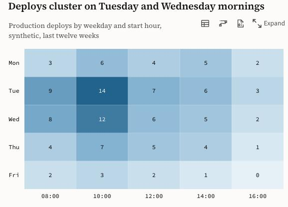

Heatmap: deploys by weekday and hour, every cell printing its value, no colour key. This matches FEA-CH-10 (F-CHART-HEATMAP) and FEA-CH-34 (D-HEATMAP-KEY), which would add a key only when some cell cannot print its value.

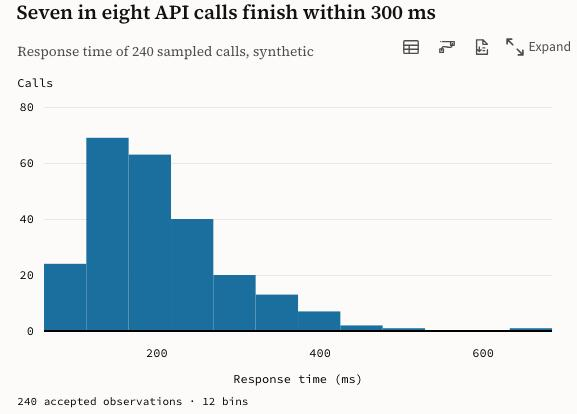

Histogram: 240 response times in 12 authored bins, with the note "240 accepted observations · 12 bins". This matches FEA-CH-11 (F-CHART-HISTOGRAM) and FEA-CH-14 (D-CHART-METHOD-NOTES).

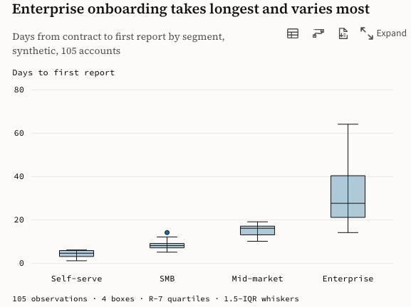

Box plot: days to first report in four segments, with the note "105 observations · 4 boxes · R-7 quartiles · 1.5-IQR whiskers". Proposals: FEA-CH-12 (F-CHART-BOXPLOT); FEA-CH-14 (D-CHART-METHOD-NOTES) would move the method names out of the note into readouts, the Table and `check`.

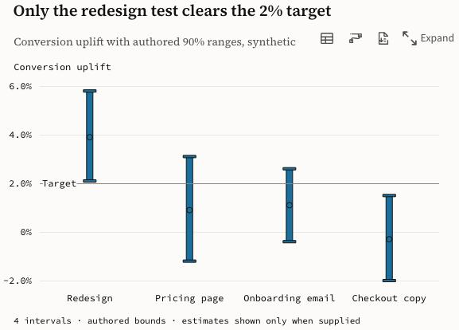

Interval: authored 90% ranges of conversion uplift for four tests, estimates as circles, a 2% target line and the note "4 intervals · authored bounds · estimates shown only when supplied". The "Target" label runs into the 2.0% tick. Proposals: FEA-CH-13 (F-CHART-INTERVAL) matches the ranges and estimates; FEA-CH-32 (F-CHART-ANNOTATIONS) would keep annotation text clear of labels, or drop it and report it; FEA-CH-14 (D-CHART-METHOD-NOTES) would drop the note, since no rows were excluded.

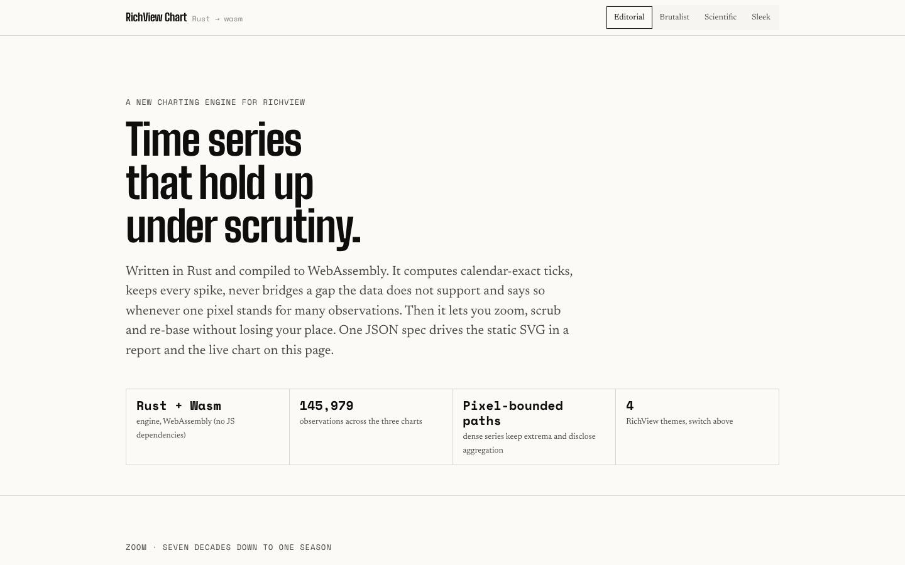

`/charts/` on main: "RichView Chart Rust → wasm", style buttons Editorial (selected), Brutalist, Scientific and Sleek, and counters such as 145,979 observations. Further down ([full page](../lockdown/screenshots/product/charts/charts-desktop-full.jpg)) come three large time series (CO2 at Mauna Loa, US consumer prices, Germany's power system in 15-minute steps) with range presets, rebasing, an overview strip and an "Edit this chart" JSON editor ([capture](../lockdown/screenshots/product/charts/charts-desktop-edit-this-chart.jpg)). Source: `/charts/` on the local build, 1440×900, 2026-10-21. Proposals: FEA-SF-44 (F-WEB-CHARTS-EXAMPLES) and ARC-40 (C-WEB-CHART-EXAMPLES) would drop the page and redirect `/charts/` to the docs gallery; FEA-CH-16 (F-CHART-TRANSFORMS) would drop its panes, secondary axis and range presets and bring rebasing back only as a reader control.

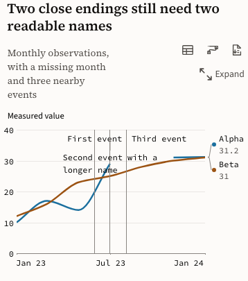

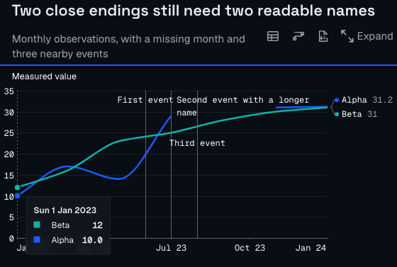

Chart 1 of the chart review report "standard" ("Two close endings still need two readable names"). In scientific at 390 px the three event labels crowd each other and one crosses a data line; in sleek at 1440 px the readout for the first month ("Sun 1 Jan 2023: Beta 12, Alpha 10.0") covers the "Jan 23" tick. Both captures passed the visual review matrix with zero findings, as DEL-19 (G-VISUAL-MATRIX) records; it would add the two missing assertions, a minimum gap between annotation labels and no label box crossing a data mark. Source: `node scripts/verify-chart-review.mjs --phase after` at `b4db233`, case `standard` (`benchmarks/chart-regression/report.rmd`), figure crops 01-rest (scientific, 390 px) and 01-tooltip (sleek, 1440 px), 2026-10-21; the site's `/showcase/chart-review/standard/` renders the same source. Proposals: FEA-CH-32 (F-CHART-ANNOTATIONS) would keep event labels clear of marks and of each other; FEA-SF-40 (F-WEB-SHOWCASE-CHART-REVIEW) would take these reports off the site and keep them only as fixtures of the visual gates.

## Builtin styles

`b4db233` accepts six builtin names for five identities (`sleek` and `sleek-dark` are the same dark style) plus `editorial`, a deprecated alias that renders brutalist with a `style.alias` warning (`crates/richview-core/src/style.rs:204-211`). A report without `styles` renders in brutalist (`crates/richview-core/src/render.rs:103-105`). Each style below shows the styles stage's [probe report](../lockdown/screenshots/styles-design/probe-report.rmd), "Retention rose in every cohort after the pricing change", and the fixture's bar chart, both rendered with `richview generate --style <name>` at 1440×900 on 2026-10-21. Daniel answered STY-05 (D-STYLE-CATALOG) and STY-06 (D-DEFAULT-STYLE) on 26 October 2026: five main styles, Sleek (today's Sleek Dark), Air (today's Sleek Light, renamed because it must not be called Sleek), Scientific, Brutalist and Hand-drawn; Sleek is the default, Air is what print and PDF use, and the 20 studio variants stay as extended themes outside the normal style menus. Proposals: INT-54 (D-STYLES-CARRY) would carry the five identities over; TYP-52 (T-STYLE-BUILTINS) would make the names an enum without aliases (`sleek`, `air`, `scientific`, `brutalist`, `hand-drawn`), so `editorial`, `sleek-dark` and `sleek-light` become a `style.renamed` error.

### Sleek (today's Sleek Dark)

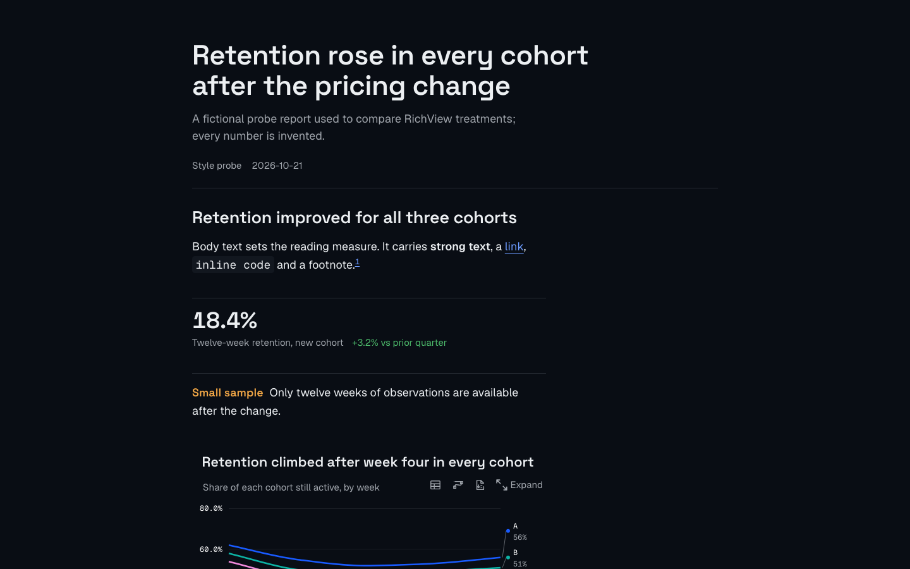

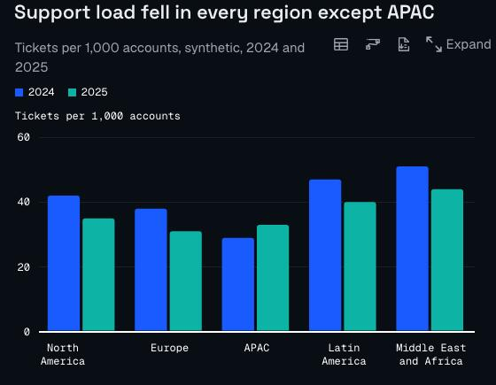

Dark page, Space Grotesk headings, Geist text and a vivid blue accent; the fixture's bars are blue and teal under a Space Grotesk title, with monospaced axis labels. Proposed specification: STY-09 (S-SLEEK-DARK), under the name Sleek.

### Air (today's Sleek Light)

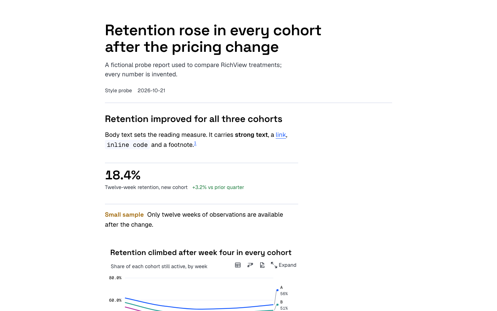

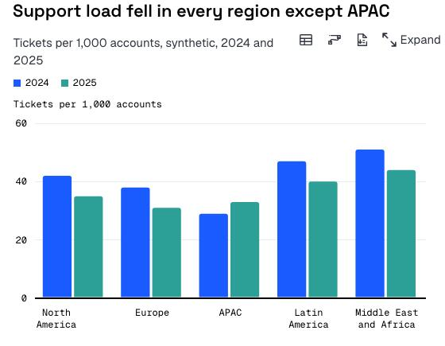

The same identity on white, the light style Sleek prints as. Proposed specification: STY-10 (S-SLEEK-LIGHT), under the name Air.

### Scientific

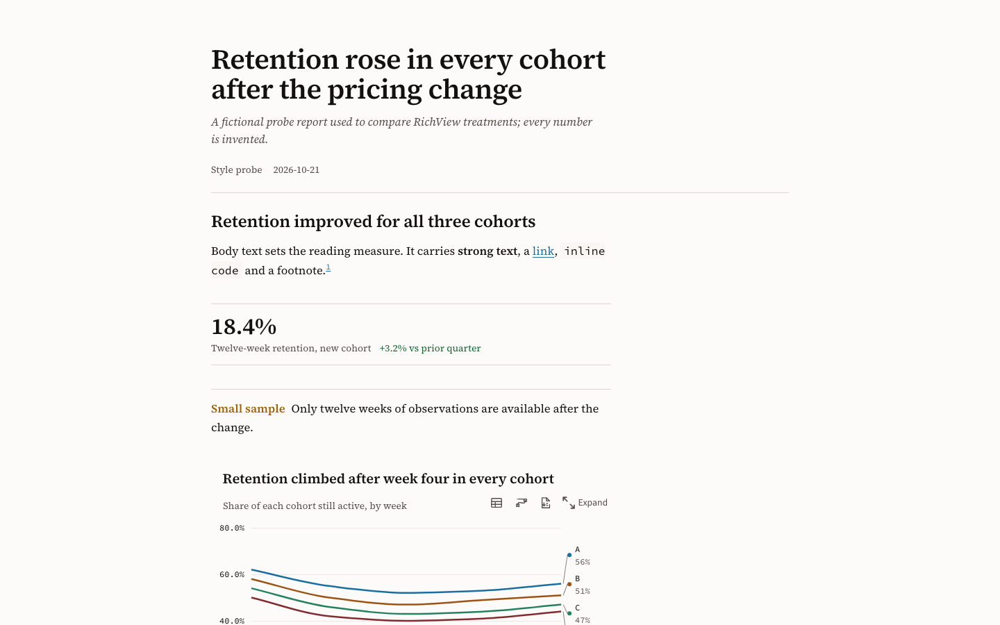

Serif type on warm paper; its bar chart is under Charts. Proposed specification: STY-11 (S-SCIENTIFIC).

### Brutalist

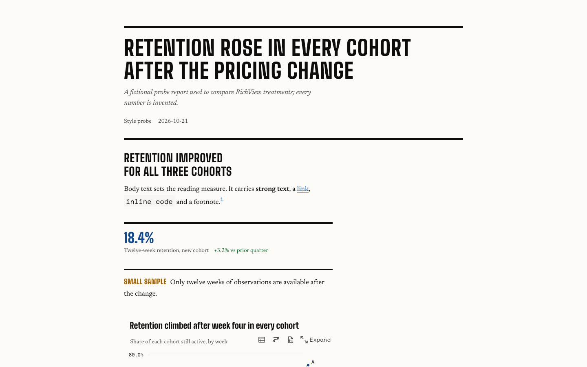

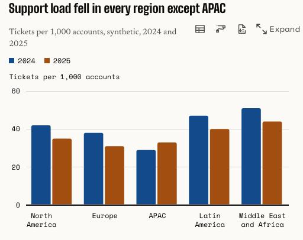

Uppercase condensed Big Shoulders headings, a header between 4 px ink rules, and a stat in blue (accent) figures under another 4 px ink rule. The code names that stat variant `knockout`, but it fills nothing (`crates/richview-core/assets/brutalist.rstyle.yaml:45-47`). The fixture's bars are navy and brown on warm off-white under a condensed bold title and a serif subtitle. Proposals: STY-12 (S-BRUTALIST) specifies the style and would square today's rounded bar ends; STY-33 (S-BIG) would make the stat a true knockout, a block filled with the accent and white figures.

### Hand-drawn

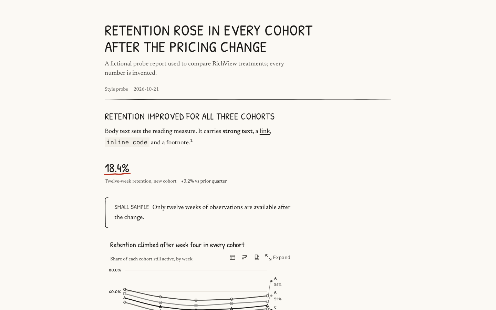

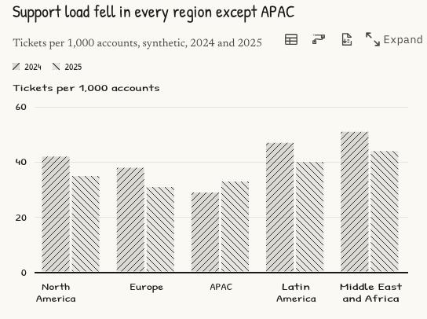

Patrick Hand headings in capitals, a pencil rule, a red underline under 18.4%, a bracket callout and grey series with markers. In the fixture both years are grey with opposite hatching, and the chart's title, legend, axis title, ticks and names are in Patrick Hand. It is the only builtin style that turns decals on (`crates/richview-core/assets/hand-drawn.rstyle.yaml:89`); the showcase's palette guard also hatches bars (see Flagship showcase). Proposals: STY-13 (S-HAND-DRAWN) specifies the style and, with STY-39 (S-CHART-TEXT), would set ticks and readout values in RichView's tabular-figure variant of Patrick Hand (OPN-62); FEA-CH-57 (F-CHART-DECALS) would turn decals on wherever colour alone cannot separate series.

### The `theme` override

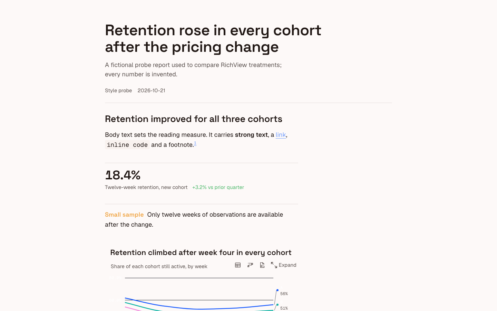

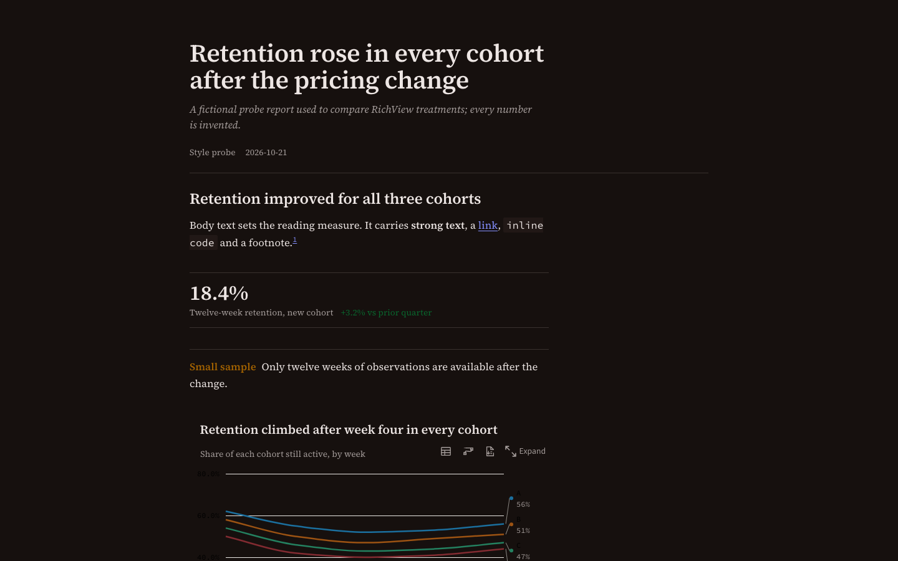

`theme: light|dark` and `--theme` change the page but not the chart. Sleek with `--theme light` turns the page white but keeps white chart text (1.05:1) and dark gridlines; scientific with `--theme dark` turns it dark but keeps black chart text (1.11:1) and white gridlines. `richview check` reports both clean. Source: the probe report, 1440×900, 2026-10-21.

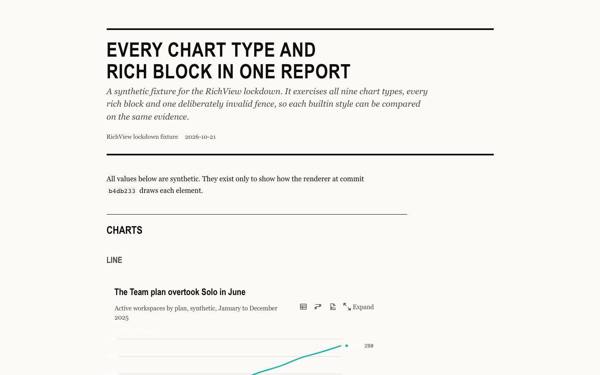

The fixture generated in sleek with `--theme dark` and opened over HTTP from a server that also serves the site's `/showcase/` files: the report turns light, with uppercase condensed headings between heavy rules, while the chart keeps sleek's pale ink, so its axis labels and series names nearly disappear. Opened from disk, the same file renders as dark sleek ([capture](../lockdown/screenshots/report-rendering/theme-dark-sleek-file-1440.jpg)). The runtime's `setup_themes` treats the `data-theme` attribute that `--theme` writes on `<html>` as a theme control, loads `/showcase/themes.json` when the origin serves it and applies the treatment named by `data-rv-theme`, defaulting to brutalist (`crates/richview-site/src/browser/authoring.rs:947-992`). Source: report-rendering stage, 1440×900, 2026-10-21. Proposals: FEA-RP-33 (F-THEME-OPTION) would remove `theme` and `--theme`, leaving the dark and light pair, Sleek and Air, to `styles`; FEA-CH-60 (D-CHART-CHECK-GAPS) would make `check` catch chart text under 4.5:1; INT-56 (G-STYLE-REACHES-CHARTS) is the standing rule.

## Rich blocks

The fixture's metrics, callouts, image, embeds, audio and video in scientific, cut for this page from the [scientific full page](../lockdown/screenshots/product/fixture/fixture-scientific-desktop-full.jpg). The table block is under Chart and table interactions; the probe reports above show one metric and one callout in each style.

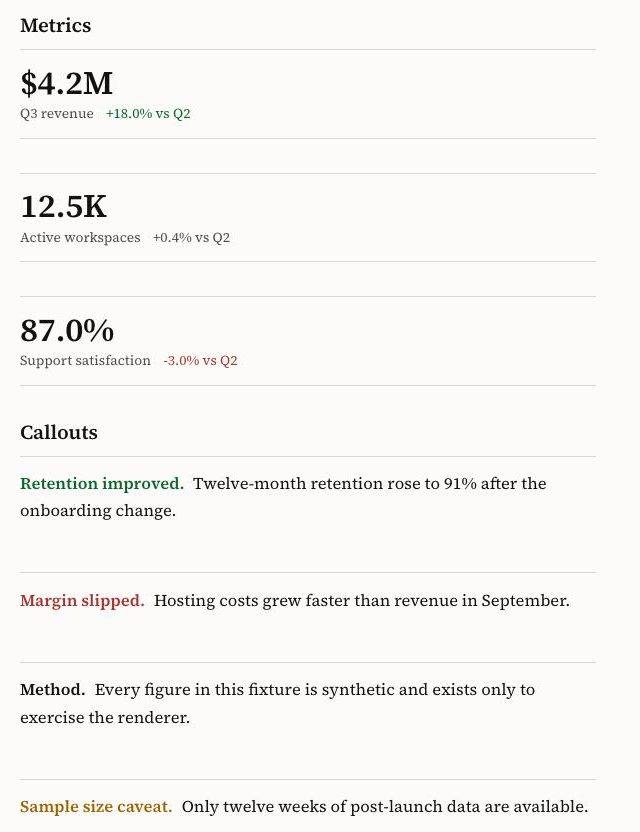

Three consecutive metrics, each between two hairlines, with deltas coloured by trend (up green, flat ink, down red), and four callouts whose run-in titles take their kind's colour (up, down, neutral, hold) under a hairline. Crop of CSS y 5,648 to 6,480. Proposals: the visible change is the sign, which FEA-RP-23 (F-CORE-BIG-NUMBER) prints as a true minus (−3.0%) where today's code prints a hyphen (`crates/richview-core/src/blocks.rs:323-325`); FEA-RP-24 (F-METRIC-ROW) would keep consecutive metrics stacked, and STY-33 (S-BIG) would keep the two hairlines as scientific's `bracket` variant; FEA-RP-25 (F-CORE-CALLOUT) matches the callouts.

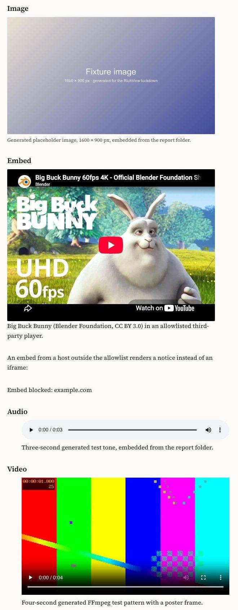

The image and the allowed YouTube embed align with the text column; the blocked embed is a plain line, "Embed blocked: example.com"; the audio and video players start 40 px right of the column and overrun it by 40 px, the browser's default `figure` margin. All five fixture full pages show the offset. Crop of CSS y 6,505 to 8,192. Proposals: FEA-RP-26 (F-CORE-MEDIA) matches the image; FEA-RP-28 (F-CORE-EMBED) would turn the blocked line into the not-rendered notice, an error that publish refuses; FEA-RP-27 (F-MEDIA-PLAYERS) would align both players with the column.

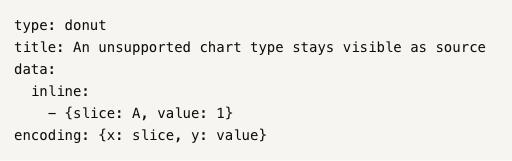

A deliberately invalid fence (`type: donut`) stays in the report as its YAML source, with nothing marking it as broken; it is the last block before the colophon ([page end](../lockdown/screenshots/product/fixture/fixture-report-card-default-desktop-viewport.jpg)). Source: `richview generate report.rmd --report-card -o report-card-default.html` with no style, so brutalist, element capture at 1440×900, 2026-10-21. Proposal: FEA-RP-29 (F-NOT-RENDERED) would put a one-line notice above the kept source.

## Report output

The fixture, "Every chart type and rich block in one report", as full pages captured 1440 px wide and 8,556 to 9,076 px tall, kept at 75% (1,080 px wide): [sleek](../lockdown/screenshots/product/fixture/fixture-sleek-desktop-full.jpg), [sleek-light](../lockdown/screenshots/product/fixture/fixture-sleek-light-desktop-full.jpg), [scientific](../lockdown/screenshots/product/fixture/fixture-scientific-desktop-full.jpg), [brutalist](../lockdown/screenshots/product/fixture/fixture-brutalist-desktop-full.jpg) and [hand-drawn](../lockdown/screenshots/product/fixture/fixture-hand-drawn-desktop-full.jpg) (`richview generate report.rmd --style <name>`, 2026-10-21).

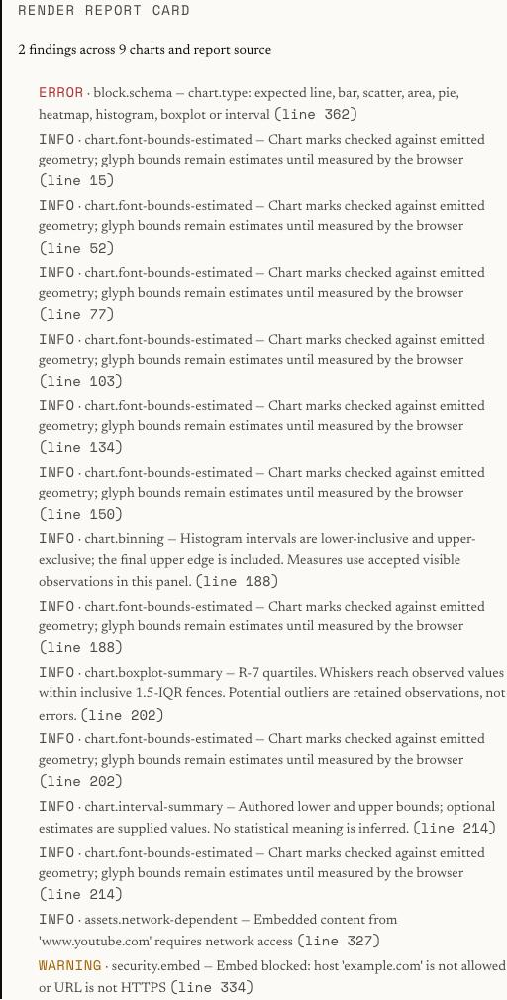

The report card of the same `--report-card` run heads "2 findings across 9 charts and report source" but lists 15 entries, 13 of them info. `richview generate` exits 1 when a block is invalid but still writes the file; the [terminal output](../lockdown/screenshots/product/cli/generate-pretty-fixture.txt) shows this for a separate run, `richview generate fixture/report.rmd --style sleek`. Source: element capture, 1440×900, 2026-10-21. Proposals: FEA-RP-31 (F-CORE-REPORT-CARD) would drop the in-report card; FEA-SF-05 (F-APP-CLI-GENERATE) would keep "written, exit 1".

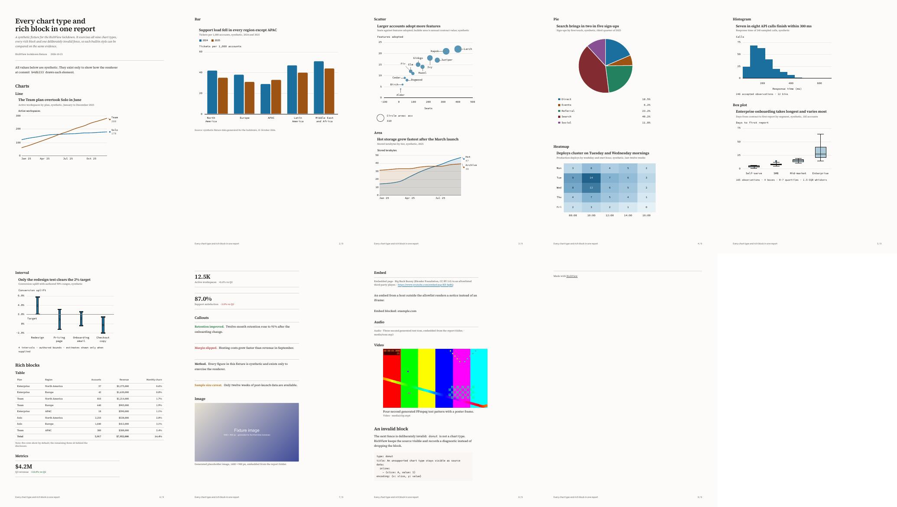

The fixture as a PDF in scientific: nine A4 pages, a running title and page numbers from page 2, no chart actions. The pie moves its names and shares into a key under the disk, the table prints all eight rows, the embed prints as a text card with its URL, audio as a line naming its file and video as its poster. Keep-together rules leave pages 1 and 2 partly empty, and page 9 holds only the "Made with RichView" colophon. Source: `richview generate … --to pdf` (A4, 495 KB, printed by headless Chromium 153), contact sheet of the nine pages by the report-rendering stage, 2026-10-21. Proposals: FEA-RP-43 (F-EXPORT-PDF) would set the pagination rules, FEA-RP-45 (F-CORE-PDF-OPTIONS) the paper stand-ins and FEA-RP-06 (F-COLOPHON) the colophon.

## Preview, publishing and PDF

These come from the `b4db233` release build on 22 October: `richview serve` and `richview server` on loopback ports with temporary folders, read in headless Chromium with reduced motion, and a PDF printed through Chrome for Testing. Nothing left the machine.

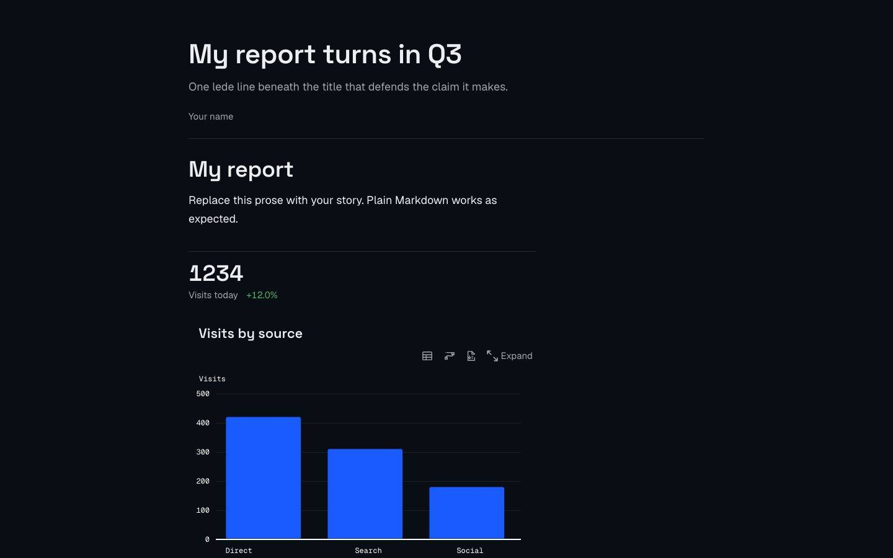

`richview serve` of the `init` template: the report in sleek, the template's style, as the native renderer wrote it, with the hydrated chart actions above the bar chart. Source: `richview serve` on a loopback port, 1440×900, 2026-10-22.

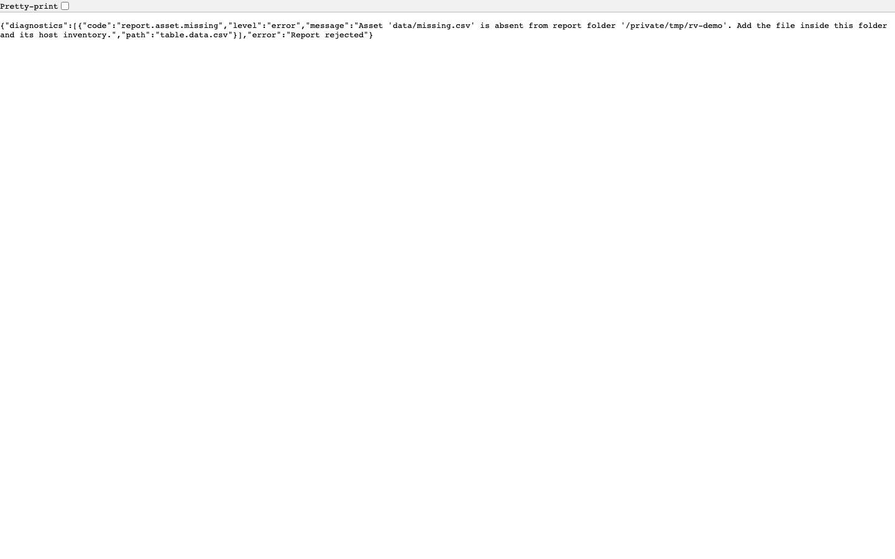

Three seconds after a table referencing the missing `data/missing.csv` was appended, the preview is replaced by the raw JSON error `report.asset.missing`, which names the report folder's absolute path, and it stays after the edit is undone, because the JSON error page has no reload poller (`crates/richview-site/src/browser/authoring.rs:1237-1282`). Source: same session, 2026-10-22. Proposal: FEA-SF-08 (F-APP-CLI-SERVE) would show diagnostics in a banner above the report, keep the last good render under it on a hard error and recover on its own once the source is fixed.

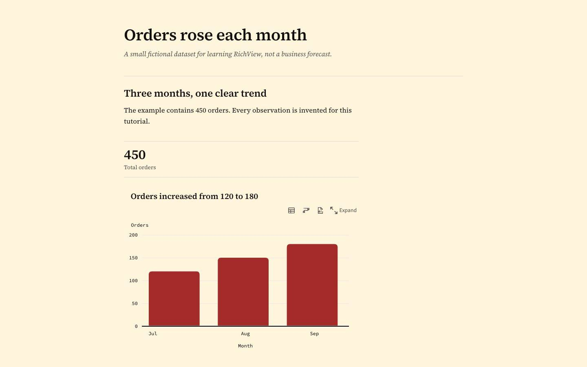

The tutorial report "Orders rose each month" (`examples/first-report`) published to a loopback `richview server` with a temporary data directory and read at `/r/first-report`: the stored HTML with its embedded runtime and hydrated chart actions. On a phone the title, lede, metric and chart fit the width, and the chart keeps its actions as icons beside Expand ([capture](../lockdown/screenshots/surfaces/published-report-mobile-viewport.jpg), 390×844). Source: `richview server` on a loopback port, 1440×900, 2026-10-22. Proposals: FEA-SF-14 (F-APP-SERVER-REPORT-PAGES) would serve `/r/<slug>` as the highest release or the pinned version, with immutable version permalinks; ARC-20 (D-PUBLISH-CONTRACT) would have the host re-render from source instead of storing HTML a client sends.

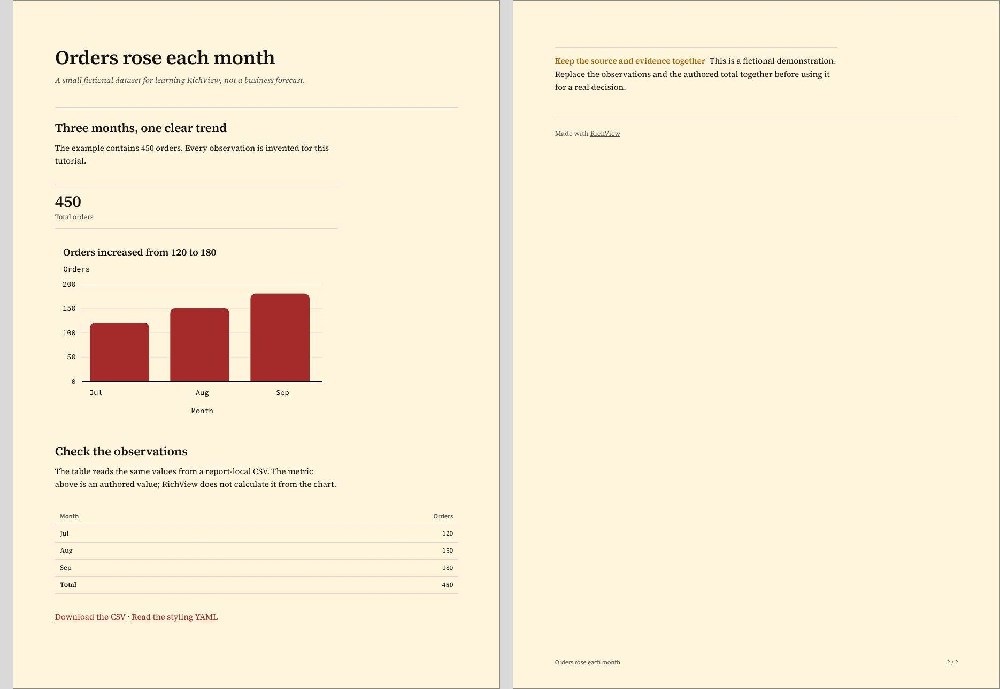

`examples/first-report` printed with `richview generate --to pdf`: two A4 pages, the second holding only the closing callout and the colophon above the running title and page number; the chart prints without its action row. Source: the `b4db233` release build with Chrome for Testing, 2026-10-22. Proposals: FEA-SF-06 (F-APP-PDF-EXPORT) keeps PDF as a mode of `generate`; FEA-RP-43 (F-EXPORT-PDF) would set the pagination rules.

## Flagship showcase

The flagship report compares OpenAI and Anthropic as a fixed research snapshot of 2 October 2026, as INT-10 (D-FLAGSHIP-STORY) proposes to keep it. The showcase frames it with a style rail: three pills (Sleek, Scientific, Brutalist) and an "All styles" select over 23 treatments; sleek-light and hand-drawn cannot be selected. Daniel's STY-05 (D-STYLE-CATALOG) answer keeps the 20 studio variants as extended themes: a real feature that shows how many variants RichView can produce, kept out of the normal style menus, at most in a hidden or secondary dropdown, with the showcase's side-by-side view of styles and layers. Proposals: FEA-SF-36 (F-WEB-SHOWCASE-FLAGSHIP) and ARC-41 (C-WEB-SHOWCASE) would keep the page, rendered once per style and per extended theme and opening in Sleek; FEA-BR-17 (F-WEB-SHOWCASE-STYLE-PICKER) would show the five styles as pills followed by one secondary dropdown of extended themes; INT-19 (D-BET-STYLE-RANGE) would have the flagship demonstrate that one report renders in every accepted style with identical data, wording and sources, each style restyling the whole page, charts included.

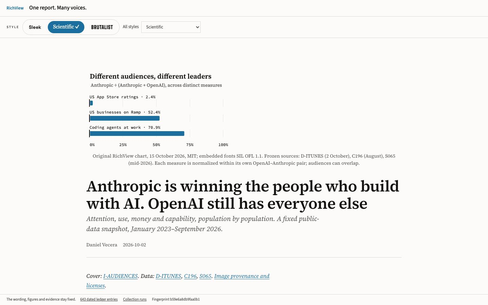

The default treatment, scientific: the header "One report. Many voices.", the style rail, the cover chart "Different audiences, different leaders" and the headline. A fixed footer reads "The wording, figures and evidence stay fixed." with the ledger count (643 dated entries) and a content fingerprint. Source: `/showcase/openai-vs-anthropic/?theme=scientific` on the local build, 1440×900, 2026-10-21.


Sleek: the page turns dark while the cover image keeps its light chart surface. Source: `?theme=sleek`, 1440×900, 2026-10-21. Also captured: the [brutalist](../lockdown/screenshots/product/showcase/showcase-brutalist-desktop-viewport.jpg) treatment, main's whole showcase page in scientific ([part 1](../lockdown/screenshots/product/showcase/showcase-scientific-desktop-full-part1of3.jpg), [part 2](../lockdown/screenshots/product/showcase/showcase-scientific-desktop-full-part2of3.jpg), [part 3](../lockdown/screenshots/product/showcase/showcase-scientific-desktop-full-part3of3.jpg)), the [live flagship](../lockdown/screenshots/live/richview-flagship-scientific-desktop-viewport.png) and the whole live report in its own styles ([part 1](../lockdown/screenshots/live/richview-flagship-report-desktop-full-part1of4.jpg), [part 2](../lockdown/screenshots/live/richview-flagship-report-desktop-full-part2of4.jpg), [part 3](../lockdown/screenshots/live/richview-flagship-report-desktop-full-part3of4.jpg), [part 4](../lockdown/screenshots/live/richview-flagship-report-desktop-full-part4of4.jpg)).

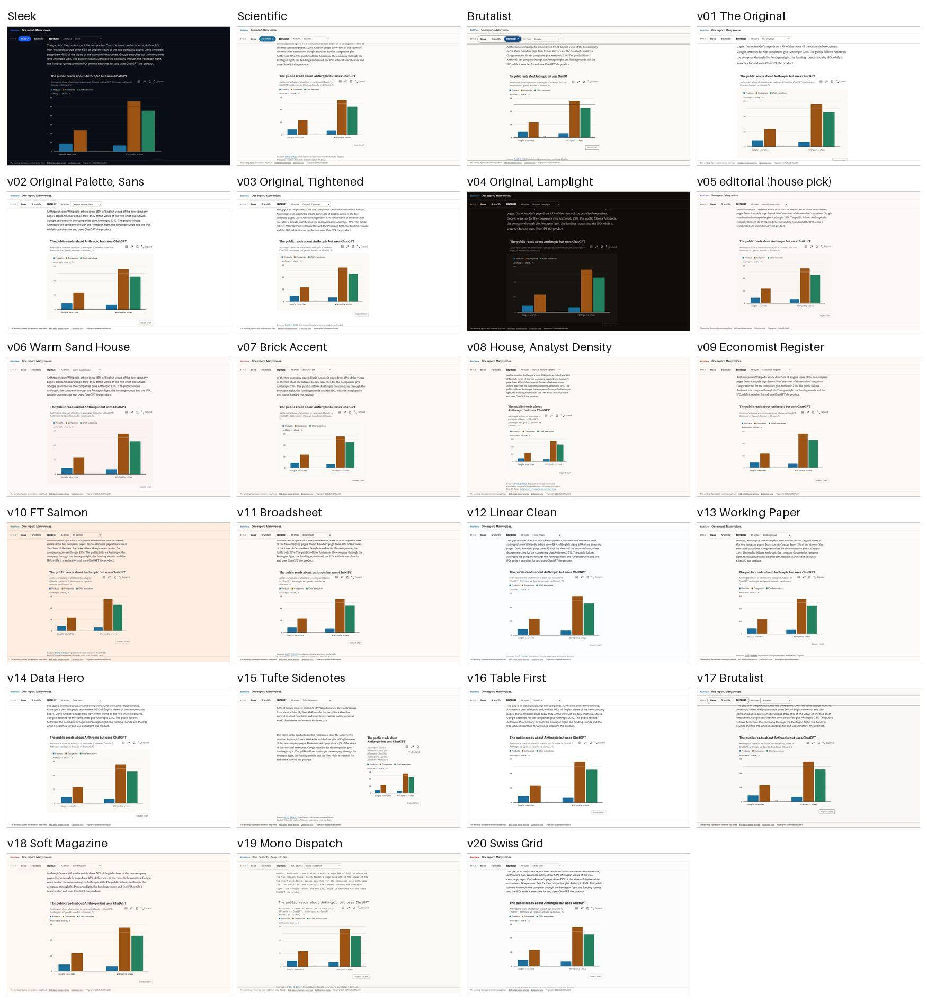

All 23 treatments at the first bar chart, "The public reads about Anthropic but uses ChatGPT": the three builtins, then the studio variants v01 to v20, each labelled with its name in `themes.json`. Contact sheet made for this page from the `?theme=<id>` chart captures that the index lists under `product/showcase/` (frame scrolled to the chart, 1440×900, 2026-10-21; only v04 and v15 are committed, the others are kept locally). The treatments differ in page tint, type and layout, yet every capture draws the same blue, brown and green bars, the first slots of the builtin scientific palette (`richview-chart/src/rmd_render.rs:1209-1218`), although `assets/showcase/themes.json` gives most treatments other palettes ("Original, Lamplight" starts with light blue and rose, "Economist Register" with red). The styles evidence saw this lag once, on a deep link, and reads it as the first load drawing the builtin scientific palette, with a treatment's palette applied only after a pill switch; these 23 captures reproduce the symptom but do not confirm that cause. INT-19 rules out such a half-styled page.

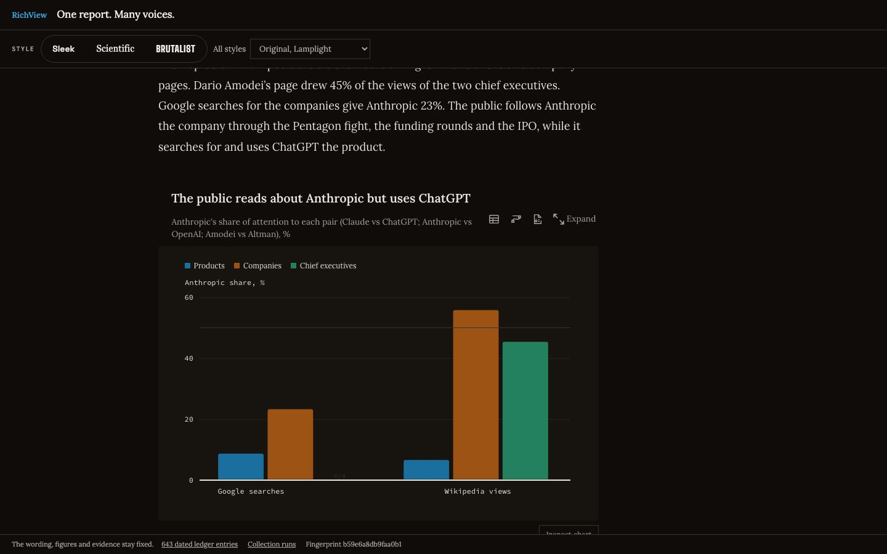

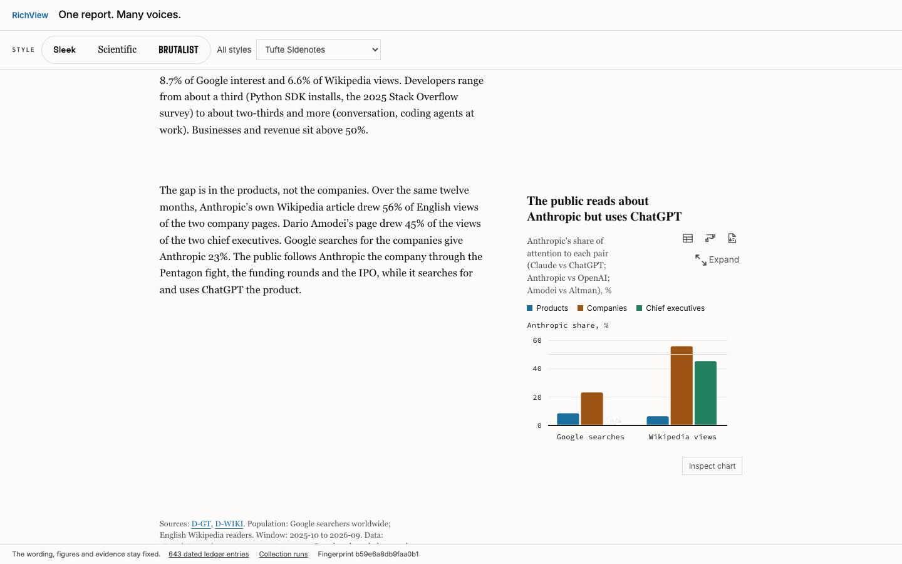

Two studio variants at full size: "Original, Lamplight" (v04) sets the chart on a dark panel; "Tufte Sidenotes" (v15) moves it into a side column. Source: `?theme=v04-original-dark` and `?theme=v15-tufte`, frame scrolled to the chart, 1440×900, 2026-10-21.

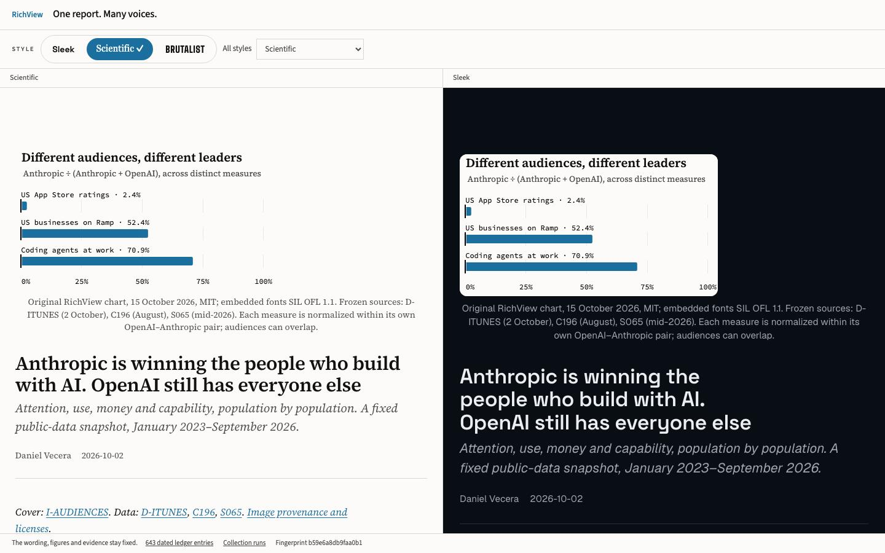

Compare mode (key `c`): scientific and sleek side by side with a synchronised reading position. Source: `?theme=scientific&compare=sleek`, 1440×900, 2026-10-21.

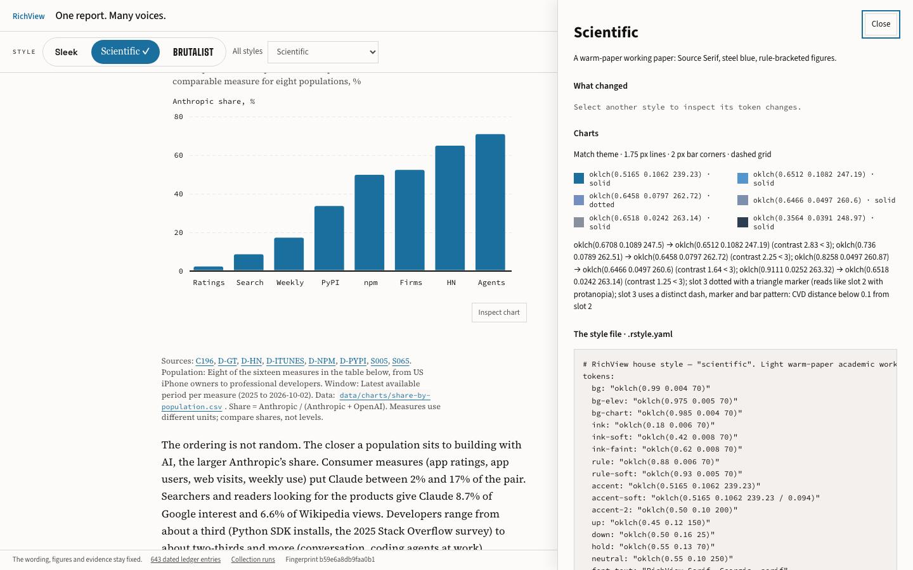

The style drawer (key `s`) for scientific: a description of the treatment, its chart settings ("Match theme · 1.75 px lines · 2 px bar corners · dashed grid"), palette swatches with their contrast adjustments, and the `.rstyle.yaml` with a copy button. Since PR #58 (merge `bcea882`, 13 October; branch commit `9d328b5`) neither compare nor the drawer has a visible control, only its key. Source: `?theme=scientific`, 1440×900, 2026-10-21. Proposal: FEA-SF-37 (D-SHOWCASE-CONTROLS) would restore compare as a visible control, since Daniel's STY-05 answer keeps the showcase's side-by-side view, and delete the style drawer with its key and code.

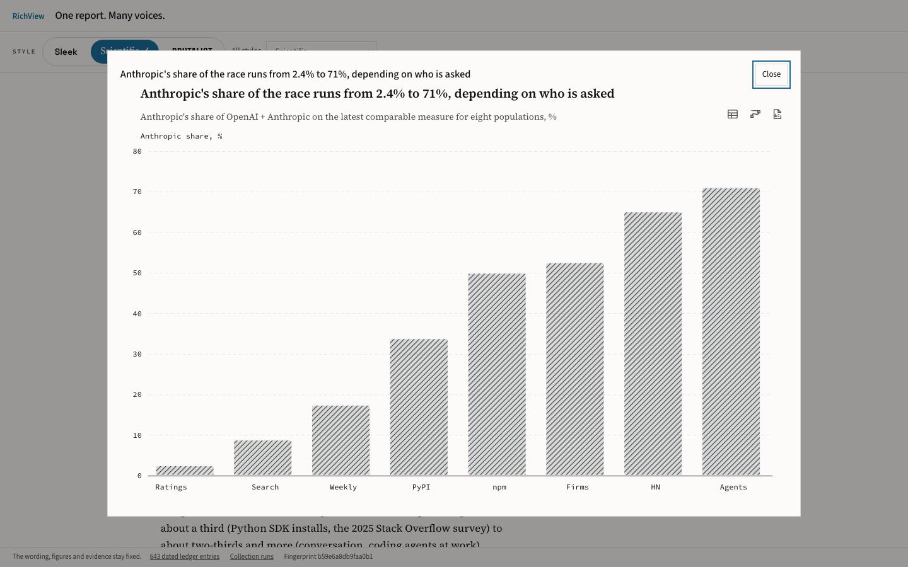

"Inspect chart" opens a second chart modal whose heading repeats the chart title. Inside it the bars are grey and hatched, while the report draws them solid: the showcase's runtime palette guard switches to hatches when palette slots sit too close under colour-vision simulation (`crates/richview-site/src/browser/showcase.rs:1561-1670`). Source: `?theme=scientific`, 1440×900, 2026-10-21. Proposals: FEA-SF-39 (F-WEB-SHOWCASE-INSPECT) would drop the lightbox; FEA-CH-44 (D-CHART-MODAL) would leave one Expand modal; FEA-CH-62 (D-PALETTE-ENFORCEMENT) would remove the guard and check every palette at render, warning and switching decals on instead of changing colours.

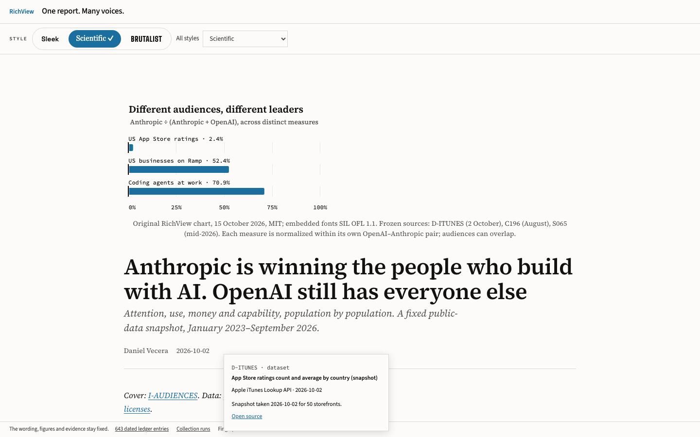

A source link opens its ledger entry: the App Store ratings dataset from the Apple iTunes Lookup API, a snapshot of 2 October 2026 for 50 storefronts, with a link to the source. Source: `?theme=scientific`, 1440×900, 2026-10-21. FEA-SF-38 (F-WEB-SHOWCASE-CITATION) would keep the card as shown (title, publisher, date and link) on the flagship page only.

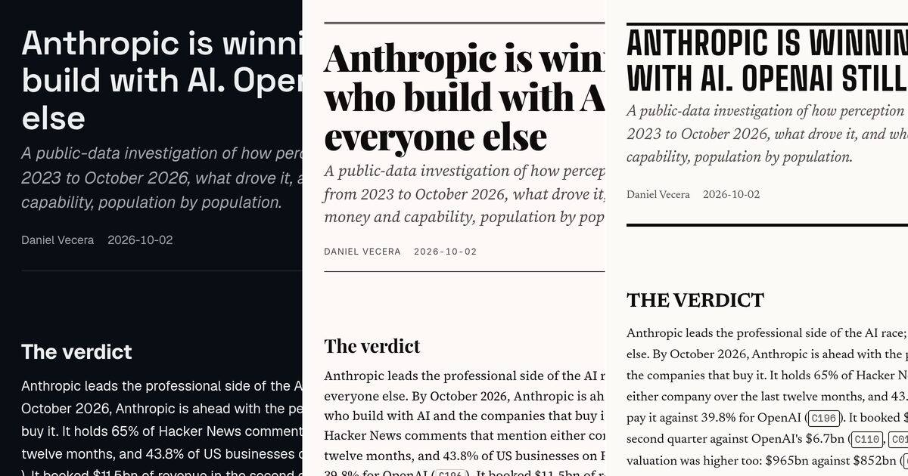

The flagship page's own share image, `/showcase/openai-vs-anthropic/og.png` (shown as a JPEG copy): the report's title, author line and verdict with its figures, in three looks side by side, dark sleek, a serif treatment and brutalist. The PNG is byte-identical in the local build and on richview.ai. Source: `dist/web` at `b4db233` and https://richview.ai, 1200×630, 2026-10-22. Proposal: FEA-SF-55 (F-SITE-SHARE-IMAGES) would show RichView rendering the report in its styles with no title, verdict or figure from it, as INT-45 (D-FLAGSHIP-CLAIMS) requires. A story published on a RichView server gets a thumbnail of its own, with its own title (Daniel's INT-07 answer, FEA-SF-55); that is its author sharing it, not RichView's marketing.

## Chart and table interactions

The fixture in brutalist (`richview generate report.rmd --style brutalist`), driven with a mouse at 1440×900 on 2026-10-21. FEA-CH-39 to FEA-CH-50 decide what stays.

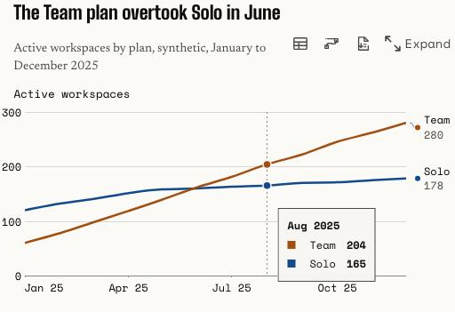

Hovering the line chart selects the nearest month and shows both series ("Aug 2025", Team 204, Solo 165) under a dashed crosshair with hover dots, as FEA-CH-41 (F-CHART-HIT-TESTING) proposes. FEA-CH-42 (D-TOOLTIP) and STY-41 (S-TOOLTIP) would keep the translucent panel but drop its 6 px background blur (`crates/richview-site/src/browser/charts.rs:5059`).


On a bubble the readout's first line is the bare x value ("210"), followed by the account (Ivy), "acv 180" and "Features adopted 18". FEA-CH-40 (F-CHART-READOUT-CONTENT) would label every value, the first line included.


Clicking the 2024 legend entry hides that series; the entry stays, struck through. This matches FEA-CH-33 (F-WEB-CHART-LEGEND), which would also always leave one series visible.


After a drag across the line chart: the zoomed window (May to October 2025), a "Reset zoom" control and an overview strip under the plot. The zoom rescales y from 0–300 ([unzoomed](../lockdown/screenshots/product/fixture/fixture-brutalist-chart-01-line.jpg)) to 100–250, dropping zero, and the strip runs past the plot on both sides. Proposals: FEA-CH-49 (F-WEB-CHART-ZOOM-PAN) and FEA-CH-19 (F-CHART-AXES) would never let a zoom rescale y; FEA-CH-50 (F-WEB-CHART-OVERVIEW) would keep the strip.


Expand widens the chart from the text column to the report width, and the control becomes "Contract". FEA-CH-44 (D-CHART-MODAL) would replace this toggle, the phone dialog and "Inspect chart" with one modal.


The table block as authored: sorted by revenue, descending, five of eight rows, a totals row that sums Monthly churn to 14.4%, and "Showing 5 of 8 rows" with a disclosure for the rest. Proposals: FEA-RP-19 (F-CORE-TABLE); FEA-RP-21 (F-TABLE-TOTALS) would stop summing rates.


After sorting by Monthly churn and opening the rest: the three extra rows form a second table whose columns do not line up with the first, under the totals row. Proposals: FEA-RP-19 would keep one table with the total after all rows; FEA-RP-22 (F-WEB-TABLE-SORT) would sort rows in place.


The downloaded chart SVG opened outside the report: the geometry holds, but the text falls back to system fonts (a Times-like subtitle, Courier-like axis labels). FEA-CH-46 (F-WEB-CHART-SVG-DOWNLOAD) is an open question for Daniel, because his INT-31 answer has charts render with WebGL and only PDF export convert them to vector; if the download stays, it embeds font subsets. The downloads themselves are kept as [SVG](../lockdown/screenshots/product/interactions/interaction-download-bar-chart.svg) and [CSV](../lockdown/screenshots/product/interactions/interaction-download-bar-chart.csv); the Table action is [captured](../lockdown/screenshots/product/interactions/interaction-table-action-bar.jpg) too (FEA-CH-45 (F-WEB-CHART-TABLE)).

## Phones


Main's landing on a phone: only the first three header links show, "Live example" wraps, and the copy has no left gutter. Source: `/` on the local build, 390×844, 2026-10-21. OPN-17 (D-FIX-HOME-GUTTERS) does not hotfix this under the legacy freeze; the rewrite's site gate checks the gutters at 320, 390 and 1440 px (STY-49, DEL-27).


On richview.ai at 390 px the page is 426 px wide and scrolls sideways: the demo's style switcher row, which does not wrap, runs past both screen edges (the red line marks 390 px), and the fixed header stretches with the page, cutting off Docs ([capture](../lockdown/screenshots/live/richview-home-mobile-01-hero.jpg)). Source: https://richview.ai/ (PR #69 content), 390×844 with reduced motion, cropped to the switcher, 2026-10-22. OPN-18 (D-FIX-MOBILE-OVERFLOW) does not hotfix this under the legacy freeze; the rewrite's site checks (STY-49, DEL-27) hold the page width equal to the viewport width at 320, 390 and 1440 px, with the header's three links showing at 320 px.


On a phone the bar chart turns horizontal with each name above its bars, as FEA-CH-26 (F-CHART-CATEGORY-LABELS) proposes under 480 px. A tap on a bar opens a translucent readout that covers the neighbouring names and pairs the axis title with the raw field name "year", which FEA-CH-40 (F-CHART-READOUT-CONTENT) rules out. Source: the brutalist fixture, 2026-10-21. FEA-CH-41 (F-CHART-HIT-TESTING) and FEA-CH-42 (D-TOOLTIP) cover targeting and the panel.


Expand on a phone opens the live chart in a dialog laid out in landscape, rotated 90°, with a Contract control. Source: the brutalist fixture, 2026-10-21. Proposal: FEA-CH-44 (D-CHART-MODAL) would keep the landscape layout inside its one modal.

More phone captures: the [line chart in the report column](../lockdown/screenshots/product/interactions/interaction-phone-line-in-report.jpg), the [expanded chart's readout](../lockdown/screenshots/product/interactions/interaction-phone-expand-dialog-readout.jpg), the showcase in [scientific](../lockdown/screenshots/product/showcase/showcase-scientific-mobile-viewport.jpg), [sleek](../lockdown/screenshots/product/showcase/showcase-sleek-mobile-viewport.jpg) and its [lightbox](../lockdown/screenshots/product/showcase/showcase-inspect-chart-lightbox-mobile.jpg), and the [docs index](../lockdown/screenshots/product/docs/docs-index-mobile-viewport.jpg).

## RichView News

news.richview.ai runs RichView Publish, the PR #70 work, unmerged when captured and merged into `main` on 26 October. It serves content commit `7e7d9f8`, the merge of PR #72 into the `publish/news` branch, as release `33843a62a65c`, a Publish release ID rather than a Git commit. Decided and proposed: Daniel's INT-35 (D-SCOPE-PUBLISH) answer of 26 October makes RichView Publish a full member of the RichView family and part of the rewrite, with PR #70 merged into `main` and its work continuing from there, and Publish and RichView Cowork sharing one server core. He decided on 23 October that News is not frozen: the RichView News session is improving its look, real reports and editor login on #70's code. INT-74 (D-NEWS-DEMO) records that, OPN-03 (D-NEWS-LIVE) repairs its publishing path in that work, and ARC-57 (C-RICHVIEW-PUBLISH) would rebuild Publish in Rust on the shared core, with #70 running News until then.


The News home: the masthead "RichView News", the tagline "A working notebook on evidence, systems and better decisions.", sections (Research, Systems, Field notes, About, Archive, Search, Member edition), "The briefing" and stories by "RichView Example Desk" dated 13 to 18 October 2026; the footer names release `33843a62a65c`. Source: https://news.richview.ai/, 2026-10-21. Proposals: FEA-BR-23 (F-PUBLISH-LAYOUTS-THEMES) and FEA-BR-24 (F-PUBLISH-FEEDS-SEARCH) would build these pages with Publish in the rewrite (INT-35, ARC-57).


The example trading-desk dashboard ("Published snapshot · Synthetic demonstration") with six tiles. The Revenue trend and EBITDA charts fill black wedges under their lines, tile chart text falls back to a Times-like serif, and an interval axis is titled with the raw column name "plan gap lo". Source: https://news.richview.ai/dashboards/example-trading-desk, 2026-10-21. Proposals: FEA-CH-66 (F-CHART-STANDALONE-SVG) would make chart SVG draw correctly without report CSS, which the lines need for `fill: none`; FEA-CH-20 (D-AXIS-TITLES) would print no field name as an axis title; FEA-BR-30 (F-PUBLISH-DASHBOARD-SNAPSHOT) and INT-33 (D-SCOPE-DASHBOARDS) would keep dashboards out.

More News pages: a [story with an embedded report](../lockdown/screenshots/live/news-story-measurement-gap-desktop-full.jpg), the [archive](../lockdown/screenshots/live/news-archive-desktop-full.jpg), [search](../lockdown/screenshots/live/news-search-desktop-full.jpg), a [section](../lockdown/screenshots/live/news-section-research-desktop-full.jpg), [about](../lockdown/screenshots/live/news-about-desktop-full.jpg) and the [home on a phone](../lockdown/screenshots/live/news-home-mobile-full.jpg), where a card illustration is cropped to "…HERENT RELEASE".

## Features on open PR branches

Four draft PRs, open when captured, carried features that `main` lacked. Daniel's FEA-BR-01, FEA-BR-08 and INT-34 answers decided which enter the rewrite: all four kinds of chart controls, multi-tab reports and PR #65's gallery content do, the voice demo does not. Part 04d decides their form and part 08 the branches themselves (OPN-06 to OPN-09). PR #62 (`a703897`) and PR #63 (`f1cb254`) were built in scratch folders and their examples rendered and driven in headless Chromium with reduced motion, and PR #65's pages (`850032b`) were rendered with `main`'s build; the PR #64 and PR #65 shell images are those PR runs' own captures. The part 04d stage saved all of them on 22 October 2026.


PR #62's playable charts: the Gapminder example in scientific with its playback bar (previous, play, next, a scrubber and the current year, its label "Year2000" touching the value) and region buttons with Europe pressed, above a bubble scatter of invented data. After Asia and Next it shows Asia in 2020 with both axes refitted ([capture](../lockdown/screenshots/branches/pr62-gapminder-scientific-asia-2020.jpg)); the branch also refits them at every frame. The Table then lists all 64 source rows, not the 4 on screen ([capture](../lockdown/screenshots/branches/pr62-gapminder-table-after-filter.jpg)), and on a phone in sleek the controls are the browser's own range input and select ([capture](../lockdown/screenshots/branches/pr62-gapminder-sleek-phone.jpg)). Source: `richview generate examples/playable-gapminder/report.rmd` with the PR #62 build, figure crops at 1440×900 and 390×844, 2026-10-22. Proposals: Daniel's FEA-BR-01 (F-CHART-CONTROLS) answer lets all four kinds of authored controls (playback, filter, metric and variant) enter the format; FEA-BR-02 (F-CHART-CONTROLS-PLAYBACK) and FEA-BR-03 (F-CHART-CONTROLS-FILTER) specify playback and filters; FEA-BR-31 (D-PLAYBACK-AXES) would fit the axes once over all frames; FEA-BR-32 (D-CONTROLS-ACTIONS) would have the Table list and name the state on screen; FEA-BR-34 (S-CHART-CONTROLS) would restyle the controls in each style.


The indicator line after pressing "Index (2020 Q1 = 100)": the plotted values and the axis title stay those of Absolute ([before](../lockdown/screenshots/branches/pr62-indicator-scientific-initial.jpg)), and "2020" is drawn twice, because each change stacks another drawing; playback does the same on this chart. Source: `richview generate examples/playable-line-indicator/report.rmd` with the PR #62 build, figure crops at 1440×900, 2026-10-22. Proposal: FEA-BR-04 (F-CHART-CONTROLS-METRIC) would switch the plotted field, axis title, ticks and readouts together.


The variant fixture from the branch's browser check, rendered as a report: the first selector (View) as buttons, the second (Measure) as a dropdown, and a base view that cannot draw ("Cannot draw these bars", `chart.ambiguous-bar-slot`, because each country has two years). Its Share view draws a pie that sums both years ([capture](../lockdown/screenshots/branches/pr62-variant-share.jpg)). Source: the fixture in `scripts/verify-playable-controls.mjs` saved as a report and rendered with the PR #62 build, 1440×900, 2026-10-22. Proposals: FEA-BR-06 (F-CHART-SELECTORS) keeps these defaults; FEA-BR-05 (F-CHART-CONTROLS-VARIANT) would validate the base chart and every view when the report is checked, and FEA-BR-33 (G-CONTROL-STATES) every reachable state.


PR #63's multi-tab reports: the `sales-report-tabs` example in brutalist, the style used when none is given today (STY-06 makes it Sleek), with an Overview, Sales and Customers row under its prolog. Pressing Sales adds `#tab=sales` to the URL ([capture](../lockdown/screenshots/branches/pr63-tabs-desktop-sales.jpg)), and on a phone the row stays on one line ([capture](../lockdown/screenshots/branches/pr63-tabs-phone.jpg)). Source: `richview generate examples/sales-report-tabs/report.rmd` with the PR #63 build, 1440×900 and 390×844, 2026-10-22. Proposals: Daniel's FEA-BR-08 (F-REPORT-TABS) answer keeps tabs, several views in one report; FEA-BR-10 (F-WEB-TABS-NAV) keeps `#tab=<id>` deep links; FEA-BR-35 (S-TAB-ROW) would set the row in each style's faces and rules.


With JavaScript disabled the tab row still shows, but only the Overview panel is in view, because the branch writes every other panel with `hidden`. Source: the same page in a browser context with scripts off, whole page at 50%, 2026-10-22. Proposal: FEA-BR-09 (F-CORE-TABS) would show every panel under its label before and without the runtime.

PR #64's voice-to-dashboard demo (captures kept locally, not committed, because they show business metrics from another project's dataset) after the typed request "Create a dashboard that shows how my sales are performing": six tiles from the local Okurka MetricFlow adapter, each with its row count, metric names, a `release_authority: false` badge and its semantic request; the headline revenue months run out of order (Jul 26, Apr 26, Dec 25 …). After a cross-selection on `acquisition_channel = Organic`, four of the six tiles read "Unavailable from this adapter". Source: the PR run's own captures at `81110e0` (S27-651). Daniel's INT-34 (D-SCOPE-VOICE-DASHBOARD) answer: the demo does not enter RichView and lives outside this repository, possibly in a repository of its own; FEA-BR-11 (F-VOICE-DASHBOARD) keeps the branch as a reference record only.


PR #65's gallery shell on its famous-charts page: links to Typography, Chart types, Famous charts and Flagship, and five identity buttons with Hand-drawn selected. Source: the PR run's own capture at `850032b` (S27-647), 1440 px wide. Proposals: ARC-60 (C-GALLERIES) would drop standalone galleries; FEA-BR-42 (D-STYLE-PERSISTENCE) would keep a style choice only in `?theme=`, never in the browser's storage.


The famous-charts page rendered with `main`: the Rosling income-mountains fence fails YAML parsing on an unquoted colon in its subtitle and stays on the page as source text. Gapminder draws on a linear axis from −25k, because `main` ignores the fence's `scale: log` ([capture](../lockdown/screenshots/branches/pr65-famous-gapminder.jpg)); Playfair's trade chart draws two overlapping areas with years printed as "1.70k" ([capture](../lockdown/screenshots/branches/pr65-famous-playfair.jpg)); Snow's map becomes a density grid ([capture](../lockdown/screenshots/branches/pr65-famous-snow.jpg)) and Nightingale's rose a pie ([capture](../lockdown/screenshots/branches/pr65-famous-nightingale.jpg)). Source: `richview generate assets/galleries/famous-charts/report.rmd --style scientific` with the `b4db233` build on `850032b`'s source, 1440×900, 2026-10-22. Proposal: FEA-BR-12 (D-FAMOUS-SIMPLIFICATIONS) would keep only Gapminder, rebuilt from World Bank data with playback and a log axis.

Also rendered with `main` in scientific: PR #65's [chart-type gallery](../lockdown/screenshots/branches/pr65-chart-gallery-scientific-full.jpg), whose bar example draws no bars (`chart.non-numeric-y`) and whose interval fence fails YAML parsing, and which FEA-BR-41 (D-DOCS-CHART-EXAMPLES) would reuse for the docs chart-type pages once those two are fixed; and its [typography specimen](../lockdown/screenshots/branches/pr65-typography-scientific-full.jpg), which FEA-BR-13 (F-GALLERY-TYPOGRAPHY) would keep as a style fixture.

## Other surfaces

Docs on main: the [index](../lockdown/screenshots/product/docs/docs-index-desktop-full.jpg) ("Your first RichView report", the five pieces, a build from `git@github.com:richview-universe/richview-v3.git`, and "What is available today" naming six chart types), [authoring](../lockdown/screenshots/product/docs/docs-authoring-desktop-full.jpg) and [styles](../lockdown/screenshots/product/docs/docs-styles-desktop-full.jpg). Proposals: ARC-43 (C-DOCS-SITE) would keep the docs site with its reference tables generated from core; OPN-27 (D-REPO-URLS) would allow no public link to a private repository in the rewrite, while the live docs keep their clone instruction until the rewrite reaches `prod`.


richview.ai adds the chart gallery at `/docs/charts`: each of the nine types with a live chart and its `.rmd` source. The intro links the `chart-gallery` and `famous-charts` showcases, which return 404; the sidebar labels the docs "RichView v3 alpha"; and the line chart's y axis is titled "Value" although its source sets no label. Cut for this page from the top of [part 1](../lockdown/screenshots/live/richview-docs-chart-gallery-desktop-full-part1of2.jpg) ([part 2](../lockdown/screenshots/live/richview-docs-chart-gallery-desktop-full-part2of2.jpg)) of https://richview.ai/docs/charts (PR #69 content), resampled to 1080 px wide, 2026-10-21. Proposals: FEA-SF-43 (F-DOCS-CHART-GALLERY) would keep the gallery, extended to every chart type FEA-CH-01 adds, and link no missing page; OPN-19 (D-GALLERY-ROUTES) leaves the live links as they are and, in the rewrite, would redirect `/chart-gallery/` to it and link no route that returns 404; FEA-SF-41 (F-DOCS-GUIDES) would keep six guides with "Coming soon" as the only status label, and Daniel's OPN-43 (D-HOTFIX-CONTENTS) answer leaves "RichView v3 alpha" to the rewrite's docs (INT-42); FEA-CH-20 (D-AXIS-TITLES) would invent no "Value" title.

richview.ai also renders the docs tutorial example in its own styles, scientific plus `report.rstyle.yaml` ([capture](../lockdown/screenshots/live/richview-example-report-desktop-full.jpg)), and in [sleek](../lockdown/screenshots/live/richview-example-sleek-desktop-full.jpg), [scientific](../lockdown/screenshots/live/richview-example-scientific-desktop-full.jpg), [brutalist](../lockdown/screenshots/live/richview-example-brutalist-desktop-full.jpg) and [hand-drawn](../lockdown/screenshots/live/richview-example-hand-drawn-desktop-full.jpg); there is no sleek-light (Air) render (`docs/public/styles.md:20`).

The reel at `/reel/`, linked from nowhere: [scene 05](../lockdown/screenshots/product/reel/reel-desktop-05-chart.jpg) at 4.75 s, while its bars still grow, so the labels read 42% and 67% where the data give 42.8% and 68.2% and the finished bars read 43% and 68% (`crates/richview-site/src/reel.rs:572-599`); [scene 06](../lockdown/screenshots/product/reel/reel-desktop-06-themes.jpg) with the annotation "Jul 2025: Anthropic passes OpenAI" over the line; and [scene 10](../lockdown/screenshots/product/reel/reel-desktop-10-resolve.jpg) ending on "BETA · richview.ai". Proposals: FEA-SF-45 (D-REEL) would keep it only as a video for posts, rendered once locally and relabelled "Coming soon", which the site does not serve; ARC-42 (C-WEB-REEL) would remove the code.

`richview --help` lists ten commands, nine of them without a description ([full help output](../lockdown/screenshots/product/cli/help.txt)):

```text
Commands:
  generate
  validate
  check
  init
  learn
  mcp
  publish
  serve
  server
  asset     Upload, verify and abort integrity-pinned remote data and media
  help      Print this message or the help of the given subcommand(s)
```

FEA-SF-01 (F-CLI-COMMANDS) would give every command a one-line description and drop `asset`. On the fixture, `richview validate --format json` returns one diagnostic ([validate output](../lockdown/screenshots/product/cli/validate-json-fixture.txt); `check` adds per-chart results, [check output](../lockdown/screenshots/product/cli/check-json-fixture.txt)):

```json
{
  "blocks": 22,
  "diagnostics": [
    {
      "code": "block.schema",
      "level": "error",
      "line": 362,
      "message": "chart.type: expected line, bar, scatter, area, pie, heatmap, histogram, boxplot or interval",
      "path": "chart.type",
      "tag": "chart"
    }
  ],
  "ok": false
}
```

TYP-53 (T-DIAGNOSTIC) would keep this record and add optional `fix`, `expected`, `retry`, `file`, `column` and `details` fields. Also captured: [init](../lockdown/screenshots/product/cli/init.txt), whose second run fails with a misleading `report.root.shared` error and exit 2, where FEA-SF-02 (F-APP-CLI-INIT) would stop with `<path> already exists; nothing was written` and exit 1; [learn](../lockdown/screenshots/product/cli/learn-first-80-lines.txt); and the [MCP tool list](../lockdown/screenshots/product/cli/mcp-tools-list.txt).

## Seen here, not yet in a part

These show in the captures above, but no card names them yet. Each suggested home is a suggestion, not a decision.

- Every showcase treatment draws the builtin scientific chart palette (see the contact sheet under Flagship showcase). Suggested home: FEA-SF-36 (F-WEB-SHOWCASE-FLAGSHIP), whose build-time render per style would remove the runtime palette swap, checked by DEL-17 (G-THEME-SWITCH-PROOF).
- Readouts cover other text: the phone bar readout covers neighbouring category names, and the chart review's first-month readout covers the "Jan 23" tick. Suggested home: FEA-CH-42 (D-TOOLTIP).
- The playground's diagnostics repeat the field path ("chart.type: chart.type: …") because the message itself starts with the path. Suggested home: FEA-SF-34 or TYP-53.
- The jump to `#demo` hides the section heading under the sticky header on both sites; its scroll margin is a `body[data-homepage]` rule that the legacy freeze leaves in place. Suggested home: OPN-17 (D-FIX-HOME-GUTTERS), as a fixture of the rewrite's site gate.
- On the News phone home a card illustration is cropped to "…HERENT RELEASE". It matters when Publish is rebuilt in the rewrite (INT-35).
