# Styles

Styles exist so that one sourced report can speak in several finished voices: the same data, wording and sources, with typography, layout, chart palettes, controls and motion changed together, never a half-styled page (INT-19, proposed). Daniel's brief of 10 October 2026, as S27-616 records it, names what they maximize: "Five distinctive, coherent identities with restrained, purposeful detail", without "generic gradient panels, indiscriminate rounded cards, arbitrary shadows, inconsistent spacing and decoration that overwhelms the evidence".

This page describes how RichView looks on `main` at `b4db233` and on the live sites on 21 and 22 October 2026, and how Part 06 (`06-styles`, 70 cards) decides or proposes it should look in the rewrite. Daniel has answered five of the part's cards: STY-01 (one brand layer over five styles), STY-05 (the five styles), STY-06 (Sleek is the default), STY-14 (rich style files) and STY-68 (each style's review sheet). His INT-12 answer of 27 October 2026 sets the craft bar everything below is judged against ([The craft bar](#the-craft-bar)). Every other STY card is a proposal that awaits him; answer them in [Part 06 of the lockdown app](http://127.0.0.1:4790/#/part/06-styles). Statements marked re-run were checked on 22 October 2026 against the release build of `b4db233`, as [Method and sources](#method-and-sources) describes; everything else comes from the card, code or evidence named beside it.

Related pages: [Format and types](format-and-types.md#style-files) for the style file grammar and diagnostic codes; [Chart engine](components/chart.md) for chart behaviour, palettes at render and chart motion; [Report core](components/core.md) for metrics, callouts, tables and print; [Web](components/web.md) for the site's pages and controllers; [Performance](performance.md) for font bytes and switch timings; [Delivery](delivery.md#visual-regression-and-screenshots) for the visual gate; [Screenshots](screenshots.md#builtin-styles) for a wider tour; the [guide index](README.md) for labels, IDs and links.

Terms used below:

- **Builtin**: one of the five styles compiled into the core (`crates/richview-core/assets/*.rstyle.yaml`). The page names the five as Daniel's STY-05 answer does: **Sleek** (today's Sleek Dark, source name `sleek`), **Air** (today's Sleek Light, `sleek-light` in `b4db233`), Scientific, Brutalist and Hand-drawn. Statements about `b4db233` use that build's ids and labels, and say "today's Sleek Dark" or "today's Sleek Light" where the old names matter.
- **Treatment**: one of the flagship page's 23 restylings in `assets/showcase/themes.json`, three named like builtins and 20 **studio variants** (v01 to v20) from the June design-system study. Daniel's STY-05 answer keeps the studio variants as **extended themes**. **Theme** means the `theme` option and the `--theme` flag (FEA-RP-33); otherwise the word appears only in quotes and names, such as the showcase theme format and Publish's Paper and Ink themes.
- **Flagship report** and **flagship page**: the "OpenAI vs Anthropic" report in `examples/openai-vs-anthropic/`, and the site page that shows it under the treatments, `/showcase/openai-vs-anthropic/`, also called the showcase.
- **Probe report**: the fictional report the styles stage rendered in every builtin (`probe-report.rmd` in the styles-design folder of the lockdown screenshots). **Lockdown fixture**: the synthetic report with all nine chart types, every rich block and one invalid fence, behind the product captures.
- **Deck**: the line under a report's title. **Raised surface**: the `bg-elev` token behind code and the readout. **Readout**: the panel a chart shows on hover or keyboard focus. **Decals**: hatches, dashes and marker shapes that stand in for colour (FEA-CH-57).
- **ΔE×100**: the distance between two colours in OKLab, times 100. About 2 is just noticeable (CSS Color 4 takes 2 as its threshold), and today's palette rule asks 15 between neighbouring series. **Protan, deutan, tritan**: red-, green- and blue-blind vision, simulated with the Machado, Oliveira and Fernandes (2009) matrices at full severity; the rule asks 8 there.
- **D25, D26**: the labels code comments give the palette rules ("director decisions D25 and D26", `crates/richview-core/tests/palettes.rs:1`); nothing else defines them, and STY-22 retires them.
- **dec-N**: rows of the June decision surface (`architecture.html` in the design-system repository at `8c6a8e0`); OPN-36 lists those that still hold, OPN-39 the contested ones.
- **VEN-2221**: the ticket of the research digest of 2026-06-21, six research runs that turned Daniel's June note into each template's faces and accent.
- **The reel**: the 15-second motion piece at richview.ai/reel/.

## At a glance

| Question | Today on `main` | Decided or proposed | Cards |
| --- | --- | --- | --- |
| What is the brand? | The mark, `#1A6DAC` and the eggshell paper live on the site; no report style uses `#1A6DAC`; the June "Economist meets Linear" identity survives in fallbacks, the legal pages and the showcase snapshot | Decided (STY-01): an abstract brand layer, only the mark and the brand blue in a distinct shade per style, with the LCH colour space and cleanliness principles behind the design; the June identity is retired. Proposed: the mark, wordmark and colophon (STY-03, STY-04) | STY-01 to STY-04 |
| Which styles exist? | Five builtins under six names, plus `editorial` as an alias; the flagship page adds 20 studio variants from a TypeScript-era snapshot | Decided (STY-05, STY-01): exactly five, Sleek (today's Sleek Dark), Air (today's Sleek Light), Scientific, Brutalist and Hand-drawn, each with its own design review and a structure of its own, not only its own faces and colours; the 20 studio variants stay as extended themes outside the normal menus. Proposed: one name per style, `sleek` and `air` among them (STY-07) | STY-01, STY-05, STY-07 |
| Which one is the default? | `brutalist` in core, `sleek` from `init` and in the landing demo, `scientific` on the flagship page and in the playground's source | Decided (STY-06): Sleek everywhere; print and PDF use its light counterpart, Air (STY-21 proposes how) | STY-06, STY-21 |
| How far can an author change a style? | Every token, layout, chart and component key, in any colour form the grammar accepts | Decided (STY-14): style files are rich; anything about how a report feels can change, mechanics such as phone width and page width cannot, and agents learn which settings are safe and which experimental (OPN-59). Proposed: named settings as the safe shortcuts, any colour checked at render, brand fonts from files, and a test matrix that proves the safe list | STY-14, STY-15, STY-16, STY-53, STY-69 |
| Light and dark? | One scheme per builtin, but `theme`/`--theme` repaints the page and not the chart, leaving chart text at 1.05:1 or 1.11:1 | Proposed: one scheme per style, declared by the style; `theme` removed | STY-20, STY-57, FEA-RP-33 |
| Which colour rules hold? | Builtins in OKLCH; palettes pass a neighbours-only rule; Sleek's faint ink is 2.99:1 on its raised surface, Air's (today's Sleek Light) `accent-2` 2.69:1 and `neutral` 3.25:1 (re-run) | Proposed: every pair of the first four colours checked; a contrast floor per ink; `neutral` dropped | STY-19, STY-22, STY-24, STY-25 |
| Type? | Six sizes per style; on phones `h1` equals `h2` in every style, so a metric value is no larger than a section heading (re-run) | Proposed: phone `h1` 30 px, 28 px in Scientific; at most three weights per style. Decided with OPN-62: tabular figures wherever a face can, through variants of Big Shoulders and Patrick Hand | STY-26, STY-27 |
| Layout? | An 880 px column; prose, figures and metrics at the measure, tables across the column; figure titles indented by 3% of the figure (17 px in Sleek on desktop); the flagship forces 66ch and 980 px on every style | Proposed: one measure for every block, `wide: true` per block | STY-30, STY-31, TYP-89 |
| What moves outside charts? | Nothing in reports; a 760 ms circle reveal on the flagship's style switch, a 220 ms cross-fade on the landing's | Decided (INT-12): delightful and smooth motion, with INT-61's smooth-or-absent floor. Proposed: a 200 ms cross-fade everywhere, the landing's scroll story only behind FEA-BR-21, soft block entrances in reports (FEA-RP-35) | STY-43, STY-44, STY-45, FEA-RP-35 |
| The site? | Each page its own look: landing paper, docs chrome at hue 250, legal pages in the June tokens, the playground in Georgia, the flagship frame in the active style, the reel in its own constants | Decided (STY-01): the site and RichView's presentations use one simple style. Proposed: the eggshell paper, light only; the flagship's frame follows the report's style | STY-46, STY-47, STY-60 |
| What is the quality bar? | Tests and captures; four design-rule texts that disagree with each other (OPN-32) | Decided (INT-12): charts withstand side-by-side comparison with Highcharts and ECharts, typography and layout with FT-grade and Wall Street Journal design; a review agent judges each design change (DEL-68) | INT-12, STY-50, STY-51, STY-68 |
| How does a shared link look? | A bare address or the page title; the home page and the flagship page declare share images (the home one carries the retired tagline and a BETA label); docs, the playground, legal pages and published reports declare none | Decided (INT-07): every story with an address unfurls as a designed thumbnail in its own style, with its title. Proposed: where it is rendered and what it holds (FEA-SF-55, ARC-69), and how it looks per style (STY-70) | INT-07, STY-70, FEA-SF-55, ARC-69 |

## The craft bar

Every style, mark and motion on this page is judged against Daniel's INT-12 answer of 27 October 2026. Where an earlier text calls his Mluva reference unconfirmed dictation (OPN-42), this answer settles it: Mluva is his own polish bar.

> **INT-12 (D-MAX-CRAFT), Daniel's answer, 2026-10-27.** RichView maximizes visual and motion craft until its charts withstand side-by-side comparison with Highcharts and ECharts, and its typography and layout with FT-grade and Wall Street Journal editorial design, on desktop, phone and print. Those are the bar and Daniel's inspirations; they are quality benchmarks, never code or styling to copy. Animation is delightful and smooth: the whimsical quality of Studio Ghibli meets the polish of Apple's website animations, and that is what RichView strives for. Motion that explains structure or change and gives pleasure belongs to the craft (floor INT-61, controls INT-59). Daniel's own polish bar is Mluva. Restraint is part of craft: the right number of lines, marks and colours. A review agent on the model Daniel uses at the time judges craft on each design change, and Daniel sees every change in the before-and-after report before `prod` (INT-67, DEL-68, DEL-69); INT-67 to INT-70 are the bars for done.

What follows from it for styles:

- Craft wins when targets conflict (Daniel's INT-17 answer): a style that looks bad is a failure, and a file size or speed budget may be raised when craft needs it, with the trade recorded.
- The benchmarks are comparisons, not templates. No style copies another product's code or look; each of the five stays a voice of its own (STY-01).
- Restraint is part of the bar, so the rules of [Design rules and review](#design-rules-and-review) still remove glass, gradients and ornaments, and the motion section below asks for delight inside INT-61's floor, not for more motion.
- A review agent judges each design change from rendered output (DEL-68), the review sheet of each style carries its verdict (STY-68), and Daniel sees every change before `prod` (DEL-69).
- Under his INT-77 answer RichView gives authors tools and makes no judgment of a story's quality: no style, mark or review rule on this page scores whether a story argues well.

## Design identity

RichView's look has been decided several times, and the decisions disagree. The table lists what each one set. Daniel's words are quoted as his; Linear descriptions are the coordinator's record of his dictation; the design-system sources and the research digest are quoted from the styles evidence (styles-design.md), which read them, and Daniel's June note was re-read on 2026-10-22.

| Date | Source | What it set |
| --- | --- | --- |
| v1 and v2 | design-system repository, `ORIGINAL-DNA.md` | The original identity: "a serif document on warm eggshell paper, structured as a bar chart in `#1A6DAC` blue", warm charcoal `#4D4845` on `#FAF9F6`, a four-bar-plus-dot mark |
| 2026-06-09 | TypeScript-era design-system note | "The Economist meets Linear": warm sand at OKLCH hue 40, "a single indigo accent" at 277, light and dark through `prefers-color-scheme` plus `theme:` |
| 2026-06-20 | design-system `STUDY.md` and `ORIGINAL-DNA.md`; S27-404 | The studio's `editorial` house style kept indigo 277 over `#1A6DAC`, while `ORIGINAL-DNA.md` says "The original blue is the brand. v3's indigo drift is an error to correct" and S27-404 asked to switch back; S27-404 is still in Brain Dump |
| 2026-06-21 | Daniel's design note (a legacy vault note) | Three templates, "each will have different font, main accent": Brutalist the default ("Tell your story in style"), and of its filled stat block "I love the call out even if we have to fix bit coloring - but it should be heavy, opinioted, full of soul"; Sleek "based on LampLight", a dark page with large type and large gaps that "aims to Wow"; Scientific "based on working paper" ("Communicate your findings confidently."); three choices per setting; three blues, "as Claude is orange and we're blue"; of a knockout logo lockup, "I like this heavy knockout, id add bit more letter spacing though" |
| 2026-06-21 | research digest (VEN-2221) | The faces and blues the builtins still use: Big Shoulders, Newsreader, Space Mono and `#124A8C`; Space Grotesk, Geist, Geist Mono and `#195BFF` on dark grey rather than black; Source Serif 4, Source Sans 3, Source Code Pro and `#1B6F9E` |
| 2026-07-07 | commit `5ceb7d4` | Three templates replaced the single `editorial` builtin, which became an alias of Brutalist, while the same commit's `CLAUDE.md` still says "v1 ships ONE builtin house style: `editorial`" in "The Economist meets Linear" |
| 2026-10-04 | Rust port `2c926b0`; `CLAUDE.md:76` | Sleek, Scientific and Brutalist as ordered YAML with semantic tokens; Sleek Light followed on 2026-10-05 (PR #16) |
| 2026-10-10 | S27-616, "Daniel's product brief of 10 October 2026" | Five identities, "Sleek dark" the default; Hand-drawn new, "Predominantly black and white", with pencil-like marks, crossed-out elements and expressive annotations; "Five distinctive, coherent identities with restrained, purposeful detail"; avoid "generic gradient panels, indiscriminate rounded cards, arbitrary shadows" |
| 2026-10-11 | commit `4167940`, "Typeset the report page"; commit `f388b5f` | Metrics and callouts set as type under rules, "no fills, outlines, radii or side bars in any style"; one type scale and measure per style; the load-time text fades removed; Hand-drawn added the same day, with its red pencil accent |
| 2026-10-18 | S27-654 | "Resolve the current five canonical identities"; the five at the top of the selector, the rest behind "Other styles" |

The latest brief on record is S27-616, which ends "Source: Daniel's product brief of 10 October 2026". It sets five identities, Sleek dark as the default and a predominantly black-and-white Hand-drawn, and lists what to maximize. It names no accent colours and no author settings, so that brief does not say whether the June note's three-choice settings and blue-only accents (STY-02) still hold; Daniel's STY-14 answer of 26 October has since replaced the settings-only limit with rich style files, and STY-15 keeps the named settings as safe shortcuts; Hand-drawn's red pencil came with the shipped style (`f388b5f`), not from a brief (STY-55). The three original builtins implement the June note through the same day's research digest, whose hexes equal their accents exactly (styles evidence).

The brand blue `#1A6DAC`, `oklch(0.5196 0.1248 247.06)`, lives outside reports: the mark, the landing and home page, the reel, the playground's accent (`assets/playground.html:8`) and 12 of the 20 studio variants. No builtin report style uses it; Scientific's `#1B6F9E` is the digest's calmer tuning, OKLab ΔE×100 2.46 away (re-run).

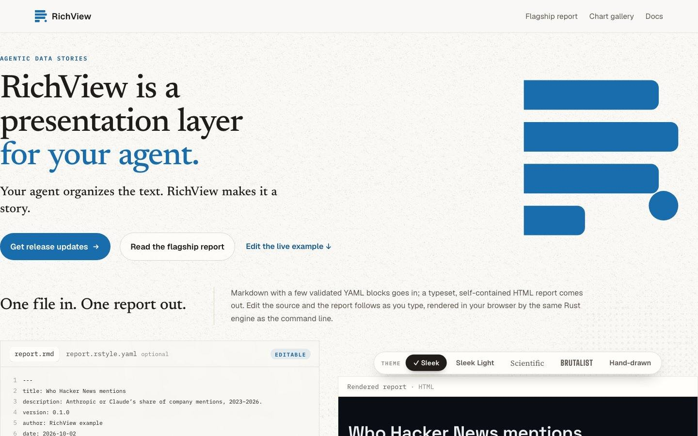

The brand layer on richview.ai (1440 × 900, live PR #69 build, 2026-10-21): eggshell paper with grain, the Newsreader headline with "for your agent." in the brand blue, the blue mark in the header and at large size on the right, and an "AGENTIC DATA STORIES" eyebrow that Daniel's INT-02 answer drops and STY-49 removes from every site section. `main`'s home page differs; see [Web](components/web.md#how-it-looks). Cards: STY-01, STY-02, STY-03.

The mark is four rounded bars and a dot. PR #58 (`bcea882`, 2026-10-13) applied the 2026-10-12 feedback to "align the blue dot vertically with the bottom-most bar": in a 268.58 × 269.73 box the dot moved from `cy=218.33`, centred on the bottom bar's top edge, to `cy=244.04`, centred on the bar. It changed only the inline marks of the home page (`assets/landing/index.html:45`); the favicon (`assets/landing/favicon.svg:1`), the live hero and the live share image still draw the old position. The knockout lockup Daniel liked in June centres the dot.

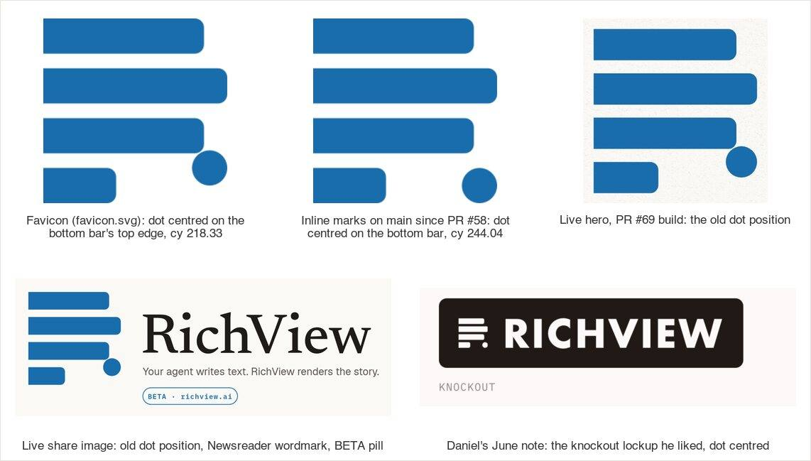

The mark in five places: `assets/landing/favicon.svg` and the same file with `main`'s inline `cy=244.04`, both rendered with `rsvg-convert`; the large mark cropped from the live hero capture above; the live share image (`open-work/richview-og-live.png`, byte-identical to the build's `og.png`); and the knockout lockup from Daniel's June note (Daniel's notes: Daniel's manual design system (2026-06-21), lines 42-48). Card: STY-03.

The June identity survives in three places: the base tokens under every cascade (`crates/richview-core/assets/report.css:1-27`: hue 40, indigo `oklch(0.55 0.18 277)`, Newsreader text, a 33rem measure), which show through when a report's `styles` names only files; the legal pages' `assets/styles/tokens.css` (hue 40, indigo `oklch(0.7 0.18 277)`, Newsreader as the sans at line 113); and the flagship page's stylesheet snapshot, whose v05 is the June house pick. At `b4db233` the repository's own `CLAUDE.md:76` names three canonical treatments, not five.

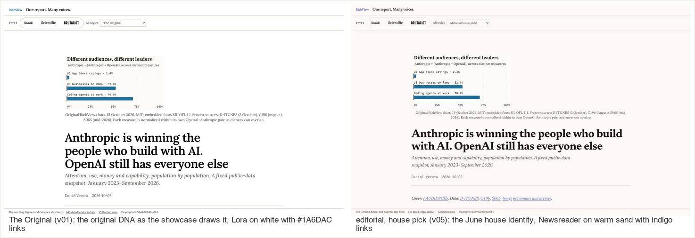

Two earlier identities as the flagship page draws them (`?theme=v01-original-serif` and `?theme=v05-editorial`, local `b4db233` build, 1440 × 900, 2026-10-21): left, "The Original", the studio's reconstruction of the v1 and v2 look, in Lora on white with `#1A6DAC` links; right, the June house pick, Newsreader on warm sand with indigo links. The cover chart is the same pre-rendered image in both. Daniel's STY-01 answer retires the June identity; STY-46 proposes the original paper for the site, which his STY-01 answer gives one simple style.

> **STY-01 (S-IDENTITY), Daniel's answer, 2026-10-26.** Chosen option: Brand layer over five styles, with these specifics.
>
> The brand layer is abstract: only a mark (the RichView wordmark) and a colour, brand blue, in a distinct shade per style. RichView's design is driven by the LCH colour space and a set of cleanliness principles.
>
> There are always five report styles, and each gets its own design review. Each style must feel very distinctive, beyond its fonts and colours: styles differ in structure too, for example outlines and shading or none, where the legend sits, and where chart titles sit. Scientific puts chart descriptions below the chart, sometimes with boxes around them, as scientific papers do.
>
> The website and RichView's own presentations use one simple style.
>
> The June warm-sand and indigo house identity is retired.

| Where | Daniel's June note | Today | Proposed (STY-02, D-BRAND-ACCENT) |
| --- | --- | --- | --- |
| Mark, site links and buttons, share images | not named | `#1A6DAC` | `#1A6DAC`, `oklch(0.5196 0.1248 247.06)` |
| Sleek (today's Sleek Dark), Air (today's Sleek Light) | "Sleek has more poppy blue - sth like #0433ff" | electric blue `#195BFF`, `oklch(0.5464 0.2508 263.51)`, the digest's tuning of that anchor; Sleek's links `oklch(0.70 0.16 264)` | unchanged; Air's design review gives it a shade distinct from Sleek's (STY-01, STY-02) |
| Scientific ("Paper" in the note) | "Paper can have the original blue #1A6DAC" | steel blue `#1B6F9E`, the digest's tuning | the brand blue |
| Brutalist | "fuller version of the original blue #144e95 or similiar - bit more blue, bit darker to give it more power" | deep blue `#124A8C`, `oklch(0.4128 0.1233 255.65)`, the digest's tuning | unchanged |
| Hand-drawn | not in the note | red pencil `oklch(0.52 0.174 31)` wherever the accent goes | red pencil for emphasis marks, or ink only (STY-55) |

STY-02 also rules out indigo and keeps clay `#C4613F` a data colour on the site, where it is Anthropic's series colour in the landing's data field and the reel. Its other options are the blues as shipped, or one blue everywhere, which reaches only 3.54:1 on the Sleek page (re-run) and which Daniel's STY-01 answer argues against, since each style carries the brand blue in a shade of its own and the wordmark inside a report takes that shade (STY-03, STY-04). Neither blue gets Scientific's palette past STY-22's rule (see [Palettes](#palettes)): with the brand blue first, its first and third colours differ by 15.0 for normal vision but 2.8 under tritan simulation (re-run), against 12.7 and 2.6 with today's steel blue.

> **STY-03 (S-MARK), proposed.** One mark file, its dot centred on the bottom bar (`cy=244.04` in a 268.58 × 269.73 box), drives the favicon, site header, hero, share images and social posts. On the site, share images, social posts and RichView's presentations it is the brand blue on light surfaces and white on dark or blue ones; inside a report the wordmark takes its style's own shade of the brand blue (STY-01, STY-02). The wordmark is "RichView" in Geist 600 beside the mark; the knockout lockup (white mark and RICHVIEW in Geist 600 capitals, tracked wider, on a near-black block) is the heavy variant for dark surfaces and social images. Nothing else recolours, outlines or animates the mark except the landing story (STY-44). The options are a serif wordmark, as on the share image, or a knockout lockup in Big Shoulders 800 as the June research suggested. Daniel's STY-01 answer makes the brand abstract, a mark and a colour only; whether the four-bar mark and the knockout lockup stay beside the wordmark is not settled by it. The live share image also carries a "BETA" pill, which stays until the rewrite reaches `prod` and its home share image replaces it (OPN-20, FEA-SF-30).
>
> **STY-04 (S-COLOPHON-SETTING), proposed.** A style file removes the colophon with `colophon: hide`; the default is `show` in every builtin. It is one line under the footer rule: "Made with" at `size-small` in `ink-soft`, in the style's text face, followed by the RichView wordmark in that style's shade of the brand blue (STY-01, STY-02), linking to richview.ai, with no badge and no other brand colour; Hand-drawn draws the rule in pencil. FEA-RP-06 keeps the colophon and lets a style switch it off.

## The five styles

`b4db233` builds five identities from five YAML files compiled into the core (`crates/richview-core/assets/*.rstyle.yaml`) and accepts six names: `sleek` and `sleek-dark` are the same dark style (`crates/richview-core/src/style.rs:16-36`). `editorial` renders Brutalist with a `style.alias` warning (`crates/richview-core/src/style.rs:204-211`); any other unknown name warns `style.unknown` and is skipped. Each surface opens in a different style:

| Surface | Opens in | Source |
| --- | --- | --- |
| A report without `styles` | `brutalist` | `crates/richview-core/src/render.rs:103-105` |
| `richview init` | `styles: [sleek]` | `crates/richview-app/src/cli.rs:594` |
| Landing demo | `styles: [sleek, report.rstyle.yaml]` | `assets/landing/anchor/report.rmd:7` |
| Flagship page | `scientific` | `crates/richview-site/src/browser/showcase.rs:154-157` |
| Playground | the default source's `styles: [scientific]`; the select starts at "Source / default" | `assets/playground.html:13`, `assets/playground.html:20` |
| Docs guides and tutorial | `scientific`, the tutorial plus its own style file | `docs/public/index.md:4`, `examples/first-report/report.rmd:6` |

| | Sleek (today's Sleek Dark) | Air (today's Sleek Light) | Scientific | Brutalist | Hand-drawn |
| --- | --- | --- | --- | --- | --- |
| Names today | `sleek`, `sleek-dark` | `sleek-light` | `scientific` | `brutalist`; `editorial` warns | `hand-drawn` |
| Added | 2026-07-07; Rust 2026-10-04 | 2026-10-05 | 2026-07-07; Rust 2026-10-04 | 2026-07-07; Rust 2026-10-04 | 2026-10-11 |
| Page | cool grey `oklch(0.16 0.015 260)` | white | warm paper `oklch(0.99 0.004 70)` | warm paper `oklch(0.985 0.004 70)` | off-white `oklch(0.982 0.007 85)` |
| Accent | `#195BFF` | `#195BFF` | `#1B6F9E` | `#124A8C` | red pencil |
| Display, text, UI, data faces | Space Grotesk; Geist; Geist; Geist Mono | as Sleek | RichView Serif; RichView Serif; RichView Sans; RichView Code | Big Shoulders; Newsreader; Space Mono; Space Mono | Patrick Hand; Newsreader; RichView Mono; RichView Mono |
| Line height, measure | 1.65, 35rem | as Sleek | 1.65, 66ch | 1.65, 32rem | 1.6, 34rem |
| Metric | `card`: one hairline above | as Sleek | `bracket`: hairlines above and below | `knockout`: a 4 px ink rule above, the value in the accent | `underline`: a red pencil stroke under the value |
| Callout | 1 px rule | 1 px rule | 1 px rule | 2 px ink rule | pencil bracket at the left |
| Rules and headings | hairlines | hairlines | hairlines; italic deck | ink rules, 4 px bars above and below the header; capitals for title, headings and table heads; italic deck | seeded pencil strokes; Patrick Hand capitals for title, headings, table heads and source labels |
| Corners | 12 px | 12 px | 2 px | square | square |
| Charts | Sleek palette, bar ends 3 px | Sleek Light palette, 3 px | Scientific palette, 3 px | Brutalist palette, 3 px | six greys, square bars, Patrick Hand lettering; hatched bars and marker shapes, with dashed lines only in static frames |

Values from the five style files and `crates/richview-core/src/style.rs:684-690`; dates from `git log`, first the TypeScript files of `5ceb7d4`, then the Rust port `2c926b0`. Weights, sizes and embedded bytes are under [Typography and fonts](#typography-and-fonts). RichView Serif, Sans, Code and Mono are Source Serif 4, Source Sans 3, Source Code Pro and IBM Plex Mono under RichView names.

Daniel's STY-01 answer asks more of the five than this table shows. Each style gets its own design review and must feel very distinct beyond its faces and colours, in structure too: outlines and shading or none, where the legend sits and where chart titles sit, and Scientific puts chart descriptions below the chart, sometimes boxed, as scientific papers do. As shipped, Air shares Sleek's faces, scale and marks (STY-10), so each style's review sheet (STY-68) is where its structure is settled and judged.

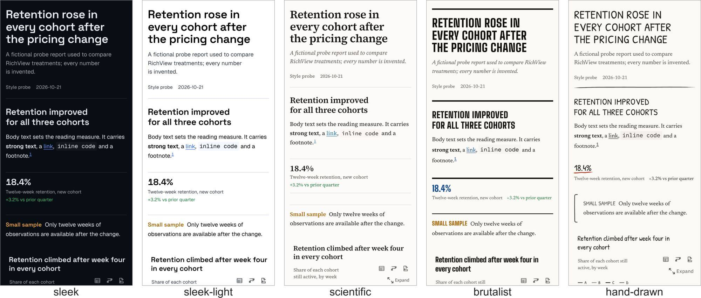

The probe report's first phone screen in each builtin, 390 × 844 at 2× in headless Chromium (re-run). Same words, five voices: Sleek's grotesk on cool grey and on white, Scientific's serif with an italic deck, Brutalist's condensed capitals between heavy bars with the metric in its accent, Hand-drawn's lettering, pencil rule, red underline and bracket. In every style the metric value is set as large as the section heading (STY-26). The lockdown fixture's first screen in all five is on [Report core](components/core.md#how-it-looks).

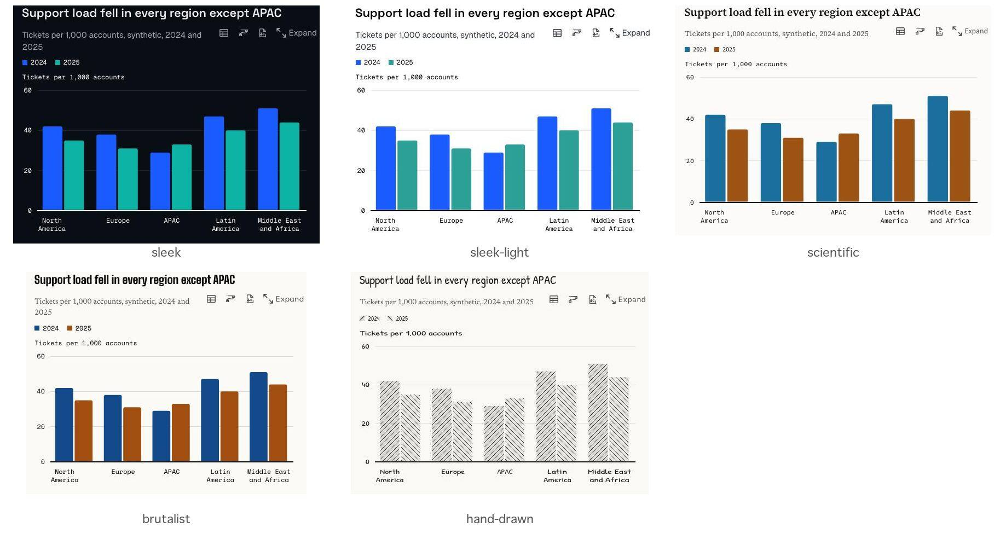

The fixture's bar chart in the five builtins (1440 px fixture renders at `b4db233`, 2026-10-21; sheet from [Chart engine](components/chart.md#how-it-looks)). The geometry is shared; the style supplies faces, ink, palette and surface, and only Hand-drawn hatches its bars. Every style shows three unlabelled action icons and a labelled Expand (FEA-CH-43, STY-42).

### Catalogue, default, names and selector

Two catalogues coexist: core's five builtins and the flagship page's 23 treatments (see [Showcase treatments](#showcase-treatments)); the `/charts/` page's Editorial, Brutalist, Scientific and Sleek buttons went with the page (ARC-40). Labels drift as well: the live landing labels its pills "Sleek" and "Sleek Light", the playground's select "Sleek" and "Sleek light", S27-616 "Sleek dark". The selector looks different on every surface. On `main` the landing demo's pill row is hidden: it shows only once the `js` class is set (`assets/landing/homepage.css:595-597`), which only the landing's scroll-motion controller does (`crates/richview-site/src/browser/landing.rs:2587`), and that controller stops early because `main`'s home page has no motion canvas or stage (`crates/richview-site/src/browser/landing.rs:2505-2507`). richview.ai shows the row; the flagship page offers three pills and an "All styles" select; the playground uses a plain select.

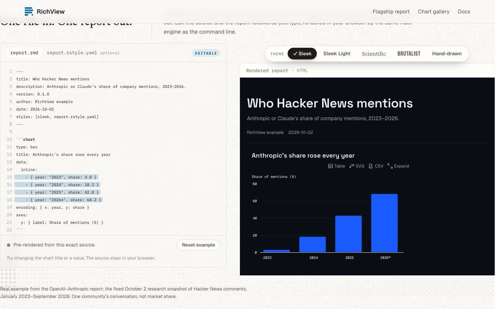

The landing demo on richview.ai (1440 × 900, live PR #69 build, 2026-10-21): five pills beside the source and the rendered report, the active Sleek pill filled and checked. Three labels are set in their style's face (Sleek in Space Grotesk, Scientific in its serif, BRUTALIST in Big Shoulders capitals); Air (today's Sleek Light) and Hand-drawn fall back to the UI face, because the stylesheet has face rules for the other three only (`assets/landing/homepage.css:569-571`). The row opens with a "THEME" label in small monospaced capitals, which STY-08 does not mention. STY-08 starts from this row, but sets every label in its own face and drops the bar's 10 px backdrop blur and drop shadow.

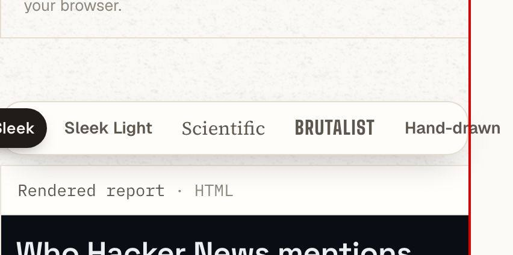

The same row on a phone (crop of a 390 × 844 capture at 2× of richview.ai, live PR #69 content, open-work stage, 2026-10-22): the pills run from off-screen left to past the screen edge, marked by the red line, so the page is 426 px wide and scrolls sideways (OPN-18). STY-08 does not say how five labels in display faces fit a phone: by wrapping, by scrolling inside the bar or with shorter labels.

> **STY-05 (D-STYLE-CATALOG), Daniel's answer, 2026-10-26.** Five main styles: Sleek (today's Sleek Dark), Air (today's Sleek Light, renamed: it must not be called "Sleek"), Scientific, Brutalist and Hand-drawn.
>
> The showcase's studio themes are kept as extended themes. They are a real feature that shows how many variants RichView can produce, but they are not promoted much and do not appear in the normal style menus; at most they sit in a hidden or secondary style dropdown. The showcase keeps its side-by-side view of different styles and layers, which demonstrates the range.
>
> **STY-06 (D-DEFAULT-STYLE), Daniel's answer, 2026-10-26.** Chosen option: Sleek (formerly Sleek Dark) is the default everywhere. A report without `styles` renders in it, `init` writes `styles: [sleek]`, and the playground, landing demo and flagship page open in it. Print and PDF use its light counterpart, Air (STY-05, STY-21).
>
> **STY-07 (S-STYLE-NAMES), proposed.** One name per style in source, labelled as in the list: `sleek` (Sleek), `air` (Air), `scientific` (Scientific), `brutalist` (Brutalist) and `hand-drawn` (Hand-drawn). These are Daniel's STY-05 names: Sleek is today's Sleek Dark and the default (STY-06); Air is today's Sleek Light, which no longer carries the Sleek name. `sleek-dark`, `sleek-light` and `editorial` stop being names; the migration (INT-51) rewrites them to `sleek`, `air` and `brutalist`, and TYP-52 makes a retired name a `style.renamed` error. Palette names follow style names. The extended themes STY-05 keeps are not builtin names; they appear only where STY-08 and ARC-41 place them. The option is keeping `sleek` and `air` with `sleek-dark` and `sleek-light` as aliases, which gives two names to one style again.
>
> **STY-08 (S-STYLE-SELECTOR), proposed.** Wherever a reader or author picks a style (flagship page, landing demo, playground) the five appear as one row of text pills in STY-07's order, each label set in its own style's display face and case, Air and Hand-drawn included. The active pill is filled with the page's ink and marked with a check; the row is a keyboard radio group shown on first paint, one opaque bar with a hairline and no blur, shadow or motion of its own; switching follows STY-43. With no pill chosen, the playground renders the styles its source declares (FEA-SF-34). The extended themes STY-05 keeps never join the row: only the flagship page offers them, in one secondary dropdown after the pills, closed by default (FEA-BR-17, ARC-41); no other surface has a `<select>`.

### Sleek (today's Sleek Dark, `sleek`)

The style file calls it "Dark, cool-hued (260°) Material-grey surfaces + a single poppy-ultramarine accent" (`crates/richview-core/assets/sleek.rstyle.yaml:1-3`). Daniel's June note asked for a dark page "based on LampLight" with large type and large gaps that "aims to Wow" (Daniel, 2026-06-21 design note); the research digest then chose dark grey rather than black with the electric blue, and S27-616 made it the default: "Calm, precise, polished dark presentation with disciplined contrast and depth". Its accent reaches only 3.68:1 on the page and its faint ink 2.99:1 on the raised surface, both below the 4.5:1 body text needs (re-run; every ink under [Contrast](#contrast)).

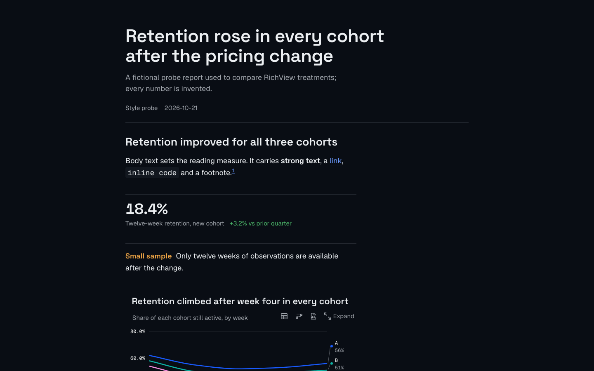

The probe report in `sleek` (1440 × 900, `richview generate --style sleek` at `b4db233`, styles stage, 2026-10-21): Space Grotesk title and headings, Geist text, the link in the lighter link blue, inline code on the raised surface, the metric under one hairline with its delta in `up` green, the callout's title in `hold` amber, and the line chart's actions as three icons and a labelled Expand.

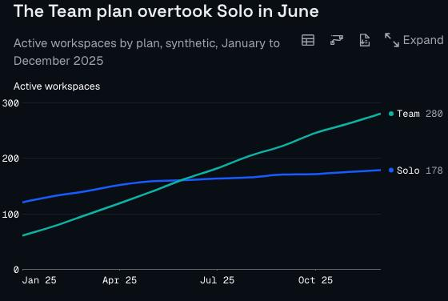

The fixture's line chart in `sleek` (crop of the 1440 px fixture render, `b4db233`, 2026-10-21): Solo in the electric blue and Team in teal, each named at its end with its last value, ticks in Geist Mono.

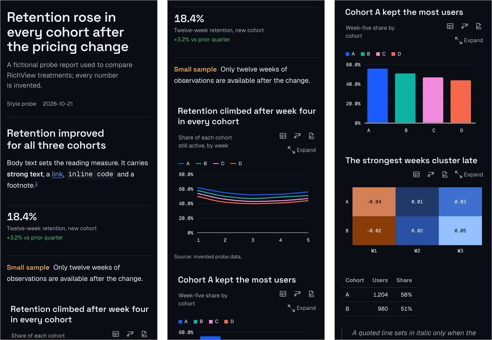

Sleek on a 390 px phone, three screens of the probe (re-run, headless Chromium, 390 × 844 at 2×). Left: the title at 34 px over the section heading and the metric value, both 26 px. Middle: the line chart names its series in a legend above the plot instead of at the line ends, and the action row wraps Expand onto a second line. Right: the bar chart, the heatmap with negative cells on an orange arm and positive cells on blue, the Markdown table at its content width, and a quote with a 2 px side rule. No style scrolls sideways at 390 px (re-run).

> **STY-09 (S-SLEEK-DARK), proposed.** Sleek keeps today's values with the purpose "Wow the reader: a calm, precise dark page for screens and presentations" and these changes from other cards: the name `sleek` and label Sleek (STY-05, STY-07); phone `h1` 30 px (STY-26); faint ink raised to 3:1 on the raised surface and never used for text (STY-25); a 4 rem default block gap, about 1.7 times today's 37 px (STY-15); the readout without blur (STY-41). It is the default style, printed as Air (STY-06, STY-21), and its own design review sets its structure: outlines or shading, legend position and chart-title position (STY-01). Its temperature is the card's one option. Accepting keeps it cool, as shipped and recommended: S27-616 asked to preserve the identities while improving them, and the research that chose Sleek's faces and blue chose blue-black surfaces with them. Lamplight warm needs an edit: hue 60 surfaces, warm ink and a 1.85 line height from the studio's v04, closer to "based on LampLight" and the June study's warm dark, with every Sleek token, the palette and the ramp re-derived and rechecked. The June brief also asked for "large gaps"; today blocks sit 1.25 body lines (37 px) apart, which STY-15's 4 rem default would widen.

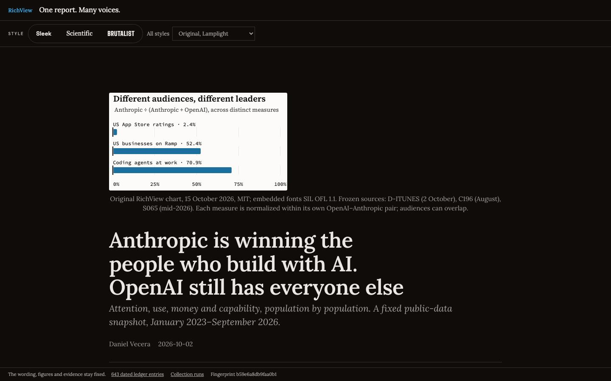

The reference for the Lamplight option: the studio treatment "Original, Lamplight" (v04), the only dark studio variant, on the flagship page (`?theme=v04-original-dark`, 1440 × 900, `b4db233`, 2026-10-21). A warm near-black page with a serif headline and italic deck; the cover chart keeps its light panel, the same pre-rendered image that glares on Sleek. INT-75 would replace it with a header graphic drawn from the report's own evidence in the active style.

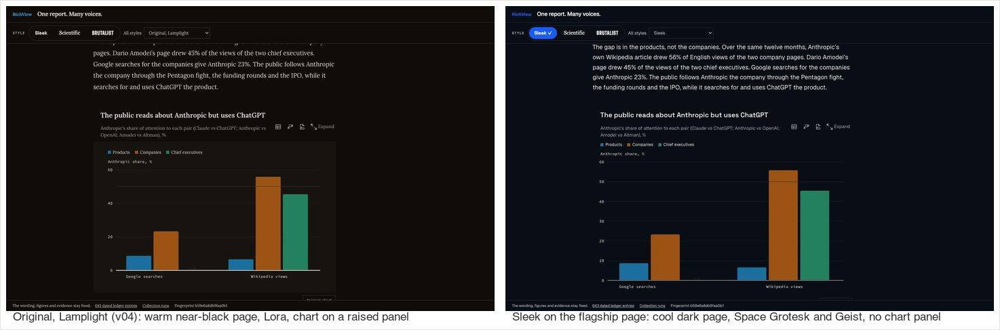

The flagship's first bar chart under v04 (left) and under the showcase's own Sleek (right), from the `?theme=` chart captures (1440 × 900, `b4db233`, 2026-10-21). Lamplight sets the chart on a raised warm panel, Sleek on the page. Both draw the same blue, brown and green bars, the builtin scientific palette the flagship page draws in every treatment (see [Showcase treatments](#showcase-treatments)), so no capture shows Lamplight's own palette, which `themes.json` starts with light blue, rose and warm grey.

### Air (today's Sleek Light, `sleek-light`)

Sleek's faces, sizes and marks on white, with "white surfaces, black chart ink and the vivid Sleek series palette" (`crates/richview-core/assets/sleek-light.rstyle.yaml:1-2`); its palette is a separate set of the same hues, deepened for white. Its inks are strong, but `neutral` reaches only 3.25:1 (3.03:1 on the raised surface) and `accent-2` 2.69:1 (re-run).

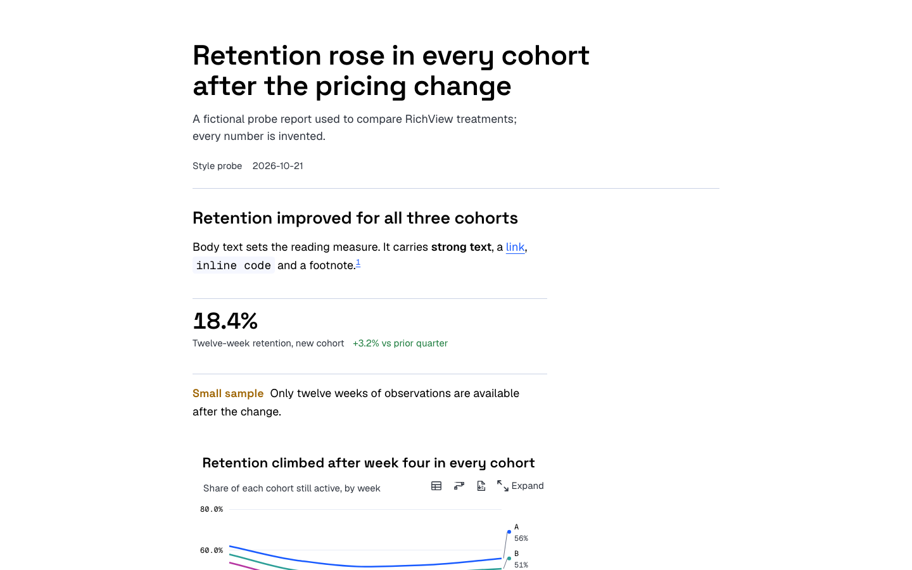

The probe report in `sleek-light` (1440 × 900, `b4db233`, styles stage, 2026-10-21): the Sleek layout on white, the link and the first series in the electric blue, the delta in a darker green and the callout title in a darker amber than Sleek's.

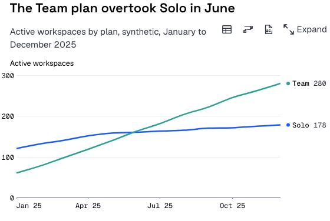

The fixture's line chart in `sleek-light` (crop of the 1440 px fixture render, `b4db233`, 2026-10-21): black chart text, Solo in the electric blue, Team in a deeper teal.

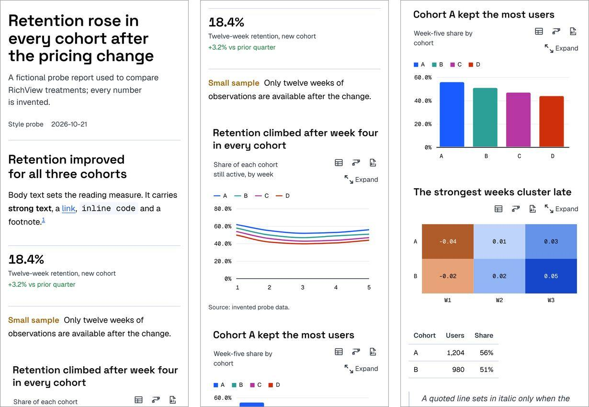

Sleek Light on the phone (re-run, as above): the same layout and sizes as Sleek, with the heatmap's negative cells on an orange arm that runs from near-white to deep orange.

> **STY-10 (S-SLEEK-LIGHT), proposed.** Air keeps today's values with the purpose "Daylight reading and paper; the light style Sleek prints as". Changes from other cards: phone `h1` 30 px (STY-26); `neutral` dropped or raised to 4.5:1 (STY-24); `accent-2` raised to 3:1 if it stays (STY-25, STY-54); a 4 rem default block gap (STY-15); the name `air` and label "Air" (STY-05, STY-07); a shade of the brand blue distinct from Sleek's (STY-02). Under Daniel's STY-01 and STY-05 answers Air must differ from Sleek beyond colours and must not be called Sleek; its own design review decides what sets it apart and what its structure is, while it stays the style Sleek prints as (STY-06).

### Scientific

"Light warm-paper (70°) academic working-paper ... Steel-blue accent, calm and credible" (`crates/richview-core/assets/scientific.rstyle.yaml:1-3`), after Daniel's "based on working paper" and "Communicate your findings confidently." (Daniel, 2026-06-21 design note); S27-616 gives it dense evidence, units, annotations and citations. It is the only style with a measure in characters (66ch) and with phone values for `h1` and the title only. Its faces are the Source families under RichView names.

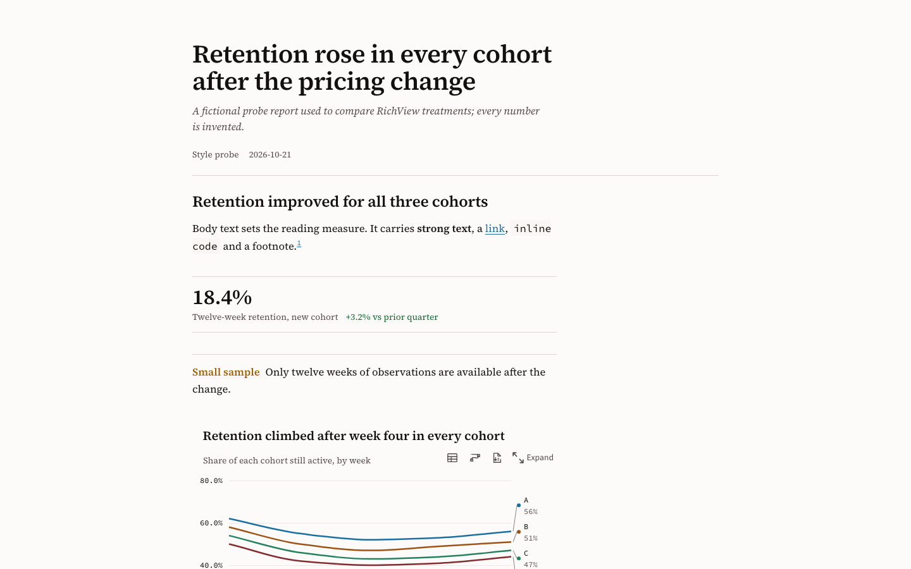

The probe report in `scientific` (1440 × 900, `b4db233`, styles stage, 2026-10-21): RichView Serif for title, headings and text, an italic deck, the metric between two hairlines, and, one line further down, the callout's own rule, so two rules stack between the metric and the callout. The lines run blue, brown, green and brick.

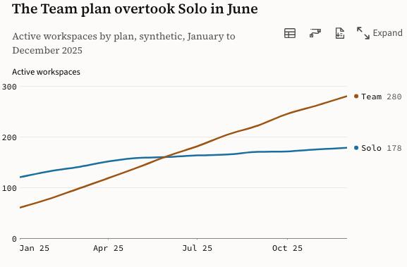

The fixture's line chart in `scientific` (crop of the 1440 px fixture render, `b4db233`, 2026-10-21): a serif title and subtitle, Solo in steel blue, Team in brown, ticks and end values in RichView Code.

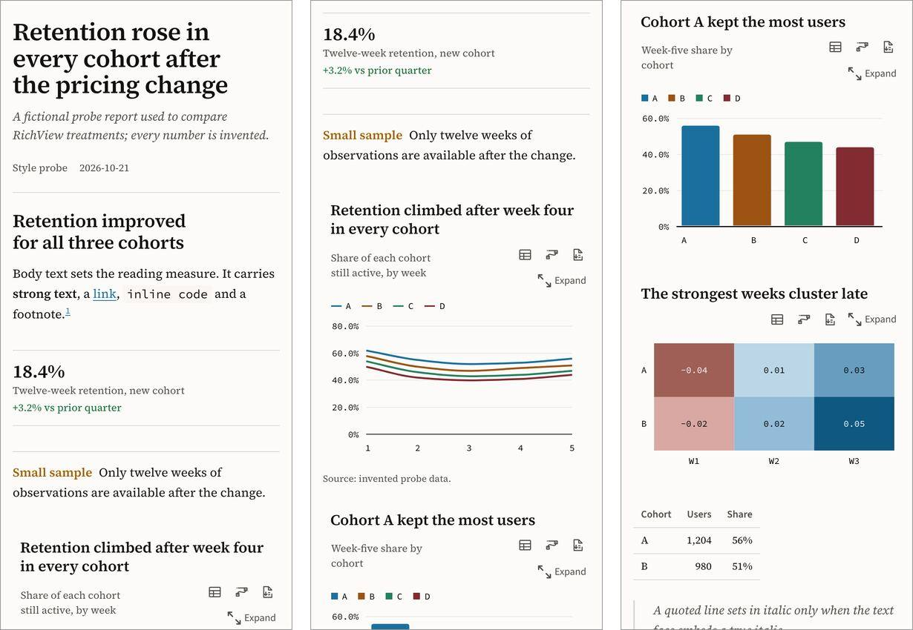

Scientific on the phone (re-run): title 33 px, body 16.5 px, the section heading and the metric value both 24.5 px; the stacked rules between metric and callout; the heatmap's negative cells on a brick arm beside the steel-blue positive cells.

> **STY-11 (S-SCIENTIFIC), proposed.** Scientific keeps today's values with the purpose "Communicate findings confidently: a working paper for dense evidence, units and citations". Changes from other cards: the brand blue as its accent (STY-02); its palette retuned, since its first and third colours differ by only 2.6 under tritan simulation (2.8 with the brand blue) and its second and fourth by 12.3 (STY-22); the negative heatmap arm retuned at its middle stop (STY-56); `neutral` dropped or retuned (STY-24); phone `h1` 28 px (STY-26); a 4 rem default block gap (STY-15); chart descriptions set below the chart, sometimes boxed, as in scientific papers (STY-01, STY-39). Its own design review also sets its outlines or shading, legend position and chart-title position, and places the chart actions that FEA-CH-43 and STY-42 put right of the subtitle (Daniel's STY-01 answer).

### Brutalist

"Light warm paper, maximally high-contrast: rule == ink (black rules), 4px header bars, uppercase condensed display ... the studio's BASE template" (`crates/richview-core/assets/brutalist.rstyle.yaml:1-4`). Daniel's June note made it the default, "Tell your story in style", and said of its filled stat block: "I love the call out even if we have to fix bit coloring - but it should be heavy, opinioted, full of soul" (Daniel, 2026-06-21 design note). Today its metric variant is named `knockout` but fills nothing: a 4 px ink rule above the value and the value in the accent (`crates/richview-core/src/style.rs:684-690`, whose comment says "No variant fills a panel"). Its deep blue is the strongest accent of the five.

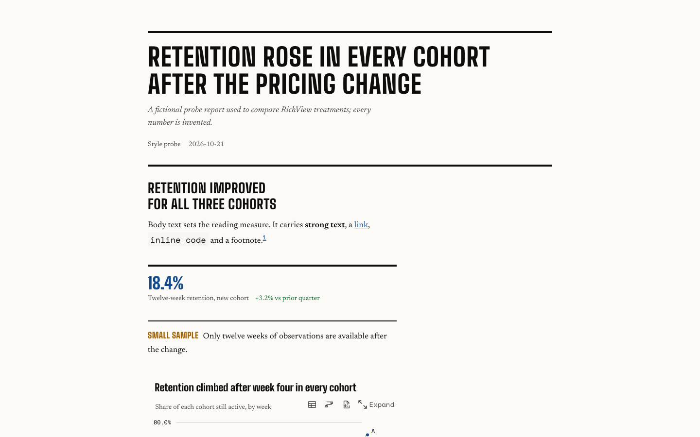

The probe report in `brutalist` (1440 × 900, `b4db233`, styles stage, 2026-10-21): Big Shoulders capitals between 4 px ink bars, an italic Newsreader deck, a section heading that wraps at the 32rem measure, the metric in the deep blue under a 4 px ink rule, and the callout under a 2 px ink rule with its title in condensed capitals.

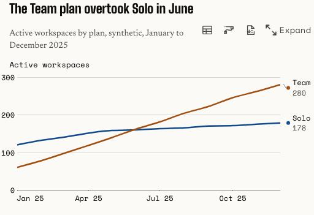

The fixture's line chart in `brutalist` (crop of the 1440 px fixture render, `b4db233`, 2026-10-21): a condensed bold title over a serif subtitle, Solo in the deep blue and Team in orange, ticks in Space Mono; each end label breaks onto two lines.

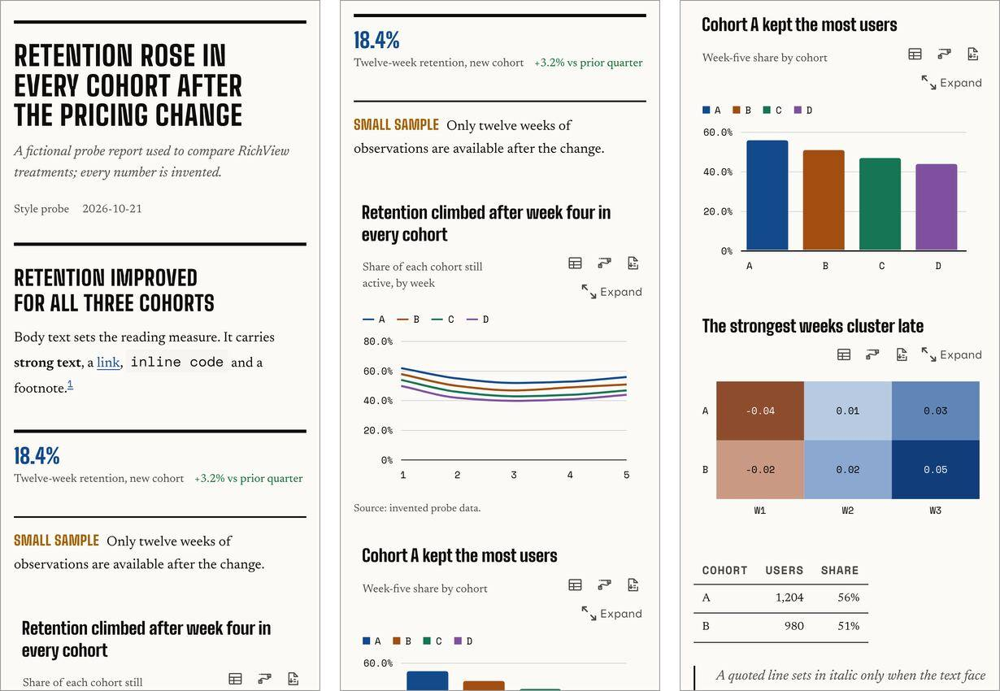

Brutalist on the phone (re-run): the heavy bars and rules, the condensed heading over two lines, the metric in the accent, capitals in the table head and a 2 px ink side rule on the quote. The page loads four weights, Big Shoulders 800, Newsreader 400 and 600, and Space Mono 400 and 700 (re-run); STY-27 allows three.

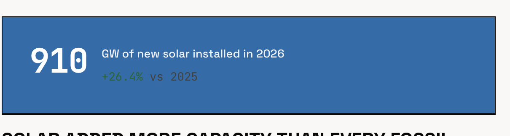

The image under that comment in Daniel's June note (Daniel's notes: Daniel's manual design system (2026-06-21), lines 12-13): the Brutalist stat block of June, a blue panel in a black border with the value in white and the delta in green and grey, about 1.3:1 and 1.8:1 on the blue (sampled from the image). Brutalist's knockout stayed a filled accent block until commit `4167940` removed fills on 2026-10-11, by then with its delta in white (the knockout rule in `style.rs` before that commit); STY-33 would bring the block back with value, label and delta in white.

> **STY-12 (S-BRUTALIST), proposed.** Brutalist keeps today's values with the purpose "Tell your story in style: heavy, opinionated, full of soul". Changes from other cards: Space Mono at 400 only, so three weights remain (STY-27); tabular figures in its metrics through RichView's variant of Big Shoulders (OPN-62); the knockout metric (STY-33, below); its palette retuned for its first and fourth colours, 6.6 apart under protan simulation (STY-22); `neutral` dropped or retuned (STY-24); square bar ends under STY-36's recommendation; phone `h1` 30 px (STY-26); a 4 rem default block gap (STY-15). Its own design review also sets its outlines or shading, legend position and chart-title position (STY-01).
>
> **STY-33 (S-BIG), proposed.** Four metric variants: `rule` (one hairline above; Sleek and Air; `card` today), `bracket` (Scientific), `knockout` (Brutalist) and `underline` (Hand-drawn). Brutalist's knockout becomes a true knockout: a square block filled with the accent and bordered in 2 px ink, with value, label and delta in white (8.81:1, re-run) and the delta's sign and words carrying the trend. Besides code panels it is the only filled block in any style; callouts stay type under a rule. Recommended because Daniel's only direct comment on metrics favours it and one square accent block is not the "indiscriminate rounded cards" S27-616 warns against. The options are no fills anywhere, as today, or filled blocks in Brutalist for metrics and callouts, closest to the June look. The block undoes commit `4167940`'s "no fills ... in any style" and contradicts `docs/public/styles.md:63`, which sets metrics and callouts "as text under rules, never as filled panels"; FEA-RP-23 leaves each style's frame to this card, and TYP-48 names the first variant `card`.

### Hand-drawn

"Ink on off-white paper ... one red-pencil accent kept for the single most important mark, the stat underline", with paper, ink and every grey on one warm hue (`crates/richview-core/assets/hand-drawn.rstyle.yaml:1-10`). S27-616 asked for black and white, pencil-like marks, crossed-out elements and expressive annotations, and for more than "a handwriting font to the same template". Links, `up` and `down` are ink, `hold` and `neutral` soft ink; it is the only style that turns chart decals on (`crates/richview-core/assets/hand-drawn.rstyle.yaml:89`). Its chart lettering is Patrick Hand (`chart.fontFamily`), and the rendered charts set ticks in Patrick Hand too (re-run), while `docs/public/styles.md:69` and the learn text (`crates/richview-core/src/knowledge.rs:15`) say chart text stays monospaced.

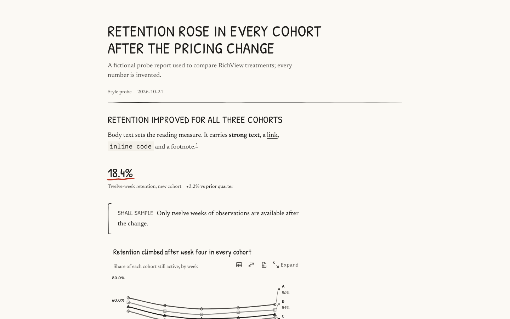

The probe report in `hand-drawn` (1440 × 900, `b4db233`, styles stage, 2026-10-21): Patrick Hand capitals for title and heading, a pencil rule under the header, the red pencil underline under 18.4%, the pencil bracket beside the callout with its title in Patrick Hand, and grey lines told apart by circle, square, triangle and diamond markers.

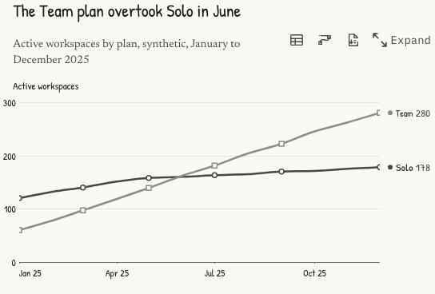

The fixture's line chart in `hand-drawn` (crop of the 1440 px fixture render, `b4db233`, 2026-10-21): two greys with markers, title, ticks and end labels lettered in Patrick Hand, whose digits are not tabular.

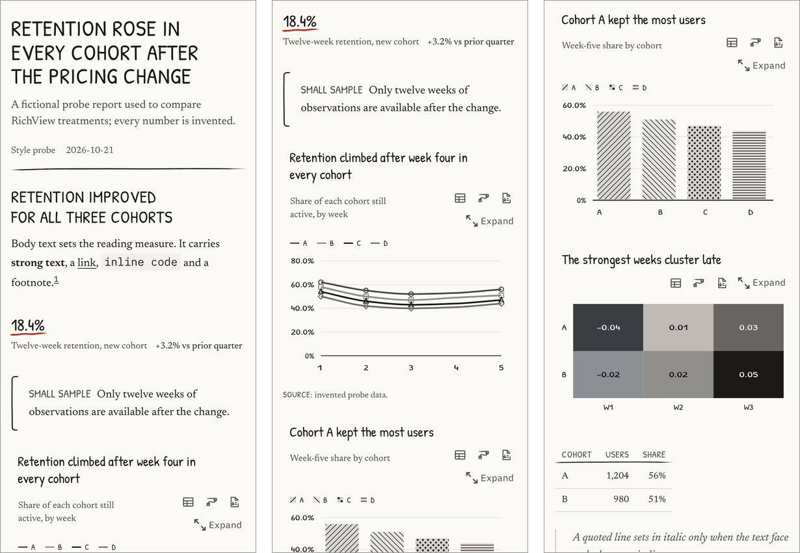

Hand-drawn on the phone (re-run): pencil rules, the red underline, the bracket callout, a "SOURCE:" label in lettering, hatched bars, and a heatmap whose negative cells (−0.04, −0.02) are greys like the positive ones, so only the printed sign tells them apart.

> **STY-13 (S-HAND-DRAWN), proposed.** Hand-drawn keeps today's values with the purpose "A story told in pencil: black and white, lettered by hand", and keeps its pencil bracket beside callouts as the one exception to FEA-RP-25's "No icon, fill or side bar". Changes from other cards: the accent's scope (STY-55); chart ticks and readout values in RichView's tabular-figure variant of Patrick Hand (STY-39, OPN-62); pencil strikes, circles and arrows (STY-35); its greys retuned for its first and fourth colours (ΔE×100 13.0) and its second and fourth (11.0) (STY-22); a sign cue for negative heatmap values (STY-56); phone `h1` 30 px (STY-26); a 4 rem default block gap (STY-15). Its own design review also sets its outlines or shading, legend position and chart-title position (STY-01).
>
> **STY-55 (S-HAND-DRAWN-ACCENT), proposed.** One red pencil, `oklch(0.52 0.174 31)`, for marks that ask the reader to look: the stat underline, point-annotation circles and the pencil strikes of STY-35. Everything else that takes the accent in other styles is ink in Hand-drawn: focus rings, the zoom brush, pressed toggles, the active tab and control option, and links. The options are ink only, strictly black and white as S27-616 described, or red wherever the accent goes, as today, where focus rings, the brush and every pressed control turn red.
>
> **STY-35 (S-PENCIL-MARKS), proposed.** Hand-drawn draws three existing marks in pencil with no new syntax: Markdown strikethrough as a pencil strike, point annotations as a pencil circle, annotation leaders as pencil arrows. Strokes are seeded, print exactly and never replace data marks; other styles keep straight strokes and get no pencil callouts or emphasis. S27-616 also asked for soft callouts, emphasis and "pencil-like annotation lines" that "also work outside the hand-drawn theme where appropriate"; Daniel's INT-77 answer lists callouts, emphasis and annotations among the tools RichView gives authors, and the card declines the pencil part outside Hand-drawn, because a hand-drawn gesture inside Sleek or Scientific breaks their voice (INT-19) and FEA-RP-25 keeps callouts to one rule. The options are dropping the marks, so the brief's crossed-out elements never appear, or pencil marks in every style.

## Showcase treatments

The flagship page restyles one render of the flagship report in the browser by injecting a treatment's tokens into its frame ([Web](components/web.md#how-it-works)). Its 23 treatments come from `assets/showcase/themes.json` (schema `richview-showcase-themes/1`) and the stylesheet `assets/showcase/themes.css`, whose first line reads "snapshot c617606"; the studio variants trace to the design-system repository at `8c6a8e0`. Air (today's Sleek Light) and Hand-drawn are not among them. Daniel's STY-05 answer keeps the 20 studio variants as extended themes; what that changes is at the end of this section.

| Family in `themes.json` | Treatments |
| --- | --- |
| Ships in RichView | Sleek; Scientific; Brutalist |
| Original-faithful | v01 The Original; v02 Original Palette, Sans; v03 Original, Tightened; v04 Original, Lamplight (the only dark one) |
| House candidate | v05 editorial (house pick), the June indigo house style; v06 Warm Sand House; v07 Brick Accent; v08 House, Analyst Density |
| Editorial | v09 Vermilion; v10 Apricot; v11 Broadsheet; v12 Linear Clean; v13 Working Paper |
| Data-first | v14 Data Hero; v15 Tufte Sidenotes; v16 Table First |
| Experimental | v17 Brutalist; v18 Soft Magazine; v19 Mono Dispatch; v20 Swiss Grid |

The snapshot's own Sleek, Scientific and Brutalist are not core's: STY-05 lists filled stat cards, callout side bars and monospaced stats at 2.5 rem, which core removed on 2026-10-11, and measures of 62 to 66ch in place of core's (`assets/showcase/themes.css:240-318`). Recomputed for STY-05 under today's neighbour rule on 2026-10-22, 16 of the 23 palettes fail; only Sleek, v01, v02, v03, v07, v08 and v20 pass. The page guards weak slots at runtime instead: it lifts colours to 3.03:1 and switches to dashes and hatches when slots sit too close under simulation (`crates/richview-site/src/browser/showcase.rs:1561-1670`).

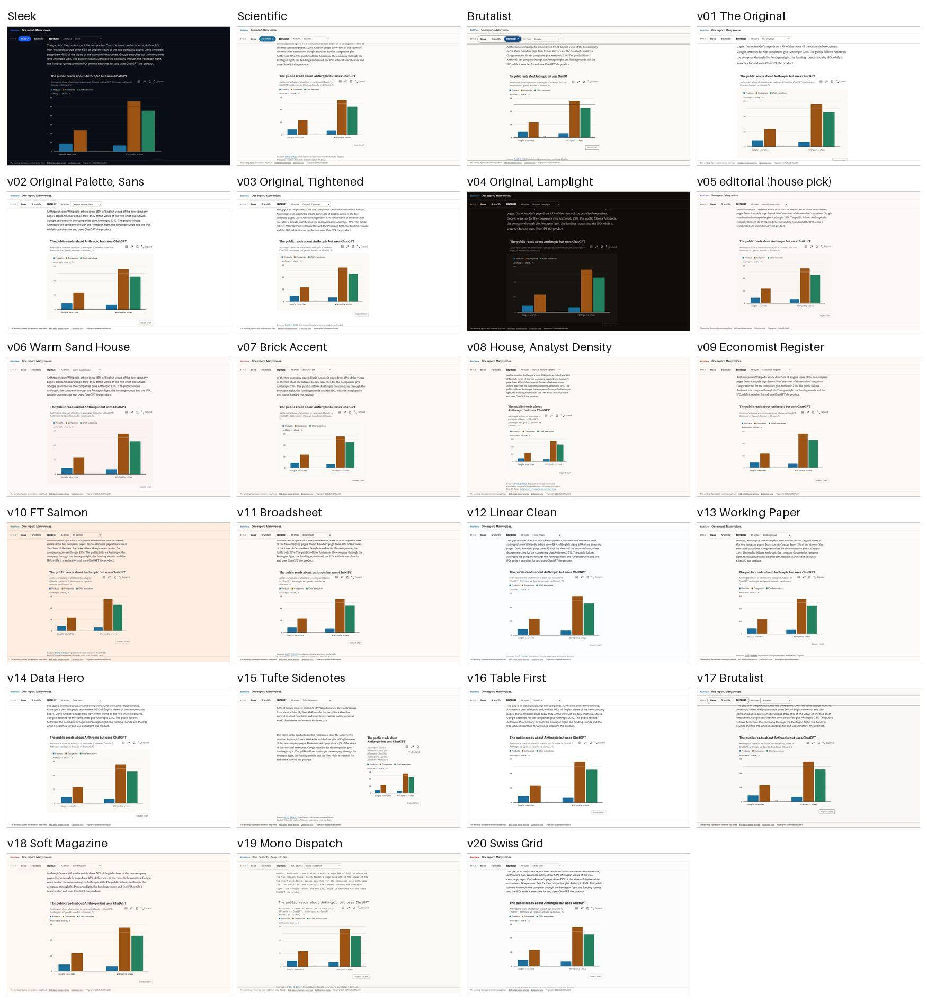

All 23 treatments at the flagship's first bar chart, from the `?theme=<id>` captures on the local `b4db233` build (1440 × 900, 2026-10-21; sheet from [Screenshots](screenshots.md#flagship-showcase)). Page tint, type and layout change, but every capture draws the same blue, brown and green bars, the first slots of the builtin scientific palette, so none of the 16 failing palettes shows. Why is not settled: the styles evidence saw a first load draw the builtin scientific palette and a pill switch then apply the treatment's own, and these deep-link captures match that without confirming it.

Daniel's STY-05 answer keeps the 20 studio variants as extended themes: a real feature that shows how many variants RichView can produce, but not promoted, absent from the normal style menus and at most in a hidden or secondary dropdown, with the showcase's side-by-side view of styles and layers kept. The stylesheet snapshot does not survive in its present form. TYP-93 proposes retiring the `richview-showcase-themes/1` format, so `.rstyle.yaml` stays the only style format: each extended theme is rewritten as a style file over one of the five builtins, which STY-14's rich style files can express, and the engine renders it. ARC-41 keeps the page, showing the five styles and, outside the normal menus, the extended themes; each theme passes the same checks as an author's style file (STY-52), so variants whose palettes fail the palette rule today are retuned first, and FEA-CH-62 replaces the runtime guard with a render-time palette check that warns and switches decals on. FEA-SF-36 builds the flagship once per style and per extended theme with the release engine and swaps renders on a switch, so nothing restyles in the browser; FEA-SF-37 restores the side-by-side compare as a visible control and deletes the tour, drawer, embed and share controls with their keys; FEA-BR-17 gives the page one secondary dropdown after the five pills for the extended themes. PR #67 built only the pills: at its pushed head three of the five can render, because `themes.json` lacks Sleek Light and Hand-drawn, and it never built the "Other styles" dropdown.

## Tokens, cascade and customization

A style file has five sections, `tokens`, `layout`, `chart`, `motion` and `components`; their grammar and the injection risk at each sink are on [Format and types](format-and-types.md#style-files) (TYP-44 to TYP-51) and in ARC-12. The cascade on `main`:

- The frontmatter's `styles` come first, then `--style`; with neither, `brutalist` (`crates/richview-core/src/render.rs:82-125`).
- Each entry is a builtin name or style source the host has already read. Entries merge key by key within each section, the later entry winning; a key's whole value is replaced, so a later `components.big` replaces the earlier one entirely (`crates/richview-core/src/style.rs:451-466`).
- A file whose validation reports anything other than `style.retired` is skipped whole; unknown names warn `style.unknown`, unparsable YAML `style.yaml` (`crates/richview-core/src/style.rs:221-252`).
- `tokens` and `layout` leaves become `--rv-<key>` custom properties; `components` become generated CSS; `chart` goes to the engine.
- Underneath sits `report.css` with the June tokens. When `styles` names only files, nothing else is underneath, so such a report shows the retired identity and, on a dark system, half-dark tokens (STY-17).

Authors can set everything the builtins set, and the shipped examples teach it. The landing demo's style file invites `chart.decals: true` and `type-size: bigger` (`assets/landing/anchor/report.rstyle.yaml:1-7`, commented out; every accent and palette tried on its four-series line chart failed the palette rule in at least one of the five styles); the docs tutorial's file sets `bg`, `accent`, a two-colour palette and `barRadius: 8` (`examples/first-report/report.rstyle.yaml`); the flagship's sets `line-base`, `measure: 66ch` and `report-max-width: 980px` for every style (`examples/openai-vs-anthropic/report.rstyle.yaml:1-6`). No settings layer exists. Daniel's June note asked for one: three densities (standard by default, then loose, then airmax), a block gap with a "4 rem default", a font size "named large, then offer small and bigger", no line-spacing option, full font replacement to match a brand, three blues, and "the style.yaml should only offer these 3 things" (Daniel, 2026-06-21 design note).

> **STY-17 (S-CASCADE), proposed.** Every cascade starts with a builtin: if `styles` names only files, the default builtin (STY-06) goes underneath them. The base stylesheet holds layout and print rules and no colours, faces or sizes. A value missing after the cascade is a defect, caught by a test over all five builtins, never a fallback; where an exported chart needs fallback values they are the default style's. The report-card rules go with the card (FEA-RP-31).
>
> **STY-14 (S-STYLE-SETTINGS), Daniel's answer, 2026-10-26.** Style files are rich. Everything that differs between the built-in styles can also be changed in a style file: mostly fonts, colours, spacing and chart details, and the structural look choices too, such as outlines, shading and where legends and titles sit (STY-01). The rule of thumb: anything that is about how a report feels can be changed; anything that fixes underlying mechanics, such as phone width or page width, cannot.
>
> Agents get clear guidance on which settings are safe to play with and which are experimental. For example, centering a title may break the layout in ways nobody expects, so it is marked experimental. Every value still passes the closed, validated vocabulary (INT-28). The exact list is not over-specified here; it follows this intuition.

| Setting | Choices, default first | What it changes (STY-15, S-SETTINGS-VALUES, proposed; the safe shortcuts of a rich style file) |
| --- | --- | --- |
| `density` | `comfortable`, `loose`, `airmax` | space inside blocks (paragraphs, lists, table cells, chart padding), ×1, ×1.25, ×1.5; the factors have no source |
| `block-gap` | `regular` 4 rem, `tight` 3 rem, `wide` 5 rem; on phones 2.5, 2 and 3 rem | space between blocks and before sections |
| `type-size` | `large`, `small`, `bigger` | the whole type scale ×1, ×0.9, ×1.1; steps keep their ratios |
| `accent` | the style's own blue, one of the other two (`#195BFF`, `#124A8C`, `#1A6DAC`), or any colour (STY-53) | accent, first series and links; links keep the style's link colour where the accent is below 4.5:1 |
| `fonts` | `display`, `text`, `ui`, `mono`: a bundled family or a brand font (STY-16) | that role only |
| `palette` | a builtin palette name, or a list of colours (STY-53; beyond the brief) | chart series |
| `motion` | `on`, `off` (beyond the brief) | `off` renders every chart and block settled (TYP-49) |
| `colophon` | `show`, `hide` (beyond the brief) | STY-04 |

Under Daniel's STY-14 answer these settings are shortcuts, not the whole surface: a style file may also set the tokens, component and chart keys behind them and everything else the builtins differ by, except mechanics such as the page width (OPN-59), and agents are told which settings are safe and which experimental. STY-15 gives line spacing no named setting; a style file may set `line-base`, marked experimental (OPN-59), and the flagship's file sets it today. The 4 rem default is about 1.7 to 1.9 times today's space between rich blocks, 1.25 body lines: 37 px in Sleek, 34 px in Scientific (`crates/richview-core/assets/report.css:158`). Daniel's June note asked for deep research on the default line spacing, but none is recorded; the June digest only says line height "should not be user-facing".

STY-69 proposes how "safe" is proven: every setting in the generated settings registry carries `safe` or `experimental`; in the release run on `pre-prod` for a batch that touches styles (DEL-81), the gate renders the every-block and chart-type fixtures with each safe setting at its declared values, pairwise across settings, in each builtin, and runs the layout, contrast, palette and value checks. The fast gate in `dev` runs only the unit tests of the settings registry. A failing safe setting is fixed or relabelled experimental, and `learn` lists the experimental ones apart.

> **STY-53 (S-AUTHOR-COLOURS), proposed.** Yes: under Daniel's STY-14 answer a style file may set the accent, page and ink colours and the chart palette to any colour the closed grammar accepts (TYP-46), a brand's own included. `check` measures them at render: contrast floors (STY-25) and the palette rule (STY-22) report as `style.*` and `chart.*` warnings (STY-52, FEA-CH-62), and decals switch on where colour fails (FEA-CH-57). The three blues and the builtin palettes stay as the named choices of STY-15. The option is named choices only, Daniel's 2026-06-21 brief, which his STY-14 answer supersedes; TYP-50 types a palette as a builtin name or one to eight colours.
>
> **STY-16 (S-BRAND-FONTS), proposed.** Yes, from files. An author puts WOFF2 files in the report folder (report-relative paths under TYP-39) and names them in the `fonts` setting (STY-15); RichView handles them like bundled faces: inline in exported files and PDFs, and on hosted pages served from the report host's content-hashed, immutably cached font routes and linked from the HTML, not inlined (INT-04, ARC-24). It lists them in the report's font notices and counts them in the report's size (PRF-32). A family with neither a bundled face nor a declared file renders in the next family of its stack and warns `style.font-missing`, the level TYP-46 sets, naming the family, so no fallback is silent. The author answers for the licence. The options are bundled faces only, or system font names not embedded, as today, which INT-57 forbids.

| Group | Tokens every builtin sets (STY-18, S-TOKENS, proposed) |
| --- | --- |
| Surfaces | `bg`, `bg-elev`, `bg-chart` |
| Inks | `ink`, `ink-soft`, `ink-faint`, `chart-ink` |
| Rules | `rule`, `rule-soft` |
| Accent | `accent`, `accent-soft` (band and brush fills), `accent-2` (if STY-54 keeps it), `link` |
| Status | `up`, `down`, `hold`; `neutral` only if STY-24 keeps it |
| Faces | `font-display`, `font-text`, `font-ui`, `font-mono` |
| Type | `size-small` to `size-display`, each with a `-phone` value; `line-base`; `measure` |
| Shape | `radius-s`, `radius-m`, `shadow-float` (new) |
| Layout | `report-max-width` |
| Scheme | `scheme` and its print counterpart (new, STY-57) |

STY-18 would add a test that fails on any builtin missing a token. An author's style file may set any of them (Daniel's STY-14 answer) except `measure` and `report-max-width`, which fix the page's mechanics (OPN-59). STY-67 (S-CHART-KEYS) would settle the chart section: `palette` and `ramp` stay per style, with an author's palette set by name or as colours; `font-family`, `font-text`, `font-numeric`, `bar-radius`, `decals`, `curve` and `curvature` stay per style, and a chart can still override its curve; `ink`, `ink-soft`, `grid`, `axis`, `accent`, `accent-soft`, `surface`, `tooltip`, `tooltip-border`, `line-width`, `grid-width`, `grid-dash`, `area-opacity` and `symbol-size` would go, because charts would read the style's tokens and STY-40's fixed values. Every key kept is a style key an author's file may set. Component keys stay as TYP-48 lists them, joined by the structural choices STY-01 lets styles differ by: outlines or shading, legend position and chart-title position, which part 05 types. TYP-50 types every chart key as author-facing, so accepting STY-67 removes the keys charts read from tokens and those STY-40 fixes, and the rest stay author-facing.

## Colour, palettes and accessibility

Every builtin colour is written in OKLCH, and `crates/richview-core/tests/palettes.rs:85-137` fails on any line with a hex colour, `rgb()`, `hsl()` or an sRGB or OKLab `color-mix()` in the core, chart engine, report runtime, showcase, docs, legal tokens and playground. It skips the landing and reel ("The independently developed landing/reel remain owned by their existing PR.", `crates/richview-core/tests/palettes.rs:116`): `assets/landing/landing.css` and `assets/landing/homepage.css` carry hex colours on 33 and 32 lines, and the test's pattern would flag 52 and 85 of their lines (re-run).

> **STY-19 (S-OKLCH), proposed.** Every colour RichView ships, site and share images included, is written as `oklch()`, and derived colours (tints, ramps, contrast, colour-vision checks, gamut mapping) come from one colour module; the test has no exemptions. Authors may write any colour form TYP-46 accepts, converted to OKLCH on load; docs and examples teach OKLCH.

### Contrast

WCAG 2 contrast of each token on its page, and on the raised surface where that falls below a proposed floor (re-run):

| Style | `ink` | `ink-soft` | `ink-faint` | `accent` | `link` | `up`, `down`, `hold` | `neutral` | `accent-2` |
| --- | --- | --- | --- | --- | --- | --- | --- | --- |
| Sleek | 16.78 | 7.83 | 3.24; 2.99 raised | 3.68 | 7.11 | 7.72, 6.24, 9.47 | 5.98 | 7.22 |
| Air (today's Sleek Light) | 21.00 | 12.16 | 4.95 | 5.27 | 5.27 | 5.19, 5.34, 4.98 | 3.25; 3.03 raised | 2.69 |
| Scientific | 18.27 | 8.23 | 3.54 | 5.35 | 5.35 | 6.83, 6.33, 4.84 | 4.69; 4.49 raised | 5.43 |
| Brutalist | 18.59 | 8.83 | 3.49 | 8.44 | 8.44 | 6.74, 6.24, 4.77 | 4.63; 4.43 raised | 9.13 |
| Hand-drawn | 16.44 | 8.75 | 5.01 | 5.70 | 16.44 (ink) | 16.44, 16.44, 8.75 | 8.75 | 8.75 |

Chart ink on the chart surface is 16.4:1 or more in every style (re-run). Faint ink still sets some text: the readout's secondary line (`.rvc-tip small` in `crates/richview-site/src/browser/charts.rs:5059`) and the "n/a" labels of missing values (`richview-chart/src/rmd_render.rs:3495`). `neutral` colours nothing in any output (STY-54).

| Colour | Floor on page, raised and chart surfaces | Used for (STY-25, S-TEXT-CONTRAST, proposed) |
| --- | --- | --- |
| `ink`, `chart-ink` | 7:1 | text, axis text |
| `ink-soft` | 4.5:1 | secondary text, decks, captions, source notes, the readout's labels, missing-value labels |
| `link`, status colours | 4.5:1 | links, the table's row summary, deltas, callout titles |
| `accent` | 3:1 | marks, rules, focus rings; text only where it reaches 4.5:1 |
| `accent-2` | 3:1 | a second series colour |
| `ink-faint` | 3:1 | ticks, leaders, gap marks; never text |
| `rule`, `rule-soft` | none | hairlines and gridlines only |

STY-25 would add a test of every floor in every builtin, including every text use of the accent, and raise Sleek's faint ink and Air's `accent-2` to 3:1.

> **STY-24 (S-SEMANTIC-COLOURS), proposed.** Three status colours, `up`, `down` and `hold`, each at least 4.5:1 as text on its page and raised surface, colour deltas and callout titles, and `down` also the "DEMONSTRATION DATA" label; never fills, icons or backgrounds. `neutral` leaves the vocabulary and neutral callouts keep ink titles; Hand-drawn sets `up` and `down` in ink and `hold` in soft ink. The option is keeping `neutral` and retuning it in Air, Scientific and Brutalist.
>
> **STY-54 (S-TOKEN-USES), proposed.** The accent keeps its marks and focus rings and gains the active tab and control option (FEA-BR-34, FEA-BR-35) within Hand-drawn's limits (STY-55); wikilinks go with FEA-RP-12, the table's row summary takes `link`, and the report card's mark and bars go with the card (FEA-RP-31). `accent-2` stays as a second series colour at 3:1 or is dropped. A test renders every listed use in every builtin against STY-25's floors.

### Palettes

Each builtin has eight categorical colours (six greys in Hand-drawn), defined in the chart engine (`richview-chart/src/rmd_render.rs:1181-1240`), and a three-stop ramp for heatmaps in its style file. The accent comes first, except in Hand-drawn, which reserves its red for the stat underline (`crates/richview-core/tests/palettes.rs:4`). A unit test holds every builtin to the rule the code calls D25: on the chart surface and page the first four colours reach 3:1, and neighbouring colours differ by ΔE×100 15 or more, and 8 or more under protan, deutan and tritan simulation. Every builtin passes. Pairs that are not neighbours are not tested, and three styles fail them (re-run):

| Style | Lowest contrast, first four | Neighbours, normal and simulated | Pairs among the first four below 15 or 8 |
| --- | --- | --- | --- |
| Sleek | 3.49 | 15.4, 9.1 | none |
| Air (today's Sleek Light) | 3.21 | 16.1, 8.6 | none |
| Scientific | 4.60 | 15.6, 8.5 | first and third: 12.7, and 2.6 under tritan; second and fourth: 12.3 |
| Brutalist | 5.30 | 16.9, 8.6 | first and fourth: 6.6 under protan |
| Hand-drawn | 3.19 | 23.0, 23.0 | first and fourth: 13.0; second and fourth: 11.0 |

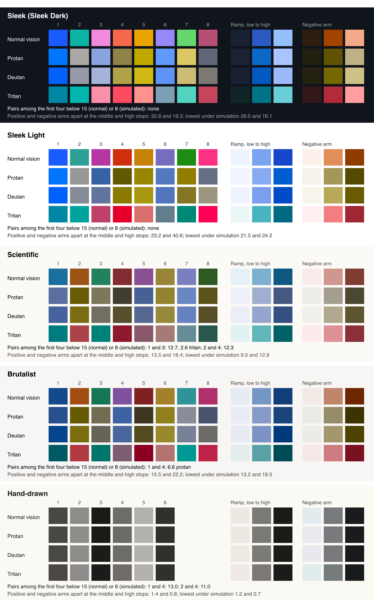

Each builtin's categorical palette, heatmap ramp and negative arm on its chart surface, for normal vision and for simulated protan, deutan and tritan vision (re-run: colours from `richview-chart/src/rmd_render.rs:1181-1240` and each style file's `chart.ramp`, the negative arm turned 150° in hue as the engine does, simulated at full severity). Scientific's first and third colours merge under tritan, Brutalist's first and fourth under protan, and Hand-drawn's two arms are nearly identical for every reader.

A Scientific chart with three series therefore draws its first and third lines in nearly the same colour for a tritan reader. On the charts these palettes reach, and on the decals that stand in when colour fails, see [Chart engine](components/chart.md#palettes-on-charts).

> **STY-22 (S-PALETTE-CHECKS), proposed.** The palette rule, under that name: the first four colours of a categorical palette reach 3:1 on the chart surface and the page; every pair among the first four, and each neighbouring pair after them, differs by ΔE×100 15 for normal vision and 8 under each simulation; every colour lies inside sRGB. A ramp has three stops whose lightness moves steadily away from the surface, its high end at 3:1; a diverging ramp's arms differ by the same 15 and 8 at their middle and high stops, or the style marks the sign another way (STY-56). Failing builtins are retuned, keeping their hue order, and "D25" and "D26" are retired as labels. The option is neighbours only, as today, where every builtin passes. FEA-CH-62 and FEA-CH-57 would apply this rule at render, so a chart showing Scientific's first and third series would switch decals on until the palette is retuned.

| Style | Series hues in order (STY-23, S-PALETTES, proposed) | Ramp | Negative arm | Colour change from today |
| --- | --- | --- | --- | --- |
| Sleek | electric blue, teal, pink, coral, amber, violet, green, rose, light enough for the dark surface | deep navy to pale blue | dark to pale orange | none |
| Air | the same hues, deepened for white | near-white to deep blue | near-white to deep orange | none |
| Scientific | brand blue, orange, green, brick, plum, olive, lavender, forest | pale to dark steel blue | pale to dark brick | the brand blue replaces steel blue first (STY-02); retuned under STY-22 |
| Brutalist | deep blue, orange, green, purple, red, ochre, teal, crimson | pale to ink blue | pale to burnt orange | retuned under STY-22 |
| Hand-drawn | story grey, context grey, ink, mid grey, light grey, dark grey; hatches and dashes on | paper to ink in equal steps | the same greys, with no visible difference, so STY-56 adds a mark | retuned under STY-22 |

STY-23 also defines each palette once, in its style; today the engine holds all five (`richview-chart/src/rmd_render.rs:1181-1240`) and Hand-drawn's greys are written in its style file as well. The card's "hatches and dashes on" holds only for static frames: mounted Hand-drawn charts draw every line solid and tell series apart by circle, square, triangle and diamond markers, as the captures above show (`richview-chart/src/svg.rs:38-39` dashes only `[data-chart-decals=true]` frames).

### Negative values

A heatmap with negative values draws them on a second arm, each ramp stop turned 150° in hue (`richview-chart/src/rmd_render.rs:3804-3830`, `NEGATIVE_TURN` at line 3858). For a blue ramp that gives orange or brick, but Hand-drawn's greys have almost no chroma, so turning them changes almost nothing: a faint cool and warm tint at low values, none at the dark end. Its arms differ by ΔE×100 1.4 at the middle stop and 0.8 at the high stop. Scientific's arms differ by 13.5 at the middle stop, below the proposed 15, and 18.4 at the high stop (re-run).

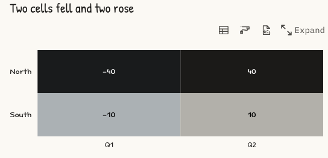

A four-cell heatmap with −40, +40, −10 and +10 in `hand-drawn` (styles stage probe, `--style hand-drawn` at `b4db233`, 1440 px, 2026-10-22): −40 and +40 are the same near-black, and −10 and +10 differ only by a faint cool and warm tint (ΔE×100 1.6, sampled from the capture), so the printed sign does the work. A cell too small to print its value would lose the sign, which is why STY-56 adds a mark.

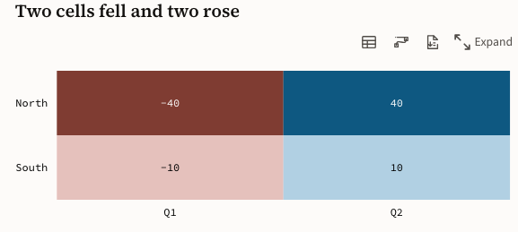

The same heatmap in `scientific` (same probe, `--style scientific`, 2026-10-22): negative cells on the brick arm, positive cells on the steel-blue ramp.

> **STY-56 (S-RAMPS-DIVERGING), proposed.** Sleek, Air and Brutalist keep their orange arms; Scientific's brick arm is retuned at its middle stop to differ from the steel blue by at least 15; Hand-drawn keeps its greys and adds a diagonal pencil hatch on negative cells. Every pair of arms passes STY-22 or carries a mark other than colour, the legend shows both arms with their signs, and the every-block fixture gains a heatmap with negative values (DEL-27). The options for Hand-drawn are a red pencil arm, which overlaps STY-55's emphasis red, or always printing signed values, which loses the sign in cells too small for a value.

## Typography and fonts

Each style embeds only the faces it declares, as WOFF2 subsets inside the report (re-run from the font manifest):

| Style | Faces embedded | Bytes | Tabular figures |
| --- | --- | --- | --- |
| Sleek, Air (today's Sleek and Sleek Light) | Space Grotesk 600; Geist 400, 400 italic, 600; Geist Mono 400 | 65,976 | all faces |
| Scientific | RichView Serif 400, 400 italic, 600; RichView Sans 400, 600; RichView Code 400 | 104,452 | all faces |
| Brutalist | Big Shoulders 800; Newsreader 400, 400 italic, 600; Space Mono 400, 700 | 111,656 | not Big Shoulders |
| Hand-drawn | Patrick Hand 400; Newsreader 400, 400 italic, 600; RichView Mono 400, 600 | 115,600 | not Patrick Hand |

Newsreader and RichView Mono come from a catalogue file still named for the retired alias, `crates/richview-core/assets/fonts-editorial.css`. Every style fits PRF-32's proposed 160 KiB of faces. The subsets cover Basic Latin, Latin-1 and Latin Extended-A with typographic punctuation, arrows and a few math signs; no Greek. Italic is requested only from a family that embeds a true italic, and weight synthesis is switched off for a display face without bold (`crates/richview-core/src/style.rs:264-285`). Faces load with `font-display: block`, so text is drawn once in its own face (commit `4167940`).

| Style | Desktop: small, base, h3, h2, h1, display (px) | Phone today, 640 px and narrower (re-run) | Phone proposed (STY-26) |
| --- | --- | --- | --- |
| Sleek, Air, Hand-drawn | 15 (14 in Hand-drawn), 18, 22, 27, 36, 44 | 14, 17, 21, 26, 26, 34 | 14, 17, 21, 26, 30, 34 |
| Scientific | 13.75, 16.5, 20, 24.5, 33, 40 | 13.75, 16.5, 20, 24.5, 24.5, 33 | 13.75, 16.5, 20, 24.5, 28, 33 |
| Brutalist | 14, 17, 21, 28, 34, 52 | 14, 17, 21, 26, 26, 34 | 14, 17, 21, 26, 30, 34 |

On desktop each step is at least 1.2 times the one below. On phones `h1` equals `h2` in every style, and since the metric value is set at `h1`, the metric is no larger than a section heading (measured: 26 px, 24.5 px in Scientific). OPN-22 lists this as a rewrite fixture.

> **STY-26 (S-TYPE-SCALE), proposed.** Six sizes per style: small, base, h3, h2, h1 (also metric values) and display (the title, always the largest). Each desktop step is at least 1.2 times the one below, each phone step at least 1.125 times. Only `size-h1-phone` changes, to 30 px, 28 px in Scientific. The type-size setting scales a whole scale, never one step; a style file that sets single sizes (Daniel's STY-14 answer) is held to these ratios by `check` (STY-52).
>
> **STY-27 (S-FONT-CATALOG), proposed.** The faces stay as in the table above, with at most three weights per style: Brutalist drops Space Mono 700 and sets its UI text at 400. Italic and bold come only from real faces, never synthesized. Metric values and columns of numbers use tabular figures wherever the face can (Daniel's OPN-62 answer): RichView makes tabular-figure variants of Big Shoulders and Patrick Hand, so Brutalist and Hand-drawn metrics align and keep their lettering. Both faces are under the OFL and declare no Reserved Font Name, so the variants may keep their family names and ship under the OFL with its notice. Proportional figures appear only where alignment isn't needed and the face has no tabular set. Every embedded face carries its OFL notice. This settles the conflict with FEA-RP-23 without an exception.
>
> **STY-39 (S-CHART-TEXT), proposed.** Chart text (ticks, axis titles, data and end labels, readout values) is 12 px in the style's data face with tabular lining figures in `chart-ink`; secondary chart text is `ink-soft`. Figure titles use the display face at `size-h3`, subtitles the text face at `size-small` in `ink-soft`, legends (12 px) and actions (`size-small`) the UI face. Hand-drawn letters all chart text in Patrick Hand and sets ticks and readout values in RichView's tabular-figure variant of it, so they line up (OPN-62). Where the chart title, its description and the legend sit is each style's choice, settled in its design review (Daniel's STY-01 answer): above the plot, with the legend as FEA-CH-33 sets it, unless a style places them elsewhere; Scientific sets the description below the chart, sometimes in a box, as scientific papers do (STY-11). The options are RichView Mono for Hand-drawn's numbers, the earlier proposal made while Patrick Hand had no tabular figures, or Patrick Hand for all chart text as today, where digits do not line up. Docs and learn text then say the same.
>
> **STY-28 (S-FONT-NAMING), proposed.** Site pages load the report font builds under the report names, and one licence page linked from the footer lists their notices. No subset carries an OFL Reserved Font Name, which a modified build such as a subset may not use: today the landing loads its own font folder and the docs declare "Docs Geist" and "Docs Mono" from it (`assets/docs/docs.css:1-3`); both go. OPN-22 also records a landing subset said to lack a space glyph (stated 2026-10-05, not re-checked).
>
> **STY-29 (S-FONT-LOADING), proposed.** Reports embed only the faces their style uses, subset to Latin plus typographic punctuation, with `font-display: block`; brand fonts take the same path. Site pages preload their faces and use `font-display: swap` with size-adjusted fallbacks, so the swap does not move text. A face that fails to load fails the visual capture (DEL-27); INT-57 makes a silent fallback a defect.
>
> **STY-63 (S-GLYPH-COVERAGE), proposed.** Each style's faces add Greek (U+0370 to U+03FF) where the family has it, and any character outside a style's embedded faces warns `style.glyph-missing` with the character and line; the PDF gate fails as FEA-RP-43 says. The options are subsetting per report at render time, or warning only, so Greek in a Scientific report always warns. TYP-55 has no glyph code yet.

## Layout

The report column is 880 px in every builtin (`report-max-width`), centred, with 24 px gutters inside it, so blocks sit in an 832 px column; on phones the gutters are 16 px, giving the 358 px figures measured at 390 px (re-run). A report whose cascade sets no width falls back to 980 px (`crates/richview-core/assets/report.css:73`). Pages start 4 rem below the top, 1.5 rem on phones (`crates/richview-core/assets/report.css:74`, `crates/richview-core/assets/report.css:235-238`). Rhythm counts in body lines: the report's grid gap is one line, rich blocks add 1.25 lines around them (37 px in Sleek, 34 px in Scientific), and a block after a heading adds no space of its own.

Every body block is capped at the style's measure on one left edge, except tables, which take the full column, and charts, images and embeds marked `--full`, which break out to it (`crates/richview-core/assets/report.css:102-112`). The measures are 35rem (560 px) in Sleek and today's Sleek Light, 66ch in Scientific, 32rem (512 px) in Brutalist and 34rem (544 px) in Hand-drawn, so default figures are 512 to 576 px wide while the static chart frames are drawn at 358 and 832 px (FEA-CH-64, on [Chart engine](components/chart.md#frames-sizing-embedding-and-print)). The flagship's style file forces 66ch and 980 px on every style. The 2026-10-13 feedback asked for figures at the prose measure, and S27-654 (2026-10-18) for "one consistent text/content measure throughout, including tables and headings"; open PR #67 instead adds a `layout.measure-wide-blocks` switch that widens figures and metrics again for the flagship. A margin column exists in code, floating footnotes beside the text at 1,100 px and wider (`crates/richview-core/src/render.rs:954`), but no builtin or example turns it on.

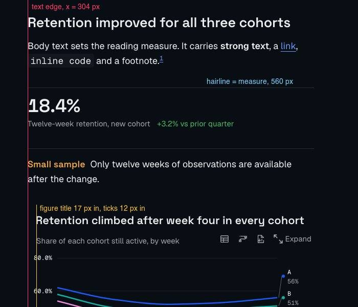

The probe report in `sleek` at 1440 px, cropped from the styles stage capture with guides drawn at measured pixel positions: prose, the metric and the callout start at the text edge (x = 304 px), and the hairlines span the 560 px measure. The figure's title and subtitle start 17 px further in, because the figure header is indented by 3% of the figure's width (`richview-chart/src/svg.rs:50`), about 11 px on a 390 px phone; its tick labels start 12 px in. STY-30 asks for "one left edge" without saying whether that edge includes the figure's own inset.

> **STY-30 (D-MEASURE), proposed.** Every block (prose, headings, lists, tables, charts, metrics, callouts, images, video and embeds) sits at the style's measure on one left edge: 35rem in Sleek and Air, 66ch in Scientific, 32rem in Brutalist, 34rem in Hand-drawn. A table wider than the measure scrolls inside it. A chart, table, image, video or embed may take the report width with `wide: true` (TYP-89); metrics and callouts never widen. There is no `measure-wide-blocks` key (FEA-BR-18) and the flagship carries no measure or width override. Recommended as Daniel's October calls; the option is PR #67's layout, text at the measure and figures and metrics at the column width. INT-60 states the rule; `docs/RMD-SPEC.md:351` says tables use the full column by default.
>
> **STY-31 (S-REPORT-WIDTH), proposed.** The column is 880 px in every style, centred, with 24 px gutters (16 px on phones); the measure sits at its left edge, header and footer rules span the column, and the space right of the measure stays empty. Spacing inside blocks counts in body lines; between blocks it follows the block-gap setting. Pages start 4 rem below the top on desktop and 1.5 rem on phones.
>
> **STY-32 (S-MARGIN-COLUMN), proposed.** No margin column: footnotes are endnotes (FEA-RP-10), nothing floats right of the measure, and `layout.margin-column` leaves the vocabulary. The option is keeping it for sidenotes, which needs its own syntax, print rules and a phone fallback.

## Surfaces, marks and chart chrome

Since commit `4167940` the page is typeset: structure comes from type, rules and space, and metrics and callouts are text under rules. Three marks still differ from that: block quotes carry a 2 px side rule (`crates/richview-core/src/render.rs:952`), code is a filled panel on the raised surface, and the chart readout is a translucent panel with a 6 px backdrop blur (`crates/richview-site/src/browser/charts.rs:5059`). No report element casts a shadow: `docs/MOTION.md:91` records that no treatment draws the readout or dot shadow yet.

| Card | Today on `main` | Proposed |
| --- | --- | --- |
| STY-34 (S-RULES) | Hairlines under the header, over the footer, above metrics and callouts and in tables; Brutalist in ink with 4 px header bars; Hand-drawn in pencil | Rules mark structure only, at the places listed; no other dividers, side rules, boxes, stripes, gradients or ornaments; the named exceptions are code panels and the quote treatment (STY-61), Brutalist's knockout (STY-33), Hand-drawn's bracket (STY-13), Scientific's boxed chart descriptions (STY-39) and the outlines or shading a style's design review chooses (STY-01); pencil never touches gridlines, axes or data |
| STY-61 (S-TEXT-EXTRAS) | Quotes in soft ink with a 2 px side rule; code panels on `bg-elev`; each footnote under its own top rule | Quotes indented in soft ink with no side rule (recommended) or the side rule as today; code panels kept; a Notes section under one rule; a table's total row at 600 under a rule; the row disclosure in `link` |
| STY-36 (S-CORNERS) | 12 px in Sleek and today's Sleek Light, capped at 6 px on code and 4 px on the readout; 2 px in Scientific; square in Brutalist and Hand-drawn; bar ends 3 px except Hand-drawn | Corners only on images, embeds, code, the readout and bar ends: Sleek and Air 12 px on images, up to 6 px on code, up to 4 px on the readout, 3 px on bars; Scientific 2 px, 3 px on bars; Hand-drawn square; Brutalist square, its bars square (recommended, because every other Brutalist corner is square and bar rounding is opt-in per style, square where a style sets none, as S27-634 asked: `richview-chart/src/rmd_render.rs:665`) or 3 px as shipped, the soft bars Daniel's 2026-10-12 feedback asked for |
| STY-37 (S-SHADOWS) | None in reports; the landing's shadow tokens are defined but unused on `main` | One `shadow-float` per style, only on floating elements: Air and Scientific `0 2px 8px oklch(0 0 0 / 0.12)`, `0 1px 3px oklch(0 0 0 / 0.14)` on the hover dot; none in Sleek, Brutalist and Hand-drawn, which use the raised surface and a hairline; report blocks, buttons, code panels and site sections cast no shadow unless a style's design review gives that style shaded blocks (STY-01) |
| STY-38 (S-HOVER-FOCUS) | Focus rings 2 px in the accent with a 3 px offset on chart actions | Hover and focus change colour, underline, opacity or a ring, never position; chart marks follow FEA-CH-52; rings 2 px with a 2 to 3 px offset on keyboard focus, in ink in Hand-drawn; no curve overshoots |
| STY-62 (S-HEADER-IMAGE) | The flagship's pre-rendered light cover image sits unchanged on dark pages | Images as supplied, at the measure or `wide`, with the style's corners and, for an Unsplash photo, the credit its `credit` field renders (FEA-RP-62); no style filters, tints, frames or shadows an image; on Sleek the author picks dark-ready art or a data header that follows the style (INT-75); header imagery is one of the tools RichView gives authors (INT-77) and the cover of a story's link-preview thumbnail when it has no chart (FEA-SF-55); the option is a per-style treatment that alters credited work |
| STY-40 (S-CHART-CHROME) | Gridlines 1 px `rule-soft`; zero line and bar baseline 1.5 px `chart-ink`; ticks 1 px `ink-faint`; lines 2.5 px; areas 13 to 18%, bands 28%, dimmed series 30% (`richview-chart/src/svg.rs:10-73`) | The same values, areas at 15%; swatches 9 px squares, 14 × 2 px lines or 9 px dots; hidden series at 45% with a strike; no border, panel or plot background beyond the style's chart surface, unless a style's design review gives its charts outlines or shading (STY-01) |
| STY-41 (S-TOOLTIP) | The raised surface at 82% with a 6 px blur, a hairline at 78%, corners up to 4 px, 10 px padding, 12 px text, at most 300 px | The style's own raised surface, opaque, with no blur (recommended); the options are PR #67's 70% with blur, where soft text drops below 4.5:1 over some series, or today's |
| STY-42 (S-ACTION-LOOK) | Table, SVG and CSV as icons only, Expand labelled | Quiet icon buttons in soft ink, 18 px line icons with no visible label (Daniel, 9 Nov 2026); each label is the button's accessible name and shows as a 12 px name under the icon on hover and keyboard focus; a pressed toggle gets a bar under its icon, never a fill; hit areas at least 32 × 32 px; the group sits at the right end of the title row and goes under the title on narrow figures |

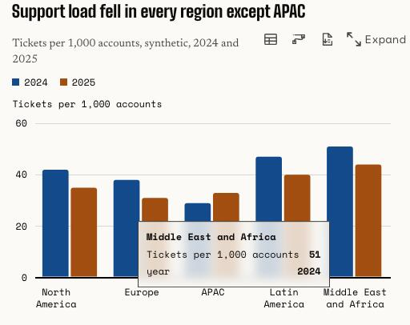

The readout over a grouped bar chart in `brutalist` (fixture, 1440 × 900, `b4db233`, 2026-10-21): the panel's backdrop blur smears the bars behind it, the glass effect the learn text forbids (`crates/richview-core/src/knowledge.rs:17`) and STY-41 removes.

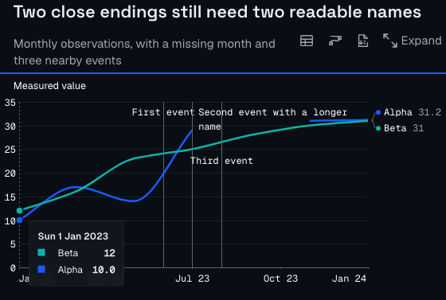

The same panel on Sleek's dark surface, on the first month of a line chart from the chart-review page's Sleek render (1440 px, delivery stage, 2026-10-21; its commit was not recorded).

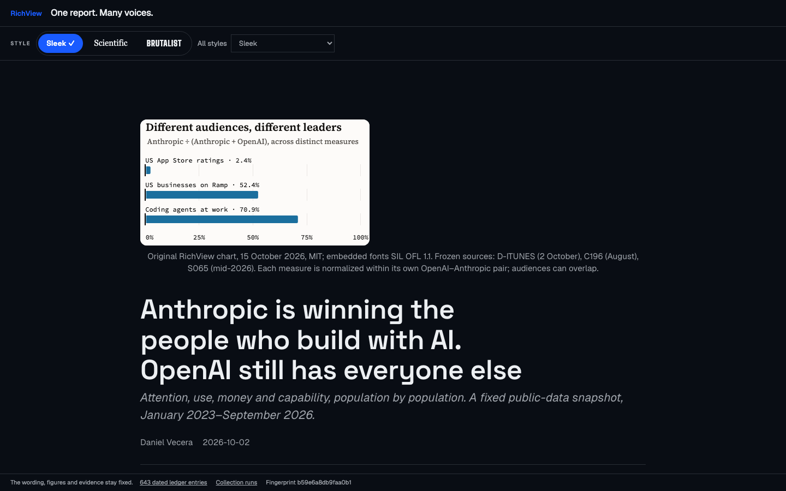

The flagship page in Sleek (`?theme=sleek`, 1440 × 900, captured on richview.ai on 2026-10-21; `b4db233` renders the same view): the frame turns dark with the report, the deck is italic as in the showcase's own Sleek, and the cover image keeps its light chart surface. STY-62 leaves images as supplied, INT-75 replaces this one with a header drawn from the report's data, and STY-60 keeps the frame following the active style.

### Link-preview thumbnails

Daniel's INT-07 answer gives every story with an address a rich link preview wherever its link is shared, in WhatsApp, Slack, iMessage, email or a social post: a designed thumbnail of the story, in its own style, with its title, like the card a shared song gets. Today only the home page and the flagship page declare a share image, and published reports carry no `og:image`. FEA-SF-55 decides where the 1200 × 630 thumbnail is rendered and what it holds, FEA-RP-51 adds `og:image` to a story at an address, and ARC-69 proposes that the server core renders each version's thumbnail natively from the engine's geometry model, with no browser or GPU, stores it with the immutable version and serves it under the story's own access rule. A story shared only with signed-in readers shows its title and image only to them, so a link preview never reveals a private story (INT-07, OPN-54). STY-70 decides how the thumbnail looks.

> **STY-70 (S-STORY-THUMBNAIL), proposed.** The thumbnail is drawn from the story's active style: the style's page surface and inks, its display face for the title and its UI face for the byline, and the lead chart drawn by the engine in that style (STY-23) or the cover image as supplied (STY-62). Sleek's is dark and Air's light; the print rule of STY-21 does not apply. Each style keeps its structural voice (STY-01): Brutalist's ink bars, Scientific's hairlines, Hand-drawn's pencil rule. Title and byline stay inside a safe area, so apps that crop previews to other shapes do not cut them, and the title is large enough to read at the width a chat app shows it. A story with neither a chart nor a cover image shows its title and byline alone on the style's surface. No tagline, verdict or marketing line appears (INT-45). The thumbnail joins each style's review sheet (STY-68), for a short and a long title and for a story with a chart and one with a cover image, judged first by the review agent on the model Daniel uses at the time (INT-12, DEL-68). The option is one layout filled with each style's colours and faces, which is less to review but hides the styles' structural differences.

## Motion

Reports move their chart data and, since FEA-RP-35 was built as proposed, fade each block that starts below the first screen up once as it comes into view (`crates/richview-runtime/src/web/entrance.rs`). Commit `4167940` had removed the load-time text and chart fades, and `docs/MOTION.md` said report text never animates; that sentence now describes the soft block entrance. The 2026-06-27 feedback had asked for "beautiful soft animations of chart and texts" (quoted in commit `5ceb7d4`). Charts use two curves, `out`, `cubic-bezier(0.33, 1, 0.68, 1)`, for anything that enters or answers the pointer, and `move`, `cubic-bezier(0.4, 0, 0.2, 1)`, for movement (`richview-chart/src/motion.rs:6-8`); a reduced-motion rule turns every animation and transition off (`crates/richview-core/src/style.rs:971`). Entrance timings, emphasis and the chart parts of Part 04a are on [Chart engine](components/chart.md#motion); what a report page does is FEA-RP-35 and FEA-RP-36 on [Report core](components/core.md#motion).

Daniel's INT-12 answer ([The craft bar](#the-craft-bar)) sets the direction for all motion, in reports, charts and the site: animation is delightful and smooth, with "the whimsical quality of Studio Ghibli" meeting "the polish of Apple's website animations", and motion that explains structure or change and gives pleasure belongs to the craft. Two floors stay under that aim. INT-61 proposes that motion ships only when it is smooth on a real phone, with no ticking, jumping, flicker or layout shift, and is removed rather than shipped rough; reduced motion shows the settled state (FEA-RP-36). A review agent on the model Daniel uses at the time judges each motion change from frame strips and real-speed clips (DEL-75, DEL-68), and Daniel sees every motion change in the before-and-after report (DEL-69). Restraint is part of the craft: delight does not mean more motion everywhere, and INT-59 keeps controls and chrome few, light and labelled.

The open cards follow that direction. FEA-CH-51 keeps today's chart entrances as the starting point and tunes them in design review; FEA-CH-52 makes interaction feedback quick, smooth and quiet by default, with quiet as the floor and not a ceiling; FEA-CH-53 builds the restrained hover set and leaves richer effects, the drawn-on pencil strokes of Hand-drawn above all, to later design changes. For report text, FEA-RP-35 now recommends charts plus soft block entrances: blocks below the first screen fade up once, about 300 ms, as they come into view, applied by the runtime so the first screen, print, PDF and a report without scripts show every word at rest. That reverses `docs/MOTION.md`'s rule and follows the June request for soft text animation; reduced motion stops all of it, and the option of charts only remains for Daniel to choose.

Outside reports the site moves more. The flagship page switches style with a 760 ms circular view transition from the clicked control on `cubic-bezier(0.22, 1, 0.36, 1)` (`crates/richview-site/src/browser/showcase.rs:726-758`); the landing demo cross-fades its frame in 220 ms (`assets/landing/homepage.css:617`). The home page defines a `--pop` curve that overshoots and a `--glide` curve (`assets/landing/homepage.css:15-16`) under a `body[data-homepage]` attribute that `assets/landing/index.html:32` does not set, so `main` never uses them. On richview.ai, PR #69 restored the scroll-driven logo field that PR #58 had removed; S27-653 reports it as "jumpy/weird with visible ticking" on phones (stated).

> **STY-43 (S-THEME-TRANSITION), proposed.** A style switch cross-fades the page in 200 ms on the `out` curve and keeps the reading position and focus; charts do not replay their entrances; on the landing it retunes today's 220 ms cross-fade; reduced motion switches at once. The options are the circle reveal, as on the flagship page today, or an instant swap. A 200 ms cross-fade is smooth, and the review agent judges whichever option wins against INT-12's bar (DEL-68). PRF-22 budgets a warm switch on the 18-chart flagship at 100 ms to every chart's first new frame; FEA-SF-36's one render per style keeps the reading position but resets hidden series and zoom.
>
> **STY-44 (D-LANDING-MOTION), proposed.** The landing keeps its scroll story (the mark and its data pieces moving with scrolling, as restored on 2026-10-18). It may merge into `dev` at any time, but reaches `prod` only when Daniel accepts it in the review packet (DEL-34) with the evidence FEA-BR-21 requires (no jumps, flicker or frame over 25 ms when scrolling either way, a readable first screen, the full content under reduced motion), judged by the visual review agent from real-speed clips (DEL-35, Daniel's DEL-68 answer) and shown in the before-and-after report (DEL-69); a real iPhone is his optional look (PRF-09). Until then `prod` serves the landing static and complete: same sections and copy, no stage. The story animates transform and opacity only, and the bar for its motion is Daniel's INT-12 direction: smooth and delightful, with the polish of Apple's website animations. The options are a load-time mark animation only, or a static landing, Daniel's 2026-10-12 call.
>
> **STY-45 (S-SITE-MOTION), proposed.** Outside the landing story (STY-44) with its element deck (STY-58), and outside charts, site motion is limited to 150 to 200 ms colour and opacity transitions on controls, the style-switch cross-fade (STY-43) and the demo's bar-chart loader while a render is pending. Every site transition uses `docs/MOTION.md`'s two curves, `out` for what appears or answers the pointer and `move` for movement; `--pop`, `--glide` and the showcase's own curve go. Nothing else floats, scales, overshoots or reacts to scroll position, so the section reveals, scroll-driven sheet floats and tile and mini-chart effects go, and reduced motion removes all of it. These limits keep controls, chrome and reading pages quiet; they do not rule out delight (Daniel's INT-12 answer). The landing story, the element deck, the style-switch fade and chart entrances (FEA-CH-51) carry the site's whimsy, and the review agent judges them against INT-12's bar (DEL-68). S27-594 had asked for a "chart-like loading/reveal treatment" and "coherent transitions rather than disconnected section effects".

## Light, dark and print

Each builtin is one colour scheme. The base stylesheet still carries dark tokens for `prefers-color-scheme: dark` and for `html[data-theme="dark"]` and `"light"` (`crates/richview-core/assets/report.css:31-62`). A builtin's own tokens win against the media query, so `theme: auto`, the default, changes nothing; the flagship report declares it (`examples/openai-vs-anthropic/report.rmd:14`). `theme: light|dark` and `--theme` write `data-theme` on `<html>` (`crates/richview-core/src/render.rs:301-307`), whose rules outrank the builtin's: seven page tokens take the June sand and indigo values while chart ink stays, and `check` reports clean. The same attribute triggers an old showcase hook in the report runtime, which treats it as a theme control and, on an origin that serves the site's showcase files, restyles the report into a showcase treatment, Brutalist by default (`crates/richview-site/src/browser/authoring.rs:947-992`), as [Screenshots](screenshots.md#the-theme-override) shows.

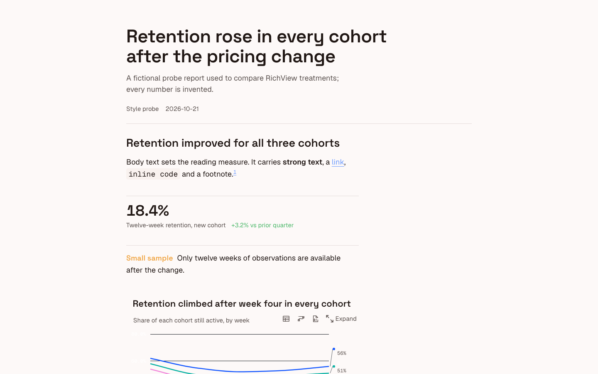

Sleek with `--theme light` (probe report, 1440 × 900, `b4db233`, styles stage, 2026-10-21): the page turns white while the chart keeps white text at 1.05:1 and dark gridlines.

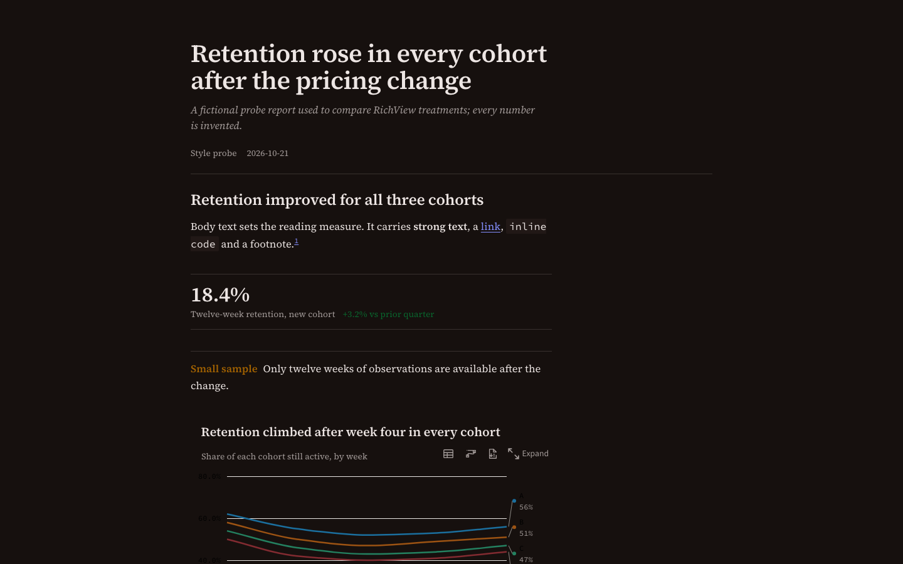

Scientific with `--theme dark` (same probe, stage and date): the page turns dark while the chart keeps black tick labels and series names at 1.11:1 under bright gridlines, and the delta keeps Scientific's dark green. FEA-RP-33 removes the option; FEA-CH-60 adds the contrast check that would have caught it.

> **STY-20 (S-COLOR-SCHEME), proposed.** Each style is one complete colour scheme, and no style pairs light and dark tokens: Sleek and Air are separate styles chosen by name. Removing `theme`, and with it the VS Code setting `richview.previewTheme`, is FEA-RP-33's decision (FEA-SF-23 follows it); this card settles the design side: the base stylesheet has no `prefers-color-scheme` or `data-theme` rules, so reports never follow the reader's system setting. A dark or light version of another style is a new builtin, added through a decision card in the review packet (DEL-06). The option is pairing light and dark in every style: ten schemes to design and capture, and four styles have no dark design. dec-21 kept `prefers-color-scheme` plus `theme:`; OPN-39 lists it as contested and leaves it to FEA-RP-33 and this card.
>
> **STY-57 (S-SCHEME-FLAG), proposed.** Every builtin declares `scheme: dark` or `scheme: light` and, if dark, the light builtin it prints as: Sleek is dark and prints as Air; the other four are light and print as themselves. The report emits `color-scheme` from it, in the `<meta>` (FEA-RP-02) and in CSS, and the print swap reads it instead of a list of names. An author's style file that changes the page colours sets `scheme` to match (Daniel's STY-14 answer); a cascade still dark when printed follows STY-21.

Paper is already light. `print_counterpart` maps `sleek` and `sleek-dark` to `sleek-light` (`crates/richview-core/src/style.rs:871-873`), PDF output resolves the cascade through it (`crates/richview-core/src/render.rs:106-108`), type prints at 80% of the screen scale (`crates/richview-core/src/style.rs:894`), and the print tokens are also declared for `html[data-theme]`, so an explicit dark theme prints light too.

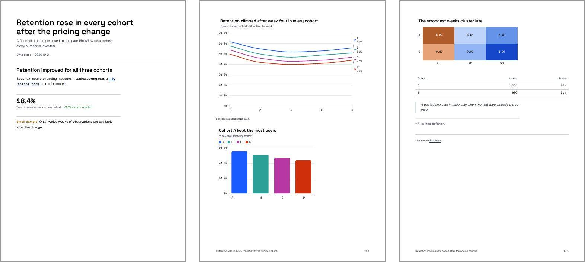

The probe report printed with `richview generate --style sleek --to pdf` (re-run, headless Chromium shell, A4, three pages rasterized at 60 dpi): Sleek (today's Sleek Dark) prints on white in the tokens and palette of Air (today's Sleek Light), with Space Grotesk, Geist and Geist Mono embedded. Page 1 ends after the callout, because the line chart is kept whole and moves to page 2; pages 2 and 3 carry the running title and page numbers; page 3 holds the heatmap with its orange negative arm, the table across the full column, the quote, the footnote and "Made with RichView". STY-21's card predates this capture and says no Sleek Dark print had been captured.

> **STY-21 (S-PRINT), proposed.** Print and PDF always use a light page. Sleek prints as Air (STY-06), read from each builtin's declared print counterpart (STY-57); the four light styles print as themselves, and an author's style file still applies. Because Daniel's STY-14 answer lets a style file set page colours, a cascade still dark after the swap prints with Air's surfaces and inks and warns `style.print-dark`, a code TYP-55 does not list yet. Type and measure scale to 80% of screen, page margins and running heads use the style's UI face in `ink-soft`, and chart palettes and ramps follow the printed style.

## The site

Each site page on `main` has its own look:

| Page | Look on `main` | Source |
| --- | --- | --- |
| Home | "Paper, ink and one blue: the original RichView DNA (eggshell #FAF9F6, warm charcoal, #1A6DAC)", Newsreader headlines, Geist UI, IBM Plex Mono labels, grain behind the content, dark tokens for dark systems; clay `#C4613F` for Anthropic in the data field | `assets/landing/landing.css:1-5`, `assets/landing/landing.css:66-69`, `assets/landing/landing.css:173` |
| Docs | Report-engine output restyled in cool blue-grey chrome at hue 250 on white, in "Docs Geist" and "Docs Mono" | `assets/docs/docs.css:1-12` |
| Legal pages | The June tokens: hue 40, indigo, Newsreader as the sans | `assets/styles/tokens.css` |
| Playground | Georgia with the brand blue on a warm off-white | `assets/playground.html:8` |
| Flagship page | The active treatment's tokens, dark under Sleek | `crates/richview-site/src/browser/showcase.rs` |
| Reel | Its own constants: paper `#FAF9F6`, ink `#141210`, the brand blue and clay `#C4613F` for Anthropic's series, in Newsreader, Geist, IBM Plex Mono and Big Shoulders | `crates/richview-site/src/reel.rs:9-16` |

RichView Publish, merged from PR #70 into `main` on 2026-10-26 and live as RichView News at news.richview.ai, adds its own Paper and Ink themes for a publication's own pages. Daniel's INT-35 answer makes Publish a full member of the rewrite, and FEA-BR-23 proposes building two layouts and those two themes with it; Paper and Ink style only the publication's own pages, and each item keeps the RichView style its frontmatter names. This page describes them no further.

The home page also defines glass (a 66% frosted sheet), two large warm shadows and the overshooting `--pop` curve (`assets/landing/homepage.css:7-30`), all under the missing `body[data-homepage]` attribute, so neither `main` nor production shows them; OPN-17's "Restore the attribute" option would switch them on.

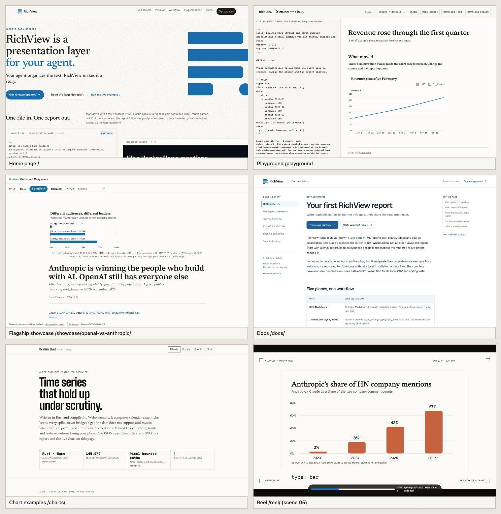

The site pages of `main` at 1440 × 900 (local `b4db233` build, 2026-10-21; sheet from [Web](components/web.md#how-it-looks)): home, playground, flagship page, docs, `/charts/` and the reel, each in its own look. What richview.ai shows instead, section by section, is on [Screenshots](screenshots.md#landing-page).

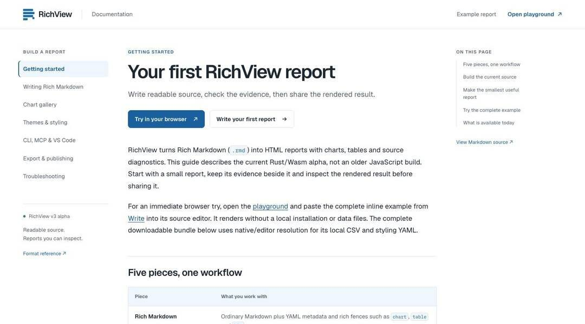

The top of the docs index on richview.ai (cropped from the full-page capture `live/richview-docs-index-desktop-full.jpg`, 1080 px wide, live PR #69 content, 2026-10-21): the hue-250 chrome around report-engine output, uppercase letter-spaced sidebar labels and a "GETTING STARTED" overline above the title, which STY-49 would drop.

| Card | Proposed | Open choice |
| --- | --- | --- |
| STY-46 (S-SITE-LOOK) | Every site page (home, docs, chart gallery, playground, legal) uses the original paper: eggshell `#FAF9F6`, warm charcoal ink, hairline rules, the brand blue for links and the one primary button, Newsreader for headlines and ledes, Geist for UI and body, RichView Mono for code. Reports shown inside the site render in their own style; the docs' hue-250 chrome and the legal pages' token file are deleted | Docs chrome everywhere, or each page its own as today |
| STY-60 (S-FLAGSHIP-FRAME) | The flagship's frame follows the active style (header, style rail, footer note, citation cards), the one site surface that is dark under Sleek | Site paper around the report, consistent with STY-47 |
| STY-47 (S-SITE-SCHEME) | The site is light only and ignores the system's dark setting; the landing's dark tokens go | Follow the system on every page, with every page captured twice |
| STY-48 (S-SITE-SURFACES) | Opaque surfaces; the demo's source and report sheets float with one soft shadow, `0 2px 8px oklch(0 0 0 / 0.12)`; the glass, lift and curve tokens are deleted | Flat panels with no shadows, or glass and lift as designed |
| STY-58 (S-ELEMENT-DECK) | The five element cards stay together, each showing a real artifact; the themes card shows the five builtins rendered by core; the 3D focus-on-scroll ships with the scroll story, and until then the cards are a static row | A static row only, or the deck's motion on its own |
| STY-59 (S-SITE-CODE) | One light OKLCH highlighting palette for the demo, examples, docs code and commands, five roles at 4.5:1 or more, keys in the brand blue; reports keep code plain (FEA-RP-17) | Dark code panels in the docs, light elsewhere |
| STY-65 (S-PAPER-GRAIN) | Grain on the landing only; reading pages use flat paper | Grain everywhere, or none |
| STY-66 (S-SITE-CORNERS) | Three radii: 999 px for pills and the style row, 12 px for panels, sheets, cards, code panels and menus, 4 px for small controls and inline code | none |
| STY-49 (S-SITE-SECTIONS) | Sections and docs pages lead with a Newsreader heading, never an eyebrow, overline, number or badge. The three home defects OPN-22 routes here (the flagship eyebrow overlapping its heading, the check card hiding the tallest bar's label, the signup aside reaching the viewport edge) become fixtures: the site gate asserts gutters and page width (DEL-59, OPN-17, OPN-18), and captures at 320, 390 and 1440 px show overlaps and clipped labels (DEL-27) | none |

## Design rules and review

Four texts state RichView's design rules today, and they disagree (OPN-32): `.claude/rules/anti-slop-design.md` points to the chrome-only tokens in `assets/styles/` (line 19) and asks for visible labels on controls (line 21) that the chart actions lack; the learn text forbids "glass effects, hover lifts" (`crates/richview-core/src/knowledge.rs:17`) while the readout blurs; the skill reference names three styles (`skill/reference/anti-slop.md:10-14`); and agents working from the local primary checkout, still at the July commit `5ceb7d4`, read a `CLAUDE.md` that describes the retired house identity. OPN-32 (D-GUIDE-DESIGN-RULE) proposes one source, the accepted Part 06 cards rendered into this guide, with the rule file reduced to its path scope and a pointer. Nothing in code checks a judgement rule, and dec-28's planned `richview check --anti-slop` was never built (OPN-38). Tests cover the palette rule and OKLCH authoring (`crates/richview-core/tests/palettes.rs`), the embedding, glyph coverage and font features of every builtin's faces (`crates/richview-core/tests/fonts.rs:287-385`), `font-display: block` and the presence of the six sizes with phone values (`crates/richview-core/tests/contracts.rs:1188-1279`); none checks contrast floors, the 1.2× steps or weight limits.

> **STY-50 (S-ANTI-GENERIC), proposed.** RichView's design rules:
>
> - Craft is the bar: charts withstand side-by-side comparison with Highcharts and ECharts, and type and layout with FT-grade and Wall Street Journal editorial design, on desktop, phone and print; these are benchmarks, never code or styling to copy, and restraint is part of craft (INT-12).
> - Tools for the story, no judgment of it: every chart can show its source, and content, data and wording are identical in every style; RichView makes no judgment of a story's quality (INT-77, INT-11).
> - Each style is a complete voice, distinct in structure as well as faces and colours (outlines or shading, legend and chart-title position); nothing keeps another style's look.
> - Colour is designed in the LCH colour space (OKLCH, STY-19) and every surface follows the cleanliness principles below.
> - Type, rules and space make structure: no gradients, glass, card grids, eyebrows, ornamental icons or badges.
> - One accent per style; status colours back up words; colour never identifies a series alone.
> - Shadows only on floating elements unless a style's structure shades its blocks, corners per style, hover changes colour and never position.
> - Motion is delightful and smooth, with the whimsical quality of Studio Ghibli and the polish of Apple's website animations; it explains structure or change or gives pleasure, never ticks or jumps, and reduced motion shows the settled state (INT-12, INT-61).
> - Judge real output after fonts load, at 390 and 1440 px, in every style.
>
> Daniel's INT-12 and INT-77 answers (2026-10-27) replace the earlier first and motion rules, "evidence first" and "nothing else moves".
>
> **STY-51 (S-REVIEW-QUESTIONS), proposed.** Every design entry in the before-and-after report (DEL-69) answers three questions in one line each: what makes it RichView rather than a generic template, what was removed or could be, and which editorial reference it meets (the FT or the Wall Street Journal, INT-12; The Economist and Bloomberg also serve). The visual review agent (DEL-35, Daniel's DEL-68 answer) uses them in its verdict, and Daniel reads them beside the crops; they are not a gate on their own. Style reviews use STY-68's review sheet: the typography specimen (FEA-BR-13), the every-block fixture, a representative majority of chart types, the map, flow, a normal table and the pivot table, the flagship and the story thumbnail (STY-70), beside the other four styles; the agents choose the selection.
>
> **STY-68 (S-STYLE-REVIEW), Daniel's answer, 2026-10-26.** Option 1, less strict. Each style gets one review sheet generated from the candidate. Show what makes sense rather than every variation:
>
> - the typography specimen, the every-block fixture, a representative majority of chart types (not necessarily all), the map, flow, a normal table and the pivot table, and the flagship, at phone and desktop widths and as PDF;
> - the same content in the other four styles beside it, so structural differences show: outlines and shading, legend and title positions, Scientific's captions below charts in boxes;
> - the style's declared structure (where legends and titles sit, outlines or none) verified against the geometry model, and STY-52's measured checks;
> - entrance clips in that style;
> - STY-51's three answers.
>
> The agents choose the selection. Daniel reviews a sheet when a style is created and when its tokens or structure change. A review agent on the model he uses at the time judges the sheet first, including distinctiveness beyond the mechanical check, and its verdict sits on the sheet (DEL-68). A mechanical check flags two styles whose structural declarations are identical. Once a style is accepted, later changes reach Daniel one by one through the before-and-after report (DEL-69).
>
> **STY-64 (S-IMPECCABLE), proposed.** Design agents and the visual review agent that Daniel's DEL-68 answer requires may run the critique and audit modes of Impeccable, an open-source design skill for coding agents that S27-616 asked to assess, on visual changes. Impeccable informs that review but is not the review step itself; its findings are advisory (DEL-35), and where they conflict with this part, this part wins. It is not vendored and not a gate. The options are a required step for design PRs, or not using it.
>
> **STY-52 (S-STYLE-CHECKS), proposed.** Tests over all five builtins check the contrast floors (STY-25), the palette rule (STY-22), the type-scale steps (STY-26), at most three weights (STY-27) and that every declared face is embedded, the one of these tested today. `check` runs the same measures over an author's style file, colours included (STY-14, STY-53): palette and chart-text contrast report under FEA-CH-60's and FEA-CH-62's `chart.*` codes, and the style-level measures (token contrast, type scale, weights, faces) as `style.*` warnings. The visual review agent on the model Daniel uses at the time applies the judgement rules (STY-50; DEL-35, Daniel's DEL-68 answer), and Daniel sees its verdict in the before-and-after report (DEL-69); there is no `--anti-slop` flag.

## Open style decisions

The cards below list options. Daniel has answered STY-01, STY-05, STY-06, STY-14 and STY-68, so they are not listed. The Recommended column is the card's recommendation, which its proposal already states, so accepting the card picks it; the other options need an edit. Every other Part 06 card proposes one answer to accept, edit or reject.

| Card | Decision | Recommended | Other options |
| --- | --- | --- | --- |
| STY-02 (D-BRAND-ACCENT) | Blues | Per-style blues, Scientific on `#1A6DAC` | Blues as shipped; one blue everywhere |
| STY-03 (S-MARK) | Wordmark | Geist 600, knockout lockup in Geist capitals | Serif wordmark; Big Shoulders lockup |
| STY-07 (S-STYLE-NAMES) | Names | `sleek` and `air`, one name each | `sleek` and `air` with the old names kept as aliases |
| STY-09 (S-SLEEK-DARK) | Sleek's temperature | Cool, as shipped | Lamplight warm |
| STY-55 (S-HAND-DRAWN-ACCENT) | Hand-drawn's red | Emphasis marks only | Ink only; red wherever the accent goes |
| STY-53 (S-AUTHOR-COLOURS) | Author colours | Any colour, checked at render | Named choices only |
| STY-16 (S-BRAND-FONTS) | Author fonts | WOFF2 files in the report folder | Bundled faces only; system names |
| STY-17 (S-CASCADE) | Floor of the cascade | Default builtin underneath | Base stylesheet, as today |
| STY-20 (S-COLOR-SCHEME) | Schemes | One per style | Every style pairs light and dark |
| STY-22 (S-PALETTE-CHECKS) | Palette rule | Every pair among the first four | Neighbours only |
| STY-24 (S-SEMANTIC-COLOURS) | `neutral` | Drop it | Keep and retune it |
| STY-56 (S-RAMPS-DIVERGING) | Hand-drawn's negative cells | Pencil hatch | Red pencil arm; always print signed values |
| STY-63 (S-GLYPH-COVERAGE) | Characters outside the subset | Add Greek, warn on the rest | Subset per report; warn only |
| STY-30 (D-MEASURE) | Measure | One measure, `wide: true` per block | Figures and metrics at the column width |
| STY-32 (S-MARGIN-COLUMN) | Margin column | Drop | Keep for sidenotes |
| STY-33 (S-BIG) | Brutalist's metric | True knockout block | No fills anywhere; filled metrics and callouts |
| STY-61 (S-TEXT-EXTRAS) | Block quotes | Indented, no side rule | 2 px side rule |
| STY-35 (S-PENCIL-MARKS) | Pencil marks | Hand-drawn only | Drop; every style |
| STY-36 (S-CORNERS) | Brutalist's bars | Square | 3 px as shipped |
| STY-62 (S-HEADER-IMAGE) | Images | As supplied | Per-style treatment |
| STY-70 (S-STORY-THUMBNAIL) | Link-preview thumbnail | Style tokens and structure, per style | One layout in each style's colours and faces |
| STY-39 (S-CHART-TEXT) | Hand-drawn's chart numbers | The tabular Patrick Hand variant | RichView Mono; Patrick Hand as today |
| STY-41 (S-TOOLTIP) | Readout | The style's own raised surface, opaque, no blur | 70% with blur; 82% with blur |
| STY-43 (S-THEME-TRANSITION) | Style switch | 200 ms cross-fade | Circle reveal; instant swap |
| STY-44 (D-LANDING-MOTION) | Landing motion | Scroll story behind FEA-BR-21 | Load-time mark only; static |
| STY-46 (S-SITE-LOOK) | Site look | Original paper everywhere | Docs chrome everywhere; each page its own |
| STY-60 (S-FLAGSHIP-FRAME) | Flagship frame | Follows the active style | Site paper around the report |
| STY-47 (S-SITE-SCHEME) | Site scheme | Light only | Follow the system |
| STY-48 (S-SITE-SURFACES) | Site surfaces | Opaque sheets, one soft shadow | Flat panels; glass and lift |
| STY-58 (S-ELEMENT-DECK) | Element deck | Part of the scroll story | Static row; deck motion alone |
| STY-59 (S-SITE-CODE) | Site code colours | One light palette | Dark panels in docs |
| STY-65 (S-PAPER-GRAIN) | Grain | Landing only | Everywhere; none |
| STY-64 (S-IMPECCABLE) | Impeccable | Advisory | Required for design PRs; not used |
| STY-69 (S-SETTINGS-MATRIX) | Proof of the safe settings | Pairwise matrix in the release run, full at the candidate | Builtins only |

### Conflicts to answer together

| Cards | Conflict |
| --- | --- |
| STY-08 and S27-594 | S27-594 asked for "beautiful floating theme controls"; STY-08 drops the bar's blur and shadow, so the row floats only by its position and hairline |
| STY-10 and STY-01, STY-05 | As shipped Air shares Sleek's faces, scale and marks; Daniel's STY-01 answer asks every style to differ beyond faces and colours and his STY-05 answer stops calling it Sleek, so its design review decides what sets it apart while it stays the style Sleek prints as |
| STY-67 and TYP-50 | Part 05 types every chart key as author-facing; STY-67 removes the keys charts read from tokens and those STY-40 fixes, and the rest stay author-facing under STY-14's rich style files |
| STY-16 and TYP-46 | TYP-46 requires the first family of every font stack to be in the font catalogue, which an author's WOFF2 file is not; accepting STY-16 extends the rule to files a style declares |
| STY-33 and FEA-RP-23, TYP-48 | A filled Brutalist metric undoes commit `4167940`'s "no fills ... in any style" and contradicts `docs/public/styles.md:63`, "never as filled panels"; the first variant is `rule` here and `card` in TYP-48 |
| STY-22 and FEA-CH-57, FEA-CH-62 | The palette rule decides which pairs switch decals on at render; with every pair, Scientific's charts hatch until it is retuned |
| STY-20 and FEA-RP-33, OPN-39, INT-56 | Removing `theme` and `prefers-color-scheme` drops dec-21, which OPN-39 leaves to FEA-RP-33 and STY-20, and INT-56's clause on chart contrast "under an explicit light or dark theme" falls away |
| STY-43 and FEA-SF-36 | One render per style keeps the reading position but resets hidden series and zoom; FEA-SF-36's other option keeps chart state by restyling one render in the page, as today |
| STY-47 and STY-60 | A light-only site with a flagship frame that turns dark under Sleek, and Daniel's STY-01 answer that the site uses one simple style |
| STY-45 and STY-58 | No scroll-driven motion outside the story, but the deck's focus-on-scroll is scroll-driven |
| STY-50, STY-38 and FEA-CH-52, S27-616, INT-12 | "Hover changes colour and never position", while FEA-CH-52 grows the hover dot, grows a hovered scatter point by 25% and moves a hovered pie slice out 6 px, S27-616 asked for "restrained hover emphasis with a small 'pop,' well-judged shadows", and Daniel's INT-12 answer counts motion that gives pleasure as craft; STY-38 exempts chart marks, STY-50's rule does not |
| STY-21, STY-52, STY-63, STY-69 and TYP-55 | `style.print-dark`, `style.glyph-missing`, `style.experimental` and the `style.*` measures are codes the catalogue does not list; `style.font-missing`, which STY-16 uses, is already in TYP-46 and TYP-55 |
| STY-41 and S27-654 | "Slightly more transparent and visually lighter" is met by dropping the blur, not by much more transparency |
| STY-35 and S27-616, INT-77 | S27-616 asked for soft callouts, emphasis and pencil-like annotation lines outside Hand-drawn "where appropriate", and Daniel's INT-77 answer lists callouts, emphasis and annotations among the tools RichView gives authors; STY-35 declines the pencil part outside Hand-drawn |
| STY-70 and FEA-SF-55, INT-45 | A story's thumbnail shows its own title, which is its author sharing it; INT-45, that marketing never restates a report's findings, still applies only to RichView's own pages |

Settled by Daniel's answers and no longer open: the "Other styles" dropdown of S27-654 (STY-05 keeps the studio variants as extended themes in one secondary dropdown), the core and `init` default (STY-06: Sleek), the settings-only author surface (STY-14: rich style files, mechanics fixed) and tabular figures in Big Shoulders and Patrick Hand (OPN-62: RichView's variants).

OPN-22 also turns style defects into rewrite fixtures. Five of its rows go to Part 06 cards: the core and `init` defaults (STY-06, with TYP-52), the phone `h1` (STY-26), the showcase palettes that rely on runtime guards (STY-22, with FEA-CH-62), the three home defects (STY-49) and the landing font subset said to lack a space glyph (STY-28). The `theme` override goes to FEA-RP-33 and FEA-CH-60, and `/charts/`'s duplicate Editorial button to FEA-SF-44.

## Where to answer

Open [Part 06 in the lockdown app](http://127.0.0.1:4790/#/part/06-styles) and go to a card with `#/part/06-styles/<item>`, for example http://127.0.0.1:4790/#/part/06-styles/STY-07. Accept keeps a proposal as written, edit replaces it with your text, reject drops it from the rewrite and defer leaves it open. Daniel has answered STY-01, STY-05, STY-06, STY-14 and STY-68. The part's summary names the decisions that matter most: STY-02, STY-09 and STY-10, STY-15 with STY-53, STY-20 and STY-22, and STY-33. The names and the selector (STY-07, STY-08) follow from his STY-05 answer, so they come first: the five style cards, the selector and the site cards assume them. The settings cards decide how much of Part 05's style vocabulary stays author-facing beside his STY-14 answer, so answer them with TYP-44 to TYP-50 and TYP-55.

| Group | Cards | First card |
| --- | --- | --- |
| Identity and brand | STY-01 to STY-04 | [STY-01](http://127.0.0.1:4790/#/part/06-styles/STY-01) |
| Catalogue and default | STY-05 to STY-08 | [STY-05](http://127.0.0.1:4790/#/part/06-styles/STY-05) |
| The five styles | STY-09 to STY-13, STY-55 | [STY-09](http://127.0.0.1:4790/#/part/06-styles/STY-09) |
| Customization | STY-14 to STY-18, STY-53 | [STY-14](http://127.0.0.1:4790/#/part/06-styles/STY-14) |
| Colour | STY-19 to STY-25, STY-54, STY-56, STY-57 | [STY-19](http://127.0.0.1:4790/#/part/06-styles/STY-19) |
| Typography | STY-26 to STY-29, STY-63 | [STY-26](http://127.0.0.1:4790/#/part/06-styles/STY-26) |
| Layout | STY-30 to STY-32 | [STY-30](http://127.0.0.1:4790/#/part/06-styles/STY-30) |
| Surfaces and marks | STY-33 to STY-38, STY-61, STY-62, STY-70 | [STY-33](http://127.0.0.1:4790/#/part/06-styles/STY-33) |
| Chart chrome | STY-39 to STY-42, STY-67 | [STY-39](http://127.0.0.1:4790/#/part/06-styles/STY-39) |
| Motion outside charts | STY-43 to STY-45 | [STY-43](http://127.0.0.1:4790/#/part/06-styles/STY-43) |
| The site | STY-46 to STY-49, STY-58 to STY-60, STY-65, STY-66 | [STY-46](http://127.0.0.1:4790/#/part/06-styles/STY-46) |
| Rules and review | STY-50 to STY-52, STY-64, STY-68, STY-69 | [STY-50](http://127.0.0.1:4790/#/part/06-styles/STY-50) |

Cards from other parts that this page leans on:

- Part 01: INT-07 (readers, and the link-preview thumbnail of every story), INT-12 (the craft bar), INT-17 (craft wins when targets conflict), INT-19 (one sourced report, many coherent styles), INT-54 (the five identities carry over), INT-56 (a style reaches everything it renders), INT-57 (fonts load or fail loudly), INT-60 (one reading measure), INT-61 (motion is smooth or absent), INT-75 (a native header graphic for the flagship), INT-77 (tools for the story, no judgment of it).
- Part 02: DEL-06 (design changes merge into `dev` and Daniel reviews them one by one before `prod`), DEL-27 (what the visual gate captures), DEL-31 (screenshot evidence per release and the private phone preview), DEL-34 (the review packet before a `prod` merge), DEL-35 (review agents advise), DEL-68 (a review agent judges visual and motion quality), DEL-69 (the before-and-after report), DEL-75 (motion tests), DEL-81 (long suites run in the release run on `pre-prod`).
- Part 03: ARC-41 (the showcase and the extended themes), ARC-69 (the link-preview thumbnail renderer).
- Part 04a: FEA-CH-51 (chart entrances), FEA-CH-52 (interaction motion), FEA-CH-53 (motion described but never built), FEA-CH-57 (decals when colour fails), FEA-CH-60 (defects `check` must catch), FEA-CH-62 (every palette checked at render), FEA-CH-64 (static frames at the widths figures occupy).
- Part 04b: FEA-RP-23 (the metric stat line), FEA-RP-25 (the callout), FEA-RP-33 (the `theme` option), FEA-RP-35 (what moves in a report), FEA-RP-36 (the reduced-motion floor), FEA-RP-51 (link-preview tags), FEA-RP-62 (Unsplash photos and their credit).
- Parts 04c and 04d: FEA-SF-36 (the flagship page renders once per style), FEA-SF-37 (the showcase's side-by-side compare returns, dormant controls deleted), FEA-SF-55 (share images and link previews), FEA-BR-17 (the showcase pills of PR #67 and the extended themes' dropdown), FEA-BR-21 (the bar the landing's scroll motion must clear).
- Part 05: TYP-44 to TYP-52 (the style file's vocabulary and builtin names), TYP-55 (diagnostic codes), TYP-89 (`wide: true`), TYP-93 (the showcase theme format).
- Part 07: PRF-22 (style switch time), PRF-32 (report size and font bytes).
- Part 08: OPN-22 (mined defects become rewrite fixtures), OPN-32 (one design-rule source), OPN-39 (contested June decisions), OPN-59 (rich style files, mechanics fixed), OPN-62 (tabular figures and the Big Shoulders and Patrick Hand variants).

## Method and sources

Re-run on 22 October 2026 in the lockdown worktree, with the release build of `b4db233` (`target/release/richview` 3.0.0-alpha.0):

- Renders: the styles stage's probe report, copied to a scratch folder and rendered with `richview generate report.rmd --style <name> --public-dir dist/web --format json` for each builtin (2.34 to 2.45 MB each, status `ok`, three info diagnostics `chart.font-bounds-estimated`), and with `--style sleek --to pdf` through the local Playwright Chromium headless shell (three A4 pages, 55,612 B).
- Phone captures and measurements: a Playwright script in headless Chromium with a temporary profile, 390 × 844 at device scale 2 with touch, light scheme, served from a loopback port; it waited for fonts and `window.__richview.settled()`, scrolled each page once to mount its charts, and recorded computed sizes, faces, loaded fonts, figure boxes and page width. No console or page errors. The phone sheets (`img/styles-<style>-phone.jpg`, `img/styles-five-phone-tops.jpg`) and the PDF sheet (`img/styles-sleek-dark-pdf-pages.jpg`, rasterized with `pdftoppm` at 60 dpi) were assembled with ImageMagick.
- Colour: contrast and separation recomputed from the token and palette values in `crates/richview-core/assets/*.rstyle.yaml` and `richview-chart/src/rmd_render.rs:1181-1240`, converting OKLCH through OKLab to sRGB, WCAG 2 luminance, Euclidean OKLab distance ×100 and the Machado 2009 full-severity matrices; the heatmap arms by turning each ramp stop 150° in hue, as the engine does. These agree with the figures in the Part 06 cards. The palette sheet (`img/styles-palettes.png`) draws the same values as an SVG rendered with `rsvg-convert`; the ±10 heatmap difference and the June stat's delta contrast were sampled from the pixels of the hand-drawn capture and the June image.
- Code and files: the paths cited, read at `b4db233`; face bytes summed from `crates/richview-core/assets/font-manifest.json`; hex lines counted by matching the OKLCH test's own pattern against the two landing stylesheets.
- Other images: the mark sheet renders `assets/landing/favicon.svg` and a copy with `main`'s inline `cy=244.04` beside crops of the live hero and share image and the June lockup; the layout crop's guides sit at positions measured from the styles stage capture; the identity and Lamplight sheets join existing flagship captures; the two June images were copied from the legacy vault note.

Not re-run: the desktop captures, which come from the styles, product, delivery, live and open-work stages (dates and sources in each caption); the showcase palette recount (STY-05); the design-system sources and the research digest, read through the styles evidence. Daniel's June note and S27-594, S27-616, S27-634 and S27-654 were re-read on 22 October 2026; other Linear tickets were read through the Linear evidence.

Sources: the styles evidence (styles-design.md), with the Linear (linear.md), history and pull request (history-prs.md) and Notion and site (intent-notion-site.md) evidence, in the worktree's docs/lockdown/evidence folder; the Part 06 file (06-styles.json) and the other part files in docs/lockdown/parts; the screenshot index (docs/lockdown/screenshots/INDEX.md) and the captures under docs/lockdown/screenshots; and the code at `b4db233`.
