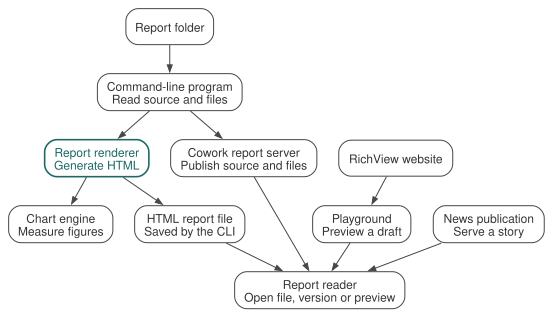

# How RichView works

A [Report folder](../../examples/first-report/) holds a Rich Markdown source file (`.rmd`) and the files it uses, such as data and styles. RichView turns those inputs into an HTML report file that opens in a browser. You can generate the file on your computer, publish the source to the Cowork report server for a versioned link, or edit a draft in the Playground on the RichView website. Each path uses the same Report renderer. The difference is who supplies its inputs and who keeps the result.



For a local export, start at the Report folder. The Command-line program reads the files, the Report renderer calls the Chart engine, and the Command-line program writes the returned HTML to disk. The arrows into the Report reader show the other ways a browser can receive a report. [Map source](diagrams/overview.dot)

## Read the parts in order

1. [Command-line program](cli.md) (`richview-app`). Start with the folder on disk. Follow a command from its arguments through resource resolution to an exported file or a publication request.

1. [Report renderer](core.md) (`richview-core`). Follow the source and resolved files through parsing, validation and styling to HTML and diagnostics.

1. [Chart engine](chart-engine.md) (`richview-chart`). Follow a chart definition and its rows to axes, marks and labels with measured positions.

1. [Report reader](runtime.md) (`richview-runtime`). Open the page. Follow the chart data into browser drawing, resizing and interaction.

1. [Cowork report server](server.md) (the server in `richview-app`). Follow a publication from the upload through storage to the access check when a colleague opens its link.

1. [RichView website and Playground](site.md) (`richview-build` and `richview-site`). Follow a site build to a public example, then follow a source edit to the preview in a browser tab.

## Follow one report

The [first-report example](../../examples/first-report) follows fictional orders over three months. It contains a headline total, a chart, a table and links to download the supporting files. The Report folder holds all the inputs for this example.

```text
first-report/
├── report.rmd
├── report.rstyle.yaml
└── data/
    └── orders.csv
```

| Input | What to look for |
| --- | --- |
| [report.rmd](../../examples/first-report/report.rmd) | The header names the report, version and styles. The body contains the narrative and the chart's inline observations. |
| [report.rstyle.yaml](../../examples/first-report/report.rstyle.yaml) | The header selects this local style file after a built-in style. |
| [data/orders.csv](../../examples/first-report/data/orders.csv) | The table reads the CSV. A Markdown link also lets the reader download the original file. |

The chart takes its observations directly from the source. The table reads its observations from a file, and the author supplies the headline number. To change the example's conclusion, edit each of those inputs that the change affects. [Example source](../../examples/first-report/report.rmd#L9)

### Generate an HTML report file

From the repository root, the installed Command-line program can generate the example with this command.

```sh
richview generate examples/first-report/report.rmd
```

The Command-line program finds the Report folder, resolves its style and data and calls the Report renderer. The renderer produces the page and reports findings about the source. The Command-line program then writes the page and copies the files that the source links for download. [Generate](../../crates/richview-app/src/ops.rs#L389) · [Export](../../crates/richview-app/src/resolver.rs#L1347)

The generated files for this example belong together.

```text
first-report/Rendered/
├── report.html
├── report.rstyle.yaml
└── data/
    └── orders.csv
```

Open `Rendered/report.html` to read the report offline. The page carries its chart data and the Report reader code. Sending the entire `Rendered/` folder also preserves the reader's two download links. [File copying](../../crates/richview-app/src/resolver.rs#L1373)

### Open a chart in the browser

The Report renderer includes a chart frame and its data in the page. When the page opens, the Report reader measures the space the chart actually occupies. A phone and a desktop can therefore lay out the same observations at different widths. [Chart frame](../../crates/richview-core/src/figure.rs#L895) · [Browser entry point](../../crates/richview-runtime/src/web/mod.rs#L149)

- **Layout.** The Chart engine takes the chart definition, rows, theme and dimensions and returns geometry, the positions and shapes to draw. [Layout](../../richview-chart/src/layout/mod.rs#L823)
- **Drawing.** The Report reader uses WebGL2, the browser's graphics interface, to draw that geometry. [Browser drawing](../../crates/richview-runtime/src/web/gl.rs)
- **Interaction.** The Report reader owns browser events and controls for inspecting a chart. Reading a plotted value or opening its table takes place on the reader's device. [Browser chart host](../../crates/richview-runtime/src/web/host.rs)

### Share a versioned link

A publisher can send the same example to a chosen Cowork report server. A *slug* is the report's short name in a web address. The first publication explicitly confirms that Cowork should create that address.

```sh
richview publish examples/first-report/report.rmd --slug first-report --new
```

The publication request carries source, styles, data and linked files. Cowork renders those inputs and stores the result with the version from the source. With the default visibility, this hosted report is private. Cowork checks access even when a reader opens its permalink. [Publish request](../../crates/richview-app/src/ops.rs#L536) · [Server publication](../../crates/richview-app/src/server/reports.rs#L354)

The response contains two addresses. For the example's version `0.0.1`, their paths take these forms. Hosted keys include the organization before `first-report`.

```text
/r/<key>
/r/<key>/v/0.0.1
```

- **Share the report address** when colleagues should see the selected latest version. An owner can pin the version this address opens. Without a pin, Cowork prefers the highest stable release.
- **Share the version address** when the discussion depends on the exact edition. A new publication under a different version leaves this address pointing to the original edition. [Version selection](../../crates/richview-app/src/storage.rs#L670) · [Publication response](../../crates/richview-app/src/server/reports.rs#L690)

### Edit a draft in the Playground

Open a chart example from the RichView website in the Playground, or begin with the source already in the Playground editor. The page asks the Report renderer in the tab for an updated report each time an edit settles. The preview frame runs the Report reader. [Playground guide](../public/playground.md) · [Preview update](../../crates/richview-site/src/browser/authoring.rs#L1053)

The author chooses how to keep the draft.

| Playground action | What a colleague receives |
| --- | --- |
| Download .rmd | The editable source text. |
| Download report | An HTML report file with its reader embedded, for drafts without local download links. For a report with those links, export the folder through the Command-line program or VS Code. |
| Copy link | A URL whose fragment, the part after `#`, carries the source and style choice. Opening it restores a draft in the Playground. |

A Playground link therefore shares editable content with its recipient. A Cowork link identifies a server-held report and lets Cowork enforce the report's access settings. [Draft encoding](../../crates/richview-site/src/share.rs) · [Cowork viewing rights](../../crates/richview-app/src/server/reports.rs#L1437)

### Print a PDF

The Command-line program can also generate a PDF. The Report renderer produces a print layout, including vector charts, and a local browser prints that layout. The PDF preserves the printed page for a reader who needs a fixed document. [Generate PDF](../../crates/richview-app/src/ops.rs#L391) · [PDF export](../../crates/richview-app/src/export_pdf.rs)

## Where the code runs

The renderer and the engine are Rust libraries. A *host* is the part that supplies the files or browser resources and calls a library. Each host runs its own compiled copy. [Report renderer interface](../../crates/richview-core/src/document.rs) · [Workspace crates](../../Cargo.toml)

| Location | Host | What crosses its boundary |
| --- | --- | --- |
| Author's computer | Command-line program | Reads files from the Report folder. Writes the local output or sends a publication request. |
| Author's editor | Native editor service (`richview-editor`) with the VS Code extension | Combines the current editor text with the folder's resources and returns a preview. |
| Cowork app and report listeners | Cowork report server | The app receives the publication. The report listener serves a permitted reader the page and its files. |
| Website build machine | Website builder | Reads templates, guides and example reports. Writes the static site into `dist/web/`. |
| Visitor's tab | Playground | Loads an example or receives edits. Supplies resolved resources and sends the resulting HTML into a preview frame. |
| Reader's browser | Report reader | Receives the HTML and chart data. Lays out and draws charts at the displayed size. |

The Command-line program and Cowork report server are modes of the same executable. The Report renderer and Chart engine work on supplied values. The browser Report reader uses the Chart engine directly and can display a report without the Playground or a Markdown editor. [Executable](../../crates/richview-app/Cargo.toml) · [Report reader dependencies](../../crates/richview-runtime/Cargo.toml)

## Other entry points on the map

**VS Code preview.** The [VS Code extension](../../packages/vscode/README.md) starts the native editor service. The service passes the open source buffer and resolved files to the Report renderer, so an author can inspect an edit before exporting it. [Editor preview](../../crates/richview-editor/src/lsp.rs#L826)

**News publication.** RichView Publish builds the editorial site at `news.richview.ai` from a Git publication, with its own [site definition](../../publications/news/site.yaml) and [story folders](../../publications/news/items). The builder (`richview-publish`) renders story HTML with a release-specific reader address. The publication server (`richview-publish-server`) serves the story and its matching reader files. [Story build](../../crates/richview-publish/src/build.rs#L374) · [Story route](../../crates/richview-publish-server/src/routes.rs#L303) · [Reader files](../../crates/richview-publish-server/src/routes.rs#L398) · [News host](../../wrangler.publish.toml#L30)

## Find the owner of a result

| Question | Start here |
| --- | --- |
| Which source file supplies the chart's observations? | Open the chart definition in the [Report folder](../../examples/first-report/report.rmd#L18). |
| Which file reference failed to resolve? | Follow the [Command-line program](cli.md) for local resources or the [Playground](site.md) for a staged example. |
| Why did a valid report produce a diagnostic? | Follow validation and rendering in the [Report renderer](core.md). |
| Who chooses where a chart label fits? | Follow the layout inputs and geometry in the [Chart engine](chart-engine.md). |
| Why does a chart resize when its container changes? | Follow the measured width and browser drawing in the [Report reader](runtime.md). |
| Why does the short link open a different version from the permalink? | Follow pins and version selection in the [Cowork report server](server.md). |
| Where does an edited example go when I copy its link? | Follow the URL fragment through sharing and restore in the [Playground](site.md). |

## Interfaces to keep beside the map

- [Rich Markdown specification](../RMD-SPEC.md) defines the source format, fields and diagnostics used by report authors.
- [First report walkthrough](../public/first-report.md) shows how to create and generate a report from a terminal.
- [Export guide](../public/export.md) describes the HTML report file, its linked files and PDF output.
- [Publishing guide](../public/publishing.md) covers choosing a destination and publishing versions.
- [Self-hosting guide](../public/self-hosting.md) walks through starting a Cowork report server and opening its first report.
