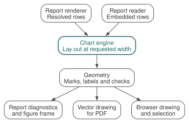

# Chart engine

## Overview

The Chart engine ([`richview-chart`](../../richview-chart/Cargo.toml)) is the Rust library that decides where each mark and label goes. It takes a chart definition, resolved data rows, a theme and the available width, and returns a `Geometry` containing the drawing, the observations a reader can inspect and any problems found during layout. The [Report renderer](core.md) (`richview-core`) uses it to check a figure and prepare a screen figure or draw a vector chart for print. The [Report reader](runtime.md) (`richview-runtime`) calls the same library in the browser when the figure changes size or the reader changes its controls. The engine never accesses files, the network, processes, the environment or the clock. [Layout entry point](../../richview-chart/src/layout/mod.rs#L823) · [Architecture rule ARC-02](../lockdown/parts/03-architecture.json#L78)

## Module structure

- [`richview-chart`](../../richview-chart/src/lib.rs) exposes the chart library. Its callers supply data and decide where to display or save the result.
  - [`block.rs`](../../richview-chart/src/block.rs) reads a validated chart definition, including which columns supply positions, colours and labels.
  - [`rows.rs`](../../richview-chart/src/rows.rs) reads cells from row objects and distinguishes a number, a missing value, invalid text and a number too small to represent.
  - [`numbers.rs`](../../richview-chart/src/numbers.rs) formats values for labels and readouts at the chosen precision.
  - [`reader_controls.rs`](../../richview-chart/src/reader_controls.rs) applies the reader's selections to the chart definition and rows.
  - [`layout/mod.rs`](../../richview-chart/src/layout/mod.rs#L823) groups rows into panels and builds the geometry at the requested width.
    - [`types.rs`](../../richview-chart/src/layout/types.rs) selects the drawing function and default proportions for each chart type.
    - [`cartesian.rs`](../../richview-chart/src/layout/cartesian.rs) lays out charts with horizontal and vertical axes, including the orders example below.
    - [`place.rs`](../../richview-chart/src/layout/place.rs) chooses positions for labels and annotations around the marks.
    - [`finish.rs`](../../richview-chart/src/layout/finish.rs#L25) fits text inside the figure and leaves clearance below its lowest label.
    - [`checks.rs`](../../richview-chart/src/layout/checks.rs#L99) tests the laid-out figure for problems such as clipping and overlapping text.
  - [`scale.rs`](../../richview-chart/src/scale.rs) converts between data values and drawing coordinates.
  - [`text.rs`](../../richview-chart/src/text.rs) measures text using bundled font metrics and estimates widths for unmeasured faces.
  - [`geometry.rs`](../../richview-chart/src/geometry.rs#L788) defines the model that both the browser and vector drawing functions consume.
  - [`derived.rs`](../../richview-chart/src/derived.rs) records decisions made from exact values, such as which bin contains an observation.
  - [`payload.rs`](../../richview-chart/src/payload.rs) defines the serializable chart data that crosses from the Report renderer to the Report reader.
  - [`hit.rs`](../../richview-chart/src/hit.rs) maps pointer positions and arrow keys to observations in a panel.
  - [`interaction.rs`](../../richview-chart/src/interaction.rs) shares chart action definitions and readout placement rules with the Report reader.
  - [`vector.rs`](../../richview-chart/src/vector.rs#L513) turns geometry into Scalable Vector Graphics (SVG).
  - [`limits.rs`](../../richview-chart/src/limits.rs#L21) defines the counts that chart drawing functions enforce.

## Architecture



In the [first report](../../examples/first-report/report.rmd), the author maps month to the horizontal axis and orders to the vertical axis. The Report renderer supplies the rows and asks the engine how much space the bars, tick labels and other marks take. For interactive HTML it uses that answer to reserve a frame and embeds the data needed to lay it out again. On a narrow screen the Report reader can move the labels and bars to fit the available width. For PDF the Report renderer requests geometry at the print width and turns it directly into SVG. [Figure assembly](../../crates/richview-core/src/figure.rs#L509) · [Browser layout](../../crates/richview-runtime/src/payload.rs#L403)

## Pipeline

1. **Read the chart definition.** The Report renderer passes the normalized chart block to `ChartBlock::from_value`. The result names the type, fields and style overrides. An unknown type returns no block, and the Report renderer records an error. [block.rs:286](../../richview-chart/src/block.rs#L286) · [figure.rs:509](../../crates/richview-core/src/figure.rs#L509)

1. **Choose the rows for this view.** The Report renderer projects the columns needed across the authored views. With controls, `Controls::chart` returns the selected block, rows and original row indices. Without controls the caller uses the block and projected rows directly. [figure.rs:532](../../crates/richview-core/src/figure.rs#L532) · [reader_controls.rs:422](../../richview-chart/src/reader_controls.rs#L422)

1. **Set the drawing width and group the rows.** `layout` takes the block, rows, theme and options. It applies any chart palette override and groups rows by the facet field, the column that gives each panel its name. Without that field all rows belong to one panel. [layout/mod.rs:823](../../richview-chart/src/layout/mod.rs#L823) · [layout/mod.rs:1025](../../richview-chart/src/layout/mod.rs#L1025)

1. **Draw the panels.** For usable input, the function registered for the chart type computes scales and places marks, text and observations. Empty input takes a different branch in the same step. The engine produces a panel with a reason that the caller can display. [layout/mod.rs:925](../../richview-chart/src/layout/mod.rs#L925)

1. **Check the drawing.** `finish` adjusts the placed text, then `checks::run` inspects the result. The returned geometry carries the panels, summary, check findings, omitted labels and any failure reason alongside the marks. [layout/finish.rs:25](../../richview-chart/src/layout/finish.rs#L25) · [layout/mod.rs:979](../../richview-chart/src/layout/mod.rs#L979)

1. **Use the geometry for the requested output.** The [figure renderer](../../crates/richview-core/src/figure.rs#L509) handles screen and print. Other callers can take the geometry directly.

   - **HTML report file.** The Report renderer checks the phone and desktop layouts, reserves space for the chart and embeds a JSON payload. The Report reader later calls layout with the measured width. [figure.rs:765](../../crates/richview-core/src/figure.rs#L765) · [figure.rs:895](../../crates/richview-core/src/figure.rs#L895) · [payload.rs:403](../../crates/richview-runtime/src/payload.rs#L403)
   - **PDF.** The Report renderer lays out the print theme and calls `svg_for_pdf`. Its figure contains the vector drawing and has no interactive chart payload. [figure.rs:744](../../crates/richview-core/src/figure.rs#L744)
   - **Report link preview.** The [Cowork report server](server.md) can use a chart in a link thumbnail. The share-card library obtains vector artwork from the Chart engine and renders the card to PNG. [richview-share/src/lib.rs:58](../../crates/richview-share/src/lib.rs#L58) · [richview-share/src/lib.rs:264](../../crates/richview-share/src/lib.rs#L264)
   - **Standalone SVG in Rust.** A caller with a geometry and theme can call `vector::svg` to obtain an SVG string. The caller owns writing the file. [vector.rs:513](../../richview-chart/src/vector.rs#L513)

The following Rust function starts at the library boundary, after the caller has supplied the rows. It illustrates the standalone SVG branch. [Layout arguments](../../richview-chart/src/layout/mod.rs#L823) · [SVG result](../../richview-chart/src/vector.rs#L513)

```rust
use richview_chart::block::ChartBlock;
use richview_chart::layout::{ChartTheme, Options, layout};
use richview_chart::vector;
use serde_json::Value;

fn chart_svg(block: &ChartBlock, rows: &[Value], theme: &ChartTheme, width: f64) -> String {
    let options = Options { width, ..Options::default() };
    let geometry = layout(block, rows, theme, &options);
    vector::svg(&geometry, theme)
}
```

The SVG names the font families used in the layout. A viewer opening the SVG on its own needs those faces to match the report typography. [SVG text](../../richview-chart/src/vector.rs#L669)

## What is stored where, and what is rebuilt

| Thing | Where it lives | Who writes it | When it changes |
| --- | --- | --- | --- |
| Chart definition and source rows | In the [Report folder](../../examples/first-report/report.rmd), inline or in a referenced resource | The author | Editing the source changes the input to the next render. |
| Typed chart and selected rows | In the caller's memory as a [chart block](../../richview-chart/src/block.rs) and [resolved state](../../richview-chart/src/reader_controls.rs) | The caller invokes the engine to construct them | A new definition or control selection changes the input to layout. |
| Reusable row preparation | In a caller-owned [`Prepared`](../../richview-chart/src/layout/mod.rs#L804) | The engine fills it on first use | Resize and zoom can reuse it. New rows, a new filter, playback frame, visible series, language or theme require fresh preparation. |
| Geometry | In the caller's memory as [`Geometry`](../../richview-chart/src/geometry.rs#L788) | The Chart engine | Each layout returns the positions and observations for that width and view. |
| Chart data for the browser | Inside the figure's [JSON script element](../../crates/richview-core/src/figure.rs#L895) in the HTML report file | The Report renderer | Regenerating the report replaces the projected rows, display values, theme and records derived from exact rows. |
| Printed chart | In the [PDF-mode figure](../../crates/richview-core/src/figure.rs#L744) as SVG | The Report renderer calls the Chart engine | Rendering the PDF again recomputes geometry for the paper size and print theme. |
| Font measurements | In the engine's [compiled metrics](../../richview-chart/src/optical_metrics.rs) | The [font measurement script](../../scripts/fonts/optical.py) | Regenerating the metrics and rebuilding the engine updates text measurement. |

A histogram illustrates why both the rows and the derived records travel. The Report renderer can determine a bin from the exact value. The Report reader can then lay out the bin at another width using that decision, even when rounding the value would have put it on the other side of the boundary. [Derived records](../../richview-chart/src/derived.rs) · [State records in the payload](../../crates/richview-core/src/figure.rs#L780)

## Configuration and limits

**Who sets what.**

- The author chooses the chart fields, axes, precision and style in the Report folder.
- The Report renderer converts the resolved report style to a chart theme.
- The caller passes width, language, colour assignments, hidden series and zoom in `Options`.
- The library takes its configuration through those values and has no command-line flags or environment settings. [Chart reference](../RMD-SPEC.md#charts) · [Theme conversion](../../crates/richview-core/src/figure.rs#L26) · [Layout options](../../richview-chart/src/layout/mod.rs#L195)

**Width, 240–4,096 CSS pixels.**

- Layout clamps a finite positive width to this range.
- A missing, nonpositive or nonfinite width uses 640 pixels.
- Multiple facet panels can use two columns from 600 pixels. [Width selection](../../richview-chart/src/layout/mod.rs#L868) · [Facet columns](../../richview-chart/src/layout/mod.rs#L1044)

**Panel ratio, 0.5–6.**

- The engine accepts a width-to-height ratio as a number or a pair such as `16:9`.
- Outside the range it has no usable override. [Ratio parser](../../richview-chart/src/block.rs#L271)

**Numbers, 1–15 significant digits.**

- The default is three.
- Axis and readout settings determine which values the reader sees.
- A numeric position grid starts from 4,095 intervals and can use fewer for integers or more to distinguish values the author shows. [Number formats](../../richview-chart/src/numbers.rs) · [Digits parser](../../richview-chart/src/block.rs#L248) · [Position grids](../../richview-chart/src/payload.rs#L30)

**Checks, 1,000 control states per chart.**

- If the chart has more combinations, the Report renderer warns how many went unchecked.
- A playback frame uses 800 milliseconds by default. The [Report reader](runtime.md#configuration-and-limits) controls when playback stops or restarts. [State checks](../../crates/richview-core/src/figure.rs#L813) · [Control defaults](../../richview-chart/src/reader_controls.rs)

**Automatic point selection, over 10,000 observations.**

- Dense line, area and scatter drawings can use representative marks and disclose the reduction.
- Explicit `points: all` bypasses that automatic ceiling.
- The embedded rows remain available for the Table and CSV. [Point policy](../../richview-chart/src/limits.rs#L1) · [Embedded rows](../../crates/richview-core/src/figure.rs#L532)

**Drawing limits.**

- When a hard count below is exceeded, the drawing function returns a reason for the affected chart or panel and reports the count.
- Each panel has its own allowance where the limit is per panel. [Declared chart limits](../../richview-chart/src/limits.rs#L21) · [Over-limit result](../../richview-chart/src/layout/kit.rs#L744)

| What the drawing counts | Maximum |
| --- | ---: |
| Network nodes and links | 400 nodes and 2,000 links |
| Nodes and links in a Sankey, alluvial or chord diagram | 300 nodes and 2,000 links |
| Steps and connections in a flow diagram | 150 steps and 600 connections |
| Scattered observations in a contour panel | 4,000 rows |
| Words or packed bubbles in one panel | 150 words or 200 bubbles |
| Arrows or scheduled tasks in one panel | 1,500 arrows or 60 tasks |
| Points in a three-dimensional scatter plot | 5,000 points |
| Parallel axes or scatter-matrix dimensions | 8 axes or 6 dimensions |
| Pivot rows and columns | 40 rows and 12 columns |
| Three-dimensional bar categories and groups | 24 horizontal categories and 12 groups |
| Surface data | 4,000 scattered rows or 100 grid nodes along either axis |

**Calendar panels, 12 calendar years.** A panel whose first and last dates cover more years reports a range error. [Calendar range check](../../richview-chart/src/layout/calendar.rs#L212)

**Bin settings, 1–256 bins or 2–257 ordered edges.**

- An invalid count or edge sequence fails bin validation.
- The two-dimensional rectangular and hexagonal layouts choose a resolution between 5 and 24 bins per axis or hexagons across. [Bin validation](../../richview-chart/src/binning.rs#L202) · [Rectangular bins](../../richview-chart/src/layout/bin2d.rs#L19) · [Hexagonal bins](../../richview-chart/src/layout/hexbin.rs#L183)

**Contour grid, 250,000 nodes.**

- Up to that size the engine can use a complete grid directly.
- Otherwise the scattered-row path applies its 4,000-row ceiling. [Grid selection](../../richview-chart/src/layout/contour.rs#L214)

**Multiple dimensions, at least 2.** Parallel axes and scatter matrices need two distinct numeric fields. Too few fields produce a failure reason for the figure. [Parallel axes](../../richview-chart/src/layout/parallel.rs#L70) · [Scatter matrix](../../richview-chart/src/layout/splom.rs#L102)

**Set overlaps, 2–3 sets.** A Venn diagram needs a total for each set and reports a failure outside that range. [Set-count check](../../richview-chart/src/layout/venn.rs#L298)

**Bullet ranges, up to 3 boundaries.** The boundaries must be finite and strictly increasing for the bands to draw. [Range validation](../../richview-chart/src/layout/bullet.rs#L35)

**Map zoom, 24×.** The map drawing clamps its scale between the whole-map fit and 24 times that fit. [Map scale](../../richview-chart/src/layout/map.rs#L650)

**Palette checks.** For charts with at least two visible series, the first four visible colours must reach 3:1 contrast against the chart surface. The engine tests colour distance for those pairs and adjacent colours, using minimum OKLab distances of 0.15 normally and 0.08 in colour-vision simulation. A failing palette raises a warning and turns on patterns. [Palette check](../../richview-chart/src/layout/checks.rs#L47)

**Text contrast, 4.5:1.** If either main or secondary chart text falls below this contrast against the chart surface, the engine warns and identifies the ink setting to change. [Text contrast check](../../richview-chart/src/layout/checks.rs#L210)

**Dense entrances, 2,000 marks.** At or above this count a non-sweep entrance becomes a fade. The theme can disable chart motion. [Entrance selection](../../richview-chart/src/layout/mod.rs#L1048) · [Theme](../../crates/richview-core/src/figure.rs#L26)
