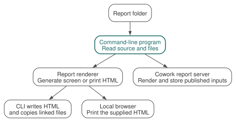

# Command-line program

## Overview

The Command-line program (`richview` in the [`richview-app` crate](../../crates/richview-app/Cargo.toml)) turns a saved [Report folder](../../examples/first-report/) into an HTML report file, a PDF, or a link to a published version. Authors and scripts run the same executable and can ask for a machine-readable result. The program reads the source and its referenced files, calls the [Report renderer](core.md) (`richview-core`) and writes local exports under `Rendered/`. Local generation never publishes a report. Publication sends the source and files to the chosen [Cowork report server](server.md), which renders its own copy.

## Module structure

- [`richview-app`](../../crates/richview-app/Cargo.toml) defines the native executable and the library behind it.
  - [`bin/richview.rs`](../../crates/richview-app/src/bin/richview.rs) starts the asynchronous command loop.
  - [`cli.rs`](../../crates/richview-app/src/cli.rs) parses arguments, selects a target and prints the result.
  - [`reference.rs`](../../crates/richview-app/src/reference.rs) builds the command reference from the argument definitions.
  - [`ops.rs`](../../crates/richview-app/src/ops.rs) implements report operations and returns their structured findings.
  - [`mcp.rs`](../../crates/richview-app/src/mcp.rs) exposes operations over the Model Context Protocol, a tool interface carried over standard input and output.
  - [`resolver.rs`](../../crates/richview-app/src/resolver.rs) inspects the Report folder, loads inputs and writes the HTML export.
  - [`runtime.rs`](../../crates/richview-app/src/runtime.rs) provides the packaged [Report reader](runtime.md), the code that runs when someone opens the HTML.
  - [`connectors/`](../../crates/richview-app/src/connectors) resolves local data and keeps query results.
    - [`connectors/config.rs`](../../crates/richview-app/src/connectors/config.rs) binds names in the report to data sources available on the author’s machine.
    - [`connectors/resolve.rs`](../../crates/richview-app/src/connectors/resolve.rs) turns a query or a saved result into rows the renderer can use.
    - [`connectors/parquet_source.rs`](../../crates/richview-app/src/connectors/parquet_source.rs) reads columns from a Parquet data file through the local worker.
    - [`connectors/cache.rs`](../../crates/richview-app/src/connectors/cache.rs) saves query results and looks them up by fingerprint or name.
  - [`export_pdf.rs`](../../crates/richview-app/src/export_pdf.rs) finds a local browser, waits for the print page and saves the PDF.
  - [`publish_destination.rs`](../../crates/richview-app/src/publish_destination.rs) selects the server for publication.
  - [`sign_in.rs`](../../crates/richview-app/src/sign_in.rs) exchanges a browser confirmation or a supplied token for a local sign-in.
  - [`credentials.rs`](../../crates/richview-app/src/credentials.rs) keeps that sign-in under the server’s origin, the combination of scheme, host and port.
  - [`remote.rs`](../../crates/richview-app/src/remote.rs) sends authenticated requests and returns the server’s answer.
  - [`server/mod.rs`](../../crates/richview-app/src/server/mod.rs) starts the report service or the single-report preview.
  - [`asset_upload/mod.rs`](../../crates/richview-app/src/asset_upload/mod.rs) uploads files to a configured store, verifies them and can abort an unfinished upload.
  - [`unsplash.rs`](../../crates/richview-app/src/unsplash.rs) searches for a photo and prepares its credited placement in a report.

## Architecture



The fork comes before the output file exists. For `generate`, the program supplies local data and reader code to the Report renderer, then writes the returned HTML or asks a browser to print it. For `publish`, the program sends the materials that Cowork needs to render and retain a version. Publishing therefore works from a saved source even if the author has never generated an HTML report file. [Local export](../../crates/richview-app/src/ops.rs#L389) · [Publish request](../../crates/richview-app/src/cli.rs#L1312)

## Pipeline

From the repository root, this command reads the [first report](../../examples/first-report/report.rmd) and writes `examples/first-report/Rendered/report.html`.

```sh
richview generate examples/first-report/report.rmd --format json
```

1. **Select the operation.** `run` decodes the command and output format. `execute` turns the path and flags into a `GenerateRequest` for each report. [cli.rs:707](../../crates/richview-app/src/cli.rs#L707) · [cli.rs:899](../../crates/richview-app/src/cli.rs#L899)

1. **Find the source.** `Target::of` takes a path and returns one report or an ordered list. [resolver.rs:894](../../crates/richview-app/src/resolver.rs#L894)

   - A file names the source directly. A directory with `report.rmd` selects that file first, otherwise one `.rmd` selects that report. The resolver still checks the folder inventory.
   - A directory without a source stands for the reports below it. Discovery stops descending when it finds a report and sorts the paths. `generate`, `check` and `validate` accept this list. `serve` and `publish` require a single report.

1. **Read the Report folder.** `ops::resolve` reads the source, finds its actual parent directory and loads any connector definitions. `resolve_inner` inventories the folder, parses the document, checks references and fills `RenderOptions` with the required style text, rows and media. [ops.rs:208](../../crates/richview-app/src/ops.rs#L208) · [resolver.rs:151](../../crates/richview-app/src/resolver.rs#L151)

   - The resolver follows a local file reference only within the Report folder. Missing inputs that affect one element can travel with the document as findings. [resolver.rs:1105](../../crates/richview-app/src/resolver.rs#L1105)
   - During generation, `load_runtime` adds the JavaScript bindings and compressed WebAssembly program for the Report reader. [resolver.rs:1179](../../crates/richview-app/src/resolver.rs#L1179)

1. **Produce the requested result.** The [command dispatcher](../../crates/richview-app/src/cli.rs#L899) selects one of these paths for the source.

   - **HTML.** `generate` passes the parsed document and options to `render_document`. `export_report` rereads the saved source for download links, copies their files under `Rendered/` at their relative paths, then writes the HTML. A recoverable block error can leave a draft on disk with an error result. [ops.rs:389](../../crates/richview-app/src/ops.rs#L389) · [resolver.rs:1347](../../crates/richview-app/src/resolver.rs#L1347)
   - **PDF.** `generate` requests print HTML and checks the findings. If any is an error, the command stops before printing. Otherwise `export` prints the page in a local Chromium-family browser and writes the resulting bytes. [ops.rs:405](../../crates/richview-app/src/ops.rs#L405) · [export_pdf.rs:98](../../crates/richview-app/src/export_pdf.rs#L98)
   - **Validation or chart checks.** `validate_source` checks the source and folder, skipping live connector queries. `check` resolves data and runs the renderer’s geometry checks. Both return findings without writing an HTML report file. [ops.rs:251](../../crates/richview-app/src/ops.rs#L251) · [ops.rs:357](../../crates/richview-app/src/ops.rs#L357)
   - **Publication.** `publish_as` validates the input and sends the source, folder inventory, style overrides, resolved data and linked files to `POST /api/reports`. The request uses the folder name in place of its absolute path. Cowork returns the version link. [ops.rs:536](../../crates/richview-app/src/ops.rs#L536) · [cli.rs:1344](../../crates/richview-app/src/cli.rs#L1344) · [cli.rs:871](../../crates/richview-app/src/cli.rs#L871)

1. **Return the outcome.** `finish` prints a summary to standard output and human-readable findings to standard error, or one JSON object to standard output. A folder run places the individual outcomes under `reports`. [cli.rs:776](../../crates/richview-app/src/cli.rs#L776) · [ops.rs:168](../../crates/richview-app/src/ops.rs#L168)

A successful run of the example returns these fields, among others. The output path ends in `examples/first-report/Rendered/report.html`.

| Field | How a script uses it |
| --- | --- |
| `ok` | Decide whether the result contains an error. |
| `status` | Read `clean` for a run without warnings or errors, or `issues` for either. |
| `output` | Locate the generated file. |
| `diagnostics` | Find individual issues, including warnings on a successful run. |

When an HTML draft contains a recoverable block error, the result can contain both an output path and `ok: false`. [Result fields](../../crates/richview-core/src/folder.rs#L566)

## What is stored where, and what is rebuilt

| Thing | Where it lives | Who writes it | What makes it stale or rebuilt |
| --- | --- | --- | --- |
| Source, data, styles and media | Report folder beside the `.rmd` | The author, or `init` for the starter source and CSV | Edit these inputs, then generate again. |
| HTML report file | `Rendered/<source-name>.html` by default | `export_report` | Each HTML generation writes the current rendered result to its selected path. |
| Linked downloads | `Rendered/<relative-path>` | `export_report` copies referenced files | A new export recopies the files its current source links to. The copy loop does not prune old downloads. |
| PDF | `Rendered/<source-name>.pdf` by default | `export_pdf::export` | A successful print replaces the destination with the new PDF. |
| Preview state | Process memory and a system temporary directory | `serve` | The preview reads the working report and drops its temporary directory on normal exit. |
| Report reader | Inside the packaged executable, then in the exported HTML | The native build packages it and `generate` embeds it | Using a different executable affects newly generated files. |
| Connector snapshot | A report-specific directory under the configured snapshot root | The native connector store | A query can write fresh rows. A cache lookup reads retained rows and checks the requested freshness. |
| Publish destination | `richview/publish-server.json` in the user configuration directory | The destination prompt or sign-in flow | A new saved choice changes the destination for later commands. |
| Sign-in | `richview/credentials.json` in the same directory | `login` and `logout` | Sign-in replaces that server’s entry. Logout forgets the local entry. |
| Upload journal | User state directory under `richview/uploads/` | Multipart asset uploader | An interrupted transfer keeps its progress for resume or abort. |
| Published version | Cowork’s report store | The Cowork report server | A new version retains its own source, resources and server-rendered HTML. Regenerating local output does not update the server. |

The [preview setup](../../crates/richview-app/src/cli.rs#L1043), [snapshot root selection](../../crates/richview-app/src/connectors/config.rs#L207), [private configuration files](../../crates/richview-app/src/publish_destination.rs#L12) and [export writer](../../crates/richview-app/src/resolver.rs#L1347) show which files belong to the user, the report and the running process.

## Configuration and limits

**Source and target.** `init [dir] --name NAME` creates `NAME.rmd` and `data/visits.csv`. The default name is `report`. An existing file at either destination stops initialization. [Starter files](../../crates/richview-app/src/ops.rs#L492)

**Report folder discovery, 10,000 descendant directories.** A wider walk fails and asks for a folder closer to the reports. The walk skips hidden and symlinked directories. [Folder walk](../../crates/richview-app/src/resolver.rs#L978)

**Local file reads, 32 MiB per file.** The native bounded reader rejects non-regular files and oversize reads, including a file that grows past its limit while being read. [Native reader](../../crates/richview-app/src/resolver.rs#L1154)

**Source and resolved dataset, 16 MiB each.** The Report renderer enforces the smaller source limit after the native read. The dataset limit applies separately to each resolved dataset. [Renderer limits](core.md#configuration-and-limits)

**Resolved resources, 64 MiB combined.** The native resolver charges retained data, styles and encoded media to a report-wide budget. Base64 encoding expands media, so the original file sizes alone do not predict whether the inputs fit. [Resource budget](../../crates/richview-app/src/resolver.rs#L12)

**HTML, 64 MiB.** The renderer also bounds its final HTML, including embedded resources. A failure here stops generation before HTML export. [Output limit](../../crates/richview-core/src/render.rs#L1184)

**Filename and format.** `-o` or `--output` chooses a filename directly inside `Rendered/`. The default output is HTML. Use `--to pdf` or, with `--to` omitted, a name ending in `.pdf` to print. [Format selection](../../crates/richview-app/src/cli.rs#L911) · [Output path](../../crates/richview-app/src/resolver.rs#L1195)

**Style layers.** Repeat `--style` for built-in names or style files inside the Report folder. The resolver loads the source’s styles first, then applies the CLI layers in argument order. A style file can override a color while keeping a font from an earlier file. A background specified in frontmatter comes last. [Resolver order](../../crates/richview-app/src/resolver.rs#L236) · [Renderer order](../../crates/richview-core/src/render.rs#L257) · [Font preservation](../../crates/richview-app/tests/report_folders.rs#L1186)

**Chart check widths, 240 through 4096 pixels.** Repeat `check --chart-width` to measure specific widths. A nonfinite or out-of-range width is a usage error. With no override, the renderer chooses widths for the report layout. [Check](../../crates/richview-app/src/ops.rs#L357)

**Connector settings.** `--connectors` or `RICHVIEW_CONNECTORS` selects the trusted `connectors.toml`. The Report folder supplies `report.connectors.yaml`. Generation and checking pass the trusted configuration to the resolver. `publish` and `serve` accept the shared argument but their command paths do not pass that registry through. [Generation and checks](../../crates/richview-app/src/ops.rs#L208) · [Publication](../../crates/richview-app/src/ops.rs#L544) · [Preview](../../crates/richview-app/src/cli.rs#L1043) [Connector configuration](../../crates/richview-app/src/connectors/config.rs)

**Snapshot location.** Without `cache_root` the host uses `richview/snapshots` under `XDG_STATE_HOME`, `$HOME/.local/state` or `LOCALAPPDATA`. The canonical Report folder path determines the report’s subdirectory. [Snapshot paths](../../crates/richview-app/src/connectors/config.rs#L207)

**Data reads.** A direct Parquet table over 1,000,000 rows is refused. Connector query results have a 100,000-row ceiling. SQL queries and direct Parquet reads share a confined worker. On Linux both need kernel 6.2 or newer with Landlock ABI 3 enabled. The local SQL worker has a 30-second timeout and a 256 MiB memory budget. [Linux requirements](../public/data.md#read-a-parquet-file) · [Parquet reader](../../crates/richview-app/src/connectors/parquet_source.rs#L211) · [Connector result limit](../../crates/richview-app/src/connectors/spec.rs#L5) · [Worker limits](../../crates/richview-app/src/connectors/sql_worker.rs#L22)

**PDF paper.** `--page` selects A4 or Letter, with A4 as the default. A slide deck prints on 16:9 pages. `--browser` or `RICHVIEW_BROWSER` chooses an executable. Without either, the program searches for a local browser. [PDF flags](../../crates/richview-app/src/cli.rs#L179) · [Browser selection](../../crates/richview-app/src/export_pdf.rs#L130)

**PDF timeouts.** Browser launch has a 15-second deadline per attempt. The page has 30 seconds by default to load and settle, with a minimum of 1 second for `--settle-timeout`. Printing has a 60-second deadline. A settle timeout reports what is still pending when the browser can supply it. [Deadlines](../../crates/richview-app/src/export_pdf.rs#L22) · [Settle failure](../../crates/richview-app/src/export_pdf.rs#L1251)

**Preview address.** `serve` defaults to `127.0.0.1` on port `4711`. The command accepts `--bind` and `--port`. Use `server` to start Cowork with its own storage, access settings and listeners. [Preview arguments](../../crates/richview-app/src/cli.rs#L279) · [Cowork settings](server.md#configuration-and-limits)

**Publish address.** Select a server with `--server` or `RICHVIEW_SERVER`. Without an explicit server, the client uses its saved choice or asks in an interactive terminal. `--choose-server` replaces the saved choice. In JSON mode or without a terminal an unconfigured client stops and asks for an explicit destination. [Destination selection](../../crates/richview-app/src/publish_destination.rs#L110)

**Publish identity and access.** `--slug` chooses the report address, ahead of the source’s slug and its title. `--new` requests a new address. `--visibility` selects who can open the report. Hosted Cowork makes new reports private by default. [Publish flags](../../crates/richview-app/src/cli.rs#L232) · [Publish identity](../RMD-SPEC.md#report-identity)

**Sign-in.** `login --with-token` reads a token from standard input. `--no-browser` or `RICHVIEW_NO_BROWSER` leaves browser confirmation to the user. With nobody at the terminal to confirm whose sign-in it is, `--expect-account <address>` names the account it must be for, compared whole, and `--expect-organization` and `--expect-organization-id` the organization, by its whole name and by its id, each compared with its own field only; without an account nothing is kept. A token read by `--with-token` is checked against both too: a token is bound to an organization, `GET /api/session` names it, and a server that names none does not meet an expected one. A publish command can use `--token` or the sign-in kept for its server. `RICHVIEW_TOKEN` is bound to `RICHVIEW_SERVER`. [Login flags](../../crates/richview-app/src/cli.rs#L257) · [Token destination](../../crates/richview-app/src/cli.rs#L1419)

**Local settings directory.** The program looks under `XDG_CONFIG_HOME`, then `$HOME/.config`, then `APPDATA` for its `richview` directory. The sign-in reader refuses a credentials file over 1 MiB and, on Unix, refuses to use one accessible by other users. [Directory](../../crates/richview-app/src/publish_destination.rs#L12) · [Credentials reader](../../crates/richview-app/src/credentials.rs#L41)

**Publish request, 32 MiB.** Cowork applies the limit to the whole request body. Encoded downloads and resolved data contribute to the size. The client explains a server response of HTTP 413 using the size of the serialized request. [Server body limit](../../crates/richview-app/src/server/mod.rs#L194) · [Client response](../../crates/richview-app/src/remote.rs#L64)

**Server replies.** The publish and owner-action client times out after 30 seconds and refuses a response over 32 MiB. The sign-in client also times out after 30 seconds and bounds each response at 64 KiB. [Report requests](../../crates/richview-app/src/remote.rs#L34) · [Sign-in requests](../../crates/richview-app/src/remote.rs#L108)

**Output for scripts.** `--format json` gives report commands a single result object. Exit code `0` means no errors, `1` means an operation or report error, and `2` means a usage error. The `asset` and `image` commands use `3` for transfer or service failure. An asset verification mismatch returns `4`. [Command contracts](../../crates/richview-app/src/cli.rs#L45)

**Browser confirmation.** The client reads at most 4096 bytes for a token supplied on standard input. In browser sign-in it limits the server’s initial confirmation window to 30–900 seconds, with 600 seconds as the fallback. When the window expires the client stops waiting. [Token input](../../crates/richview-app/src/sign_in.rs#L99) · [Confirmation window](../../crates/richview-app/src/sign_in.rs#L282)

**Upload destination.** `asset put --to` selects a store profile. `--stores` or `RICHVIEW_STORES` selects the profiles file. The upload is private unless the caller supplies `--public`. A profile defaults to a 5 GiB file limit and can set `max_bytes`. [Store profiles](../../crates/richview-app/src/asset_upload/store.rs#L155) · [Storage guide](../public/storage.md)

**Upload parts.** Files through 16 MiB use one request. Larger files use parts of at least 8 MiB, except the last, with at most 9,000 parts. The client sends up to four parts at a time. [Upload plan](../../crates/richview-app/src/asset_upload/upload.rs#L26) · [Transfer policy](../../crates/richview-app/src/asset_upload/transfer.rs#L31)

**Upload retries.** A retryable transfer gets up to five attempts. An interrupted multipart upload retains a local journal so a later run can reuse the parts the store confirms. The client caps buffered response bodies at 4 MiB. [Transfer policy](../../crates/richview-app/src/asset_upload/transfer.rs#L31) · [Response budget](../../crates/richview-app/src/asset_upload/transfer.rs#L144)

**Image lookup.** `UNSPLASH_ACCESS_KEY` supplies the Unsplash access key. `RICHVIEW_UNSPLASH_API` selects the API endpoint and `RICHVIEW_UNSPLASH_APP` sets the attribution parameter. Search accepts 1–10 results per page. Placement accepts widths of 1–8192 pixels, defaulting to 1600. [Image settings](../../crates/richview-app/src/unsplash.rs#L91) · [Image commands](../../crates/richview-app/src/unsplash.rs#L635)

**Report operations on Cowork.** `report pin` and `report unpin` control which version the unversioned address serves. `report regenerate` compares a fresh render with the stored page. `report delete` requires confirmation or `--yes` to remove the named version. [Owner operations](../../crates/richview-app/src/cli.rs#L121)

**Command reference.** The [generated command and flag reference](https://richview.ai/docs/tools) covers the remaining subcommands, including file uploads and image placement. The [local export guide](../public/export.md) covers external content in shared files, including photographs that require a connection.
